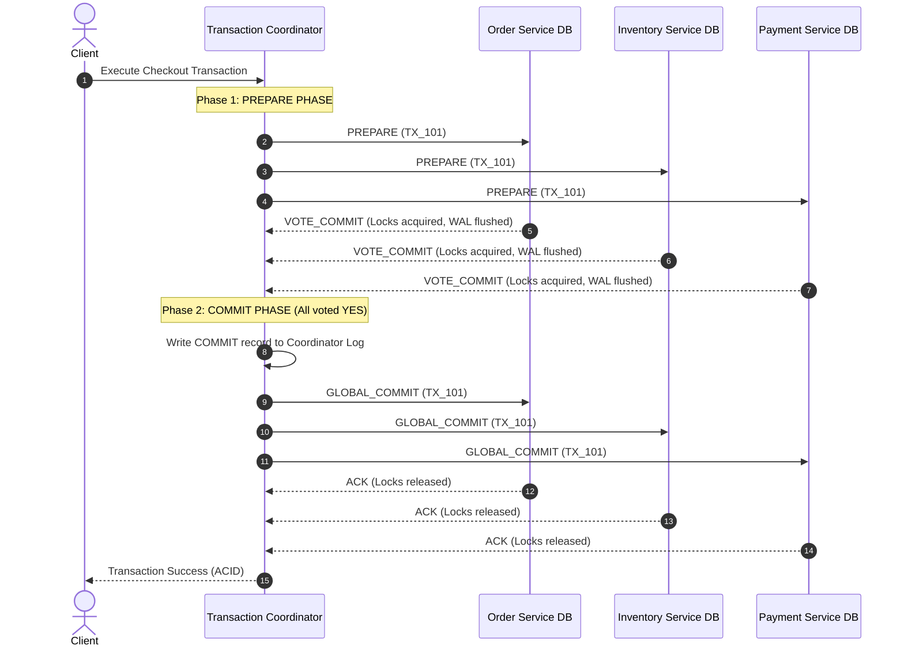
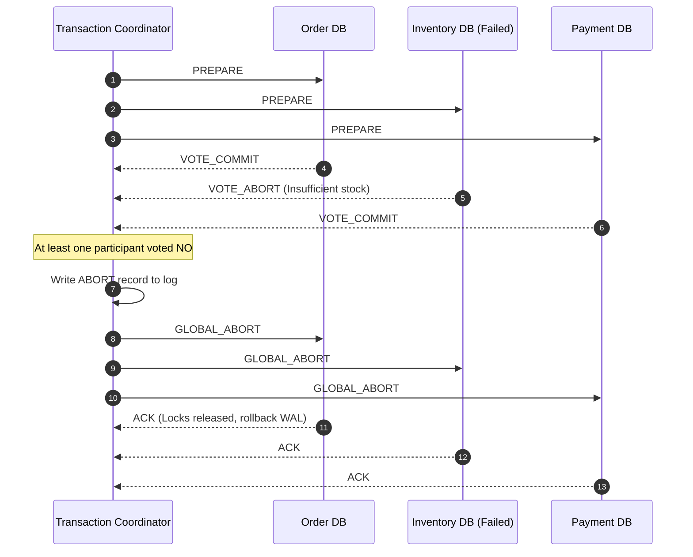
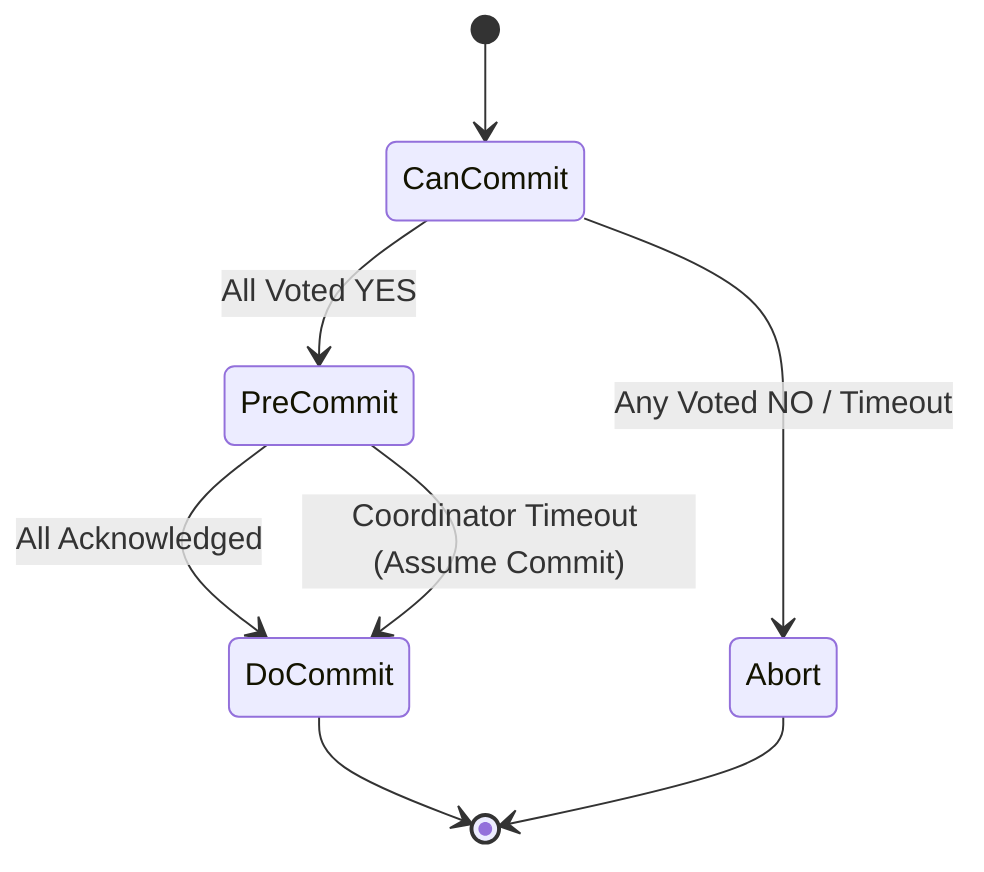
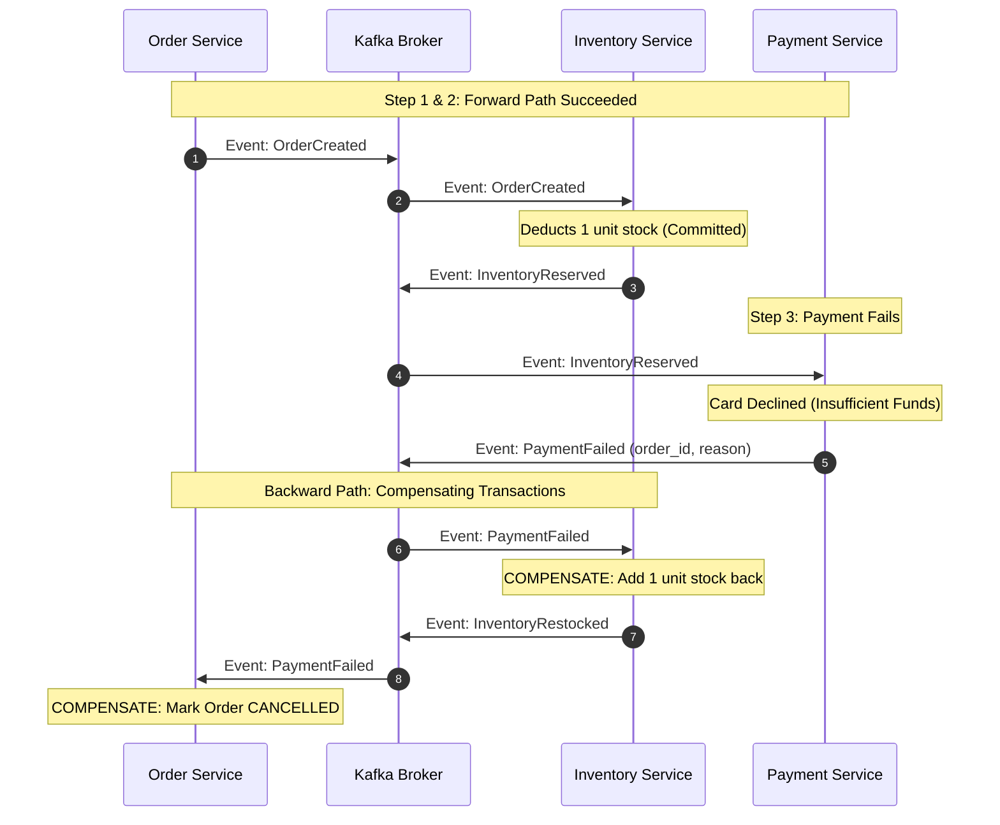
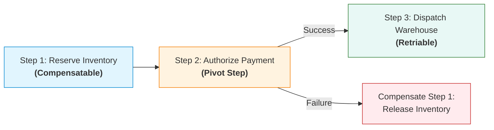
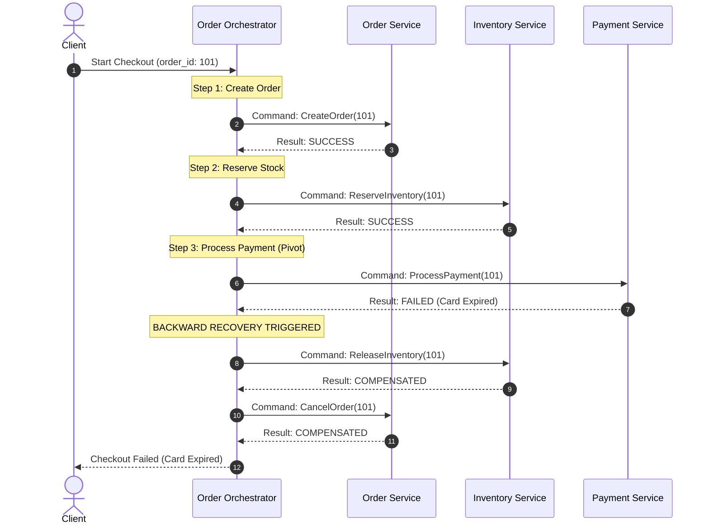
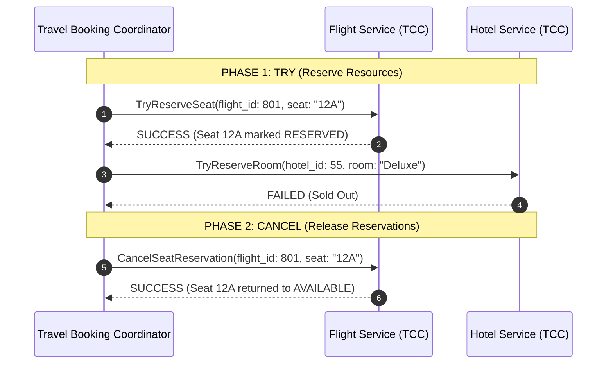
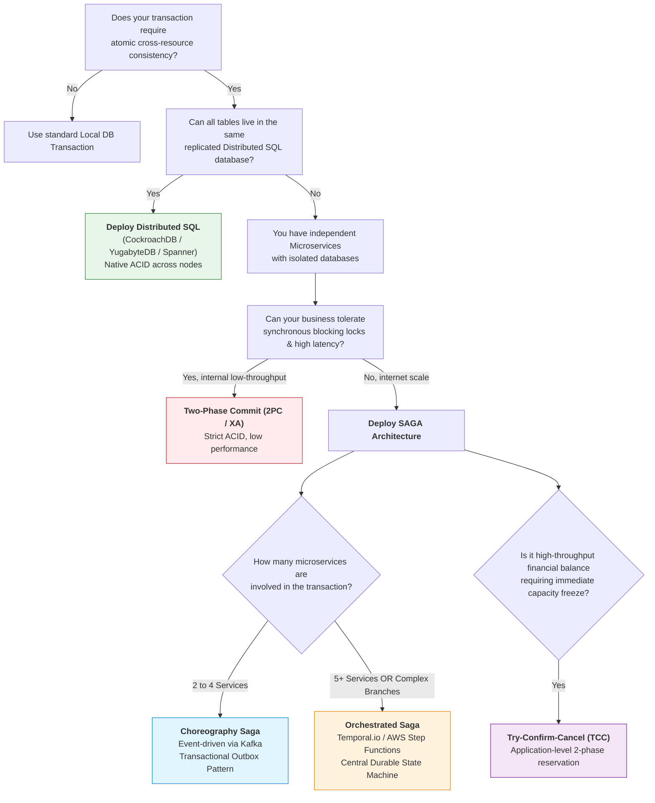

# Distributed Transactions & Sagas: High-Level & Low-Level System Design

## 1. Executive Summary & Real-World Production Context

In a classical monolithic architecture backed by a single relational database, maintaining transactional consistency across multiple business domains is trivial. Developers wrap database operations inside an ACID transaction (`BEGIN TRANSACTION ... COMMIT`), delegating atomicity, consistency, isolation, and durability entirely to the database engine's **Write-Ahead Log (WAL)** and **Two-Phase Locking (2PL)** engine.

```
                    MONOLITHIC TRANSACTION (LOCAL ACID)
 ┌────────────────────────────────────────────────────────────────────────┐
 │ Single Monolithic Process                                              │
 │                                                                        │
 │  BEGIN TRANSACTION;                                                    │
 │    INSERT INTO orders (id, user_id, amount) VALUES (...);              │
 │    UPDATE inventory SET stock = stock - 1 WHERE item_id = 42;          │
 │    INSERT INTO payments (id, order_id, status) VALUES (...);           │
 │  COMMIT;  ◄── Atomicity & Isolation guaranteed by local DB engine      │
 └───────────────────────────────────┬────────────────────────────────────┘
                                     │
                                     ▼
                     ┌───────────────────────────────┐
                     │   Single RDBMS (PostgreSQL)   │
                     │  - Shared Table Locks / MVCC  │
                     │  - Single Write-Ahead Log     │
                     └───────────────────────────────┘
```

However, modern engineering demands distributed architectures. Microservice ecosystems enforce the **Database-per-Service** pattern to achieve loose coupling, independent scalability, and autonomous deployments. When the Order Service, Inventory Service, and Payment Service own isolated databases, a simple checkout operation spans multiple network boundaries and storage engines.

```
                  DISTRIBUTED SYSTEM (LOSS OF LOCAL ACID)
 ┌──────────────────┐      ┌─────────────────────┐      ┌──────────────────┐
 │  Order Service   │      │  Inventory Service  │      │ Payment Service  │
 └────────┬─────────┘      └──────────┬──────────┘      └────────┬─────────┘
          │ (Network RPC)             │ (Network RPC)            │
          ▼                           ▼                          ▼
 ┌──────────────────┐      ┌─────────────────────┐      ┌──────────────────┐
 │  Orders Database │      │ Inventory Database  │      │ Payment Database │
 │   (PostgreSQL)   │      │       (MySQL)       │      │     (MongoDB)    │
 └──────────────────┘      └─────────────────────┘      └──────────────────┘
   ❌ No shared locks        ❌ Independent WAL           ❌ No cross-DB commit
```

If the Payment Service fails due to a network timeout or credit limit rejection *after* the Inventory Service has decremented stock, the platform enters an **inconsistent state**: stock is reserved, but no payment or order exists (**Ghost Inventory**).

---

### Theoretical Foundations

To design distributed transaction systems, engineers must understand the underlying theoretical laws:

#### 1. The Fallacies of Distributed Computing
Distributed systems violate monolithic assumptions:
*   The network is **not** reliable (packets drop, routes flap).
*   Latency is **not** zero.
*   Bandwidth is **not** infinite.
*   Topology changes continuously.
*   Transport cost is **not** zero.

#### 2. The Two Generals' Problem & FLP Impossibility
*   **Two Generals' Problem:** Proves that two processes communicating over an unreliable link cannot reach 100% guaranteed consensus on an action with a bounded number of messages.
*   **FLP Impossibility Theorem (Fischer, Lynch, Paterson, 1985):** In an asynchronous network, no deterministic consensus protocol can guarantee both safety and liveness in the presence of even a single unannounced process crash.
*   **Practical Consequence:** Distributed systems cannot achieve both strict consistency and non-blocking availability across arbitrary partitions; we must design around failure modes, retries, idempotency, and timeouts.

#### 3. CAP & PACELC Theorems
*   **CAP Theorem:** Under a network partition (**P**), a system must trade off between Consistency (**C** - every read receives the most recent write) and Availability (**A** - every non-failing node returns a response).
*   **PACELC Theorem:** If there is a Partition (**P**), trade off Availability (**A**) vs Consistency (**C**); **E**lse (when the system is running normally), trade off Latency (**L**) vs Consistency (**C**). Synchronous cross-service locking (like 2PC) sacrifices Availability and incurs high Latency.

#### 4. ACID vs. BASE
Distributed business processes shift from relational **ACID** to distributed **BASE**:
*   **Basically Available:** The system prioritizes overall availability, allowing degraded operation for localized partitions.
*   **Soft State:** State may fluctuate over time due to in-flight messages without user interaction.
*   **Eventual Consistency:** Given sufficient time without new updates, all replicas and service states converge to identical values.

---

### Real-World Production Disasters

#### 1. Amazon Dynamo & The Resurrecting Shopping Cart (2007)
*   **The Problem:** Amazon designed DynamoDB with leaderless eventual consistency and vector clocks to survive data center outages during Black Friday.
*   **The Failure:** When network partitions occurred, concurrent shopping cart updates branched across nodes. During checkout reconciliation, deleted cart items resurrected because the system used naive union resolution on vector clock conflicts.
*   **The Fix:** Redesigned cart state transitions with explicit tombstone timestamps and domain-specific merge algorithms.

#### 2. Uber Ride Cancellation & Payment Reconciliation Desynchronization
*   **The Problem:** Rider cancels a trip while the driver's phone enters a tunnel with zero cellular connectivity.
*   **The Failure:** The Rider Service marked the trip `CANCELLED` and refunded the rider. The Driver Service, upon exiting the tunnel, reported `TRIP_COMPLETED`. The Payment Service executed a dual charge-and-refund race condition, debiting the driver's account while crediting the rider, causing tens of thousands of dollars in daily accounting discrepancies.
*   **The Fix:** Transitioned to an Orchestrated Saga with deterministic state machines and lease-based distributed locks.

#### 3. The Dual-Write Nightmare (Order Charged, Order Never Created)
*   **The Incident:** A fintech e-commerce app executed:
    ```python
    db.orders.insert(order)          # Step 1: Write to local DB
    kafka.send("order_created", msg) # Step 2: Publish event to Kafka
    ```
*   **The Crash:** Step 1 succeeded, but the Kubernetes pod was killed by an OOM (Out Of Memory) killer before Step 2 executed. The database committed the order, but the inventory and payment services never heard about it. 
*   **Alternative Failure:** Reversing the order (`kafka.send` then `db.insert`) resulted in Kafka emitting the event, but the database write failing due to a unique constraint violation. Downstream services charged the customer's credit card for an order that did not exist in the primary database.

---

## 2. The Core Problem: The Distributed Consistency Dilemma

### The Dual-Write Problem

The single most common root cause of data corruption in microservices is the **Dual-Write Problem**: attempting to write to two different stateful systems (e.g., a relational database and a message broker) without a distributed coordination protocol.

```
                              THE DUAL-WRITE PROBLEM
                                
                             ┌────────────────────────┐
                             │  Order Service Worker  │
                             └───────────┬────────────┘
                                         │
                   ┌─────────────────────┴─────────────────────┐
                   │                                           │
                   ▼ (Step 1: Write State)                     ▼ (Step 2: Emit Event)
      ┌───────────────────────────┐               ┌───────────────────────────┐
      │   Local Database (SQL)    │               │   Message Broker (Kafka)  │
      └───────────────────────────┘               └───────────────────────────┘
      
   SCENARIO A: DB write succeeds ──► Worker crashes before Kafka call ──► Event LOST forever!
   SCENARIO B: Kafka send succeeds ─► DB write fails (e.g., DB crash) ───► GHOST event published!
```

There is no native mechanism in standard TCP/IP to make these two calls atomic without specialized patterns (such as the **Transactional Outbox** or **Two-Phase Commit**).

### Distributed Transaction Anomalies Matrix

When distributed transactions lack strict isolation, systems suffer from specific concurrency anomalies:

| Anomaly | Mechanism | Real-World Impact |
| :--- | :--- | :--- |
| **Lost Update** | Saga A and Saga B concurrently read stock = 10. Both decrement by 2. Saga A commits stock = 8. Saga B overwrites stock = 8 (instead of 6). | Inventory leak; stock oversold. |
| **Dirty Read** | Saga A deducts $100 from an account. Saga B reads the reduced balance and approves a loan. Saga A encounters a downstream failure and compensates (adds $100 back). | Loan approved on false credit state. |
| **Fuzzy / Non-Repeatable Read** | Service reads a customer record at Step 1. At Step 3, another saga updates customer address. Service performs shipping to the old address. | Order shipped to outdated location. |
| **Cascading Abort (Phantom Compensation)** | Saga A fails and triggers compensation. A downstream service relies on Saga A's intermediate state and fails, triggering further compensations. | System-wide rollback storm; connection pools overwhelmed. |

---

## 3. Deep Dive into Architectural Approaches

We will now examine the five primary architectural patterns for managing distributed transactions, presenting for each:
1.  **High-Level Design (HLD):** Architecture, component topology, sequence diagrams, and lifecycle flows.
2.  **Low-Level Design (LLD):** Database schemas, state machines, protocol internals, concrete code implementations, failure recovery, and trade-offs.

---

## Approach 1: Two-Phase Commit (2PC) & Three-Phase Commit (3PC)

### High-Level Design (HLD)

Two-Phase Commit (2PC) is a synchronous distributed consensus protocol derived from the **X/Open XA** specification. It coordinates multiple autonomous database engines (Resource Managers) under the command of a centralized **Transaction Coordinator**.

```
┌────────────────────────────────────────────────────────────────────────────────────────┐
│                             TWO-PHASE COMMIT (2PC) TOPOLOGY                            │
└────────────────────────────────────────────────────────────────────────────────────────┘

                                ┌──────────────────────────┐
                                │ Transaction Coordinator  │
                                └─────────────┬────────────┘
                                              │
                    ┌─────────────────────────┼─────────────────────────┐
                    │                         │                         │
                    ▼ (Phase 1: PREPARE)      ▼ (Phase 1: PREPARE)      ▼ (Phase 1: PREPARE)
          ┌───────────────────┐     ┌───────────────────┐     ┌───────────────────┐
          │  Order Service DB │     │  Inventory DB     │     │    Payment DB     │
          │ (Resource Manager)│     │ (Resource Manager)│     │ (Resource Manager)│
          └───────────────────┘     └───────────────────┘     └───────────────────┘
```

#### The Protocol Lifecycle



#### Failure Flow (Abort Scenario)

If any single participant votes `VOTE_ABORT` (e.g., Inventory out of stock) or fails to respond within a strict timeout window, the Coordinator executes a global rollback:



---

### Low-Level Design (LLD)

#### 1. Database Engine Mechanics: XA Transactions

At the database engine level (e.g., PostgreSQL or MySQL InnoDB), 2PC is implemented using the XA standard. When a transaction enters the prepared state, the engine flushes the transaction changes to the WAL and maintains exclusive row locks **across connection disconnects**.

```sql
-- Step 1: Application connects to PostgreSQL Order Database
BEGIN;
INSERT INTO orders (id, user_id, amount, status) 
VALUES ('ord_8721', 'usr_42', 150.00, 'PENDING');

-- Step 2: Prepare the transaction with a global transaction ID (GTRID)
-- At this point, locks on the orders table are held in shared memory.
-- The connection can even terminate, and the locks PERSIST until resolved!
PREPARE TRANSACTION 'tx_global_checkout_8721_order';

-- Step 3: Application connects to PostgreSQL Inventory Database
BEGIN;
UPDATE inventory SET stock = stock - 1 WHERE item_id = 'item_99';
PREPARE TRANSACTION 'tx_global_checkout_8721_inventory';

-- Step 4: Coordinator evaluates all votes. If all PREPARE succeeded:
COMMIT PREPARED 'tx_global_checkout_8721_order';
COMMIT PREPARED 'tx_global_checkout_8721_inventory';

-- OR if any participant failed:
ROLLBACK PREPARED 'tx_global_checkout_8721_order';
ROLLBACK PREPARED 'tx_global_checkout_8721_inventory';
```

#### 2. The Blocking Problem & The "In-Doubt" State

The fundamental flaw of 2PC is that it is a **blocking protocol**:

```
                       THE IN-DOUBT WINDOW
                       
   Participant 1                  Coordinator                 Participant 2
         │                             │                             │
         │◄─────── PREPARE ────────────┤──────────── PREPARE ───────►│
         │                             │                             │
         │──────── VOTE_COMMIT ───────►│◄─────────── VOTE_COMMIT ────│
         │                             │                             │
         │                    ┌──────────────────┐                   │
         │                    │ COORDINATOR DIES │                   │
         │                    └──────────────────┘                   │
         │                                                           │
   [Status: PREPARED]                                          [Status: PREPARED]
   - Locks held!                                               - Locks held!
   - Cannot self-commit!                                       - Cannot self-commit!
   - Cannot self-abort!                                        - Cannot self-abort!
   - BLOCKED INDEFINITELY                                      - BLOCKED INDEFINITELY
```

*   **The In-Doubt Window:** Once a participant votes `VOTE_COMMIT`, it yields autonomy. It cannot unilaterally commit (the coordinator might have sent `GLOBAL_ABORT` to someone else), nor can it abort (the coordinator might have committed).
*   **Cascading Outage:** While in the `PREPARED` state, row locks are held. Any concurrent transactions attempting to read with locks or write to those rows will block. Database connection pools (`HikariCP`, `pgbouncer`) exhaust within seconds, crashing the entire service.

#### 3. Evolution: Three-Phase Commit (3PC)

3PC attempts to solve 2PC's blocking problem by introducing an additional phase and timeout-driven state transitions:
1.  **Can-Commit:** Coordinator checks if participants are healthy.
2.  **Pre-Commit:** Coordinator instructs participants to prepare. Once in Pre-Commit, if the coordinator dies, participants timeout and assume `COMMIT`.
3.  **Do-Commit:** Final commit execution.



> [!WARNING]
> **Why 3PC is rarely used in production:** 3PC assumes a **fail-stop model** with bounded network latency. Under real-world **network partitions** (split-brain), 3PC fails catastrophically: one partition times out and aborts while another partition times out and commits, causing permanent data corruption.

#### 4. Trade-Off Analysis: Two-Phase Commit

*   **Advantages:**
    *   Strict ACID guarantees across multiple databases.
    *   Zero isolation anomalies; no dirty reads or lost updates.
    *   Simple programming model for developers (identical to monolithic transactions).
*   **Disadvantages:**
    *   **High Latency:** Minimum $2 \times$ RTT (Round Trip Time) across all participant databases synchronously.
    *   **Throughput Killer:** Throughput scales inversely with participant count. Contended rows remain locked for the entire duration of network calls.
    *   **Single Point of Failure:** Coordinator failure leaves resources locked indefinitely until manual DBA intervention via `pg_prepared_xacts`.
    *   **Heterogeneous Incompatibility:** Modern cloud services (Stripe API, AWS S3, Kafka) do not support XA interfaces.

---

## Approach 2: SAGA Pattern — Choreography-Based (Event-Driven)

### High-Level Design (HLD)

The Saga pattern addresses 2PC's scalability limitations by splitting a global transaction into a sequence of **local transactions**. Each local transaction updates the database of a single microservice and publishes an event to an asynchronous message broker (e.g., Apache Kafka, RabbitMQ). 

In **Choreography-Based Sagas**, there is no centralized orchestrator. Services react autonomously to domain events emitted by peer services, resembling a collaborative dance.

```
┌────────────────────────────────────────────────────────────────────────────────────────┐
│                        CHOREOGRAPHY SAGA: HAPPY PATH FLOW                               │
└────────────────────────────────────────────────────────────────────────────────────────┘

 [Order Service]       [Event Broker]       [Inventory Service]    [Payment Service]
        │                     │                      │                    │
        │── 1. Create Order ──┤                      │                    │
        │   (Status: PENDING) │                      │                    │
        │── 2. Publish ──────►│                      │                    │
        │   "OrderCreated"    │── 3. Consume ───────►│                    │
        │                     │      "OrderCreated"  │                    │
        │                     │                      │── 4. Deduct Stock  │
        │                     │◄── 5. Publish ───────┤                    │
        │                     │   "InventoryReserved"│                    │
        │                     │                      │                    │
        │                     │── 6. Consume ────────────────────────────►│
        │                     │   "InventoryReserved"                     │
        │                     │                                           │── 7. Charge Card
        │                     │◄── 8. Publish ────────────────────────────┤
        │                     │   "PaymentCompleted"                      │
        │◄── 9. Consume ──────┤                                           │
        │   "PaymentCompleted"│                                           │
        │── 10. Update Order ─┤                                           │
        │   (Status: CONFIRMED)                                           │
```

#### Compensating Transactions (Rollback Flow)

Because local transactions commit immediately to their respective databases, changes are visible to other transactions. If step $N$ fails, the system cannot issue an SQL `ROLLBACK`. Instead, it must publish failure events that trigger **Compensating Transactions** on all previously committed services ($N-1, N-2, \dots, 1$) to semantically undo their changes.



---

### Low-Level Design (LLD)

#### 1. Standardized Event Envelope (CloudEvents Compliant)

All choreography events must adhere to an immutable, trace-enabled schema to guarantee causality tracking and idempotency:

```json
{
  "specversion": "1.0",
  "type": "com.ecommerce.inventory.reserved",
  "source": "/services/inventory",
  "id": "evt_b89a-4f21-9e20-72189d0c2e4f",
  "time": "2026-10-14T14:32:00.120Z",
  "datacontenttype": "application/json",
  "correlationid": "corr_ord_9872134",
  "causationid": "evt_a11c-2231-1b10-61298a0d1e3a",
  "data": {
    "order_id": "ord_9872134",
    "user_id": "usr_4291",
    "items": [
      { "item_id": "item_42", "quantity": 1 }
    ],
    "total_amount": 150.00
  }
}
```

*   `correlationid`: Persists across the entire lifecycle of the checkout saga.
*   `causationid`: Specifies the exact event ID that triggered this downstream action.

#### 2. Local Database Schema & Deduplication Tables

Each service must maintain an idempotent deduplication table within its local database to eliminate duplicate message processing caused by Kafka at-least-once delivery.

```sql
-- Inventory Service Database (PostgreSQL)

CREATE TABLE inventory_items (
    item_id VARCHAR(64) PRIMARY KEY,
    total_stock INT NOT NULL CHECK (total_stock >= 0),
    reserved_stock INT NOT NULL DEFAULT 0 CHECK (reserved_stock >= 0),
    version BIGINT NOT NULL DEFAULT 0
);

CREATE TABLE inventory_reservations (
    reservation_id VARCHAR(64) PRIMARY KEY,
    order_id VARCHAR(64) NOT NULL UNIQUE,
    item_id VARCHAR(64) NOT NULL REFERENCES inventory_items(item_id),
    quantity INT NOT NULL,
    status VARCHAR(32) NOT NULL, -- 'RESERVED', 'COMPENSATED'
    created_at TIMESTAMP WITH TIME ZONE DEFAULT NOW(),
    updated_at TIMESTAMP WITH TIME ZONE DEFAULT NOW()
);

-- Idempotent Consumer Dedup Ledger
CREATE TABLE processed_events (
    event_id VARCHAR(128) PRIMARY KEY,
    event_type VARCHAR(128) NOT NULL,
    processed_at TIMESTAMP WITH TIME ZONE DEFAULT NOW()
);
```

#### 3. Idempotent Consumer Implementation with Compensating Logic

Below is a complete, production-grade Go consumer demonstrating atomic processing, idempotency, and compensation:

```go
package saga

import (
	"context"
	"database/sql"
	"encoding/json"
	"fmt"
	"time"
)

type PaymentFailedEvent struct {
	EventID       string `json:"id"`
	CorrelationID string `json:"correlationid"`
	OrderID       string `json:"order_id"`
	Reason        string `json:"reason"`
}

type InventoryCompensationHandler struct {
	db *sql.DB
}

func (h *InventoryCompensationHandler) HandlePaymentFailed(ctx context.Context, msgPayload []byte) error {
	var event PaymentFailedEvent
	if err := json.Unmarshal(msgPayload, &event); err != nil {
		return fmt.Errorf("failed to deserialize event: %w", err)
	}

	// Begin atomic local transaction
	tx, err := h.db.BeginTx(ctx, &sql.TxOptions{Isolation: sql.LevelReadCommitted})
	if err != nil {
		return err
	}
	defer tx.Rollback()

	// 1. Idempotency Check: Verify if event was already processed
	var exists bool
	queryCheck := `SELECT EXISTS(SELECT 1 FROM processed_events WHERE event_id = $1)`
	if err := tx.QueryRowContext(ctx, queryCheck, event.EventID).Scan(&exists); err != nil {
		return fmt.Errorf("failed to check dedup table: %w", err)
	}
	if exists {
		// Event already processed; safely ACK to prevent consumer stall
		return nil
	}

	// 2. Fetch existing reservation to compensate
	var (
		resID    string
		itemID   string
		quantity int
		status   string
	)
	queryRes := `SELECT reservation_id, item_id, quantity, status 
                 FROM inventory_reservations 
                 WHERE order_id = $1 FOR UPDATE`
	err = tx.QueryRowContext(ctx, queryRes, event.OrderID).Scan(&resID, &itemID, &quantity, &status)
	if err == sql.ErrNoRows {
		// Out-of-order execution edge case: Compensation arrived BEFORE reservation!
		// Write a tombstone record so future reservation will auto-abort.
		insertTombstone := `INSERT INTO inventory_reservations 
                            (reservation_id, order_id, item_id, quantity, status) 
                            VALUES ($1, $2, 'NONE', 0, 'COMPENSATED')`
		if _, err := tx.ExecContext(ctx, insertTombstone, "tombstone_"+event.OrderID, event.OrderID); err != nil {
			return err
		}
		// Record processed event
		if _, err := tx.ExecContext(ctx, `INSERT INTO processed_events (event_id, event_type) VALUES ($1, $2)`, 
			event.EventID, "com.ecommerce.payment.failed"); err != nil {
			return err
		}
		return tx.Commit()
	} else if err != nil {
		return fmt.Errorf("error querying reservation: %w", err)
	}

	// 3. Execute Compensation if not already compensated
	if status == "RESERVED" {
		// Restore stock count
		updateStock := `UPDATE inventory_items 
                        SET reserved_stock = reserved_stock - $1, 
                            total_stock = total_stock + $1 
                        WHERE item_id = $2`
		if _, err := tx.ExecContext(ctx, updateStock, quantity, itemID); err != nil {
			return fmt.Errorf("failed to restore stock: %w", err)
		}

		// Update reservation status
		updateRes := `UPDATE inventory_reservations 
                      SET status = 'COMPENSATED', updated_at = $1 
                      WHERE reservation_id = $2`
		if _, err := tx.ExecContext(ctx, updateRes, time.Now(), resID); err != nil {
			return fmt.Errorf("failed to update reservation status: %w", err)
		}
	}

	// 4. Mark event as processed in the deduplication ledger
	insertDedup := `INSERT INTO processed_events (event_id, event_type) VALUES ($1, $2)`
	if _, err := tx.ExecContext(ctx, insertDedup, event.EventID, "com.ecommerce.payment.failed"); err != nil {
		return fmt.Errorf("failed to record event dedup: %w", err)
	}

	return tx.Commit()
}
```

#### 4. The "Out-of-Order" Race Condition Hazard

In asynchronous distributed systems, messages may arrive out of order:

```
                         THE OUT-OF-ORDER RACE HAZARD
                         
           Kafka Broker                         Inventory Service
                │                                       │
                │── 1. PaymentFailed Event ────────────►│  (Arrives FIRST due to network jitter)
                │                                       │  - No reservation row found!
                │                                       │  - What should Inventory do?
                │                                       │
                │── 2. OrderCreated Event ─────────────►│  (Arrives SECOND!)
                │                                       │  - Deducts stock!
                │                                       │  - Stock remains locked FOREVER!
```

*   **Solution (Tombstone Pattern):** When a compensating event arrives for a non-existent business entity, insert a **Tombstone** record with status `COMPENSATED`. When the original forward event subsequently arrives, it detects the tombstone and immediately discards the request without modifying inventory.

#### 5. Trade-Off Analysis: Choreography Saga

*   **Advantages:**
    *   **Loose Coupling:** Services do not know about other service implementations; they only subscribe to topics.
    *   **High Performance:** Fully asynchronous; zero centralized coordinator bottleneck.
    *   **Ideal for Simple Flows:** Very low overhead for 2 to 4 service workflows.
*   **Disadvantages:**
    *   **Event Spaghetti:** As workflows grow to 10+ services, tracing event dependency graphs becomes impossible without specialized distributed tracing tooling (Jaeger, OpenTelemetry).
    *   **Cyclic Dependencies:** High risk of circular event triggers (Service A triggers B, which triggers C, which triggers A).
    *   **Difficult Testing:** End-to-end integration testing requires spinning up all services and message brokers simultaneously.

---

## Approach 3: SAGA Pattern — Orchestration-Based (Central Coordinator)

### High-Level Design (HLD)

In **Orchestration-Based Sagas**, a centralized **Saga Orchestrator** manages the global state machine. The orchestrator explicitly instructs participant microservices what local transactions to execute via synchronous RPCs (gRPC/HTTP) or point-to-point command queues.

```
┌────────────────────────────────────────────────────────────────────────────────────────┐
│                        ORCHESTRATION SAGA: ARCHITECTURE                                │
└────────────────────────────────────────────────────────────────────────────────────────┘

                                ┌───────────────────────────┐
                                │     Order Orchestrator    │
                                │   (Durable State Machine) │
                                └─────────────┬─────────────┘
                                              │
                      ┌───────────────────────┼───────────────────────┐
      1. CreateOrder  │       2. ReserveStock │       3. ChargeCard   │
      (Compensatable) │       (Compensatable) │       (Pivot Step)    │
                      ▼                       ▼                       ▼
            ┌──────────────────┐    ┌──────────────────┐    ┌──────────────────┐
            │  Order Service   │    │Inventory Service │    │ Payment Service  │
            └──────────────────┘    └──────────────────┘    └──────────────────┘
```

#### Step Classification in Orchestration

Every step in an Orchestrated Saga belongs to one of three categories:
1.  **Compensatable Transactions:** Steps that can be semantically undone (e.g., reserving inventory can be compensated by un-reserving inventory).
2.  **Pivot Transaction:** The point of no return. If the pivot transaction commits, the Saga **must** complete forward. If it aborts, the Saga **must** roll backward. (e.g., charging a non-refundable credit card).
3.  **Retriable Transactions:** Steps occurring *after* the pivot transaction. They cannot fail due to business rules; they must be retried with exponential backoff until they succeed (e.g., sending an order confirmation email, updating order state to `CONFIRMED`).



#### End-to-End Orchestrated Sequence



---

### Low-Level Design (LLD)

#### 1. Orchestrator State Storage Schema

The orchestrator must persist its state machine transitions durably before dispatching outbound commands to survive coordinator crashes:

```sql
-- Orchestrator Database Schema (PostgreSQL)

CREATE TYPE saga_status AS ENUM (
    'STARTED', 
    'EXECUTING', 
    'COMPENSATING', 
    'COMPLETED', 
    'FAILED'
);

CREATE TYPE step_status AS ENUM (
    'PENDING', 
    'RUNNING', 
    'SUCCEEDED', 
    'FAILED', 
    'COMPENSATED'
);

CREATE TABLE saga_instances (
    saga_id VARCHAR(64) PRIMARY KEY,
    saga_type VARCHAR(64) NOT NULL,
    current_step INT NOT NULL DEFAULT 0,
    status saga_status NOT NULL DEFAULT 'STARTED',
    payload JSONB NOT NULL,
    error_message TEXT,
    created_at TIMESTAMP WITH TIME ZONE DEFAULT NOW(),
    updated_at TIMESTAMP WITH TIME ZONE DEFAULT NOW()
);

CREATE TABLE saga_step_execution_log (
    log_id BIGSERIAL PRIMARY KEY,
    saga_id VARCHAR(64) NOT NULL REFERENCES saga_instances(saga_id),
    step_index INT NOT NULL,
    step_name VARCHAR(64) NOT NULL,
    status step_status NOT NULL,
    request_payload JSONB,
    response_payload JSONB,
    retry_count INT DEFAULT 0,
    started_at TIMESTAMP WITH TIME ZONE DEFAULT NOW(),
    completed_at TIMESTAMP WITH TIME ZONE
);

CREATE INDEX idx_saga_lookup ON saga_instances(status, updated_at);
```

#### 2. Concrete State Machine Orchestrator Implementation

Below is a complete TypeScript/Node.js implementation of a durable Saga Orchestrator engine with forward and backward recovery stacks:

```typescript
import { Pool, PoolClient } from 'pg';

export interface SagaStep<TContext> {
  name: string;
  execute: (context: TContext) => Promise<void>;
  compensate: (context: TContext) => Promise<void>;
}

export interface CheckoutContext {
  sagaId: string;
  orderId: string;
  userId: string;
  amount: number;
  inventoryReserved?: boolean;
  paymentProcessed?: boolean;
}

export class DurableSagaOrchestrator {
  constructor(private readonly dbPool: Pool) {}

  public async executeSaga(
    sagaId: string, 
    context: CheckoutContext, 
    steps: SagaStep<CheckoutContext>[]
  ): Promise<boolean> {
    const client = await this.dbPool.connect();
    let currentStepIndex = 0;

    try {
      // 1. Initialize Saga in Database
      await client.query(
        `INSERT INTO saga_instances (saga_id, saga_type, current_step, status, payload)
         VALUES ($1, 'CHECKOUT_SAGA', 0, 'EXECUTING', $2)`,
        [sagaId, JSON.stringify(context)]
      );

      // 2. Forward Execution Loop
      for (let i = 0; i < steps.length; i++) {
        currentStepIndex = i;
        const step = steps[i];

        await this.logStepStatus(client, sagaId, i, step.name, 'RUNNING');

        try {
          // Execute current forward step
          await step.execute(context);
          await this.logStepStatus(client, sagaId, i, step.name, 'SUCCEEDED');
          
          await client.query(
            `UPDATE saga_instances SET current_step = $1, updated_at = NOW() WHERE saga_id = $2`,
            [i + 1, sagaId]
          );
        } catch (stepErr: any) {
          console.error(`Step ${step.name} failed:`, stepErr.message);
          await this.logStepStatus(client, sagaId, i, step.name, 'FAILED');
          
          // Trigger Backward Compensation
          await this.rollbackSaga(client, sagaId, context, steps, i);
          return false;
        }
      }

      // 3. Mark Saga Completed
      await client.query(
        `UPDATE saga_instances SET status = 'COMPLETED', updated_at = NOW() WHERE saga_id = $1`,
        [sagaId]
      );
      return true;

    } finally {
      client.release();
    }
  }

  private async rollbackSaga(
    client: PoolClient,
    sagaId: string,
    context: CheckoutContext,
    steps: SagaStep<CheckoutContext>[],
    failedStepIndex: number
  ): Promise<void> {
    await client.query(
      `UPDATE saga_instances SET status = 'COMPENSATING', updated_at = NOW() WHERE saga_id = $1`,
      [sagaId]
    );

    // Roll backward from the step immediately preceding the failed step down to 0
    for (let j = failedStepIndex - 1; j >= 0; j--) {
      const step = steps[j];
      let compensated = false;
      let retries = 0;

      // Compensations MUST succeed; retry with backoff until completed
      while (!compensated && retries < 5) {
        try {
          await step.compensate(context);
          await this.logStepStatus(client, sagaId, j, step.name, 'COMPENSATED');
          compensated = true;
        } catch (compErr: any) {
          retries++;
          console.error(`Compensation ${step.name} failed (Attempt ${retries}):`, compErr.message);
          await new Promise((res) => setTimeout(res, 1000 * Math.pow(2, retries))); // Exponential backoff
        }
      }

      if (!compensated) {
        // Critical alert: Poison pill or infrastructure outage requires human intervention
        await client.query(
          `UPDATE saga_instances 
           SET status = 'FAILED', error_message = $1, updated_at = NOW() 
           WHERE saga_id = $2`,
          [`FATAL: Compensation failed at step ${step.name}`, sagaId]
        );
        throw new Error(`Saga ${sagaId} halted in inconsistent state: Step ${step.name} failed compensation.`);
      }
    }

    await client.query(
      `UPDATE saga_instances SET status = 'FAILED', updated_at = NOW() WHERE saga_id = $1`,
      [sagaId]
    );
  }

  private async logStepStatus(
    client: PoolClient,
    sagaId: string,
    stepIndex: number,
    stepName: string,
    status: string
  ): Promise<void> {
    await client.query(
      `INSERT INTO saga_step_execution_log (saga_id, step_index, step_name, status)
       VALUES ($1, $2, $3, $4)`,
      [sagaId, stepIndex, stepName, status]
    );
  }
}
```

#### 3. Enterprise Workflow Engines (Temporal / Cadence / AWS Step Functions)

While custom orchestrators suffice for simple state machines, production microservices at Uber, Netflix, and Stripe deploy dedicated workflow orchestrators like **Temporal.io**:
*   **Virtual Memory Replay:** Temporal records every activity invocation and deterministic event into an append-only history log.
*   **Crash Recovery:** If a worker node crashes mid-workflow, another node loads the workflow history, replays completed activities from cache without re-executing side effects, and resumes precisely where the previous node stopped.

---

## Approach 4: Reliable Event Delivery — Transactional Outbox Pattern & CDC

### High-Level Design (HLD)

In both Choreography and Orchestration Sagas, services must atomically update their local database *and* publish an event/command to an external message broker. The **Transactional Outbox Pattern** solves the Dual-Write problem by writing the outbound message directly into an `outbox` table inside the **same local database transaction** that modifies business entities.

```
┌────────────────────────────────────────────────────────────────────────────────────────┐
│                        TRANSACTIONAL OUTBOX PATTERN WITH CDC                           │
└────────────────────────────────────────────────────────────────────────────────────────┘

 [Order Service App]
          │
          │ 1. Atomic DB Transaction (Local ACID)
          │    - INSERT INTO orders (...)
          │    - INSERT INTO outbox_events (...)
          ▼
 ┌──────────────────────────────────────────────────┐
 │           Relational Database (PostgreSQL)       │
 │                                                  │
 │  ┌───────────────────┐    ┌───────────────────┐  │
 │  │   orders table    │    │   outbox_events   │  │
 │  └───────────────────┘    └─────────┬─────────┘  │
 │                                     │            │
 └─────────────────────────────────────┼────────────┘
                                       │ 2. WAL Engine
                                       ▼
                       ┌───────────────────────────────┐
                       │ Write-Ahead Log (WAL / Binlog)│
                       └───────────────┬───────────────┘
                                       │
                                       │ 3. Log Tailing (Zero App Overhead)
                                       ▼
                       ┌───────────────────────────────┐
                       │  Change Data Capture Engine   │
                       │     (Debezium Connector)      │
                       └───────────────┬───────────────┘
                                       │
                                       │ 4. Produce Event (At-Least-Once)
                                       ▼
                       ┌───────────────────────────────┐
                       │     Apache Kafka Cluster      │
                       └───────────────────────────────┘
```

#### Publisher Mechanisms: Polling vs. Change Data Capture (CDC)

| Dimension | Pattern A: Polling Publisher | Pattern B: Log-Tailing (CDC via Debezium) |
| :--- | :--- | :--- |
| **Mechanics** | Background worker queries `SELECT ... FROM outbox WHERE status='PENDING'`. | Debezium tails database WAL (PostgreSQL `pgoutput`, MySQL Binlog). |
| **Latency** | Medium to High (Polling interval: 500ms – 5s). | Sub-second (Real-time streaming from WAL: < 50ms). |
| **Database Overhead** | High (Continuous index scans, table bloat, lock contention). | Negligible (Direct memory/disk read from sequential WAL stream). |
| **Ordering** | Risky under multi-worker polling; requires complex row-locking. | Guaranteed per partition based on WAL log sequence numbers (LSN). |
| **Operational Cost** | Simple (Just application code and cron workers). | High (Requires Kafka Connect cluster, ZooKeeper/KRaft, Debezium plugins). |

---

### Low-Level Design (LLD)

#### 1. Outbox Table Schema

```sql
CREATE TABLE outbox_events (
    event_id UUID PRIMARY KEY DEFAULT gen_random_uuid(),
    aggregate_type VARCHAR(64) NOT NULL,   -- e.g., 'ORDER'
    aggregate_id VARCHAR(64) NOT NULL,     -- e.g., 'ord_98124'
    event_type VARCHAR(128) NOT NULL,      -- e.g., 'OrderCreated'
    payload JSONB NOT NULL,
    headers JSONB DEFAULT '{}'::jsonb,
    created_at TIMESTAMP WITH TIME ZONE DEFAULT NOW(),
    published BOOLEAN NOT NULL DEFAULT FALSE,
    published_at TIMESTAMP WITH TIME ZONE
);

CREATE INDEX idx_outbox_unpublished 
ON outbox_events (created_at ASC) 
WHERE published = FALSE;
```

#### 2. Atomic Application Service Write

```python
import psycopg2
import json
import uuid

def place_order(conn, user_id: str, item_id: str, amount: float):
    order_id = f"ord_{uuid.uuid4().hex[:12]}"
    event_id = str(uuid.uuid4())
    
    event_payload = {
        "event_id": event_id,
        "order_id": order_id,
        "user_id": user_id,
        "item_id": item_id,
        "amount": amount
    }

    with conn:
        with conn.cursor() as cur:
            # 1. Update Core Business Domain Table
            cur.execute(
                """
                INSERT INTO orders (order_id, user_id, item_id, total_amount, status)
                VALUES (%s, %s, %s, %s, 'PENDING');
                """,
                (order_id, user_id, item_id, amount)
            )

            # 2. Write Outbox Record within the EXACT SAME local transaction
            cur.execute(
                """
                INSERT INTO outbox_events (event_id, aggregate_type, aggregate_id, event_type, payload)
                VALUES (%s, 'ORDER', %s, 'com.ecommerce.order.created', %s);
                """,
                (event_id, order_id, json.dumps(event_payload))
            )
            
    # Once the 'with conn' block exits, BOTH records commit atomically to disk!
    return order_id
```

#### 3. Polling Publisher with `FOR UPDATE SKIP LOCKED`

If CDC infrastructure is too heavyweight, a resilient polling publisher must use non-blocking queue semantics to prevent multiple worker threads from claiming the same event:

```sql
-- Worker queries and locks up to 50 pending events without blocking peer workers
WITH next_events AS (
    SELECT event_id
    FROM outbox_events
    WHERE published = FALSE
    ORDER BY created_at ASC
    LIMIT 50
    FOR UPDATE SKIP LOCKED
)
UPDATE outbox_events o
SET published = TRUE,
    published_at = NOW()
FROM next_events n
WHERE o.event_id = n.event_id
RETURNING o.event_id, o.aggregate_type, o.aggregate_id, o.event_type, o.payload;
```

#### 4. The Transactional Inbox Pattern (Receiver End)

Publishing reliably solves only half the equation. The receiving microservice must guarantee that incoming messages are processed **effectively-once**, even if Kafka delivers them multiple times:

```
┌────────────────────────────────────────────────────────────────────────────────────────┐
│                         TRANSACTIONAL INBOX PATTERN                                    │
└────────────────────────────────────────────────────────────────────────────────────────┘

 Kafka Consumer ──► 1. BEGIN LOCAL DB TX
                    │
                    ├── 2. INSERT INTO inbox_events (event_id) VALUES (?)
                    │      ON CONFLICT DO NOTHING (Check if already processed)
                    │
                    ├── 3. If new: Execute Business Logic (e.g., Update Account Balance)
                    │      If duplicate: Skip execution
                    │
                    └── 4. COMMIT LOCAL DB TX ──► 5. Commit Kafka Offset
```

---

## Approach 5: Try-Confirm-Cancel (TCC) Pattern

### High-Level Design (HLD)

The **Try-Confirm-Cancel (TCC)** pattern is an application-level variant of two-phase coordination. Unlike 2PC, which holds database-level row and table locks, TCC performs **business-level reservations** in the first phase, keeping the database transactions short-lived.

```
┌────────────────────────────────────────────────────────────────────────────────────────┐
│                               TCC LIFECYCLE PHASES                                     │
└────────────────────────────────────────────────────────────────────────────────────────┘

 1. TRY PHASE (Reservation):
    - Checks resource availability.
    - Freezes/reserves required capacity (e.g., balance: $100 frozen).
    - Resources are NOT yet transferred, but guaranteed to be available.

 2. CONFIRM PHASE (Commit):
    - Actually executes the business transfer using frozen resources.
    - Confirm is GUARANTEED to succeed if Try succeeded.
    - Idempotent and retriable.

 3. CANCEL PHASE (Rollback):
    - Unfreezes/releases the reserved capacity if any service's Try failed.
    - Restores balance or inventory to available pool.
    - Idempotent and retriable.
```

#### Sequence Diagram (Hotel & Flight Booking)



---

### Low-Level Design (LLD)

#### 1. Database Schema with Separation of Usable and Frozen Balances

```sql
-- Payment Service Balance Table
CREATE TABLE customer_wallets (
    user_id VARCHAR(64) PRIMARY KEY,
    available_balance NUMERIC(12, 2) NOT NULL CHECK (available_balance >= 0),
    frozen_balance NUMERIC(12, 2) NOT NULL DEFAULT 0.00 CHECK (frozen_balance >= 0)
);

CREATE TABLE tcc_wallet_transactions (
    tx_id VARCHAR(64) PRIMARY KEY,
    user_id VARCHAR(64) NOT NULL REFERENCES customer_wallets(user_id),
    amount NUMERIC(12, 2) NOT NULL,
    phase VARCHAR(16) NOT NULL, -- 'TRY', 'CONFIRM', 'CANCEL'
    created_at TIMESTAMP WITH TIME ZONE DEFAULT NOW()
);
```

#### 2. TCC SQL Procedures

```sql
-- ========================================================
-- 1. TRY: Freeze the requested amount
-- ========================================================
UPDATE customer_wallets
SET available_balance = available_balance - 100.00,
    frozen_balance = frozen_balance + 100.00
WHERE user_id = 'usr_42' AND available_balance >= 100.00;
-- If rows_affected == 0, Try failed! Abort transaction.

INSERT INTO tcc_wallet_transactions (tx_id, user_id, amount, phase)
VALUES ('tx_checkout_881', 'usr_42', 100.00, 'TRY');

-- ========================================================
-- 2. CONFIRM: Deduct permanently from frozen balance
-- ========================================================
UPDATE customer_wallets
SET frozen_balance = frozen_balance - 100.00
WHERE user_id = 'usr_42' AND frozen_balance >= 100.00;

UPDATE tcc_wallet_transactions 
SET phase = 'CONFIRM' 
WHERE tx_id = 'tx_checkout_881';

-- ========================================================
-- 3. CANCEL: Release frozen balance back to available
-- ========================================================
UPDATE customer_wallets
SET available_balance = available_balance + 100.00,
    frozen_balance = frozen_balance - 100.00
WHERE user_id = 'usr_42' AND frozen_balance >= 100.00;

UPDATE tcc_wallet_transactions 
SET phase = 'CANCEL' 
WHERE tx_id = 'tx_checkout_881';
```

#### 3. Critical TCC Anomalies & Countermeasures

| Edge Case | Problem | Architectural Fix |
| :--- | :--- | :--- |
| **Empty Rollback** | Network drops `Try` request. Coordinator assumes failure and sends `Cancel`. Service receives `Cancel` without ever seeing `Try`. | Check if a `Try` record exists. If not, record a `CANCELLED` marker so any delayed `Try` that arrives later is rejected immediately. |
| **Suspended Try** | `Try` request is delayed in transit. Coordinator times out, sends `Cancel`. `Cancel` finishes. Then, the delayed `Try` arrives and erroneously freezes funds forever. | Service must verify that no `Cancel` marker exists for this transaction ID before executing `Try`. |
| **Duplicate Confirm/Cancel** | Coordinator retries `Confirm` or `Cancel` due to network drops. | Strict database-level idempotency checks based on `tx_id`. |

---

## Approach 6: Distributed Consensus & Distributed SQL (Spanner & CockroachDB)

### High-Level Design (HLD)

Modern **Distributed SQL** engines (Google Spanner, CockroachDB, YugabyteDB) eliminate the need for application-level Sagas by implementing ACID transactions natively across distributed sharded nodes.

They combine two classical protocols:
1.  **Raft / Multi-Paxos:** Used for high-availability data replication **within** each individual shard/range.
2.  **Two-Phase Commit (2PC):** Used **across** multiple shards/ranges only when a transaction spans across ranges.

```
┌────────────────────────────────────────────────────────────────────────────────────────┐
│                        DISTRIBUTED SQL (COCKROACHDB / SPANNER)                         │
└────────────────────────────────────────────────────────────────────────────────────────┘

                           TRANSACTION COORDINATOR
                                      │
              ┌───────────────────────┴───────────────────────┐
              │ 2PC Across Consensus Groups                   │
              ▼                                               ▼
   ┌─────────────────────┐                         ┌─────────────────────┐
   │    Range Group 1    │                         │    Range Group 2    │
   │  (Customer Records) │                         │  (Account Balances) │
   │                     │                         │                     │
   │   Leader (Raft)     │                         │   Leader (Raft)     │
   │     ▲         ▲     │                         │     ▲         ▲     │
   │     │         │     │                         │     │         │     │
   │  Replica   Replica  │                         │  Replica   Replica  │
   │   (Raft)   (Raft)   │                         │   (Raft)   (Raft)   │
   └─────────────────────┘                         └─────────────────────┘
     Consensus Replicated                            Consensus Replicated
```

*   **Why 2PC works here when it failed in microservices:** 
    1.  The coordinator and participants are internal database processes, not arbitrary HTTP microservices.
    2.  Participants are not single servers; each participant is a replicated **Raft consensus group**. If a coordinator or node crashes, Raft elects a new leader in milliseconds, preventing the 2PC "In-Doubt" blocking disaster.
    3.  Clock synchronization: Google Spanner uses **TrueTime** (GPS + Atomic Clocks) to maintain bounded clock uncertainty ($\epsilon \approx 1-7\text{ms}$), enabling lock-free consistent snapshot reads across global regions. CockroachDB uses **Hybrid Logical Clocks (HLC)**.

---

## 4. The Isolation Problem in Sagas: Anomalies & Countermeasures

The most dangerous pitfall in Saga architectures is that **Sagas provide ACD (Atomicity, Consistency, Durability), but LACK Isolation ("I")**.

Because each local transaction commits immediately, intermediate states are exposed to concurrent transactions. If an engineer ignores this reality, catastrophic business anomalies occur.

### Concurrency Anomalies Illustrated

```
                     DIRTY READ ANOMALY IN CHOREOGRAPHY SAGA
                     
      Saga 1 (User Checkout)                         Saga 2 (Fraud Detection / Credit Check)
                │                                                    │
   Step 1: Deduct $1000 from Bank                                    │
   (COMMITTED LOCALLY TO DB)                                         │
                │                                                    │
                ├───────────────────────────────────────────────────►│ Read Balance: $0
                │                                                    │ (Decides: User is bankrupt!)
                ▼                                                    │
   Step 2: Reserve Inventory                                         │
   (OUT OF STOCK - FAILS!)                                           │
                │                                                    │
   Step 3: COMPENSATE Step 1                                         │
   (Refund $1000 to Bank)                                            │
                │                                                    │
   Final Balance: $1000                                              ❌ Action taken on dirty read!
```

---

### Battle-Tested Countermeasures

#### 1. Semantic Locking (Pending State Pattern)
Never mutate state directly to its final value during intermediate steps. Use explicit application-level lock flags:
*   Instead of `UPDATE orders SET status = 'ACTIVE'`, use `status = 'PENDING_APPROVAL'`.
*   Concurrent transactions encountering `PENDING_APPROVAL` are programmed to either block, fail-fast, or warn the user that modifications are currently locked.

#### 2. Commutative Updates
Design operations such that order of execution does not alter the final mathematical outcome:
*   Instead of setting absolute values (`SET balance = 400`), use relative deltas (`SET balance = balance - 100`).
*   Debit and Credit operations are commutative: $A - 50 + 20 = A + 20 - 50$.

#### 3. Pessimistic View (Re-ordering Steps)
Order Saga steps strategically based on business risk:
1.  **Low Risk / Reversible Steps:** Run first (e.g., creating an order record in draft mode).
2.  **High Risk / Non-Reversible Steps:** Run last (e.g., physical cash transfer via SWIFT, sending SMS notifications).

#### 4. By-Value Strategy (Risk Reserves)
For high-volume financial platforms:
*   If a transaction has high business impact, allocate a dedicated "reserve" balance bucket instead of deducting from general funds.

---

## 5. Architectural Comparison Matrix & Decision Framework

### Comprehensive Feature Matrix

| Feature / Metric | Two-Phase Commit (2PC) | Choreography Saga | Orchestration Saga | Try-Confirm-Cancel (TCC) | Distributed SQL (Spanner/CRDB) |
| :--- | :--- | :--- | :--- | :--- | :--- |
| **Consistency** | Strict Immediate (ACID) | Eventual Consistency (BASE) | Eventual Consistency (BASE) | Eventual Consistency (BASE) | Strict Serializability (ACID) |
| **Isolation** | Full Isolation (2PL) | **None** (Requires Countermeasures)| **None** (Requires Countermeasures)| Semantic Reservation | Full MVCC / Serializable |
| **Latency** | Extremely High (Synchronous locks) | Ultra Low (Async message queues) | Low to Medium (Central coordinator) | Medium (Synchronous RPCs) | Low to Medium (Optimized consensus) |
| **Throughput** | Abysmal under contention | Maximum throughput | High throughput | High throughput | High (Horizontal scale) |
| **Coordinator SPOF**| Yes (Blocks DB on crash) | No (Decentralized) | Mitigated via durable storage | Mitigated via timeouts | No (Raft/Paxos leader election)|
| **Complexity** | Low (Handled by DB drivers) | Medium (High at 10+ services) | Medium to High (Engine setup) | Extremely High (3 RPCs/service) | Minimal (Abstracted by DB) |
| **Rollback Mechanism**| Automatic engine rollback | Manual compensating code | Orchestrator compensation stack | Application Cancel RPC | Native database rollback |
| **Best Use Case** | Legacy enterprise RDBMS | Lightweight 2-4 step flows | Complex enterprise workflows | High-frequency financial transfers | Unified DB replacing microservice DBs |

---

### Production Decision Framework



---

## 6. Operational Failure Modes & Disaster Recovery Runbook

Even with perfect Sagas, distributed production environments fail in unpredictable ways:

### 1. What Happens When a Compensating Transaction Fails?
A compensation step encounters a bug, a network partition, or a downstream service outage:
```
                      THE ULTIMATE SAGA DILEMMA
                      
   Order Service                 Orchestrator               Inventory Service
         │                             │                             │
         │◄────── CancelOrder ─────────┤                             │
         │       (SUCCESS)             │                             │
         │                             │────── CompensateStock ─────►│
         │                             │       (Returns: 500 ERROR!) ❌
         │                             │                             │
         │                             │◄── Retry 1 (500 ERROR!) ────┤
         │                             │◄── Retry 2 (500 ERROR!) ────┤
         │                             │◄── Retry 3 (500 ERROR!) ────┤
```

#### Resolution Strategy:
1.  **Exponential Backoff Retries:** Compensations must never give up immediately. Retry with randomized jitter for up to $N$ hours.
2.  **Dead Letter Queue (DLQ):** Route persistently failing compensations to a high-priority DLQ.
3.  **Human-in-the-Loop Admin Dashboard:** Provide internal operations teams with a web dashboard displaying stalled Sagas, payload diffs, and manual "Force Compensate" or "Force Complete" buttons.
4.  **Reconciliation Daemons:** Nightly batch jobs compare account balances and inventory counts against event logs, identifying and flagging discrepancies.

### 2. Handling Poison Pill Messages
A malformed payload causes the consumer to throw an unhandled exception before acknowledging the Kafka offset:
*   **The Hazard:** Consumer crashes, restarts, re-reads the exact same message, and crashes again in an **infinite crash-loop**.
*   **The Fix:** Wrap deserialization in safety handlers. If parsing fails, immediately dispatch the raw message to an `unparseable_poison_pills` dead-letter topic and acknowledge the offset to preserve partition progress.

---

## 7. Production Battle-Tested Rules of Thumb

1.  **Avoid Distributed Transactions Whenever Possible:** Before choosing Sagas, challenge your domain boundaries. If two datasets must be strictly consistent at all times, merge them into the same service and database. Strong domain boundaries trump microservice dogma.
2.  **Never Use 2PC in High-Scale Public APIs:** 2PC locks resources across unreliable network boundaries. One slow participant throttles the entire platform.
3.  **Idempotency is Non-Negotiable:** Every consumer, compensation handler, and REST/gRPC endpoint participating in a Saga **must** be idempotent, keyed by a persistent `idempotency_key` or `correlation_id`.
4.  **Always Pair Sagas with the Transactional Outbox Pattern:** Never write to a database and invoke a message broker sequentially without an atomic outbox. Dual-writes without an outbox will silently corrupt your data under load.
5.  **Design for Compensating Failure on Day One:** Compensations are not guaranteed to succeed on the first attempt. Make them retriable, idempotent, and backed by a Dead Letter Queue and reconciliation alarms.
6.  **Explicitly Handle Isolation Anomalies:** Implement Semantic Locking (`status = 'PENDING'`) to protect intermediate states from concurrent reads and writes.
