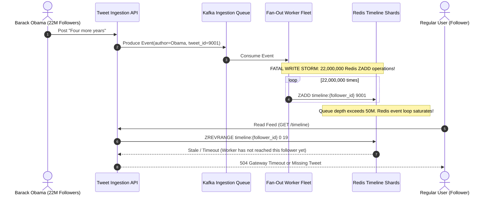
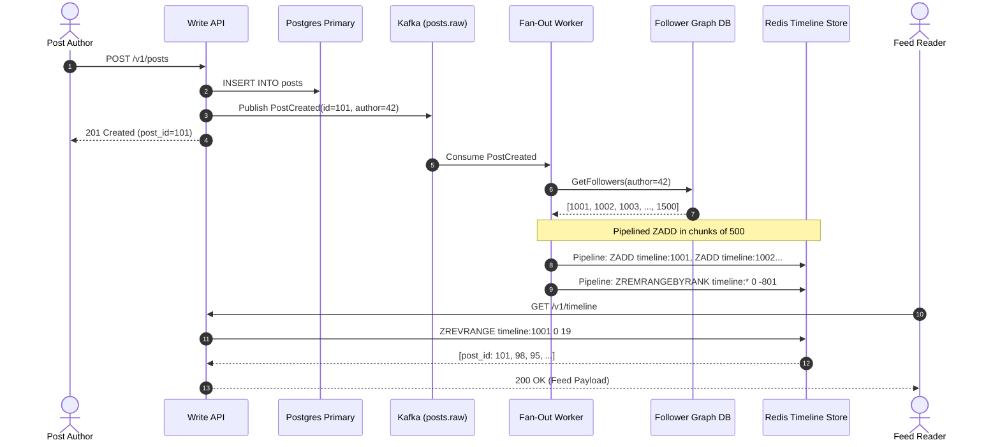
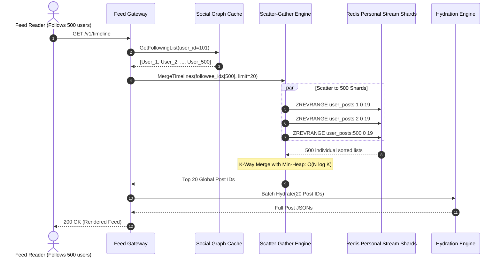
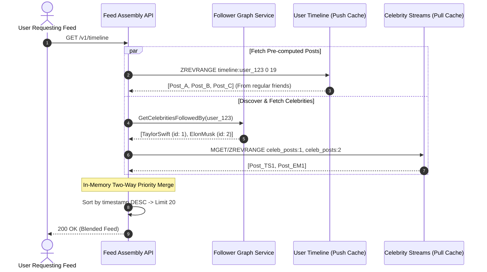
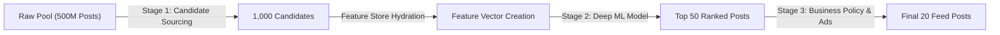
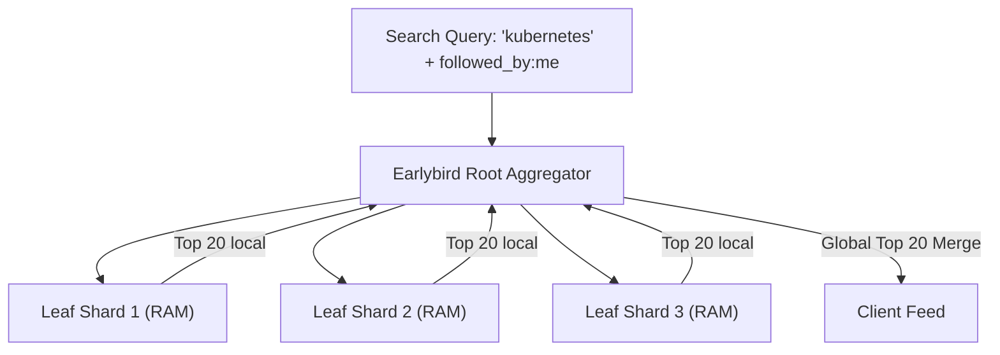
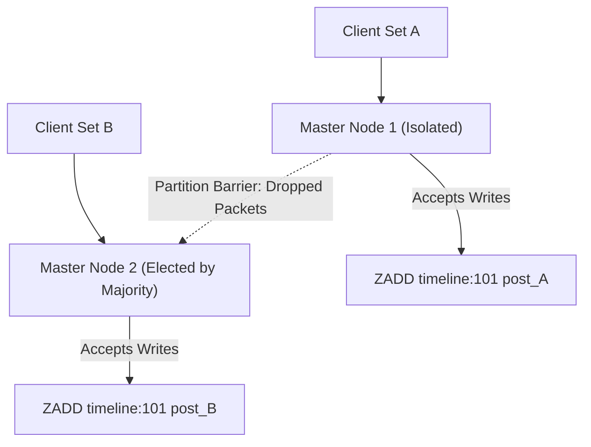
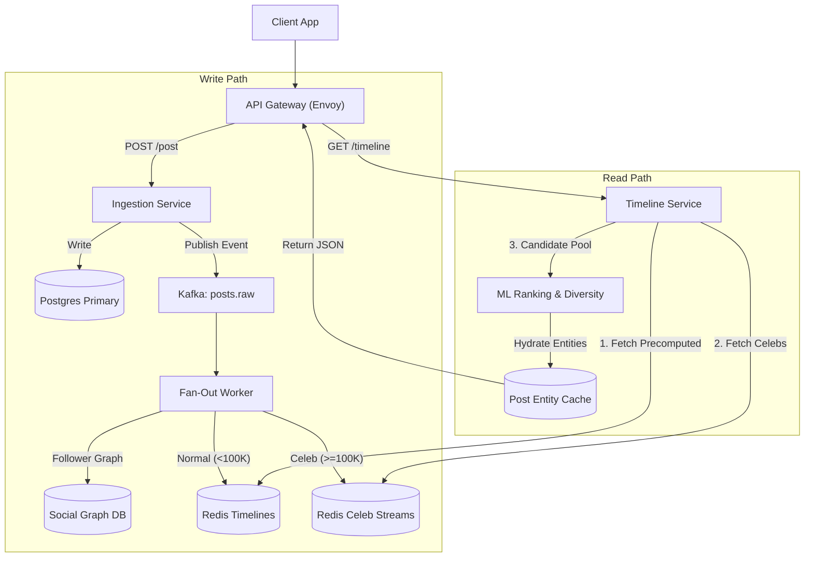
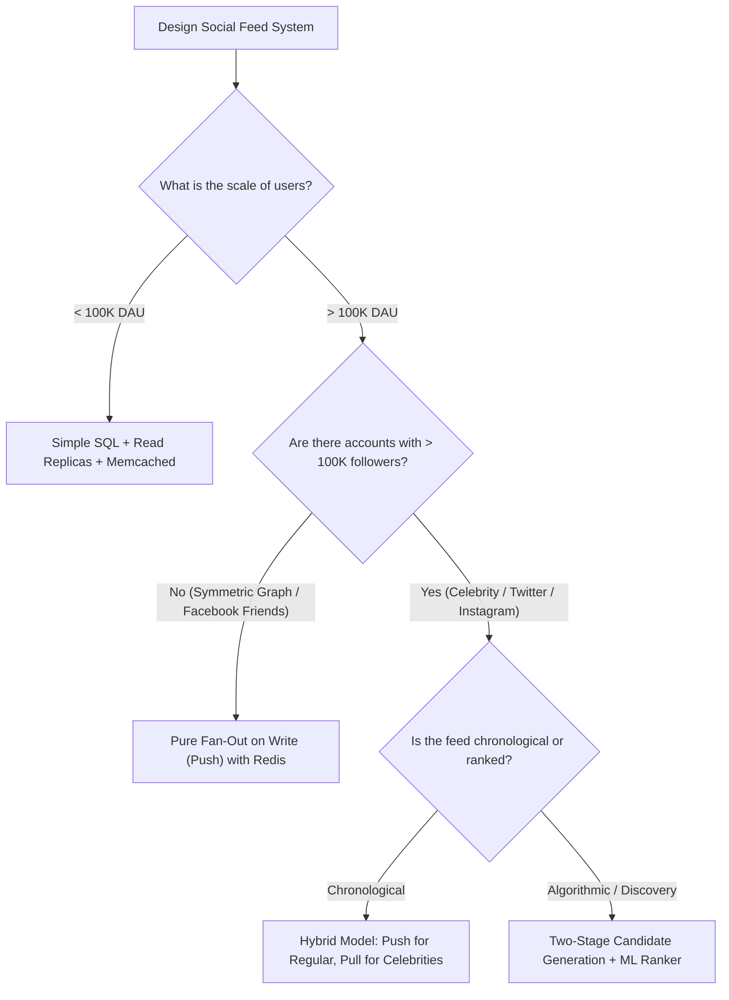

# Heavy Read Workloads & Social Feeds: High-Level & Low-Level System Design

## 1. Executive Summary & Real-World Production Case Studies

Modern social platforms—such as **Twitter (X), Instagram, Facebook, LinkedIn, and TikTok**—power the highest concurrent read workloads in distributed computing. Generating a personalized, real-time social feed demands serving hundreds of millions of daily active users (DAUs) with sub-100-millisecond response latencies, while ingesting hundreds of millions of new posts every day.

```
                           THE SOCIAL FEED SCALE DILEMMA
                           
        WRITE PATH (Ingestion)                          READ PATH (Timeline Retrieval)
      500M Posts/Day (~6,000 writes/sec)            300,000 Requests/sec (~26 Billion reads/day)
                     │                                                   │
                     ▼                                                   ▼
       ┌───────────────────────────┐                       ┌───────────────────────────┐
       │   Ingestion & Validation  │                       │   Feed Assembly & Merging │
       └─────────────┬─────────────┘                       └─────────────┬─────────────┘
                     │                                                   │
                     │ Write Amplification:                              │ Read Amplification:
                     │ Post to 10M followers                             │ Follows 1,000 accounts
                     │ = 10,000,000 timeline writes!                     │ = 1,000 shard scatter-reads!
                     ▼                                                   ▼
       ┌───────────────────────────────────────────────────────────────────────────────┐
       │                In-Memory Storage & Ranking Cluster (Redis / RocksDB)           │
       │                   Must resolve: Write Explosion vs Read Fan-In                │
       └───────────────────────────────────────────────────────────────────────────────┘
```

At this scale, generating timelines dynamically using traditional relational database joins (`SELECT ... JOIN follows ... ORDER BY created_at DESC LIMIT 20`) causes **immediate connection pool exhaustion, unindexed cross-shard distributed joins, and multi-second query latencies**. Feed engineering is fundamentally an optimization trade-off between **Write Amplification (Fan-Out on Write)** and **Read Amplification (Fan-Out on Read)** under extreme power-law (Zipfian) user follower distributions.

---

### Real-World Production Incidents & Architectural Evolutions

#### 1. Twitter's 2012 Obama Election Meltdown: "Four More Years"
- **The Event:** On November 6, 2012, President Barack Obama celebrated his election victory with a three-word tweet: *"Four more years."* Peak retweet volume exceeded **750,000 retweets per minute**.
- **The Failure:** Twitter was running an eager **Fan-Out on Write (Push)** architecture. Every tweet was written to an individual timeline list in memory for each follower. For Obama's 22+ million followers, a single tweet triggered 22 million discrete timeline insert operations. Retweets compounded this exponentially. The background fan-out worker queue backlogged to over **50 million unprocessed jobs**. Redis write latencies escalated from **0.5ms to over 45ms**, causing memory saturation and timeline stalls. Users saw stale feeds for hours.
- **The Architectural Evolution:** Twitter abandoned pure push fan-out and engineered the **Hybrid Fan-Out Architecture** (codenamed *FlockDB* + *Timeline Service*), decoupling high-follower celebrity accounts from standard fan-out queues.

```
Timeline of the Obama Tweet Incident (Nov 6, 2012)
──────────────────────────────────────────────────────────────────────────────
 20:17 ET  │  Obama tweets "Four more years"
 20:18 ET  │  Fan-out worker message queues surge to 10M+ unacknowledged jobs
 20:20 ET  │  Redis write latency spikes from 0.5ms -> 45ms (thread queueing)
 20:22 ET  │  Worker queue depth hits 50M backlog; Redis out-of-memory alarms
 20:25 ET  │  Engineers manually drop fan-out queues for accounts > 1M followers
 20:30 ET  │  Hybrid routing deployed; read-time merging stabilizes timeline lag
──────────────────────────────────────────────────────────────────────────────
```



---

#### 2. The "Justin Bieber Problem": Instagram's Fan-Out on Write Collapse
- **The Event:** In 2012–2013, pop icon Justin Bieber joined Instagram, rapidly acquiring tens of millions of followers (later exceeding 100M).
- **The Failure:** Instagram ran a pure fan-out on write architecture backed by Redis sorted sets. Every photo Bieber posted triggered tens of millions of `ZADD` operations. Even though single-threaded Redis executes an in-memory `ZADD` in ~10 microseconds, **100,000,000 operations require 1,000 seconds of dedicated single-threaded CPU processing time**. 
- Even across a sharded Redis cluster, worker pools clogged. Normal users' photos were trapped behind Bieber's fan-out jobs, delaying regular timeline deliveries by over 30 minutes. Instagram coined this industry-wide edge case the **"Justin Bieber Problem."**
- **The Fix:** Instagram instituted dynamic follower thresholds. Users with over **100,000 followers** were marked as "celebrities" and bypassed the write-time fan-out pipeline entirely.

---

#### 3. LinkedIn's Project Voldemort & Multi-Data-Center Timeline Consistency
- **The Event:** Scaling the LinkedIn Network Updates Feed (NUF) across hundreds of millions of professional connections.
- **The Failure:** Relational databases could not handle the multi-hop social graph traversal needed to show "User X liked User Y's post." Early decentralized caching layers suffered from replica drift and split-brain partition anomalies during network splits between East Coast and West Coast data centers.
- **The Architectural Evolution:** LinkedIn developed and open-sourced **Project Voldemort**, a distributed key-value store using **consistent hashing rings**, **vector clocks** for optimistic conflict resolution, pluggable storage engines (BDB-JE and memory), and lazy **read-repair** mechanisms. Voldemort later directly influenced Apache Cassandra and modern timeline cache topologies.

```
Voldemort Consistent Hash Ring with Virtual Nodes
──────────────────────────────────────────────────────────────────────────────
                        Node A (vnode 1) [0°]
                       /                     \
        Node D (vnode 4)                     Node B (vnode 2)
             [270°]                               [90°]
                       \                     /
                        Node C (vnode 3) [180°]

  - Key: "timeline:user_99214"
  - Murmur3Hash(key) -> Token Position 142°
  - Assigned to Node C (Primary) + Replicated to Node D & Node A
  - Quorum: R=2, W=2, N=3 (Configurable consistency vs latency)
──────────────────────────────────────────────────────────────────────────────
```

---

#### 4. Facebook's 2021 BGP Outage: Blast Radius & Control-Plane Coupling
- **The Event:** On October 4, 2021, a routine configuration command withdrew all **Border Gateway Protocol (BGP)** routes for Facebook's Autonomous System Number (ASN 32934).
- **The Failure:** Facebook, Instagram, WhatsApp, and Messenger vanished from the global internet routing table for over 6 hours. Because internal DNS, authentication, and physical building access shared the same backbone network as user-facing feeds:
  1. Edge routers dropped all internal domain resolution (`*.fb.com`).
  2. Timeline assembly workers could not resolve cache cluster hostnames.
  3. Engineers were locked out of data centers because digital door badges depended on internal network identity services.
- **The Architectural Lesson:** Multi-tier feed systems require strict **blast radius containment** and an isolated **out-of-band management control plane**. Client-facing caches, graph storage, and internal DNS must never share fate with upstream border gateway peering networks.

---

## 2. Core Engineering & Mathematical Bottlenecks

### 2.1 The Relational Database Failure Mode

Consider a naive relational schema for a social feed:

```sql
CREATE TABLE users (
    id BIGINT PRIMARY KEY,
    username VARCHAR(64) NOT NULL
);

CREATE TABLE follows (
    follower_id BIGINT NOT NULL,
    followee_id BIGINT NOT NULL,
    created_at TIMESTAMP NOT NULL,
    PRIMARY KEY (follower_id, followee_id),
    INDEX idx_followee (followee_id)
);

CREATE TABLE posts (
    id BIGINT PRIMARY KEY,
    user_id BIGINT NOT NULL,
    content TEXT NOT NULL,
    created_at TIMESTAMP NOT NULL,
    INDEX idx_user_created (user_id, created_at DESC)
);
```

To render the user's chronological home feed, the application executes:

```sql
SELECT p.id, p.user_id, p.content, p.created_at, u.username
FROM posts p
JOIN follows f ON p.user_id = f.followee_id
JOIN users u ON p.user_id = u.id
WHERE f.follower_id = 99214
  AND p.created_at >= NOW() - INTERVAL '7 days'
ORDER BY p.created_at DESC
LIMIT 20;
```

#### Why This Query Collapses at Scale:
1. **Index Nested Loop Join Thrashing:** If User `99214` follows 1,000 accounts, the query planner must retrieve 1,000 `followee_id` values from the `follows` index, then perform 1,000 separate index seeks into the `posts` index.
2. **Sort Buffer Exhaustion ($N \log N$):** If those 1,000 followees published an average of 50 posts each over the past 7 days, the database must collect $50,000$ candidate rows into memory, sort them by `created_at DESC`, and discard $49,980$ rows to return the top 20.
3. **Cross-Shard Join Impossibility:** In a sharded database, the `follows` table is sharded by `follower_id`, while the `posts` table is sharded by `user_id` (author). Executing this query requires a **scatter-gather cross-shard distributed join across hundreds of database nodes**, saturating network switches and driving latency to seconds.

---

### 2.2 Asymmetric Read-to-Write Ratios & Amplification Metrics

Social networks exhibit extreme workload asymmetry:

| System Metric | Twitter / X | Instagram | Typical Web App |
|---|---|---|---|
| **Daily Active Users (DAU)** | ~250 Million | ~2.0 Billion | ~1 Million |
| **New Posts / Sec (Writes)** | ~6,000 writes/sec | ~1,200 writes/sec | ~500 writes/sec |
| **Peak Writes / Sec** | ~150,000 writes/sec | ~25,000 writes/sec | ~2,000 writes/sec |
| **Feed Reads / Sec** | ~300,000 reads/sec | ~500,000 reads/sec | ~1,000 reads/sec |
| **Read-to-Write Ratio** | **50:1 to 100:1** | **400:1** | **2:1 to 5:1** |

#### The Write Amplification Factor ($W_{amp}$)
In a Fan-Out on Write architecture, for every post published by an author with $F$ followers:
$$W_{amp} = F$$
Total system write volume per second is:
$$\text{Total Writes/sec} = \sum_{i=1}^{P} F_i$$
Where $P$ is the number of posts published per second, and $F_i$ is the follower count of author $i$.

#### The Read Amplification Factor ($R_{amp}$)
In a Fan-Out on Read architecture, for every feed requested by a user following $K$ accounts:
$$R_{amp} = K$$
Total system read IOPS across the storage tier is:
$$\text{Total Reads/sec} = Q_{read} \times K$$
Where $Q_{read}$ is feed read requests per second.

---

### 2.3 Power-Law (Zipfian) Follower Distribution

Real-world follower counts do not follow a Gaussian normal distribution; they strictly follow a **Power-Law (Pareto / Zipfian) distribution**:

$$P(k) \propto k^{-\gamma} \quad (2 < \gamma < 3)$$

```
Follower Count Distribution Curve
──────────────────────────────────────────────────────────────────────────────
 Number of
 Users
   ▲
   │  ████ (95% of users: < 500 followers)
   │  ████
   │  ████
   │  ████
   │  ████
   │  ████
   │  ████   
   │  ████   ██ (4.9% of users: 500 - 50,000 followers)
   │  ████   ██
   │  ████   ██      █ (0.1% "Celebrities": 100,000 - 150,000,000 followers)
   └────────────────────────────────────────────────────────────────────────►
      0     500    50K                           100M+ Follower Count
──────────────────────────────────────────────────────────────────────────────
```

- **The Long Tail (95% of users):** Have fewer than 500 followers. Writing to their followers' timelines takes minimal resources.
- **The Fat Head (0.1% of users):** Celebrities, politicians, and media outlets have millions of followers. A single post from them creates a **hot shard bottleneck** that can saturate an entire cluster.

---

## 3. Comprehensive Deep Dive into Architectural Approaches

---

## Approach 1: Fan-Out on Write (Push / Eager Pre-Computation Model)

### High-Level Design (HLD)

In the Fan-Out on Write model, timelines are **pre-computed at write time**. When an author creates a post, background asynchronous worker fleets immediately push the post reference into the timeline cache of every one of the author's followers.

```
┌──────────────────────────────────────────────────────────────────────────────────────────────────┐
│                             APPROACH 1: FAN-OUT ON WRITE ARCHITECTURE                            │
└──────────────────────────────────────────────────────────────────────────────────────────────────┘

   [Mobile / Web Client]
            │
            ├────────────────────────────────────────────┐
   1. POST /v1/posts (Create Post)             8. GET /v1/timeline (Read Feed)
            ▼                                            ▼
   ┌───────────────────┐                        ┌───────────────────┐
   │ Post Write API    │                        │ Feed Query API    │
   └────────┬──────────┘                        └────────┬──────────┘
            │ 2. Persist to DB                           │ 9. ZREVRANGE timeline:{uid} 0 19
            ▼                                            ▼
   ┌───────────────────┐                        ┌───────────────────┐
   │ Primary DB        │                        │ Redis Timeline    │
   │ (PostgreSQL/MySQL)│                        │ In-Memory Shards  │
   └───────────────────┘                        └────────┬──────────┘
            │ 3. Produce Event                           │ 10. List of 20 Post IDs
            ▼                                            ▼
   ┌───────────────────┐                        ┌───────────────────┐
   │ Apache Kafka      │                        │ Post Hydration    │
   │ Topic: posts.raw  │                        │ Service           │
   └────────┬──────────┘                        └────────┬──────────┘
            │ 4. Consume Event                           │ 11. Multi-Get (post_cache)
            ▼                                            ▼
   ┌─────────────────────────────────────────┐  ┌───────────────────┐
   │ Fan-Out Worker Fleet                    │  │ Redis Post Cache  │
   │                                         │  │ (MGET post:id)    │
   │ 5. Query Follower Graph DB              │  └───────────────────┘
   │    -> Get followers of author           │           │ 12. Complete JSON Feed
   │ 6. Batch into chunks of 1,000           │           ▼
   │ 7. Redis Pipeline:                      │  [User Mobile App Screen]
   │    ZADD timeline:{follower_id} ts pid   │
   └─────────────────────────────────────────┘
```

#### Detailed Write Lifecycle (Ingestion Flow):
1. **Author publishes a post:** The client sends an HTTP `POST /v1/posts` containing text, media references, and user metadata to the [Post Write Service](file:///E:/project/system-design-series/Backend%20Problems/06-heavy-read-workloads-social-feeds.md#L450-L470).
2. **Canonical Persistence:** The service writes the post record to the primary relational/document database ([`posts`](file:///E:/project/system-design-series/Backend%20Problems/06-heavy-read-workloads-social-feeds.md#L55-L65) table) and populates the global post entity cache in Redis (`post_cache:{post_id}`).
3. **Event Publishing:** An asynchronous event `PostCreatedEvent(post_id, author_id, created_at)` is published to Apache Kafka on the `posts.raw` topic, keyed by `author_id`.
4. **Graph Lookup:** Fan-out workers consume the event, querying the **Social Graph Service** (backed by Cassandra or a distributed graph DB) to retrieve the complete list of follower user IDs.
5. **Chunked Pipeline Dispatch:** The worker divides the follower list into batches of 1,000 and uses non-blocking Redis pipelines to issue concurrent `ZADD` operations into each follower's sorted set timeline key: `timeline:{follower_id}`.
6. **Timeline Trimming:** To enforce memory constraints, the worker trims each follower's sorted set to a maximum capacity (e.g., 800 most recent items) using `ZREMRANGEBYRANK`.

#### Detailed Read Lifecycle (Retrieval Flow):
1. **User opens app:** Client issues `GET /v1/timeline?limit=20&cursor=...`.
2. **Single-Hop In-Memory Seek:** The [Feed Query API](file:///E:/project/system-design-series/Backend%20Problems/06-heavy-read-workloads-social-feeds.md#L263-L288) queries the user's dedicated Redis Sorted Set:
   ```bash
   ZREVRANGEBYSCORE timeline:{user_id} +inf -inf LIMIT 0 20
   ```
   Execution time in Redis: **< 1 millisecond**.
3. **Entity Hydration:** The query returns 20 post IDs. The API issues a single multi-key read (`MGET` or Redis Hash pipeline) to `post_cache:{post_id}` to hydrate author usernames, profile pictures, and post text.
4. **Response Delivery:** Complete serialized JSON feed is returned to the client within **10–15ms total edge-to-edge latency**.



---

### Low-Level Design (LLD)

#### 1. Redis In-Memory Internals: ZSET Memory Layout
A Redis Sorted Set (`ZSET`) is implemented as an adaptive dual data structure:
- **`listpack` / `ziplist` (Compact encoding):** When the set contains fewer than `zset-max-listpack-entries` (default: 128) and all elements are smaller than `zset-max-listpack-value` (default: 64 bytes), Redis encodes the sorted set as a contiguous single memory allocation containing pairs of `[element, score]`. This eliminates pointer overhead and maximizes CPU L1/L2 cache locality.
- **`skiplist` + `dict` (Full encoding):** Once either limit is exceeded, Redis transforms the structure into:
  1. A **Skip List**: Probabilistic balanced hierarchy of forward pointers with height up to 32 levels, providing $O(\log N)$ insertions, deletions, and range queries.
  2. A **Hash Table (`dict`)**: Maps element value $\to$ score, providing $O(1)$ lookups.

```
Redis Skiplist Internal Pointer Layout for Timeline Sorted Set
──────────────────────────────────────────────────────────────────────────────
 Level 3: [Head] ──────────────────────────────────────────────► [Node: Post 9005 | Score: 1700000030]
 Level 2: [Head] ───────────────► [Node: Post 9002 | 1700000010] ─► [Node: Post 9005 | Score: 1700000030]
 Level 1: [Head] ─► [Node: 9001] ─► [Node: Post 9002 | 1700000010] ─► [Node: Post 9005 | Score: 1700000030]
 Backward: [NIL] ◄── [Node: 9001] ◄─ [Node: Post 9002] ◄─────────── [Node: Post 9005]
──────────────────────────────────────────────────────────────────────────────
```

#### 2. Production Python Fan-Out Worker Implementation
The following production-grade implementation includes **follower batching, pipelining, exponential backoff retries, and strict timeline trimming**:

```python
import time
import json
import logging
from typing import List, Generator
import redis
from redis.cluster import RedisCluster, ClusterNode

logging.basicConfig(level=logging.INFO)
logger = logging.getLogger("FanOutWorker")

class FanOutPushWorker:
    """
    High-throughput Fan-Out on Write worker.
    Consumes new post events and pushes post IDs to follower timeline sorted sets.
    """
    def __init__(self, redis_client: redis.Redis, max_timeline_size: int = 800, ttl_seconds: int = 604800):
        self.r = redis_client
        self.max_timeline_size = max_timeline_size
        self.ttl_seconds = ttl_seconds  # 7 days
        self.batch_size = 500

    def _chunk_followers(self, followers: List[int], chunk_size: int) -> Generator[List[int], None, None]:
        for i in range(0, len(followers), chunk_size):
            yield followers[i:i + chunk_size]

    def process_post_fanout(self, post_id: int, author_id: int, timestamp: float, follower_ids: List[int]) -> dict:
        """
        Executes pipelined ZADD and boundary trimming across all follower timelines.
        """
        start_time = time.perf_counter()
        total_pushed = 0
        
        # Format payload: key is timeline:{user_id}, member is post_id, score is unix timestamp
        member_name = str(post_id)
        
        for batch in self._chunk_followers(follower_ids, self.batch_size):
            pipe = self.r.pipeline(transaction=False)
            for follower_id in batch:
                timeline_key = f"timeline:{follower_id}"
                
                # 1. Push post into follower's sorted set
                pipe.zadd(timeline_key, {member_name: timestamp})
                
                # 2. Trim timeline to max_timeline_size (keep newest entries, drop oldest)
                # Redis ranks are 0-indexed ascending. 
                # Dropping items with rank 0 to -(max_timeline_size + 1) removes excess oldest items.
                pipe.zremrangebyrank(timeline_key, 0, -(self.max_timeline_size + 1))
                
                # 3. Refresh TTL so inactive user timelines eventually expire
                pipe.expire(timeline_key, self.ttl_seconds)
            
            try:
                pipe.execute()
                total_pushed += len(batch)
            except redis.RedisError as e:
                logger.error(f"Redis pipeline error during fan-out batch for author {author_id}: {str(e)}")
                # In production, dispatch failed batch to Dead Letter Queue (DLQ)
                raise
                
        elapsed_ms = (time.perf_counter() - start_time) * 1000
        logger.info(f"Fanned out post {post_id} to {total_pushed} followers in {elapsed_ms:.2f}ms")
        return {"status": "SUCCESS", "followers_count": total_pushed, "duration_ms": elapsed_ms}

    def fetch_user_feed(self, user_id: int, limit: int = 20, cursor: float = None) -> List[int]:
        """
        Sub-millisecond feed read operation.
        """
        timeline_key = f"timeline:{user_id}"
        max_score = "+inf" if cursor is None else f"({cursor}"
        
        # ZREVRANGEBYSCORE returns members ordered from high score to low score (newest first)
        post_ids = self.r.zrevrangebyscore(
            name=timeline_key,
            max=max_score,
            min="-inf",
            start=0,
            num=limit
        )
        return [int(pid) for pid in post_ids]
```

#### 3. Mathematical Memory & Storage Footprint
Let us calculate the memory requirement for a pure push model:
- **Active Users with Timelines:** 100,000,000 users.
- **Timeline Depth:** 800 post IDs per user.
- **Data per Entry:** 64-bit integer Post ID (8 bytes) + 64-bit Float Timestamp (8 bytes) = 16 bytes.
- **Redis Skiplist Overhead per Node:** ~32 bytes (pointers + jemalloc chunk alignment padding).
- **Total Memory per User:** $800 \times (16 + 32) \approx 38.4 \text{ KB}$.
- **Global Memory Required:**
  $$\text{Total RAM} = 100,000,000 \times 38.4 \text{ KB} \approx 3.84 \text{ Terabytes}$$
This is well within reach for a 40-node Redis Cluster (each node hosting ~100GB of RAM).

---

### Tradeoffs: Fan-Out on Write

| Evaluation Criterion | Metric / Behavior | Engineering Implication |
|---|---|---|
| **Read Latency ($P_{99}$)** | **0.5ms – 2ms** | Unbeatable. Single `ZREVRANGEBYSCORE` against local memory. |
| **Write Amplification** | **Equal to Follower Count ($O(F)$)** | Disastrous for celebrity accounts (1 post = 100M writes). |
| **Storage Waste** | **High** | Wasted CPU and RAM pushing posts to users who haven't logged in for months. |
| **Data Freshness** | **Eventual (Lag dependent)** | During traffic spikes, worker queues back up, delaying delivery. |
| **Best Suited For** | Platforms with bounded follower counts (e.g., LinkedIn 30K limit, private circles, Facebook Friends). |

---

## Approach 2: Fan-Out on Read (Pull / Lazy / Scatter-Gather Model)

### High-Level Design (HLD)

In the Fan-Out on Read model, **no timelines are pre-computed at write time**. When an author publishes a post, the system writes it once to the author's own timeline stream. When a user requests their home feed, the system dynamically discovers all people they follow, queries their individual streams in parallel, and merges them on the fly.

```
┌──────────────────────────────────────────────────────────────────────────────────────────────────┐
│                             APPROACH 2: FAN-OUT ON READ ARCHITECTURE                             │
└──────────────────────────────────────────────────────────────────────────────────────────────────┘

   [Author Publishes]                                  [User Opens App (Follows 500 People)]
           │                                                              │
           ▼                                                              ▼
   ┌───────────────────┐                                         ┌───────────────────┐
   │ Post Write API    │                                         │ Feed Query API    │
   └────────┬──────────┘                                         └────────┬──────────┘
            │                                                             │
            │ Single Write: O(1)                                          │ 1. Get followee IDs (500)
            ▼                                                             ▼
   ┌─────────────────────────────────────────┐                   ┌───────────────────┐
   │ Author's Personal Stream                │                   │ Follower Graph DB │
   │ LPUSH user_posts:{author_id} post_id    │                   └────────┬──────────┘
   └─────────────────────────────────────────┘                            │
                                                                          │ 2. Scatter query to 500 streams
                                                                          ▼
                                                                 ┌──────────────────────────────┐
                                                                 │ Scatter-Gather Merge Service │
                                                                 └────────┬─────────────────────┘
                                      ┌───────────────────────────────────┼──────────────────────────────────┐
                                      ▼                                   ▼                                  ▼
                         ┌─────────────────────────┐         ┌─────────────────────────┐        ┌─────────────────────────┐
                         │ Followee 1 Posts Cache  │         │ Followee 2 Posts Cache  │        │ Followee 500 Posts Cache│
                         │ ZREVRANGEBYSCORE        │         │ ZREVRANGEBYSCORE        │        │ ZREVRANGEBYSCORE        │
                         └────────────┬────────────┘         └────────────┬────────────┘        └────────────┬────────────┘
                                      │                                   │                                  │
                                      └───────────────────────────────────┼──────────────────────────────────┘
                                                                          │ 3. Gather 500 sorted arrays
                                                                          ▼
                                                                 ┌──────────────────────────────┐
                                                                 │ K-Way Min-Heap Merge Engine  │
                                                                 │ (Extract top 20 newest posts)│
                                                                 └────────┬─────────────────────┘
                                                                          │ 4. Return top 20 posts
                                                                          ▼
                                                                 [User Mobile App Screen]
```

#### Detailed Write Lifecycle:
1. Author publishes a post.
2. The write service saves the post to database storage and adds the post ID to the author's personal post list:
   ```bash
   ZADD user_posts:{author_id} 1700000000 "post_9901"
   ```
3. **Total write operations:** Exactly **1 write**, regardless of whether the author has 1 follower or 100 million followers.

#### Detailed Read Lifecycle:
1. User requests feed (`GET /v1/timeline`).
2. The [Feed Query API](file:///E:/project/system-design-series/Backend%20Problems/06-heavy-read-workloads-social-feeds.md#L327-L343) fetches the user's follow list (e.g., 500 followee IDs).
3. The API distributes parallel asynchronous fetch requests across the Redis cluster, retrieving the latest 20 post IDs from each of the 500 followee sorted sets.
4. The system executes an in-memory **K-Way Merge** using a Priority Queue (Min-Heap) to extract the globally latest 20 posts.
5. Posts are hydrated and returned to the client.



---

### Low-Level Design (LLD)

#### 1. The K-Way Merge Algorithm (Priority Queue / Min-Heap)
Merging $K$ pre-sorted streams of length $M$ to produce the top $L$ elements requires a Min-Heap.
- **Time Complexity:** $O(K + L \log K)$.
- **Space Complexity:** $O(K)$ in-memory heap elements.

```
K-Way Min-Heap Merge Visualization (K=3 followees, Limit=3)
──────────────────────────────────────────────────────────────────────────────
 Stream 1 (User A): [Post 105 (ts: 50), Post 101 (ts: 10)]
 Stream 2 (User B): [Post 104 (ts: 45), Post 102 (ts: 20)]
 Stream 3 (User C): [Post 106 (ts: 60), Post 103 (ts: 30)]

 Initial Heap (Max size K=3):
   Insert Head Elements -> [(60, C), (50, A), (45, B)]

 Extraction 1: Pop largest -> Post 106 (C). Pull next from C (Post 103, ts: 30) -> Heap: [(50, A), (45, B), (30, C)]
 Extraction 2: Pop largest -> Post 105 (A). Pull next from A (Post 101, ts: 10) -> Heap: [(45, B), (30, C), (10, A)]
 Extraction 3: Pop largest -> Post 104 (B). Limit 3 reached! STOP.
 Output: [Post 106, Post 105, Post 104]
──────────────────────────────────────────────────────────────────────────────
```

#### 2. Production Python AsyncIO Scatter-Gather Implementation

```python
import asyncio
import heapq
from typing import List, Dict, Optional, Tuple
import redis.asyncio as aioredis

class ScatterGatherFeedEngine:
    """
    Fan-Out on Read feed engine.
    Scatters parallel queries across followee streams with strict timeout budgets.
    """
    def __init__(self, redis_pool: aioredis.ConnectionPool, timeout_ms: float = 60.0):
        self.redis_pool = redis_pool
        self.timeout_seconds = timeout_ms / 1000.0

    async def _fetch_stream(self, client: aioredis.Redis, followee_id: int, cursor: Optional[float], count: int) -> Tuple[int, List[Tuple[int, float]]]:
        key = f"user_posts:{followee_id}"
        max_score = "+inf" if cursor is None else f"({cursor}"
        
        try:
            # ZREVRANGEBYSCORE with WITHSCORES returns [(member, score), ...]
            raw_items = await client.zrevrangebyscore(
                key, max=max_score, min="-inf", start=0, num=count, withscores=True
            )
            parsed = [(int(member), float(score)) for member, score in raw_items]
            return followee_id, parsed
        except Exception:
            # Degrade gracefully if a single shard is unreachable
            return followee_id, []

    async def build_feed(self, followee_ids: List[int], limit: int = 20, cursor: Optional[float] = None) -> List[Dict]:
        client = aioredis.Redis(connection_pool=self.redis_pool)
        
        # 1. Scatter reads concurrently across all followee keys with a hard timeout
        tasks = [
            self._fetch_stream(client, fid, cursor, count=limit)
            for fid in followee_ids
        ]
        
        try:
            # Wait for all shards to reply within strict timeout budget (e.g., 60ms)
            results = await asyncio.wait_for(asyncio.gather(*tasks, return_exceptions=True), timeout=self.timeout_seconds)
        except asyncio.TimeoutError:
            # Log degradation: return partial feed from shards that responded in time
            results = [task.result() for task in tasks if task.done() and not task.exception()]

        # 2. Prepare Iterators for K-Way Merge
        # Heap elements: (-timestamp, post_id, followee_id, iterator_index)
        heap = []
        stream_map: Dict[int, List[Tuple[int, float]]] = {}
        index_tracker: Dict[int, int] = {}

        for res in results:
            if isinstance(res, tuple):
                fid, posts = res
                if posts:
                    stream_map[fid] = posts
                    index_tracker[fid] = 0
                    post_id, ts = posts[0]
                    # We invert timestamp because heapq is a min-heap, but we want newest first
                    heapq.heappush(heap, (-ts, post_id, fid))

        # 3. K-Way Merge Extraction
        merged_feed: List[Dict] = []
        while heap and len(merged_feed) < limit:
            neg_ts, post_id, fid = heapq.heappop(heap)
            merged_feed.append({"post_id": post_id, "timestamp": -neg_ts, "author_id": fid})
            
            # Advance iterator for this followee
            idx = index_tracker[fid] + 1
            index_tracker[fid] = idx
            
            if idx < len(stream_map[fid]):
                next_post_id, next_ts = stream_map[fid][idx]
                heapq.heappush(heap, (-next_ts, next_post_id, fid))

        return merged_feed
```

---

### Tradeoffs: Fan-Out on Read

| Evaluation Criterion | Metric / Behavior | Engineering Implication |
|---|---|---|
| **Read Latency ($P_{99}$)** | **50ms – 300ms** | High tail latency. Bound to slowest responding Redis shard ($P_{99}$ latency tax). |
| **Write Amplification** | **Exactly 1 ($O(1)$)** | Ideal for high-frequency celebrity posters. No write explosion. |
| **Storage Overhead** | **Minimal** | No duplicate timeline sets. Each post exists once in the author's stream. |
| **Power User Vulnerability** | **Severe Degradation** | A user following 2,000 accounts triggers 2,000 network round trips per feed view! |
| **Best Suited For** | Celebrity accounts, search/discovery feeds, and systems with low read-to-write ratios. |

---

## Approach 3: The Hybrid Model (Twitter's Production Architecture)

### High-Level Design (HLD)

Neither pure push nor pure pull scales across the entire spectrum of user behaviors. The industry-standard architecture is a **Hybrid Dynamic Tiering Model**:
- **Regular Users ($< 100,000$ followers):** Handled via **Fan-Out on Write (Push)**. Their posts are eagerly fanned out into their followers' Redis timelines.
- **Celebrities / High-Follower Accounts ($\ge 100,000$ followers):** Handled via **Fan-Out on Read (Pull)**. Their posts are written to a dedicated celebrity post cache.
- **Feed Assembly at Read Time:** The reader's pre-computed timeline is merged with recent posts from only the specific celebrities that the reader follows.

```
┌──────────────────────────────────────────────────────────────────────────────────────────────────┐
│                                APPROACH 3: HYBRID TIERING ARCHITECTURE                           │
└──────────────────────────────────────────────────────────────────────────────────────────────────┘

                                    [NEW POST PUBLISHED]
                                             │
                                             ▼
                               ┌───────────────────────────┐
                               │ Dynamic User Tier Router  │
                               │ Follower Count >= 100,000?│
                               └─────────────┬─────────────┘
                                             │
                     ┌───────────────────────┴───────────────────────┐
                     │ NO (< 100K)                                   │ YES (>= 100K)
                     ▼                                               ▼
         ┌───────────────────────┐                       ┌───────────────────────┐
         │ Push Fan-Out Pipeline │                       │ Celebrity Stream Store│
         │ (Kafka -> Worker)     │                       │ ZADD celeb_posts:{id} │
         └───────────┬───────────┘                       └───────────────────────┘
                     │                                         (Single Write)
                     ▼
         ┌───────────────────────┐
         │ Followers' Timelines  │
         │ ZADD timeline:{uid}   │
         └───────────────────────┘

════════════════════════════════════════════════════════════════════════════════════════════════════

                                  [FEED READ REQUEST]
                                             │
                                             ▼
                               ┌───────────────────────────┐
                               │ Feed Aggregator Gateway   │
                               └─────────────┬─────────────┘
                                             │
                     ┌───────────────────────┴───────────────────────┐
                     │ 1. Read Pre-computed Timeline                 │ 2. Find Followed Celebrities
                     ▼                                               ▼
         ┌───────────────────────┐                       ┌───────────────────────┐
         │ User's Pre-Computed   │                       │ Social Graph Bloom    │
         │ Redis Timeline        │                       │ Filter / Roaring Set  │
         │ ZREVRANGE timeline:me │                       └───────────┬───────────┘
         └───────────┬───────────┘                                   │ Returns: [Celeb_A, Celeb_B]
                     │ (Gets 20 posts from normal friends)           ▼
                     │                                   ┌───────────────────────┐
                     │                                   │ Pull Celeb Streams    │
                     │                                   │ ZREVRANGEBYSCORE      │
                     │                                   └───────────┬───────────┘
                     │                                               │ (Gets 5 posts per celeb)
                     └───────────────────────┬───────────────────────┘
                                             │
                                             ▼
                               ┌───────────────────────────┐
                               │ In-Memory 2-Way Merge     │
                               │ (Sort by timestamp/score) │
                               └─────────────┬─────────────┘
                                             │
                                             ▼
                               [Top 20 Unified Feed Response]
```

#### Why This Works:
1. **Normal Users (99.9% of user base):** Have an average of 200 followers. Writing to 200 timelines requires negligible CPU time.
2. **Celebrity Users (0.1% of user base):** Do not cause a 100-million write explosion.
3. **Feed Retrieval Stays Fast:** The average reader follows only **10 to 30 celebrities**. Merging 1 pre-computed timeline with 20 celebrity streams takes **< 5 milliseconds** in memory.



---

### Low-Level Design (LLD)

#### 1. Follower Graph Fast Lookup: Roaring Bitsets
Determining which celebrities a user follows during the read path cannot afford a slow database query. Systems use **Roaring Bitsets** or in-memory sets:
- Every celebrity is assigned a sparse integer index.
- Each user maintains an in-memory bitset or Redis Set `user_celebs:{user_id}` containing IDs of followed celebrities.
- Lookup latency: **< 0.1ms**.

#### 2. Hybrid Assembly Engine Implementation

```python
import time
from typing import List, Dict, Optional
import redis

class HybridFeedManager:
    """
    Production Hybrid Feed Assembly System.
    Bridges pre-computed write-timelines with real-time celebrity pull streams.
    """
    CELEBRITY_FOLLOWER_THRESHOLD = 100_000

    def __init__(self, redis_client: redis.Redis):
        self.r = redis_client

    def publish_post(self, post_id: int, author_id: int, follower_count: int, timestamp: float):
        """
        Routes post write based on author's social tier.
        """
        # Always store the canonical post metadata
        self.r.hset(f"post_meta:{post_id}", mapping={
            "id": post_id,
            "author_id": author_id,
            "timestamp": timestamp
        })

        if follower_count >= self.CELEBRITY_FOLLOWER_THRESHOLD:
            # TIER 1 (Celebrity): Write to author's individual stream ONLY
            celeb_key = f"celeb_posts:{author_id}"
            self.r.zadd(celeb_key, {str(post_id): timestamp})
            self.r.expire(celeb_key, 14 * 86400)  # Keep 14 days
        else:
            # TIER 2 (Standard): Enqueue background job for asynchronous fan-out on write
            self._enqueue_push_job(post_id, author_id, timestamp)

    def _enqueue_push_job(self, post_id: int, author_id: int, timestamp: float):
        # In production: KafkaProducer.send("timeline.fanout", ...)
        pass

    def get_hybrid_feed(self, user_id: int, followed_celeb_ids: List[int], limit: int = 20, cursor: Optional[float] = None) -> List[Dict]:
        """
        Blends the pre-computed timeline with on-demand celebrity streams.
        """
        max_score = "+inf" if cursor is None else f"({cursor}"
        pipe = self.r.pipeline(transaction=False)
        
        # 1. Fetch pre-computed timeline for normal friends
        timeline_key = f"timeline:{user_id}"
        pipe.zrevrangebyscore(timeline_key, max=max_score, min="-inf", start=0, num=limit, withscores=True)
        
        # 2. Fetch latest posts for every celebrity followed by this user
        for celeb_id in followed_celeb_ids:
            pipe.zrevrangebyscore(f"celeb_posts:{celeb_id}", max=max_score, min="-inf", start=0, num=limit, withscores=True)
            
        responses = pipe.execute()
        
        # 3. Two-Way Merge & Sort in Application Memory
        candidates = []
        
        # Normal posts
        normal_posts = responses[0]
        for pid, score in normal_posts:
            candidates.append({"post_id": int(pid), "timestamp": float(score), "source": "regular"})
            
        # Celebrity posts
        for celeb_posts in responses[1:]:
            for pid, score in celeb_posts:
                candidates.append({"post_id": int(pid), "timestamp": float(score), "source": "celebrity"})
                
        # Sort descending by timestamp
        candidates.sort(key=lambda x: x["timestamp"], reverse=True)
        
        return candidates[:limit]
```

---

## Approach 4: Two-Stage Candidate Retrieval & Algorithmic Ranking (Modern Feeds)

### High-Level Design (HLD)

Modern social networks (TikTok, Instagram, Facebook, Twitter) no longer present a pure reverse-chronological feed. Feeds are **ranked algorithmically** based on user engagement prediction ($P(\text{like}), P(\text{comment}), P(\text{share}), P(\text{dwell\_time}))$.

Evaluating complex machine learning models (Deep Neural Networks with billions of parameters) across thousands of candidate posts cannot be completed within a 50ms read latency budget. Modern systems use a **Two-Stage Funnel Architecture**:

```
┌──────────────────────────────────────────────────────────────────────────────────────────────────┐
│                            APPROACH 4: TWO-STAGE ML RANKING ARCHITECTURE                         │
└──────────────────────────────────────────────────────────────────────────────────────────────────┘

   [Candidate Generation / Sourcing]                  [Heavy ML Scoring]                 [Re-Ranking & Diversity]
             (Stage 1)                                     (Stage 2)                            (Stage 3)
   
  ┌───────────────────────────────┐
  │ In-Network Sources            │
  │ - Followed Users (Hybrid)     │
  │ - 800 Candidate Posts         │
  └───────────────┬───────────────┘
                  │
                  ├────────────────────────► ┌───────────────────────────┐           ┌───────────────────────────┐
                  │                          │ Heavy ML Ranking Service  │           │ Business Logic & Diversity│
  ┌───────────────┴───────────────┐          │ - GBDT / Deep Neural Net  │           │ - Deduplication           │
  │ Out-of-Network Sources        │          │ - Evaluates:              │           │ - Sponsored Ads Injection │
  │ - Vector Search (ANN / HNSW)  │          │   P(Like), P(Dwell Time)  ├──────────►│ - Author Diversity Rules  │
  │ - Collaborative Filtering     │          │ - Scores 1,000 candidates │           │   (Max 2 posts per author)│
  │ - 200 Candidate Posts         │          │ - Selects Top 50          │           │ - Downrank Misinformation │
  └───────────────────────────────┘          └───────────────────────────┘           └─────────────┬─────────────┘
                                                                                                   │
                                                                                                   ▼
                                                                                         [Top 20 Rendered Feed]
```

#### The Three Stages:
1. **Stage 1: Candidate Generation (Sourcing):** Reduces the universe of hundreds of millions of posts down to **500–1,000 relevant candidates** in $< 15\text{ms}$ using lightweight heuristics:
   - *In-network candidates:* Retrieved from the user's hybrid timeline cache.
   - *Out-of-network candidates:* Retrieved via Approximate Nearest Neighbor (ANN) search over embeddings (e.g., Milvus, Faiss, Pinecone) reflecting user interest clusters.
2. **Stage 2: Heavy Scoring & Ranking:** A compute-intensive model evaluates all 1,000 candidate posts. Features extracted from an in-memory **Feature Store (Feast / Redis)**:
   - User features: Historical click-through rates, categories of interest.
   - Author features: Author engagement reputation, past interaction with user.
   - Post features: Recency decay, media type, viral velocity (likes/minute).
3. **Stage 3: Policy, Filtering & Diversity (Re-Ranking):** Applies business constraints:
   - Injection of sponsored advertising (e.g., exactly 1 ad every 5 organic posts).
   - Author diversity: No more than 2 consecutive posts from the same author.
   - Content safety, copyright, and misinformation filtering.



---

### Low-Level Design (LLD)

#### The Ranking Formula (EdgeRank & Machine Learning Scoring)
The historical Facebook EdgeRank model provides the foundation:

$$\text{Score} = \sum_{e \in \text{Edges}} U_e \times W_e \times e^{-\lambda \Delta t}$$

Modern neural scoring computes expected value $V$:

$$V = w_{\text{like}} P(\text{like}) + w_{\text{comment}} P(\text{comment}) + w_{\text{share}} P(\text{share}) + w_{\text{dwell}} \mathbb{E}[\text{dwell\_time}] - w_{\text{negative}} P(\text{hide})$$

#### Python Feed Re-Ranking Engine Implementation

```python
import math
import time
from typing import List, Dict

class ProductionFeedRanker:
    """
    Implements Stage 2 (Feature Scoring) and Stage 3 (Diversity & Policy Filtering).
    """
    def __init__(self, half_life_hours: float = 12.0):
        self.decay_lambda = math.log(2) / (half_life_hours * 3600.0)

    def calculate_score(self, post: Dict, user_affinity: float) -> float:
        """
        Calculates ranking score using recency decay, affinity, and engagement velocity.
        """
        now = time.time()
        age_seconds = max(0.0, now - post["created_at"])
        recency_decay = math.exp(-self.decay_lambda * age_seconds)
        
        # Type weights
        media_weights = {"video": 3.0, "carousel": 2.5, "photo": 2.0, "text": 1.0}
        type_weight = media_weights.get(post.get("media_type", "text"), 1.0)
        
        # Engagement velocity
        engagement = post.get("likes", 0) * 1.0 + post.get("comments", 0) * 3.0 + post.get("shares", 0) * 5.0
        engagement_factor = math.log1p(engagement)
        
        # Final weighted composite score
        score = (user_affinity * 0.4 + engagement_factor * 0.3 + type_weight * 0.3) * recency_decay
        return score

    def rank_and_apply_diversity(self, candidates: List[Dict], user_affinities: Dict[int, float], limit: int = 20) -> List[Dict]:
        """
        Scores all candidate posts, sorts them, and enforces author diversity rules.
        """
        # 1. Score all candidate posts
        for post in candidates:
            author_id = post["author_id"]
            affinity = user_affinities.get(author_id, 0.1)
            post["rank_score"] = self.calculate_score(post, affinity)

        # 2. Sort by descending score
        candidates.sort(key=lambda p: p["rank_score"], reverse=True)

        # 3. Apply Diversity Policy: No author may appear more than 2 times in the top 20
        final_feed = []
        author_counts = {}

        for post in candidates:
            author_id = post["author_id"]
            count = author_counts.get(author_id, 0)
            
            if count < 2:
                final_feed.append(post)
                author_counts[author_id] = count + 1
                if len(final_feed) == limit:
                    break

        return final_feed
```

---

## Approach 5: Inverted Index & Search-Based Feed Architecture (Twitter Earlybird)

### High-Level Design (HLD)

For real-time search, hashtag timelines, and content discovery, push/pull caches fail because feeds are dynamic queries over arbitrary keywords, entities, and social circles. Twitter engineered **Earlybird**, an in-memory, real-time distributed inverted index built on top of customized Apache Lucene.

```
┌──────────────────────────────────────────────────────────────────────────────────────────────────┐
│                          APPROACH 5: INVERTED INDEX FEED ARCHITECTURE                            │
└──────────────────────────────────────────────────────────────────────────────────────────────────┘

   [Tweet Write Stream]                                     [Timeline / Search Query]
            │                                                           │
            ▼                                                           ▼
   ┌───────────────────┐                                       ┌───────────────────┐
   │ Kafka Partition   │                                       │ Search Root       │
   └────────┬──────────┘                                       │ Scatter-Gather    │
            │                                                  └────────┬──────────┘
            ▼                                                           │ Parallel Fan-Out
   ┌─────────────────────────────────────────┐                          │ to all index shards
   │ Earlybird Indexing Shard                │                          ▼
   │                                         │         ┌─────────────────────────────────┐
   │ 1. Ingest Tweet (DocID = 90214)         │         │ In-Memory Posting List Search   │
   │ 2. Append to Inverted Posting Lists:    │◄────────┤ - Intersect terms in RAM        │
   │    "system" -> [..., 90214]             │         │ - Filter: author_id IN (follows)│
   │    "design" -> [..., 90214]             │         │ - Read from dynamic tail segment│
   │ 3. Maintain Social Graph Bitmask        │         └─────────────────────────────────┘
   └─────────────────────────────────────────┘
```

#### How Earlybird Works:
1. **Partitioning by Tweet ID (Document Partitioning):** Tweets are partitioned across cluster shards by `tweet_id` (not by `user_id`). Every cluster node holds an in-memory inverted index of a fraction of all historical tweets.
2. **Reverse-Chronological Postings:** Posting lists are stored in memory in strict **descending order of Tweet ID**. Because Twitter Snowflake IDs are monotonically increasing with time, searching a posting list automatically yields chronologically sorted results without sorting.
3. **Scatter-Gather Search:** When User X searches or requests an entity feed, the query is broadcast to **all Earlybird leaf nodes**. Each leaf intersects the posting lists, filters results against User X's social graph bitmask, and returns the top matches to a root aggregator.



---

### Low-Level Design (LLD)

#### Inverted Index In-Memory Data Structure
An in-memory inverted index maps terms (or followee user IDs) to postings lists containing 32-bit document IDs:

```
Term Dictionary (Hash Table in RAM)         Posting Lists (Array of 32-bit Document IDs in DESC order)
──────────────────────────────────────────────────────────────────────────────
 "user:42" (Author ID)         ───────►    [ 90540, 90210, 89100, 85400, ... ]
 "hashtag:#systemdesign"       ───────►    [ 90540, 88200, 84100, 72000, ... ]
 "term:database"               ───────►    [ 90540, 89100, 76000, 65000, ... ]
──────────────────────────────────────────────────────────────────────────────
 Intersecting "user:42" AND "hashtag:#systemdesign":
 -> Compare heads of sorted arrays (Two-finger pointer walk)
 -> Match found: Document ID 90540!
```

#### Python In-Memory Reverse Index Implementation

```python
from typing import List, Dict, Set

class InMemoryTimelineIndex:
    """
    Simplified in-memory inverted index for real-time social timeline retrieval.
    """
    def __init__(self):
        # Maps author_id -> list of post_ids (stored newest first)
        self.author_postings: Dict[int, List[int]] = {}
        self.post_data: Dict[int, dict] = {}

    def index_post(self, post_id: int, author_id: int, content: str, timestamp: float):
        self.post_data[post_id] = {
            "id": post_id, "author": author_id, "content": content, "timestamp": timestamp
        }
        if author_id not in self.author_postings:
            self.author_postings[author_id] = []
        # Prepend to maintain newest-first order
        self.author_postings[author_id].insert(0, post_id)

    def query_feed_for_user(self, followee_ids: Set[int], limit: int = 20) -> List[dict]:
        """
        Executes a multi-list cursor merge over author posting lists.
        """
        # Collect candidate posting lists
        active_streams = [
            self.author_postings[fid] for fid in followee_ids if fid in self.author_postings
        ]
        
        # Multi-way pointer scan
        pointers = [0] * len(active_streams)
        matched_post_ids = []

        while len(matched_post_ids) < limit:
            best_post_id = -1
            best_stream_idx = -1
            
            # Find the largest post_id currently at the pointer heads
            for idx, stream in enumerate(active_streams):
                if pointers[idx] < len(stream):
                    pid = stream[pointers[idx]]
                    if pid > best_post_id:
                        best_post_id = pid
                        best_stream_idx = idx

            if best_post_id == -1:
                break  # Exhausted all streams

            matched_post_ids.append(best_post_id)
            pointers[best_stream_idx] += 1

        return [self.post_data[pid] for pid in matched_post_ids]
```

---

## 4. Deep-Dive Subsystem Mechanics & Edge Cases

---

### 4.1 Timeline Pagination: Cursor-Based vs Offset-Based

#### Why Offset Pagination (`LIMIT 20 OFFSET 100`) Breaks:
1. **The Page-Drift Anomaly:** If 5 new tweets are posted while a user is reading Page 1, navigating to Page 2 (`OFFSET 20`) causes the user to see the last 5 tweets from Page 1 again (duplicates). Conversely, deleting posts causes posts to be skipped.
2. **$O(N)$ Database Scan:** The database engine must scan and discard $N$ index rows before returning 20 records. `OFFSET 50000` is hundreds of times slower than `OFFSET 0`.

```
The Offset Drift Problem Under Concurrent Writes
──────────────────────────────────────────────────────────────────────────────
 Initial State:
 Page 1 (LIMIT 5 OFFSET 0): [P10, P9, P8, P7, P6]
 Page 2 (LIMIT 5 OFFSET 5): [P5, P4, P3, P2, P1]

 Event: 2 new posts inserted (P12, P11) while user views Page 1.
 New DB State: [P12, P11, P10, P9, P8, P7, P6, P5, P4, P3, P2, P1]
 User requests Page 2 (LIMIT 5 OFFSET 5):
 Query skips 5 rows -> Returns: [P7, P6, P5, P4, P3]
 BUG: User sees P7 and P6 a second time!
──────────────────────────────────────────────────────────────────────────────
```

#### The Production Standard: 64-Bit Snowflake ID Cursor
Twitter's **Snowflake ID** embeds time directly:

```
┌──────────────────────────────────────────────────────────────────────────────┐
│ 1-bit sign │ 41-bit timestamp (ms since epoch) │ 10-bit worker ID │ 12-bit sequence │
└──────────────────────────────────────────────────────────────────────────────┘
```

Because Snowflake IDs are monotonically increasing, the cursor is simply the `post_id` of the last post on the current page:

```python
def fetch_timeline_cursor(user_id: int, cursor_post_id: Optional[int] = None, page_size: int = 20) -> dict:
    """
    Pagination using Snowflake ID as exclusive upper boundary.
    """
    timeline_key = f"timeline:{user_id}"
    max_boundary = "+inf" if cursor_post_id is None else f"({cursor_post_id}"
    
    post_ids = r.zrevrangebyscore(timeline_key, max=max_boundary, min="-inf", start=0, num=page_size)
    
    next_cursor = post_ids[-1] if len(post_ids) == page_size else None
    return {
        "posts": post_ids,
        "next_cursor": next_cursor,
        "has_more": next_cursor is not None
    }
```

---

### 4.2 The Unread Count Badge Problem

Displaying the little red badge: *"14 new posts"* cannot execute an expensive SQL query (`SELECT COUNT(*) WHERE created_at > last_read`).

#### Production Approaches:
1. **Watermark Timestamp (Low Storage):**
   - Store `last_read_timestamp:{user_id}`.
   - When user queries unread count, execute:
     ```bash
     ZCOUNT timeline:{user_id} (last_read_timestamp +inf
     ```
   - In Redis, `ZCOUNT` executes in $O(\log N)$ by walking skiplist forward pointers.
2. **Atomic Counter with Cap (Ultra Fast):**
   - Maintain an atomic string key: `unread_count:{user_id}`.
   - When a fan-out worker inserts a post, it issues: `INCR unread_count:{follower_id}`.
   - If count exceeds 99, cap the counter to save updates.
   - When the user opens the timeline, execute `SET unread_count:{user_id} 0`.

---

### 4.3 Database Replication Lag & Read-Your-Own-Writes Consistency

```
Replication Lag Inconsistency Race Condition
──────────────────────────────────────────────────────────────────────────────
 User A Posts Photo               Primary DB                    Read Replica
        │                             │                              │
   1.   │─── INSERT INTO posts ──────►│                              │
   2.   │◄── 201 Created (OK) ────────┤                              │
        │                             │── 3. Async Replication Lag ─►│ (Lag: 250ms)
   4.   │─── GET /v1/user/posts ────────────────────────────────────►│
        │                             │                              │
   5.   │◄── 200 OK (Empty List!) ───────────────────────────────────┤
        │    CRITICAL BUG: User thinks their post was lost!          │
──────────────────────────────────────────────────────────────────────────────
```

#### Production Solutions:
1. **Author Primary Pinning (Session Stickiness):** For any read request made by User X for User X's own recent data within 5 seconds of a write, route the read directly to the **Primary Database**.
2. **Replication Watermark / Session Tokens:** The write response returns a monotonic transaction log position (e.g., LSN: `0/15E8438`). Subsequent read requests pass this token in an HTTP header (`X-Replica-LSN`). The routing proxy only selects replicas whose current replication position has passed that watermark.

---

### 4.4 Multi-Tier Caching & Cold-User Offloading

Active users access their timelines every 10 minutes; dormant users may not open the app for months. Storing timelines for 100M inactive users in RAM wastes hundreds of thousands of dollars.

```
Multi-Tier Storage Architecture for Active vs Inactive Users
──────────────────────────────────────────────────────────────────────────────
 [Incoming Read Request]
            │
            ▼
   ┌───────────────────┐       Cache Hit (< 1ms)
   │ L1: Redis Cluster │──────────────────────────────► Return Timeline
   └────────┬──────────┘
            │ Cache Miss (User not active in 7 days / Evicted by LRU)
            ▼
   ┌───────────────────────────────────┐
   │ On-Demand Timeline Hydration Task │
   └────────┬──────────────────────────┘
            │
            ▼
   ┌───────────────────────────────────┐
   │ L2: RocksDB / ScyllaDB on NVMe    │──► Fast SSD scan of user's followees
   └────────┬──────────────────────────┘
            │
            ▼
   Re-populate L1 Redis Sorted Set with TTL = 7 Days
──────────────────────────────────────────────────────────────────────────────
```

- **Active Users (Opened app within 7 days):** Timelines live in L1 Redis Cluster. TTL is set to 7 days and refreshed upon each read.
- **Inactive Users:** Timelines are naturally evicted by Redis TTL. When an inactive user finally logs in, a **Cache Miss** triggers a background regeneration worker that queries L2 storage (RocksDB / Cassandra), constructs the top 800 posts, and writes them back into Redis.

---

### 4.5 Split-Brain, Network Partitions & Data Inconsistencies

During a network split in a Redis Cluster, two master nodes can believe they are the authoritative owner of the hash slots for `timeline:user_99214`:



- **The Danger:** Redis uses asynchronous replication. When the network partition heals, Node 1 is demoted to a replica of Node 2. All writes made to Node 1 during the partition are **permanently lost**.
- **Mitigation:**
  1. Configure `min-replicas-to-write 1` and `min-replicas-max-lag 10` in Redis to ensure masters reject writes if isolated.
  2. Implement **Fencing Tokens** generated via Apache ZooKeeper or etcd for fan-out worker fleets to prevent split-brain worker pools from executing conflicting mutations.

---

## 5. End-to-End Production System Architecture

The following diagram unifies all components into a complete, fault-tolerant enterprise social feed architecture:

```
════════════════════════════════════════════════════════════════════════════════════════════════════
                        COMPLETE END-TO-END SOCIAL FEED SYSTEM ARCHITECTURE
════════════════════════════════════════════════════════════════════════════════════════════════════

                                     [MOBILE / WEB CLIENTS]
                                                │
                                                ▼ HTTPS / gRPC
                        ┌───────────────────────────────────────────────┐
                        │          Global Anycast Edge / CDN            │
                        │           (Cloudflare / AWS CloudFront)       │
                        └───────────────────────┬───────────────────────┘
                                                │
                                                ▼
                        ┌───────────────────────────────────────────────┐
                        │          API Gateway / Envoy Proxy            │
                        │     (Rate Limiting, JWT Auth, TLS Term)       │
                        └───────────────┬───────────────┬───────────────┘
                                        │               │
                 POST /v1/posts (Writes)│               │GET /v1/timeline (Reads)
                                        ▼               ▼
                        ┌───────────────────────┐ ┌───────────────────────────┐
                        │ Post Ingestion Service│ │ Timeline Query Service    │
                        └───────────┬───────────┘ └─────────────┬─────────────┘
                                    │                           │
                     ┌──────────────┴──────────────┐            │
                     ▼                             ▼            │
         ┌───────────────────────┐     ┌───────────────────────┐│
         │ Relational Primary DB │     │ Apache Kafka Cluster  ││
         │ (PostgreSQL Shards)   │     │ Topic: posts.raw      ││
         └───────────────────────┘     └───────────┬───────────┘│
                                                   │            │
                                                   ▼            │
                                       ┌───────────────────────┐│
                                       │ Fan-Out Worker Fleet  ││
                                       │ (Dynamic Tier Router) ││
                                       └───────────┬───────────┘│
                                                   │            │
                      ┌────────────────────────────┴────────┐   │
                      ▼                                     ▼   │
         ┌─────────────────────────┐           ┌────────────────┴────────┐
         │ Social Graph Service    │           │ Redis Timeline Cluster  │
         │ (Followers / Following) │           │ - timeline:{user_id}    │
         │ Cassandra / TAO Graph   │           │ - celeb_posts:{user_id} │
         └─────────────────────────┘           │ - post_cache:{post_id}  │
                                               └────────────┬────────────┘
                                                            │
                                                            ▼
                                               ┌─────────────────────────┐
                                               │ Candidate Sourcing & ML │
                                               │ Ranking Service         │
                                               └────────────┬────────────┘
                                                            │
                                                            ▼
                                               ┌─────────────────────────┐
                                               │ Media / Entity CDN      │
                                               │ (S3 / Blob Storage)     │
                                               └─────────────────────────┘
════════════════════════════════════════════════════════════════════════════════════════════════════
```



---

## 6. Capacity Planning & Quantitative Hardware Estimation

Let us perform a complete capacity sizing exercise for a Twitter-scale platform:

### 1. Traffic Assumptions
- **Daily Active Users (DAU):** 100,000,000
- **Posts Created per Day:** 500,000,000 posts
- **Average Writes per Second:** $\frac{500,000,000}{86,400} \approx 5,787 \text{ writes/sec}$
- **Peak Writes per Second ($3\times$):** $\approx 18,000 \text{ writes/sec}$
- **Feed Reads per User per Day:** 10 feed reads
- **Total Reads per Day:** $100,000,000 \times 10 = 1,000,000,000 \text{ reads/day}$
- **Average Reads per Second:** $\frac{1,000,000,000}{86,400} \approx 11,574 \text{ reads/sec}$
- **Peak Reads per Second ($5\times$ evening spike):** $\approx 60,000 \text{ reads/sec}$

---

### 2. Storage Estimation (Post Entity Store)
- **Post Record Size:**
  - `post_id`: 8 bytes
  - `author_id`: 8 bytes
  - `content`: 280 bytes
  - `created_at`: 8 bytes
  - `media_urls` & metadata: 100 bytes
  - Total per post: $\approx 404 \text{ bytes} \approx 0.5 \text{ KB}$.
- **Daily Storage Growth:** $500,000,000 \times 0.5 \text{ KB} = 250 \text{ GB / day}$.
- **Annual Storage (Posts only):** $250 \text{ GB} \times 365 \approx 91.25 \text{ Terabytes / year}$.

---

### 3. In-Memory Timeline Cache Sizing (Redis)
- **Active Timelines Cached:** 100,000,000 users.
- **Posts per Timeline:** 800 items.
- **Bytes per Entry in Skiplist:** 48 bytes.
- **Memory per User:** $800 \times 48 \text{ bytes} \approx 38.4 \text{ KB}$.
- **Raw Memory for Timelines:** $100,000,000 \times 38.4 \text{ KB} \approx 3.84 \text{ TB}$.
- **Buffer for Post Entity Cache:** 500M posts/day $\times$ 7 days retention $\times$ 0.5 KB $\approx 1.75 \text{ TB}$.
- **Safety Margin & jemalloc Fragmentation (1.5x):** $(3.84 + 1.75) \times 1.5 \approx 8.38 \text{ TB RAM}$.
- **Redis Cluster Hardware Required:**
  - Standard AWS instance: `r6g.4xlarge` (128 GB RAM).
  - Number of instances: $\frac{8,380 \text{ GB}}{128 \text{ GB}} \approx 66 \text{ nodes}$.
  - With master-replica pairs for high availability: **132 Redis nodes**.

---

### 4. Network Bandwidth Calculation
- **Read Path Bandwidth:**
  - Each feed request returns 20 hydrated post objects: $20 \times 1 \text{ KB} = 20 \text{ KB}$.
  - Peak Reads = 60,000 requests/sec.
  - Peak Outgoing Network Bandwidth:
    $$\text{Bandwidth} = 60,000 \times 20 \text{ KB} = 1,200,000 \text{ KB/sec} \approx 1.2 \text{ GB/sec} \approx 9.6 \text{ Gbps}$$
  - A dual 10-Gbps or 25-Gbps network interface card (NIC) topology handles this comfortably across the gateway tier.

---

## 7. System Design Interview Playbook & Strategy Matrix

### Approach Comparison Matrix

| Evaluation Dimension | Approach 1: Push (Write) | Approach 2: Pull (Read) | Approach 3: Hybrid Tiering | Approach 4: ML 2-Stage | Approach 5: Inverted Index |
|---|---|---|---|---|---|
| **Read Latency ($P_{99}$)** | **0.5ms – 2ms** | 50ms – 300ms | **5ms – 15ms** | 30ms – 60ms | 20ms – 50ms |
| **Write Latency** | High / Async Queue | **Instant (< 5ms)** | Instant (< 5ms) | Async Queue | 10ms – 20ms |
| **Write Amplification** | $O(\text{Followers})$ | **$O(1)$** | $O(\text{Followers}_{<100K})$ | $O(\text{Followers}_{<100K})$ | $O(1)$ |
| **Storage Cost** | High (Duplicated) | **Minimal** | Balanced | High (Feature Store) | Medium (Index in RAM) |
| **Celebrity Handling** | **Fails Completely** | Native | **Native** | Native | Native |
| **Chronological Feed** | Native | Native | Native | Hard (Needs Scoring) | Native |
| **Algorithmic Ranking** | Difficult | Moderate | Moderate | **Native** | Native (Scoring phases) |
| **Industry Adoption** | Early Instagram | Small platforms | **Twitter / Instagram** | **TikTok / Facebook** | **Twitter Earlybird** |

---

### Architectural Decision Flowchart



---

### 8 Critical Traps to Avoid in Interviews

1. ❌ **Proposing a Relational Database JOIN:** Never suggest running SQL joins across the `follows` and `posts` tables at scale. Immediately state: *"At this scale, relational joins cause cross-shard table locking; we must decouple timelines into an in-memory sorted cache."*
2. ❌ **Forgetting the Celebrity Problem:** If you propose Fan-Out on Write without mentioning the Justin Bieber / Obama problem, you fail the scalability check. Always state: *"We classify users by follower count and bypass write-fanout for accounts above 100K followers."*
3. ❌ **Using Offset Pagination:** Never write `LIMIT 20 OFFSET 40`. Always specify: *"We utilize cursor-based pagination using 64-bit Snowflake IDs to eliminate pagination drift and prevent $O(N)$ index scans."*
4. ❌ **Assuming Redis is Durable Without Explaining Persistence:** Redis is an in-memory store. Explain that Redis data loss is mitigated by combining **AOF (Append-Only File with `everysec` fsync)**, Redis Cluster master-replica replication, and having Kafka act as the durable replay log.
5. ❌ **Fanning Out to Inactive Users:** Do not waste memory computing timelines for users who haven't logged in for 6 months. Explain your **Active User TTL Strategy**: *"Timelines have a 7-day TTL in Redis. Inactive user keys expire and are rebuilt lazily upon login."*
6. ❌ **Neglecting Post Hydration:** Storing entire post payloads (content, user object, avatars, likes count) inside every follower's sorted set causes an explosion of RAM. Keep only **Post IDs** in the timeline sorted set, and hydrate post details via a shared post cache (`MGET post_cache:{id}`).
7. ❌ **Ignoring Read-Your-Own-Writes Consistency:** Address the replication race condition where a user posts a photo and immediately refreshes their profile only to find the photo missing due to read replica lag. Mention **Primary Pinning** or session tokens.
8. ❌ **Treating Feed Ranking as a Single Model:** If asked about modern feeds (TikTok, Instagram), explain the **Two-Stage Funnel**: Candidate Generation (Lightweight Sourcing from 500M down to 1,000) followed by Heavy ML Ranking (50ms scoring budget down to 20).
