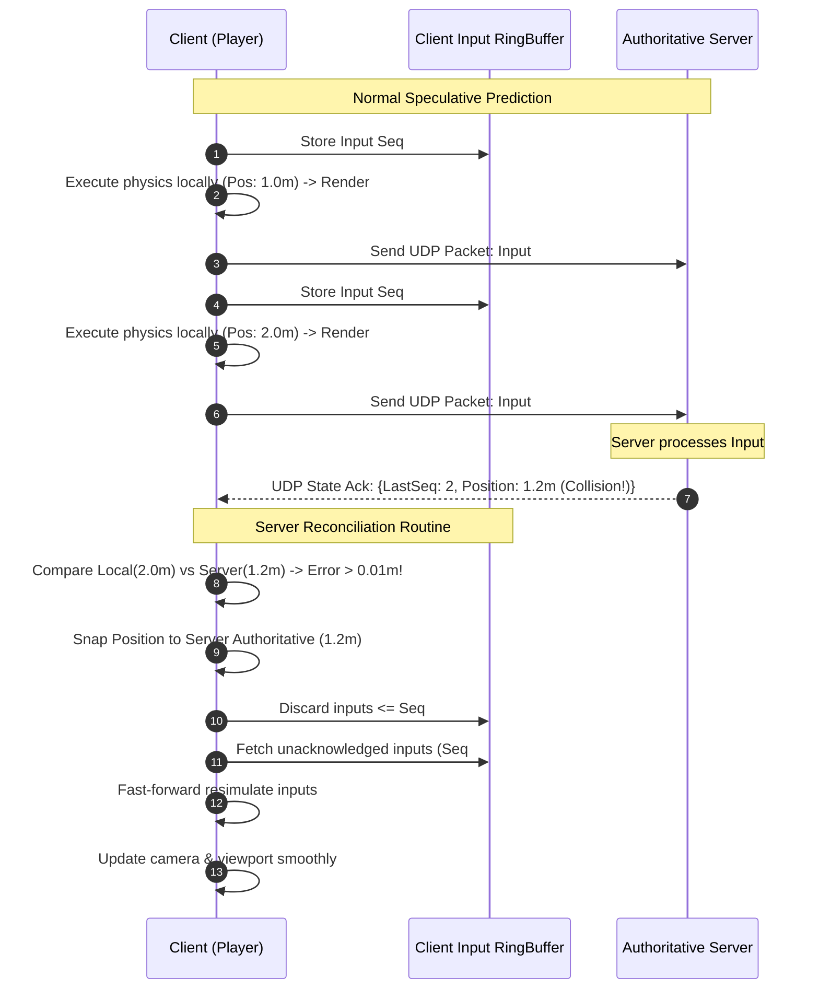
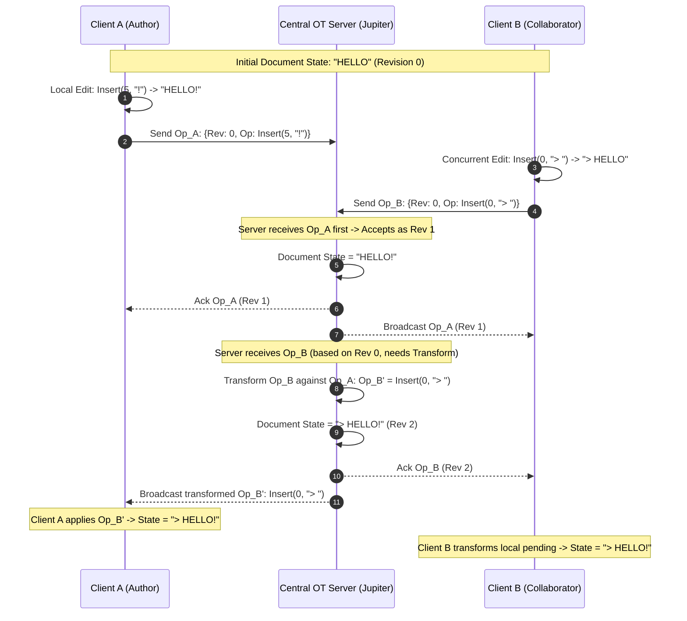
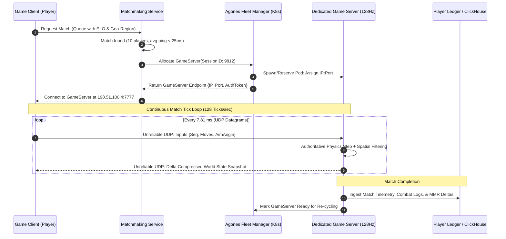

# Gaming & Real-Time Collaboration Systems: High-Level & Low-Level System Design

## 1. Executive Summary & Real-World Production Challenges

Multiplayer action games (*Call of Duty, Valorant, Counter-Strike 2, Rocket League*) and real-time collaboration platforms (*Google Docs, Figma, Notion, Miro*) represent the most latency-sensitive distributed systems in computer science. These systems must provide an illusion of zero latency to human users while maintaining strong mathematical consistency across geographically distributed clients separated by physical network delays, packet loss, and jitter.

```
                           THE LATENCY-CONSISTENCY PARADOX
                           
         HUMAN PERCEPTION THRESHOLD                   SPEED-OF-LIGHT PHYSICAL BOUND
         - 60 FPS: 16.6 ms per frame                  - Light in fiber optic: ~200 km/ms
         - 144 FPS: 6.94 ms per frame                 - NY to London (5,500 km): ~28 ms (1-way min)
         - Sub-50 ms: Illusion of instant touch       - Real-world transatlantic RTT: 70 - 100 ms
                        │                                           │
                        ▼                                           ▼
             ┌─────────────────────────────────────────────────────────────┐
             │       THE IMPOSSIBILITY: STATE CANNOT TRAVEL FASTER         │
             │       THAN FIBER-OPTIC LIGHT TO REACH CONSENSUS             │
             └──────────────────────────────┬──────────────────────────────┘
                                            │
                                            ▼
             ┌─────────────────────────────────────────────────────────────┐
             │                   ENGINEERING RESOLUTION                    │
             │  1. Gaming: Speculative Prediction + Historical Rollback    │
             │  2. Collaboration: Operational Transform (OT) or CRDTs     │
             └─────────────────────────────────────────────────────────────┘
```

---

### Real-World Production Scenarios & Disasters

#### 1. Riot Games (*Valorant*) & The "Peeker's Advantage" Netcode Crisis
- **The Phenomenon:** In first-person shooters (FPS), when Player A sprints around a corner, their client renders the enemy (Player B) instantly. However, Player B does not see Player A until Player A's movement packet reaches the server, the server processes the tick, and the update packet travels from the server to Player B. At a $60\text{ms}$ round-trip time (RTT), Player A has a $60-80\text{ms}$ visual reaction advantage ("Peeker's Advantage"), rendering competitive play unfair.
- **The Failure:** Naive authoritative server models with unoptimized interpolation create massive peeker advantages or severe hit-registration desyncs ("no-regs" — hearing blood splatter client-side while the server discards the shot).
- **The Engineering Shift:** Riot Games engineered **Project Stryker** and **Riot Direct** — a bespoke worldwide physical ISP backbone with Anycast routing to enforce $<35\text{ms}$ ping for 70% of players. Concurrently, they built a strict $128\text{Hz}$ tick rate server loop with deterministic sub-tick raycast historical rewind, bounding lag compensation to a strict $175\text{ms}$ window to eliminate peek exploits.

#### 2. Psyonix (*Rocket League*) & Floating-Point Physics Non-Determinism
- **The Event:** Unlike standard shooters where players are treated as discrete bounding boxes, *Rocket League* requires continuous, rigid-body physics calculations (car collisions, ball bounces, aerodynamic aerials) computed at $120\text{Hz}$.
- **The Failure:** Early prototypes attempted standard client-side prediction using stock PhysX physics engines. Because floating-point operations (IEEE 754) produce microscopic divergence across different CPU architectures (Intel x86 vs. AMD vs. ARM) and compiler optimization flags, the client's predicted ball trajectory diverged from the server within 2 seconds. The client's car vibrated violently ("rubber-banding") as the server continuously snapped the ball back.
- **The Engineering Shift:** Psyonix abandoned non-deterministic stock physics, rewrote Bullet Physics to enforce deterministic fixed-point integer mathematics, and implemented a custom rollback physics pipeline that resimulates up to 30 past physics frames in $<2\text{ms}$ upon receiving conflicting server input packets.

#### 3. Google Docs & The 2014 Jupiter Operational Transformation Outage
- **The Event:** A collaborative document shared across hundreds of concurrent enterprise users during an earnings call experienced localized network partitions.
- **The Failure:** Google Docs relies on **Operational Transformation (OT)** through its central coordinator service (*Jupiter*). When concurrent clients sent dense, multi-character paste and delete operations under fluctuating network conditions, the transformation queue on the central server experienced sequence order drift. The server failed to compute transformation property 2 (TP2), resulting in characters shuffling into unrecoverable scrambled anagrams across connected clients.
- **The Engineering Shift:** Google re-architected its OT client state machine to enforce strict 3-state transitions (`Synchronized`, `AwaitingACK`, `AwaitingACKWithPendingOperations`), serializing client mutations and bounding batch sizes.

#### 4. Figma & The Abandonment of OT in Favor of CRDTs
- **The Challenge:** Figma provides a multiplayer infinite design canvas. Unlike Google Docs (a 1D linear string of text), Figma documents are massive 2D/3D hierarchical tree structures (frames, groups, vector shapes, layout constraints, color fills).
- **The Bottleneck:** Applying Operational Transformation to hierarchical tree structures requires complex multidimensional transform matrices. Resolving concurrent operations such as "User A moves Node X inside Node Y" while "User B moves Node Y inside Node X" creates circular dependency cycles that break the entire document structure.
- **The Engineering Shift:** Figma abandoned OT entirely and built a custom fractional-indexing tree-based **Conflict-Free Replicated Data Type (CRDT)** running in WebAssembly (Wasm) compiled from C++ and Rust, paired with a central multiplayer server acting as an ordering coordinator.

---

## 2. Core Mathematical & Engineering Bottlenecks

### 2.1 The Distributed State Concurrency Trilemma

In real-time distributed interactive systems, you can choose at most **two** of the following three guarantees simultaneously:

```
                            THE CONCURRENCY TRILEMMA
                            
                           Instant Local Feedback
                             (0ms Perceived Lag)
                                    /\
                                   /  \
                                  /    \
                                 /      \
                                /        \
                               /          \
            Authoritative Server ────────── Fair Network
            Absolute Anti-Cheat             Convergence
            (Deterministic Order)           (Equal Advantage)
```

1. **Instant Local Feedback:** The user's input mutates their local viewport instantaneously without waiting for a network round trip.
2. **Authoritative Server Ordering:** A single source of truth validates all mutations to prevent physics cheating, teleportation, or illegal state transitions.
3. **Fair Network Convergence:** All participants across varying latency profiles observe identical state transitions without temporal advantages.

Systems balance this trilemma through distinct paradigms:
- **Fast-Paced Action Games:** Choose *Instant Local Feedback* + *Authoritative Server Ordering* via **Client-Side Prediction & Server Reconciliation**, sacrificing pure visual convergence (tolerating lag compensation artifacts like dying around corners).
- **Collaborative Document Editors:** Choose *Instant Local Feedback* + *Fair Network Convergence* via **CRDTs or Operational Transformation**, relaxing instantaneous global ordering in favor of eventual algebraic convergence.

---

### 2.2 Network Transport Mechanics: UDP vs. TCP vs. WebSockets vs. WebTransport

Transport layer protocol selection dictates architectural viability:

```
┌─────────────────────────────────────────────────────────────────────────────────────────────────┐
│                               HEAD-OF-LINE (HoL) BLOCKING PENALTY                               │
└─────────────────────────────────────────────────────────────────────────────────────────────────┘

  TCP / WebSocket Stream:
  Packet 1 [OK] ──► Packet 2 [LOST] ──► Packet 3 [HELD IN OS BUFFER] ──► Packet 4 [HELD]
                                              ▲
                                              │ ALL downstream frames delayed until
                                              │ Packet 2 is retransmitted (1 RTT penalty)!

  UDP / WebTransport Datagram Stream:
  Packet 1 [OK] ──► Packet 2 [LOST] ──► Packet 3 [PROCESSED IMMEDIATELY] ──► Packet 4 [PROCESSED]
                                              ▲
                                              │ Game engine discards stale Packet 2;
                                              │ State is superseded by newer Packet 4!
```

#### Protocol Comparison Matrix

| Protocol | Transport Layer | Connection Setup | Head-of-Line Blocking | Reliability Model | Primary Use Case |
| :--- | :--- | :--- | :--- | :--- | :--- |
| **TCP** | L4 | 3-way handshake ($1-1.5\text{ RTT}$) | **Severe** (Kernel-level) | Fully reliable, ordered | Turn-based games, initial auth |
| **UDP** | L4 | None ($0\text{ RTT}$) | **None** | Unreliable, unordered | Competitive FPS, Action games |
| **WebSockets** | L7 (over TCP) | HTTP Upgrade ($2-3\text{ RTT}$) | **Severe** (Inherits TCP) | Fully reliable, ordered | Browser collaboration (Google Docs) |
| **WebTransport** | L7 (over HTTP/3 QUIC) | TLS 1.3 + QUIC ($0-1\text{ RTT}$) | **None** (Per-stream/datagram) | Hybrid (Reliable streams + Unreliable datagrams) | Next-gen browser gaming & Figma canvas |

---

### 2.3 Clock Synchronization, Jitter & Tick Dynamics

#### Server Tick Loops vs. Client Render Loops
- **Server Tick Rate ($T_s$):** The fixed frequency at which the authoritative server computes world state (e.g., $64\text{Hz} = 15.625\text{ms}$ per tick, $128\text{Hz} = 7.8125\text{ms}$ per tick).
- **Client Frame Rate ($F_c$):** The variable frequency at which the client's GPU renders frames (e.g., $60\text{Hz}, 144\text{Hz}, 240\text{Hz}$).
- **The Phase Mismatch:** Because $F_c \neq T_s$, game engines use **Fixed Timestep Accumulators** with linear interpolation (`lerp`) to render states smoothly between discrete server ticks.

#### The Fixed Timestep Accumulator Formula
$$\text{accumulator} = \text{accumulator} + \Delta t_{\text{frame}}$$
$$\text{while } (\text{accumulator} \ge \Delta t_{\text{tick}}): \quad \text{Simulate}(\Delta t_{\text{tick}}); \quad \text{accumulator} -= \Delta t_{\text{tick}}$$
$$\alpha = \frac{\text{accumulator}}{\Delta t_{\text{tick}}} \implies \text{RenderState} = \text{lerp}(\text{PreviousState}, \text{CurrentState}, \alpha)$$

---

## 3. Real-Time Multiplayer Action Games (Netcode)

We explore the four foundational netcode approaches powering modern multiplayer game engines (Unreal Engine, Unity, Source 2, Valve SDR).

---

## Approach 1: Client-Side Prediction & Server Reconciliation

### High-Level Design (HLD)

In a pure client-server model without prediction, if a player presses "Move Forward" with $50\text{ms}$ network latency, the character remains stationary for $100\text{ms}$ (Round-Trip Time) before moving on screen.

**Client-Side Prediction** breaks this delay:
1. When input is sampled, the client immediately applies the movement vector locally.
2. The client tags the input with a monotonic sequence number $N$ and transmits it to the server.
3. The server runs the identical physics simulation, computes the true authoritative state, and replies with:
   $$\text{AuthoritativeState} = \{\text{tick}: K, \text{last\_processed\_input}: N, \text{position}: \mathbf{P}_{\text{server}}, \text{velocity}: \mathbf{V}_{\text{server}}\}$$
4. **Server Reconciliation:** The client inspects the server snapshot. If the server's authoritative position matches the client's historical prediction at sequence $N$, the prediction was correct. If there is a discrepancy (e.g., an enemy blocked the path), the client snaps to the server position and **re-simulates all inputs** from $N+1$ up to the current sequence number.

```
┌────────────────────────────────────────────────────────────────────────────────────────────────────────┐
│                          CLIENT-SIDE PREDICTION & RECONCILIATION WORKFLOW                              │
└────────────────────────────────────────────────────────────────────────────────────────────────────────┘

  CLIENT (Tick 105)                                                        SERVER (Tick 100)
  ─────────────────                                                        ─────────────────
  Input: Seq 105 (Key 'W')
  Simulate: Pos = (0, 10.5) ─── Packet: {Seq: 105, Move: +1.0} ────────►
  Render immediately!                                                      Process Seq 105:
                                                                           Calculates: Pos = (0, 9.8)
                                                                           (Path obstructed by wall!)
                                ◄── Packet: {AckSeq: 105, AuthPos: (0, 9.8)}
  RECONCILIATION:
  1. Compare predicted Pos (10.5) vs Server Pos (9.8)
  2. Discrepancy > Epsilon (0.7m error detected)
  3. SNAP local state to (0, 9.8)
  4. REPLAY stored inputs:
     - Seq 106 (+1.0) -> Pos = (0, 10.8)
     - Seq 107 (+1.0) -> Pos = (0, 11.8)
  5. Render corrected state!
```



---

### Low-Level Design (LLD)

#### 1. Data Structures & Ring Buffers
To prevent dynamic memory allocations in tight tick loops ($7.8\text{ms}$ budget), inputs and states are stored in fixed-size circular ring buffers indexed by sequence modulo buffer size.

```python
# Fixed memory structures for zero-garbage-collection cycles
INPUT_BUFFER_SIZE = 1024  # Holds ~8 seconds of input history at 128 Hz
```

#### 2. Reconciliation Epsilon Threshold
Direct floating-point comparison `pos_client == pos_server` fails due to precision noise. Systems apply an error epsilon:
$$\Delta = \|\mathbf{P}_{\text{predicted}}[N] - \mathbf{P}_{\text{authoritative}}[N]\|$$
$$\text{If } \Delta > \epsilon \quad (\text{typically } 0.001\text{m} \le \epsilon \le 0.05\text{m}) \implies \text{Trigger Rollback Replay}$$

#### 3. Production Implementation: Prediction & Reconciliation Engine

```python
"""
Client-Side Prediction and Server Reconciliation Engine.
Production-grade simulation demonstrating input ring-buffering, speculative execution,
authoritative server state generation, and deterministic client replay.
"""

from dataclasses import dataclass, field
from typing import List, Optional, Dict
import math

@dataclass(slots=True)
class PlayerInput:
    sequence_number: int
    delta_time: float
    move_x: float
    move_y: float

@dataclass(slots=True)
class PlayerState:
    sequence_number: int
    pos_x: float
    pos_y: float
    vel_x: float
    vel_y: float

class PhysicsWorld:
    """Deterministic 2D point physics with friction and static boundary collisions."""
    FRICTION: float = 0.85
    ACCELERATION: float = 25.0
    OBSTACLE_X: float = 5.0  # Static obstacle on X-axis

    @classmethod
    def step(cls, state: PlayerState, inp: PlayerInput) -> PlayerState:
        # Calculate velocity
        new_vx = (state.vel_x + inp.move_x * cls.ACCELERATION * inp.delta_time) * cls.FRICTION
        new_vy = (state.vel_y + inp.move_y * cls.ACCELERATION * inp.delta_time) * cls.FRICTION

        # Calculate speculative position
        new_px = state.pos_x + new_vx * inp.delta_time
        new_py = state.pos_y + new_vy * inp.delta_time

        # Obstacle collision constraint
        if new_px > cls.OBSTACLE_X:
            new_px = cls.OBSTACLE_X
            new_vx = 0.0

        return PlayerState(
            sequence_number=inp.sequence_number,
            pos_x=round(new_px, 5),
            pos_y=round(new_py, 5),
            vel_x=round(new_vx, 5),
            vel_y=round(new_vy, 5)
        )

class ClientPredictionEngine:
    """Runs locally on player device; predicts inputs speculatively and reconciles against server."""
    def __init__(self, epsilon: float = 0.01):
        self.epsilon = epsilon
        self.current_state = PlayerState(0, 0.0, 0.0, 0.0, 0.0)
        self.input_sequence = 0
        self.input_history: Dict[int, PlayerInput] = {}
        self.state_history: Dict[int, PlayerState] = {}

    def sample_and_predict_input(self, move_x: float, move_y: float, dt: float) -> PlayerInput:
        self.input_sequence += 1
        inp = PlayerInput(self.input_sequence, dt, move_x, move_y)
        
        # Store input for future reconciliation
        self.input_history[self.input_sequence] = inp
        
        # Speculatively apply physics immediately
        self.current_state = PhysicsWorld.step(self.current_state, inp)
        self.state_history[self.input_sequence] = self.current_state
        return inp

    def reconcile_with_server(self, auth_state: PlayerState) -> bool:
        """
        Validates server snapshot against local prediction.
        Returns True if rollback resimulation was executed.
        """
        ack_seq = auth_state.sequence_number
        if ack_seq not in self.state_history:
            return False

        predicted_state = self.state_history[ack_seq]
        distance_error = math.sqrt(
            (predicted_state.pos_x - auth_state.pos_x) ** 2 +
            (predicted_state.pos_y - auth_state.pos_y) ** 2
        )

        # Discard historical inputs and states acknowledged by server
        acknowledged_keys = [seq for seq in self.input_history.keys() if seq <= ack_seq]
        for seq in acknowledged_keys:
            del self.input_history[seq]
            if seq in self.state_history:
                del self.state_history[seq]

        if distance_error <= self.epsilon:
            # Prediction was mathematically accurate within tolerance
            return False

        # --- RECONCILIATION ROLLBACK TRIGGERED ---
        # 1. Snap to authoritative server state
        replay_state = auth_state
        
        # 2. Replay all unacknowledged inputs in sequential order
        for seq in sorted(self.input_history.keys()):
            replay_input = self.input_history[seq]
            replay_state = PhysicsWorld.step(replay_state, replay_input)
            self.state_history[seq] = replay_state

        self.current_state = replay_state
        return True

# --- Verification & Execution ---
if __name__ == "__main__":
    client = ClientPredictionEngine(epsilon=0.01)

    # 1. Client predicts 5 forward movements towards the obstacle
    for i in range(5):
        client.sample_and_predict_input(move_x=1.0, move_y=0.0, dt=0.1)

    print(f"Speculative Predicted Pos: X={client.current_state.pos_x}, Seq={client.input_sequence}")

    # 2. Server processes sequence 3, but hits obstacle earlier than client anticipated
    authoritative_state_seq3 = PlayerState(sequence_number=3, pos_x=4.2, pos_y=0.0, vel_x=0.0, vel_y=0.0)

    # 3. Client receives server state and reconciles
    did_reconcile = client.reconcile_with_server(authoritative_state_seq3)
    print(f"Reconciliation Triggered: {did_reconcile}")
    print(f"Reconciled Replayed Pos:   X={client.current_state.pos_x}, CurrentSeq={client.input_sequence}")
```

---

## Approach 2: Lag Compensation (Historical Rewind Buffering)

### High-Level Design (HLD)

#### The Problem: "Shooting Where They Were"
Suppose Player A (ping $40\text{ms}$) shoots at Player B (ping $80\text{ms}$).
Due to entity interpolation delays ($50\text{ms}$) and network transit, Player A sees Player B at the exact coordinates Player B occupied $90\text{ms}$ in the past.
If the authoritative server evaluates the bullet raycast against the world's *current* coordinates, the bullet hits thin air because Player B has already moved forward on the server.

```
┌────────────────────────────────────────────────────────────────────────────────────────────────────────┐
│                              THE LAG COMPENSATION REWIND MECHANISM                                     │
└────────────────────────────────────────────────────────────────────────────────────────────────────────┘

  Server Current Time: T = 1000ms
  Player A fires at Player B.
  Player A's Packet arrives at Server at T = 1000ms with timestamp T_shot = 910ms.

  1. SERVER HISTORICAL BUFFER:
     [Tick 900ms] ──► [Tick 910ms] ──► [Tick 920ms] ──► ... ──► [Tick 1000ms (Present)]
                           ▲
                           │
  2. REWIND: Server moves Player B's hitbox backward in time to T = 910ms.
  3. RAYCAST: Server evaluates bullet line segment against Player B's historical hitbox.
  4. DECISION: HIT CONFIRMED! Damage applied.
  5. RESTORE: Server restores Player B's hitbox back to T = 1000ms (Present).
```

---

### Low-Level Design (LLD)

#### 1. Rewind Time Calculation Formula
$$T_{\text{rewind}} = T_{\text{server\_current}} - \left(\frac{\text{RTT}_{\text{shooter}}}{2}\right) - T_{\text{client\_interpolation\_delay}}$$

To prevent exploits from hacked clients spoofing high ping values to shoot players who safely took cover 3 seconds ago, the server enforces an **anti-exploitation clamp**:
$$T_{\text{rewind}} = \max\left(T_{\text{server\_current}} - T_{\text{max\_lag\_compensation}}, \quad T_{\text{rewind}}\right)$$
*Where $T_{\text{max\_lag\_compensation}}$ is strictly bounded (typically $150\text{ms} - 250\text{ms}$).*

#### 2. Sub-Tick Hitbox Linear Interpolation (`lerp`)
If $T_{\text{rewind}}$ falls between discrete tick snapshots $T_k$ and $T_{k+1}$, the server interpolates the exact Axis-Aligned Bounding Box (AABB):
$$\alpha = \frac{T_{\text{rewind}} - T_k}{T_{k+1} - T_k}$$
$$\mathbf{Hitbox}(T_{\text{rewind}}) = (1 - \alpha) \cdot \mathbf{Hitbox}(T_k) + \alpha \cdot \mathbf{Hitbox}(T_{k+1})$$

#### 3. Production Implementation: Lag Compensation Rewind Buffer

```python
"""
Server-Side Lag Compensation Engine with Sub-Tick Hitbox Interpolation.
Maintains historical bounding-box ring buffers, rewinds time during shot verification,
and evaluates 2D Ray-AABB intersection tests.
"""

from dataclasses import dataclass
from typing import List, Dict, Optional
import math

@dataclass(slots=True)
class AABB:
    """Axis-Aligned Bounding Box."""
    min_x: float
    min_y: float
    max_x: float
    max_y: float

    def intersects_ray(self, ray_orig_x: float, ray_orig_y: float, ray_dir_x: float, ray_dir_y: float) -> bool:
        """Fast slab method for 2D Ray-AABB intersection."""
        t1 = (self.min_x - ray_orig_x) / (ray_dir_x if ray_dir_x != 0 else 1e-9)
        t2 = (self.max_x - ray_orig_x) / (ray_dir_x if ray_dir_x != 0 else 1e-9)
        t3 = (self.min_y - ray_orig_y) / (ray_dir_y if ray_dir_y != 0 else 1e-9)
        t4 = (self.max_y - ray_orig_y) / (ray_dir_y if ray_dir_y != 0 else 1e-9)

        tmin = max(min(t1, t2), min(t3, t4))
        tmax = min(max(t1, t2), max(t3, t4))

        return tmax >= max(0.0, tmin)

@dataclass(slots=True)
class HistoricalSnapshot:
    timestamp_ms: float
    hitboxes: Dict[str, AABB]

class LagCompensator:
    def __init__(self, max_history_ms: float = 1000.0, max_rewind_limit_ms: float = 200.0):
        self.max_history_ms = max_history_ms
        self.max_rewind_limit_ms = max_rewind_limit_ms
        self.history: List[HistoricalSnapshot] = []

    def record_tick(self, timestamp_ms: float, hitboxes: Dict[str, AABB]):
        self.history.append(HistoricalSnapshot(timestamp_ms, hitboxes))
        # Evict snapshots older than max_history_ms
        cutoff = timestamp_ms - self.max_history_ms
        self.history = [snap for snap in self.history if snap.timestamp_ms >= cutoff]

    def _interpolate_hitbox(self, box_a: AABB, box_b: AABB, alpha: float) -> AABB:
        return AABB(
            min_x=(1 - alpha) * box_a.min_x + alpha * box_b.min_x,
            min_y=(1 - alpha) * box_a.min_y + alpha * box_b.min_y,
            max_x=(1 - alpha) * box_a.max_x + alpha * box_b.max_x,
            max_y=(1 - alpha) * box_a.max_y + alpha * box_b.max_y,
        )

    def evaluate_shot(
        self,
        current_time_ms: float,
        shooter_rtt_ms: float,
        interp_delay_ms: float,
        ray_x: float, ray_y: float,
        dir_x: float, dir_y: float,
        target_player_id: str
    ) -> bool:
        # Calculate requested rewind target time
        target_rewind_time = current_time_ms - (shooter_rtt_ms / 2.0) - interp_delay_ms

        # Enforce anti-cheat maximum rewind clamp
        clamped_rewind_time = max(current_time_ms - self.max_rewind_limit_ms, target_rewind_time)

        if len(self.history) < 2:
            return False

        # Find the two historical snapshots sandwiching the rewind time
        snap_before: Optional[HistoricalSnapshot] = None
        snap_after: Optional[HistoricalSnapshot] = None

        for i in range(len(self.history) - 1):
            if self.history[i].timestamp_ms <= clamped_rewind_time <= self.history[i + 1].timestamp_ms:
                snap_before = self.history[i]
                snap_after = self.history[i + 1]
                break

        if not snap_before or not snap_after:
            return False

        if target_player_id not in snap_before.hitboxes or target_player_id not in snap_after.hitboxes:
            return False

        # Calculate linear interpolation factor alpha
        time_span = snap_after.timestamp_ms - snap_before.timestamp_ms
        alpha = (clamped_rewind_time - snap_before.timestamp_ms) / (time_span if time_span > 0 else 1.0)

        # Reconstruct historical hitbox at exact sub-tick moment of shooting
        historical_hitbox = self._interpolate_hitbox(
            snap_before.hitboxes[target_player_id],
            snap_after.hitboxes[target_player_id],
            alpha
        )

        # Raycast intersection test
        return historical_hitbox.intersects_ray(ray_x, ray_y, dir_x, dir_y)

# --- Verification & Execution ---
if __name__ == "__main__":
    server_time = 1000.0  # Present time in ms
    compensator = LagCompensator(max_rewind_limit_ms=200.0)

    # Record historical movement of Target Player
    # Moving along X axis: from x=[10,12] at 800ms to x=[16,18] at 1000ms
    compensator.record_tick(800.0, {"player_b": AABB(10.0, -1.0, 12.0, 1.0)})
    compensator.record_tick(900.0, {"player_b": AABB(13.0, -1.0, 15.0, 1.0)})
    compensator.record_tick(1000.0, {"player_b": AABB(16.0, -1.0, 18.0, 1.0)})

    # Shooter has 100ms RTT and 50ms interp delay -> Total latency = 100ms
    # Shot targeted where Player B was at T = 900ms (X centered at 14.0)
    ray_origin_x, ray_origin_y = 14.0, -10.0
    ray_direction_x, ray_direction_y = 0.0, 1.0  # Firing North along Y axis

    hit_confirmed = compensator.evaluate_shot(
        current_time_ms=1000.0,
        shooter_rtt_ms=100.0,
        interp_delay_ms=50.0,
        ray_x=ray_origin_x, ray_y=ray_origin_y,
        dir_x=ray_direction_x, dir_y=ray_direction_y,
        target_player_id="player_b"
    )

    print(f"Server Present Target Position: X=[16.0, 18.0]")
    print(f"Shot evaluated against T=900ms historical rewind.")
    print(f"Hit Registration Result: {hit_confirmed}")
```

---

## Approach 3: Entity Interpolation & Dead Reckoning

### High-Level Design (HLD)

When receiving world snapshots from the server over UDP, network jitter causes packets to arrive at irregular intervals ($15\text{ms}, 35\text{ms}, 8\text{ms}$). Rendering entity positions as soon as packets arrive produces jarring visual stutter.

```
┌────────────────────────────────────────────────────────────────────────────────────────────────────────┐
│                              ENTITY INTERPOLATION BUFFER TIMELINE                                      │
└────────────────────────────────────────────────────────────────────────────────────────────────────────┘

  Server Clock (Present): ───────────────────────────────────────────► T = 200ms
  Latest Packet Arrived at Client: ──────────────────────────────────► T = 180ms
  CLIENT RENDER CLOCK (T_render = T_present - 100ms): ──────────────► T = 100ms
                                                                         │
                                                Interpolates smoothly    │
                                                between snapshots at     │
                                                T=80ms and T=120ms! ─────┘
```

1. **Entity Interpolation:** The client intentionally buffers remote entities and delays rendering them by a constant window (e.g., $50\text{ms} - 100\text{ms}$). The client always has at least two historical snapshots to interpolate between, delivering perfectly smooth movement even if intermediate packets experience jitter.
2. **Dead Reckoning (Extrapolation):** If packet loss causes the buffer to run dry, the engine switches to predictive extrapolation:
   $$\mathbf{P}_{\text{render}}(t) = \mathbf{P}_{\text{last}} + \mathbf{V}_{\text{last}} \cdot \Delta t + \frac{1}{2} \mathbf{A}_{\text{last}} \cdot \Delta t^2$$

---

## Approach 4: Spatial Interest Management & Area of Interest (AoI)

### High-Level Design (HLD)

In a 100-player Battle Royale (e.g., *Warzone, PUBG*), broadcasting every player's location to all 100 clients at $60\text{Hz}$ produces catastrophic network overhead:
$$\text{Messages/sec} = N \cdot (N - 1) \cdot \text{TickRate} = 100 \times 99 \times 60 = 594,000 \text{ packets/sec}$$

```
┌────────────────────────────────────────────────────────────────────────────────────────────────────────┐
│                               2D GRID SPATIAL INTEREST MANAGEMENT (AoI)                                │
└────────────────────────────────────────────────────────────────────────────────────────────────────────┘

        Col 0              Col 1              Col 2              Col 3
    ┌──────────────────┬──────────────────┬──────────────────┬──────────────────┐
    │                  │  Subscriber to   │  Subscriber to   │                  │
Row │     Cell 0,0     │     Cell 0,1     │     Cell 0,2     │     Cell 0,3     │
 0  │                  │  Active Zone     │  Active Zone     │                  │
    ├──────────────────┼──────────────────┼──────────────────┼──────────────────┤
    │                  │ [NEIGHBOR CELL]  │ [NEIGHBOR CELL]  │                  │
Row │     Cell 1,0     │    Player B      │    Player C      │     Cell 1,3     │
 1  │                  │        o         │        o         │                  │
    ├──────────────────┼──────────────────┼──────────────────┼──────────────────┤
    │                  │ [NEIGHBOR CELL]  │ [ACTIVE CELL]    │                  │
Row │     Cell 2,0     │                  │  Player A (o)    │     Cell 2,3     │
 2  │                  │                  │  (9-Cell Radius) │                  │
    └──────────────────┴──────────────────┴──────────────────┴──────────────────┘

    Player A only receives state packets for entities in Cell (2,2) and its 8 adjacent neighbor cells.
    Entities in Cell (0,0) or (0,3) are completely culled from Player A's network stream!
```

### Low-Level Design (LLD): Bit-Packing & Delta Compression
To minimize UDP packet size below the Ethernet MTU threshold ($1500\text{ bytes}$), positions are quantized from 32-bit floating-point coordinates into 16-bit unsigned integers:
$$\text{QuantizedInt16} = \text{uint16}\left(\frac{\text{Pos} - \text{MinBound}}{\text{MaxBound} - \text{MinBound}} \times 65535\right)$$
This reduces coordinate bandwidth by **50%** per entity before transmission.

---

## 4. Collaborative Document Synchronization

Now we transition to real-time collaborative applications (*Google Docs, Figma, Notion*), where concurrent text and tree mutations must converge without central locking.

---

## Approach 5: Centralized Operational Transformation (OT)

### High-Level Design (HLD)

Operational Transformation (invented by Ellis and Gibbs in 1989, popularized by Google Wave and Google Docs) resolves concurrent edits by maintaining operations as positional intents (`Insert(index, char)`, `Delete(index)`) and transforming their positional indices against concurrent operations.

```
┌────────────────────────────────────────────────────────────────────────────────────────────────────────┐
│                               OPERATIONAL TRANSFORMATION (OT) FORK & CONVERGENCE                      │
└────────────────────────────────────────────────────────────────────────────────────────────────────────┘

                               Base Document State: "CAT"
                                           │
                    ┌──────────────────────┴──────────────────────┐
                    │                                             │
             User A Action:                                User B Action:
           Insert(0, "B")                                Delete(2, "T")
          Result: "BCAT"                                 Result: "CA"
                    │                                             │
                    └──────────────────────┬──────────────────────┘
                                           ▼
                                 CENTRAL OT SERVER
                    Transforms Op_A against Op_B:
                    - Op_A shifted User B's target index to the right (+1)!
                    - Transformed Op_B' = Delete(3, "T")
                    - Transformed Op_A' = Insert(0, "B")
                                           │
                    ┌──────────────────────┴──────────────────────┐
                    ▼                                             ▼
          Apply Op_B' to User A:                        Apply Op_A' to User B:
          "BCAT" -> Delete(3)                           "CA" -> Insert(0, "B")
          State = "BCA"                                 State = "BCA"
                    └──────────────────────┬──────────────────────┘
                                           ▼
                             MATHEMATICAL CONVERGENCE REACHED!
```



---

### Low-Level Design (LLD)

#### 1. Transformation Functions
Let $O_1 = \text{Insert}(p_1, c_1)$ and $O_2 = \text{Insert}(p_2, c_2)$:
$$T(O_1, O_2) = \begin{cases} 
O_1' = \text{Insert}(p_1 + 1, c_1) & \text{if } p_1 > p_2 \text{ or } (p_1 = p_2 \land \text{ClientID}_1 > \text{ClientID}_2) \\
O_1' = O_1 & \text{otherwise}
\end{cases}$$

Let $O_1 = \text{Delete}(p_1)$ and $O_2 = \text{Insert}(p_2, c_2)$:
$$T(O_1, O_2) = \begin{cases} 
O_1' = \text{Delete}(p_1 + 1) & \text{if } p_1 \ge p_2 \\
O_1' = O_1 & \text{otherwise}
\end{cases}$$

#### 2. The 3-State Client Machine (Jupiter Architecture)
The client resides in one of three states at any given moment:
1. `SYNCHRONIZED`: No local pending edits.
2. `AWAITING_ACK`: One operation sent to server; waiting for confirmation.
3. `AWAITING_ACK_WITH_PENDING`: One operation inflight, additional local edits buffered locally.

#### 3. Production Implementation: Jupiter Operational Transformation Engine

```python
"""
Jupiter Centralized Operational Transformation (OT) Engine.
Demonstrates text mutation transforms (Insert/Delete), state synchronization,
and multi-client convergence against a central coordinator.
"""

from dataclasses import dataclass
from typing import Tuple, List, Optional
from enum import Enum

class OpType(Enum):
    INSERT = "INSERT"
    DELETE = "DELETE"

@dataclass(slots=True)
class Operation:
    op_type: OpType
    position: int
    char: str
    client_id: str
    revision: int

def transform(op_a: Operation, op_b: Operation) -> Tuple[Operation, Operation]:
    """
    Transforms op_a against concurrent op_b such that:
    op_a' can be applied after op_b, and op_b' can be applied after op_a.
    """
    # Case 1: INSERT vs INSERT
    if op_a.op_type == OpType.INSERT and op_b.op_type == OpType.INSERT:
        if op_a.position > op_b.position or (op_a.position == op_b.position and op_a.client_id > op_b.client_id):
            a_prime = Operation(OpType.INSERT, op_a.position + len(op_b.char), op_a.char, op_a.client_id, op_b.revision + 1)
            b_prime = Operation(OpType.INSERT, op_b.position, op_b.char, op_b.client_id, op_a.revision + 1)
        else:
            a_prime = Operation(OpType.INSERT, op_a.position, op_a.char, op_a.client_id, op_b.revision + 1)
            b_prime = Operation(OpType.INSERT, op_b.position + len(op_a.char), op_b.char, op_b.client_id, op_a.revision + 1)
        return a_prime, b_prime

    # Case 2: INSERT vs DELETE
    elif op_a.op_type == OpType.INSERT and op_b.op_type == OpType.DELETE:
        if op_a.position > op_b.position:
            a_prime = Operation(OpType.INSERT, op_a.position - 1, op_a.char, op_a.client_id, op_b.revision + 1)
        else:
            a_prime = Operation(OpType.INSERT, op_a.position, op_a.char, op_a.client_id, op_b.revision + 1)
        
        b_prime = Operation(OpType.DELETE, op_b.position + (1 if op_b.position >= op_a.position else 0),
                            op_b.char, op_b.client_id, op_a.revision + 1)
        return a_prime, b_prime

    # Case 3: DELETE vs INSERT
    elif op_a.op_type == OpType.DELETE and op_b.op_type == OpType.INSERT:
        b_prime, a_prime = transform(op_b, op_a)
        return a_prime, b_prime

    # Case 4: DELETE vs DELETE
    else:
        if op_a.position > op_b.position:
            a_prime = Operation(OpType.DELETE, op_a.position - 1, op_a.char, op_a.client_id, op_b.revision + 1)
            b_prime = Operation(OpType.DELETE, op_b.position, op_b.char, op_b.client_id, op_a.revision + 1)
        elif op_a.position < op_b.position:
            a_prime = Operation(OpType.DELETE, op_a.position, op_a.char, op_a.client_id, op_b.revision + 1)
            b_prime = Operation(OpType.DELETE, op_b.position - 1, op_b.char, op_b.client_id, op_a.revision + 1)
        else:
            # Both delete same character: Null operations
            a_prime = Operation(OpType.DELETE, op_a.position, "", op_a.client_id, op_b.revision + 1)
            b_prime = Operation(OpType.DELETE, op_b.position, "", op_b.client_id, op_a.revision + 1)
        return a_prime, b_prime

class CentralOTServer:
    def __init__(self, initial_text: str = ""):
        self.text = initial_text
        self.history: List[Operation] = []
        self.current_revision = 0

    def apply_operation(self, op: Operation) -> Operation:
        # Transform incoming operation against all historical operations occurred after op.revision
        transformed_op = op
        for historical_op in self.history[op.revision:]:
            transformed_op, _ = transform(transformed_op, historical_op)

        # Mutate central document text
        if transformed_op.op_type == OpType.INSERT:
            self.text = self.text[:transformed_op.position] + transformed_op.char + self.text[transformed_op.position:]
        elif transformed_op.op_type == OpType.DELETE and transformed_op.char != "":
            self.text = self.text[:transformed_op.position] + self.text[transformed_op.position + 1:]

        self.current_revision += 1
        transformed_op.revision = self.current_revision
        self.history.append(transformed_op)
        return transformed_op

# --- Verification & Execution ---
if __name__ == "__main__":
    server = CentralOTServer(initial_text="CAT")

    # Client A wants to Insert 'B' at 0 -> "BCAT"
    op_user_a = Operation(OpType.INSERT, position=0, char="B", client_id="UserA", revision=0)

    # Client B concurrently wants to Delete 'T' at index 2 -> "CA"
    op_user_b = Operation(OpType.DELETE, position=2, char="T", client_id="UserB", revision=0)

    # Server receives Op A first
    applied_a = server.apply_operation(op_user_a)
    print(f"After User A: '{server.text}' (Rev {server.current_revision})")

    # Server receives Op B (submitted with Rev 0, but server is at Rev 1)
    applied_b = server.apply_operation(op_user_b)
    print(f"After User B: '{server.text}' (Rev {server.current_revision})")
    print(f"User B transformed position: {applied_b.position} (Shifted right by User A's insert)")
```

---

## Approach 6: Conflict-Free Replicated Data Types (CRDTs)

### High-Level Design (HLD)

Unlike OT, which requires an authoritative central server to dictate global sequence ordering, **CRDTs (Conflict-Free Replicated Data Types)** are designed so that updates can be applied in **any order, across peer-to-peer or offline-first topologies**, with guaranteed mathematical convergence.

```
┌────────────────────────────────────────────────────────────────────────────────────────────────────────┐
│                                 CRDT STRONG EVENTUAL CONSISTENCY (SEC)                                 │
└────────────────────────────────────────────────────────────────────────────────────────────────────────┘

    Client A State (Replica 1)                           Client B State (Replica 2)
    ┌────────────────────────┐                           ┌────────────────────────┐
    │ Node(ID: A1, Val: 'H') │                           │ Node(ID: A1, Val: 'H') │
    │ Node(ID: A2, Val: 'I') │                           │ Node(ID: A2, Val: 'I') │
    └───────────┬────────────┘                           └───────────┬────────────┘
                │                                                    │
     Insert 'A' │ (Concurrent Offline Edits)              Insert 'B' │
                ▼                                                    ▼
    ┌────────────────────────┐                           ┌────────────────────────┐
    │ Node(ID: A1, Val: 'H') │                           │ Node(ID: A1, Val: 'H') │
    │ Node(ID: A3, Val: 'A') │                           │ Node(ID: B1, Val: 'B') │
    │ Node(ID: A2, Val: 'I') │                           │ Node(ID: A2, Val: 'I') │
    └───────────┬────────────┘                           └───────────┬────────────┘
                │                                                    │
                └─────────────────── SYNC EXCHANGE ──────────────────┘
                                             │
                                             ▼
                             DETERMINISTIC CONVERGENCE:
                             Sort ID(A3) vs ID(B1) by Lamport Clock & ClientID!
                                             │
                                             ▼
                    Both replicas independently converge to: "HBAI"
```

#### The Mathematical Foundation: Join-Semilattices
A state-based CRDT (CvRDT) forms a Join-Semilattice $\langle S, \sqcup \rangle$ with a partial order $\le$ satisfying:
1. **Commutativity:** $x \sqcup y = y \sqcup x$
2. **Associativity:** $(x \sqcup y) \sqcup z = x \sqcup (y \sqcup z)$
3. **Idempotency:** $x \sqcup x = x$

---

### Low-Level Design (LLD): Sequence CRDTs (RGA / YATA Model)

Text cannot simply be stored as an array of characters, because array indices shift during insertions. Sequence CRDTs represent text as a **linked list of immutable character nodes**, where each node has a globally unique, immutable ID:
$$\text{ID} = \langle \text{LamportTimestamp}, \text{ClientID} \rangle$$

#### 1. Node Ordering Rule
When two clients concurrently insert a character after the same left neighbor:
1. Compare `LamportTimestamp`: Higher timestamp wins (positioned first).
2. If timestamps match, compare `ClientID` lexicographically as a tie-breaker.

#### 2. The Tombstone Dilemma
When a character is deleted, it **cannot be physically freed from memory**, because a concurrent inflight packet might reference that node as its left neighbor! Deletions mark nodes as `is_deleted = True` (**Tombstone**).
*Modern libraries like Yjs and Automerge run background garbage collection during document snapshot compaction.*

#### 3. Production Implementation: Replicated Growable Array (RGA) CRDT

```python
"""
Replicated Growable Array (RGA) Sequence CRDT Engine.
Production-grade implementation demonstrating immutable Lamport IDs,
deterministic concurrent insertion tie-breaking, and tombstone deletions.
"""

from dataclasses import dataclass
from typing import List, Optional, Tuple

@dataclass(slots=True, order=True)
class NodeID:
    lamport_clock: int
    client_id: str

@dataclass(slots=True)
class CRDTNode:
    id: NodeID
    value: str
    left_id: Optional[NodeID]
    is_deleted: bool = False

class SequenceCRDT:
    def __init__(self, client_id: str):
        self.client_id = client_id
        self.lamport_clock = 0
        # Head sentinel node
        self.head = CRDTNode(id=NodeID(0, "ROOT"), value="", left_id=None)
        self.nodes: List[CRDTNode] = [self.head]

    def _tick_clock(self, external_clock: int = 0):
        self.lamport_clock = max(self.lamport_clock, external_clock) + 1

    def local_insert(self, index: int, char: str) -> CRDTNode:
        """Inserts a character at visible string index."""
        self._tick_clock()
        new_id = NodeID(self.lamport_clock, self.client_id)

        # Locate preceding visible character node
        left_node = self._find_visible_node_at(index - 1)
        left_id = left_node.id if left_node else self.head.id

        new_node = CRDTNode(id=new_id, value=char, left_id=left_id)
        self._integrate_node(new_node)
        return new_node

    def local_delete(self, index: int) -> Optional[NodeID]:
        """Tombstones the character at visible string index."""
        target_node = self._find_visible_node_at(index)
        if target_node:
            target_node.is_deleted = True
            return target_node.id
        return None

    def remote_integrate(self, new_node: CRDTNode):
        """Integrates a node received from a remote replica."""
        self._tick_clock(new_node.id.lamport_clock)
        self._integrate_node(new_node)

    def _find_visible_node_at(self, target_index: int) -> Optional[CRDTNode]:
        if target_index < 0:
            return self.head
        current_idx = -1
        for node in self.nodes[1:]:  # Skip root sentinel
            if not node.is_deleted:
                current_idx += 1
                if current_idx == target_index:
                    return node
        return None

    def _integrate_node(self, new_node: CRDTNode):
        # Prevent duplicate integration (Idempotency)
        if any(n.id == new_node.id for n in self.nodes):
            return

        # Find position of left_id
        left_idx = 0
        for i, node in enumerate(self.nodes):
            if node.id == new_node.left_id:
                left_idx = i
                break

        # Scan right to locate exact deterministic insertion index
        insert_idx = left_idx + 1
        while insert_idx < len(self.nodes):
            sibling = self.nodes[insert_idx]
            # Must remain within child branches of the same left neighbor
            if sibling.left_id != new_node.left_id:
                break
            # Deterministic ordering: Higher Lamport clock or ClientID wins
            if sibling.id < new_node.id:
                break
            insert_idx += 1

        self.nodes.insert(insert_idx, new_node)

    def to_string(self) -> str:
        return "".join(node.value for node in self.nodes[1:] if not node.is_deleted)

# --- Verification & Execution ---
if __name__ == "__main__":
    # Initialize two offline replicas with initial text "AB"
    replica_a = SequenceCRDT(client_id="ClientA")
    replica_b = SequenceCRDT(client_id="ClientB")

    n1 = replica_a.local_insert(0, "A")
    n2 = replica_a.local_insert(1, "B")
    replica_b.remote_integrate(n1)
    replica_b.remote_integrate(n2)

    print(f"Initial State: Replica A='{replica_a.to_string()}', Replica B='{replica_b.to_string()}'")

    # Concurrent Offline Edits between 'A' and 'B':
    # Replica A inserts 'X' between A and B
    node_x = replica_a.local_insert(1, "X")

    # Replica B inserts 'Y' between A and B
    node_y = replica_b.local_insert(1, "Y")

    print(f"Before Sync: Replica A='{replica_a.to_string()}', Replica B='{replica_b.to_string()}'")

    # Peer-to-Peer Cross Synchronization
    replica_a.remote_integrate(node_y)
    replica_b.remote_integrate(node_x)

    print(f"After Convergence: Replica A='{replica_a.to_string()}', Replica B='{replica_b.to_string()}'")
    assert replica_a.to_string() == replica_b.to_string(), "CRDTs failed to reach mathematical consensus!"
    print("Consensus Verified! Mathematical convergence reached without central locking.")
```

---

## 5. Architectural Blueprints for Production Systems

### 5.1 Multiplayer Dedicated Game Server Architecture (*Valorant / Apex Legends* Scale)

```
┌────────────────────────────────────────────────────────────────────────────────────────────────────────┐
│                      GLOBAL MULTIPLAYER DEDICATED GAME SERVER ARCHITECTURE                             │
└────────────────────────────────────────────────────────────────────────────────────────────────────────┘

 [Worldwide Players] 
          │
          │ UDP / Custom KCP / Steam Datagram Relay (SDR)
          ▼
 ┌──────────────────────────────────────────────────────────────────────────────┐
 │                     ANYCAST EDGE & DDOS SCRUBBING PROXY                      │
 │      - Cloudflare Magic Transit / AWS Shield                                 │
 │      - Geo-routing to nearest physical point-of-presence (PoP)               │
 └──────────────────────────────────────┬───────────────────────────────────────┘
                                        │
                                        │ High-Speed Backbone (Private Fiber)
                                        ▼
 ┌──────────────────────────────────────────────────────────────────────────────┐
 │                  KUBERNETES GAME FLEET CLUSTER (AGONES)                      │
 │                                                                              │
 │   ┌──────────────────────────┐            ┌──────────────────────────────┐   │
 │   │  Matchmaker Pod          │            │  Agones GameServer Pod       │   │
 │   │  - Open Match / Redis    ├───────────►│  - Dedicated Tick Loop (128Hz)│   │
 │   │  - Latency-ranked ELO    │ (Allocate) │  - Headless Physics Engine   │   │
 │   └──────────────────────────┘            │  - Lag Compensation Rewind   │   │
 │                                           │  - Area of Interest (AoI)    │   │
 │                                           └──────────────┬───────────────┘   │
 └──────────────────────────────────────────────────────────┼───────────────────┘
                                                            │
                                  State Telemetry Stream    │ (Kafka / gRPC)
                                                            ▼
                                             ┌─────────────────────────────┐
                                             │     CENTRAL BACKEND         │
                                             │  - Anti-Cheat ML Pipeline   │
                                             │  - Player Stats & Economy   │
                                             │  - ClickHouse Match Logs    │
                                             └─────────────────────────────┘
```



---

### 5.2 Real-Time Collaborative Canvas & Document Architecture (*Figma / Google Docs* Scale)

```
┌────────────────────────────────────────────────────────────────────────────────────────────────────────┐
│                       REAL-TIME COLLABORATIVE DOCUMENT CLOUD ARCHITECTURE                              │
└────────────────────────────────────────────────────────────────────────────────────────────────────────┘

 [Collaborator Browsers] 
          │
          │ WebSockets / WebTransport (Binary Protobuf / Cap'n Proto)
          ▼
 ┌──────────────────────────────────────────────────────────────────────────────┐
 │                     EDGE WEBSOCKET LOAD BALANCER & GATEWAY                   │
 │      - Envoy / Cloudflare Workers                                            │
 │      - TLS Termination & JWT Authenticated Session Handoff                   │
 └──────────────────────────────────────┬───────────────────────────────────────┘
                                        │
                                        │ Room-Based Sticky Routing
                                        ▼
 ┌──────────────────────────────────────────────────────────────────────────────┐
 │                     DOCUMENT ROOM COORDINATOR CLUSTER                        │
 │                                                                              │
 │   ┌──────────────────────────┐            ┌──────────────────────────────┐   │
 │   │  Consistent Hash Router  │            │  Document State Worker Node  │   │
 │   │  - Maps DocID -> Node IP ├───────────►│  - In-Memory CRDT/OT State   │   │
 │   │  - Heartbeat & Migration │            │  - Ephemeral Presence Engine │   │
 │   └──────────────────────────┘            │    (Live Cursors & Hovers)   │   │
 │                                           │  - Periodic Snapshotter      │   │
 │                                           └──────────────┬───────────────┘   │
 └──────────────────────────────────────────────────────────┼───────────────────┘
                                                            │
                                  Periodic Async Flush      │ (RocksDB WAL + S3)
                                                            ▼
                                             ┌─────────────────────────────┐
                                             │     PERSISTENCE STORE       │
                                             │  - RocksDB Write-Ahead Log  │
                                             │  - AWS S3 Compressed Blocks │
                                             │  - PostgreSQL Metadata      │
                                             └─────────────────────────────┘
```

---

## 6. Comprehensive Comparative Trade-Off Matrix

| Dimension | Dedicated Game Server (FPS/Action) | Peer-to-Peer Deterministic Lockstep | Operational Transformation (OT) | Conflict-Free Replicated Data Types (CRDT) |
| :--- | :--- | :--- | :--- | :--- |
| **Industry Archetype** | *Valorant, CS2, Overwatch* | *StarCraft II, Age of Empires* | *Google Docs, Etherpad* | *Figma, Apple Notes, Yjs, Automerge* |
| **Network Topology** | Central Authoritative Server | Peer-to-Peer or Relay | Central Coordinator Server | P2P, Central Relay, or Offline-First |
| **Transport Protocol** | **UDP / WebTransport** | UDP | **WebSockets (TCP)** | WebSockets, WebRTC, WebTransport |
| **Consensus Mechanism** | Server State Reconciliation | Turn-based Lockstep Frames | Central Transformation Matrix | Join-Semilattice Algebraic Merge |
| **Perceived Client Latency** | **$0\text{ms}$** (Predicted) | Delayed by max player ping ($100-200\text{ms}$) | **$0\text{ms}$** (Speculative local insert) | **$0\text{ms}$** (Instant local update) |
| **Offline Capability** | Non-existent | Non-existent | Poor (Complex buffer resolution) | **Native / First-Class** |
| **Bandwidth Consumption** | High (Delta snapshots @ 64-128Hz) | **Extremely Low** (Inputs only) | Moderate (Positional edits) | High (Metadata IDs + Tombstones) |
| **Memory Footprint** | Low (Circular ring buffers) | Low | Moderate | **High** (Tombstones require compaction) |
| **Cheat Vulnerability** | **Low** (Physics authoritative) | **Severe** (Full world memory on client) | Low (Server validates ops) | Medium (Malicious clients can inject bad ops) |

---

## 7. Failure Modes, Edge Cases & Battle-Tested Operational Rules

### 1. The Desync Storm & Floating-Point Divergence
- **The Defect:** When implementing client-side prediction, differences in CPU floating-point rounding (Intel SSE `x87` 80-bit internal registers vs. ARM64 64-bit IEEE 754 registers vs. compiler `-ffast-math` optimizations) cause physics to subtly diverge between client and server. The client enters a continuous desync loop ("rubber-banding").
- **The Battle-Tested Fix:** Enforce **Fixed-Point Arithmetic** (e.g., using 64-bit integers where the lower 16 bits represent the fractional component) for all core movement and collision routines. Never use floating-point numbers in deterministic rollback loops.

### 2. CRDT Tombstone Explosion & Memory Exhaustion
- **The Defect:** In long-lived collaborative documents with high turnover (e.g., automated CI bot scripts updating status text), deleted characters remain in memory as tombstones. Over months, a document containing $50\text{KB}$ of visible text can accumulate $500\text{MB}$ of tombstone metadata, exhausting browser WebAssembly memory allocations.
- **The Battle-Tested Fix:** Implement **Epoch-Based State Snapshots**. When all connected collaborators synchronize past a known global vector clock (Stable Checkpoint), compile the CRDT into a pristine flat snapshot and discard all historical tombstones prior to that checkpoint.

### 3. Exploitation & High-Ping Peeker Abuse
- **The Defect:** Malicious players artificially inflate their ping using network throttling tools (e.g., *Clumsy* to introduce $200\text{ms}$ artificial lag). The server's lag compensator rewards this by allowing them to shoot targets around corners because the historical buffer rewinds up to $200\text{ms}$ in the past.
- **The Battle-Tested Fix:**
  1. Strictly cap lag compensation rewind to $150\text{ms}$.
  2. Implement asymmetric lag compensation: if a player's ping exceeds $100\text{ms}$, progressively penalize their hit validation window and require them to lead their shots.

### 4. Fractional Indexing Precision Underflow
- **The Defect:** Collaborative canvas engines (Figma) use fractional indexing strings (e.g., inserting between index `"0.5"` and `"0.75"` yields `"0.625"`). Rapid concurrent insertions at the same position create exponentially growing fraction strings (`"0.500000000000000000001..."`), leading to string allocation limits and CPU degradation during sorting.
- **The Battle-Tested Fix:** Implement dynamic **Key Rebalancing**. When index byte length exceeds 32 characters, execute a background transaction to redistribute scene graph keys uniformly across the parent node space (`0.1, 0.2, 0.3...`).

### 5. Tick Loop Micro-Stutter & GC Pauses
- **The Defect:** Game servers written in managed languages (Java, C#, Go) suffer periodic Stop-The-World (STW) Garbage Collection pauses of $10-30\text{ms}$. A $15\text{ms}$ GC pause on a $128\text{Hz}$ server drops 2 consecutive ticks, causing a synchronized positional jitter for all connected players.
- **The Battle-Tested Fix:** Zero runtime allocations in the tick loop. Pre-allocate all memory pools, packet buffers, and entity components at server boot time (`arena allocators` or `sync.Pool`). Run real-time OS kernels with `SCHED_FIFO` CPU affinity binding game server worker threads to dedicated physical cores.
