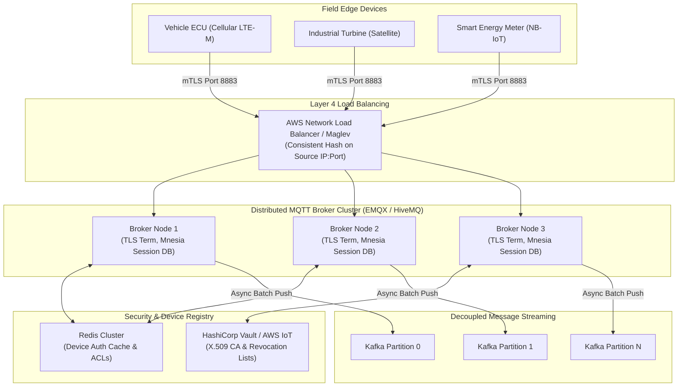
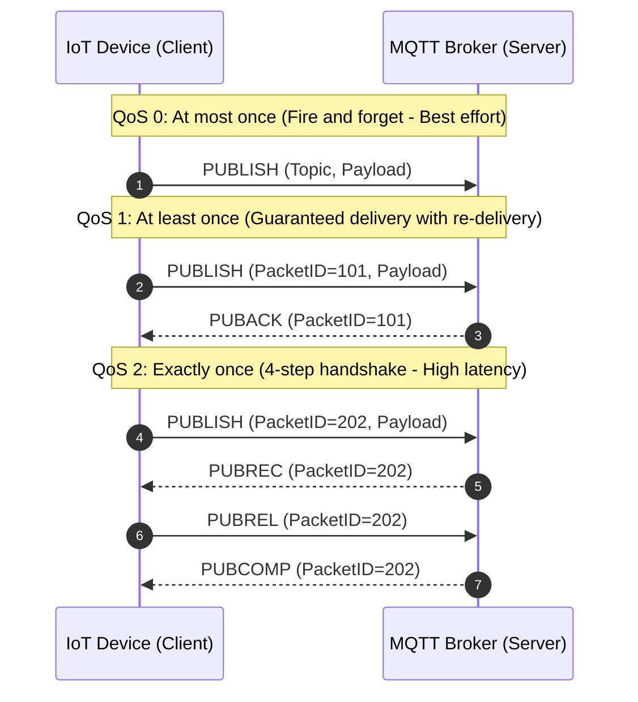
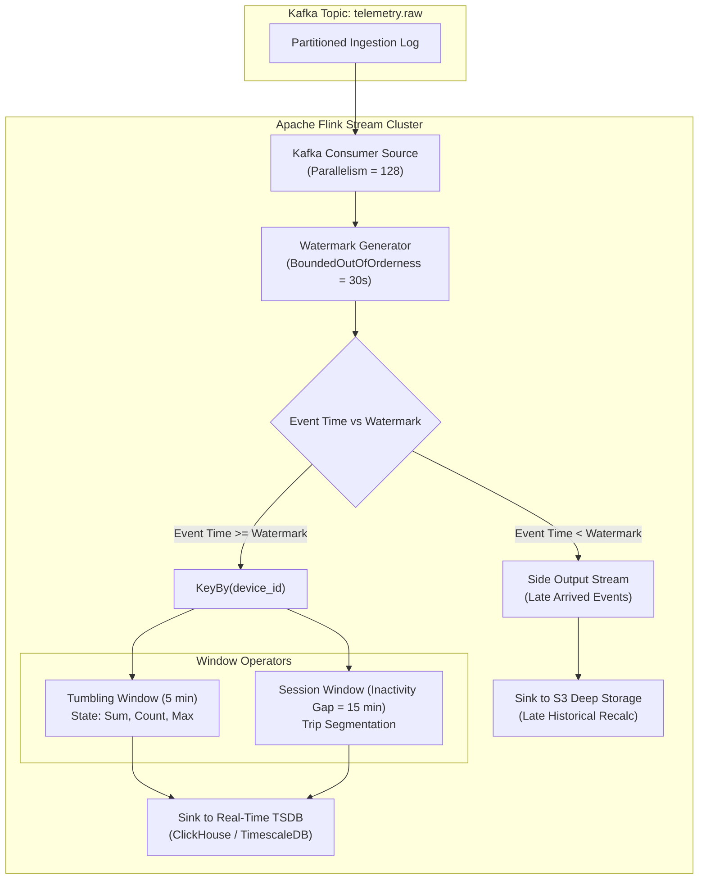
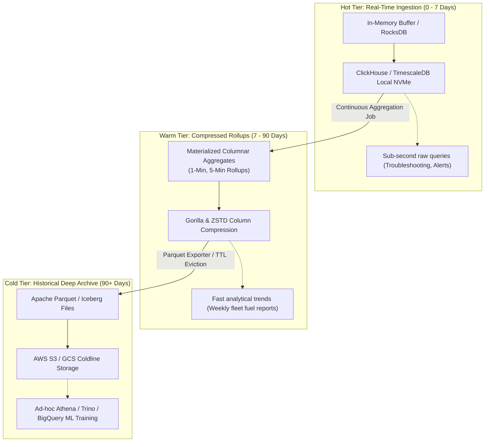
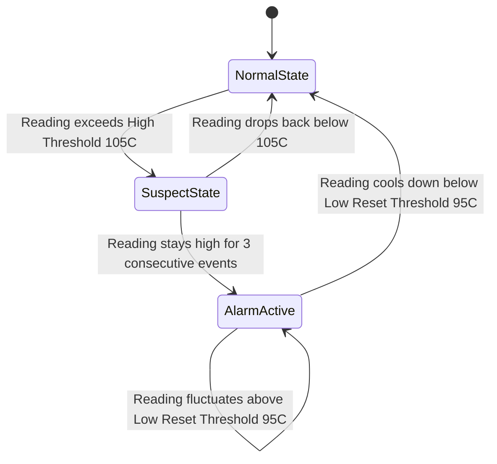
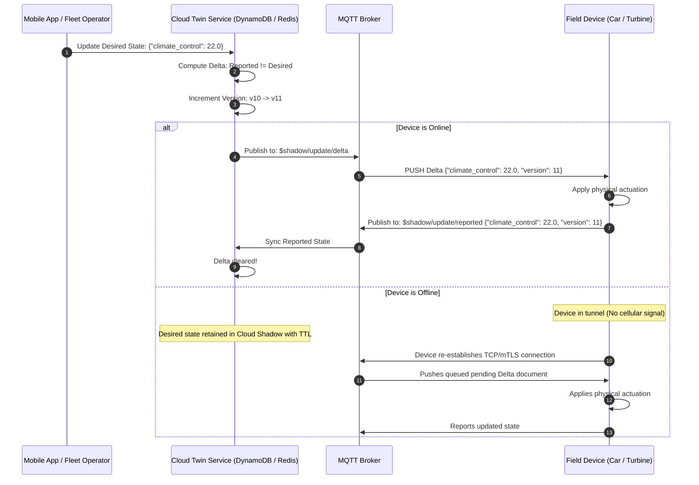
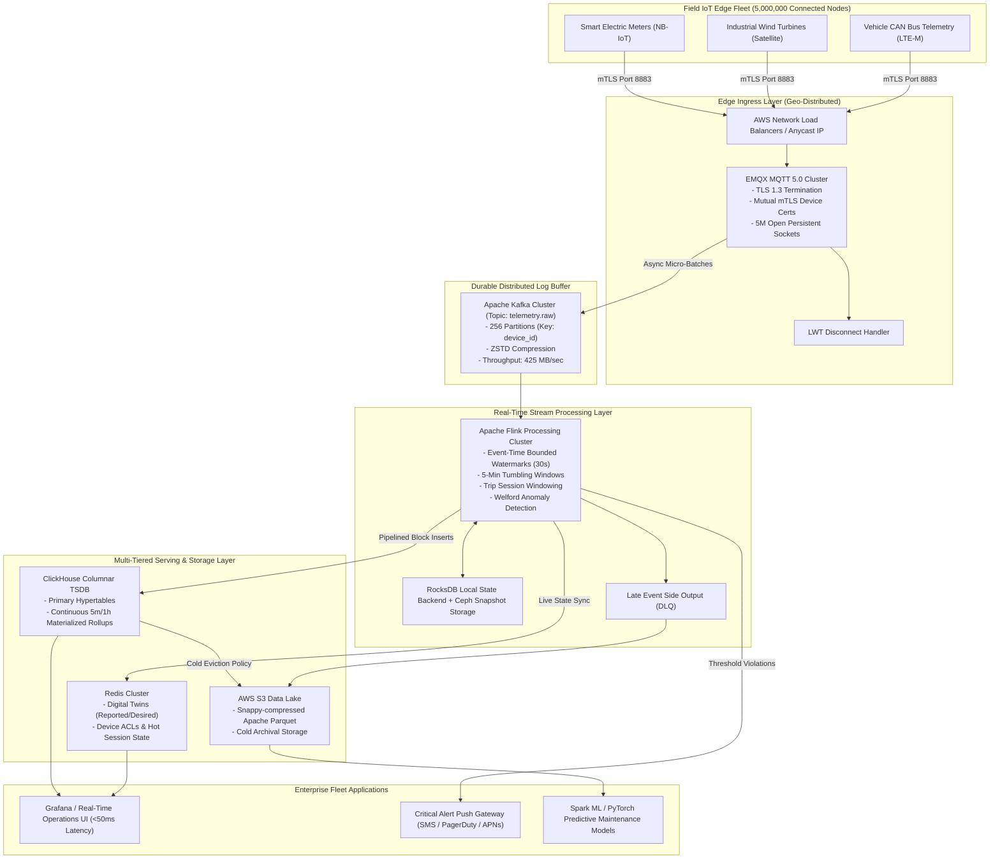

# IoT & Telemetry Streaming: High-Level & Low-Level System Design

> **"In distributed IoT systems, the physical world is fundamentally chaotic: sensors drift, cellular connections drop inside tunnels, device clocks reset to the Unix epoch, and millions of embedded nodes can reconnect simultaneously after an outage, unleashing a catastrophic thundering herd. Engineering an IoT backend requires treating latency, clock synchronization, bandwidth, and out-of-order arrival not as edge cases, but as baseline operational realities."**

---

## 1. Executive Summary & Real-World Production Challenges

Modern Internet of Things (IoT) platforms—such as **Tesla Fleet Operations, Datadog/New Relic Infrastructure Agents, AWS IoT Core, Samsara Telematics, GE Digital Wind Turbines, and Smart Grid AMI Systems**—ingest, process, and analyze continuous streams of high-frequency time-stamped metrics, telemetry logs, and state events from millions of geographically dispersed devices.

```
                             THE IOT TELEMETRY SCALE TRILEMMA
                                     
                                     Ingestion Velocity
                                    (10,000,000 Pings/sec,
                                     Zero Data Loss)
                                           /\
                                          /  \
                                         /    \
                                        /      \
                                       /        \
                                      /          \
                                     /   SYSTEM   \
                                    /    DESIGN    \
                                   /     BALANCE    \
                                  /                  \
                                 /____________________\
                   Query Latency                       Resource & Bandwidth
               (<100ms P99 Dashboards,                 (Cellular Data Caps,
               Sub-Second Alerts)                       Battery Constraints,
                                                        Storage Tiering)
```

Unlike traditional web or mobile applications where clients operate over low-latency, reliable broadband or Wi-Fi networks with abundant CPU and battery resources, IoT architectures bridge the digital cloud with resource-constrained embedded microcontrollers (MCUs) running over unreliable cellular (LTE-M, NB-IoT), satellite, or industrial mesh networks.

### The Real-World Telemetry Scale Duality

```
┌──────────────────────────────────────────────────────────────────────────────────────────────────┐
│                                  THE IOT TELEMETRY SCALE DUALITY                                 │
└──────────────────────────────────────────────────────────────────────────────────────────────────┘

        HIGH-VELOCITY UNRELIABLE INGESTION                       REAL-TIME ANALYTICS & AUDIT
    (5,000,000 Vehicles / Turbines @ 1s)                      (Fleet Ops Dashboards & Safety)
                     │                                                       │
                     ▼                                                       ▼
    ┌─────────────────────────────────┐                     ┌─────────────────────────────────┐
    │    5,000,000 Pings / Second     │                     │ "Compute Moving Avg Oil Temp    │
    │  - Intermittent 4G / 5G dropout │                     │  across all Model Y in Munich   │
    │  - 30-minute late burst arrivals│                     │  for past 15 min in <50ms"      │
    │  - Hardware clock drift (±120s) │                     │  - Sub-second anomaly alerting  │
    │  - Payload size strictly < 200B │                     │  - High-cardinality aggregation │
    └────────────────┬────────────────┘                     └────────────────┬────────────────┘
                     │                                                       │
                     └──────────────────────────┬────────────────────────────┘
                                                ▼
                                ┌───────────────────────────────┐
                                │   Stream & Storage Pipeline   │
                                │ (MQTT + Kafka + Flink + TSDB) │
                                └───────────────────────────────┘
```

---

### Back-of-the-Envelope Capacity Estimation (Fleet of 5 Million Devices)

To design the system realistically, we establish concrete traffic, network, and storage budgets:

| Metric | Calculation | Production Value |
| :--- | :--- | :--- |
| **Active Devices** | Connected vehicles, industrial meters, or telemetry sensors | **$5,000,000$ concurrent devices** |
| **Reporting Frequency** | Telemetry payload transmitted every $1.0\text{ second}$ | **$1\text{ Hz}$ sampling rate** |
| **Ingestion Throughput** | $5,000,000\text{ devices} \times 1\text{ msg/sec}$ | **$5,000,000\text{ msgs/sec}$ ($5\text{M TPS}$)** |
| **Uncompressed JSON Size** | Lat, Lon, Speed, Battery, Temp, Accelerometer, Status | $\approx 600\text{ bytes/payload}$ |
| **Raw Ingestion Bandwidth** | $5\text{M} \times 600\text{ bytes} = 3.0\text{ GB/sec}$ | **$24.0\text{ Gbps}$ continuous wire ingress** |
| **Protobuf / CBOR Compressed** | Compact binary encoding with variable-length integers | $\approx 85\text{ bytes/payload}$ |
| **Optimized Ingress Bandwidth** | $5\text{M} \times 85\text{ bytes} = 425\text{ MB/sec}$ | **$3.4\text{ Gbps}$ continuous wire ingress** |
| **Daily Telemetry Volume** | $425\text{ MB/sec} \times 86,400\text{ seconds}$ | **$\approx 36.72\text{ TB/day}$ (Compressed)** |
| **Monthly Storage Footprint** | $36.72\text{ TB/day} \times 30\text{ days}$ | **$\approx 1.10\text{ Petabytes/month}$** |
| **Peak Burst Multiplier** | Post-outage thundering herd reconnection factor ($3\times - 5\times$) | **$15,000,000\text{ to } 25,000,000\text{ msgs/sec}$** |

---

### Real-World Production Disasters & Post-Mortems

#### 1. The Cellular Recovery Thundering Herd (Smart Grid Blackout)
- **The Event:** A severe ice storm caused a regional cellular tower power failure in a major metropolitan area, disconnecting $1,200,000$ smart electrical meters.
- **The Failure:** Over a 4-hour outage, the smart meters continued to log power quality, voltage, and phase angles locally in internal flash memory. When the cell towers rebooted, all $1.2\text{ million}$ meters attempted to reconnect and dump their historical backlogs simultaneously.
- **The Mechanism:** The cloud edge brokers (MQTT) experienced a $100\times$ spike in TLS handshake negotiations ($1.2\text{M}$ simultaneous TLS handshakes pinned broker CPU at 100%). As brokers crashed, TCP connections dropped, triggering aggressive client-side retries without exponential backoff or jitter. The entire cloud ingestion cluster collapsed in a cascade failure, rendering utility operators blind for 14 hours during power restoration.
- **System Design Shift:** Implemented edge-level **Decorrelated Jitter Exponential Backoff**, **TLS Session Resumption (Session Tickets)**, and an ingress **Token Bucket Rate Limiter** with hardware-assisted cryptographic termination.

```
┌──────────────────────────────────────────────────────────────────────────────────────────────────┐
│                 CELLULAR RECOVERY THUNDERING HERD (WITHOUT JITTER VS WITH JITTER)               │
└──────────────────────────────────────────────────────────────────────────────────────────────────┘

   WITHOUT JITTER (SYNCHRONIZED RETRY SPIKE -> BROKER COLLAPSE)
   Conns/s
     ^
     |         /\  /\  /\
     |        /  \/  \/  \   <- 1.2M devices retry at identical 60-second intervals!
     |_______/            \________
     +-----------------------------------> Time

   WITH DECORRELATED JITTER & EXPONENTIAL BACKOFF (SMOOTH INGRESS)
   Conns/s
     ^
     |      -------------------   <- Ingress broker capacity limit
     |     /~~~~~~~~~~~~~~~~~~~\  <- Desynchronized connections absorbed smoothly
     |____/                     \__
     +-----------------------------------> Time
```

#### 2. The Prometheus/Datadog Metric Cardinality Explosion
- **The Event:** A DevOps platform monitoring $500,000$ IoT micro-gateways pushed a firmware update adding a new tag to the network telemetry metric: `device_id` (a UUIDv4) combined with `ephemeral_ip_address`.
- **The Failure:** Time-Series Databases (TSDBs) like InfluxDB and Prometheus maintain an inverted index in RAM that maps every unique combination of metric name and tag key-value pairs to a unique **Time Series ID (TSID)**.
- **The Consequence:** The number of unique time series exploded from $20,000$ to $500,000 \times 100\text{ interfaces} = 50,000,000$ active series within 10 minutes. The TSDB inverted index exhausted all 512 GB of host RAM, causing continuous Linux Out-Of-Memory (OOM) killer terminations. Dashboards went down globally.
- **System Design Shift:** Strict separation of **Metric Dimensions (low cardinality: region, firmware, model)** from **Payload Attributes (high cardinality: device_id, session_id, IP)** stored in columnar tables or wide-column engines rather than indexed tag-sets.

#### 3. The Tunnel Effect & Event-Time Window Corruption
- **The Event:** A fleet of 50,000 connected trucks operating in mountainous terrain frequently lost cellular connection in mountain tunnels (lasting 10 to 45 minutes).
- **The Failure:** The central fleet dashboard computed rolling 15-minute fuel consumption and driver fatigue safety metrics using **Processing Time** (the timestamp recorded when the backend server received the packet).
- **The Consequence:** When trucks exited a tunnel, 45 minutes of queued telemetry was delivered to the backend in a single 5-second burst. The analytics engine treated 45 minutes of fuel consumption as if it had occurred within that single 5-second window. The system triggered hundreds of false-positive "Catastrophic Fuel Leak Detected" alerts and automatically locked down truck throttles via remote commands, stranding commercial trucks on the highway.
- **System Design Shift:** Total deprecation of Processing Time for domain calculations; adoption of **Event Time semantics with Bounded-Out-Of-Orderness Watermarks** and **Session/Tumbling Windows** in Apache Flink.

---

## 2. Core Mathematical & Engineering Bottlenecks

### 2.1 The Three Clocks: Event Time, Ingestion Time, and Processing Time

In distributed IoT backends, every telemetry event is associated with three distinct temporal coordinates:

```
┌──────────────────────────────────────────────────────────────────────────────────────────────────┐
│                                  THE THREE TEMPORAL COORDINATES                                  │
└──────────────────────────────────────────────────────────────────────────────────────────────────┘

   [Physical Sensor] ────(1) Sensor triggers reading────► Event Time (T_event)
          │                                               (Set by hardware clock on device)
          ▼
   [Cellular Modem]  ────(2) Queued in local Flash (Tunnel/Offline)
          │
          ▼
   [Cloud Gateway]   ────(3) Packet arrives at MQTT broker──► Ingestion Time (T_ingest)
          │                                               (Cloud edge timestamp)
          ▼
   [Stream Engine]   ────(4) Flink executes aggregation──► Processing Time (T_process)
                                                          (Local wall clock of consumer)
```

1. **Event Time ($T_{\text{event}}$):** The exact moment the physical phenomenon occurred at the sensor (recorded by the device clock). Crucial for domain accuracy.
2. **Ingestion Time ($T_{\text{ingest}}$):** The moment the edge broker (e.g., AWS IoT Core, EMQX) received and validated the network packet.
3. **Processing Time ($T_{\text{process}}$):** The local system wall clock time of the stream processing node (e.g., Apache Flink task manager) executing the computation.

#### The Clock Skew & NTP Vulnerability
Devices operating in the wild cannot be assumed to have accurate clocks.
- Embedded Real-Time Clocks (RTCs) drift by up to $\pm 2\text{ seconds/day}$ due to ambient temperature variations.
- Cheap microcontrollers lose power, rebooting to default timestamps (e.g., `1970-01-01 00:00:00 UTC` or `2000-01-01 00:00:00 UTC`).
- If an NTP synchronization occurs mid-operation, the device clock can jump backwards in time, breaking monotonic assumptions!

$$\Delta_{\text{skew}} = T_{\text{device\_clock}} - T_{\text{true\_UTC}}$$

To mitigate this:
- Telemetry events must carry a **64-bit monotonic sequence number** alongside the event timestamp.
- Cloud gateways calculate relative offset: 
  $$\text{Offset}_{\text{drift}} = T_{\text{ingest}} - T_{\text{event}}$$
- If $|\text{Offset}_{\text{drift}}| > \text{Threshold}_{\text{sanity}}$ (e.g., 24 hours into the future or 30 days into the past), the packet is redirected to a quarantine dead-letter pipeline for clock-correction processing.

---

### 2.2 The Watermarking Heuristic & Late Data Mechanics

When computing aggregations over time windows (e.g., "Average engine temperature in 5-minute tumbling windows"), how long should the stream processor wait for delayed packets?

A **Watermark** $W(t)$ is a monotonically increasing temporal assertion emitted into the data stream that guarantees:
> *"No further events with Event Time $T_{\text{event}} \le W(t)$ will arrive."*

```
┌──────────────────────────────────────────────────────────────────────────────────────────────────┐
│                          WATERMARK PROGRESSION & LATE DATA ROUTING                              │
└──────────────────────────────────────────────────────────────────────────────────────────────────┘

   Time Flow ─────────────────────────────────────────────────────────────────────────────►
   
   Stream:  [t=18] [t=14] [t=21]  ◄── Watermark W(15) ──►  [t=11] [t=25] [t=13 (LATE!)]
                                     (Declares all events
                                      <= 15 have arrived)
                                                                 │
                                                                 ▼
                                                        Watermark has passed!
                                                        Routed to Dead-Letter Queue /
                                                        Side Output for Late Reconciliation
```

#### Mathematical Formulation of Bounded-Out-Of-Orderness Watermarks

Let $E_1, E_2, \dots, E_n$ be events observed up to current processing step with event timestamps $t(E_i)$. Given an allowable late-arrival delay tolerance $\Delta_{\text{delay}}$ (e.g., 10 seconds):

$$W(t) = \max_{1 \le i \le n}(t(E_i)) - \Delta_{\text{delay}}$$

- **Completeness vs. Latency Trade-Off:**
  - If $\Delta_{\text{delay}}$ is set too small (e.g., $100\text{ ms}$), late events arrive after the watermark, causing windows to close prematurely and discard valid sensor data.
  - If $\Delta_{\text{delay}}$ is set too large (e.g., $15\text{ minutes}$), downstream alert dashboards experience a 15-minute lag before window results are finalized.

---

### 2.3 The High-Cardinality Dimensional Explosion

A time-series metric is defined by its identifier:

$$\text{Series ID} = (\text{Metric Name}, \{K_1 = V_1, K_2 = V_2, \dots, K_m = V_m\})$$

The total number of unique series $C$ stored in the indexing system is the Cartesian product of the cardinalities of all individual tag dimensions:

$$C = \prod_{j=1}^{m} |V_j|$$

```
                           THE HIGH-CARDINALITY TRAP
                           
   Metric: sensor.temperature
   Tags:
     - region: 10 regions                          |V1| = 10
     - model: 5 vehicle models                     |V2| = 5
     - firmware: 4 versions                        |V3| = 4
     - device_id: 5,000,000 unique vehicles        |V4| = 5,000,000  <-- EXPLOSION!
   
   Total Active Time Series:
   C = 10 * 5 * 4 * 5,000,000 = 1,000,000,000 (1 BILLION UNIQUE SERIES)
```

When $C \ge 10^8$, traditional inverted indexes (which map `tag_value -> list of series_ids`) exceed physical memory limits:
1. Every new device creates an entry in the posting list.
2. Inverted index updates during writes require distributed lock contention and disk flushes.
3. Memory consumption grows linearly with unique devices rather than data ingestion volume.

**The Solution:** Decouple **Indexable Dimensions** (used for slicing and routing in memory) from **Stored Payload Columns** (scanned in columnar blocks like ClickHouse or Apache Iceberg on disk).

---

### 2.4 Time-Series Compression Mathematics: Gorilla XOR & Delta-of-Delta

Storing 5 million pings per second uncompressed requires hundreds of terabytes daily. Modern TSDBs (such as Prometheus, VictoriaMetrics, and TimescaleDB) implement the **Gorilla Compression Algorithm** (originated by Facebook in 2015), which achieves $10\times - 12\times$ compression ratios in-memory using bit-level encoding.

#### 1. Timestamp Compression: Delta-of-Delta Encoding
Sensors report at relatively fixed intervals (e.g., every 10 seconds: $t_0, t_1, t_2, \dots$).
1. Let $D_i = t_i - t_{i-1}$ be the first-order delta.
2. Let $D'_i = D_i - D_{i-1}$ be the second-order delta ("delta-of-delta").

If measurements arrive exactly on schedule:
- $D_1 = 10\text{s}$, $D_2 = 10\text{s} \implies D'_2 = 0$.
- A zero delta-of-delta is encoded with a **single bit: `0`**!
- If $-63 \le D' \le 64$, encode with bits `10` followed by 7 bits of value.
- If $-255 \le D' \le 256$, encode with bits `110` followed by 9 bits.
- Otherwise, encode with bits `111` followed by variable-length bit chunks.

```
┌──────────────────────────────────────────────────────────────────────────────────────────────────┐
│                            GORILLA DELTA-OF-DELTA TIMESTAMP ENCODING                             │
└──────────────────────────────────────────────────────────────────────────────────────────────────┘

   Raw Timestamps:   1609459200, 1609459210, 1609459220, 1609459230
   First Deltas:                10,         10,         10
   Delta-of-Delta:                          0,          0
   
   Bitstream:        [Full 64-bit t0] [14-bit D1] [Bit 0] [Bit 0]
   
   Savings: 64 bits per timestamp reduced to an average of ~1.37 bits!
```

#### 2. Floating-Point Value Compression: XOR Leading/Trailing Zero Bit-Packing
Floating point sensor values (IEEE 754 64-bit floats: e.g., temperature `98.6`, `98.65`, `98.64`) change very little between consecutive readings.
1. Compute the bitwise XOR between current value $V_i$ and previous value $V_{i-1}$:
   $$\Delta_{\text{xor}} = V_i \oplus V_{i-1}$$
2. If $\Delta_{\text{xor}} = 0$ (identical reading), store a single bit **`0`**.
3. If $\Delta_{\text{xor}} \ne 0$, store bit **`1`**:
   - If the sequence of leading and trailing zeros in $\Delta_{\text{xor}}$ matches the previous XOR result, write bit `0` followed by the meaningful bits.
   - If the block size changes, write bit `1`, followed by 5 bits (leading zero count), 6 bits (length of meaningful bits), and the meaningful bits.

---

## 3. Approach 1: Edge Protocol & Ingestion Gateway (MQTT vs CoAP vs HTTP/2 / WebSockets)

```
┌──────────────────────────────────────────────────────────────────────────────────────────────────┐
│                             APPROACH 1: INGESTION ARCHITECTURE OVERVIEW                          │
└──────────────────────────────────────────────────────────────────────────────────────────────────┘

     5,000,000 Devices                      Edge Ingestion Layer               Streaming Buffer
   ┌───────────────────┐                     ┌──────────────────────┐        ┌───────────────────┐
   │ Vehicles / Sensors│──[mTLS / MQTT 5.0]─►│ EMQX / HiveMQ Cluster│───────►│   Apache Kafka    │
   │ (Pipelined Pings) │                     │ (TCP / TLS Term)     │(Batch) │  (Partitioned by  │
   └───────────────────┘                     └──────────────────────┘        │    device_id)     │
                                                        ▲                    └───────────────────┘
                                                        │
                                             ┌──────────────────────┐
                                             │ Device Auth & Reg    │
                                             │ (X.509 CRL / Redis)  │
                                             └──────────────────────┘
```

### High-Level Design (HLD)

The Edge Gateway serves as the front line of the cloud infrastructure, terminating millions of persistent, long-lived bidirectional connections from edge hardware.



#### MQTT Quality of Service (QoS) Mechanics

MQTT provides three distinct levels of message delivery guarantees:



1. **QoS 0 (At most once):** "Fire and forget." No acknowledgment, no retransmission. Ideal for ultra-high-frequency, loss-tolerant metrics (e.g., GPS location updated every 100ms).
2. **QoS 1 (At least once):** Packet contains `PacketIdentifier`. Sender retains message in memory until `PUBACK` is received. If timeout expires, message is resent with `DUP=1`. Essential for critical state transitions and alarms (e.g., "Airbag Deployed", "High Temperature Threshold Breached").
3. **QoS 2 (Exactly once):** Four-step handshake (`PUBLISH`, `PUBREC`, `PUBREL`, `PUBCOMP`). Guarantees no duplicates or data loss at the protocol layer, but incurs **$4\times$ round-trip latency and network overhead**. In production high-scale IoT, **QoS 2 is avoided**; systems use QoS 1 combined with downstream idempotency keys.

#### MQTT Topic Hierarchy & Partition Multiplexing
Topics are structured hierarchically:
`telemetry/{tenant_id}/{device_type}/{region_id}/{device_id}`
- Example: `telemetry/corp_logistics/heavy_truck/eu_central/truck_94812`
- Subscriptions use wildcards:
  - `+` matches a single level: `telemetry/corp_logistics/heavy_truck/+/truck_94812`
  - `#` matches all sub-levels: `telemetry/corp_logistics/#`

#### Keep-Alive, PINGREQ, and Last Will and Testament (LWT)
- **Keep-Alive Interval:** Client defines a keep-alive window (e.g., 60 seconds). If no application message is sent, the client sends a 2-byte `PINGREQ`. If the broker receives no communication within $1.5 \times \text{Keep-Alive}$, it abruptly closes the TCP socket.
- **Last Will and Testament (LWT):** When the client establishes the initial connection, it registers an LWT topic and payload (e.g., `status/truck_94812` with payload `{"status": "OFFLINE", "reason": "UNEXPECTED_DISCONNECT"}`). If the broker detects an ungraceful socket drop, the broker **autonomously publishes the LWT message** to alert fleet managers in real time.

---

### Low-Level Design (LLD)

#### 1. Wire Protocol Overhead Comparison

```
┌──────────────────────────────────────────────────────────────────────────────────────────────────┐
│                                   WIRE PROTOCOL OVERHEAD ANALYSIS                                │
└──────────────────────────────────────────────────────────────────────────────────────────────────┘

   HTTP/1.1 POST /api/telemetry
   Headers: Host, User-Agent, Accept, Content-Type, Authorization, Connection...
   Header Overhead: ~500 to 1,024 BYTES per reading!
   Payload: 50 bytes. (Overhead = 95% of packet)

   HTTP/2 / gRPC
   HPACK compression, binary frames.
   Header Overhead: ~30 to 80 BYTES per request stream frame.

   MQTT 5.0 PUBLISH Packet
   Fixed Header: 2 to 5 BYTES!
   Variable Header: Topic Name (or Topic Alias = 2 bytes) + Packet Identifier (2 bytes).
   Total Overhead: ~7 to 12 BYTES! (Overhead < 10% of packet)
```

#### 2. Decorrelated Jitter Exponential Backoff Client Implementation

When millions of field devices encounter connectivity drops, naive exponential backoff causes synchronized reconnection waves ("thundering herds"). Modern firmware implements **Decorrelated Jitter** (developed by AWS Architecture):

$$T_{\text{sleep}} = \min(T_{\text{max}}, \text{UniformRandom}(T_{\text{base}}, T_{\text{previous}} \times 3))$$

Here is the production-grade Python client implementing offline SQLite disk buffering, decorrelated jitter, and MQTT QoS 1 retries:

```python
"""
Production-grade IoT Edge Client with Decorrelated Jitter and Offline Spooling.
Handles cellular dropouts, intermittent connectivity, and hardware restarts.
"""

import time
import random
import sqlite3
import json
import logging
from typing import Optional, Dict, Any

logging.basicConfig(level=logging.INFO)
logger = logging.getLogger("IoTEdgeClient")

class EdgeTelemetryBuffer:
    """Embedded SQLite FIFO buffer for local telemetry caching when offline."""
    def __init__(self, db_path: str = "edge_spool.db"):
        self.conn = sqlite3.connect(db_path, check_same_thread=False)
        self._init_db()

    def _init_db(self):
        with self.conn:
            self.conn.execute("""
                CREATE TABLE IF NOT EXISTS telemetry_queue (
                    id INTEGER PRIMARY KEY AUTOINCREMENT,
                    topic TEXT NOT NULL,
                    payload TEXT NOT NULL,
                    created_at REAL NOT NULL
                )
            """)

    def push(self, topic: str, payload: Dict[str, Any]):
        with self.conn:
            self.conn.execute(
                "INSERT INTO telemetry_queue (topic, payload, created_at) VALUES (?, ?, ?)",
                (topic, json.dumps(payload), time.time())
            )

    def pop_batch(self, batch_size: int = 50):
        with self.conn:
            cursor = self.conn.cursor()
            cursor.execute(
                "SELECT id, topic, payload FROM telemetry_queue ORDER BY id ASC LIMIT ?",
                (batch_size,)
            )
            return cursor.fetchall()

    def delete_batch(self, ids: list[int]):
        with self.conn:
            placeholders = ",".join("?" for _ in ids)
            self.conn.execute(f"DELETE FROM telemetry_queue WHERE id IN ({placeholders})", ids)

    def count(self) -> int:
        cursor = self.conn.cursor()
        cursor.execute("SELECT COUNT(*) FROM telemetry_queue")
        return cursor.fetchone()[0]


class RobustIoTEdgeClient:
    def __init__(self, device_id: str, base_delay: float = 1.0, max_delay: float = 60.0):
        self.device_id = device_id
        self.base_delay = base_delay
        self.max_delay = max_delay
        self.current_sleep = base_delay
        self.is_connected = False
        self.buffer = EdgeTelemetryBuffer()

    def decorrelated_jitter_sleep(self) -> float:
        """Calculates sleep time using Decorrelated Jitter to prevent thundering herd."""
        new_sleep = min(self.max_delay, random.uniform(self.base_delay, self.current_sleep * 3.0))
        self.current_sleep = new_sleep
        return new_sleep

    def reset_backoff(self):
        self.current_sleep = self.base_delay

    def simulate_mock_network_publish(self, topic: str, payload: str) -> bool:
        """Simulates intermittent physical network environment."""
        # 30% chance of cellular drop
        if random.random() < 0.30:
            return False
        return True

    def emit_telemetry(self, topic: str, sensor_data: Dict[str, Any]):
        """Application interface to publish sensor metrics."""
        sensor_data["device_id"] = self.device_id
        sensor_data["event_time"] = time.time()

        if not self.is_connected:
            logger.warning("Device offline! Spooling telemetry to persistent storage.")
            self.buffer.push(topic, sensor_data)
            return

        # Attempt immediate publish
        payload_str = json.dumps(sensor_data)
        success = self.simulate_mock_network_publish(topic, payload_str)
        if not success:
            logger.error("Publish failed! Lost connection. Spooling to local flash.")
            self.is_connected = False
            self.buffer.push(topic, sensor_data)
        else:
            logger.info("Successfully published telemetry via live network.")

    def run_reconnection_loop(self):
        """Background daemon managing reconnection and spool drain."""
        while True:
            if not self.is_connected:
                sleep_time = self.decorrelated_jitter_sleep()
                logger.info(f"Attempting reconnect in {sleep_time:.2f}s...")
                time.sleep(sleep_time)

                # Simulate reconnection attempt
                reconnected = random.random() > 0.40
                if reconnected:
                    logger.info("TCP/TLS Reconnection established! Broker authenticated.")
                    self.is_connected = True
                    self.reset_backoff()
                    self._drain_offline_spool()
            else:
                time.sleep(1.0)

    def _drain_offline_spool(self):
        """Flushes buffered offline telemetry in ordered micro-batches."""
        logger.info(f"Draining spool buffer. Pending items: {self.buffer.count()}")
        while self.is_connected:
            batch = self.buffer.pop_batch(batch_size=20)
            if not batch:
                break
            ids_to_ack = []
            for item_id, topic, payload in batch:
                if self.simulate_mock_network_publish(topic, payload):
                    ids_to_ack.append(item_id)
                else:
                    logger.warning("Network dropped during spool drain. Halting flush.")
                    self.is_connected = False
                    break
            if ids_to_ack:
                self.buffer.delete_batch(ids_to_ack)
                logger.info(f"Drained and acknowledged {len(ids_to_ack)} buffered items.")
```

---

## 4. Approach 2: High-Throughput Stream Ingestion & Partitioning (Apache Kafka)

```
┌──────────────────────────────────────────────────────────────────────────────────────────────────┐
│                             APPROACH 2: BUFFERING & PARTITIONING                                 │
└──────────────────────────────────────────────────────────────────────────────────────────────────┘

   MQTT Ingress Cluster                  Kafka Ingestion Topic (256 Partitions)
   ┌──────────────────┐                  ┌──────────────────────────────────────────────┐
   │ Broker Gateway 1 │──(Batch Push)───►│ Partition 0   [D001, D257, D513...]          │
   │ Broker Gateway 2 │──(Batch Push)───►│ Partition 1   [D002, D258, D514...]          │
   │ Broker Gateway 3 │──(Batch Push)───►│ ...                                          │
   └──────────────────┘                  │ Partition 255 [D256, D512, D768...]          │
                                         └──────────────────────────────────────────────┘
                                                 ▲
                                                 │
                                        Partition Key Hash:
                                  MurmurHash3("device_id") % 256
```

### High-Level Design (HLD)

The MQTT brokers act as ephemeral protocol translators. They must immediately offload received bytes into a durable, distributed append-only log (**Apache Kafka** or **Apache Pulsar**) before acknowledging packets upstream.

```mermaid
flowchart LR
    subgraph MQTT_Nodes["MQTT Gateway Cluster"]
        M1["MQTT Broker A"]
        M2["MQTT Broker B"]
        M3["MQTT Broker C"]
    end

    subgraph KafkaProducer["Optimized Kafka Producers"]
        P1["Producer Client (librdkafka)<br/>- Zstd Compression<br/>- linger.ms = 20<br/>- acks = all"]
    end

    subgraph KafkaCluster["Kafka Cluster (Topic: telemetry.raw)"]
        KP0["Partition 0 (Key: dev_004)"]
        KP1["Partition 1 (Key: dev_001)"]
        KP2["Partition 2 (Key: dev_002)"]
        KP3["Partition 3 (Key: dev_003)"]
    end

    M1 & M2 & M3 --> P1
    P1 -->|Hash(dev_004) % 4| KP0
    P1 -->|Hash(dev_001) % 4| KP1
    P1 -->|Hash(dev_002) % 4| KP2
    P1 -->|Hash(dev_003) % 4| KP3
```

#### Partition Key Selection & Hot-Partition Mitigations
1. **Naive Approach (Random Partitioning / Round Robin):**
   - High distribution throughput.
   - **Fatal Flaw:** Successive readings from the same physical vehicle land on different partitions. Downstream consumers cannot process a device's metrics in chronological order without global distributed sorting!
2. **Production Standard (Partition by `device_id`):**
   $$\text{Partition} = \text{MurmurHash2}(\text{device\_id}) \pmod{N_{\text{partitions}}}$$
   - **Advantage:** Every event generated by a single physical device is strictly appended to the same partition. A single consumer thread in a stream processor processes events for that device sequentially, eliminating concurrency race conditions.
3. **Hot-Partition Risk (Fleet Micro-Gateways):**
   - If an industrial factory or cargo ship aggregates 50,000 sub-sensors through a single master gateway ID, that single key generates 100,000 msgs/sec, saturating a single Kafka partition broker.
   - **Mitigation: Composite Partition Key:**
     $$\text{Key} = \text{gateway\_id} + \text{":"} + \text{sub\_sensor\_id}$$

#### Producer Tuning for $5,000,000\text{ msgs/sec}$
- `linger.ms = 20`: Holds messages in memory buffers for up to 20ms to assemble massive batches rather than issuing single-record network RPCs.
- `batch.size = 131072` (128 KB): Maximizes throughput per TCP packet.
- `compression.type = zstd`: Provides higher compression ratios than Snappy while preserving lower CPU decompression overhead than GZIP.
- `acks = all` (`-1`) with `min.insync.replicas = 2`: Guarantees durability across broker crashes.

---

### Low-Level Design (LLD)

#### 1. Binary Serialization: Protocol Buffers Definition
JSON incurs unacceptable serialization and deserialization CPU and bandwidth overhead. Telemetry is encoded in compact binary format using Google Protocol Buffers v3:

```protobuf
syntax = "proto3";

package iot.telemetry;

enum DeviceStatus {
  STATUS_UNKNOWN = 0;
  STATUS_HEALTHY = 1;
  STATUS_WARNING = 2;
  STATUS_CRITICAL = 3;
}

message SensorReading {
  string sensor_name = 1;      // e.g. "engine_temp"
  double value = 2;            // e.g. 104.5
  int64 reading_timestamp = 3; // Epoch milliseconds
}

message VehicleTelemetryPayload {
  string device_id = 1;          // e.g. "VIN-5YJ3E1EA1JF000000"
  int64 sequence_number = 2;     // Monotonic counter for deduplication
  int64 event_timestamp = 3;     // Hardware epoch milliseconds
  double latitude = 4;           // GPS lat
  double longitude = 5;          // GPS lon
  float speed_kmh = 6;           // Vehicle speed
  float battery_level_pct = 7;   // State of charge
  DeviceStatus status = 8;
  repeated SensorReading readings = 9;
}
```

#### 2. Deduplication Engine with Sliding Bloom Filter & RocksDB Cache
Because devices retry via MQTT QoS 1 upon network timeouts, duplicate payloads regularly arrive at the stream buffer. Downstream analytical jobs must filter out duplicates using a sliding deduplication window.

```python
"""
Low-Level High-Throughput Stream Ingestion Deduplicator.
Combines a fast In-Memory Bloom Filter for early negative lookup
with an LRU/RocksDB Cache for exact sequence-number checking.
"""

import mmh3
from bitarray import bitarray
from collections import OrderedDict
from typing import Tuple

class SlidingBloomFilter:
    """Memory-efficient probabilistic set to check if an event ID was seen."""
    def __init__(self, size: int = 10_000_000, hash_count: int = 5):
        self.size = size
        self.hash_count = hash_count
        self.bit_array = bitarray(size)
        self.bit_array.setall(0)

    def add(self, key: str):
        for seed in range(self.hash_count):
            idx = mmh3.hash(key, seed) % self.size
            self.bit_array[idx] = 1

    def contains(self, key: str) -> bool:
        for seed in range(self.hash_count):
            idx = mmh3.hash(key, seed) % self.size
            if not self.bit_array[idx]:
                return False
        return True


class TelemetryDeduplicator:
    """
    Sliding window deduplicator tracking (device_id, sequence_number).
    Rejects duplicate packets delivered during network retries.
    """
    def __init__(self, capacity: int = 500_000):
        self.bloom = SlidingBloomFilter(size=5_000_000, hash_count=4)
        # In-memory exact cache: device_id -> highest seen sequence_number
        self.device_max_seq: OrderedDict[str, int] = OrderedDict()
        self.capacity = capacity

    def is_duplicate(self, device_id: str, sequence_number: int) -> bool:
        unique_key = f"{device_id}:{sequence_number}"

        # Step 1: Fast Bloom Filter check (Zero I/O)
        if not self.bloom.contains(unique_key):
            # Guaranteed to have never been seen
            self.bloom.add(unique_key)
            self._record_sequence(device_id, sequence_number)
            return False

        # Step 2: Probable duplicate: check exact sequence cache
        if device_id in self.device_max_seq:
            last_seq = self.device_max_seq[device_id]
            if sequence_number <= last_seq:
                return True  # Verified duplicate or out-of-order stale packet

        self._record_sequence(device_id, sequence_number)
        return False

    def _record_sequence(self, device_id: str, sequence_number: int):
        self.device_max_seq[device_id] = max(
            self.device_max_seq.get(device_id, 0), sequence_number
        )
        self.device_max_seq.move_to_end(device_id)
        if len(self.device_max_seq) > self.capacity:
            self.device_max_seq.popitem(last=False)
```

---

## 5. Approach 3: Stream Processing, Watermarks & Windowing (Apache Flink)

```
┌──────────────────────────────────────────────────────────────────────────────────────────────────┐
│                             APPROACH 3: FLINK STREAM ENGINE PIPELINE                             │
└──────────────────────────────────────────────────────────────────────────────────────────────────┘

   Kafka Telemetry Stream
   ┌────────────────────────────────────────────────────────────────────────────────────────┐
   │ [T_ev: 12:00:01] ──► [T_ev: 12:00:04] ──► [Watermark W=12:00:00] ──► [T_ev: 11:59:50] │
   └───────────────────────────────────────────────────────────────────────────┬────────────┘
                                                                               │
                                                                               ▼
   Apache Flink Task Manager                                       (Late by 10s > W)
   ┌──────────────────────────────────────────────┐                            │
   │ Tumbling Window [12:00:00 - 12:05:00]        │                            ▼
   │ - RocksDB State: Sum, Count, Min, Max        │                ┌────────────────────────┐
   │ - Window Fire Trigger when W >= 12:05:00     │                │   Side Output (DLQ)    │
   └──────────────────────┬───────────────────────┘                │  (Late Event Storage)  │
                          │                                        └────────────────────────┘
                          ▼
   Downstream Output: ClickHouse Rollups / Redis Alert Cache
```

### High-Level Design (HLD)

Apache Flink acts as the stateful stream processing backbone, performing continuous windowed computations, evaluating anomalies, and managing out-of-order arrival semantics.



#### Window Aggregation Typologies

```
┌──────────────────────────────────────────────────────────────────────────────────────────────────┐
│                                 WINDOW AGGREGATION TYPOLOGIES                                    │
└──────────────────────────────────────────────────────────────────────────────────────────────────┘

   1. TUMBLING WINDOW (Fixed size, non-overlapping)
   [ 12:00 - 12:05 ] [ 12:05 - 12:10 ] [ 12:10 - 12:15 ]
   Use case: Standard metric rollups (5-minute average battery health).

   2. SLIDING (HOPPING) WINDOW (Fixed size, overlapping interval)
   [    10-Minute Window    ]
         [    10-Minute Window    ]
               [    10-Minute Window    ]
   |<- 2 min ->| (Sliding interval)
   Use case: Moving average smoothing for real-time driver speeding scores.

   3. SESSION WINDOW (Dynamic size, activity-driven, inactive gap timeout)
   ●--●-●-●-●-●               ●--●-●
   [   Trip Session 1   ]     [ Trip Session 2 ]
   |<- 30 min gap ->|
   Use case: Vehicle trip lifecycle segmentation (Turn ignition on -> drive -> park).
```

#### Distributed Checkpointing: Chandy-Lamport & RocksDB State
To maintain **Exactly-Once Processing Guarantees (EOS)** across node failures:
1. Flink periodically injects **Checkpoint Barrier Markers** into the source stream.
2. When an operator receives a barrier, it blocks that channel and flushes its in-memory window accumulator state (stored in embedded **RocksDB**) to durable distributed object storage (Ceph or AWS S3).
3. If any task manager crashes, the whole cluster rolls back its read offsets in Kafka to the latest barrier and restores RocksDB state from the snapshot.

---

### Low-Level Design (LLD)

#### 1. Flink Event-Time Windowing & Side-Output Implementation (Python/PyFlink Logic)

The following production-grade streaming engine demonstrates bounded-out-of-orderness watermark progression, tumbling window aggregation, and late-event dead-letter routing:

```python
"""
Low-Level Stream Processing Window Engine with Watermarking.
Implements:
1. Event-Time BoundedOutOfOrderness Watermarks
2. Tumbling Window Aggregators
3. Dead-Letter Side-Output for late arrived packets
"""

import time
from typing import Dict, Any, List, Optional

class StreamRecord:
    def __init__(self, device_id: str, event_time_ms: int, metric_val: float):
        self.device_id = device_id
        self.event_time_ms = event_time_ms
        self.metric_val = metric_val

class TumblingEventTimeWindow:
    def __init__(self, start_ms: int, end_ms: int):
        self.start_ms = start_ms
        self.end_ms = end_ms
        self.sum = 0.0
        self.count = 0
        self.max = float("-inf")
        self.min = float("inf")

    def accumulate(self, val: float):
        self.sum += val
        self.count += 1
        self.max = max(self.max, val)
        self.min = min(self.min, val)

    def result(self) -> Dict[str, Any]:
        return {
            "window_start": self.start_ms,
            "window_end": self.end_ms,
            "count": self.count,
            "avg": (self.sum / self.count) if self.count > 0 else 0.0,
            "max": self.max,
            "min": self.min
        }


class ProductionStreamProcessor:
    def __init__(self, window_size_sec: int = 300, max_lateness_sec: int = 30):
        self.window_size_ms = window_size_sec * 1000
        self.max_lateness_ms = max_lateness_sec * 1000
        self.current_watermark_ms = 0
        self.max_observed_event_time_ms = 0

        # State storage: device_id -> { window_start_ms -> Window }
        self.window_state: Dict[str, Dict[int, TumblingEventTimeWindow]] = {}
        self.side_output_dlq: List[StreamRecord] = []

    def update_watermark(self, event_time_ms: int):
        """Monotonically advances the stream watermark."""
        if event_time_ms > self.max_observed_event_time_ms:
            self.max_observed_event_time_ms = event_time_ms
            # Bounded out-of-orderness formula:
            self.current_watermark_ms = self.max_observed_event_time_ms - self.max_lateness_ms

    def process_record(self, record: StreamRecord) -> Optional[Dict[str, Any]]:
        self.update_watermark(record.event_time_ms)

        # Step 1: Check if event is hopelessly late
        if record.event_time_ms < self.current_watermark_ms:
            # Drop from live calculation and route to Side-Output
            self.side_output_dlq.append(record)
            return None

        # Step 2: Assign to Tumbling Window
        # Math: window_start = t - (t % window_size)
        window_start = record.event_time_ms - (record.event_time_ms % self.window_size_ms)
        window_end = window_start + self.window_size_ms

        if record.device_id not in self.window_state:
            self.window_state[record.device_id] = {}

        if window_start not in self.window_state[record.device_id]:
            self.window_state[record.device_id][window_start] = TumblingEventTimeWindow(
                window_start, window_end
            )

        window = self.window_state[record.device_id][window_start]
        window.accumulate(record.metric_val)
        return None

    def trigger_and_purge_windows(self) -> List[Dict[str, Any]]:
        """Fires and closes windows whose window_end <= current_watermark."""
        completed_results = []

        for device_id, windows in list(self.window_state.items()):
            for w_start, window in list(windows.items()):
                if window.end_ms <= self.current_watermark_ms:
                    # Watermark guarantees no more on-time events for this window
                    res = window.result()
                    res["device_id"] = device_id
                    completed_results.append(res)
                    # Purge state to free memory
                    del windows[w_start]

        return completed_results
```

---

## 6. Approach 4: High-Cardinality Time-Series Storage & Downsampling (TSDB / Columnar)

```
┌──────────────────────────────────────────────────────────────────────────────────────────────────┐
│                             APPROACH 4: MULTI-TIER STORAGE LIFECYCLE                             │
└──────────────────────────────────────────────────────────────────────────────────────────────────┘

   Raw Stream ──► [Hot Tier: NVMe SSD] ──► [Warm Tier: Columnar] ──► [Cold Tier: Object Store]
                  - RAM / Fast NVMe         - Timescale / ClickHouse   - Parquet on AWS S3
                  - Retention: 7 Days       - Retention: 90 Days       - Retention: 7 Years
                  - Raw 1-second pings      - 1-minute rollups         - 1-hour downsampled LTTB
                  - Cost: $0.15 / GB-month  - Cost: $0.04 / GB-month   - Cost: $0.004 / GB-month
```

### High-Level Design (HLD)

Storing raw 1-second telemetry for 5 million devices permanently on high-performance primary storage is economically unfeasible ($1.1\text{ PB/month} \implies \$165,000/\text{month}$ on EBS). Modern time-series storage enforces **Automated Tiered Lifecycle Management**:



#### Why B-Trees Fail vs Why Columnar Storage Wins for TSDB
- **Relational B-Trees (PostgreSQL/MySQL):**
  - Store data in row-oriented 8KB pages containing all columns.
  - An analytical query `SELECT AVG(speed) FROM telemetry WHERE device_id='X' AND time > NOW() - INTERVAL '1 DAY'` must read all unused columns (GPS, battery, engine status) off disk into RAM, wasting I/O bandwidth.
  - B-Trees require constant random page splits under high-concurrency ingestion.
- **Columnar Storage (ClickHouse / TimescaleDB Hypertables):**
  - Stores each column in separate, contiguous disk blocks.
  - `speed` column is stored alone, achieving up to $90\%$ compression ratio because adjacent numbers are nearly identical.
  - Disk reads only load the single requested column byte stream.

---

### Low-Level Design (LLD)

#### 1. Downsampling Mathematics: Largest Triangle Three Buckets (LTTB)
When rendering a 1-year historical chart on a dashboard (with 1,920 horizontal screen pixels), plotting 31,536,000 raw points is wasteful and crashes browser DOM renderers. 

Naive downsampling (taking every $N$-th point or average) flattens critical narrow spikes (e.g., a momentary battery voltage drop or speed spike).

The **LTTB Algorithm** divides time into equal buckets and selects points that maximize the triangular area formed with adjacent buckets, mathematically preserving visual peaks and troughs:

$$\text{Area} = \frac{1}{2} |x_A (y_B - y_C) + x_B (y_C - y_A) + x_C (y_A - y_B)|$$

```
┌──────────────────────────────────────────────────────────────────────────────────────────────────┐
│                     LARGEST TRIANGLE THREE BUCKETS (LTTB) SELECTION                              │
└──────────────────────────────────────────────────────────────────────────────────────────────────┘

        Point A (Selected in Bucket 1)
           o
            \
             \                     Point B (Max Area Candidate in Bucket 2)
              \                       o (SELECTED - Preserves Peak!)
               \                     / \
                \                   /   \
                 \                 /     \
                  \   Bucket 2    /       \
   ----------------o-------------o---------o---------------------------------
                  x1            x2        x3
                                           \
                                            o Point C (Average of Bucket 3)
```

#### 2. Production Python Implementation: LTTB Downsampler

```python
"""
Low-Level Implementation of Largest Triangle Three Buckets (LTTB) Algorithm.
Downsamples high-frequency sensor streams while strictly preserving visual spikes.
"""

from typing import List, Tuple

def lttb_downsample(data: List[Tuple[float, float]], threshold: int) -> List[Tuple[float, float]]:
    """
    Args:
        data: List of (timestamp, value) tuples, sorted by timestamp.
        threshold: Target number of points to retain (e.g. 1000 points for UI).
    Returns:
        Downsampled list of (timestamp, value) tuples.
    """
    data_len = len(data)
    if threshold >= data_len or threshold == 0:
        return data

    sampled = []
    bucket_size = (data_len - 2) / (threshold - 2)

    # Point A: Always include the very first point
    a_idx = 0
    sampled.append(data[a_idx])

    for i in range(threshold - 2):
        # Calculate bucket range for Bucket 2 (candidate bucket)
        b_start = int((i + 0) * bucket_size) + 1
        b_end = int((i + 1) * bucket_size) + 1

        # Calculate average point for Bucket 3 (next bucket)
        c_start = int((i + 1) * bucket_size) + 1
        c_end = int((i + 2) * bucket_size) + 1
        c_end = min(c_end, data_len)

        avg_x = 0.0
        avg_y = 0.0
        c_len = c_end - c_start
        for j in range(c_start, c_end):
            avg_x += data[j][0]
            avg_y += data[j][1]
        if c_len > 0:
            avg_x /= c_len
            avg_y /= c_len

        # Find the point in Bucket 2 that maximizes the triangular area
        max_area = -1.0
        max_idx = b_start

        pt_a = data[a_idx]
        for idx in range(b_start, min(b_end, data_len)):
            pt_b = data[idx]
            # Triangle area: 0.5 * |x_A(y_B - y_C) + x_B(y_C - y_A) + x_C(y_A - y_B)|
            area = 0.5 * abs(
                pt_a[0] * (pt_b[1] - avg_y) +
                pt_b[0] * (avg_y - pt_a[1]) +
                avg_x * (pt_a[1] - pt_b[1])
            )
            if area > max_area:
                max_area = area
                max_idx = idx

        sampled.append(data[max_idx])
        a_idx = max_idx  # This becomes Point A for the next iteration

    # Always include the very last point
    sampled.append(data[-1])
    return sampled
```

#### 3. Production DDL: ClickHouse Columnar Partitioning & Codecs

```sql
-- Production ClickHouse DDL for high-velocity IoT telemetry
CREATE TABLE telemetry.vehicle_sensors
(
    device_id UUID,
    event_time DateTime64(3, 'UTC') CODEC(DoubleDelta, LZ4),
    sequence_num UInt64 CODEC(DoubleDelta, LZ4),
    latitude Float64 CODEC(Gorilla, ZSTD),
    longitude Float64 CODEC(Gorilla, ZSTD),
    speed_kmh Float32 CODEC(Gorilla, ZSTD),
    engine_temp Float32 CODEC(Gorilla, ZSTD),
    battery_level_pct Float32 CODEC(Gorilla, ZSTD),
    status Enum8('UNKNOWN' = 0, 'HEALTHY' = 1, 'WARNING' = 2, 'CRITICAL' = 3) CODEC(ZSTD),
    created_at DateTime DEFAULT now()
)
ENGINE = MergeTree()
PARTITION BY toYYYYMM(event_time)
PRIMARY KEY (device_id, event_time)
ORDER BY (device_id, event_time, sequence_num)
SETTINGS index_granularity = 8192;

-- Continuous 5-minute aggregation materialized view
CREATE TABLE telemetry.vehicle_sensors_5m_rollup
(
    device_id UUID,
    window_start DateTime,
    avg_speed Float32,
    max_engine_temp Float32,
    min_battery Float32,
    sample_count UInt32
)
ENGINE = SummingMergeTree()
PARTITION BY toYYYYMM(window_start)
PRIMARY KEY (device_id, window_start)
ORDER BY (device_id, window_start);

CREATE MATERIALIZED VIEW telemetry.mv_vehicle_sensors_5m
TO telemetry.vehicle_sensors_5m_rollup AS
SELECT
    device_id,
    toStartOfFiveMinute(event_time) AS window_start,
    avg(speed_kmh) AS avg_speed,
    max(engine_temp) AS max_engine_temp,
    min(battery_level_pct) AS min_battery,
    count() AS sample_count
FROM telemetry.vehicle_sensors
GROUP BY device_id, window_start;
```

---

## 7. Approach 5: Real-Time Anomaly Detection & Complex Event Processing (CEP)

```
┌──────────────────────────────────────────────────────────────────────────────────────────────────┐
│                             APPROACH 5: CEP & STREAMING ANOMALIES                                │
└──────────────────────────────────────────────────────────────────────────────────────────────────┘

   Single Metric Check (Naive)              Complex Event Processing (Stateful Rule)
   "Is Temp > 105°C?"                       "IF Engine Temp > 105°C 
                                             AND Coolant Pressure Drops > 20%
                                             WITHIN 30 SECONDS
                                             FOLLOWED BY Engine RPM > 3000"
   -> High False Positive Rate               -> High-Fidelity Critical Alarm (Zero False Alarm)
```

### High-Level Design (HLD)

Simple static threshold alerts ("Trigger alert if temperature > 100°C") fail in real-world IoT because ambient operating environments fluctuate (e.g., a truck operating in Phoenix in summer vs Minneapolis in winter). Modern platforms employ:
1. **Dynamic Statistical Baselining (Z-Score & Welford's Algorithm):** An anomaly is declared when a value deviates by $k$ standard deviations from its rolling mean.
2. **Complex Event Processing (CEP):** Evaluates multi-sensor temporal correlation patterns using a state machine.
3. **Alert Flapping Mitigation (Hysteresis):** Prevents noisy notification storms when a metric oscillates around a threshold boundary.



---

### Low-Level Design (LLD)

#### 1. Streaming Online Variance: Welford's Algorithm ($O(1)$ Space & Time)
Calculating standard deviation across a rolling stream usually requires storing all historical window values. **Welford's Algorithm** computes the exact running mean and variance in $O(1)$ memory using an iterative recurrence relation:

$$M_k = M_{k-1} + \frac{x_k - M_{k-1}}{k}$$

$$S_k = S_{k-1} + (x_k - M_{k-1})(x_k - M_k)$$

$$\sigma^2 = \frac{S_k}{k - 1}$$

```python
"""
Low-Level Implementation of Welford's Online Anomaly Detector with Hysteresis.
Operates in strict O(1) space and time per incoming sensor event.
"""

import math
from typing import Optional, Dict, Any

class StreamingWelfordAnomalyDetector:
    def __init__(self, z_threshold: float = 3.0, hysteresis_reset_z: float = 1.5):
        self.count = 0
        self.mean = 0.0
        self.M2 = 0.0
        self.z_threshold = z_threshold
        self.hysteresis_reset_z = hysteresis_reset_z
        self.is_alarm_active = False

    def process_sample(self, val: float) -> Dict[str, Any]:
        """Ingests a new metric reading and evaluates statistical anomaly."""
        self.count += 1
        delta = val - self.mean
        self.mean += delta / self.count
        delta2 = val - self.mean
        self.M2 += delta * delta2

        if self.count < 30:
            # Warm-up phase: accumulate baseline statistics
            return {"status": "WARMUP", "z_score": 0.0, "alarm": False}

        variance = self.M2 / (self.count - 1)
        std_dev = math.sqrt(variance) if variance > 0 else 1e-6
        z_score = (val - self.mean) / std_dev

        # Evaluate alarm state using Hysteresis
        if not self.is_alarm_active:
            if abs(z_score) >= self.z_threshold:
                self.is_alarm_active = True
                alarm_triggered = True
            else:
                alarm_triggered = False
        else:
            # Active alarm stays latched until metric drops safely below reset threshold
            if abs(z_score) < self.hysteresis_reset_z:
                self.is_alarm_active = False
            alarm_triggered = self.is_alarm_active

        return {
            "status": "ANOMALY" if alarm_triggered else "NORMAL",
            "val": val,
            "rolling_mean": self.mean,
            "std_dev": std_dev,
            "z_score": z_score,
            "alarm": alarm_triggered
        }
```

---

## 8. Approach 6: Digital Twins & Bidirectional Command-and-Control (C2)

```
┌──────────────────────────────────────────────────────────────────────────────────────────────────┐
│                             APPROACH 6: DIGITAL TWIN SYNCHRONIZATION                             │
└──────────────────────────────────────────────────────────────────────────────────────────────────┘

   Device Shadow JSON Document:
   ┌────────────────────────────────────────────────────────────────────────────────────┐
   │ {                                                                                  │
   │   "state": {                                                                       │
   │     "reported": { "headlights": "OFF", "max_speed_limit": 80, "firmware": "v2.1" },│
   │     "desired":  { "headlights": "ON",  "max_speed_limit": 80, "firmware": "v2.2" } │
   │   },                                                                               │
   │   "delta": { "headlights": "ON", "firmware": "v2.2" },                             │
   │   "version": 412                                                                   │
   │ }                                                                                  │
   └────────────────────────────────────────────────────────────────────────────────────┘
```

### High-Level Design (HLD)

Field devices frequently switch between online and offline states. If an operator in a web console clicks "Unlock Car Doors" or "Update Speed Limiter to 65 mph" while the vehicle is driving through an underground parking garage with no cellular signal:
- The system cannot issue a synchronous HTTP RPC (it would time out and fail).
- The system must decouple the **Intent** from physical execution via the **Digital Twin (Device Shadow)** pattern.



#### Firmware Over-The-Air (FOTA) Safety Architecture
Deploying binary firmware to 5 million moving vehicles is high-risk. A corrupted firmware update can permanently "brick" vehicles, requiring physical towing to service centers.
1. **Canary Rollout Rings:**
   - Ring 0: Internal test benches (10 devices).
   - Ring 1: Employee beta vehicles (500 devices).
   - Ring 2: 1% of public fleet (50,000 devices).
   - Ring 3: General rollout over 14 days.
2. **Dual-Partition A/B Flash Architecture:**
   - Flash memory is split into Partition A (Active) and Partition B (Passive).
   - The new firmware image is written to Partition B while Partition A runs normally.
   - The bootloader verifies the cryptographic SHA-256 signature and RSA/ECDSA certificate.
   - System reboots into Partition B. A hardware **Watchdog Timer (WDT)** is initialized.
   - If the new OS fails to achieve successful cloud MQTT check-in within 180 seconds, the hardware watchdog triggers an automatic rollback reboot back to Partition A!

---

### Low-Level Design (LLD)

#### 1. Digital Twin State Manager with Versioned Delta Reconciliation

```python
"""
Low-Level Implementation of Digital Twin (Device Shadow) Engine.
Enforces Optimistic Concurrency Control and Automatic Delta Calculation.
"""

from typing import Dict, Any, Optional

class DeviceShadow:
    def __init__(self, device_id: str):
        self.device_id = device_id
        self.version = 0
        self.reported_state: Dict[str, Any] = {}
        self.desired_state: Dict[str, Any] = {}

    def update_desired(self, new_desired: Dict[str, Any], client_version: Optional[int] = None) -> Dict[str, Any]:
        """API called by Cloud Users to mutate target state."""
        # Optimistic locking check
        if client_version is not None and client_version != self.version:
            raise ValueError(f"Conflict! Shadow version mismatch. Expected {self.version}, got {client_version}")

        self.desired_state.update(new_desired)
        self.version += 1
        delta = self.calculate_delta()
        return {"version": self.version, "delta": delta}

    def update_reported(self, new_reported: Dict[str, Any], reported_version: int) -> Dict[str, Any]:
        """API called by Physical Device after successful hardware actuation."""
        self.reported_state.update(new_reported)
        self.version += 1
        delta = self.calculate_delta()
        return {"version": self.version, "delta": delta}

    def calculate_delta(self) -> Dict[str, Any]:
        """
        Calculates diff: keys where desired is defined and differs from reported.
        If reported matches desired, the delta key is eliminated.
        """
        delta = {}
        for key, desired_val in self.desired_state.items():
            reported_val = self.reported_state.get(key)
            if reported_val != desired_val:
                delta[key] = desired_val
        return delta

    def get_document(self) -> Dict[str, Any]:
        return {
            "device_id": self.device_id,
            "version": self.version,
            "state": {
                "reported": self.reported_state,
                "desired": self.desired_state,
                "delta": self.calculate_delta()
            }
        }
```

---

## 9. Comprehensive End-to-End System Architecture Blueprint

### Connected Vehicle Telemetry Platform (5 Million Fleet Scale)



---

## 10. Comprehensive Architectural Comparison Matrix

### 10.1 Ingestion Protocols Comparison

| Feature | MQTT (v5.0) | CoAP | HTTP/2 / REST | WebSockets | gRPC |
| :--- | :---: | :---: | :---: | :---: | :---: |
| **Transport Layer** | TCP | **UDP** | TCP | TCP | TCP / HTTP/2 |
| **Header Overhead** | **2 to 7 bytes** | **4 bytes** | 30 to 100 bytes | 2 to 14 bytes | 20 to 50 bytes |
| **Connection Nature** | Persistent Long-lived | Connectionless | Multiplexed Streams | Persistent Bi-directional | Persistent Multiplexed |
| **Network Bandwidth** | **Extremely Low** | **Lowest** | High | Low | Low |
| **QoS Guarantees** | QoS 0, 1, 2 | Confirmable / Non | None (App level) | None (TCP only) | App level |
| **Last Will (LWT)** | **Native Built-in** | No | No | No | No |
| **Battery Impact** | Very Low | **Minimal (Sleep friendly)** | High (Radio wakeup) | Low | Moderate |
| **Primary Industry Use** | **Automotive, IoT Telemetry** | Low-power Smart Sensors | Web Ingestion APIs | Browser Real-time UI | Internal Microservices |

---

### 10.2 Time-Series & Storage Engines Comparison

| Dimension | ClickHouse | TimescaleDB | InfluxDB (IOx) | VictoriaMetrics | Apache Cassandra |
| :--- | :---: | :---: | :---: | :---: | :---: |
| **Underlying Architecture** | Columnar MergeTree | Relational Hypertables (Postgres) | Apache Arrow / Parquet | LSM-based TSDB | Wide-Column Distributed |
| **Write Throughput (TPS)** | **Maximum (Millions/sec)** | Moderate (100k - 300k/sec) | High (500k/sec) | **Extremely High (1M+/sec)** | High (500k/sec) |
| **Compression Ratio** | **$10\times - 15\times$** | $5\times - 8\times$ | $8\times - 12\times$ | **$12\times - 18\times$** | $3\times - 5\times$ |
| **Query Engine** | Full Vectorized SQL | Full PostgreSQL SQL | SQL & InfluxQL | MetricsQL | CQL (No ad-hoc aggregation) |
| **High-Cardinality Limits** | **Handles Billions** | Constrained by RAM | High | Excellent | Good (Requires fixed partition) |
| **Cold S3 Storage Tiering** | **Native Built-in** | Tiered Storage Addon | Native Object Store | Supported in Enterprise | Manual backups |

---

## 11. Real-World Production Anti-Patterns & Post-Mortems

### Anti-Pattern 1: The "Store Raw JSON in MongoDB / PostgreSQL" Failure
- **The Context:** An electric scooter sharing company stored live GPS and battery telemetry by inserting raw JSON documents into MongoDB:
  `db.telemetry.insert({ scooter_id: "S-104", lat: 37.77, battery: 84, time: ISODate() })`
- **The Crash:** At 50,000 active scooters reporting every 2 seconds ($25,000\text{ writes/sec}$), MongoDB's WiredTiger cache saturated within 3 hours. Document overhead, B-Tree index updates on timestamp, and disk write amplification pinned IOPS at hardware limits. Database disk consumed 400 GB/day.
- **The Solution:** Switched to binary Protobuf ingestion buffered through Kafka into ClickHouse with DoubleDelta/Gorilla compression. Ingestion IOPS dropped by $94\%$, and disk consumption shrank from 400 GB/day to 18 GB/day.

### Anti-Pattern 2: The "Processing Time Window Fallacy in Intermittent Networks"
- **The Context:** A connected freight fleet calculated driver driving-hour violations (FMCSA safety regulations: drivers must rest after 8 consecutive hours of driving) using the server's processing timestamp.
- **The Disaster:** A truck traveled through an out-of-coverage desert highway for 6 hours. When the cellular modem reconnected, it delivered 6 hours of queued driving logs in a 10-second burst. Because the stream processor evaluated windows based on server reception time, the system interpreted the event as a corrupt zero-length trip and failed to flag a major driver fatigue violation, leading to regulatory fines.
- **The Solution:** Adopted **Event-Time Stream Windows** in Apache Flink with Bounded-Out-Of-Orderness Watermarks.

### Anti-Pattern 3: The "QoS 2 in Low-Bandwidth Cellular Networks" Trap
- **The Context:** An oil & gas monitoring provider configured all remote pipeline pressure sensors to send telemetry via MQTT QoS 2 ("Exactly Once") over satellite modems.
- **The Disaster:** Satellite links experience high latency ($600\text{ ms} - 1,200\text{ ms}$) and intermittent packet loss. QoS 2 requires a 4-way packet handshake (`PUBLISH`, `PUBREC`, `PUBREL`, `PUBCOMP`). With a $5\%$ packet loss rate, the handshakes frequently timed out, triggering retransmission cascades. Satellite bandwidth bills jumped by $600\%$, and telemetry queues backed up by several hours.
- **The Solution:** Downgraded telemetry ingestion to **MQTT QoS 1**, attached unique monotonic 64-bit sequence numbers to each payload, and handled deduplication downstream using an in-memory sliding Bloom Filter and deduplication window.

---

## 12. System Design Interview Blueprint: "Design a Fleet Telemetry Platform"

When tackling an IoT and Telemetry system design interview:

```
┌──────────────────────────────────────────────────────────────────────────────────────────────────┐
│                               45-MINUTE INTERVIEW PACING ROADMAP                                 │
└──────────────────────────────────────────────────────────────────────────────────────────────────┘

   00:00 - 05:00: Clarify Requirements, Device Counts, Ping Frequency, Payload Size
   05:00 - 10:00: Back-of-the-Envelope Calculations (Ingress Throughput, Bandwidth, Storage)
   10:00 - 20:00: High-Level Architecture (Edge MQTT Brokers -> Kafka -> Flink -> TSDB / S3)
   20:00 - 35:00: Deep Dives (Watermarks, High Cardinality, Digital Twins, Offline Spooling)
   35:00 - 42:00: Failure Modes (Thundering Herds, Network Tunnels, Clock Drift)
   42:00 - 45:00: Wrap-Up & Summary Matrix
```

### Proactive Design Checklist to Lead the Interview

1. **Clarify the Physical Realities First:**
   - Ask: *"What is the reporting frequency (e.g., 1 Hz vs every 60 seconds)?"*
   - Ask: *"Are devices battery-powered or connected to vehicle power?"*
   - Ask: *"What are the network constraints? Is packet loss or tunnel dropout expected?"*

2. **Differentiate Ingestion Protocols:**
   - Justify why **MQTT with TLS and QoS 1** is selected over HTTP/REST (header overhead reduction from 800 bytes to 5 bytes, native persistent TCP connections, Last Will and Testament support).

3. **Demonstrate Deep Stream Processing Knowledge:**
   - Explain the difference between **Event Time**, **Ingestion Time**, and **Processing Time**.
   - Draw the **Watermark Progression** diagram and explain how late data is handled via Side Outputs rather than silently dropped.

4. **Address High Cardinality Head-On:**
   - Explain why metric tags must not contain unbound identifiers (like `device_id` or `session_uuid`) in Prometheus-like inverted indexes, and how columnar engines (ClickHouse) solve this via block compression.

5. **Design for Bidirectional Control (Digital Twin):**
   - Explain how the **Reported vs Desired State Shadow** pattern enables users to interact with devices seamlessly even when the hardware is temporarily offline.
