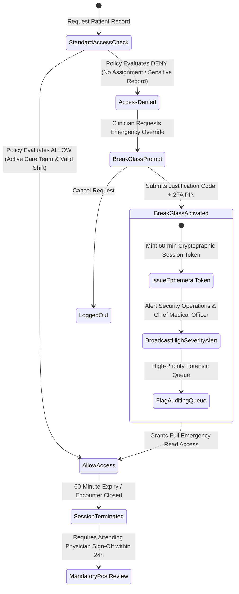
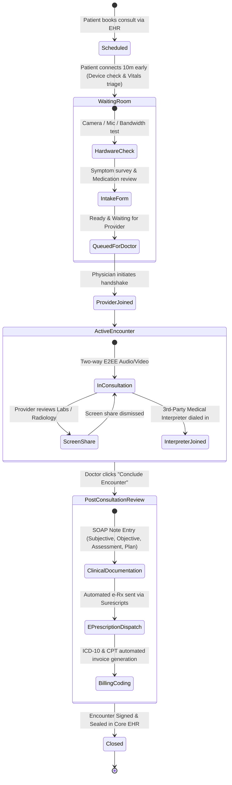

# Healthcare & Telemedicine Systems: High-Level & Low-Level System Design

> **"In healthcare engineering, a software bug, race condition, or authorization flaw does not merely leak revenue or degrade user experience — it leaks the most intimate personal records of human lives, delays emergency clinical interventions, delivers lethal medication dosages, and triggers catastrophic regulatory shutdowns."**

---

## 1. Executive Summary & Real-Life Production Scenarios

Building backend systems for **Electronic Health Records (EHR) platforms (e.g., Epic Systems, Cerner/Oracle Health), telehealth startups (e.g., Teladoc, Amwell, Ro), clinical decision support engines, and Internet of Medical Things (IoMT) fleets** requires navigating the most stringent intersection of legal mandates, life-safety requirements, and legacy technology in modern computer science.

Unlike consumer tech—where eventual consistency delays on social feeds or dropped analytics events are completely acceptable—healthcare software operates under the uncompromising governance of the **Healthcare Engineering Trilemma**:

```
                       THE HEALTHCARE ENGINEERING TRILEMMA
                                Life-Safety &
                               Zero-Downtime
                                Availability
                                     /\
                                    /  \
                                   /    \
                                  /      \
                                 /        \
                                /          \
                               /   SYSTEM   \
                              /    DESIGN    \
                             /     BALANCE    \
                            /                  \
                           /____________________\
              Absolute Privacy                   Global Interoperability
           & Cryptographic Audit                  & Legacy Compatibility
          (Zero-Trust ABAC, HIPAA,               (HL7 v2, C-CDA, FHIR R4,
            Merkle WORM Ledgers)                  LOINC, SNOMED-CT, DICOM)
```

1. **Life-Safety & Zero-Downtime Availability:** A patient experiencing anaphylactic shock or cardiac arrest in an Emergency Department (ED) cannot wait for a database failover, an expired OAuth token, or an unindexed SQL query. Systems must support instant "Break-Glass" emergency overrides that bypass standard access controls while maintaining strict forensic accountability.
2. **Absolute Privacy & Cryptographic Auditability:** Under the US Health Insurance Portability and Accountability Act (HIPAA), the European General Data Protection Regulation (GDPR), and HITRUST standards, every read, write, export, and search of Electronic Protected Health Information (ePHI) must be authenticated, evaluated against dynamic contextual policies (Attribute-Based Access Control), and recorded in an immutable, tamper-evident ledger.
3. **Global Interoperability Across Decades of Technical Debt:** Modern digital health platforms must ingest, normalize, and reconcile data from 40-year-old on-premise hospital mainframes transmitting pipe-delimited HL7 v2 messages over raw TCP/IP (MLLP), radiology imaging suites outputting gigabytes of binary DICOM files, and modern mobile apps consuming RESTful HL7 FHIR (Fast Healthcare Interoperability Resources) JSON endpoints.

```
                           THE CLINICAL DATA & ACCESS PIPELINE
                           
  [ External Clinics, Hospital EHRs, Wearable IoMT Sensors, Telehealth Clients ]
                                     │
                                     ▼
  ┌────────────────────────────────────────────────────────────────────────────┐
  │ 1. Secure Ingress, mTLS Termination & Envelope Decryption                 │
  │    (Zero-Trust Boundary, WAF, Client-Certificate Validation)              │
  └──────────────────────────────────────┬─────────────────────────────────────┘
                                         │
                                         ▼
  ┌────────────────────────────────────────────────────────────────────────────┐
  │ 2. Dynamic Attribute-Based Access Control (ABAC) & Policy Engine          │ ──► Evaluates Shift, Ward,
  │    (Open Policy Agent / Cedar PDP, Break-Glass Emergency Bypass)          │     Consent & Relationship
  └──────────────────────────────────────┬─────────────────────────────────────┘
                                         │ (Policy Approved)
                                         ▼
  ┌────────────────────────────────────────────────────────────────────────────┐
  │ 3. Streaming Ingestion, Normalization & Terminology Translation            │ ──► Converts HL7 v2 / C-CDA
  │    (Kafka, MLLP Parsers, SNOMED-CT / LOINC / RxNorm In-Memory Cache)      │     into Normalized FHIR R4
  └──────────────────────────────────────┬─────────────────────────────────────┘
                                         │
                                         ▼
  ┌────────────────────────────────────────────────────────────────────────────┐
  │ 4. Multi-Tier Clinical Core Persistence                                   │ ──► PostgreSQL JSONB (FHIR)
  │    (PostgreSQL JSONB, TimescaleDB Vitals, S3 WORM DICOM / Clinical Notes) │     + Field-Level KMS Crypto
  └──────────────────────────────────────┬─────────────────────────────────────┘
                                         │
                                         ▼
  ┌────────────────────────────────────────────────────────────────────────────┐
  │ 5. Cryptographic Merkle Audit Engine & VIP Anti-Snooping Detection        │ ──► Write-Once-Read-Many
  │    (SHA-256 Hash Chaining, Amazon S3 Object Lock, Real-Time ML Anomaly)   │     Tamper-Evident Trail
  └────────────────────────────────────────────────────────────────────────────┘
```

---

### Real-World Production Disasters & Post-Mortems

#### 1. Change Healthcare Ransomware Catastrophe (2024) — The $22 Billion Single Point of Failure
- **The Context:** Change Healthcare (a subsidiary of UnitedHealth Group) processes clinical billing, insurance eligibility verifications, and pharmacy prescription authorizations for over 152 million Americans and 1 in 3 US patient records.
- **The Engineering Breakdown:** Threat actors (ALPHV/BlackCat) gained entry through an unsegmented remote access Citrix portal that lacked Multi-Factor Authentication (MFA). Once inside, they escalated privileges across corporate Active Directory controllers, laterally moved into production database enclaves, exfiltrated 6 terabytes of unencrypted and weakly-encrypted ePHI, and deployed ransomware across core transactional databases and virtual machines.
- **The Clinical Disaster:** For weeks, thousands of pharmacies nationwide could not verify insurance benefits or dispense life-critical medications (e.g., insulin, chemotherapy infusion bags). Hospitals were forced to manually fax paper claims, losing billions in cash flow. UnitedHealth estimated total response, remediation, and loan costs exceeding $2.2 billion directly, with systemic healthcare impacts surpassing $20 billion.
- **System Design Lessons:**
  - Zero-Trust Network Architecture (ZTNA) is mandatory: administrative access portals must never rely solely on passwords; universal FIDO2/WebAuthn hardware MFA is non-negotiable.
  - Air-gapped, immutable off-site backups with separate identity providers (IdPs) must be maintained to prevent simultaneous encryption of production and backup storage.
  - Core clearinghouse pipelines require multi-region active-active redundancy with automated failover rails to independent clearing networks.

```
┌──────────────────────────────────────────────────────────────────────────────┐
│          CHANGE HEALTHCARE: SINGLE-POINT-OF-FAILURE RANSOMWARE BLAST          │
└──────────────────────────────────────────────────────────────────────────────┘

  Attack Vector:
  [ External Threat Actor ]
          │
          ▼ (No Multi-Factor Authentication)
  ┌──────────────────────────┐
  │ Legacy Citrix Gateway    │ ──► Single compromised credential grants network ingress
  └─────────────┬────────────┘
                │ Lateral traversal (flat internal network, no zero-trust microsegmentation)
                ▼
  ┌──────────────────────────────────────────────────────────────────────────┐
  │ Production Clearinghouse Enclave                                         │
  │  ┌───────────────────────────┐       ┌────────────────────────────────┐  │
  │  │ Pharmacy Claims Engine    │ ❌     │ Patient Identity DB (ePHI)     │ ❌ │
  │  └───────────────────────────┘       └────────────────────────────────┘  │
  │  ┌───────────────────────────┐       ┌────────────────────────────────┐  │
  │  │ Secondary Insurance Rails │ ❌     │ Backups (Online & Co-located)  │ ❌ │
  │  └───────────────────────────┘       └────────────────────────────────┘  │
  └──────────────────────────────────────────────────────────────────────────┘
                │
                ▼ Total Nationwide Blackout
  ┌──────────────────────────────────────────────────────────────────────────┐
  │ 152 Million Patients Affected | Thousands of Pharmacies Paralyzed        │
  │ Manual Paper / Fax Workarounds | $22B+ Systemic Healthcare Liquidity Hit │
  └──────────────────────────────────────────────────────────────────────────┘
```

#### 2. The NHS WannaCry Ransomware Outage (2017) — Legacy Network Worm Halts Surgeries
- **The Context:** The UK National Health Service (NHS) operated thousands of hospital workstations, pathology lab analyzers, and radiology scanners running unpatched Windows XP and Windows 7 operating systems.
- **The Incident:** The WannaCry worm leveraged the leaked NSA exploit **EternalBlue** (targeting an unauthenticated remote code execution vulnerability in the SMBv1 file-sharing protocol over port 445).
- **The Consequence:** WannaCry swept across flat hospital LANs within minutes. Over 80 NHS trusts were incapacitated, 19,000 appointments and surgeries were cancelled, emergency rooms were forced to divert trauma ambulances, and MRI/CT scanners went dark because their embedded controller PCs were encrypted.
- **System Design Lessons:**
  - Medical devices (IoMT) and clinical endpoints must be isolated in microsegmented VLANs with strict firewall egress filtering; no legacy SMB/NetBIOS traffic permitted across routing boundaries.
  - Hospital infrastructure must assume zero-trust host security: automated patch pipelines, kernel hardening, and default-deny network policies.

#### 3. St. Jude Medical Implantable Cardiac Device Vulnerabilities (2017) — Unauthenticated RF Telemetry
- **The Context:** St. Jude Medical (later Abbott) manufactured hundreds of thousands of implantable cardiac pacemakers and defibrillators paired with home transmitters ("Merlin@home") that communicated over proprietary RF frequencies to transmit telemetry to cardiologists.
- **The Vulnerability:** Independent security researchers and the FDA discovered that the RF communication protocol lacked mutual cryptographic authentication and replay protection. An attacker with a commodity software-defined radio (SDR) within 50 feet could forge commands to deplete the pacemaker's battery rapidly or command the unit to administer life-threatening high-voltage pacing shocks.
- **System Design Lessons:**
  - All IoMT telemetry and control planes must enforce cryptographically authenticated handshakes (e.g., ECDSA signatures, AES-128-GCM session keys) established via out-of-band physical pairing.
  - Firmware update routines must strictly enforce hardware-rooted public key signature verification before flash execution.

#### 4. The UCLA Health & Cedars-Sinai VIP Patient Snooping Scandals
- **The Context:** Elite teaching hospitals frequently treat high-profile celebrities, politicians, and athletes.
- **The Violation:** Repeated audits revealed that dozens of physicians, nurses, technicians, and billing clerks accessed the medical files, psychiatric notes, and toxicology screens of famous patients (e.g., Britney Spears, Michael Jackson) despite having no clinical assignment or care-team relationship to them.
- **System Design Lessons:**
  - Role-Based Access Control (`role = 'doctor'`) is fundamentally broken in clinical environments. A physician in dermatology has zero clinical need to view a maternity or psychiatric record unless assigned to that active encounter.
  - Real-time behavioral anomaly detection engines must analyze audit streams against patient VIP flags, alerting compliance officers within milliseconds of unauthorized chart opens.

---

## 2. Regulatory, Cryptographic, and Security Foundations

### 2.1 The 18 HIPAA Safe Harbor Identifiers & ePHI Data Taxonomy

Under Title 45 of the US Code of Federal Regulations (CFR) § 164.514, any dataset containing clinical information combined with any of the following **18 identifiers** constitutes Electronic Protected Health Information (ePHI) and is subject to federal statutory penalties:

| Identifier # | Category | Production Examples | Storage & Encryption Requirement |
| :---: | :--- | :--- | :--- |
| **1** | Names | Patient, family, healthcare proxy | Envelope-encrypted (AES-256-GCM), deterministic tokenization |
| **2** | Geographic data | Street address, city, county, precinct, ZIP | Truncated to first 3 ZIP digits if population > 20,000; else zeroed |
| **3** | Dates (except year) | Birth date, admission, discharge, death, age > 89 | Shifted dates (cryptographic salt per patient) in analytics warehouses |
| **4** | Contact numbers | Telephone, mobile, emergency contacts | Field-level encrypted; masked on UI (`(***) ***-1234`) |
| **5** | Fax numbers | Clinic fax, pharmacy fax | Field-level encrypted |
| **6** | Email addresses | Patient email, portal login ID | One-way salted hash for lookup (`HMAC-SHA256`); AES-256 for delivery |
| **7** | Social Security Numbers | SSN, tax identification | AES-256-GCM with hardware HSM keys; strict dual-custody access |
| **8** | Medical Record Numbers | Hospital MRN, Enterprise Master Patient ID | Synthetic UUIDv4 tokenization; mapped via secure translation vault |
| **9** | Health Plan Beneficiary | Insurance policy ID, Medicaid ID | Encrypted at rest; restricted to billing clearance pipelines |
| **10** | Account Numbers | Financial billing account numbers | Encrypted at rest; masked in audit logs |
| **11** | Certificate/License # | Driver's license, organ donor ID | Encrypted blob |
| **12** | Vehicle Identifiers | License plate, ambulance run numbers | Encrypted string |
| **13** | Device Identifiers | Pacemaker serial, CGM device GUID, MAC | Salted hash in telemetry pipeline; hardware-rooted pairing table |
| **14** | Web URLs | Personal health sites, patient portals | Sanitized; query params stripped of PHI |
| **15** | IP Addresses | Client IPv4/IPv6, mobile gateway | Truncated/masked in application access logs; never stored in plaintext |
| **16** | Biometric Identifiers | Fingerprints, retinal scans, voiceprints | One-way cryptographic feature embeddings; raw biometrics in secure enclave |
| **17** | Photographic Images | Full-face clinical photos, dermatologic | Stored in S3 with KMS client-side encryption; DICOM pixel burn-in scrubbed |
| **18** | Unique Identifiers | Any unique patient tracking code | Synthetic surrogate keys (UUIDv4/ULID) |

---

### 2.2 Modern Envelope Encryption Architecture (KMS, DEK, and KEK)

To satisfy HIPAA § 164.312(a)(2)(iv) (Encryption and Decryption) without suffering debilitating database performance penalties, enterprise healthcare backends implement **Envelope Encryption**:

```
┌──────────────────────────────────────────────────────────────────────────────┐
│                    ENVELOPE ENCRYPTION PIPELINE FOR ePHI                     │
└──────────────────────────────────────────────────────────────────────────────┘

  Hardware Security Module (HSM) / Cloud KMS Enclave (FIPS 140-3 Level 3)
  ┌──────────────────────────────────────────────────────────────────────────┐
  │ Key Encryption Key (KEK): Customer Master Key (Rotated every 90 days)    │
  │ Master Key NEVER leaves the boundary of the hardware secure enclave      │
  └─────────────────────────────────────┬────────────────────────────────────┘
                                        │
                 1. kms:GenerateDataKey │ 2. Returns Encrypted DEK
                    (KeyId = KEK)       │    + Plaintext DEK in RAM
                                        ▼
  ┌──────────────────────────────────────────────────────────────────────────┐
  │ Microservice Application Memory (Volatile RAM Only)                      │
  │                                                                          │
  │   Plaintext DEK (256-bit AES Key) ──► Encrypts ePHI Payload via          │
  │                                       AES-256-GCM (Authenticated Crypto) │
  │                                                                          │
  │   [ Plaintext DEK immediately zeroed from memory buffers via memzero() ] │
  └─────────────────────────────────────┬────────────────────────────────────┘
                                        │
                                        ▼ Writes ciphertext pair to disk
  ┌──────────────────────────────────────────────────────────────────────────┐
  │ Persistent Database Storage (PostgreSQL / DynamoDB / S3)                 │
  │                                                                          │
  │  Record: {                                                               │
  │    "patient_id": "7f3b4c10-92a1-4f11-...",                              │
  │    "encrypted_dek": "AQIDAHj9... [Ciphertext DEK]",                      │
  │    "iv_nonce": "99a4c11f72b8d001...",                                    │
  │    "auth_tag": "e3b0c44298fc1c14...",                                    │
  │    "encrypted_payload": "X8zK+19/0sPqR... [Ciphertext ePHI]"             │
  │  }                                                                       │
  └──────────────────────────────────────────────────────────────────────────┘
```

#### Deterministic vs. Randomized Authenticated Encryption
- **Randomized Encryption (AES-256-GCM with unique 96-bit Initialization Vector / Nonce per record):** Must be used for all sensitive clinical narrative notes, lab results, and diagnostic reports. Two identical strings encrypt to completely different ciphertexts, preventing frequency analysis attacks.
- **Deterministic Tokenization (Blind Indexing with HMAC-SHA256):** If the application needs to execute SQL exact-match queries (e.g., `SELECT * FROM patients WHERE ssn = ?`), storing pure randomized ciphertext makes indexing impossible without decrypting the entire database. The architecture generates an auxiliary column:
  
  $$\text{BlindIndex} = \text{HMAC-SHA256}(\text{Salt}_{\text{Secret}}, \text{NormalizedSSN})$$
  
  Queries search on the blind index hash while the displayed SSN is retrieved from the AES-256-GCM envelope-encrypted field.

---

### 2.3 The "Minimum Necessary" Standard & Dynamic De-Identification

HIPAA Privacy Rule § 164.502(b) dictates that healthcare systems must limit the disclosure of ePHI to the **minimum necessary** required to accomplish the intended purpose:
1. **Clinical Care Team:** Full access to clinical history, vitals, active medications, and allergies for assigned patients.
2. **Billing & Coding Operations:** Access to billing codes (ICD-10, CPT), date of service, and insurance policy identifiers; zero access to psychiatric notes or raw lab telemetry.
3. **Machine Learning & Population Health Analytics:** Complete stripping of the 18 Safe Harbor identifiers or formal mathematical verification via **Differential Privacy** ($\epsilon, \delta$-guarantees) or the **Expert Determination Method**.

---

## 3. Comprehensive Deep Dive into Architectural Approaches

---

### Approach 1: Attribute-Based Access Control (ABAC), ReBAC & "Break-Glass" Emergency Override

#### The Problem
In standard web applications, Role-Based Access Control (RBAC) maps permissions to coarse roles (`role = 'doctor'`, `role = 'nurse'`). In clinical healthcare, RBAC is dangerous and completely inadequate:
- A physician in cardiology has no legitimate reason to read a gynecology clinical note unless a formal consult has been ordered.
- A nurse assigned to the Intensive Care Unit (ICU) on Monday night should not be permitted to view medical records of patients in the Pediatric Ward on Tuesday morning when off-shift.
- A patient may explicitly revoke consent for specific family members or opt out of psychiatric data sharing under US **42 CFR Part 2** (confidentiality of substance use disorder records).
- **The Life-Safety Dilemma:** If an unconscious patient arrives in the Emergency Department following a motor vehicle collision, an ER physician who has never met the patient must instantly access allergies, blood type, and surgical history. If access control blocks the physician, the patient dies.

#### High-Level Design (HLD)

The system deploys an **Attribute-Based Access Control (ABAC)** and **Relationship-Based Access Control (ReBAC)** engine powered by **Open Policy Agent (OPA)** or AWS Cedar, integrated with a Policy Enforcement Point (PEP) at the API Gateway:

```
┌──────────────────────────────────────────────────────────────────────────────┐
│         HIGH-LEVEL DESIGN: CONTEXTUAL ABAC WITH BREAK-GLASS ENGINE           │
└──────────────────────────────────────────────────────────────────────────────┘

                 Incoming Clinical API Request
                 [ GET /v1/patients/P1024/clinical-notes ]
                 Bearer Token: Doctor JWT (Sub: D501)
                                │
                                ▼
  ┌──────────────────────────────────────────────────────────────────────────┐
  │ API Gateway / Envoy Proxy (Policy Enforcement Point - PEP)              │
  └─────────────────────────────┬────────────────────────────────────────────┘
                                │ 1. Extracts Subject, Resource, Action, Env
                                ▼
  ┌──────────────────────────────────────────────────────────────────────────┐
  │ Policy Decision Point (PDP) — Open Policy Agent (OPA)                    │
  │                                                                          │
  │   Evaluates Rego Rules:                                                  │
  │   - Subject: User ID, Role, Department, Active Shift Status              │
  │   - Resource: Patient ID, Classification, Department, Assigned Ward      │
  │   - Context: Time of Day, Location, Patient Consent Directives           │
  │   - Emergency Flag: "Break-Glass" Active?                                │
  └──────────────▲─────────────────────────────────────────────▲─────────────┘
                 │                                             │
      Queries    │ 2. Fetch Active Attributes       Queries    │ 3. Check Dynamic
      Metadata   │    (Shift, Ward, Assignment)     Consent    │    Consent Directives
                 ▼                                             ▼
  ┌───────────────────────────┐                 ┌────────────────────────────┐
  │ Policy Information Point  │                 │ Consent Management Service │
  │ (PIP): Redis Core Cache   │                 │ (42 CFR Part 2 Directives) │
  └───────────────────────────┘                 └────────────────────────────┘
```

#### Low-Level Design (LLD): The "Break-Glass" Protocol & State Machine

When a normal policy evaluation returns `DENY`, the practitioner can invoke the **Break-Glass** emergency override by asserting a clinical justification (e.g., `IMMINENT_THREAT_TO_LIFE_OR_LIMB`).



#### Concrete Low-Level Implementation: Open Policy Agent (Rego)

```rego
package healthcare.authz

import future.keywords.in
import future.keywords.if

default allow = false
default is_break_glass = false

# 1. Standard Authorization Rule: Contextual Assignment
allow if {
    # Clinician role must be authorized for clinical data
    input.user.role in ["attending_physician", "fellow", "resident", "registered_nurse"]
    
    # Must be on an active shift verified by the scheduling engine
    input.environment.shift_active == true
    
    # Clinician must be explicitly assigned to the patient or patient's ward
    clinician_assigned_to_patient(input.user.id, input.resource.patient_id)
    
    # Patient has not revoked consent for this category of notes
    not consent_revoked(input.resource.patient_id, input.resource.category)
}

# 2. Break-Glass Emergency Override Rule
allow if {
    # Emergency override asserted
    input.request.headers["x-break-glass-override"] == "true"
    
    # Clinician must possess valid emergency credentials (e.g. licensed MD/DO/RN)
    input.user.role in ["attending_physician", "er_resident", "trauma_nurse"]
    
    # Clinician provided an accepted clinical justification code
    input.request.break_glass_justification in [
        "CARDIAC_ARREST",
        "UNCONSCIOUS_TRAUMA",
        "ACUTE_RESPIRATORY_FAILURE",
        "IMMEDIATE_LIFE_OR_LIMB_THREAT"
    ]
    
    # Clinician re-authenticated via hardware token or biometric challenge
    input.user.mfa_verified_at_override == true
}

# Helper: Check care team assignment via PIP cached relations
clinician_assigned_to_patient(user_id, patient_id) if {
    user_id in data.active_care_teams[patient_id].physicians
}

clinician_assigned_to_patient(user_id, patient_id) if {
    user_ward := data.active_staff_ward_assignments[user_id]
    patient_ward := data.admitted_patients[patient_id].current_ward
    user_ward == patient_ward
}

# Helper: Respect sensitive consent restrictions (42 CFR Part 2)
consent_revoked(patient_id, category) if {
    category in ["psychiatric_notes", "substance_abuse_history", "hiv_status"]
    data.patient_consent_opt_outs[patient_id][category] == true
}
```

---

### Approach 2: Cryptographically Verifiable, Tamper-Evident Audit Ledgers (Merkle Trees & WORM Storage)

#### The Problem
HIPAA § 164.312(b) requires audit controls that record and examine activity in information systems containing or using ePHI. Traditional logging solutions (writing log rows to an Amazon RDS PostgreSQL table or streaming to ElasticSearch) fail federal regulatory and legal evidentiary standards:
- **The Rogue Insider Threat:** A rogue Systems Administrator, Cloud Engineer, or compromised DBA with root database access can execute:
  ```sql
  DELETE FROM audit_logs WHERE user_id = 'compromised_admin_account';
  ```
- If an audit log can be edited, truncated, or dropped without immediate mathematical detection, the institution cannot defend itself against criminal non-repudiation challenges in court.

#### High-Level Design (HLD)

The architecture isolates the audit generation path from the audit retention path using an **Asynchronous Sidecar -> Kafka -> Merkle Tree Engine -> Write-Once-Read-Many (WORM) Storage** pipeline:

```
┌──────────────────────────────────────────────────────────────────────────────┐
│            TAMPER-EVIDENT CRYPTOGRAPHIC AUDIT LOGGING ARCHITECTURE           │
└──────────────────────────────────────────────────────────────────────────────┘

  Clinical API Services (EHR Core, Telehealth, Pharmacy)
  ┌──────────────────────────────────────────────────────────────────────────┐
  │ In-Process Audit Interceptor (Zero application latency impact)           │
  │ Captures: Actor ID, Patient ID, Action, Timestamp, Cryptographic Nonce    │
  └────────────────────────────────────┬─────────────────────────────────────┘
                                       │ Async TLS 1.3 Streaming
                                       ▼
  ┌──────────────────────────────────────────────────────────────────────────┐
  │ Apache Kafka Cluster: Topic `clinical-access-audit-events` (3x RF)       │
  └────────────────────────────────────┬─────────────────────────────────────┘
                                       │ Consumer Groups
                                       ▼
  ┌──────────────────────────────────────────────────────────────────────────┐
  │ Merkle Tree Aggregator & Notary Worker Service                           │
  │                                                                          │
  │  Batches 1,000 log records every 10 seconds into a Merkle Hash Tree      │
  │  Calculates Root Hash: R_t = Hash(Left_Node || Right_Node)               │
  │  Signs Root Hash with HSM Private Signing Key (ECDSA P-384)              │
  └──────────────────┬───────────────────────────────────────┬───────────────┘
                     │                                       │
     1. Publish      │                       2. Flush Block  │
        Merkle Proof │                          to WORM      │
                     ▼                                       ▼
  ┌─────────────────────────────────────┐ ┌──────────────────────────────────┐
  │ Immutable Public Ledger /           │ │ Amazon S3 Object Lock            │
  │ Blockchain Anchor                   │ │ (Compliance Mode: Retain for 7   │
  │ (Stores 64-byte Merkle Root + Sig)  │ │  Years; CANNOT be deleted even   │
  │                                     │ │  by AWS Root Account Owner)      │
  └─────────────────────────────────────┘ └──────────────────────────────────┘
```

#### Low-Level Design (LLD): Cryptographic Merkle Hash Chaining

Every audit log entry $L_i$ is hashed. Leaves are paired and hashed recursively until producing the **Merkle Root**:

$$\text{Leaf}_i = H(\text{Timestamp} \parallel \text{ActorID} \parallel \text{PatientID} \parallel \text{Action} \parallel \text{ResourceID} \parallel \text{Salt})$$

$$H_{\text{Parent}} = \text{SHA256}(H_{\text{Left}} \parallel H_{\text{Right}})$$

```
                         Merkle Root (R_1..4)
                       [Published to HSM & Ledger]
                                 /     \
                                /       \
                               /         \
                         H(1-2)           H(3-4)
                         /    \           /    \
                        /      \         /      \
                      H(1)    H(2)     H(3)    H(4)
                       │       │        │       │
                      Log 1   Log 2    Log 3   Log 4
```

To prove that a specific access log event `Log 2` was recorded at that precise timestamp and was never altered, the compliance auditor requires only:
1. The plaintext of `Log 2`
2. The sibling cryptographic hash `H(1)`
3. The uncle cryptographic hash `H(3-4)`
4. The published, signed `Merkle Root`

$$\text{Recomputed Root} = \text{SHA256}(\text{SHA256}(H(1) \parallel \text{SHA256}(\text{Log } 2)) \parallel H(3-4)) \stackrel{?}{=} \text{Merkle Root}$$

Verification takes $O(\log N)$ time and $O(\log N)$ space, allowing forensic mathematical audits across billions of clinical records without traversing database storage.

#### Python Production Implementation: Merkle Audit Verification Engine

```python
import hashlib
import json
import time
from typing import List, Dict, Optional

class MerkleAuditNode:
    def __init__(self, left, right, hash_val: str):
        self.left = left
        self.right = right
        self.hash_val = hash_val

def sha256_hash(data: str) -> str:
    return hashlib.sha256(data.encode('utf-8')).hexdigest()

class TamperEvidentAuditLedger:
    def __init__(self):
        self.leaves: List[str] = []
        self.raw_logs: List[Dict] = []
        self.root_hash: Optional[str] = None

    def record_event(self, actor_id: str, patient_id: str, action: str, resource: str, justification: str) -> Dict:
        """
        Creates an immutable clinical audit record with UTC timestamp and salt.
        """
        event = {
            "version": "1.0",
            "timestamp_ns": time.time_ns(),
            "actor_id": actor_id,
            "patient_id": patient_id,
            "action": action,
            "resource": resource,
            "justification": justification
        }
        serialized = json.dumps(event, sort_keys=True)
        leaf_hash = sha256_hash(serialized)
        
        self.raw_logs.append(event)
        self.leaves.append(leaf_hash)
        return event

    def build_merkle_tree(self) -> str:
        """
        Builds the Merkle Tree from the leaves and returns the top Root Hash.
        """
        if not self.leaves:
            raise ValueError("No audit logs present to seal.")

        current_level = self.leaves
        while len(current_level) > 1:
            next_level = []
            for i in range(0, len(current_level), 2):
                left = current_level[i]
                # If odd number of nodes, duplicate the last node
                right = current_level[i + 1] if i + 1 < len(current_level) else left
                combined_hash = sha256_hash(left + right)
                next_level.append(combined_hash)
            current_level = next_level

        self.root_hash = current_level[0]
        return self.root_hash

    def generate_audit_proof(self, target_index: int) -> List[Dict[str, str]]:
        """
        Generates the O(log N) cryptographic proof for an auditor.
        """
        proof = []
        current_level = self.leaves
        idx = target_index

        while len(current_level) > 1:
            next_level = []
            for i in range(0, len(current_level), 2):
                left = current_level[i]
                right = current_level[i + 1] if i + 1 < len(current_level) else left
                combined = sha256_hash(left + right)
                next_level.append(combined)

                if i == idx or (i + 1 == idx):
                    if idx % 2 == 0:
                        proof.append({"position": "right", "hash": right})
                    else:
                        proof.append({"position": "left", "hash": left})

            idx = idx // 2
            current_level = next_level

        return proof

    @staticmethod
    def verify_proof(leaf_data: Dict, proof: List[Dict[str, str]], expected_root: str) -> bool:
        """
        Independent auditor verification: Proves record was unmodified without trusting DB.
        """
        serialized = json.dumps(leaf_data, sort_keys=True)
        current_hash = sha256_hash(serialized)

        for step in proof:
            if step["position"] == "right":
                current_hash = sha256_hash(current_hash + step["hash"])
            else:
                current_hash = sha256_hash(step["hash"] + current_hash)

        return current_hash == expected_root
```

---

### Approach 3: Legacy HL7 v2 to Modern FHIR R4 Streaming Ingestion & Terminology Normalization

#### The Problem
Hospital systems run on heterogeneous software spanning decades:
- Acquired radiology clinics send data via **HL7 v2.x**, a pipe-delimited (`|`), hat-delimited (`^`) ASCII format dating back to 1989 that runs over raw, stateful TCP sockets using **Minimal Lower Layer Protocol (MLLP)**.
- Regional labs transmit reports via **C-CDA (Consolidated Clinical Document Architecture)**, an unwieldy XML standard.
- Modern consumer apps and clinical decision tools expect **HL7 FHIR Release 4/5 (Fast Healthcare Interoperability Resources)**, a clean JSON/REST specification.
- **The Semantic Gap:** Clinic A encodes Diabetes Mellitus Type 2 as ICD-10 `E11.9`. Clinic B records it under SNOMED-CT code `44054006`. Clinic C uses a legacy proprietary hospital internal string `"DIAB-MELL-T2"`. A patient's chart must not display duplicate or disjoint conditions.

#### High-Level Design (HLD)

```
┌──────────────────────────────────────────────────────────────────────────────┐
│       HL7 v2 MLLP STREAMING ETL & FHIR R4 TERMINOLOGY NORMALIZATION          │
└──────────────────────────────────────────────────────────────────────────────┘

  Hospital On-Premise EHR (Epic / Cerner / Legacy Meditech)
  ┌──────────────────────────────────────────────────────────────────────────┐
  │ HL7 v2 Interface Engine (Emits ADT, ORU, MDM messages over MLLP)         │
  └────────────────────────────────────┬─────────────────────────────────────┘
                                       │ IPSec VPN / Mutual TLS Tunnel
                                       ▼
  ┌──────────────────────────────────────────────────────────────────────────┐
  │ Edge Ingestion Gateway: MLLP Listener (Golang Goroutine Socket Pool)      │
  │ - Strips MLLP framing bytes: <SB> (0x0B), <EB> (0x1C), <CR> (0x0D)       │
  │ - Generates instant synchronous HL7 ACK (Acknowledgement) message        │
  └────────────────────────────────────┬─────────────────────────────────────┘
                                       │ Publishes Raw Payload
                                       ▼
  ┌──────────────────────────────────────────────────────────────────────────┐
  │ Apache Kafka Ingestion Topic: `hl7v2-raw-feed-partitioned`                │
  │ Key = Medical Record Number (MRN) to preserve per-patient ordering       │
  └────────────────────────────────────┬─────────────────────────────────────┘
                                       │
                                       ▼
  ┌──────────────────────────────────────────────────────────────────────────┐
  │ Streaming Parser & Transform Microservice (FHIR Converter)               │
  │                                                                          │
  │ 1. Tokenizes HL7 Segments: MSH (Header), PID (Patient), OBX (Observation)│
  │ 2. Queries Terminology Server (Distributed Redis LRU Cache):             │
  │    Maps proprietary codes -> SNOMED-CT / LOINC / RxNorm                  │
  │ 3. Assembles Validated FHIR R4 Resource (`Patient`, `Observation`)       │
  └────────────────────────────────────┬─────────────────────────────────────┘
                                       │
                                       ▼
  ┌──────────────────────────────────────────────────────────────────────────┐
  │ Enterprise FHIR Core Repository (PostgreSQL JSONB + HAPI FHIR Engine)    │
  └──────────────────────────────────────────────────────────────────────────┘
```

#### Low-Level Design (LLD): MLLP Framing Protocol & Segment Mapping

The **Minimal Lower Layer Protocol (MLLP)** is a session-less framing protocol wrapping HL7 v2 ASCII payloads over a stream-oriented TCP socket:
- **Start Block Character:** `<SB> = 0x0B` (ASCII Vertical Tab)
- **Data Payload:** Raw HL7 v2 pipe-delimited text
- **End Block Character:** `<EB> = 0x1C` (ASCII File Separator)
- **Carriage Return:** `<CR> = 0x0D` (ASCII Carriage Return)

```
 [TCP Stream] ──► [ 0x0B ] [ HL7 ASCII PAYLOAD ] [ 0x1C ] [ 0x0D ] ──► [TCP Stream]
```

##### HL7 v2.5.1 Pipe-Delimited Example (Observation Result - ORU^R01):
```text
MSH|^~\&|LAB_SYSTEM|METRO_HOSPITAL|INTEGRATION_BUS|HEALTH_SYSTEM|20261014193000||ORU^R01|MSG009214|P|2.5.1
PID|1||MRN-90210^^^METRO^MR||DOE^JANE^A||19850615|F|||123 ELM ST^^METROPOLIS^NY^10001
PV1|1|O|CLINIC-4^^^WARD-B||||DR-412^SMITH^JOHN|||||||||||ENC-88314
OBX|1|NM|GLU^Glucose Serum|1|142|mg/dL|70-99|H|||F|||20261014192500
```

##### Converted FHIR R4 JSON Resource (`Observation`):
```json
{
  "resourceType": "Observation",
  "id": "obs-glucose-88314",
  "status": "final",
  "category": [
    {
      "coding": [
        {
          "system": "http://terminology.hl7.org/CodeSystem/observation-category",
          "code": "laboratory",
          "display": "Laboratory"
        }
      ]
    }
  ],
  "code": {
    "coding": [
      {
        "system": "http://loinc.org",
        "code": "2345-7",
        "display": "Glucose [Mass/volume] in Serum or Plasma"
      }
    ],
    "text": "Glucose Serum"
  },
  "subject": {
    "reference": "Patient/pat-90210"
  },
  "encounter": {
    "reference": "Encounter/enc-88314"
  },
  "effectiveDateTime": "2026-10-14T19:25:00Z",
  "valueQuantity": {
    "value": 142,
    "unit": "mg/dL",
    "system": "http://unitsofmeasure.org",
    "code": "mg/dL"
  },
  "interpretation": [
    {
      "coding": [
        {
          "system": "http://terminology.hl7.org/CodeSystem/v3-ObservationInterpretation",
          "code": "H",
          "display": "High"
        }
      ]
    }
  ],
  "referenceRange": [
    {
      "low": {
        "value": 70,
        "unit": "mg/dL"
      },
      "high": {
        "value": 99,
        "unit": "mg/dL"
      }
    }
  ]
}
```

#### Go Production Implementation: High-Throughput MLLP Server

```go
package main

import (
	"bufio"
	"bytes"
	"context"
	"fmt"
	"io"
	"log"
	"net"
	"time"
)

const (
	MLLPStartBlock byte = 0x0B // <SB>
	MLLPEndBlock   byte = 0x1C // <EB>
	MLLPCarriage   byte = 0x0D // <CR>
)

type MLLPServer struct {
	listenAddr string
	listener   net.Listener
	kafkaQueue chan []byte
}

func NewMLLPServer(addr string) *MLLPServer {
	return &MLLPServer{
		listenAddr: addr,
		kafkaQueue: make(chan []byte, 10000),
	}
}

func (s *MLLPServer) Start(ctx context.Context) error {
	var err error
	s.listener, err = net.Listen("tcp", s.listenAddr)
	if err != nil {
		return fmt.Errorf("failed to bind MLLP port: %w", err)
	}
	defer s.listener.Close()

	log.Printf("[MLLP-INGEST] Listening on %s...", s.listenAddr)

	for {
		conn, err := s.listener.Accept()
		if err != nil {
			select {
			case <-ctx.Done():
				return nil
			default:
				log.Printf("[MLLP-ERROR] Socket accept error: %v", err)
				continue
			}
		}

		go s.handleConnection(conn)
	}
}

func (s *MLLPServer) handleConnection(conn net.Conn) {
	defer conn.Close()
	reader := bufio.NewReader(conn)

	for {
		_ = conn.SetReadDeadline(time.Now().Add(60 * time.Second))

		// 1. Await Start Block <SB>
		b, err := reader.ReadByte()
		if err != nil {
			if err != io.EOF {
				log.Printf("[MLLP-WARN] Connection read aborted: %v", err)
			}
			return
		}

		if b != MLLPStartBlock {
			log.Printf("[MLLP-MALFORMED] Expected 0x0B Start Block, got: 0x%02X", b)
			return
		}

		// 2. Read until End Block <EB><CR>
		payload, err := reader.ReadBytes(MLLPEndBlock)
		if err != nil {
			log.Printf("[MLLP-ERROR] Truncated packet before <EB>: %v", err)
			return
		}

		// Consume the trailing <CR>
		trailingCR, err := reader.ReadByte()
		if err != nil || trailingCR != MLLPCarriage {
			log.Printf("[MLLP-WARN] Missing trailing <CR> after <EB>")
		}

		// Strip the <EB> from payload slice
		cleanHL7 := payload[:len(payload)-1]

		// 3. Dispatch to worker channel
		s.kafkaQueue <- cleanHL7

		// 4. Construct and return HL7 v2 ACK (Commit-Accept)
		ack := s.generateACK(cleanHL7)
		if _, err := conn.Write(ack); err != nil {
			log.Printf("[MLLP-ERROR] Failed to write ACK response: %v", err)
			return
		}
	}
}

func (s *MLLPServer) generateACK(rawHL7 []byte) []byte {
	// Extract Message Control ID from MSH-10
	segments := bytes.Split(rawHL7, []byte("\r"))
	msgControlID := "UNKNOWN"
	if len(segments) > 0 {
		fields := bytes.Split(segments[0], []byte("|"))
		if len(fields) >= 10 {
			msgControlID = string(fields[9])
		}
	}

	timestamp := time.Now().Format("20060102150405")
	ackContent := fmt.Sprintf(
		"MSH|^~\\&|INGEST_ENGINE|GATEWAY|HOSPITAL_EHR|FACILITY|%s||ACK|ACK%s|P|2.5\r"+
			"MSA|AA|%s\r",
		timestamp, msgControlID, msgControlID,
	)

	// Wrap in MLLP envelope
	var buf bytes.Buffer
	buf.WriteByte(MLLPStartBlock)
	buf.WriteString(ackContent)
	buf.WriteByte(MLLPEndBlock)
	buf.WriteByte(MLLPCarriage)

	return buf.Bytes()
}
```

---

### Approach 4: Low-Latency, HIPAA-Compliant Telemedicine Video Engine (WebRTC SFU & E2EE)

#### The Problem
Real-time telehealth consultations present unique networking and cryptographic challenges:
- **Latency & Jitter Requirements:** Interactive diagnostic conversation requires end-to-end glass-to-glass latency below **150 milliseconds**. High latency destroys physician-patient rapport and disrupts acoustic stethoscopy.
- **HIPAA Compliance for Real-Time Media:** Under HIPAA, the provider cannot route video through unencrypted third-party relays. Audio/video media must never be persisted to unencrypted cache disks.
- **Network Topologies in Real-World Conditions:** Patients frequently dial in from rural areas over unstable 3G/4G connections with high packet loss (15%–30%) and dynamic symmetric NAT firewalls.
- **Mesh vs. SFU vs. MCU:** A peer-to-peer WebRTC mesh network collapses when a 3rd participant joins (e.g., an interpreter or family proxy) due to client upstream bandwidth saturation ($N-1$ uploads). An MCU (Multipoint Control Unit) decodes and re-encodes video in the cloud, consuming excessive CPU and destroying End-to-End Encryption (E2EE).

#### High-Level Design (HLD)

The telemedicine architecture utilizes a **Selective Forwarding Unit (SFU)** cluster (such as mediasoup or LiveKit) paired with WebRTC **Insertable Streams** for true End-to-End Encryption:

```
┌──────────────────────────────────────────────────────────────────────────────┐
│       HIPAA TELEHEALTH WEBRTC SELECTIVE FORWARDING UNIT (SFU) ROUTING        │
└──────────────────────────────────────────────────────────────────────────────┘

  Patient Browser / Native App                     Physician Workstation
  ┌───────────────────────────┐                   ┌───────────────────────────┐
  │ WebRTC Audio/Video Tracks │                   │ WebRTC Audio/Video Tracks │
  │ + Insertable Streams E2EE │                   │ + Insertable Streams E2EE │
  │ (Frame payload encrypted  │                   │ (Frame payload decrypted  │
  │  using shared room key)   │                   │  using shared room key)   │
  └─────────────┬─────────────┘                   └─────────────▲─────────────┘
                │ DTLS-SRTP                                     │ DTLS-SRTP
                ▼                                               │
  ┌─────────────────────────────────────────────────────────────┴─────────────┐
  │ Cloud Selective Forwarding Unit (SFU) Cluster (Auto-scaling Node Enclave) │
  │                                                                           │
  │   - Terminated Transport-Layer DTLS-SRTP Session                          │
  │   - CANNOT view video frames! (Ciphertext payload preserved via E2EE)     │
  │   - Inspects RTP packet headers (Sequence Number, Timestamp, SSRC)        │
  │   - Routes packets dynamically based on bandwidth / simulcast layers      │
  └─────────────────────────────────────┬─────────────────────────────────────┘
                                        │ Forward copy for recording (if opted)
                                        ▼
  ┌──────────────────────────────────────────────────────────────────────────┐
  │ Encrypted Media Archival Service (AWS S3 KMS Vault)                       │
  │ Only executed if explicit signed patient clinical consent is verified    │
  └──────────────────────────────────────────────────────────────────────────┘
```

#### Low-Level Design (LLD): The Telehealth Session State Machine

A patient consultation is not just a video call; it is a clinical encounter bound by strict billing and medical-legal boundaries:



#### Low-Level WebRTC Insertable Streams (Client-Side E2EE Frame Encryption)

Even though DTLS-SRTP encrypts WebRTC traffic over the wire, the SFU server terminates DTLS, exposing raw decrypted RTP payloads in server memory. To guarantee HIPAA zero-knowledge compliance, the browser uses WebRTC **Insertable Streams** (`TransformStream`) to re-encrypt every audio and video frame payload with an ephemeral AES-GCM room key before it reaches the WebRTC network transport layer:

```javascript
// WebRTC Client-Side Frame Encryptor (Insertable Streams API)
class TelehealthFrameEncryptor {
  constructor(sharedSessionKey) {
    this.cryptoKey = sharedSessionKey; // CryptoKey derived via ECDH
    this.frameCounter = 0;
  }

  createSenderTransform() {
    return new TransformStream({
      transform: async (encodedFrame, controller) => {
        // Leave unencrypted RTP payload header (first 10 bytes) for SFU routing
        const headerLength = 10;
        const rawPayload = new Uint8Array(encodedFrame.data);
        const header = rawPayload.slice(0, headerLength);
        const frameBody = rawPayload.slice(headerLength);

        // Generate deterministic initialization vector (IV) from counter
        const iv = new Uint8Array(12);
        const view = new DataView(iv.buffer);
        view.setUint32(8, this.frameCounter++);

        // Encrypt frame body with AES-GCM
        const encryptedBody = await crypto.subtle.encrypt(
          { name: "AES-GCM", iv: iv },
          this.cryptoKey,
          frameBody
        );

        // Construct final payload: [RTP Header] + [12-byte IV] + [Encrypted Ciphertext]
        const finalPayload = new Uint8Array(headerLength + 12 + encryptedBody.byteLength);
        finalPayload.set(header, 0);
        finalPayload.set(iv, headerLength);
        finalPayload.set(new Uint8Array(encryptedBody), headerLength + 12);

        encodedFrame.data = finalPayload.buffer;
        controller.enqueue(encodedFrame);
      }
    });
  }
}
```

---

### Approach 5: Internet of Medical Things (IoMT) & Real-Time Clinical Deterioration Alerting

#### The Problem
Modern hospitals and remote patient monitoring (RPM) setups deploy thousands of continuous streaming sensors:
- Continuous Glucose Monitors (CGM), 12-lead wearable Holter ECGs, pulse oximeters, and smart hospital beds emit high-frequency vitals (1 Hz – 500 Hz).
- **Alarm Fatigue:** In a typical 400-bed hospital, ICU monitors generate up to **350 alarms per bed per day**. Between **85% and 99%** of these alarms are false positives (e.g., patient shifting in bed causing a momentary pulse-oximeter lead disconnection). Nurses become desensitized to sirens, leading to delayed responses when genuine fatal ventricular fibrillation occurs.
- **The Sepsis Shock Threshold:** Sepsis is the leading cause of hospital mortality. Every 1-hour delay in antibiotic administration increases mortality by **7.6%**. Systems must detect subtle, multi-parameter vital trends across sliding temporal windows (e.g., body temperature spiking while mean arterial pressure drops and respiratory rate accelerates) before overt physical collapse.

#### High-Level Design (HLD)

```
┌──────────────────────────────────────────────────────────────────────────────┐
│          IoMT REAL-TIME CLINICAL DETERIORATION ENGINE (SEPSIS / NEWS2)        │
└──────────────────────────────────────────────────────────────────────────────┘

  Hospital Beds, Infusion Pumps, Wearable Patches (IoMT Fleet)
  ┌──────────────────────────────────────────────────────────────────────────┐
  │ Microcontroller Telemetry Agent (mTLS 1.3 Client Certificate Authenticated)│
  │ Protocols: MQTT over TLS or lightweight CoAP with DTLS                   │
  └────────────────────────────────────┬─────────────────────────────────────┘
                                       │ High-throughput binary streams
                                       ▼
  ┌──────────────────────────────────────────────────────────────────────────┐
  │ Edge IoT Gateway (EMQX / AWS IoT Core Cluster)                           │
  │ - Authenticates device X.509 certificates                                │
  │ - Enforces payload throttling and malformed sensor dead-letter queues    │
  └────────────────────────────────────┬─────────────────────────────────────┘
                                       │ High-volume stream
                                       ▼
  ┌──────────────────────────────────────────────────────────────────────────┐
  │ Apache Kafka Ingestion Cluster: `iomt-vitals-high-frequency`             │
  │ Key = `patient_uuid` (Guarantees in-order processing per patient)        │
  └────────────────────────────────────┬─────────────────────────────────────┘
                                       │
                                       ▼
  ┌──────────────────────────────────────────────────────────────────────────┐
  │ Stateful Complex Event Processing (CEP) Engine: Apache Flink             │
  │                                                                          │
  │ 1. 15-Minute Tumbling & Sliding Event-Time Windows                       │
  │ 2. Calculates Dynamic NEWS2 (National Early Warning Score)               │
  │ 3. Signal Filtering & Deadbanding (Dampens transient noise / motion)     │
  │ 4. Escalation Trigger: Score >= 7 OR Acute Drop in Oxygen Saturation     │
  └──────────────────┬───────────────────────────────────────┬───────────────┘
                     │ High-Severity Sepsis Alert            │ Cold Path
                     ▼                                       ▼
  ┌─────────────────────────────────────┐ ┌──────────────────────────────────┐
  │ Priority Clinical Dispatch Engine   │ │ TimescaleDB / InfluxDB           │
  │ - Apple Push Notification Service   │ │ Compressed Time-Series Vitals    │
  │   (VoIP Push bypasses Do-Not-Disturb│ │ Hypertable for Longitudinal      │
  │ - Hospital Pager Radio Gateway      │ │ Clinical Analytics & AI Models   │
  │ - EHR InBasket Critical Flag        │ │                                  │
  └─────────────────────────────────────┘ └──────────────────────────────────┘
```

#### Low-Level Design (LLD): The NEWS2 Score & Alarm Hysteresis Filter

The **National Early Warning Score (NEWS2)** is an internationally validated physiological scoring system based on 6 core clinical parameters:

| Physiological Parameter | 3 Points | 2 Points | 1 Point | 0 Points (Normal) | 1 Point | 2 Points | 3 Points |
| :--- | :---: | :---: | :---: | :---: | :---: | :---: | :---: |
| **Respiration Rate (bpm)** | $\le 8$ | — | $9 - 11$ | **$12 - 20$** | — | $21 - 24$ | $\ge 25$ |
| **$\text{SpO}_2$ Oxygen Saturation Scale 1 (%)** | $\le 91$ | $92 - 93$ | $94 - 95$ | **$\ge 96$** | — | — | — |
| **Systolic Blood Pressure (mmHg)**| $\le 90$ | $91 - 100$| $101 - 110$| **$111 - 219$**| — | — | $\ge 220$ |
| **Pulse Rate (bpm)** | $\le 40$ | — | $41 - 50$ | **$51 - 90$** | $91 - 110$ | $111 - 130$ | $\ge 131$ |
| **Consciousness Level** | — | — | — | **Alert (A)** | — | — | CVPU (Altered)|
| **Temperature ($^\circ\text{C}$)** | $\le 35.0$ | — | $35.1 - 36.0$| **$36.1 - 38.0$**| $38.1 - 39.0$| $\ge 39.1$ | — |

##### The Anti-Alarm-Fatigue Filter (Hysteresis & Deadbanding):
If a patient's systolic blood pressure oscillates between $90\text{ mmHg}$ and $91\text{ mmHg}$ every 5 seconds, an unfiltered alerting engine would fire 700 alarms an hour. The alerting engine applies **Hysteresis Deadbanding**:
- An alert is triggered only when the score enters the critical zone ($Score \ge 7$) and remains there continuously for a confirmation window ($T_{\text{confirm}} = 45\text{ seconds}$).
- Once triggered, the alert cannot clear until the score drops by at least **2 points below** the threshold for more than $T_{\text{clear}} = 120\text{ seconds}$.

```
  NEWS2 Score
      ▲
      │                 Trigger Threshold (Score >= 7)
   8 ─┼───────────────╭───────╮────────────────────────
   7 ─┼───╭──╮────────│ ALARM │────────────────────────
   6 ─┼───│──│────────│ ACTIVE│─────────╮
   5 ─┼───│──│────────│       │─────────│── De-escalation Threshold (Score <= 5)
   4 ─┼───╯──╰────────╯───────╰─────────╰───────────────
      └─────────────────────────────────────────────────► Time
         Transient Spike:           Sustained Deterioration:
          No Alarm (Deadbanded)      ALARM FIRED & PUSHED
```

##### Python Production Implementation: Stateful NEWS2 Alerting with Deadbanding

```python
from dataclasses import dataclass
from typing import Optional, Dict
import time

@dataclass
class VitalsMeasurement:
    patient_id: str
    timestamp_epoch: float
    respiration_rate: int          # breaths per minute
    spo2_percentage: int           # SpO2 percentage
    systolic_bp: int               # mmHg
    heart_rate: int                # beats per minute
    is_conscious_alert: bool       # True = Alert, False = CVPU
    temperature_celsius: float     # Celsius

@dataclass
class AlertState:
    current_state: str             # "NORMAL", "PENDING_ESCALATION", "ACTIVE_ALARM"
    pending_since: Optional[float]
    last_alarm_time: Optional[float]
    last_score: int

class News2SepsisEngine:
    def __init__(self, escalation_threshold=7, deescalation_threshold=5,
                 confirm_window_sec=45.0, deadband_cooldown_sec=120.0):
        self.escalation_threshold = escalation_threshold
        self.deescalation_threshold = deescalation_threshold
        self.confirm_window_sec = confirm_window_sec
        self.deadband_cooldown_sec = deadband_cooldown_sec
        # Per-patient state table (stored in Flink KeyedState or Redis)
        self.patient_states: Dict[str, AlertState] = {}

    def compute_news2_score(self, v: VitalsMeasurement) -> int:
        score = 0

        # 1. Respiration Rate
        if v.respiration_rate <= 8 or v.respiration_rate >= 25:
            score += 3
        elif 21 <= v.respiration_rate <= 24:
            score += 2
        elif 9 <= v.respiration_rate <= 11:
            score += 1

        # 2. Oxygen Saturation (SpO2) Scale 1
        if v.spo2_percentage <= 91:
            score += 3
        elif 92 <= v.spo2_percentage <= 93:
            score += 2
        elif 94 <= v.spo2_percentage <= 95:
            score += 1

        # 3. Systolic Blood Pressure
        if v.systolic_bp <= 90 or v.systolic_bp >= 220:
            score += 3
        elif 91 <= v.systolic_bp <= 100:
            score += 2
        elif 101 <= v.systolic_bp <= 110:
            score += 1

        # 4. Heart Rate
        if v.heart_rate <= 40 or v.heart_rate >= 131:
            score += 3
        elif 111 <= v.heart_rate <= 130:
            score += 2
        elif (41 <= v.heart_rate <= 50) or (91 <= v.heart_rate <= 110):
            score += 1

        # 5. Consciousness
        if not v.is_conscious_alert:
            score += 3

        # 6. Temperature
        if v.temperature_celsius <= 35.0:
            score += 3
        elif v.temperature_celsius >= 39.1:
            score += 2
        elif (35.1 <= v.temperature_celsius <= 36.0) or (38.1 <= v.temperature_celsius <= 39.0):
            score += 1

        return score

    def evaluate_telemetry(self, v: VitalsMeasurement) -> Optional[Dict]:
        """
        Stateful sliding evaluation with hysteresis to suppress false alarms.
        """
        score = self.compute_news2_score(v)
        now = v.timestamp_epoch

        if v.patient_id not in self.patient_states:
            self.patient_states[v.patient_id] = AlertState(
                current_state="NORMAL",
                pending_since=None,
                last_alarm_time=None,
                last_score=score
            )

        state = self.patient_states[v.patient_id]
        state.last_score = score
        alert_event = None

        if state.current_state == "NORMAL":
            if score >= self.escalation_threshold:
                # Enter pending escalation confirmation window
                state.current_state = "PENDING_ESCALATION"
                state.pending_since = now

        elif state.current_state == "PENDING_ESCALATION":
            if score >= self.escalation_threshold:
                # Check if sustained across the confirmation window
                if state.pending_since and (now - state.pending_since >= self.confirm_window_sec):
                    state.current_state = "ACTIVE_ALARM"
                    state.last_alarm_time = now
                    alert_event = {
                        "event_type": "CLINICAL_DETERIORATION_ALARM",
                        "patient_id": v.patient_id,
                        "news2_score": score,
                        "severity": "CRITICAL_RED",
                        "timestamp": now,
                        "action_required": "IMMEDIATE_BEDSIDE_ATTENDANCE"
                    }
            else:
                # Transient spike subsided; reset to normal
                state.current_state = "NORMAL"
                state.pending_since = None

        elif state.current_state == "ACTIVE_ALARM":
            # Hysteresis: Must drop to or below deescalation threshold to clear
            if score <= self.deescalation_threshold:
                if state.last_alarm_time and (now - state.last_alarm_time >= self.deadband_cooldown_sec):
                    state.current_state = "NORMAL"
                    state.pending_since = None
                    alert_event = {
                        "event_type": "CLINICAL_ALARM_RESOLVED",
                        "patient_id": v.patient_id,
                        "news2_score": score,
                        "severity": "INFO",
                        "timestamp": now
                    }

        return alert_event
```

---

### Approach 6: Medical Imaging (PACS, DICOM & DICOMweb) Pipeline

#### The Problem
Radiology departments produce massive volumetric data sets:
- Computed Tomography (CT) scans and Magnetic Resonance Imaging (MRI) studies generate thousands of slice images per study. A single multi-phase contrast CT can be **1.5 gigabytes** of uncompressed 16-bit grayscale data.
- The standard format is **DICOM (Digital Imaging and Communications in Medicine)**, which bundles binary pixel matrices together with nested binary tags (patient name, scanner calibration, slice thickness).
- Radiologists require sub-second image loading and interactive multi-planar reconstruction (MPR). Traditional on-premise **PACS (Picture Archiving and Communication System)** servers are trapped on legacy hospital LANs using ancient DICOM C-STORE protocols over TCP port 104.
- **The Cloud Challenge:** Web and mobile viewers cannot download 1.5 GB files over residential internet to render a clinical view. Modern backends must stream **DICOMweb (WADO-RS, QIDO-RS, STOW-RS)** over HTTPS with progressive multi-resolution streaming.

#### High-Level Design (HLD)

```
┌──────────────────────────────────────────────────────────────────────────────┐
│        CLOUD DICOMweb / PACS MEDICAL IMAGING ARCHITECTURE                    │
└──────────────────────────────────────────────────────────────────────────────┘

  Hospital CT / MRI Scanners & Ultrasound Machines
  ┌──────────────────────────────────────────────────────────────────────────┐
  │ DICOM Modality Node (Emits C-STORE-RQ over raw TCP Port 104)             │
  └────────────────────────────────────┬─────────────────────────────────────┘
                                       │ TLS VPN Bridge
                                       ▼
  ┌──────────────────────────────────────────────────────────────────────────┐
  │ Edge DICOM Router & Gateway                                              │
  │ - Terminates C-STORE TCP session and returns C-STORE-RSP                 │
  │ - Translates legacy DICOM protocol -> DICOMweb STOW-RS (RESTful HTTPS)   │
  └────────────────────────────────────┬─────────────────────────────────────┘
                                       │ HTTPS Multipart/Related Upload
                                       ▼
  ┌──────────────────────────────────────────────────────────────────────────┐
  │ Ingestion & De-Identification Worker Cluster                              │
  │                                                                          │
  │ 1. Extracts Metadata Tags (StudyUID, SeriesUID, PatientID, Modality)     │
  │ 2. De-identifies tags (HIPAA Safe Harbor) if routed to research bucket   │
  │ 3. Transcodes raw 16-bit Pixel Data -> Lossless HTJ2K (High-Throughput   │
  │    JPEG 2000) or WebP tiles for zero-footprint web streaming             │
  └──────────────────┬───────────────────────────────────────┬───────────────┘
                     │                                       │
      Store Parsed   │                       Persist Binary  │
      Metadata       │                       Tile Pyramids   │
                     ▼                                       ▼
  ┌─────────────────────────────────────┐ ┌──────────────────────────────────┐
  │ Imaging Metadata Database           │ │ Amazon S3 Tiered Storage         │
  │ (PostgreSQL Relational Schema:      │ │ - Hot Tier: Recent 30 days       │
  │  Studies -> Series -> Instances)    │ │ - Glacier Instant Retrieval:     │
  │                                     │ │   Retain for 7-year statutory    │
  │                                     │ │   medical retention mandate      │
  └─────────────────────────────────────┘ └──────────────────────────────────┘
```

#### Low-Level Design (LLD): DICOM Information Model & DICOMweb Protocols

The DICOM information entity model adheres to a strict four-level hierarchy:

```
  [ Patient ] (Patient ID, Birth Date, Sex)
      │
      └──► [ Study ] (Study Instance UID, Study Date, Accession Number)
              │
              └──► [ Series ] (Series Instance UID, Modality: CT/MR/US, Body Part)
                      │
                      └──► [ SOP Instance ] (SOP Instance UID, Slice Location, Pixel Data)
```

##### DICOMweb RESTful Services Standard:
1. **QIDO-RS (Query based on ID for DICOM Objects):**
   - Search studies: `GET /dicomweb/studies?PatientID=P90210&ModalitiesInStudy=CT`
   - Returns lightweight JSON summary of matching studies without transferring pixel data.
2. **WADO-RS (Web Access to DICOM Objects by RESTful Services):**
   - Retrieve full study: `GET /dicomweb/studies/{studyUID}`
   - Retrieve specific rendered frame (progressive JPEG/WebP):
     `GET /dicomweb/studies/{studyUID}/series/{seriesUID}/instances/{sopUID}/frames/{frameIdx}/rendered`
3. **STOW-RS (Store Over the Web by RESTful Services):**
   - Upload new DICOM instances via HTTP `POST /dicomweb/studies` with `Content-Type: multipart/related; type="application/dicom"`.

##### Python Implementation: DICOM Tag De-Identification (PS 3.15 Clean Pixel Pipeline)

```python
import pydicom
from pydicom.tag import Tag

# Key HIPAA Safe Harbor Tags to Scrub or Hash
DICOM_DEIDENTIFICATION_MAP = {
    Tag(0x0010, 0x0010): "ANONYMIZED_PATIENT",     # Patient Name
    Tag(0x0010, 0x0020): "HASHED_MRN",              # Patient ID
    Tag(0x0010, 0x0030): "19800101",                # Patient Birth Date (Masked)
    Tag(0x0008, 0x0080): "CENTRAL_IMAGING_CENTER",  # Institution Name
    Tag(0x0008, 0x0090): "REFERRING_PHYSICIAN",     # Referring Physician
    Tag(0x0008, 0x1048): "",                         # Physician of Record
    Tag(0x0008, 0x1050): "",                         # Performing Physician
    Tag(0x0010, 0x1000): "",                         # Other Patient IDs
}

def deidentify_dicom_instance(input_file_path: str, output_file_path: str, pseudonymous_id: str):
    """
    Strips ePHI from binary DICOM files according to DICOM PS 3.15 Annex E.
    """
    ds = pydicom.dcmread(input_file_path)

    # 1. Replace Direct Identifiers
    for tag, replacement in DICOM_DEIDENTIFICATION_MAP.items():
        if tag in ds:
            if tag == Tag(0x0010, 0x0020):
                ds[tag].value = pseudonymous_id
            else:
                ds[tag].value = replacement

    # 2. Remove Private Vendor Tags (which often leak patient data in proprietary tags)
    ds.remove_private_tags()

    # 3. Strip Burned-in Text Flag
    # If the scanner burned patient name directly into pixels (common in ultrasound),
    # this requires OCR optical scrubbing; flagged here for downstream optical pipeline.
    has_burned_in_annotation = getattr(ds, "BurnedInAnnotation", "NO")
    if has_burned_in_annotation == "YES":
        raise ValueError("CRITICAL: Instance contains burned-in pixel ePHI; requires OCR redaction.")

    ds.save_as(output_file_path)
```

---

## 4. End-to-End System Architecture: Production Healthcare & Telemedicine Platform

The following diagram unifies every core healthcare subsystem into a hardened, highly available, multi-region production architecture:

```
┌──────────────────────────────────────────────────────────────────────────────────────────────────────────────┐
│                            UNIFIED PRODUCTION DIGITAL HEALTHCARE ARCHITECTURE                                │
└──────────────────────────────────────────────────────────────────────────────────────────────────────────────┘

 [ Wearables / IoMT ]        [ Patients & Mobile App ]       [ Hospital EHR / Clinics ]       [ Radiologists ]
       │                               │                                 │                             │
       ▼ (mTLS / MQTT)                 ▼ (HTTPS / TLS 1.3)               ▼ (MLLP / HL7 v2 VPN)         ▼ (DICOMweb)
┌──────────────┐             ┌────────────────────────┐        ┌──────────────────┐          ┌────────────────┐
│ IoT Gateway  │             │ Cloudflare Edge / WAF  │        │ MLLP Edge Ingest │          │ DICOM Gateway  │
│ (EMQX / AWS) │             │ (Rate Limit, DDoS Guard│        │ (TCP 2575 Socket)│          │ (STOW-RS)      │
└──────┬───────┘             └───────────┬────────────┘        └─────────┬────────┘          └────────┬───────┘
       │                                 │                               │                            │
       │                                 ▼                               │                            │
       │                     ┌────────────────────────┐                  │                            │
       │                     │ API Gateway & Envoy    │                  │                            │
       │                     │ (OAuth2 / OIDC Token)  │                  │                            │
       │                     └───────────┬────────────┘                  │                            │
       │                                 │                               │                            │
       │                      Evaluates  ▼                               │                            │
       │                     ┌────────────────────────┐                  │                            │
       │                     │ Open Policy Agent (OPA)│                  │                            │
       │                     │ ABAC & Break-Glass PDP │                  │                            │
       │                     └───────────┬────────────┘                  │                            │
       │                                 │ (Authorized)                  │                            │
       │                                 ▼                               │                            │
       │                     ┌────────────────────────┐                  │                            │
       │                     │ Telehealth Core &      │                  │                            │
       │                     │ Scheduling Services    │                  │                            │
       │                     └───────────┬────────────┘                  │                            │
       │                                 │                               │                            │
       ▼                                 ▼                               ▼                            ▼
┌──────────────────────────────────────────────────────────────────────────────────────────────────────────────┐
│                              APACHE KAFKA HIGH-THROUGHPUT EVENT BUS                                          │
│  Topics:                                                                                                     │
│   - `iomt.vitals.stream`               - `clinical.audit.trail`             - `hl7.v2.inbound`               │
│   - `telehealth.consult.events`        - `dicom.ingest.jobs`                - `fhir.resource.mutations`      │
└───────┬─────────────────────────────────┬───────────────────────────────┬───────────────────────────┬────────┘
        │                                 │                               │                           │
        ▼                                 ▼                               ▼                           ▼
┌──────────────────┐             ┌──────────────────┐           ┌───────────────────┐       ┌─────────────────┐
│ Apache Flink CEP │             │ Merkle Ledger    │           │ FHIR Converter    │       │ DICOM Ingestion │
│ (NEWS2 / Sepsis) │             │ Notary Service   │           │ & Terminology Svc │       │ & Tile Worker   │
└───────┬──────────┘             └────────┬─────────┘           └─────────┬─────────┘       └────────┬────────┘
        │                                 │                               │                          │
        ▼ Critical Alert                  ▼ Root Hash                     ▼ FHIR R4 JSON             ▼ Pyramids
┌──────────────────┐             ┌──────────────────┐           ┌───────────────────┐       ┌─────────────────┐
│ Emergency Pager  │             │ Amazon S3 WORM   │           │ PostgreSQL Core   │       │ Amazon S3       │
│ Push Gateway     │             │ (Object Lock)    │           │ (JSONB + GIN Idx) │       │ Hot/Glacier Med │
└──────────────────┘             └──────────────────┘           └───────────────────┘       └─────────────────┘
```

---

## 5. Concrete Production Schemas, Data Models & API Protocols

### 5.1 Hardened PostgreSQL FHIR Schema with Column-Level Encryption & Row-Level Security (RLS)

```sql
-- PostgreSQL 16+ Production FHIR Core Schema
CREATE EXTENSION IF NOT EXISTS "uuid-ossp";
CREATE EXTENSION IF NOT EXISTS "pgcrypto";

-- Enum for HIPAA classification
CREATE TYPE data_classification_level AS ENUM (
    'PUBLIC',
    'INTERNAL',
    'CONFIDENTIAL_PHI',
    'RESTRICTED_PSYCHIATRIC_42CFR'
);

-- Core FHIR Resources Table (Document-Relational Hybrid)
CREATE TABLE fhir_resources (
    resource_id UUID PRIMARY KEY DEFAULT gen_random_uuid(),
    resource_type VARCHAR(64) NOT NULL,
    patient_id UUID NOT NULL,
    version_id INT NOT NULL DEFAULT 1,
    classification data_classification_level NOT NULL DEFAULT 'CONFIDENTIAL_PHI',
    
    -- Envelope Encryption metadata
    encrypted_dek_blob BYTEA NOT NULL,
    encryption_iv BYTEA NOT NULL,
    auth_tag BYTEA NOT NULL,
    
    -- Ciphertext payload of the complete FHIR JSON document
    encrypted_payload BYTEA NOT NULL,
    
    -- Unencrypted queryable metadata for indexing (NO DIRECT IDENTIFIERS)
    status VARCHAR(32) NOT NULL,
    code_system VARCHAR(128),
    code_value VARCHAR(64),
    effective_datetime TIMESTAMPTZ,
    
    created_at TIMESTAMPTZ NOT NULL DEFAULT CLOCK_TIMESTAMP(),
    updated_at TIMESTAMPTZ NOT NULL DEFAULT CLOCK_TIMESTAMP(),
    deleted_at TIMESTAMPTZ -- Soft deletes strictly enforced
);

-- Compound index for fast FHIR searches without decrypting payloads
CREATE INDEX idx_fhir_patient_type_time ON fhir_resources (patient_id, resource_type, effective_datetime DESC);
CREATE INDEX idx_fhir_lookup_code ON fhir_resources (code_system, code_value) WHERE deleted_at IS NULL;

-- Enable Row-Level Security (RLS)
ALTER TABLE fhir_resources ENABLE ROW LEVEL SECURITY;

-- Production RLS Policy: Only tenants with matching context can read records
CREATE POLICY fhir_patient_isolation_policy ON fhir_resources
    FOR ALL
    USING (
        -- Enforce that the application session variable matches or admin bypass
        current_setting('app.current_user_tenant_id', true) IS NOT NULL
        AND (
            classification != 'RESTRICTED_PSYCHIATRIC_42CFR'
            OR current_setting('app.user_has_42cfr_clearance', true) = 'TRUE'
        )
    );
```

---

### 5.2 Cryptographic Tamper-Evident Audit Trail Schema

```sql
CREATE TABLE audit_ledger_blocks (
    block_id BIGSERIAL PRIMARY KEY,
    batch_start_time TIMESTAMPTZ NOT NULL,
    batch_end_time TIMESTAMPTZ NOT NULL,
    record_count INT NOT NULL,
    
    -- Cryptographic Lineage
    previous_merkle_root CHAR(64) NOT NULL, -- SHA-256 of the prior block
    merkle_root CHAR(64) NOT NULL,          -- SHA-256 of the current block
    hsm_digital_signature BYTEA NOT NULL,   -- ECDSA P-384 hardware signature
    
    -- WORM S3 Pointer
    s3_object_uri VARCHAR(512) NOT NULL,
    s3_object_version_id VARCHAR(128) NOT NULL,
    
    sealed_at TIMESTAMPTZ NOT NULL DEFAULT CLOCK_TIMESTAMP()
);

-- STRICT IMMUTABILITY TRIGGER: Prevents UPDATE or DELETE queries even by database superusers
CREATE OR REPLACE FUNCTION enforce_audit_immutability()
RETURNS TRIGGER AS $$
BEGIN
    RAISE EXCEPTION 'CRITICAL COMPLIANCE VIOLATION: Records in audit_ledger_blocks are strictly immutable and cannot be updated or deleted.';
END;
$$ LANGUAGE plpgsql;

CREATE TRIGGER trg_audit_ledger_immutable
BEFORE UPDATE OR DELETE ON audit_ledger_blocks
FOR EACH ROW EXECUTE FUNCTION enforce_audit_immutability();
```

---

### 5.3 OpenAPI 3.1 REST Contract: "Break-Glass" Emergency Access Protocol

```yaml
openapi: 3.1.0
info:
  title: Healthcare Emergency Access API
  version: 1.0.0
  description: Endpoints governing Attribute-Based Access Control and Break-Glass protocols under HIPAA.
paths:
  /v1/emergency/break-glass:
    post:
      summary: Assert emergency Break-Glass override for an unconscious or acute trauma patient
      security:
        - OAuth2Bearer: []
        - HardwareTokenMFA: []
      requestBody:
        required: true
        content:
          application/json:
            schema:
              type: object
              required:
                - patient_id
                - clinical_justification_code
                - attending_license_number
                - location_facility_id
              properties:
                patient_id:
                  type: string
                  format: uuid
                  example: "8f1a2340-9a21-4f11-b822-129485739201"
                clinical_justification_code:
                  type: string
                  enum:
                    - CARDIAC_ARREST
                    - UNCONSCIOUS_TRAUMA
                    - ACUTE_RESPIRATORY_FAILURE
                    - IMMEDIATE_LIFE_OR_LIMB_THREAT
                free_text_clinical_note:
                  type: string
                  maxLength: 500
                  example: "Unconscious male admitted via air ambulance with severe intracranial hemorrhage."
                attending_license_number:
                  type: string
                  example: "MD-NY-902142"
                location_facility_id:
                  type: string
                  example: "TRAUMA-CTR-ER-BAY-3"
      responses:
        '200':
          description: Break-Glass authorized. Ephemeral emergency session minted.
          content:
            application/json:
              schema:
                type: object
                properties:
                  session_token:
                    type: string
                    description: Ephemeral JWT valid for exactly 60 minutes with emergency scopes.
                  expires_at:
                    type: string
                    format: date-time
                  audit_transaction_hash:
                    type: string
                    description: Immediate SHA-256 cryptographic receipt committed to Merkle ledger.
                  cmo_alert_broadcast:
                    type: boolean
                    example: true
        '403':
          description: Clinician credentials invalid or unauthorized for emergency override.
```

---

## 6. Comprehensive Architectural Comparison Matrix

| Architectural Dimension | Traditional RBAC Approach | Modern Zero-Trust ABAC (Recommended) | Distributed ReBAC (Zanzibar-Style) |
| :--- | :--- | :--- | :--- |
| **Access Model** | Static Roles (`Doctor`, `Nurse`) | Dynamic Multi-Attribute Evaluation | Graph-based Relationship Traversal |
| **Context Awareness** | None (Role valid 24/7/365) | High (Evaluates shift, ward, consent) | High (Evaluates active care-team graph) |
| **Emergency Override** | Requires DB role promotion (slow) | Sub-second "Break-Glass" state machine | Ephemeral ACL edge insertion |
| **Latency Overhead** | $<1\text{ ms}$ (token inspect) | $3 - 5\text{ ms}$ (OPA PDP query) | $5 - 15\text{ ms}$ (Graph index traversal) |
| **Regulatory Fit** | Fails HIPAA "Minimum Necessary" | Fully satisfies HIPAA & 42 CFR Part 2 | Highly effective for complex health networks |

---

| Protocol / Standard | HL7 v2.x (1989–Present) | C-CDA XML (2005–Present) | HL7 FHIR Release 4/5 (Modern Standard) | openEHR Archetypes |
| :--- | :--- | :--- | :--- | :--- |
| **Payload Format** | Pipe/Hat-delimited ASCII | Complex nested XML schemas | Standardized JSON / RESTful resources | Multi-level modeling (ADL/XML/JSON) |
| **Transport Layer** | Raw TCP with MLLP framing | SOAP Web Services / IHE XDS.b | HTTP/2 / REST / WebSockets / gRPC | REST / JSON APIs |
| **Terminology Binding** | Rigid, proprietary local tables | Bound via OIDs (Object Identifiers) | Native JSON `Coding` & `CodeableConcept` | Strict semantic archetype bindings |
| **Developer Ergonomics** | Painful (Custom string parsing) | Unwieldy (Gigantic XML documents) | Exceptional (Standard JSON payloads) | High clinical precision, steep curve |
| **Primary Industry Role** | On-premise internal hospital feeds | Document exchange / HIE transitions | Universal cloud, mobile, and API apps | Academic clinical data repositories |

---

| Real-Time Video Architecture | Peer-to-Peer Mesh (P2P) | Selective Forwarding Unit (SFU) | Multipoint Control Unit (MCU) |
| :--- | :--- | :--- | :--- |
| **Bandwidth Scaling (N calls)** | $O(N^2)$ (Collapses at 3+ peers) | $O(N)$ (Server replicates packets) | $O(1)$ (Server mixes single video stream) |
| **Server CPU Load** | Negligible (Signaling only) | Low/Moderate (Packet forwarding only) | Extreme (Real-time video decoding/encoding) |
| **End-to-End Latency** | Lowest ($<100\text{ ms}$) | Low ($100 - 150\text{ ms}$) | High ($250 - 450\text{ ms}$) |
| **HIPAA E2EE Capability** | Native WebRTC DTLS-SRTP | Preserved via Insertable Streams | Broken (Server must decrypt video) |
| **Simulcast / Dynamic Bitrate** | Client-limited | Fully supported (Client picks layer) | Handled via server-side transcoding |

---

## 7. Staff-Level Healthcare System Design Interview Blueprint

### The Prompt: "Design a Global HIPAA-Compliant Telehealth Consultation & Continuous Patient Monitoring Platform"

#### Step 1: Clarifying Scope & Functional / Non-Functional Requirements
- **Functional Scope:**
  1. Secure patient-doctor real-time audio/video consultations with waiting room triage.
  2. Ingestion of continuous vitals (ECG, $\text{SpO}_2$, BP) from remote patient monitoring (RPM) sensors.
  3. Real-time clinical deterioration alerts (NEWS2 score) delivered to on-duty physicians.
  4. Instant "Break-Glass" emergency access for emergency room physicians with forensic auditing.
  5. Interoperability: Bi-directional sync with legacy hospital EHRs via HL7 v2 and FHIR R4.
- **Scale & Non-Functional Requirements:**
  - **Scale:** 10,000,000 enrolled patients; 50,000 concurrent video consultations at peak; 100,000 continuous IoMT devices transmitting telemetry at 1 Hz ($100,000\text{ writes/sec}$).
  - **Latency:** Video glass-to-glass latency $<150\text{ ms}$; Sepsis/vitals alerting dispatch $<3\text{ seconds}$ from sensor emission.
  - **Availability:** $99.999\%$ ("Five Nines") for emergency triage and Break-Glass endpoints ($<5.26\text{ minutes}$ downtime/year).
  - **Compliance:** Full compliance with HIPAA Security/Privacy Rules, GDPR, and WORM tamper-evident storage for 7-year statutory retention.

---

#### Step 2: Back-of-the-Envelope Capacity Estimations
1. **IoMT Telemetry Ingestion Throughput:**
   - $100,000\text{ active devices} \times 1\text{ payload/sec} = 100,000\text{ TPS}$.
   - Average compressed vitals packet size: $256\text{ bytes}$.
   - Network Ingestion Bandwidth: $100,000 \times 256\text{ bytes} = 25.6\text{ MB/sec} = 204.8\text{ Mbps}$.
   - Daily Storage for Raw Telemetry: $25.6\text{ MB/sec} \times 86,400\text{ sec} \approx 2.21\text{ TB/day}$.
   - Yearly Compressed Storage: $2.21\text{ TB} \times 365 \times 0.30\text{ (ZSTD compression)} \approx 242\text{ TB/year}$.
2. **Video Streaming Infrastructure:**
   - $50,000\text{ concurrent sessions} \times 2\text{ participants (Patient + Doctor)} = 100,000\text{ active video streams}$.
   - Using 720p 30fps Simulcast: Average upstream bitrate $= 1.5\text{ Mbps}$; Average downstream bitrate $= 1.5\text{ Mbps}$.
   - Total Global Edge Ingress / Egress: $100,000 \times 1.5\text{ Mbps} = 150\text{ Gbps}$ aggregate traffic.
   - Requires distributed SFU cluster across multi-region edge points of presence (PoPs).

---

#### Step 3: High-Level System Architecture

```
┌──────────────────────────────────────────────────────────────────────────────┐
│                    STAFF-LEVEL TELEHEALTH INTERVIEW TOPOLOGY                 │
└──────────────────────────────────────────────────────────────────────────────┘

                          [ Global Anycast Edge Network ]
                                         │
                 ┌───────────────────────┴───────────────────────┐
                 ▼ (Signaling / REST)                            ▼ (WebRTC Media)
      ┌─────────────────────┐                         ┌─────────────────────┐
      │ Envoy Proxy / WAF   │                         │ Mediasoup / LiveKit │
      │ + OPA Policy Engine │                         │ Global SFU Cluster  │
      └──────────┬──────────┘                         └─────────────────────┘
                 │
                 ├───────────────────────────────┐
                 ▼                               ▼
      ┌─────────────────────┐         ┌─────────────────────┐
      │ Consultation & EHR  │         │ IoMT Telemetry      │
      │ Microservices       │         │ Ingestion (MQTT)    │
      └──────────┬──────────┘         └──────────┬──────────┘
                 │                               │
                 ▼                               ▼
      ┌─────────────────────────────────────────────────────┐
      │ Apache Kafka High-Volume Real-Time Messaging Core   │
      └──────┬───────────────────────────┬──────────────────┘
             │                           │
             ▼                           ▼
      ┌─────────────────────┐     ┌─────────────────────┐
      │ Apache Flink Engine │     │ Merkle Audit Worker │
      │ (NEWS2 Analytics)   │     │ (WORM S3 Notary)    │
      └──────┬──────────────┘     └─────────────────────┘
             │
             ▼
      ┌─────────────────────┐
      │ TimescaleDB /       │
      │ PostgreSQL JSONB    │
      └─────────────────────┘
```

---

#### Step 4: Deep-Dive Critical Discussions for Staff-Level Distinction

1. **How to Handle Network Disconnections During Active Telehealth Calls:**
   - Explain WebRTC ICE restart mechanisms: When a mobile patient transitions from Wi-Fi to 5G cellular, the connection transitions through an ICE Restart without terminating the consultation session state machine.
   - Implement audio fallback: If packet loss exceeds 25%, the SFU dynamically suspends video packet forwarding to allocate remaining bandwidth to FEC-protected OPUS audio packets.
2. **Zero-Knowledge Multi-Tenant Data Isolation:**
   - Discuss how PostgreSQL Row-Level Security (RLS) is combined with Tenant Master Keys in AWS KMS. Even if an attacker executes SQL Injection, the database engine returns zero rows unless the active database session variable `app.current_tenant` matches the row's tenant identifier.
3. **Preventing Sepsis False Alarm Floods:**
   - Articulate the mathematical concept of **deadbanding** and **hysteresis filters** in Apache Flink stateful operators: demonstrate how sliding window aggregations suppress transient motion artifacts while guaranteeing deterministic escalation when vital deterioration persists.
4. **Disaster Recovery & Data Sovereignty:**
   - Detail active-active multi-region deployments with regional data fences: European patient ePHI remains strictly within EU regions (`eu-west-1` / `eu-central-1`) to comply with GDPR Schrems II, utilizing cross-region cryptographic envelope replication for audit ledgers only.

---

## 8. Curated References & Further Reading

1. **Regulatory & Statutory Standards:**
   - [HIPAA Security Rule Standards (45 CFR Part 160 & Part 164)](https://www.hhs.gov/hipaa/for-professionals/security/laws-regulations/index.html) — US Department of Health and Human Services.
   - [NIST Special Publication 800-66 Rev. 2](https://csrc.nist.gov/pubs/sp/800/66/r2/final) — *Implementing the Health Insurance Portability and Accountability Act (HIPAA) Security Rule*.
   - [42 CFR Part 2 Regulations](https://www.samhsa.gov/about-us/who-we-are/laws-regulations/confidentiality-regulations-faqs) — *Confidentiality of Substance Use Disorder Patient Records*.
2. **Healthcare Interoperability Specifications:**
   - [HL7 FHIR Release 4B / Release 5 Official Standard](https://hl7.org/fhir/) — Health Level Seven International.
   - [LOINC (Logical Observation Identifiers Names and Codes)](https://loinc.org/) — Regenstrief Institute.
   - [SNOMED CT Clinical Terminology](https://www.snomed.org/) — SNOMED International.
   - [DICOM Standard (Digital Imaging and Communications in Medicine)](https://www.dicomstandard.org/) — NEMA.
3. **Real-Time Streaming, Security & Clinical Systems:**
   - [Open Policy Agent (OPA) Documentation](https://www.openpolicyagent.org/docs/latest/) — Cloud Native Computing Foundation.
   - [National Early Warning Score (NEWS) 2](https://www.rcplondon.ac.uk/projects/outputs/national-early-warning-score-news-2) — Royal College of Physicians.
   - [WebRTC Insertable Streams Specification](https://www.w3.org/TR/webrtc-encoded-transform/) — W3C Media Working Group.
