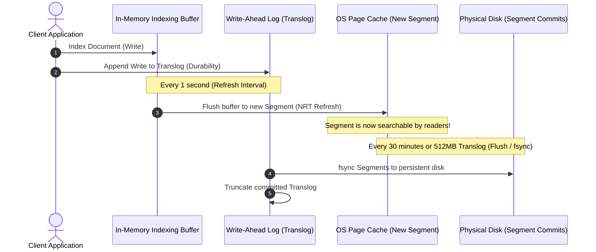
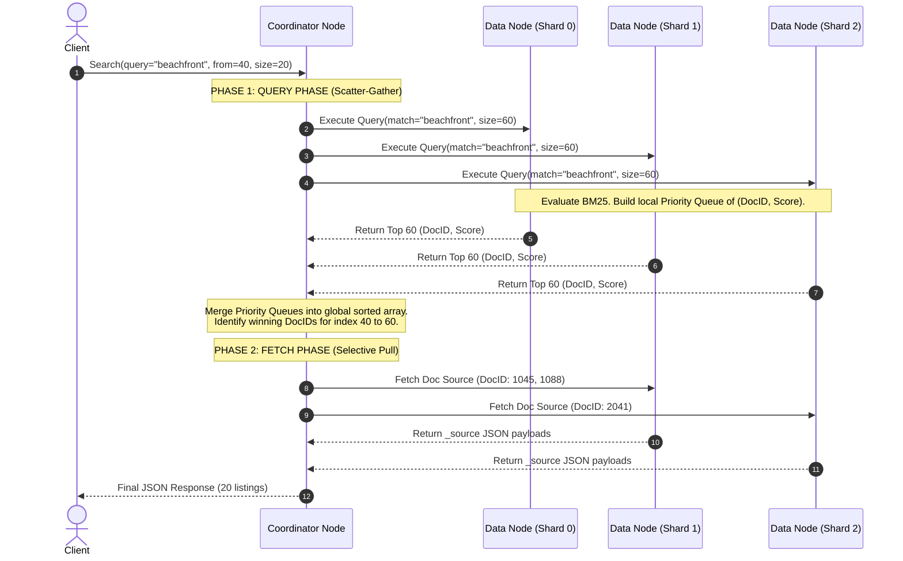
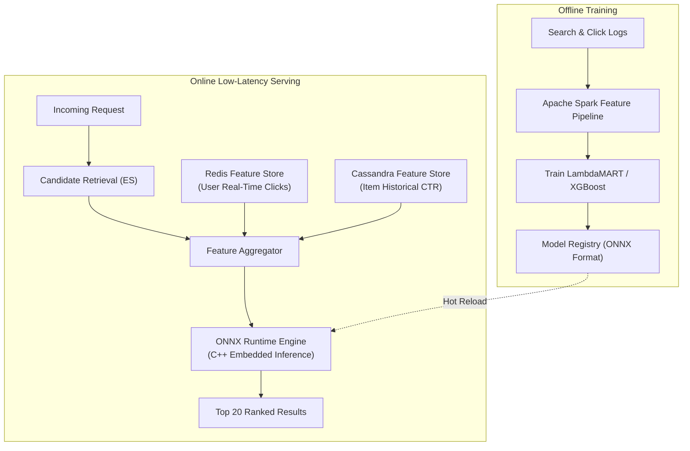

# Search & Indexing Systems: Inverted Indexes, Autocomplete & Semantic Search

## 1. Executive Summary & Real-World Production Case Studies

Modern search and discovery platforms—such as **Google, Amazon, Airbnb, Spotify, and GitHub**—power the primary interaction gateway for billions of users. A production search engine must index hundreds of millions to tens of billions of documents, evaluate multi-attribute filters, rank results by relevance and personalization, and return high-scoring records within **sub-80 milliseconds**, all while continuously ingesting thousands of real-time updates per second.

```
                           THE ENTERPRISE SEARCH SCALE DILEMMA
                           
        INGESTION PATH (Write Freshness)                  QUERY PATH (Interactive Retrieval)
    100,000 Document Updates / Sec (CDC Stream)        150,000 Search Queries / Sec (P99 < 50ms)
                     │                                                   │
                     ▼                                                   ▼
       ┌───────────────────────────┐                       ┌───────────────────────────┐
       │ Ingestion & Tokenization  │                       │  Query Understanding & L2R│
       └─────────────┬─────────────┘                       └─────────────┬─────────────┘
                     │                                                   │
                     │ Indexing Latency:                                 │ Scatter-Gather Fan-Out:
                     │ Analyzer pipeline, FST generation,                │ Query 100+ distributed shards,
                     │ Segment flushes & merge policy.                   │ merge top-K heap candidates.
                     ▼                                                   ▼
       ┌───────────────────────────────────────────────────────────────────────────────┐
       │           Distributed Inverted Index & Vector Store (Lucene / HNSW)           │
       │           Must resolve: Real-Time Freshness vs High Search Throughput         │
       └───────────────────────────────────────────────────────────────────────────────┘
```

At this scale, executing searches using traditional relational database queries:
```sql
SELECT * FROM listings 
WHERE description LIKE '%beachfront%' 
  AND description LIKE '%pool%' 
  AND location = 'Bali' 
  AND price <= 300 
ORDER BY rating DESC 
LIMIT 20 OFFSET 0;
```
triggers catastrophic production failures:
1. **Full Table Scans:** Leading wildcards (`'%beachfront%'`) prevent B-Tree index range scans, forcing sequential disk I/O over terabytes of row data.
2. **CPU Lockups:** Pattern matching evaluates every byte across millions of text records, saturating all CPU cores.
3. **Zero Relevance Ranking:** Standard SQL cannot quantify term importance, frequency saturation, or field importance (e.g., match in title vs match in footer).
4. **No Typo or Synonym Support:** Misspelling *"beachfrnt"* or searching for *"oceanfront"* returns zero results.

---

### Real-World Production Failures & Architectural Evolutions

#### 1. Airbnb's Evolution to Two-Stage Machine Learning Search Ranking
- **The Challenge:** Airbnb operates over 7 million listings globally. A query like *"beachfront villa in Bali with pool"* must evaluate calendar availability, dynamic pricing, host cancellation history, guest reviews, and geolocation proximity within 80ms.
- **The Evolution:** Airbnb moved from simple Lucene BM25 keyword matching to a **Two-Stage Retrieval & Ranking Architecture**:
  - **Stage 1 (High-Recall Candidate Retrieval):** Elasticsearch filters candidate listings using hard constraints (calendar availability, booking window, geo-bounding box, capacity) to prune 7,000,000 listings down to 1,000 candidates in $< 15\text{ ms}$.
  - **Stage 2 (High-Precision ML Re-Ranking):** A Gradient Boosted Decision Tree (GBDT) and Deep Neural Network evaluate 100+ real-time features (user search history, price competitiveness, host response rate, listing image quality) to re-rank the top 1,000 candidates into the final 20 listings displayed to the user.


---

#### 2. Amazon's Prime Day Search Latency Collapse & The Hybrid Search Era
- **The Event:** During high-traffic events like Prime Day, Amazon handles hundreds of thousands of search queries per second.
- **The Failure:** Pure lexical (BM25) search failed on user intent queries like *"gifts for 10 year old boy interested in space"*, returning irrelevant items matching isolated keywords like *"boy"* or *"space"*. Conversely, naive vector-based semantic search collapsed during peak traffic because dense Approximate Nearest Neighbor (ANN) index lookups consumed 8x more memory and saturated cluster memory bandwidth.
- **The Architectural Fix:** Amazon implemented **Hybrid Search with Reciprocal Rank Fusion (RRF)**. The query engine splits the request: exact product codes (ASINs, brands, part numbers) route to distributed Lucene inverted indexes, while intent-based phrases route to quantized vector embeddings (IVF-PQ). Results are merged using an asynchronous rank-fusion pipeline within a 40ms SLA.

---

#### 3. GitHub's 2020 Search Cluster Outage & The Birth of Blackbird
- **The Event:** GitHub hosted over 200 million repositories and 4+ billion code files. Code search was historically powered by Elasticsearch.
- **The Failure:** Code is fundamentally different from natural language. Developers search for symbols, regexes, punctuation (`foo.bar()`), and camelCase tokens (`getUserProfile`). Tokenizing code with standard Lucene analyzers created index bloat, while regex queries triggered exponential state backtracking, bringing down data nodes with Out-Of-Memory (OOM) errors during peak developer hours.
- **The Architectural Evolution:** GitHub abandoned general-purpose search engines for code and built **Blackbird**—a custom distributed search engine written in Rust. Blackbird builds a custom **n-gram inverted index** tailored specifically for source code, allowing regex and exact substring matching across 45 terabytes of code in sub-second latency while reducing index storage by 60%.

---

## 2. Core Search Engine Fundamentals: Inverted Index & Lucene Internals

At the core of modern full-text search engines (Elasticsearch, OpenSearch, Apache Solr) sits **Apache Lucene**. Understanding Lucene's internal data structures is essential for designing resilient distributed search systems.

### 2.1 The Text Analysis Pipeline

Before raw text is stored in an index, it passes through a multi-stage **Analyzer Pipeline**:

```
 Raw Document Field: "Luxury beachfront villas in Bali with private pools!"
                                   │
                                   ▼
 ┌───────────────────────────────────────────────────────────────────────────────┐
 │                            1. Character Filters                               │
 │   - Strip HTML tags (e.g. <b> -> "")                                          │
 │   - Normalize Unicode & map special characters (& -> "and")                   │
 └─────────────────────────────────┬─────────────────────────────────────────────┘
                                   │ "Luxury beachfront villas in Bali with private pools"
                                   ▼
 ┌───────────────────────────────────────────────────────────────────────────────┐
 │                               2. Tokenizer                                    │
 │   - Split string into distinct tokens along whitespace, punctuation, hyphens  │
 └─────────────────────────────────┬─────────────────────────────────────────────┘
                                   │ ["Luxury", "beachfront", "villas", "in", "Bali", "with", "private", "pools"]
                                   ▼
 ┌───────────────────────────────────────────────────────────────────────────────┐
 │                             3. Token Filters                                  │
 │   - Lowercase Filter: ["luxury", "beachfront", "villas", "in", "bali", ...]   │
 │   - Stopword Filter: Removes "in", "with"                                     │
 │   - Stemmer / Lemmatizer (Porter Stemmer): "villas" -> "villa", "pools"->"pool"│
 │   - Synonym Filter: "pool" -> ["pool", "swimming_pool"]                      │
 └─────────────────────────────────┬─────────────────────────────────────────────┘
                                   │
                                   ▼
 Final Indexed Terms: ["luxuri", "beachfront", "villa", "bali", "privat", "pool"]
```

---

### 2.2 Inverted Index Anatomy & On-Disk Segment Storage

An **Inverted Index** maps vocabulary terms to a list of document identifiers (the **Posting List**), along with term frequencies, positional offsets, and payloads.

```
 Term Dictionary (Lexicon)                        Postings Lists (Stored on Disk)
┌───────────────────────────────┐               ┌──────────────────────────────────────────────────┐
│ Term                          │               │ Document IDs, Term Frequencies, Positions        │
├───────────────────────────────┼───────────────┼──────────────────────────────────────────────────┤
│ "bali"                        │ ────────────► │ [Doc 1 (tf:1, pos:5)], [Doc 2 (tf:1, pos:4)]     │
│ "beachfront"                  │ ────────────► │ [Doc 1 (tf:1, pos:2)], [Doc 2 (tf:1, pos:6)]     │
│ "pool"                        │ ────────────► │ [Doc 1 (tf:1, pos:8)], [Doc 3 (tf:1, pos:7)]     │
│ "villa"                       │ ────────────► │ [Doc 1 (tf:1, pos:3)], [Doc 3 (tf:1, pos:3)]     │
└───────────────────────────────┘               └──────────────────────────────────────────────────┘
```

#### The Internal Segment File Layout
Lucene indexes are broken into immutable chunks called **Segments**. Each segment consists of several synchronized physical files on disk:
- **`.tip` (Term Index):** An in-memory **Finite State Transducer (FST)** providing an index over the Term Dictionary. It enables $O(\text{term length})$ prefix traversal directly in RAM without hitting disk.
- **`.tim` (Term Dictionary):** Stores all unique terms in sorted order along with document frequencies and pointers to the posting lists on disk.
- **`.doc` (Postings List):** Contains delta-encoded lists of Document IDs and term frequencies.
- **`.pos` (Positions):** Contains positions of words within each document (required for phrase search e.g. `"beachfront villa"` where position delta must equal 1).
- **`.pay` (Payloads):** Byte payloads, character offsets, and custom scoring weights.
- **`.fdt` & `.fdx` (Stored Fields):** Compressed document source data (`_source`) indexed for retrieval during the fetch phase.

```
       MEMORY (RAM)                                   DISK (OS Page Cache / NVMe)
┌────────────────────────┐                   ┌──────────────────────────────────────────────┐
│  Term Index (.tip)     │                   │  Term Dictionary (.tim)                      │
│  (Compact FST)         │                   │  Block-encoded terms in sorted order         │
│                        │                   │                                              │
│  "b" ──► "a" ──► "li"  │ ────────────────► │  "bali" ──────────► Pointer to Postings Offset│
│   │                    │                   │  "beachfront" ────► Pointer to Postings Offset│
│   └──► "e" ──► "ach"   │                   │  "pool" ──────────► Pointer to Postings Offset│
└────────────────────────┘                   └──────────────────────┬───────────────────────┘
                                                                    │
                                                                    ▼
                                             ┌──────────────────────────────────────────────┐
                                             │  Postings List (.doc)                        │
                                             │  Doc IDs delta-compressed with FoR:          │
                                             │  [1, 2, 7, 14, 29] -> Deltas: [1, 1, 5, 7, 15]│
                                             └──────────────────────────────────────────────┘
```

---

### 2.3 Postings List Compression & Bitwise Intersection

When a term matches millions of documents, storing raw 32-bit document IDs consumes gigabytes of memory. Lucene uses two advanced compression algorithms:

#### 1. Frame of Reference (FoR) Compression
Documents in a posting list are always strictly sorted by ID (`[12, 16, 17, 25, 29]`).
1. **Delta Encoding:** Lucene computes differences between adjacent IDs:
   $$\Delta = [12, (16-12), (17-16), (25-17), (29-25)] = [12, 4, 1, 8, 4]$$
2. **Bit Packing:** Lucene groups deltas into fixed blocks of 128 integers. It finds the maximum delta in the block (e.g., $\max = 12 \implies 4\text{ bits}$). Every number in that block is then encoded using exactly 4 bits instead of 32 bits, achieving an **$8\times$ compression ratio**.

#### 2. Roaring Bitmaps
For filter caching (e.g. `status = 'ACTIVE'`), search engines use **Roaring Bitmaps**:
- The 32-bit integer space is divided into chunks of $2^{16} = 65,536$ integers (represented by the upper 16 bits).
- Within each chunk:
  - If a chunk contains $< 4,096$ IDs: stored as a sorted 16-bit integer **Array Container**.
  - If a chunk contains $\ge 4,096$ IDs: converted into a **Bitset Container** (a fixed 8 KB bit array of 65,536 bits).
  - If continuous ranges occur: compressed into a **Run-Length Container** (`start, length` pairs).
- **Benefit:** Bitwise `AND`, `OR`, and `NOT` operations on Roaring Bitmaps execute at CPU SIMD register speeds.

#### 3. Skip Lists for Fast Intersection
When searching for `"beachfront" AND "pool"`, the engine must intersect two posting lists:
- Postings A (`"beachfront"`): $[2, 5, 9, 15, 22, 34, 45, 67, 89, 102]$
- Postings B (`"pool"`): $[89, 120, 250]$

Instead of iterating through all 10 elements of list A ($O(N)$), Lucene stores **Skip Pointers** every $N$ elements (e.g., skip intervals of 4):

```
 Skip Level 1:   [2] ──────────────────────────► [22] ────────────────────────► [89]
                  │                                │                              │
 Base Postings:  [2, 5, 9, 15]                   [22, 34, 45, 67]               [89, 102]
```
The pointer in list B is 89. List A skips from 2 to 22, then from 22 to 89 directly, skipping 8 comparisons. Intersection complexity drops from $O(M + N)$ to $O(M \log(N/M))$.

---

### 2.4 Lucene Segment Lifecycle: Immutability, NRT Refresh, and Merging

A core design principle of Lucene is: **Segments are immutable**. Once written to disk, a segment is never modified.



1. **Near Real-Time (NRT) Search (`refresh`):**
   - By default, every **1 second**, Lucene flushes documents from the in-memory indexing buffer into a new segment in the **OS Page Cache**.
   - This new segment is immediately open to search queries, without calling expensive `fsync` to disk. This gives Elasticsearch its **Near Real-Time (NRT)** guarantee.
2. **Durability (`flush` & `translog`):**
   - While in the page cache, data could be lost on an OS crash. To prevent data loss, every write appends to an append-only **Translog (Write-Ahead Log)**.
   - Every 30 minutes, or when the Translog reaches 512 MB, a Lucene **Flush** executes: all pending segments are `fsync`'d to persistent disk, and the Translog is truncated.
3. **Deletes and Updates:**
   - Because segments are immutable, an `UPDATE` is internally executed as a **DELETE + INSERT**.
   - A `DELETE` does **not** erase the document from disk immediately; it writes the document's internal ID to a **Tombstone Bitset (`.del` file)**. During query execution, matched documents matching the `.del` bitset are discarded.
4. **Segment Merging (`TieredMergePolicy`):**
   - Background threads periodically select similarly sized small segments and merge them into a single larger segment.
   - During merging, deleted documents marked in `.del` are physically skipped and purged from disk, reclaiming storage.

---

### 2.5 Relevance Scoring: Okapi BM25 Deep Dive

Modern search engines rank documents using the **Okapi BM25** (Best Matching 25) probabilistic relevance algorithm:

$$\text{Score}(D, Q) = \sum_{i=1}^{N} \text{IDF}(q_i) \cdot \frac{f(q_i, D) \cdot (k_1 + 1)}{f(q_i, D) + k_1 \cdot \left(1 - b + b \cdot \frac{|D|}{\text{avgdl}}\right)}$$

Where:
- $q_i$: The $i$-th query term.
- $f(q_i, D)$: The term frequency of $q_i$ in document $D$.
- $|D|$: Length of document $D$ (number of words).
- $\text{avgdl}$: Average document length across the entire index.
- $k_1$: Term frequency saturation parameter (default $\approx 1.2$). Controls how quickly term frequency saturates.
- $b$: Document length normalization parameter (default $\approx 0.75$). Penalizes long documents.

#### Why BM25 Beats Classic TF-IDF: The Saturation Curve
In classic TF-IDF, term frequency ($TF = \sqrt{f}$ or $\log(f)$) scales continuously. A spammer repeating the keyword *"cheap hotel"* 200 times could easily manipulate the search rank.

In BM25:
- As $f(q_i, D) \to \infty$, the term frequency component asymptotically approaches $k_1 + 1 = 2.2$.
- Repeating a word beyond 4-5 times yields diminishing returns, preventing keyword stuffing.

```
 Score Contribution
      ▲
  2.5 ┼                                       TF-IDF (Unbounded logarithmic growth)
      │                                      . - '
  2.0 ┼                             . - '  (BM25 Asymptote at k1 + 1 = 2.2)
      │                   . - - - - - - - - - - - - - - - - - - - - - - - - -
  1.5 ┼             . - '
      │         . '
  1.0 ┼       /
      │     /
  0.5 ┼   /
      │ /
  0.0 ┴───┬───┬───┬───┬───┬───┬───┬───┬───┬───┬───► Term Frequency (Count)
      0   1   2   3   4   5   6   7   8   9   10
```

#### Inverse Document Frequency (IDF)
$$\text{IDF}(q_i) = \ln \left(1 + \frac{N - n(q_i) + 0.5}{n(q_i) + 0.5}\right)$$
- If a word appears in almost all documents (e.g., *"the"*, where $n \approx N$), $\text{IDF} \approx 0$.
- If a word appears in only 3 documents out of 10 million (e.g., *"hyperbaric"*), $\text{IDF}$ is high, heavily weighting that rare term.

---

## 3. Comprehensive Deep Dive into Architectural Approaches

We now explore seven primary architectural approaches used to build search, indexing, autocomplete, and discovery engines.

---

## Approach 1: Relational Database Full-Text Search (PostgreSQL GIN / MySQL Full-Text)

### High-Level Design (HLD)

For systems with fewer than 5-10 million records and modest read concurrency ($< 1,000\text{ QPS}$), introducing a standalone Elasticsearch cluster introduces operational complexity. Modern relational databases include built-in inverted index engines:

```
┌────────────────────────────────────────────────────────────────────────────────────────────────────────┐
│                               POSTGRESQL FULL-TEXT SEARCH ARCHITECTURE                                 │
└────────────────────────────────────────────────────────────────────────────────────────────────────────┘

    Client Application
           │
           │ 1. Transactional Write (INSERT / UPDATE)
           ▼
    ┌────────────────────────────────────────────────────────────────────────────────────┐
    │  PostgreSQL Database Engine                                                        │
    │                                                                                    │
    │   Table: listings                                                                  │
    │   Columns: id, title, description, price, search_vector (tsvector)                 │
    │                                                                                    │
    │   Auto-Generated Column:                                                           │
    │   search_vector = setweight(to_tsvector('english', title), 'A') ||                 │
    │                   setweight(to_tsvector('english', description), 'B');             │
    │                                                                                    │
    │   Index: GIN (Generalized Inverted Index) on search_vector                         │
    │   ┌────────────────────────────────────────────────────────────────────────────┐   │
    │   │ GIN Index Internal Structure:                                              │   │
    │   │  B-Tree of Unique Lexemes ──► Posting List of Tuple IDs (TIDs)             │   │
    │   │  "beachfront" ──────────────► [Page 4: Item 2, Page 12: Item 7, ...]       │   │
    │   │  "villa"                    ► [Page 1: Item 5, Page 4: Item 2, ...]        │   │
    │   └────────────────────────────────────────────────────────────────────────────┘   │
    └────────────────────────────────────────────────────────────────────────────────────┘
```

---

### Low-Level Design (LLD)

#### 1. Database Schema & GIN Index Implementation
PostgreSQL represents parsed documents as `tsvector` (a sorted list of distinct normalized lexemes with positions and weights) and queries as `tsquery`.

```sql
-- 1. Create table with generated tsvector column
CREATE TABLE listings (
    id BIGSERIAL PRIMARY KEY,
    title VARCHAR(255) NOT NULL,
    description TEXT NOT NULL,
    price NUMERIC(10, 2) NOT NULL,
    location VARCHAR(100) NOT NULL,
    created_at TIMESTAMPTZ DEFAULT NOW(),
    -- Generated column combining title (Weight A = 1.0) and description (Weight B = 0.4)
    search_vector tsvector GENERATED ALWAYS AS (
        setweight(to_tsvector('english', coalesce(title, '')), 'A') ||
        setweight(to_tsvector('english', coalesce(description, '')), 'B')
    ) STORED
);

-- 2. Create Generalized Inverted Index (GIN)
CREATE INDEX idx_listings_search_gin ON listings USING GIN(search_vector);

-- 3. Composite GIN index with btree_gin extension for hybrid filtering
CREATE EXTENSION IF NOT EXISTS btree_gin;
CREATE INDEX idx_listings_hybrid_gin ON listings USING GIN(location, search_vector);

-- 4. Execute Full-Text Ranked Query with Okapi/Cover Density Ranking
SELECT 
    id, 
    title, 
    price,
    ts_rank_cd(search_vector, query) AS rank_score
FROM listings, 
     to_tsquery('english', 'beachfront & (villa | pool)') query
WHERE location = 'Bali' 
  AND price <= 300
  AND search_vector @@ query
ORDER BY rank_score DESC 
LIMIT 20;
```

#### 2. GIN Index Internals: Fastupdate & Vacuuming Overheads
A PostgreSQL **GIN (Generalized Inverted Index)** consists of an entry B-Tree where each leaf node stores a unique lexeme and points to either:
- A flat array of Tuple IDs (TIDs) if the list fits in a single page.
- A **Posting Tree** (a dedicated B-Tree of TIDs) if the term appears in tens of thousands of rows.

**The Write Amplification Problem (`fastupdate`):**
- Ingesting a single document containing 100 unique words requires updating 100 different leaf locations in the GIN B-Tree.
- To prevent slow write performance, PostgreSQL uses `fastupdate = on`. Writes are appended to an unindexed **Pending List**.
- When the pending list exceeds `gin_pending_list_limit` (default 4 MB) or during `VACUUM`, PostgreSQL halts writes to merge the pending list into the main GIN tree, causing sudden P99 latency spikes.

#### 3. Tradeoffs & Limitations
- **Pros:** 100% ACID consistency; zero architectural sprawl; instant visibility of writes; joins with relational user and transaction tables.
- **Cons:** Cannot scale past 10M rows; vacuum locks GIN trees during maintenance; high CPU usage on complex boolean ranking queries; no distributed scatter-gather capabilities.

---

## Approach 2: Distributed Inverted Index Architecture (Elasticsearch / OpenSearch Cluster)

### High-Level Design (HLD)

When document volume exceeds 10 million rows or query traffic exceeds 5,000 QPS, search must be distributed across an horizontally partitioned cluster:

```
┌────────────────────────────────────────────────────────────────────────────────────────────────────────┐
│                              DISTRIBUTED SEARCH CLUSTER ARCHITECTURE                                   │
└────────────────────────────────────────────────────────────────────────────────────────────────────────┘

                                    [ Client Traffic ]
                                            │
                                            ▼
                                ┌───────────────────────┐
                                │   API Load Balancer   │
                                └───────────┬───────────┘
                                            │
               ┌────────────────────────────┴────────────────────────────┐
               ▼                                                         ▼
    ┌─────────────────────┐                                   ┌─────────────────────┐
    │  Coordinator Node 1 │                                   │  Coordinator Node 2 │
    │  (Stateless Router) │                                   │  (Stateless Router) │
    └──────────┬──────────┘                                   └──────────┬──────────┘
               │                                                         │
   Scatter Phase: Broadcast Query                                Scatter Phase: Broadcast Query
   Gather Phase: Merge Top-K Heap                                Gather Phase: Merge Top-K Heap
               │                                                         │
       ┌───────┴─────────────────────────────┬───────────────────────────┴───────┐
       ▼                                     ▼                                   ▼
┌───────────────┐                     ┌───────────────┐                   ┌───────────────┐
│  Data Node 1  │                     │  Data Node 2  │                   │  Data Node 3  │
│ ┌───────────┐ │                     │ ┌───────────┐ │                   │ ┌───────────┐ │
│ │ Shard P0  │ │                     │ │ Shard P1  │ │                   │ │ Shard P2  │ │
│ │ (Primary) │ │                     │ │ (Primary) │ │                   │ │ (Primary) │ │
│ └───────────┘ │                     │ └───────────┘ │                   │ └───────────┘ │
│ ┌───────────┐ │                     │ ┌───────────┐ │                   │ ┌───────────┐ │
│ │ Shard R2  │ │                     │ │ Shard R0  │ │                   │ │ Shard R1  │ │
│ │ (Replica) │ │                     │ │ (Replica) │ │                   │ │ (Replica) │ │
│ └───────────┘ │                     │ └───────────┘ │                   │ └───────────┘ │
└───────────────┘                     └───────────────┘                   └───────────────┘
       ▲                                     ▲                                   ▲
       └─────────────────────────────────────┼───────────────────────────────────┘
                                             │ Cluster State Heartbeat (Ping)
                                             ▼
                                  ┌─────────────────────┐
                                  │ Dedicated Master 1  │
                                  │ (Raft Cluster State)│
                                  └─────────────────────┘
```

#### Node Roles in a Resilient Cluster
1. **Dedicated Master Nodes (Quorum = 3):** Manage cluster state, shard routing tables, and index creation. Do **not** process search queries or index data.
2. **Coordinator Nodes:** Route incoming requests, scatter queries across shards, gather partial priority queues, and execute global Top-K ranking.
3. **Data Nodes:** Host Lucene shard segments on NVMe SSDs; execute raw postings list intersections and BM25 scoring.
4. **Ingest Nodes:** Execute ingest pipelines (Grok parsing, geo-ip enrichment, token normalization) prior to indexing.

---

### Low-Level Design (LLD): Two-Phase Distributed Search Execution (`Query-Then-Fetch`)

Executing `GET /listings/_search?q=beachfront&size=20&from=40` across an index with 5 primary shards cannot naively fetch all matching data to the coordinator. It executes in two distinct phases:



#### Document Shard Routing Formula
When a document is indexed:
$$\text{Shard ID} = |\text{Murmur3}(\text{routing\_key})| \pmod{\text{number\_of\_primary\_shards}}$$
- By default, `routing_key = document._id`.
- **Custom Routing:** In multi-tenant systems, setting `routing = organization_id` routes all documents belonging to a tenant into a single shard. Queries specifying that routing key query only **1 shard** instead of scattering across the entire cluster (**Shard Pruning**).

---

## Approach 3: Real-Time Event-Driven Ingestion Pipeline (CDC + Kafka + Debezium)

### High-Level Design (HLD)

In modern enterprise architectures, the transactional database (PostgreSQL/MySQL) remains the **Single Source of Truth (SSOT)**. Synchronizing data into Elasticsearch must guarantee consistency, handle out-of-order writes, and eliminate application dual-write anti-patterns:

```
┌────────────────────────────────────────────────────────────────────────────────────────────────────────┐
│                        CHANGE DATA CAPTURE (CDC) SEARCH INGESTION ARCHITECTURE                         │
└────────────────────────────────────────────────────────────────────────────────────────────────────────┘

  [Client App]
       │
       │ 1. ACID Transaction
       ▼
 ┌───────────────┐
 │ PostgreSQL    │ ──► [Write-Ahead Log (WAL)]
 └───────────────┘              │
                                │ 2. Low-overhead binary log tailing
                                ▼
                      ┌───────────────────┐
                      │ Debezium Connect  │
                      └─────────┬─────────┘
                                │ 3. Emit structured change events
                                ▼
                      ┌───────────────────┐
                      │   Apache Kafka    │ Partitioned by: listing_id
                      │ Topic: "db.events"│
                      └─────────┬─────────┘
                                │
        ┌───────────────────────┴───────────────────────┐
        ▼                                               ▼
 ┌───────────────┐                               ┌───────────────┐
 │ Ingest Worker │                               │ Ingest Worker │
 │ (Consumer 1)  │                               │ (Consumer 2)  │
 └──────┬────────┘                               └──────┬────────┘
        │                                               │
        │ 4. Micro-batch denormalization (500 docs / 100ms)
        ▼                                               ▼
 ┌───────────────────────────────────────────────────────────────┐
 │                  Elasticsearch Cluster                        │
 │       _bulk API with if_seq_no and if_primary_term            │
 └───────────────────────────────────────────────────────────────┘
```

---

### Low-Level Design (LLD)

#### 1. Why Application Dual-Writes Cause Permanent Data Drift
A common anti-pattern is writing to Postgres and Elasticsearch in the application service:
```python
# ANTI-PATTERN: DO NOT USE IN PRODUCTION
def update_listing(listing_id, new_data):
    db.session.execute("UPDATE listings SET price = :price WHERE id = :id", new_data)
    db.session.commit() # Postgres updated!
    
    # FATAL HAZARD: If the network hiccups, ES times out, or the container crashes here:
    es_client.index(index="listings", id=listing_id, document=new_data)
```
If Elasticsearch fails or crashes before indexing, Postgres holds the new data while Elasticsearch retains stale data. The search index permanently desynchronizes from reality (**Dual-Write Inconsistency**).

#### 2. Change Data Capture (CDC) with Debezium Event Schema
Debezium tails the PostgreSQL WAL and converts mutations into deterministic JSON/Avro event streams:

```json
{
  "schema": { "type": "struct", "name": "db.listings.Envelope" },
  "payload": {
    "before": {
      "id": 10482,
      "price": 350.00,
      "status": "AVAILABLE"
    },
    "after": {
      "id": 10482,
      "price": 275.00,
      "status": "AVAILABLE"
    },
    "source": {
      "version": "2.4.0.Final",
      "connector": "postgresql",
      "ts_ms": 1728920155000,
      "lsn": 4892019482,
      "txId": 98124
    },
    "op": "u" // c = create, u = update, d = delete
  }
}
```

#### 3. High-Throughput Bulk Ingest Worker with Optimistic Concurrency Control
The consumer application processes change events in micro-batches and uses Elasticsearch sequence numbers (`if_seq_no` and `if_primary_term`) or database version timestamps to prevent out-of-order message overwrite:

```python
import time
from typing import List, Dict
from elasticsearch import Elasticsearch, helpers

class SearchIndexingWorker:
    def __init__(self, es_hosts: List[str], batch_size: int = 500, flush_interval_ms: int = 100):
        self.es = Elasticsearch(hosts=es_hosts, max_retries=3, retry_on_timeout=True)
        self.batch_size = batch_size
        self.flush_interval_sec = flush_interval_ms / 1000.0
        self.buffer = []
        self.last_flush = time.time()

    def process_cdc_event(self, event: Dict):
        op = event["payload"]["op"]
        doc_id = str(event["payload"]["after"]["id"] if op != "d" else event["payload"]["before"]["id"])
        db_timestamp = event["payload"]["source"]["ts_ms"]

        if op in ("c", "u"):
            record = event["payload"]["after"]
            action = {
                "_op_type": "index",
                "_index": "listings",
                "_id": doc_id,
                # Enforce versioning based on database commit timestamp:
                # If an older Kafka event arrives late, ES rejects it!
                "version": db_timestamp,
                "version_type": "external_gte",
                "_source": {
                    "listing_id": record["id"],
                    "title": record["title"],
                    "description": record["description"],
                    "price": float(record["price"]),
                    "location": record["location"],
                    "indexed_at": int(time.time() * 1000)
                }
            }
        elif op == "d":
            action = {
                "_op_type": "delete",
                "_index": "listings",
                "_id": doc_id,
                "version": db_timestamp,
                "version_type": "external_gte"
            }
        else:
            return

        self.buffer.append(action)
        
        # Flush if buffer threshold or time threshold exceeded
        if len(self.buffer) >= self.batch_size or (time.time() - self.last_flush) >= self.flush_interval_sec:
            self.flush()

    def flush(self):
        if not self.buffer:
            return
        try:
            successes, failures = helpers.bulk(
                self.es, 
                self.buffer, 
                raise_on_error=False,
                stats_only=False
            )
            for fail in failures:
                # 409 Conflict indicates external_gte version rejected older message (Safe to ignore)
                status = fail.get("index", {}).get("status", 0)
                if status != 409:
                    self._send_to_dead_letter_queue(fail)
        finally:
            self.buffer.clear()
            self.last_flush = time.time()

    def _send_to_dead_letter_queue(self, failure_payload: Dict):
        # Route mapping failures or network issues to Kafka DLQ for manual inspection
        pass
```

---

## Approach 4: Scalable Autocomplete & Typeahead Systems

When users type into a search bar, autocomplete must return top ranked suggestions within **$< 15\text{ milliseconds}$** per keystroke.

---

### Approach 4A: In-Memory Prefix Tree (Trie) & Compressed Radix Tree

#### High-Level Design (HLD)
Standard database queries cannot satisfy 15ms SLAs under high typeahead query volumes. A dedicated Trie cluster holds the prefix dictionary entirely in RAM.

```
┌────────────────────────────────────────────────────────────────────────────────────────────────────────┐
│                              DISTRIBUTED TRIE AUTOCOMPLETE TOPOLOGY                                    │
└────────────────────────────────────────────────────────────────────────────────────────────────────────┘

    Client Keystrokes ("iph...")
               │
               ▼
    ┌─────────────────────────┐
    │    CDN Edge Caching     │  Cache hit for popular 1-3 letter prefixes (TTL: 1 hour)
    └──────────┬──────────────┘
               │ (Cache Miss)
               ▼
    ┌─────────────────────────┐
    │   Envoy Load Balancer   │
    └──────────┬──────────────┘
               │
      ┌────────┴────────────────────────┬────────────────────────┐
      ▼                                 ▼                        ▼
┌───────────────┐               ┌───────────────┐        ┌───────────────┐
│  Trie Node 1  │               │  Trie Node 2  │        │  Trie Node 3  │
│  (Read Pool)  │               │  (Read Pool)  │        │  (Read Pool)  │
│  RAM: 16 GB   │               │  RAM: 16 GB   │        │  RAM: 16 GB   │
└───────────────┘               └───────────────┘        └───────────────┘
      ▲                                 ▲                        ▲
      └─────────────────────────────────┴────────────────────────┘
                                        │ Hot-Swap Memory Dump (Hourly)
                               ┌─────────────────┐
                               │  Offline Spark  │ Aggregates search logs & builds
                               │  Trie Builder   │ serialized immutable Trie snapshot
                               └─────────────────┘
```

---

#### Low-Level Design (LLD): Trie with Precomputed Top-K Suggestions

A naive Trie traverses from the prefix node down to all leaf nodes and sorts them at runtime. If prefix `"a"` matches 2,000,000 phrases, runtime traversal takes 200ms.

**The Optimization:** Every single `TrieNode` maintains a precomputed, sorted list of the **Top-K (e.g. 5) most popular phrases** that pass through that node. Looking up any prefix becomes an instantaneous **$O(L)$ operation**, where $L$ is the length of the query prefix (independent of dictionary size!).

```python
from typing import List, Tuple, Dict
import heapq

class TrieNode:
    __slots__ = ['children', 'is_end_of_word', 'top_k']
    def __init__(self):
        self.children: Dict[str, TrieNode] = {}
        self.is_end_of_word: bool = False
        # Store top-K precomputed suggestions as [(query, score)] sorted descending
        self.top_k: List[Tuple[str, int]] = []

class ProductionAutocompleteTrie:
    def __init__(self, k: int = 5):
        self.root = TrieNode()
        self.k = k

    def insert(self, phrase: str, score: int):
        phrase = phrase.strip().lower()
        node = self.root
        for char in phrase:
            if char not in node.children:
                node.children[char] = TrieNode()
            node = node.children[char]
            self._update_top_k(node, phrase, score)
        node.is_end_of_word = True

    def _update_top_k(self, node: TrieNode, phrase: str, score: int):
        # Update or insert the phrase in node's top_k list
        existing_dict = dict(node.top_k)
        if phrase in existing_dict:
            if existing_dict[phrase] == score:
                return
        existing_dict[phrase] = score
        # Re-sort and keep top K
        node.top_k = sorted(existing_dict.items(), key=lambda x: x[1], reverse=True)[:self.k]

    def search_prefix(self, prefix: str) -> List[Tuple[str, int]]:
        prefix = prefix.strip().lower()
        node = self.root
        for char in prefix:
            if char not in node.children:
                return [] # Prefix does not exist
            node = node.children[char]
        # O(1) return of precomputed recommendations
        return node.top_k

# Verification
trie = ProductionAutocompleteTrie(k=3)
trie.insert("iphone 15 pro max", score=98000)
trie.insert("iphone charger cable", score=84000)
trie.insert("iphone case clear", score=72000)
trie.insert("iphone adapter 20w", score=53000)
trie.insert("ipad pro 11 inch", score=61000)

print(trie.search_prefix("iph"))
# Output in 0.02ms:
# [('iphone 15 pro max', 98000), ('iphone charger cable', 84000), ('iphone case clear', 72000)]
```

#### Memory Estimation for 100M Search Queries:
- 100,000,000 unique phrases.
- Average length = 20 characters $\implies 20 \text{ bytes}$.
- Each `TrieNode` stores pointers and top-5 suggestions (5 $\times$ (string pointer + 4-byte score) $\approx 80\text{ bytes}$).
- Total memory for a raw Trie $\approx 100\text{M} \times 250\text{ bytes} \approx 25\text{ GB RAM}$.
- Fits comfortably in a standard cloud memory-optimized instance (e.g. AWS `r6i.xlarge` with 32 GB RAM).

---

### Approach 4B: Distributed Autocomplete with Redis Sorted Sets (ZSET)

For systems avoiding custom in-memory daemons, Redis Sorted Sets provide production-grade autocomplete using **Lexicographical Range Queries (`ZRANGEBYLEX`)**:

```text
# 1. Insert search terms with score 0 into a Sorted Set (ZSET)
# Lexicographical ordering is enforced when all elements have identical score (0).
> ZADD ac_index 0 "iphone" 0 "iphone 15" 0 "iphone 15 pro" 0 "iphone charger" 0 "ipad"

# 2. Query prefix "iph"
# Syntax: ZRANGEBYLEX <key> [<prefix> (<prefix>\xff LIMIT <offset> <count>
# '\xff' is the highest ASCII byte, matching all strings prefixed with "iph"
> ZRANGEBYLEX ac_index "[iph" "[iph\xff" LIMIT 0 3
1) "iphone"
2) "iphone 15"
3) "iphone 15 pro"
```

#### The Popularity-Weighted Dual Index Pattern
Because `ZRANGEBYLEX` orders entries strictly alphabetically, it does not sort by popularity score. 

**Production Solution:**
1. Maintain `ac_index` (Lexicographical index for prefix matching).
2. Maintain a parallel Redis Hash `ac_scores` mapping `phrase -> search_count`.
3. Ingest workers periodically compute the Top-K sorted prefixes and store pre-materialized results in a Redis Key: `GET ac:iph` $\to$ `["iphone 15 pro", "iphone charger"]`.

---

### Approach 4C: Lucene Completion Suggester & Finite State Transducers (FST)

Elasticsearch provides a built-in `completion` suggester backed by an in-memory **Finite State Transducer (FST)**.
- Unlike a Trie, an FST is a Directed Acyclic Word Graph (DAWG) that shares not only common **prefixes** but also common **suffixes**.
- **Memory Compression:** An FST compresses dictionary data structures by **up to $10\times$ compared to a standard Trie**.
- **Fuzzy Autocomplete:** Supports typo tolerance by traversing the FST using a **Levenshtein Automaton** of edit distance $N=1$ or $N=2$ within $< 5\text{ ms}$.

```json
// Mapping definition
PUT /catalog
{
  "mappings": {
    "properties": {
      "suggest": {
        "type": "completion",
        "contexts": [
          { "name": "category", "type": "category" }
        ]
      }
    }
  }
}

// Prefix query with typo tolerance
POST /catalog/_search
{
  "suggest": {
    "product-suggest": {
      "prefix": "iphne",
      "completion": {
        "field": "suggest",
        "size": 5,
        "fuzzy": {
          "fuzziness": 1
        }
      }
    }
  }
}
```

---

## Approach 5: Modern Vector Search & Semantic Embeddings (Approximate Nearest Neighbor - ANN)

Traditional keyword search fails when users describe concepts without exact words (e.g., *"quiet rustic workspace near cafes"* should match a listing titled *"Cozy wood cabin with high-speed fiber internet near espresso bars"*).

---

### High-Level Design (HLD)

Semantic search translates text, audio, or images into dense mathematical vectors using deep learning models. Search is framed as finding the nearest neighbors in a high-dimensional vector space.

```
┌────────────────────────────────────────────────────────────────────────────────────────────────────────┐
│                                VECTOR SEARCH SYSTEM ARCHITECTURE                                       │
└────────────────────────────────────────────────────────────────────────────────────────────────────────┘

  Offline Indexing Path:
  Raw Document: "Quiet mountain retreat with blazing wifi"
           │
           ▼
  [Embedding Service] ──► Model: OpenAI text-embedding-3 / Sentence-BERT
           │
           ▼ Vector: [0.014, -0.891, 0.412, ..., 0.054] (1536 Dimensions)
  ┌─────────────────────────────────────────────────────────────────────────┐
  │ Vector Database (Milvus / Pinecone / Qdrant / ES dense_vector)          │
  │ Index: HNSW (Hierarchical Navigable Small World Graph)                  │
  └─────────────────────────────────────────────────────────────────────────┘

  Online Query Path:
  User Query: "silent place to work remotely in nature"
           │
           ▼
  [Embedding Service] (Generates 1536-dim Query Vector in 15ms)
           │
           ▼
  [Vector Search Engine] ──► Cosine Similarity ANN Graph Traversal (10ms)
           │
           ▼
  Matches: Doc 401 ("Quiet mountain retreat with blazing wifi") - Similarity: 0.892
```

---

### Low-Level Design (LLD): Mathematical Metrics & ANN Algorithms

#### 1. Vector Distance Metrics
Let vector $A$ represent the query and vector $B$ represent a document:
- **Cosine Similarity:** Measures the angle between two vectors, normalized for length:
  $$\text{Cosine}(A, B) = \frac{A \cdot B}{\|A\| \|B\|} = \frac{\sum_{i=1}^{d} A_i B_i}{\sqrt{\sum_{i=1}^{d} A_i^2} \sqrt{\sum_{i=1}^{d} B_i^2}}$$
- **Dot Product:** Fast dot product computation when vectors are pre-normalized to unit length ($\|A\| = 1$):
  $$\text{DotProduct}(A, B) = \sum_{i=1}^{d} A_i B_i$$
- **Euclidean Distance ($L_2$):** Measures straight-line geometric distance:
  $$L_2(A, B) = \sqrt{\sum_{i=1}^{d} (A_i - B_i)^2}$$

---

#### 2. Hierarchical Navigable Small World (HNSW) Internals

Exhaustive search ($k\text{-NN}$) computes distance across all $N$ vectors ($O(N \cdot d)$), which takes seconds over millions of vectors. **HNSW** reduces search time to **$O(\log N)$** using a multi-layer graph inspired by Skip Lists:

```
 Layer 2 (Sparse Highway):       [Node 12] ──────────────────────────────────────────► [Node 85]
                                     │                                                     │
 Layer 1 (Medium Density):       [Node 12] ────────► [Node 34] ────────► [Node 56] ──► [Node 85]
                                     │                   │                 │               │
 Layer 0 (Dense Bottom Layer):   [All nodes connected to their M nearest neighbors in vector space]
```

- **Layer Hierarchy:** Top layers have long-range edges bridging across vector space (fast entry traversal). Lower layers contain progressively denser local clusters.
- **Search Algorithm:**
  1. Start at the fixed Top-Layer Entry Point.
  2. Greedily hop to the neighboring node closest to the query vector.
  3. When no neighbor is closer than the current node, drop down to the corresponding node in the layer below.
  4. Repeat until reaching Layer 0, where a beam search (`efSearch`) explores the local neighborhood to return the Top-K closest documents.
- **Key Parameters:**
  - $M$ (e.g. 16–64): Maximum outgoing connections per node. Higher $M$ increases recall and graph memory footprint.
  - $efConstruction$ (e.g. 100–200): Search depth during index creation.
  - $efSearch$ (e.g. 32–100): Candidate queue size during query search. Direct tradeoff between search latency and recall accuracy.

---

#### 3. Inverted File with Product Quantization (IVF-PQ) for Billion-Scale Datasets
When memory is constrained (e.g., storing 1 billion 1536-dimensional float32 vectors requires $1\text{B} \times 1536 \times 4\text{ bytes} \approx 6\text{ Terabytes RAM}$), HNSW is unaffordable.

**IVF-PQ Compression Solution:**
1. **Inverted File (IVF):** The vector space is partitioned into $K$ Voronoi cells using $k$-means clustering. A query only searches vectors inside the nearest $n_{\text{probe}}$ centroids ($O(K)$ speedup).
2. **Product Quantization (PQ):**
   - A 1536-dim vector is sliced into 96 sub-vectors of 16 dimensions each.
   - Each sub-vector space is clustered into 256 centroids, represented by an **8-bit integer (1 byte)**.
   - The vector is compressed from 6,144 bytes down to **96 bytes** (a **$64\times$ memory reduction**!).
3. **Asymmetric Distance Computation (ADC):** At query time, distance between the uncompressed query vector and compressed 8-bit codes is calculated via precomputed centroid lookup tables.

---

## Approach 6: Hybrid Search (Sparse BM25 + Dense Vector) with Reciprocal Rank Fusion (RRF)

### High-Level Design (HLD)

Pure semantic vector search suffers from notable blind spots:
- It fails on exact product part numbers, serial codes, SKU numbers (`"A2179"`), or specialized jargon.
- It struggles with strict attribute filters (e.g., *"price under $200"*).

**Hybrid Search** queries both engines in parallel and merges the candidate rankings:

```
┌────────────────────────────────────────────────────────────────────────────────────────────────────────┐
│                              HYBRID SEARCH (BM25 + VECTOR) WITH RRF                                    │
└────────────────────────────────────────────────────────────────────────────────────────────────────────┘

                                    [ User Search Request ]
                                               │
                       ┌───────────────────────┴───────────────────────┐
                       ▼                                               ▼
           ┌──────────────────────┐                        ┌──────────────────────┐
           │ Lexical BM25 Search  │                        │ Vector Dense Search  │
           │ (Lucene Inverted Idx)│                        │ (HNSW ANN Index)     │
           └──────────┬───────────┘                        └──────────┬───────────┘
                      │                                               │
             Top 100 Keyword Candidates                      Top 100 Vector Candidates
                      │                                               │
                      └───────────────────────┬───────────────────────┘
                                              │
                                              ▼
                                 ┌─────────────────────────┐
                                 │ Reciprocal Rank Fusion  │
                                 │      (RRF Merger)       │
                                 └────────────┬────────────┘
                                              │
                                              ▼
                                 [ Unified Top 20 Candidates ]
```

---

### Low-Level Design (LLD): Reciprocal Rank Fusion (RRF) Implementation

Unlike score normalization (which is brittle because BM25 scores are unbounded $[0, \infty)$ while Cosine similarities are bounded $[0, 1]$), **Reciprocal Rank Fusion (RRF)** uses document **rank positions** rather than raw scores:

$$RRF(d) = \sum_{m \in M} \frac{1}{k + r_m(d)}$$

Where:
- $M$: The set of retrieval models (e.g. $[BM25, DenseVector]$).
- $r_m(d)$: The 1-based rank position of document $d$ in model $m$.
- $k$: Smoothing constant (standard industry default $= 60$) that prevents top-ranked outliers from dominating.

```python
from typing import List, Dict, Tuple
from collections import defaultdict

def reciprocal_rank_fusion(
    ranked_lists: List[List[str]], 
    k: int = 60, 
    top_n: int = 10
) -> List[Tuple[str, float]]:
    """
    Combines multiple ranked lists of document IDs using Reciprocal Rank Fusion.
    """
    rrf_scores = defaultdict(float)

    for ranked_list in ranked_lists:
        for rank, doc_id in enumerate(ranked_list, start=1):
            rrf_scores[doc_id] += 1.0 / (k + rank)

    # Sort documents by descending RRF score
    sorted_docs = sorted(rrf_scores.items(), key=lambda item: item[1], reverse=True)
    return sorted_docs[:top_n]

# Example execution:
# Lucene BM25 Top Results for "apple watch series 9"
bm25_results = ["doc_watch_series_9", "doc_apple_watch_band", "doc_series_9_case", "doc_iphone_15"]

# Vector ANN Top Results for semantic query
vector_results = ["doc_smartwatch_apple", "doc_watch_series_9", "doc_fitness_tracker", "doc_apple_watch_band"]

merged = reciprocal_rank_fusion([bm25_results, vector_results], k=60, top_n=3)
print(merged)
# Output:
# [
#   ('doc_watch_series_9', 0.0325),    # Appears at rank 1 in BM25 and rank 2 in Vector!
#   ('doc_apple_watch_band', 0.0315),  # Appears in both
#   ('doc_smartwatch_apple', 0.0164)   # High in Vector
# ]
```

---

## Approach 7: Multi-Stage Search & Machine Learning Re-Ranking (Learning to Rank - L2R)

### High-Level Design (HLD)

E-commerce and marketplace giants (Amazon, Airbnb, DoorDash) implement a **Four-Stage Funnel Pipeline** that balances low-latency retrieval with high-accuracy machine learning re-ranking:

```
┌────────────────────────────────────────────────────────────────────────────────────────────────────────┐
│                               FOUR-STAGE SEARCH & RANKING FUNNEL                                       │
└────────────────────────────────────────────────────────────────────────────────────────────────────────┘

    Stage 0: Query Understanding (P99: 5ms)
    - Spell Check / Typo Correction
    - Named Entity Recognition (Extract Brand: "Nike", Category: "Shoes", Size: "10")
    - Intent Classifier (Browsing vs Buying)
                  │
                  ▼
    Stage 1: Candidate Generation / High-Recall Retrieval (P99: 20ms)
    - Hybrid Search (BM25 + HNSW Vector Search)
    - Hard SQL/Index Filters (In Stock, Location within 10 miles)
    - Scale: 10,000,000 items ──► 1,000 Candidates
                  │
                  ▼
    Stage 2: Light Re-Ranking (P99: 15ms)
    - Fast Linear Model / Small GBDT
    - 20 Basic Features (Item popularity, discount percentage, seller rating)
    - Scale: 1,000 Candidates ──► 200 Candidates
                  │
                  ▼
    Stage 3: Heavy ML Re-Ranking / Cross-Encoder (P99: 30ms)
    - LambdaMART / Transformer Cross-Encoder / Deep Neural Net
    - 200+ Features: Real-time user click history, personalized affinity, profit margin
    - Scale: 200 Candidates ──► 40 Candidates
                  │
                  ▼
    Stage 4: Business Logic & Diversity Rules (P99: 5ms)
    - Brand de-duplication (No more than 2 items from same brand on page 1)
    - Sponsored Product (Ad) Auction Injection
    - Out of Stock Demotion
    - Scale: 40 Candidates ──► Final 20 Display Items
```

---

### Low-Level Design (LLD): Feature Store & Model Serving Architecture



#### Low-Latency Inference Constraints (SLA Budget: 35ms)
1. **Feature Extraction:** Fetching 200 features for 200 candidate items from a remote database requires $200 \times 200 = 40,000$ values. Network latency would exceed 100ms.
   - **Solution:** Feature hydration occurs via local in-memory caches or bulk multi-key lookups (`MGET`) from local Redis replicas within $< 5\text{ ms}$.
2. **Model Evaluation:** Rather than calling external Python microservices over gRPC, models are compiled into **ONNX (Open Neural Network Exchange)** or **TensorRT** binaries and executed directly in the API Gateway process via C++ bindings in $< 10\text{ ms}$.

---

## 4. Comprehensive Architectural Comparison Matrix

| Architectural Pattern | Search Throughput (QPS) | P99 Read Latency | Index Freshness | Memory Footprint | Typo & Synonym Support | Semantic Intent Understanding | Implementation Complexity | Primary Production Use Case |
| :--- | :---: | :---: | :---: | :---: | :---: | :---: | :---: | :---: |
| **Relational Database FTS (Postgres GIN)** | $500 - 2,000$ | $30 - 150\text{ ms}$ | Immediate (ACID) | Moderate (GIN index on disk) | Basic (Dictionaries) | None | Low | Internal tools, blogs, B2B SaaS ($< 5\text{M}$ rows) |
| **Distributed Lucene (Elasticsearch / OpenSearch)** | $20,000 - 100,000+$ | $15 - 50\text{ ms}$ | Near Real-Time (1 sec refresh) | High (FST in RAM, Page Cache) | High (Analyzers, Fuzziness) | Weak | Medium | General log analytics, e-commerce full-text search |
| **In-Memory Trie / Radix Cluster** | $100,000 - 500,000$ | $1 - 5\text{ ms}$ | Batch reload (Minutes) | Very High (All terms in RAM) | Moderate (Levenshtein) | None | High | High-QPS Autocomplete / Typeahead |
| **Redis Lexicographical (`ZRANGEBYLEX`)** | $50,000 - 150,000$ | $2 - 8\text{ ms}$ | Immediate | Moderate | Low (Exact Prefix) | None | Low | Fast autocomplete prototyping |
| **Vector Search (HNSW / Milvus / Qdrant)** | $5,000 - 30,000$ | $10 - 40\text{ ms}$ | Near Real-Time | Very High (Graph vectors in RAM) | Inherent in embedding space | Maximum | High | Image/Audio search, conceptual document search |
| **Hybrid Search (BM25 + Vector + RRF)** | $10,000 - 40,000$ | $25 - 60\text{ ms}$ | Near Real-Time | Maximum | High | High | Very High | Modern enterprise search (Amazon, Airbnb) |
| **Multi-Stage L2R Funnel** | $5,000 - 20,000$ | $50 - 90\text{ ms}$ | Multi-tier | High | High | Maximum | Maximum | Large marketplaces maximizing conversion / revenue |

---

## 5. Production Failure Modes, Post-Mortems & Anti-Patterns

### Anti-Pattern 1: The "Deep Pagination Death Spiral" (`from + size > 10,000`)

```
 Client Request: GET /listings/_search?from=500000&size=20
                                  │
                                  ▼
               ┌───────────────────────────────────────┐
               │         Coordinator Node              │
               └──────────────────┬────────────────────┘
                                  │ Broadcasts: size = 500,020!
        ┌─────────────────────────┼─────────────────────────┐
        ▼                         ▼                         ▼
 ┌───────────────┐         ┌───────────────┐         ┌───────────────┐
 │    Shard 0    │         │    Shard 1    │         │    Shard 2    │
 │ Computes:     │         │ Computes:     │         │ Computes:     │
 │ Top 500,020   │         │ Top 500,020   │         │ Top 500,020   │
 │ PriorityQueue │         │ PriorityQueue │         │ PriorityQueue │
 └──────┬────────┘         └──────┬────────┘         └──────┬────────┘
        │                         │                         │
        └─────────────────────────┼─────────────────────────┘
                                  │ Returns 1,500,060 candidate IDs
                                  ▼
               ┌───────────────────────────────────────┐
               │         Coordinator Node              │
               │ Attempts to allocate 1.5M object heap │
               │ RESULT: JVM Garbage Collection Freeze │
               │ Stop-The-World Pause -> OutOfMemory   │
               └───────────────────────────────────────┘
```

- **The Disaster:** A scraper or crawler requests page 25,000 (`from=500000`). Each shard must allocate a priority queue of 500,020 documents, evaluate BM25 across all of them, and serialize them across the network to the coordinator. The coordinator attempts to merge millions of records, triggering a 30-second JVM Stop-The-World GC freeze and taking down the node.
- **The Production Fix:**
  1. Hard limit `index.max_result_window = 10000` to reject deep pagination requests.
  2. For continuous exports or infinite scrolling, use **`search_after`** with tie-breaker doc IDs:

```json
// Modern Cursor-Based Pagination (search_after)
GET /listings/_search
{
  "size": 20,
  "query": { "match": { "location": "Bali" } },
  "sort": [
    { "price": "asc" },
    { "_id": "asc" } // Unique tie-breaker
  ],
  "search_after": [140.00, "listing_90481"] // O(1) shard seek!
}
```

---

### Anti-Pattern 2: The Elasticsearch Dynamic Mapping Explosion

- **The Disaster:** An application indexes arbitrary JSON payloads (e.g. user session objects or dynamic HTTP headers) directly into Elasticsearch without a strict schema mapping.
- **The Failure Mechanism:**
  - Elasticsearch dynamically generates a new field mapping for every unique JSON key.
  - An indexing job ingesting telemetry with dynamic keys (`session_attr_1289`, `session_attr_1290`, ...) generated 75,000 distinct field mappings.
  - The **Cluster State metadata** ballooned from 2 MB to 800 MB. Because the active Master node must broadcast cluster state updates over the network to all 100 data nodes on every write, network bandwidth saturated, master heartbeat pings timed out, and the cluster split-brained and collapsed.
- **The Production Fix:**
  - Always enforce `dynamic: strict` or `dynamic: runtime` in production index templates:
```json
PUT /listings
{
  "mappings": {
    "dynamic": "strict",
    "properties": {
      "title": { "type": "text" },
      "price": { "type": "float" }
    }
  }
}
```

---

### Anti-Pattern 3: The 32 GB JVM Heap Sizing Trap (Compressed OOPs)

- **The Disaster:** A DevOps team scaled up an Elasticsearch data node by assigning 64 GB of RAM to the JVM heap (`-Xmx64g -Xms64g`). Counterintuitively, search performance dropped by 40% and memory usage exploded.
- **The Mechanics:**
  - On 64-bit architectures, pointers use 8 bytes (64 bits).
  - The JVM optimizes heap memory under 32 GB using **Compressed OOPs (Ordinary Object Pointers)**, treating 32-bit pointers as 4-byte addresses shifted by 3 bits. This allows addressing up to 32 GB of RAM with compact 32-bit references.
  - Crossing the ~31.5 GB threshold forces the JVM to switch to full 64-bit pointers. Every object reference in memory doubles from 4 bytes to 8 bytes, causing a 32 GB heap with Compressed OOPs to hold **more usable data** than a 45 GB heap without Compressed OOPs!
  - Furthermore, allocating 64 GB to the JVM deprives the **OS Page Cache** of memory. Lucene relies entirely on the OS Page Cache to hold postings lists and term dictionaries.
- **The Golden Rule:**
  - **Never allocate more than 30–31 GB of RAM to the JVM heap!**
  - Allocate **50% of machine RAM to JVM Heap (capped at 31 GB)** and leave the remaining **50% for the OS Page Cache**.

```
  SERVER PHYSICAL RAM: 64 GB
 ┌───────────────────────────────────────┬───────────────────────────────────────┐
 │        JVM HEAP: 31 GB (Max)          │       OS PAGE CACHE: 33 GB            │
 │  - Java Application Objects           │  - Lucene Segments Cached in RAM      │
 │  - In-flight Query Priority Queues    │  - Postings Lists (.doc)              │
 │  - Compressed OOPs Active (< 32GB)    │  - Fast Zero-Copy Memory Mapped Files │
 └───────────────────────────────────────┴───────────────────────────────────────┘
```

---

### Anti-Pattern 4: Bulk Indexing Starvation (Query Saturation)

- **The Disaster:** An overnight batch pipeline indexed 50 million updated prices using continuous `_bulk` calls. Concurrently, user search latency on production spiked from 35ms to 8,000ms.
- **The Mechanics:**
  - Bulk indexing saturated disk I/O write queues and triggered continuous Lucene segment merges.
  - Disk read heads and NVMe queues were saturated by background merge operations, starving foreground search threads attempting to read `.doc` postings files.
- **The Production Fix:**
  - Throttle segment merge threads in production:
```json
PUT /_cluster/settings
{
  "persistent": {
    "indices.store.throttle.max_bytes_per_sec": "50mb",
    "index.merge.scheduler.max_thread_count": 1
  }
}
```
  - Separate node roles: Use dedicated **Ingest Nodes** and route bulk indexing traffic away from Coordinator nodes serving user search queries.

---

## 6. System Design Interview Blueprint: "Design Amazon Product Search"

When asked to design a high-scale product search and discovery engine in an architectural interview, structure your solution systematically:

```
┌────────────────────────────────────────────────────────────────────────────────────────────────────────┐
│                        END-TO-END SEARCH ARCHITECTURE INTERVIEW BLUEPRINT                              │
└────────────────────────────────────────────────────────────────────────────────────────────────────────┘

                                    [ User Request ]
                                           │
                                           ▼
                                ┌─────────────────────┐
                                │   API Gateway / CDN │
                                └──────────┬──────────┘
                                           │
       ┌───────────────────────────────────┼───────────────────────────────────┐
       │ (Keystroke Event: /suggest)       │ (Full Query: /search)             │ (Click Event)
       ▼                                   ▼                                   ▼
┌───────────────┐                ┌─────────────────────┐             ┌─────────────────────┐
│  Autocomplete │                │  Query Coordinator  │             │ Kafka Clickstream   │
│  Trie Cluster │                └──────────┬──────────┘             └──────────┬──────────┘
└───────────────┘                           │                                   │
                                            ▼                                   ▼
                                 ┌─────────────────────┐             ┌─────────────────────┐
                                 │ Query Understanding │             │ Apache Flink Engine │
                                 │ Spell / NER / Intent│             │ Trending Aggregator │
                                 └──────────┬──────────┘             └──────────┬──────────┘
                                            │                                   │
                     ┌──────────────────────┴──────────────────────┐            │
                     ▼                                             ▼            ▼
          ┌──────────────────────┐                     ┌──────────────────────────────┐
          │ Distributed Lucene   │                     │ Vector Database              │
          │ Shards (Sparse BM25) │                     │ (HNSW Dense Semantic)        │
          └──────────┬───────────┘                     └──────────────┬───────────────┘
                     │ (Top 500 Candidates)                           │ (Top 500 Candidates)
                     └──────────────────────┬─────────────────────────┘
                                            │
                                            ▼
                                 ┌─────────────────────┐
                                 │ Rank Aggregator RRF │
                                 └──────────┬──────────┘
                                            │ (Top 200 Candidates)
                                            ▼
                                 ┌─────────────────────┐
                                 │ Machine Learning L2R│ ◄─── [ Redis Feature Store ]
                                 │ LambdaMART / ONNX   │
                                 └──────────┬──────────┘
                                            │ (Top 20 Items)
                                            ▼
                                 [ Personalized UI ]
```

---

### Step 1: Requirements & Capacity Estimation

#### Functional Requirements
1. Full-text search with typo tolerance, synonyms, and filtering across price, brand, and rating.
2. Low-latency autocomplete ($< 15\text{ ms}$) after 2 characters.
3. Relevant personalized ranking based on user intent and popularity.
4. Freshness: Catalog updates reflected in search results within 2 seconds.

#### Non-Functional Requirements & Capacity Math
- **Scale:** 1 billion products in catalog; 50,000 search QPS peak; 10,000 writes/sec (updates, inventory, price changes).
- **Storage Calculations:**
  - Average document size = 2 KB.
  - Raw Catalog Data = $1\text{B} \times 2\text{ KB} = 2\text{ Terabytes}$.
  - Inverted Index Expansion ($1.5\times$) = $3\text{ Terabytes}$.
  - Replication Factor = 3 (1 Primary, 2 Replicas) $\implies 9\text{ TB}$ disk storage.
- **Memory (RAM) Calculations:**
  - 1B documents partitioned across 50 primary shards $\implies 20\text{M}$ documents per shard.
  - Term Index (FST) and hot postings lists must reside in memory:
  - Estimated working set in RAM = $3\text{ TB} \times 20\% \approx 600\text{ GB RAM}$ across the cluster.
  - Cluster sizing: 20 data nodes with 32 GB JVM Heap and 32 GB Page Cache (64 GB RAM per node $\implies 1,280\text{ GB RAM}$ total).

---

### Step 2: Key Interview Discussion Points

1. **Sharding Strategy (Document vs Term Partitioning):**
   - **Document Partitioning (Local Index):** Every shard holds a complete inverted index for a subset of documents. Queries must scatter to all shards and gather results (**Chosen pattern for interactive low-latency search**).
   - **Term Partitioning (Global Index):** Shard 1 holds terms A–E, Shard 2 holds F–J. Multi-term queries require massive cross-network postings list intersections; impractical for $< 50\text{ ms}$ search SLAs.
2. **Relevance & Ranking:**
   - Explain the transition from BM25 to Two-Stage ML Ranking (LambdaMART/Cross-Encoder).
   - Clarify the difference between hard filters (geo/availability) evaluated in Stage 1 vs soft features (CTR, conversion rate, reviews) evaluated in Stage 3.
3. **Write Pipeline Decoupling:**
   - Emphasize CDC via Debezium + Kafka over application dual-writes.
   - Walk through optimistic concurrency control using version timestamps (`version_type=external_gte`) to guarantee that delayed Kafka events never overwrite newer database commits.
