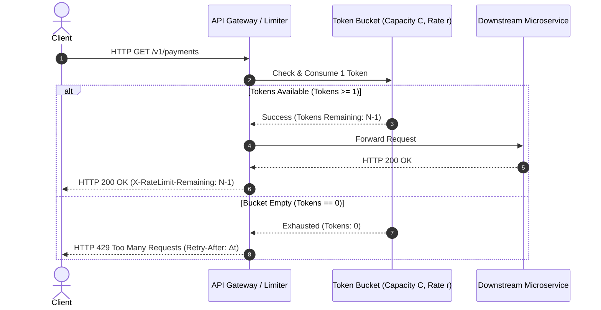
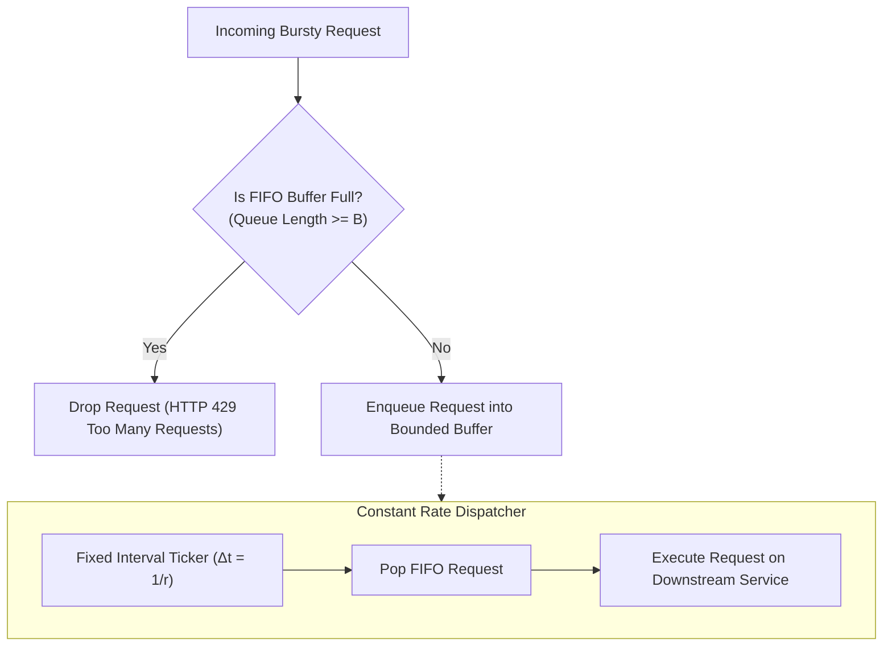
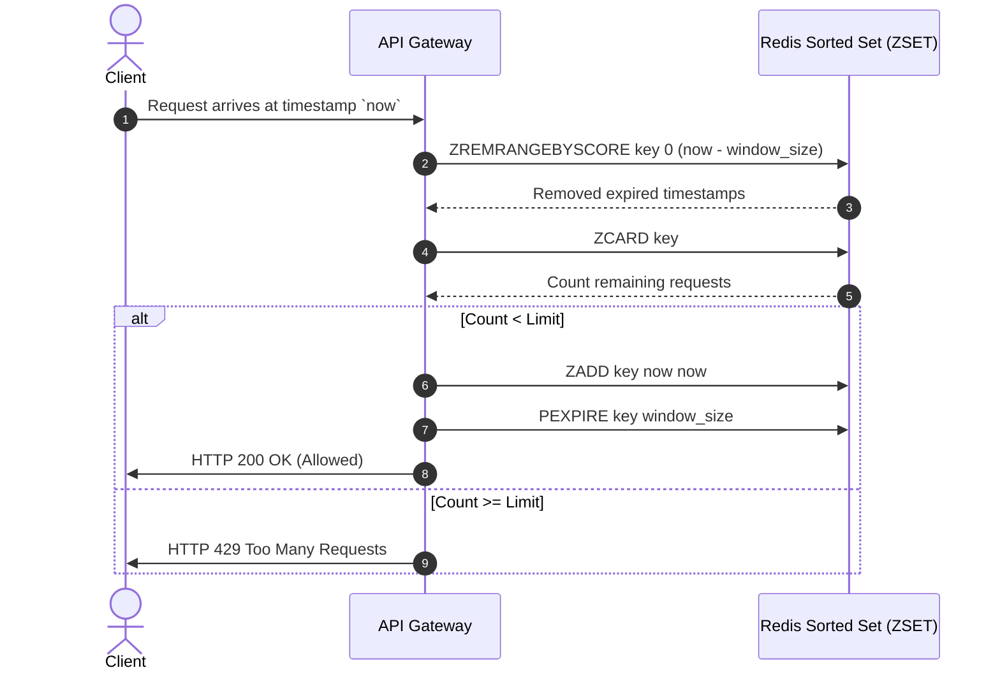
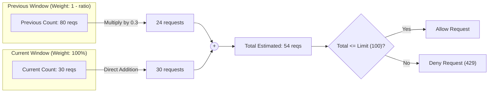
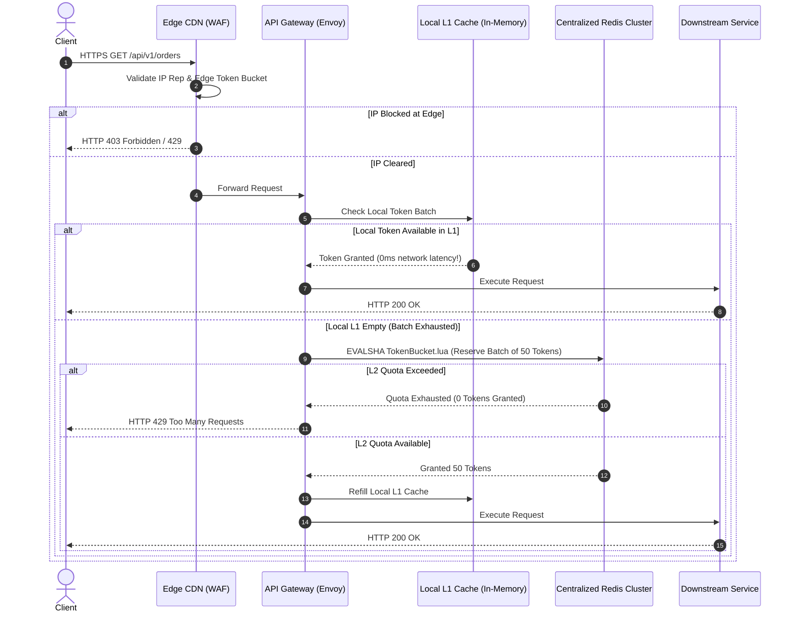

# Rate Limiting & Throttling at Scale: Protecting APIs & Distributed Services

## 1. Executive Summary & Real-World Production Challenges

In hyper-scale distributed systems, an unprotected API is an existential liability. Whether caused by an accidental infinite loop in a developer's integration script, a coordinated volumetric Distributed Denial of Service (DDoS) attack, credential stuffing bots, or a sudden stampede during a flash sale, unconstrained traffic rapidly induces cascading system failures.

```
                              THE CASCADING FAILURE SPIRAL
                              
      Unconstrained Traffic Spike (100,000 req/sec)
                          │
                          ▼
             [API Gateway Thread Pool Saturation]
                          │ (Worker threads exhaust; incoming connections queue)
                          ▼
             [Downstream Database Lock Contention]
                          │ (Connection pools drain; CPU reaches 100%)
                          ▼
            [Upstream Service Health Check Timeouts]
                          │ (Load balancers mark healthy nodes as dead)
                          ▼
            [Cascading Cluster Failover & Total Blackout]
```

Rate limiting and throttling serve as the automated defense perimeter at the API Gateway and service mesh boundaries. Their core mandate is to:
1. **Prevent Resource Starvation ("Noisy Neighbor" Problem):** Ensure a single hyper-active tenant cannot monopolize shared database connections, CPU threads, or network I/O.
2. **Mitigate DDoS & Bot Attacks:** Discard malicious floods at the edge before expensive cryptographic operations, database queries, or microservice hops occur.
3. **Enforce Business Quotas & Tiered Monetization:** Differentiate access tiers (e.g., Free Tier: 60 requests/min; Enterprise Tier: 50,000 requests/min).
4. **Smooth Traffic Peaks (Traffic Shaping):** Convert volatile, bursty spikes into a smooth, predictable stream that downstream databases and legacy payment gateways can process without crashing.

---

### Rate Limiting vs. Throttling vs. Load Shedding vs. Circuit Breaking

Engineers frequently conflate these four resilience mechanisms. Understanding their precise boundaries is critical in system design:

| Mechanism | Primary Goal | Decision Factor | Typical Action | Placement |
|---|---|---|---|---|
| **Rate Limiting** | Enforce policy limits per client/tenant | Client identity (API key, User ID, IP) | Reject immediately (`HTTP 429 Too Many Requests`) | Edge CDN, API Gateway, Ingress Controller |
| **Throttling** | Smooth traffic spikes to protect downstream capacity | Target system consumption rate | Delay, queue in buffer, or dynamically degrade rate | API Gateway, Queue Workers, Outbound HTTP clients |
| **Load Shedding** | Prevent total server collapse under extreme load | Server health metrics (CPU %, RAM, queue latency) | Drop low-priority traffic indiscriminately (`HTTP 503`) | In-process middleware, Service Mesh Sidecar |
| **Circuit Breaking** | Stop calling a failing downstream dependency | Downstream failure rate / latency | Fail fast locally without sending network requests | Internal RPC Client, Service Mesh (Envoy) |

```mermaid
flowchart TD
    Client["Client Request"] --> Edge["Edge CDN / WAF (IP Rate Limiting)"]
    Edge -->|Allowed| Gateway["API Gateway (Tenant Rate Limiting & Quotas)"]
    Edge -->|Exceeded| Drop429["Drop with HTTP 429"]
    
    Gateway -->|Allowed| LoadShed{"Server Load Shedder (CPU > 90%?)"}
    Gateway -->|Exceeded| Drop429
    
    LoadShed -->|No (Healthy)| InternalSvc["Internal Service Execution"]
    LoadShed -->|Yes (Overloaded)| Drop503["Drop Low Priority with HTTP 503"]
    
    InternalSvc --> Outbound["Call Downstream Dependency"]
    Outbound --> CircuitBreaker{"Circuit Breaker (Trip on Failures?)"}
    CircuitBreaker -->|Closed (Normal)| Database["Database / External Vendor API"]
    CircuitBreaker -->|Open (Tripped)| Fallback["Local Fallback / Degraded Response"]
```

---

### Real-World Production Outages & Case Studies

#### 1. Stripe's Black Friday Tiered Protection Fleet
- **The Challenge:** During major global e-commerce events (Cyber Monday, Black Friday), millions of merchants simultaneously submit transaction authorizations. A surge in authorization retries can create positive feedback loops that crash card processing networks.
- **The Architecture:** Stripe separates rate limiting into **four distinct tiers**:
  - *Request Rate Limiter:* Restricts raw requests per second per customer token using an atomic Redis Token Bucket.
  - *Concurrent Request Limiter:* Restricts the number of simultaneous in-flight requests (e.g., maximum 25 active connections) to protect database connection pools from long-running transactions.
  - *Fleet Usage Limiter:* Allocates capacity pools per cluster so that an unexpected spike from one enterprise customer cannot consume more than 20% of any specific API Gateway cluster's capacity.
  - *Critical Resource Limiter:* Specifically bounds resource-intensive routes (such as bulk transaction CSV exports or cardholder data vaulting).

#### 2. Cloudflare's Global Regular Expression CPU Exhaustion (July 2019)
- **The Event:** A global outage knocked major portions of the Internet offline for 27 minutes.
- **The Underlying Cause:** Cloudflare deployed a new rule within their Web Application Firewall (WAF) and rate limiting engine to detect malicious payload patterns. The rule contained an unanchored regular expression (`.*(?:.*=.*)`) that triggered catastrophic **regex backtracking** on certain HTTP request bodies.
- **The Impact:** CPU utilization on Cloudflare's edge proxy cores jumped to 100% globally, causing edge proxies to drop legitimate incoming traffic.
- **The Engineering Lesson:** Rate limiting logic must execute in $O(1)$ constant time with zero dynamic regular expression backtracking on the critical request path.

#### 3. GitHub's 1.35 Tbps Memcached DDoS & API Limiting Locks (2018)
- **The Event:** GitHub faced a massive amplification DDoS attack peaking at 1.35 Tbps via misconfigured public Memcached servers, followed by massive secondary waves of API token abuse.
- **The Failure:** GitHub's internal rate limiting service experienced severe lock contention when hundreds of internal application workers hammered the same centralized caching layer to record API key hits.
- **The Fix:** GitHub transitioned to a hybrid two-tier rate limiter: local in-memory token buffers on edge haproxy/Envoy nodes that synchronize deltas asynchronously to a distributed Redis cluster, reducing cache round-trips by over 90%.

---

## 2. Mathematical Foundations & Scale Sizing

Before evaluating specific algorithms, let us size a rate limiting engine for a tier-1 technology platform:

```
                            SCALE ESTIMATION METRICS
                            
  Daily Active Users (DAU):             100 Million
  Average API requests per user/day:    200 requests/day
  Total daily requests:                 20 Billion requests/day
  Average Request Throughput (RPS):     ~231,500 req/sec
  Peak Throughput (3x burst factor):    ~700,000 req/sec
  Total Active API Keys / IP Clients:   20 Million unique keys per hour
```

### Memory Footprint Calculations Across Different Algorithms

If we track 20 million active client keys over a 1-hour window, the choice of algorithm dictates infrastructure costs and latency bounds:

$$\begin{aligned}
\text{Fixed Window Counter:} &\quad 20\text{M keys} \times (\text{Key: 32B} + \text{Counter: 8B} + \text{Redis Overhead: 48B}) \approx 1.76\text{ GB RAM} \\
\text{Sliding Window Log:} &\quad 20\text{M keys} \times 100\text{ timestamps} \times 8\text{ bytes} \approx 16.0\text{ GB to } 32\text{ GB RAM} \\
\text{Token Bucket (Hash):} &\quad 20\text{M keys} \times (\text{Tokens: 8B} + \text{LastTimestamp: 8B} + \text{Overhead: 64B}) \approx 1.6\text{ GB RAM} \\
\text{Sliding Window Counter:} &\quad 20\text{M keys} \times (\text{PrevCount: 8B} + \text{CurrCount: 8B} + \text{Overhead: 64B}) \approx 1.6\text{ GB RAM}
\end{aligned}$$

> [!IMPORTANT]
> The Sliding Window Log requires memory proportional to the **number of requests** ($O(N)$), making it dangerously vulnerable to memory exhaustion under high-concurrency DDoS attacks. In contrast, Token Bucket and Sliding Window Counter require memory proportional to the **number of unique clients** ($O(1)$ per client), providing deterministic memory bounds.

---

## 3. The 5 Rate Limiting Algorithms: In-Depth HLD & LLD

We now perform an exhaustive analysis of the five foundational rate limiting algorithms. For each algorithm, we dissect its conceptual model, High-Level Design (HLD) architecture, Low-Level Design (LLD) mathematical state transitions, concurrency failure modes, and production-grade code implementations.

```
+---------------------------------------------------------------------------------------------------------+
|                                    ALGORITHM MECHANICS TAXONOMY                                         |
+---------------------------------------------------------------------------------------------------------+

 1. TOKEN BUCKET:
    Refill tokens steadily at rate r ──► [Bucket Capacity C] ──► Consume 1 token/req
                                         (Allows bursts up to C, smooth steady state)

 2. LEAKY BUCKET:
    Bursty incoming requests ──► [FIFO Buffer / Queue Size B] ──► Leak at steady rate r
                                 (Forces strictly constant output rate; drops on overflow)

 3. FIXED WINDOW COUNTER:
    [ Window 1: 00:00 - 00:01 ]    [ Window 2: 00:01 - 00:02 ]
    Counter: 100/100 (Max)         Counter: 100/100 (Max)
    ▲ CRITICAL FLAW: 100 reqs at 00:59 + 100 reqs at 01:00 = 200 reqs in 2 seconds!

 4. SLIDING WINDOW LOG:
    Logs every request timestamp in Sorted Set: [t1, t2, t3, ...]
    Purge timestamps older than (now - window). Count remaining elements.
    ▲ 100% EXACT, but high memory footprint O(Requests).

 5. SLIDING WINDOW COUNTER (Cloudflare / Hybrid Standard):
    Approximates count: (Current Window Counter) + (Previous Window Counter * Overlap Ratio)
    ▲ O(1) Memory, highly accurate (<0.05% error), boundary-proof.
```

---

## Approach 1: Token Bucket Algorithm

### High-Level Design (HLD)

The **Token Bucket** algorithm is the industry standard for general API rate limiting (used extensively by AWS, Stripe, and Google Cloud). 

A centralized or local bucket has a fixed capacity $C$. Tokens are added to the bucket at a constant refill rate of $r$ tokens per unit of time (e.g., 10 tokens per second). When an incoming request arrives:
- If at least 1 token is available, 1 token is removed from the bucket, and the request is permitted to proceed.
- If no tokens remain, the request is throttled immediately (`HTTP 429 Too Many Requests`).

```
┌────────────────────────────────────────────────────────────────────────────────────────────────────────┐
│                                     TOKEN BUCKET ARCHITECTURE                                          │
└────────────────────────────────────────────────────────────────────────────────────────────────────────┘

    Token Generator
    (Refill rate: r tokens/sec)
            │
            ▼
   ┌─────────────────┐
   │  .  .  .  .  .  │ ◄─── Bucket Capacity: C tokens
   │ [T] [T] [T] [T] │
   │ [T] [T] [T] [T] │      Incoming Requests
   └────────┬────────┘             │
            │                      ▼
            │ 1 Token ◄──── [Is Bucket Empty?]
            │ Consumed             │
            ▼                      ├─── No  ──► Allow Request (Forward to Backend)
     Request Processed             │
                                   └─── Yes ──► Deny Request (HTTP 429 Too Many Requests)
```



#### Key Architectural Characteristics:
- **Burst Accommodation:** The Token Bucket uniquely permits short-term bursts of traffic up to the bucket capacity $C$. If an API has been idle, a client can immediately send $C$ requests in a single millisecond without being blocked.
- **Sustained Limit Enforcement:** Over long horizons, the maximum sustained throughput is strictly bounded by the refill rate $r$.

---

### Low-Level Design (LLD)

#### The "Lazy Refill" Mathematical Formulation
A naive, novice implementation uses a background thread or cron ticker to increment tokens every second. In production with 20 million active clients, running 20 million background timers would exhaust CPU scheduler resources.

Production systems instead use **Lazy Dynamic Refill** calculated on-demand whenever a request arrives:

$$\Delta t = t_{\text{current}} - t_{\text{last\_refill}}$$

$$\text{new\_tokens} = \min\left(C, \text{current\_tokens} + \Delta t \times r\right)$$

Where:
- $C$ is the maximum bucket capacity.
- $r$ is the refill rate in tokens per second.
- $t_{\text{current}}$ is the current Unix epoch timestamp with microsecond/millisecond precision.
- $t_{\text{last\_refill}}$ is the timestamp of the previous request evaluation.

#### Concurrency Hazard: Distributed Race Conditions
In a multi-threaded or distributed environment, two concurrent requests executing the read-calculate-write sequence will encounter race conditions:

```
Thread A: Reads tokens = 1
Thread B: Reads tokens = 1
Thread A: Decrements to 0, writes to store, allows request
Thread B: Decrements to 0, writes to store, allows request  <-- RACE CONDITION (Over-allocation!)
```

To prevent this, the entire check-and-decrement operation must be executed **atomically** using a Redis Lua script.

#### Production Redis Lua Script (Atomic Token Bucket)

```lua
-- token_bucket.lua
-- KEYS[1]: Rate limit key (e.g., "ratelimit:token_bucket:user_1001")
-- ARGV[1]: Max bucket capacity (C)
-- ARGV[2]: Refill rate per millisecond (r)
-- ARGV[3]: Requested tokens (typically 1)
-- ARGV[4]: Current timestamp in milliseconds

local key = KEYS[1]
local capacity = tonumber(ARGV[1])
local refill_rate_per_ms = tonumber(ARGV[2])
local requested = tonumber(ARGV[3])
local now = tonumber(ARGV[4])

-- Retrieve current state from Redis Hash
local data = redis.call("HMGET", key, "tokens", "last_updated")
local tokens = tonumber(data[1])
local last_updated = tonumber(data[2])

if tokens == nil then
    -- Initialize new bucket full of tokens
    tokens = capacity
    last_updated = now
else
    -- Calculate tokens accumulated since last request
    local delta_ms = math.max(0, now - last_updated)
    local generated_tokens = delta_ms * refill_rate_per_ms
    tokens = math.min(capacity, tokens + generated_tokens)
    last_updated = now
end

-- Determine if requested tokens can be consumed
if tokens >= requested then
    tokens = tokens - requested
    redis.call("HMSET", key, "tokens", tokens, "last_updated", last_updated)
    -- Expire bucket if idle for 2x the time it takes to refill to capacity
    local ttl_seconds = math.ceil((capacity / refill_rate_per_ms) / 1000) * 2
    redis.call("EXPIRE", key, math.max(ttl_seconds, 60))
    return {1, math.floor(tokens)} -- Allowed: 1, Remaining tokens
else
    redis.call("HMSET", key, "tokens", tokens, "last_updated", last_updated)
    local time_to_wait_ms = math.ceil((requested - tokens) / refill_rate_per_ms)
    return {0, math.floor(tokens), time_to_wait_ms} -- Denied: 0, Remaining tokens, Wait time ms
end
```

#### Python Implementation with In-Memory Mutex (Single-Process Engine):

```python
import time
import threading
from typing import Tuple

class TokenBucketLimiter:
    """Thread-safe in-memory Token Bucket rate limiter."""
    
    def __init__(self, capacity: int, refill_rate_per_second: float):
        self.capacity = float(capacity)
        self.refill_rate = refill_rate_per_second
        self.tokens = float(capacity)
        self.last_refill_timestamp = time.monotonic()
        self.lock = threading.Lock()

    def allow_request(self, tokens_requested: int = 1) -> Tuple[bool, float]:
        """
        Evaluates whether a request can proceed.
        Returns: (is_allowed, wait_seconds_until_available)
        """
        with self.lock:
            now = time.monotonic()
            elapsed = now - self.last_refill_timestamp
            self.last_refill_timestamp = now

            # Dynamically refill tokens based on elapsed time
            self.tokens = min(self.capacity, self.tokens + elapsed * self.refill_rate)

            if self.tokens >= tokens_requested:
                self.tokens -= tokens_requested
                return True, 0.0
            else:
                missing_tokens = tokens_requested - self.tokens
                wait_time = missing_tokens / self.refill_rate
                return False, wait_time
```

---

## Approach 2: Leaky Bucket Algorithm

### High-Level Design (HLD)

The **Leaky Bucket** algorithm is designed for **traffic shaping**. While the Token Bucket allows bursts up to capacity $C$, the Leaky Bucket enforces a strictly smooth, uniform output rate regardless of incoming volatility.

The algorithm can be conceptualized in two distinct operational modes:
1. **As a FIFO Queue (Asynchronous Smoothing):** Incoming requests are placed into a bounded FIFO queue of size $B$. A background worker or scheduler pulls requests off the queue and executes them at a constant rate of $r$ requests per second. If the queue is full, incoming requests are dropped immediately.
2. **As a Traffic Meter / Policier (GCRA - Generic Cell Rate Algorithm):** Requests are not queued in memory; instead, each request is evaluated mathematically against a virtual leak schedule. Requests that exceed the allowed leak rate are immediately rejected with `429`.

```
┌────────────────────────────────────────────────────────────────────────────────────────────────────────┐
│                                     LEAKY BUCKET ARCHITECTURE                                          │
└────────────────────────────────────────────────────────────────────────────────────────────────────────┘

        Bursty Incoming Traffic (Volatile Spikes)
                   │  │  │  │  │
                   ▼  ▼  ▼  ▼  ▼
             ┌─────────────────────┐
             │  \               /  │
             │   \  [Req 4]    /   │
             │    \ [Req 3]   /    │ ◄─── Bounded Buffer Queue (Capacity: B)
             │     \[Req 2]  /     │      (Drops requests when queue is full!)
             │      \[Req 1]/      │
             └──────────┬──────────┘
                        │
                        ▼ Constant Outflow Rate (Leak Rate: r req/sec)
                   [Backend Service / Payment Gateway]
```



#### Real-World Production Use Cases:
- **E-Commerce Flash Sale Checkouts:** Preventing payment gateways (e.g., Chase Paymentech) from being overwhelmed by bursty credit card authorization requests.
- **Log Ingestion & Telemetry:** Smoothing volatile spikes of telemetry logs before streaming them into Kafka or Elasticsearch.

---

### Low-Level Design (LLD)

#### The Generic Cell Rate Algorithm (GCRA)
In low-latency API Gateways, allocating actual in-memory FIFO queues per customer introduces significant latency and memory overhead. Instead, production gateways implement Leaky Bucket using **GCRA (Generic Cell Rate Algorithm)**.

GCRA tracks a single timestamp variable called the **Theoretical Arrival Time (TAT)**:

$$\text{TAT}_{\text{new}} = \max(\text{now}, \text{TAT}_{\text{previous}}) + T$$

Where:
- $T = \frac{1}{r}$ is the emission interval (time between consecutive allowed requests).
- $\tau$ is the Burst Tolerance limit (the maximum allowable headroom above the current time).
- If $\text{TAT}_{\text{new}} - \text{now} > \tau$, the request violates the leak schedule and is rejected.

```
Timeline:
--------------------------------------------------------------------> (time)
          now                  TAT                     now + tau
           │                    │                          │
           └────────────────────┴──────────────────────────┘
             Allowed if TAT <= (now + tau)
             Rejected if TAT > (now + tau)
```

#### Production Go Implementation (GCRA Leaky Bucket):

```go
package ratelimit

import (
	"sync"
	"time"
)

// GCRALeakyBucket implements the Generic Cell Rate Algorithm.
type GCRALeakyBucket struct {
	mu             sync.Mutex
	tat            time.Time     // Theoretical Arrival Time
	emissionPeriod time.Duration // T = 1 / rate
	burstTolerance time.Duration // tau = burst_limit * emissionPeriod
}

func NewGCRALeakyBucket(ratePerSec int, burstLimit int) *GCRALeakyBucket {
	emission := time.Second / time.Duration(ratePerSec)
	return &GCRALeakyBucket{
		tat:            time.Now(),
		emissionPeriod: emission,
		burstTolerance: time.Duration(burstLimit) * emission,
	}
}

// Allow evaluates if a request conforms to the leaky bucket schedule.
func (b *GCRALeakyBucket) Allow() (bool, time.Duration) {
	b.mu.Lock()
	defer b.mu.Unlock()

	now := time.Now()
	var newTat time.Time

	if now.After(b.tat) {
		newTat = now.Add(b.emissionPeriod)
	} else {
		newTat = b.tat.Add(b.emissionPeriod)
	}

	// Calculate how far into the future this request pushes TAT
	allowableBoundary := now.Add(b.burstTolerance)
	if newTat.After(allowableBoundary) {
		// Limit exceeded: Return retry-after duration
		retryAfter := newTat.Sub(allowableBoundary)
		return false, retryAfter
	}

	b.tat = newTat
	return true, 0
}
```

---

## Approach 3: Fixed Window Counter Algorithm

### High-Level Design (HLD)

The **Fixed Window Counter** algorithm is the simplest rate limiting strategy. Time is partitioned into discrete, non-overlapping windows of duration $W$ (e.g., 1 minute: `00:00 - 00:01`, `00:01 - 00:02`).
- Each client has an associated integer counter for the current active window.
- When a request arrives, the current window key is determined, and the counter is incremented.
- If the counter exceeds limit $L$, the request is throttled until the window expires and resets.

```
┌────────────────────────────────────────────────────────────────────────────────────────────────────────┐
│                                   FIXED WINDOW COUNTER MECHANICS                                       │
└────────────────────────────────────────────────────────────────────────────────────────────────────────┘

    Window 1 [ 12:00:00 - 12:01:00 ]           Window 2 [ 12:01:00 - 12:02:00 ]
   ┌───────────────────────────────┐          ┌───────────────────────────────┐
   │ Requests: 45 / 100            │          │ Requests: 12 / 100            │
   │ Status:   ALLOWED             │          │ Status:   ALLOWED             │
   └───────────────────────────────┘          └───────────────────────────────┘
```

---

### The Critical Boundary Burst Flaw (The 2x Spike Attack)

Despite its simplicity, the Fixed Window Counter has a severe vulnerability: **traffic concentration at window edges**.

Consider a system configured for a limit of **100 requests per minute**:
1. Between `12:00:00` and `12:00:58`, the client sends zero requests.
2. At `12:00:59` (the final second of Window 1), the client sends **100 requests**. All 100 are permitted because the Window 1 counter has not been exceeded.
3. At `12:01:00`, Window 2 begins. The counter resets to 0.
4. At `12:01:01` (the first second of Window 2), the client sends another **100 requests**. All 100 are permitted.

```
                     THE 2x BOUNDARY SPIKE PHENOMENON
                     
     Limit: 100 requests / 60 seconds
     
               Window 1 (12:00 - 12:01)        Window 2 (12:01 - 12:02)
            ┌──────────────────────────────┐┌──────────────────────────────┐
            │                              ││                              │
            │                  100 Reqs    ││ 100 Reqs                     │
            │               [12:00:59]     ││ [12:01:01]                   │
     ───────┴──────────────────────████████┼┼████████──────────────────────┴───────
                                   ▲                ▲
                                   └──────┬─────────┘
                                          │
                       CRITICAL VULNERABILITY:
                       200 requests within a 2-second interval!
                       (2x the provisioned server capacity!)
```

This 2x surge can saturate database connection pools and crash downstream services even though the client never technically violated any individual fixed window limit.

---

### Low-Level Design (LLD)

#### The Redis TTL Race Condition Bug
A common anti-pattern in naive Redis fixed-window implementations is decoupling `INCR` and `EXPIRE`:

```python
# ANTI-PATTERN: NEVER DO THIS IN PRODUCTION!
count = redis.incr(key)
if count == 1:
    redis.expire(key, 60) # BUG: If the server crashes here, the key NEVER expires!
```

If the API Gateway worker crashes or network partition occurs between the `INCR` and `EXPIRE` commands, the key remains in Redis with **no TTL** (infinite lifespan). The client's counter will never reset, permanently locking them out of the system.

#### Production Solution: Atomic Multi-Command or Lua Script

```lua
-- fixed_window.lua
-- KEYS[1]: "ratelimit:fixed:user_42:17172400" (Key includes window timestamp)
-- ARGV[1]: Max allowed limit
-- ARGV[2]: Window expiration TTL in seconds

local key = KEYS[1]
local limit = tonumber(ARGV[1])
local ttl = tonumber(ARGV[2])

local current = redis.call("INCR", key)
if current == 1 then
    redis.call("EXPIRE", key, ttl)
end

if current > limit then
    return {0, 0} -- Denied: [0, Remaining]
else
    return {1, limit - current} -- Allowed: [1, Remaining]
end
```

---

## Approach 4: Sliding Window Log Algorithm

### High-Level Design (HLD)

The **Sliding Window Log** algorithm eliminates the boundary spike vulnerability of the Fixed Window Counter by tracking the exact timestamp of every individual request made by a client.

Instead of partitioning time into static blocks, the window **slides continuously** relative to the current timestamp:
1. When a request arrives at timestamp $t_{\text{current}}$, all timestamps older than $t_{\text{current}} - W$ are purged from the log.
2. The remaining timestamps are counted.
3. If $\text{count} < \text{Limit}$, the new timestamp $t_{\text{current}}$ is appended to the log, and the request is permitted.
4. If $\text{count} \ge \text{Limit}$, the request is rejected.

```
┌────────────────────────────────────────────────────────────────────────────────────────────────────────┐
│                                   SLIDING WINDOW LOG MECHANICS                                         │
└────────────────────────────────────────────────────────────────────────────────────────────────────────┘

 Current Time: 12:01:30 | Window Size: 60s | Active Range: [ 12:00:30 to 12:01:30 ]

    PURGED (Expired)                         VALID TIMESTAMPS IN WINDOW
 ┌──────────────────────┐         ┌───────────────────────────────────────────────────┐
 │ [12:00:10, 12:00:25] │         │ [12:00:45, 12:00:55, 12:01:10, 12:01:25]          │
 └──────────────────────┘         └───────────────────────────────────────────────────┘
                                  Count = 4 requests <= Limit (100) ──► ALLOW REQUEST
```



---

### Low-Level Design (LLD)

#### Redis Sorted Set (`ZSET`) Implementation
The Sliding Window Log is implemented in Redis using a **Sorted Set (`ZSET`)**, where:
- The **key** is the client identifier (e.g., `ratelimit:log:user_99`).
- The **score** is the Unix timestamp in milliseconds (`now_ms`).
- The **member** is a unique value (typically `<now_ms>:<uuid>` to allow multiple requests in the exact same millisecond).

#### Production Redis Lua Script:

```lua
-- sliding_window_log.lua
-- KEYS[1]: Rate limit key (e.g., "ratelimit:zset:user_123")
-- ARGV[1]: Current timestamp in milliseconds
-- ARGV[2]: Window size in milliseconds (e.g., 60000)
-- ARGV[3]: Maximum allowed limit (e.g., 100)
-- ARGV[4]: Unique request identifier (to avoid collisions in same millisecond)

local key = KEYS[1]
local now = tonumber(ARGV[1])
local window = tonumber(ARGV[2])
local limit = tonumber(ARGV[3])
local member = ARGV[4]

local clearBefore = now - window

-- 1. Evict all timestamps outside the active sliding window
redis.call("ZREMRANGEBYSCORE", key, "-inf", clearBefore)

-- 2. Count current elements inside the sliding window
local current_requests = redis.call("ZCARD", key)

if current_requests < limit then
    -- 3. Record current request timestamp
    redis.call("ZADD", key, now, member)
    -- Set TTL to automatically cleanup inactive keys
    redis.call("PEXPIRE", key, window)
    return {1, limit - current_requests - 1} -- Allowed: [1, Remaining]
else
    return {0, 0} -- Denied: [0, 0]
end
```

#### The Scale Dilemma: Why Sliding Log Fails at Scale
- **Time Complexity:** `ZREMRANGEBYSCORE` has complexity $O(\log N + M)$, where $N$ is the number of items in the set and $M$ is the number of removed items. Under high throughput, this consumes excessive Redis CPU time.
- **Memory Vulnerability:** If a malicious bot sends 100,000 requests per second during an attack, each client key consumes megabytes of RAM storing timestamps. A large botnet can easily trigger an **Out-Of-Memory (OOM) crash** on the Redis cluster.

---

## Approach 5: Sliding Window Counter Algorithm (Cloudflare Standard)

### High-Level Design (HLD)

The **Sliding Window Counter** combines the minimal memory footprint of the Fixed Window Counter with the boundary precision of the Sliding Window Log. It was popularized by Cloudflare and is widely considered the **industry gold standard** for high-volume API Gateways.

Instead of tracking every individual timestamp, it tracks only **two integer counters**:
1. The request count of the **Previous Window** ($C_{\text{prev}}$).
2. The request count of the **Current Window** ($C_{\text{curr}}$).

When a request arrives at time $t$ within the current window:
- We calculate the **overlap percentage** of the sliding window with the previous window.
- The estimated request volume in the rolling window is calculated via weighted approximation:

$$\text{Estimated Requests} = C_{\text{curr}} + C_{\text{prev}} \times \left(1 - \frac{\text{time elapsed in current window}}{\text{window duration}}\right)$$

```
┌────────────────────────────────────────────────────────────────────────────────────────────────────────┐
│                              SLIDING WINDOW COUNTER (WEIGHTED OVERLAP)                                 │
└────────────────────────────────────────────────────────────────────────────────────────────────────────┘

 Previous Window [ 12:00 - 12:01 ]              Current Window [ 12:01 - 12:02 ]
 ┌───────────────────────────────┐              ┌───────────────────────────────┐
 │ Counter: 80 requests          │              │ Counter: 30 requests          │
 └──────────────┬────────────────┘              └───────────────┬───────────────┘
                │                                               │
                │ 30% Overlap                                   │ 70% Overlap
                ▼                                               ▼
         ┌──────────────┐                       ┌───────────────────────────────┐
         │ 80 * (1-0.7) │                       │          30 requests          │
         │  = 24 reqs   │                       │                               │
         └──────┬───────┘                       └───────────────┬───────────────┘
                │                                               │
                └───────────────────────┬───────────────────────┘
                                        │
                                        ▼
                   Estimated Total = 24 + 30 = 54 requests <= Limit (100)
                   ──► RESULT: REQUEST PERMITTED!
```



---

### Low-Level Design (LLD)

#### Mathematical Precision & Error Analysis
Does this approximation lead to false positives or false negatives?
- **Assumption:** The algorithm assumes requests in the previous window were distributed uniformly.
- **Empirical Accuracy:** In extensive production benchmarks conducted by Cloudflare across billions of requests, the error rate was measured at **less than 0.05%**.
- **Boundaries:** Even in extreme adversarial worst-case scenarios (where all previous window requests occurred in the final millisecond), the maximum possible burst is mathematically capped at $1.41 \times \text{Limit}$ (compared to $2.0 \times \text{Limit}$ in Fixed Window Counter).

#### Memory & Performance Efficiency
- **Memory:** Only two integers per client ($O(1)$ space).
- **Time Complexity:** Single Redis `INCR` and `GET` ($O(1)$ time).

#### Production Redis Lua Script (Sliding Window Counter):

```lua
-- sliding_window_counter.lua
-- KEYS[1]: Current window key (e.g., "ratelimit:sw:usr_10:17172401")
-- KEYS[2]: Previous window key (e.g., "ratelimit:sw:usr_10:17172400")
-- ARGV[1]: Max allowed limit
-- ARGV[2]: Current timestamp in milliseconds
-- ARGV[3]: Window size in milliseconds
-- ARGV[4]: Key TTL in seconds

local curr_key = KEYS[1]
local prev_key = KEYS[2]
local limit = tonumber(ARGV[1])
local now = tonumber(ARGV[2])
local window_size = tonumber(ARGV[3])
local ttl = tonumber(ARGV[4])

-- 1. Read previous window count
local prev_count = tonumber(redis.call("GET", prev_key)) or 0

-- 2. Read current window count
local curr_count = tonumber(redis.call("GET", curr_key)) or 0

-- 3. Calculate position within current window (0.0 to 1.0)
local time_into_current_window = now % window_size
local weight_previous = 1.0 - (time_into_current_window / window_size)

-- 4. Calculate estimated requests
local estimated_requests = math.floor(curr_count + (prev_count * weight_previous))

if estimated_requests < limit then
    -- Increment current window counter
    local new_count = redis.call("INCR", curr_key)
    if new_count == 1 then
        redis.call("EXPIRE", curr_key, ttl)
    end
    return {1, limit - estimated_requests - 1} -- Allowed: [1, Remaining]
else
    return {0, 0} -- Denied: [0, Remaining]
end
```

---

## 4. Comprehensive Algorithm Comparison Matrix

| Dimension | Token Bucket | Leaky Bucket (GCRA) | Fixed Window Counter | Sliding Window Log | Sliding Window Counter |
|---|---|---|---|---|---|
| **Allows Bursts?** | Yes (up to capacity $C$) | No (strictly smooths) | Yes (vulnerable to 2x boundary spikes) | No (strictly enforced) | Smoothly bounded ($\le 1.4\times$ max worst-case) |
| **Memory Complexity** | $O(1)$ per client | $O(1)$ per client | $O(1)$ per client | $O(N)$ requests in window | $O(1)$ per client |
| **Time Complexity** | $O(1)$ | $O(1)$ | $O(1)$ | $O(\log N + M)$ | $O(1)$ |
| **Precision** | High | High | Low (edge boundary flaws) | $100\%$ Exact | $\approx 99.95\%$ (empirical) |
| **Implementation Complexity** | Low / Medium | Medium (GCRA math) | Very Low | Medium | Medium |
| **Traffic Smoothing** | Bursty bursts allowed | Perfectly constant rate | Spiky at reset boundaries | Strictly enforces limit | Smoothly enforces limit |
| **DDoS Attack Vulnerability** | Very Low | Very Low | Very Low | **High (OOM Risk)** | Very Low |
| **Industry Adoption** | AWS, Stripe, Envoy | NGINX, Uber, Shopify | Simple Internal APIs | Financial ledgers, Auth endpoints | Cloudflare, Kong, Fastly |

---

## 5. Distributed Rate Limiter: High-Level Architecture (HLD)

In a microservices architecture operating across thousands of container instances behind an Anycast Global Load Balancer, rate limiting cannot rely on isolated in-memory counters on individual servers.

```
┌────────────────────────────────────────────────────────────────────────────────────────────────────────┐
│                              DISTRIBUTED HYBRID RATE LIMITER ARCHITECTURE                              │
└────────────────────────────────────────────────────────────────────────────────────────────────────────┘

                       [Global Anycast Edge / Route 53]
                                      │
                                      ▼
                        [Cloudflare Edge / AWS WAF]
                    (Tier 1: IP-Level DDoS Rate Limiting)
                                      │
                                      ▼
                   [External Ingress Application Gateway]
                         (Envoy / Kong API Gateway)
                                      │
         ┌────────────────────────────┼────────────────────────────┐
         │                            │                            │
         ▼                            ▼                            ▼
  [Gateway Worker 1]           [Gateway Worker 2]           [Gateway Worker N]
  ┌─────────────────┐          ┌─────────────────┐          ┌─────────────────┐
  │ Local L1 Cache  │          │ Local L1 Cache  │          │ Local L1 Cache  │
  │ (Ristretto/Go)  │          │ (Ristretto/Go)  │          │ (Ristretto/Go)  │
  └────────┬────────┘          └────────┬────────┘          └────────┬────────┘
           │                            │                            │
           │ Batch Token Reservation    │ Batch Token Reservation    │ Batch Sync
           └────────────────────────────┼────────────────────────────┘
                                        │
                                        ▼
                         [Distributed Redis Cluster (L2)]
                    (Sharded with Consistent Hash + Twemproxy)
                    (Atomic Lua Scripts for Global Consistency)
                                        │
                   ┌────────────────────┴────────────────────┐
                   ▼ (Allowed)                               ▼ (Denied)
      [Downstream Microservices]               [HTTP 429 Too Many Requests]
      - Payment Service                        Headers:
      - Order Service                           - X-RateLimit-Limit: 100
      - User Profile                            - X-RateLimit-Remaining: 0
                                                - Retry-After: 30
```



---

### Centralized vs. Decentralized: The Hybrid L1/L2 Pattern

Connecting to a centralized Redis cluster on **every single incoming HTTP request** creates two critical architectural bottlenecks:
1. **Network RTT Latency Overhead:** Adding a 1-3ms Redis network round-trip to every API call increases the p99 latency profile of the entire platform.
2. **Redis Centralized Saturation:** At 1,000,000 RPS, executing 1,000,000 Redis commands/second requires enormous Redis cluster sizing (dozens of shards) and saturates network cards.

#### The Production Solution: Token Reservation & Batching (Hybrid L1/L2)
- Each API Gateway instance maintains an ultra-fast **in-memory L1 cache** (e.g., Google Guava in Java, Ristretto in Go).
- Instead of requesting 1 token from Redis per HTTP request, the Gateway worker requests a **batch of tokens** (e.g., 50 tokens) in a single atomic Redis call.
- The Gateway satisfies subsequent requests directly from its local L1 RAM with **zero network latency** ($<1\mu\text{s}$).
- When the local L1 batch drops below a low-water threshold (e.g., 10 tokens remaining), an asynchronous background thread fetches the next batch from Redis.

---

## 6. Distributed Concurrency Hazards & Hotspot Mitigation (LLD)

### 1. Redis Cluster Sharding & Hash Tagging (`{...}`)

In a Redis Cluster, keys are distributed across 16,384 hash slots using CRC16:

$$\text{slot} = \text{CRC16}(\text{key}) \pmod{16384}$$

When evaluating a multi-key Lua script (such as the Sliding Window Counter which accesses `KEYS[1]` for the current window and `KEYS[2]` for the previous window), Redis will throw a `CROSSSLOT Keys in request don't hash to the same slot` error if the keys reside on different cluster nodes.

#### The Solution: Hash Tags
Force all keys belonging to the same tenant or user into the exact same hash slot by wrapping the identifier in curly braces `{...}`:

```
# WRONG (Causes CROSSSLOT Exception in Redis Cluster):
key_current = "ratelimit:user_1001:window_1201"
key_previous = "ratelimit:user_1001:window_1200"

# CORRECT (Guaranteed to hash to identical slot):
key_current = "ratelimit:{user_1001}:window_1201"
key_previous = "ratelimit:{user_1001}:window_1200"
```

---

### 2. The "Hot Key" Bottleneck: Sharded Sub-Keys

When a hyper-popular API key (such as a major integration partner like Shopify or Uber) generates 50,000 RPS, the Redis hash slot hosting `{user_shopify}` will map to a single Redis node. That node's single-threaded event loop will saturate at 100% CPU, creating an availability cliff for all other tenants sharing that Redis shard.

#### The Solution: Salted Key Sharding
Distribute the single logical rate limit key across $N$ physical sub-keys (e.g., $N = 16$):

$$\text{SubKey} = \text{"ratelimit:\{user\_shopify\_" } + (\text{random}(0, N-1)) + \text{"\}"}$$

- When writing: Allocate increments randomly or round-robin across the 16 slots. Each individual slot only handles $\frac{1}{16}$ of the write traffic!
- When reading / checking limits: Aggregate counts across all 16 slots, or divide the tenant's global limit by $N$ for each individual sub-key bucket ($Limit_{\text{sub}} = \frac{Limit_{\text{global}}}{N}$).

```
┌────────────────────────────────────────────────────────────────────────────────────────────────────────┐
│                                   HOT-KEY MITIGATION VIA SUB-SLOTTING                                  │
└────────────────────────────────────────────────────────────────────────────────────────────────────────┘

              Incoming Requests for "User_Shopify" (50,000 RPS)
                                      │
               ┌──────────────────────┼──────────────────────┐
               │ Hash(Random) % 4     │ Hash(Random) % 4     │ Hash(Random) % 4
               ▼                      ▼                      ▼
        ┌─────────────┐        ┌─────────────┐        ┌─────────────┐
        │   Slot 0    │        │   Slot 1    │        │   Slot 3    │ (4 separate physical shards =
        │ (12,500 RPS)│        │ (12,500 RPS)│        │ (12,500 RPS)│  CPU load evenly distributed!)
        └─────────────┘        └─────────────┘        └─────────────┘
```

---

### 3. Server Clock Drift & NTP Desynchronization

Distributed rate limiters rely heavily on timestamps. In a fleet of 50 API Gateway nodes, physical hardware clocks drift. Network Time Protocol (NTP) daemons periodically perform clock adjustments:
- If Gateway Node A's clock runs **500ms ahead** of Gateway Node B, requests evaluated on Node A may prematurely clear sliding windows or incorrectly trigger GCRA rejections.
- If NTP performs a **backward clock step**, time appears to flow backwards ($\Delta t < 0$), causing token generation calculations to produce negative tokens.

#### Engineering Defenses:
1. **Never use Wall-Clock Time for Durations:** Always use **Monotonic Clocks** (`CLOCK_MONOTONIC` in C/Linux, `time.monotonic()` in Python, `time.Now()` monotonic readings in Go) for calculating elapsed time intervals. Monotonic clocks are guaranteed never to step backward.
2. **Centralize Timestamps in Redis:** Instead of trusting client gateway timestamps, execute `redis.call('TIME')` inside the Lua script. This forces all nodes to synchronize against the Redis master's internal microsecond clock.

---

## 7. Resiliency, High Availability & Fault Tolerance Patterns

Rate limiters are critical infrastructure, but they **must not become a Single Point of Failure (SPOF)**. If the Redis rate limiting cluster catches fire, does your entire business go offline?

```
                                RESILIENCY TRADEOFF MATRIX
                                
      FAIL-OPEN (High Availability Focus)            FAIL-CLOSED (Security / Cost Focus)
   ┌────────────────────────────────────────┐    ┌────────────────────────────────────────┐
   │ If Redis fails:                        │    │ If Redis fails:                        │
   │ ALLOW ALL REQUESTS TO PASS             │    │ REJECT ALL REQUESTS (HTTP 500 / 429)   │
   │                                        │    │                                        │
   │ Best for:                              │    │ Best for:                              │
   │ - Payment checkout flows               │    │ - Expensive AI inference APIs (LLMs)   │
   │ - E-commerce storefront browsing       │    │ - SMS verification dispatch (Twilio)   │
   │ - Video streaming playback             │    │ - High-risk authentication (Login OTP) │
   └────────────────────────────────────────┘    └────────────────────────────────────────┘
```

### 1. Circuit Breaker Integration for the Rate Limiter

The API Gateway wraps calls to Redis in a local **Circuit Breaker** (e.g., Netflix Hystrix / Resilience4j pattern):
- If Redis p99 response latency exceeds **10ms**, or if Redis connection timeouts exceed a 5% error threshold over a 10-second rolling window, the circuit trips to **OPEN**.
- While OPEN, the Gateway bypasses Redis completely and falls back to a **Local In-Memory Emergency Rate Limiter** or executes a **Fail-Open Policy** while triggering high-priority PagerDuty alerts to SREs.

```mermaid
flowchart TD
    Req["Incoming API Request"] --> CB{"Rate Limiter Circuit Breaker<br>(Redis Healthy?)"}
    CB -->|Closed (Normal)| RedisCluster["Query Distributed Redis Cluster"]
    RedisCluster -->|Quota OK| Allow["Forward to Microservice"]
    RedisCluster -->|Quota Exceeded| Throttle["Return HTTP 429"]
    
    CB -->|Open (Redis Outage)| PolicyCheck{"Endpoint Criticality Policy"}
    PolicyCheck -->|Fail-Open (Checkout/Catalog)| FallbackAllow["Allow Request (Log Warning)"]
    PolicyCheck -->|Fail-Closed (SMS/Auth/LLM)| FallbackReject["Block Request (HTTP 503 Service Unavailable)"]
```

---

## 8. Multi-Tier & Multi-Dimensional Rate Limiting

Real-world enterprise systems do not evaluate rate limits based solely on a single API key. Traffic is evaluated across a multi-dimensional matrix:

```
┌────────────────────────────────────────────────────────────────────────────────────────────────────────┐
│                              MULTI-DIMENSIONAL RATE LIMITING PIPELINE                                  │
└────────────────────────────────────────────────────────────────────────────────────────────────────────┘

 Incoming HTTP Request: POST /v1/reports/pdf-export | IP: 198.51.100.24 | User: usr_premium_88
                                         │
                                         ▼
 ┌──────────────────────────────────────────────────────────────────────────────────────────────────────┐
 │ TIER 1: GLOBAL IP REPUTATION & DDoS FILTER (WAF / Edge)                                              │
 │ Rule: Max 1,000 req/min per IP address (Block volumetric bot attacks)                                │
 └───────────────────────────────────┬──────────────────────────────────────────────────────────────────┘
                                     │ Pass
                                     ▼
 ┌──────────────────────────────────────────────────────────────────────────────────────────────────────┐
 │ TIER 2: AUTHENTICATED TENANT SUBSCRIPTION PLAN (API Gateway)                                         │
 │ Rule: Premium Tier = Max 5,000 req/min across all endpoints                                          │
 └───────────────────────────────────┬──────────────────────────────────────────────────────────────────┘
                                     │ Pass
                                     ▼
 ┌──────────────────────────────────────────────────────────────────────────────────────────────────────┐
 │ TIER 3: EXPENSIVE RESOURCE / ROUTE LIMITER (Microservice Ingress)                                     │
 │ Rule: POST /reports/pdf-export is CPU heavy = Max 5 req/min per user                                 │
 └───────────────────────────────────┬──────────────────────────────────────────────────────────────────┘
                                     │ Pass
                                     ▼
 ┌──────────────────────────────────────────────────────────────────────────────────────────────────────┐
 │ TIER 4: CONCURRENT IN-FLIGHT REQUEST LIMITER (Bulkhead Isolation)                                    │
 │ Rule: Max 3 simultaneous active database exports per tenant                                          │
 └───────────────────────────────────┬──────────────────────────────────────────────────────────────────┘
                                     │ Pass
                                     ▼
                          [Execute Report Generation]
```

---

### Low-Level Design: Distributed Concurrency Limiter (Semaphore with TTL)

Rate limiting raw requests per second does not protect against **Thread Pool Starvation** caused by long-running requests. If a client sends 10 requests per second, but each request takes 30 seconds to execute, the client will hold 300 simultaneous open HTTP threads, exhausting backend connection pools.

We prevent this using a **Distributed Concurrency Limiter** implemented with Redis:

```python
import uuid
import time
import redis

class RedisConcurrencyLimiter:
    """Limits simultaneous in-flight requests per client using an atomic Redis ZSET semaphore."""
    
    def __init__(self, redis_client: redis.Redis, max_concurrency: int = 5, lease_timeout_seconds: int = 30):
        self.r = redis_client
        self.max_concurrency = max_concurrency
        self.lease_timeout = lease_timeout_seconds

    def acquire(self, tenant_id: str) -> str:
        """
        Attempts to acquire a concurrency lease slot.
        Returns: request_token if acquired, None if limit reached.
        """
        key = f"concurrency:{tenant_id}"
        token = str(uuid.uuid4())
        now = time.time()
        clear_before = now - self.lease_timeout

        # Atomic Lua Script: Evict expired leases and check capacity
        lua_acquire = """
        local key = KEYS[1]
        local now = tonumber(ARGV[1])
        local clearBefore = tonumber(ARGV[2])
        local maxSlots = tonumber(ARGV[3])
        local token = ARGV[4]

        -- Clean up dead/orphaned worker leases
        redis.call('ZREMRANGEBYSCORE', key, '-inf', clearBefore)

        local currentCount = redis.call('ZCARD', key)
        if currentCount < maxSlots then
            redis.call('ZADD', key, now, token)
            return 1
        else
            return 0
        end
        """
        result = self.r.eval(lua_acquire, 1, key, now, clear_before, self.max_concurrency, token)
        return token if result == 1 else None

    def release(self, tenant_id: str, token: str):
        """Releases the concurrency lease slot immediately upon request completion."""
        key = f"concurrency:{tenant_id}"
        self.r.zrem(key, token)
```

---

## 9. Standard HTTP Headers & Client Response Specification

When rate limiting is enforced, the API Gateway must communicate status transparently using standardized HTTP response headers.

### The IETF Draft Standard Specification (`RFC 6585` & `draft-ietf-httpapi-ratelimit-headers`)

Modern production systems conform to the modern IETF standards:

#### 1. Successful Permitted Request (`HTTP 200 OK`):
```http
HTTP/1.1 200 OK
Content-Type: application/json
RateLimit-Limit: 100
RateLimit-Remaining: 58
RateLimit-Reset: 22
RateLimit-Policy: 100;w=60
```

#### 2. Throttled Request (`HTTP 429 Too Many Requests`):
```http
HTTP/1.1 429 Too Many Requests
Content-Type: application/problem+json
Retry-After: 22
RateLimit-Limit: 100
RateLimit-Remaining: 0
RateLimit-Reset: 22
RateLimit-Policy: 100;w=60

{
  "type": "https://api.example.com/errors/rate-limit-exceeded",
  "title": "Too Many Requests",
  "status": 429,
  "detail": "Quota exceeded for quota 'tiered_api_calls'. Maximum allowed is 100 requests every 60 seconds.",
  "instance": "/v1/charges/ch_99201",
  "retry_after_seconds": 22
}
```

---

## 10. Client-Side Defensive Engineering: Exponential Backoff & Jitter

When a server responds with `HTTP 429`, naive client applications immediately retry in a tight loop. This triggers a catastrophic **Retry Storm** (Thundering Herd) that prevents the server from recovering.

```
                            THE THUNDERING HERD RETRY STORM
                            
  Time 00:00: API Gateway throttles 5,000 clients with HTTP 429.
  Time 00:01: All 5,000 clients retry simultaneously after an exact 1-second fixed sleep!
              ──► Central Gateway receives another 5,000 requests instantly!
              ──► Throttles all 5,000 clients again!
```

### Full Jitter Algorithm (Marc Brooker / AWS Architecture)

To break resonance synchronization across clients, clients must combine **Exponential Backoff** with **Full Jitter**:

$$\text{backoff} = \min\left(t_{\max}, t_{\text{base}} \times 2^{\text{attempt}}\right)$$

$$\text{sleep\_time} = \text{random}\left(0, \text{backoff}\right)$$

```
┌────────────────────────────────────────────────────────────────────────────────────────────────────────┐
│                              BACKOFF & JITTER COMPARISON (AWS RESEARCH)                                │
└────────────────────────────────────────────────────────────────────────────────────────────────────────┘

 1. No Jitter (Periodic spikes, high server contention):
    Client 1: [--- sleep 2s ---] ──► RETRY!
    Client 2: [--- sleep 2s ---] ──► RETRY!  <-- High collision!
    Client 3: [--- sleep 2s ---] ──► RETRY!

 2. Full Jitter (Uniform distribution, eliminates spikes):
    Client 1: [--- sleep 1.8s ---] ──► RETRY!
    Client 2: [- sleep 0.4s -] ──► RETRY!
    Client 3: [----- sleep 2.7s -----] ──► RETRY!
```

#### Production Python Client with Resilient Retry & Full Jitter:

```python
import time
import random
import requests

def request_with_full_jitter(
    url: str,
    max_retries: int = 5,
    base_backoff_sec: float = 0.5,
    max_backoff_sec: float = 30.0
) -> requests.Response:
    """Executes HTTP request with exponential backoff and AWS Full Jitter."""
    
    for attempt in range(max_retries):
        response = requests.get(url)
        
        # If successful, or client error other than 429, return immediately
        if response.status_code != 429:
            return response
            
        # Check if server provided an explicit Retry-After header
        retry_after = response.headers.get("Retry-After")
        if retry_after:
            sleep_duration = float(retry_after)
        else:
            # Calculate Exponential Backoff with Full Jitter
            calculated_backoff = min(max_backoff_sec, base_backoff_sec * (2 ** attempt))
            sleep_duration = random.uniform(0, calculated_backoff)
            
        time.sleep(sleep_duration)
        
    raise Exception(f"Failed after {max_retries} attempts due to persistent rate limiting.")
```

---

## 11. Complete Production-Grade API Gateway Middleware

Below is a complete, production-grade API Gateway middleware in Python using `asyncio` and `aioredis`, implementing the **Sliding Window Counter** with fail-open circuit breaking, metrics instrumentation, and RFC-compliant HTTP headers:

```python
import time
import logging
from typing import Tuple, Dict, Optional
import redis.asyncio as aioredis

logger = logging.getLogger("RateLimiter")

SLIDING_WINDOW_LUA = """
local curr_key = KEYS[1]
local prev_key = KEYS[2]
local limit = tonumber(ARGV[1])
local now = tonumber(ARGV[2])
local window_ms = tonumber(ARGV[3])
local ttl = tonumber(ARGV[4])

local prev_count = tonumber(redis.call("GET", prev_key)) or 0
local curr_count = tonumber(redis.call("GET", curr_key)) or 0

local time_into_current = now % window_ms
local weight_previous = 1.0 - (time_into_current / window_ms)
local estimated_requests = math.floor(curr_count + (prev_count * weight_previous))

if estimated_requests < limit then
    local new_count = redis.call("INCR", curr_key)
    if new_count == 1 then
        redis.call("EXPIRE", curr_key, ttl)
    end
    return {1, limit - estimated_requests - 1, math.floor(weight_previous * 100)}
else
    local retry_after = math.ceil((window_ms - time_into_current) / 1000)
    return {0, 0, retry_after}
end
"""

class DistributedRateLimiterMiddleware:
    def __init__(self, redis_pool: aioredis.ConnectionPool):
        self.pool = redis_pool
        self.script_sha: Optional[str] = None
        self.circuit_open = False
        self.last_failure_time = 0.0
        self.circuit_cooldown_seconds = 10.0

    async def initialize(self):
        """Pre-loads the Lua script into Redis script cache (EVALSHA)."""
        client = aioredis.Redis(connection_pool=self.pool)
        self.script_sha = await client.script_load(SLIDING_WINDOW_LUA)
        logger.info(f"Loaded Rate Limiter Lua Script SHA: {self.script_sha}")

    async def evaluate_request(
        self,
        tenant_id: str,
        limit: int = 100,
        window_seconds: int = 60
    ) -> Tuple[bool, Dict[str, str]]:
        """
        Evaluates incoming request against sliding window limit.
        Returns: (is_allowed, response_headers)
        """
        now_sec = time.time()
        
        # 1. Circuit Breaker Check: Fail-Open if Redis is offline
        if self.circuit_open:
            if now_sec - self.last_failure_time > self.circuit_cooldown_seconds:
                self.circuit_open = False # Attempt reset (Half-Open)
            else:
                logger.warning("Rate limiter circuit breaker OPEN; failing open.")
                return True, {"X-RateLimit-Fallback": "circuit-breaker-open"}

        now_ms = int(now_sec * 1000)
        window_ms = window_seconds * 1000
        current_window_id = int(now_ms // window_ms)
        previous_window_id = current_window_id - 1

        # Use Hash Tags to guarantee identical cluster hash slot
        curr_key = f"ratelimit:{{{tenant_id}}}:{current_window_id}"
        prev_key = f"ratelimit:{{{tenant_id}}}:{previous_window_id}"
        ttl_seconds = window_seconds * 2

        try:
            client = aioredis.Redis(connection_pool=self.pool)
            result = await client.evalsha(
                self.script_sha,
                2,
                curr_key,
                prev_key,
                limit,
                now_ms,
                window_ms,
                ttl_seconds
            )
            
            is_allowed = (result[0] == 1)
            remaining = result[1]
            reset_seconds = int(window_seconds - (now_sec % window_seconds))

            headers = {
                "RateLimit-Limit": str(limit),
                "RateLimit-Remaining": str(remaining),
                "RateLimit-Reset": str(reset_seconds),
                "RateLimit-Policy": f"{limit};w={window_seconds}"
            }

            if not is_allowed:
                retry_after = result[2]
                headers["Retry-After"] = str(retry_after)

            return is_allowed, headers

        except Exception as e:
            # Tripping Circuit Breaker on Redis connection/timeout error
            logger.error(f"Redis rate limiting failure: {e}. Tripping circuit breaker to FAIL-OPEN.")
            self.circuit_open = True
            self.last_failure_time = now_sec
            return True, {"X-RateLimit-Fallback": "fail-open-error"}
```

---

## 12. System Design Interview Blueprint & Cheat Sheet

In a 45-minute System Design Interview, use this structured framework to systematically architect a production rate limiter:

### Phase 1: Clarifying Requirements & Scope (3-5 Minutes)
- **Functional Requirements:**
  - Enforce limits per IP (unauthenticated) and per User/API Key (authenticated).
  - Return standardized HTTP `429 Too Many Requests` responses with `Retry-After` headers.
  - Support multiple rules (e.g., 60 req/min for Free users, 10,000 req/min for Enterprise).
- **Non-Functional Requirements:**
  - **Low Latency Overhead:** Rate limiting decision must complete in $< 2\text{ms}$ (must not delay API traffic).
  - **High Availability & Fault Tolerance:** Must **Fail-Open** if cache cluster crashes.
  - **Accuracy:** Minimal false positives; avoid edge boundary spikes.
  - **Distributed Scalability:** Support 1,000,000 RPS across distributed gateway nodes.

---

### Phase 2: Capacity Estimation (3 Minutes)
- **RPS & Memory Calculation:**
  - Assume 10M DAU $\times$ 100 requests/day = 1 Billion requests/day $\approx$ 12,000 avg RPS (peak 40,000 RPS).
  - Active keys: 10M keys $\times 80\text{ bytes} \approx 800\text{ MB RAM}$. Easily fits in a single Redis node, but we deploy a 3-shard Redis Cluster with replica nodes for high availability and failover.

---

### Phase 3: High-Level Architecture (10 Minutes)
- Draw the end-to-end traffic topology:
  1. Anycast DNS $\rightarrow$ Edge CDN / WAF (IP volumetric filter)
  2. API Gateway (Envoy/Kong) $\rightarrow$ L1 Local Cache $\rightarrow$ L2 Distributed Redis Cluster
  3. Downstream Services $\rightarrow$ Databases

---

### Phase 4: Deep Dive & Edge Cases (20 Minutes)
1. **Algorithm Selection Justification:**
   - *"I select the **Token Bucket** algorithm for general API endpoints because it gracefully accommodates bursty user behaviors while strictly capping long-term throughput."*
   - *"For high-scale ingress gateways where memory footprint is paramount, I select the **Sliding Window Counter** (Cloudflare standard) because it provides $O(1)$ constant memory and eliminates the 2x boundary burst flaw of Fixed Window."*
2. **Distributed Concurrency:** Explain why naive `GET` + `INCR` has race conditions; demonstrate atomic Lua scripts with `EVALSHA`.
3. **Redis Cluster Slotting:** Explain hash tags `{tenant_id}` to prevent `CROSSSLOT` errors.
4. **Hot-Key Defense:** Detail sub-key slotting (`ratelimit:{user}:slot_{0..N}`) to avoid melting a single Redis shard.
5. **Resiliency:** Explain Circuit Breakers, Fail-Open vs Fail-Closed policies, and why checkout routes must fail-open while SMS/auth endpoints fail-closed.
6. **Client Backoff:** Discuss Exponential Backoff with AWS Full Jitter to eliminate thundering herd retry storms.
