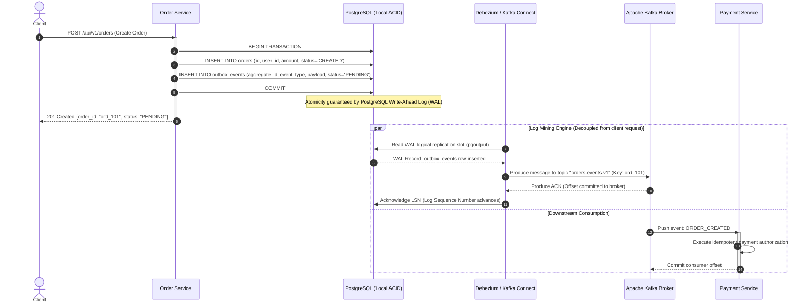
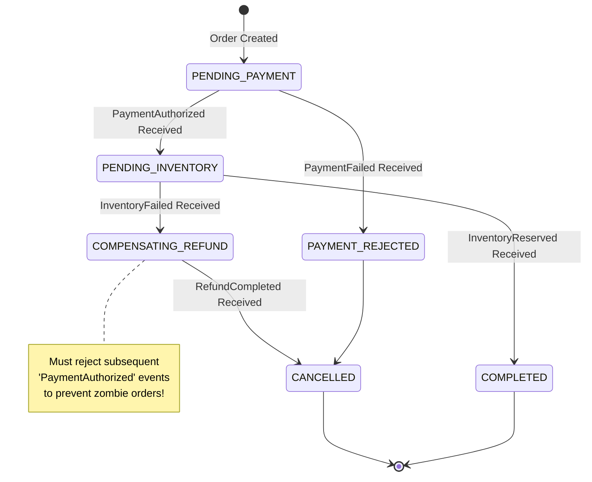
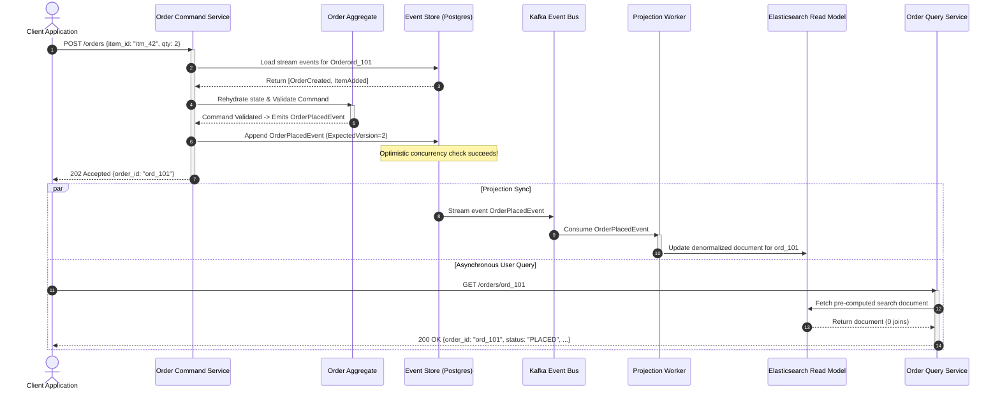
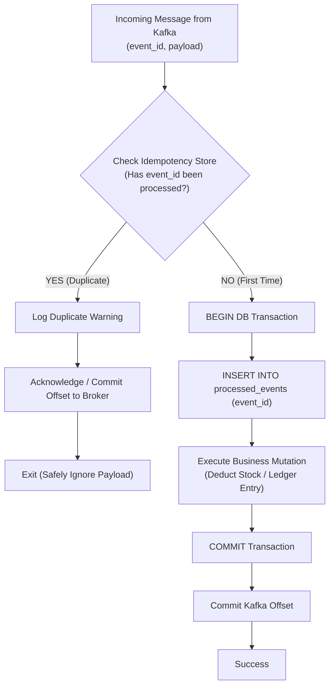
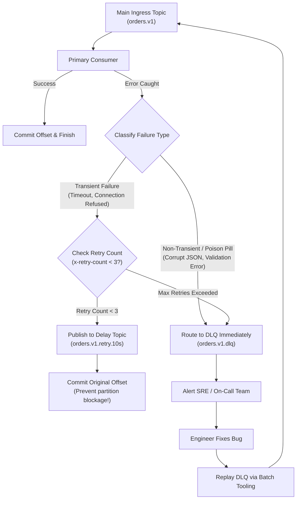

# Event-Driven Architecture Patterns: Outbox, Sagas, CQRS, Idempotency & Resilient Streaming

## 1. Executive Summary & Real-World Production Context

In modern distributed software engineering, monolithic relational architectures where a single database handles transactional integrity across all business entities have largely been superseded by microservices. However, decomposing systems into autonomous microservices introduces a profound fundamental challenge: **distributed state synchronization and cross-service coordination without catastrophic operational coupling**.

```
                   SYNCHRONOUS RPC vs. ASYNCHRONOUS EVENT-DRIVEN
                   
 1. SYNCHRONOUS RPC (Tight Coupling & Cascading Failures):
    [Client] ──► [Order Service] ──(HTTP/gRPC)──► [Payment Service] ──(HTTP/gRPC)──► [Inventory Service]
                       │                                                            ▲
                       │ (Thread blocked waiting for downstream response)           │
                       └────────────────── ❌ TIMEOUT / CRASH ──────────────────────┘
                          Result: Connection pool exhausted, 504 Gateway Timeout,
                                  data left in an inconsistent ghost state!

 2. ASYNCHRONOUS EVENT-DRIVEN (Loose Coupling & Eventual Consistency):
    [Client] ──► [Order Service]
                       │
                       │ 1. Atomic Commit (Order + Outbox Event)
                       ▼
                 [Outbox Table] ──► [Debezium CDC] ──► [Kafka Topic: "orders.v1"]
                                                             │
                       ┌─────────────────────────────────────┴─────────────────────────────────────┐
                       ▼                                                                           ▼
             [Payment Consumer]                                                           [Inventory Consumer]
             (Processes independently at its own pace)                                    (Processes independently)
```

### The Real-Life Production Lifecycle: Ride-Hailing (Uber/Lyft) & E-Commerce (Shopify/Amazon)

Consider what occurs when a user clicks **"Request Ride"** on Uber or **"Place Order"** on Amazon:
1. **Order / Trip Inception:** An initial entity must be recorded with a status of `PENDING`.
2. **Payment Authorization:** A payment processor (Stripe, Adyen, internal ledger) must authorize or hold funds.
3. **Resource Allocation:** A driver must be dispatched via a geospatial H3 index, or physical inventory must be reserved in a warehouse.
4. **Notification:** Push notifications and SMS alerts must be dispatched to drivers, merchants, and customers.
5. **Analytics & Pricing:** Metrics must be streamed into machine learning pipelines (e.g., dynamic surge pricing, fraud detection models).

If this workflow is implemented via synchronous REST or gRPC calls:
* **Multiplicative Latency:** If each downstream RPC call takes $50\text{ ms}$ at $p99$, chaining 5 services results in a minimum latency of $250\text{ ms}$. If any single service experiences a latency spike, the upstream caller's thread pool is blocked, causing connection pool exhaustion across the entire fleet.
* **Temporal Coupling:** All participating services must be healthy and reachable at the exact millisecond the request occurs. If the Notification Service has a transient network blip, the entire ride request or order fails.
* **Distributed Inconsistency (The Ghost Charge):** If the Payment Service successfully authorizes $\$150$ on the user's credit card, but the network connection to the Driver Dispatch Service drops before an acknowledgment is returned, the client receives an HTTP 500 error. The user is charged, but no driver is dispatched.

**Event-Driven Architecture (EDA)** solves these dilemmas by replacing synchronous command-and-control invocations with asynchronous, durable, immutable event streams. Participating services publish facts about what occurred (**Domain Events**), and downstream services consume, process, and react to those facts autonomously.

---

### Theoretical Foundations of Event-Driven Systems

To design production-grade event-driven architectures, backend engineers must anchor their designs in distributed systems theory:

#### 1. The Fallacies of Distributed Computing
Every asynchronous pipeline must assume that:
* The network is unreliable and subject to packet loss, route flapping, and latency spikes.
* Latency is non-zero.
* Bandwidth is finite.
* Topology changes continuously as pods autoscale, crash, or migrate.
* Message delivery across network boundaries is **at-least-once** by default; duplicated packets and out-of-order deliveries are normal operating conditions.

#### 2. The CAP & PACELC Theorems
* **CAP Theorem:** In the presence of a network partition ($P$), a distributed system must choose between Consistency ($C$ - every read receives the latest write) and Availability ($A$ - every non-failing node returns a non-error response).
* **PACELC Theorem:** If there is a Partition ($P$), trade off Availability ($A$) versus Consistency ($C$); **Else** ($E$), trade off Latency ($L$) versus Consistency ($C$). Synchronous cross-service locking (such as Two-Phase Commit) sacrifices both Availability and Latency. Event-driven architectures choose **PA/EL**: high availability and minimal latency during normal operations, settling for **Eventual Consistency**.

#### 3. Shift from ACID to BASE
Monolithic relational databases provide **ACID** (Atomicity, Consistency, Isolation, Durability) via local locks and Write-Ahead Logs (WAL). Distributed event-driven systems operate under the **BASE** paradigm:
* **Basically Available:** Subsystems remain operational independently; a failure in downstream billing does not prevent the upstream order ingress service from accepting requests.
* **Soft State:** Service data may temporarily reflect in-flight, intermediate states (e.g., an order in `AUTHORIZING_PAYMENT` status).
* **Eventual Consistency:** Given sufficient time without new inputs, all distributed replicas and service datastores converge to a consistent, synchronized state.

#### 4. Messaging Delivery Guarantees
* **At-Most-Once:** Messages may be lost, but are never duplicated (e.g., UDP, unacknowledged fire-and-forget). Unacceptable for transactional data.
* **At-Least-Once:** Messages are guaranteed to be delivered, but may be delivered more than once due to network retries, broker failovers, or consumer rebalances. **This is the industry standard guarantee of Apache Kafka, RabbitMQ, and AWS SQS.**
* **Effectively-Once (End-to-End Exactly-Once):** Achieved only when **At-Least-Once Delivery** is coupled with **Idempotent Consumer Processing** and atomic state updates.

---

### Real-World Production Disasters

#### Disaster 1: The "Dual-Write" Ghost Order & Silent Charge
* **The Incident:** A major e-commerce platform experienced a multi-million-dollar billing discrepancy during a holiday flash sale.
* **Root Cause:** The application code executed an HTTP handler that first saved an order to MySQL, and then published an `order_created` event to Apache Kafka:
  ```python
  # ANTI-PATTERN: The Dual-Write Trap
  db.orders.insert(order)          # Step 1: Write to database
  kafka.send("orders.v1", order)   # Step 2: Publish to Kafka broker
  ```
* **The Failure:** During peak traffic, the Kubernetes pod running the Order Service was killed by the Linux Out-Of-Memory (OOM) killer immediately after Step 1 committed, but before Step 2 could transmit the Kafka TCP packet. The database recorded the order, but the inventory and billing systems never received the event.
* **The Inverted Failure:** In other endpoints, developers inverted the sequence (`kafka.send` followed by `db.insert`). A transient database connection timeout caused the database insert to fail *after* Kafka had already broadcast the event. Downstream payment consumers charged customer credit cards for orders that did not exist in the primary database.

#### Disaster 2: The Synchronous Cascading Blackout
* **The Incident:** A national healthcare and pharmacy platform suffered a catastrophic 6-hour total system outage.
* **Root Cause:** A non-critical analytics service slowed down due to high disk I/O on its reporting database. Upstream microservices making synchronous REST calls to log audit data had configured default HTTP timeouts of $30\text{ seconds}$ without circuit breakers.
* **The Cascade:** Ingress gateway threads piled up waiting for the audit service to respond. Connection pools on API Gateways and upstream services were exhausted within $45\text{ seconds}$. What began as a localized analytics query slowdown cascaded backwards to paralyze user login, prescription refills, and emergency dispatch.

#### Disaster 3: Out-of-Order Message Processing & Inventory Corruption
* **The Incident:** An omnichannel retail platform allowed customers to purchase items that had been sold out hours earlier, leading to tens of thousands of backorders and order cancellations.
* **Root Cause:** The Inventory Service published inventory adjustment events to a Kafka topic configured with 10 partitions, but without specifying a message partition key (`item_id`).
* **The Failure:** An `InventoryStockAdded(+50)` event and an `InventoryStockDepleted(0)` event for the same SKU landed on different Kafka partitions. A consumer group with multiple consumer pods processed the two partitions concurrently. Because of network latency, the consumer processing the `InventoryStockAdded` event committed *after* the `InventoryStockDepleted` event, resetting the in-stock count to 50 on an item that was physically out of stock.

---

## 2. The Core Problem: The Dual-Write Dilemma

The fundamental problem that necessitates advanced event-driven patterns is the **Dual-Write Problem**: the impossibility of atomically updating two disparate, non-transactional storage engines over a network without distributed coordination.

```
                              THE DUAL-WRITE DILEMMA
                              
                           ┌────────────────────────┐
                           │   Application Worker   │
                           └───────────┬────────────┘
                                       │
                  ┌────────────────────┴────────────────────┐
                  │                                         │
                  ▼ (Write 1: Local DB)                     ▼ (Write 2: Remote Broker)
     ┌───────────────────────────┐             ┌───────────────────────────┐
     │   PostgreSQL / MySQL DB   │             │   Apache Kafka / RabbitMQ │
     └───────────────────────────┘             └───────────────────────────┘
     
  SCENARIO A: DB write succeeds ──► Worker crashes / OOM ──► Kafka event is NEVER emitted!
              Result: Inconsistent distributed state; downstream services starve.
              
  SCENARIO B: Kafka write succeeds ─► DB write fails (constraint/disk) ─► GHOST message emitted!
              Result: Downstream processes charge money or reserve items for nonexistent entities.
```

### Why Two-Phase Commit (2PC / XA) Fails at Scale

In theory, the X/Open XA standard and Two-Phase Commit (2PC) provide distributed atomic transactions across multiple resources. In practice, 2PC is an anti-pattern for modern high-throughput microservice architectures:
1. **Blocking Coordinator:** If the transaction coordinator crashes during the prepare phase, all participating resource managers hold row locks indefinitely (**In-Doubt State**).
2. **Throughput Collapse:** Locks are held across network round trips. If round-trip latency between microservices is $10\text{ ms}$, maximum throughput per row drops to fewer than 100 transactions per second.
3. **Cloud Database Incompatibility:** Modern cloud-native databases (DynamoDB, Cassandra, MongoDB, Snowflake) and distributed message logs (Kafka, Pulsar) do not support XA protocols.

Because distributed physical transactions are unviable, software architectures must adopt patterns that decompose distributed transactions into **local ACID transactions linked by durable, asynchronous event logs**.

---

## 3. Deep Dive: Architectural Approaches

We will now examine the core patterns of event-driven architectures. For each approach, we examine:
1. **High-Level Design (HLD):** Architectural topologies, message flows, sequence diagrams, and system boundaries.
2. **Low-Level Design (LLD):** Database schemas, wire protocols, concrete code implementations, failure recovery mechanisms, and trade-offs.

---

## Approach 1: The Transactional Outbox Pattern

The **Transactional Outbox Pattern** solves the dual-write problem by eliminating the remote write from the user-facing request path. Instead of communicating with both a database and a message broker, the application writes both the domain entity and an event record into the **same local database within a single local ACID transaction**.

### High-Level Design (HLD)

```
+----------------------------------------------------------------------------------------------------+
|                                TRANSACTIONAL OUTBOX TOPOLOGY                                       |
+----------------------------------------------------------------------------------------------------+

  [HTTP Client]
        │
        │ 1. POST /orders
        ▼
  ┌────────────────────────────────────────────────────────┐
  │ Order Service                                          │
  │                                                        │
  │   BEGIN TRANSACTION;                                   │
  │     INSERT INTO orders (...);                          │
  │     INSERT INTO outbox_events (...);                   │
  │   COMMIT; ◄── Guaranteed Atomicity via Local DB WAL   │
  └───────────────────────────┬────────────────────────────┘
                              │
                              ▼
  ┌────────────────────────────────────────────────────────┐
  │ Local Database (PostgreSQL / MySQL)                    │
  │                                                        │
  │  ┌───────────────────────┐   ┌───────────────────────┐ │
  │  │     orders Table      │   │   outbox_events Table │ │
  │  └───────────────────────┘   └───────────┬───────────┘ │
  └──────────────────────────────────────────┼─────────────┘
                                             │
             ┌───────────────────────────────┴───────────────────────────────┐
             │                                                               │
             ▼ Mode A: Change Data Capture (CDC)                             ▼ Mode B: Polling Publisher
  ┌──────────────────────────────────────┐                       ┌──────────────────────────────────────┐
  │ Debezium / Kafka Connect             │                       │ Outbox Polling Relay Worker          │
  │ - Tails DB Write-Ahead Log (WAL)     │                       │ - SELECT ... FOR UPDATE SKIP LOCKED  │
  │ - Zero impact on application queries │                       │ - DELETE / Mark PROCESSED            │
  └──────────────────┬───────────────────┘                       └──────────────────┬───────────────────┘
                     │                                                              │
                     └───────────────────────┬──────────────────────────────────────┘
                                             │ Guarantees At-Least-Once Delivery
                                             ▼
                             ┌───────────────────────────────┐
                             │ Apache Kafka Cluster          │
                             │ Topic: "orders.events.v1"     │
                             └───────────────┬───────────────┘
                                             │
                     ┌───────────────────────┴───────────────────────┐
                     ▼                                               ▼
           ┌───────────────────┐                           ┌───────────────────┐
           │ Payment Service   │                           │ Inventory Service │
           └───────────────────┘                           └───────────────────┘
```

#### Sequence Diagram: Outbox Pattern Lifecycle



#### Polling Publisher vs. Log-Mining Change Data Capture (CDC)

| Architectural Dimension | Polling Publisher (`SELECT ... SKIP LOCKED`) | Log-Mining CDC (Debezium / Kafka Connect) |
| :--- | :--- | :--- |
| **Publish Latency** | High (bounded by polling interval, typically $500\text{ ms} - 5\text{ s}$). | Near real-time (sub-millisecond to $50\text{ ms}$). |
| **Database Overhead** | High; repeated indexed queries, table lock contention, vacuum bloat. | Near zero; reads raw binary logs/WAL directly from disk or memory. |
| **Transaction Visibility** | Only sees the committed state at the time of the poll. | Sees every individual transaction and mutation in exact historical order. |
| **Schema Impact** | Requires status columns (`status = 'PROCESSED'`) or deletion tracking. | Outbox rows can be purged or retained without affecting publisher logic. |
| **Operational Complexity**| Low; pure application code running in background threads. | Moderate-to-High; requires Kafka Connect cluster, ZooKeeper/KRaft, DB replication privileges. |

---

### Low-Level Design (LLD)

#### 1. PostgreSQL Outbox Schema Definition

The outbox table must be optimized for fast sequential writes, partition routing, schema evolution, and distributed tracing context propagation.

```sql
-- Production Outbox Table Schema
CREATE TABLE outbox_events (
    event_id UUID PRIMARY KEY DEFAULT gen_random_uuid(),
    aggregate_type VARCHAR(64) NOT NULL,          -- e.g., 'ORDER'
    aggregate_id VARCHAR(64) NOT NULL,            -- e.g., 'ord_9841' (Used as Kafka Partition Key)
    event_type VARCHAR(64) NOT NULL,              -- e.g., 'ORDER_CREATED', 'ORDER_CANCELLED'
    payload JSONB NOT NULL,                       -- Event payload containing business domain state
    tracing_headers JSONB NOT NULL,               -- W3C TraceContext (traceparent, tracestate)
    created_at TIMESTAMPTZ NOT NULL DEFAULT NOW()
);

-- Index for Polling-based architectures (omit if using pure WAL CDC)
CREATE INDEX idx_outbox_unprocessed 
ON outbox_events (created_at ASC);

-- Orders Domain Table
CREATE TABLE orders (
    order_id VARCHAR(64) PRIMARY KEY,
    user_id VARCHAR(64) NOT NULL,
    amount NUMERIC(12, 2) NOT NULL,
    currency VARCHAR(3) NOT NULL DEFAULT 'USD',
    status VARCHAR(32) NOT NULL,
    created_at TIMESTAMPTZ NOT NULL DEFAULT NOW(),
    updated_at TIMESTAMPTZ NOT NULL DEFAULT NOW()
);
```

#### 2. Atomic Application Write Implementation (Python)

The application layer must wrap both operations within a strict database transaction. If the database crashes or constraint checks fail, both records rollback simultaneously.

```python
import json
import uuid
import psycopg2
from psycopg2.extras import Json

def create_order(db_conn, user_id: str, amount: float, items: list, trace_context: dict) -> str:
    """
    Executes domain mutation and outbox event write in a single local ACID transaction.
    Guarantees that an event CANNOT be recorded without the order, and vice-versa.
    """
    order_id = f"ord_{uuid.uuid4().hex[:12]}"
    
    order_created_event = {
        "event_id": str(uuid.uuid4()),
        "order_id": order_id,
        "user_id": user_id,
        "amount": amount,
        "items": items,
        "status": "CREATED",
        "version": 1
    }
    
    with db_conn.cursor() as cursor:
        try:
            # 1. Mutate Domain State
            cursor.execute(
                """
                INSERT INTO orders (order_id, user_id, amount, status)
                VALUES (%s, %s, %s, %s);
                """,
                (order_id, user_id, amount, "CREATED")
            )
            
            # 2. Write Outbox Record
            cursor.execute(
                """
                INSERT INTO outbox_events (
                    event_id, aggregate_type, aggregate_id, 
                    event_type, payload, tracing_headers
                )
                VALUES (%s, %s, %s, %s, %s, %s);
                """,
                (
                    order_created_event["event_id"],
                    "ORDER",
                    order_id,
                    "ORDER_CREATED",
                    Json(order_created_event),
                    Json(trace_context)
                )
            )
            
            # 3. Commit Local Transaction
            db_conn.commit()
            return order_id
            
        except Exception as e:
            db_conn.rollback()
            raise RuntimeError(f"Order creation aborted due to database error: {e}")
```

#### 3. Log-Mining Internals: PostgreSQL WAL & Debezium

When using Change Data Capture, Debezium attaches to PostgreSQL using the **Logical Decoding** feature via the `pgoutput` plugin.

```
+-----------------------------------------------------------------------------------+
|                        DEBEZIUM CDC LOG-MINING INTERNALS                          |
+-----------------------------------------------------------------------------------+

 [PostgreSQL Engine]
   │
   │ 1. Transaction Commits
   ▼
 [Write-Ahead Log (WAL)] ──► Disk Storage
   │
   │ 2. Logical Decoding Plugin (`pgoutput`)
   ▼
 [Replication Slot: "debezium_slot"] (Tracks confirmed LSN: 0/16B3D88)
   │
   │ 3. Streaming Replication Protocol (TCP Port 5432)
   ▼
 [Debezium PostgreSQL Connector Engine]
   │
   │ 4. Single Message Transform (SMT): Outbox Event Router
   ▼
 [Kafka Producer Client]
   │
   │ 5. Writes to Topic: "orders.events.v1" with Key: "ord_9841"
   ▼
 [Apache Kafka Cluster]
```

##### Debezium Kafka Connect Configuration:
```json
{
  "name": "orders-outbox-connector",
  "config": {
    "connector.class": "io.debezium.connector.postgresql.PostgresConnector",
    "tasks.max": "1",
    "plugin.name": "pgoutput",
    "database.hostname": "postgres-primary.internal",
    "database.port": "5432",
    "database.user": "debezium_cdc",
    "database.password": "${file:/secrets/db-credentials.properties:cdc_password}",
    "database.dbname": "orders_db",
    "database.server.name": "orders_cluster",
    "table.include.list": "public.outbox_events",
    "tombstones.on.delete": "false",
    
    "transforms": "outbox",
    "transforms.outbox.type": "io.debezium.transforms.outbox.EventRouter",
    "transforms.outbox.route.topic.replacement": "${routedByValue}.events.v1",
    "transforms.outbox.table.field.event.id": "event_id",
    "transforms.outbox.table.field.event.key": "aggregate_id",
    "transforms.outbox.table.field.event.type": "event_type",
    "transforms.outbox.table.field.event.payload": "payload"
  }
}
```

#### 4. High-Performance Polling Publisher (`SKIP LOCKED`)

If operating in an environment where Debezium cannot be deployed, a polling publisher worker must use PostgreSQL's `FOR UPDATE SKIP LOCKED` clause to allow multiple worker processes to poll concurrently without deadlocks or contention.

```python
import time
import psycopg2
from kafka import KafkaProducer

def run_outbox_polling_worker(db_conn_str: str, kafka_bootstrap: str):
    """
    Non-blocking, concurrent outbox poller.
    Uses 'FOR UPDATE SKIP LOCKED' so N worker instances can scale horizontally.
    """
    producer = KafkaProducer(
        bootstrap_servers=kafka_bootstrap,
        acks='all',  # Strong durability guarantee
        retries=5,
        max_in_flight_requests_per_connection=1
    )
    
    conn = psycopg2.connect(db_conn_str)
    
    while True:
        with conn.cursor() as cur:
            # Select batch of 100 rows, skipping rows locked by other concurrent workers
            cur.execute("""
                SELECT event_id, aggregate_id, event_type, payload
                FROM outbox_events
                ORDER BY created_at ASC
                LIMIT 100
                FOR UPDATE SKIP LOCKED;
            """)
            rows = cur.fetchall()
            
            if not rows:
                time.sleep(0.2)  # Backoff when idle to reduce CPU churn
                continue
                
            processed_ids = []
            for event_id, aggregate_id, event_type, payload in rows:
                # Transmit to Kafka broker synchronously to guarantee persistence
                future = producer.send(
                    topic="orders.events.v1",
                    key=aggregate_id.encode('utf-8'),
                    value=json.dumps(payload).encode('utf-8')
                )
                future.get(timeout=10) # Block until broker acknowledges receipt
                processed_ids.append(event_id)
            
            # Delete processed events to prevent outbox table bloat
            cur.execute("""
                DELETE FROM outbox_events
                WHERE event_id = ANY(%s);
            """, (processed_ids,))
            
            conn.commit()
```

---

## Approach 2: Distributed Sagas — Choreography vs Orchestration

When a business transaction spans multiple database boundaries (e.g., creating an order, debiting customer balance, reserving warehouse stock, and scheduling delivery), we cannot execute a single local transaction. The **Saga Pattern** structures a distributed business process as a sequence of local transactions:
1. Each local transaction updates the database inside a single service and publishes an event or message.
2. The subsequent transaction is triggered by the preceding event.
3. If a step fails (e.g., credit card declined), the Saga executes a series of **Compensating Transactions** that undo the changes made by preceding steps in reverse order.

```
                               SAGA FORWARD & COMPENSATING PATHWAYS
                               
  FORWARD PATHWAY:
  [Order Service] ──► [Payment Service] ──► [Inventory Service] ──► [Order Completed]
     (Order Pending)      (Card Charged)         (Stock Reserved)          (Success!)
           │                     │                      │
           │                     │                      │ ❌ OUT OF STOCK!
           ▼                     ▼                      ▼
  COMPENSATION PATHWAY (Reverse Rollback):
  [Order Cancelled] ◄── [Refund Credit Card] ◄──────────┘
```

---

### High-Level Design (HLD)

Sagas are implemented using one of two primary architectural models: **Choreography** or **Orchestration**.

```
+----------------------------------------------------------------------------------------------------+
|                               CHOREOGRAPHY vs. ORCHESTRATION ARCHITECTURE                          |
+----------------------------------------------------------------------------------------------------+

 1. CHOREOGRAPHY (Decentralized Reactive Event Mesh):
    Each service listens to Kafka topics and decides its next action autonomously.
    
    [Order Service]
          │ (Emits: OrderCreated)
          ▼
    [Kafka: orders.events] ──► [Payment Service]
                                      │ (Emits: PaymentAuthorized)
                                      ▼
                               [Kafka: payments.events] ──► [Inventory Service]
                                                                  │ (Emits: InventoryReserved)
                                                                  ▼
                                                           [Kafka: inventory.events] ──► [Order Service]
                                                                                         (Marks Order APPROVED)

 2. ORCHESTRATION (Centralized Workflow Coordinator):
    A centralized stateful orchestrator (e.g., Temporal, Cadence, AWS Step Functions) explicitly commands each service.
    
                             ┌──────────────────────────────────────┐
                             │       Temporal / Cadence Saga        │
                             │       Orchestrator Workflow          │
                             └──────────┬──────────┬──────────┬─────┘
                                        │          │          │
                     ┌──────────────────┘          │          └──────────────────┐
                     │ 1. Command                  │ 2. Command                  │ 3. Command
                     ▼                             ▼                             ▼
           ┌───────────────────┐         ┌───────────────────┐         ┌───────────────────┐
           │   Order Service   │         │  Payment Service  │         │ Inventory Service │
           └───────────────────┘         └───────────────────┘         └───────────────────┘
```

#### Detailed Architecture Comparison: Choreography vs. Orchestration

| Dimension | Saga Choreography | Saga Orchestration |
| :--- | :--- | :--- |
| **Coupling** | Loosely coupled; services only depend on event topic schemas. | Services depend on the orchestrator's RPC contracts or task queues. |
| **Workflow Observability** | **Extremely Poor:** Workflow state is fragmented across 10+ databases. Troubleshooting requires distributed log stitching. | **Exceptional:** The orchestrator maintains a single, queryable execution graph showing exact state and history. |
| **Cyclic Dependencies** | High risk; services can easily enter infinite message loops without rigorous topic governance. | Eliminated; all control flow is directed unidirectionally by the orchestrator. |
| **Compensating Logic** | Hard to coordinate; every service must listen for every failure event and implement complex rollback state machines. | Straightforward; orchestrator uses standard `try/catch` or `defer` blocks to invoke compensating APIs. |
| **Recommended Scope** | Simple 2-to-3 step workflows (e.g., User Signup -> Welcome Email -> Audit Log). | Complex business processes with 4+ steps, conditional branching, human approvals, or multi-hour timers. |

---

### Low-Level Design (LLD)

#### 1. Choreography State Machine & Race Conditions

In Choreography, every service must maintain its own state machine. A major production bug in choreography is the **Out-of-Order Compensation Race Condition**:
* Step 1: Order Service emits `ORDER_CREATED`.
* Step 2: Payment Service charges the card and emits `PAYMENT_AUTHORIZED`.
* Step 3: Inventory Service fails to reserve stock and emits `INVENTORY_FAILED`.
* **The Race:** The Order Service receives `INVENTORY_FAILED` *before* it receives `PAYMENT_AUTHORIZED` due to network routing delays. If the Order Service marks the order `CANCELLED`, but then later receives `PAYMENT_AUTHORIZED`, a naive handler might overwrite the state to `PAID`.



#### 2. Orchestration Implementation with Temporal / Cadence (Python)

Using a code-as-configuration orchestrator such as **Temporal** allows engineers to express distributed sagas with native programming language constructs (`try/except`), providing automatic durability, timer management, and deterministic replay.

```python
from datetime import timedelta
from temporalio import workflow, activity
from temporalio.exceptions import ActivityError

# ---------------------------------------------------------
# SAGA WORKFLOW DEFINITION
# ---------------------------------------------------------
@workflow.defn
class OrderFulfillmentSagaWorkflow:
    """
    Stateful Saga Orchestrator. 
    State is preserved durably across process crashes and restarts.
    """
    def __init__(self):
        self.compensations = []

    @workflow.run
    async def run(self, order_req: dict) -> dict:
        order_id = order_req["order_id"]
        
        try:
            # -------------------------------------------------
            # Step 1: Create Order in Pending State
            # -------------------------------------------------
            await workflow.execute_activity(
                create_pending_order_activity,
                order_req,
                start_to_close_timeout=timedelta(seconds=5)
            )
            # Register compensation to execute if later steps fail
            self.compensations.append((cancel_order_activity, order_id))

            # -------------------------------------------------
            # Step 2: Authorize Payment
            # -------------------------------------------------
            payment_res = await workflow.execute_activity(
                authorize_payment_activity,
                {"order_id": order_id, "amount": order_req["amount"], "user_id": order_req["user_id"]},
                start_to_close_timeout=timedelta(seconds=10)
            )
            # Register refund compensation
            self.compensations.append((refund_payment_activity, payment_res["payment_id"]))

            # -------------------------------------------------
            # Step 3: Reserve Inventory
            # -------------------------------------------------
            # If stock is insufficient, this activity raises an exception
            await workflow.execute_activity(
                reserve_inventory_activity,
                {"order_id": order_id, "items": order_req["items"]},
                start_to_close_timeout=timedelta(seconds=5)
            )
            
            # -------------------------------------------------
            # Step 4: Finalize Order
            # -------------------------------------------------
            await workflow.execute_activity(
                finalize_order_activity,
                order_id,
                start_to_close_timeout=timedelta(seconds=5)
            )
            
            return {"status": "SUCCESS", "order_id": order_id}

        except Exception as err:
            # -------------------------------------------------
            # BACKWARD RECOVERY: Execute Compensations in Reverse
            # -------------------------------------------------
            workflow.logger.error(f"Saga failed for order {order_id}: {err}. Executing compensations...")
            
            for comp_activity, comp_arg in reversed(self.compensations):
                try:
                    await workflow.execute_activity(
                        comp_activity,
                        comp_arg,
                        start_to_close_timeout=timedelta(seconds=10)
                    )
                except Exception as comp_err:
                    # Critical Alert: Compensation failed, requires manual intervention or dead-letter queue
                    workflow.logger.critical(f"FATAL: Compensation {comp_activity.__name__} failed: {comp_err}")
            
            return {"status": "FAILED", "reason": str(err)}
```

#### 3. The "ACD without I" Problem: Lack of Isolation in Sagas

A critical vulnerability of distributed sagas is the **lack of Isolation** (the $I$ in ACID). Because each service commits its local transaction immediately, intermediate states are visible to concurrent sagas:
* **The Dirty Read Anomaly:** Saga A reserves the last iPhone in stock. Saga B reads stock as 0 and rejects another customer. Saga A subsequently encounters a payment failure and compensates (adds the iPhone back to stock). The customer rejected by Saga B was turned away unnecessarily.
* **The Lost Update Anomaly:** Saga A reads an account balance of $\$100$ and prepares to debit $\$50$. Concurrently, Saga B deposits $\$200$. Saga A commits $\$50$, overwriting Saga B's deposit.

##### Countermeasures:
1. **Semantic Locking:** Introduce intermediate pending states (`status = PENDING_AUTHORIZATION`). Any transaction attempting to mutate or purchase an item in a pending state must block or abort.
2. **Commutative Updates:** Design operations so that the order of execution does not alter the final mathematical result (e.g., `stock = stock - 1` with a non-negative constraint rather than setting an absolute value).
3. **Pessimistic Read:** Explicitly reject reads of dirty intermediate data or display a disclaimer to end users that the resource is currently undergoing checkout.

---

## Approach 3: Command Query Responsibility Segregation (CQRS) & Event Sourcing

In high-scale systems, the data model optimized for processing high-velocity writes and enforcing business invariants is fundamentally different from the denormalized data model required for sub-millisecond search and retrieval.

```
                           THE CQRS ARCHITECTURAL BOUNDARY
                           
                     ┌────────────────────────────────────────┐
                     │          Client Applications           │
                     └───────────────┬────────────────────────┘
                                     │
                 ┌───────────────────┴───────────────────┐
                 │ Write Commands                        │ Read Queries
                 ▼                                       ▼
  ┌─────────────────────────────┐         ┌─────────────────────────────┐
  │ Command Gateway / Handlers  │         │ Query Handlers              │
  └──────────────┬──────────────┘         └──────────────▲──────────────┘
                 │                                       │
                 ▼ (Append-Only Event Store)             │ (Fast Denormalized Lookups)
  ┌─────────────────────────────┐         ┌──────────────┴──────────────┐
  │ Write Datastore (Postgres)  │         │ Read Store (Elastic / Redis)│
  │ - Strict ACID validation    │         │ - Pre-joined JSON documents │
  │ - Normalized tables         │         │ - Sub-10ms response times   │
  └──────────────┬──────────────┘         └──────────────▲──────────────┘
                 │                                       │
                 └──────────► [Kafka CDC Stream] ────────┘
                              (Asynchronous Projections)
```

---

### High-Level Design (HLD)

#### What is Event Sourcing?
Traditional databases store only the **current state** of an entity, discarding the historical mutations that led to that state via destructive `UPDATE` statements. In **Event Sourcing**, state is never updated directly. Instead, every state change is recorded as an immutable, append-only event in an **Event Store**. The current state of any entity is reconstructed on-demand by replaying all historical events:

$$\text{Current State} = \sum_{i=1}^{n} \text{Event}_i = \text{fold}(\text{Initial State}, [\text{Event}_1, \dots, \text{Event}_n])$$

#### Complete CQRS + Event Sourcing Pipeline



---

### Low-Level Design (LLD)

#### 1. Event Store Relational Schema

An Event Store requires strict guarantees: append-only semantics, global or per-aggregate ordering, and optimistic concurrency control via sequence version numbers.

```sql
-- Aggregate Stream Metadata Table
CREATE TABLE event_streams (
    stream_id UUID PRIMARY KEY,
    aggregate_type VARCHAR(64) NOT NULL,
    current_version BIGINT NOT NULL DEFAULT 0,
    created_at TIMESTAMPTZ NOT NULL DEFAULT NOW()
);

-- Immutable Append-Only Event Log Table
CREATE TABLE event_store (
    event_id UUID PRIMARY KEY DEFAULT gen_random_uuid(),
    stream_id UUID NOT NULL REFERENCES event_streams(stream_id),
    version BIGINT NOT NULL,                      -- Monotonically increasing per stream
    event_type VARCHAR(64) NOT NULL,
    payload JSONB NOT NULL,
    metadata JSONB NOT NULL,                      -- UserId, CorrelationId, IP address
    created_at TIMESTAMPTZ NOT NULL DEFAULT NOW(),
    
    -- Prevents concurrent race conditions on the same aggregate
    CONSTRAINT uq_stream_version UNIQUE (stream_id, version)
);

-- Periodic Snapshots to bound aggregate rehydration time
CREATE TABLE aggregate_snapshots (
    stream_id UUID PRIMARY KEY,
    version BIGINT NOT NULL,
    state JSONB NOT NULL,
    created_at TIMESTAMPTZ NOT NULL DEFAULT NOW()
);
```

#### 2. Aggregate Root Implementation in Python

The Aggregate Root is responsible for enforcing business invariants and mutating state exclusively by emitting and applying events.

```python
import json
import uuid
from typing import List, Dict, Any

class OrderAggregate:
    """
    Domain Aggregate Root. Rehydrated purely from historical events.
    Enforces business validation rules before generating new events.
    """
    def __init__(self, order_id: str):
        self.order_id = order_id
        self.version = 0
        self.status = "NONE"
        self.items = {}
        self.total_amount = 0.0
        self.uncommitted_events: List[Dict[str, Any]] = []

    def apply_event(self, event_type: str, payload: dict):
        """Pure state mutation. NEVER performs validation here!"""
        if event_type == "ORDER_CREATED":
            self.status = "CREATED"
            self.total_amount = 0.0
        elif event_type == "ITEM_ADDED":
            item_id = payload["item_id"]
            qty = payload["quantity"]
            price = payload["price"]
            self.items[item_id] = self.items.get(item_id, 0) + qty
            self.total_amount += price * qty
        elif event_type == "ORDER_CANCELLED":
            self.status = "CANCELLED"
            
        self.version += 1

    def rehydrate(self, events: List[Dict[str, Any]]):
        """Reconstruct current state from historical event log."""
        for event in events:
            self.apply_event(event["event_type"], event["payload"])

    # -----------------------------------------------------------------
    # Business Command Handlers (Enforce Invariants)
    # -----------------------------------------------------------------
    def add_item(self, item_id: str, quantity: int, price: float):
        if self.status != "CREATED":
            raise ValueError(f"Cannot add items to order in status {self.status}")
        if quantity <= 0:
            raise ValueError("Quantity must be positive")
            
        event_payload = {
            "order_id": self.order_id,
            "item_id": item_id,
            "quantity": quantity,
            "price": price
        }
        
        # Apply locally and stage for persistence
        self.apply_event("ITEM_ADDED", event_payload)
        self.uncommitted_events.append({
            "event_type": "ITEM_ADDED",
            "payload": event_payload
        })
```

#### 3. Optimistic Concurrency Control in the Event Store

When two requests attempt to mutate the same aggregate simultaneously (e.g., two users adding items to a shared cart), the Event Store rejects the second write if its `expected_version` has already been superseded.

```python
def append_events(db_conn, stream_id: str, expected_version: int, new_events: list):
    """
    Atomically appends new events if and only if the aggregate stream
    version matches expected_version. Prevents lost updates.
    """
    with db_conn.cursor() as cur:
        # Check current version
        cur.execute(
            "SELECT current_version FROM event_streams WHERE stream_id = %s FOR UPDATE;",
            (stream_id,)
        )
        row = cur.fetchone()
        if not row:
            raise ValueError("Stream does not exist")
            
        current_version = row[0]
        if current_version != expected_version:
            # Concurrency conflict! Another worker updated the stream first.
            raise ConcurrencyException(
                f"Conflict on stream {stream_id}. Expected v{expected_version}, found v{current_version}"
            )
            
        # Append events sequentially
        for event in new_events:
            current_version += 1
            cur.execute("""
                INSERT INTO event_store (stream_id, version, event_type, payload, metadata)
                VALUES (%s, %s, %s, %s, %s);
            """, (stream_id, current_version, event["event_type"], json.dumps(event["payload"]), "{}"))
            
        # Update stream metadata
        cur.execute(
            "UPDATE event_streams SET current_version = %s WHERE stream_id = %s;",
            (current_version, stream_id)
        )
        db_conn.commit()
```

#### 4. Handling Eventual Consistency Lag in CQRS

Because projections to read stores (Elasticsearch, Redis) happen asynchronously, a user who submits a command and immediately refreshes the page may experience **Read-After-Write Inconsistency** (stale data).

##### Production Mitigation Strategies:
1. **Causality Tokens / Version Cookies:** When a command succeeds, return a response header `X-Aggregate-Version: 42`. The frontend includes this header in subsequent queries. If the read model has only reached version 40, the query service polls briefly or reads directly from the write store primary.
2. **WebSocket / Server-Sent Events (SSE) Push:** The client does not immediately reload data. Instead, the backend pushes an SSE notification directly to the client's browser the millisecond the projection engine confirms the read store has indexed the event.
3. **Optimistic UI Updates:** The frontend immediately applies the mutation to its local in-memory state, reverting only if the command fails asynchronously.

---

## Approach 4: Consumer Idempotency & Exactly-Once Semantics

Because message brokers rely on TCP acknowledgments over unreliable networks, **duplicate message delivery is an unavoidable mathematical reality**. If a consumer successfully finishes processing an event, but crashes or suffers a network timeout before transmitting its ACK back to the broker, the broker re-delivers the identical message to another consumer instance.

```
                             THE MESSAGE DUPLICATION MECHANISM
                             
 [Kafka Broker: Partition 0]
       │
       │ 1. Delivers Message (Offset 402, Key: ord_101)
       ▼
 [Consumer Instance A] ──► Successfully charges credit card ($150)
       │
       │ 2. Attempts to Commit Offset 402
       ▼
 ❌ NETWORK BLIP / POD CRASH / REBALANCE TIMEOUT!
 (Broker never receives consumer offset commit)
 
 [Kafka Broker: Partition 0]
       │
       │ 3. Re-assigns partition to Consumer Instance B
       ▼
 [Consumer Instance B] ──► Receives IDENTICAL Message (Offset 402)
       │
       │ FATAL COLLISION: Without idempotency, credit card is charged A SECOND TIME ($300 total)!
       ▼
```

### High-Level Design (HLD)

To achieve **effectively-once** semantics, systems enforce the formula:

$$\text{At-Least-Once Delivery} + \text{Idempotent Consumer Processing} = \text{Effectively-Once Execution}$$

An operation is **idempotent** if applying it multiple times produces the identical side-effect as applying it once:

$$f(f(x)) = f(x)$$



---

### Low-Level Design (LLD)

#### 1. Strategy 1: Atomic Database Constraints (`ON CONFLICT DO NOTHING`)

The most robust idempotency mechanism leverages the same relational database engine executing the business logic. By bundling the domain update and the idempotency record into the **same atomic database transaction**, false positives and partial executions are impossible.

```sql
-- Processed Events Registry Table
CREATE TABLE processed_events (
    event_id UUID PRIMARY KEY,
    consumer_group VARCHAR(64) NOT NULL,
    processed_at TIMESTAMPTZ NOT NULL DEFAULT NOW()
);
```

##### Python Production Consumer Implementation:
```python
import psycopg2

def process_order_payment_event(db_conn, event: dict):
    """
    Guarantees atomic, idempotent event processing.
    If the event was already processed, the entire transaction is skipped.
    """
    event_id = event["event_id"]
    order_id = event["payload"]["order_id"]
    amount = event["payload"]["amount"]
    consumer_group = "billing_payment_processor"
    
    with db_conn.cursor() as cur:
        try:
            # 1. Attempt to insert event_id into processed_events table
            # ON CONFLICT DO NOTHING returns 0 rows if duplicate
            cur.execute("""
                INSERT INTO processed_events (event_id, consumer_group)
                VALUES (%s, %s)
                ON CONFLICT (event_id) DO NOTHING
                RETURNING event_id;
            """, (event_id, consumer_group))
            
            is_new_event = cur.fetchone() is not None
            
            if not is_new_event:
                # Duplicate detected!
                print(f"[IDEMPOTENCY] Event {event_id} already processed. Skipping business logic.")
                db_conn.commit()
                return  # Safe to acknowledge to broker
                
            # 2. Execute Business Logic (e.g., mutate customer balance)
            cur.execute("""
                UPDATE accounts 
                SET balance = balance - %s
                WHERE account_id = (SELECT user_id FROM orders WHERE order_id = %s);
            """, (amount, order_id))
            
            # 3. Commit both operations atomically
            db_conn.commit()
            print(f"[SUCCESS] Successfully processed event {event_id} for order {order_id}")
            
        except Exception as e:
            db_conn.rollback()
            raise RuntimeError(f"Processing failed, rolling back: {e}")
```

#### 2. Strategy 2: Distributed Redis State Machine (High-Throughput / Non-DB Workloads)

When consumers perform non-transactional downstream actions (e.g., calling third-party Stripe APIs or sending push notifications), an external distributed cache like Redis tracks execution states:

```python
import redis
import time

r = redis.Redis(host="redis-cluster.internal", port=6379, decode_responses=True)

def process_with_redis_dedup(event_id: str, action_func):
    """
    Uses Redis atomic SETNX with TTL to handle high-throughput dedup.
    State lifecycle: UNSEEN -> PROCESSING -> COMPLETED
    """
    key = f"idempotency:event:{event_id}"
    
    # Try to acquire lock with 120s TTL (handles crashed workers)
    # Returns True if key was not already present
    acquired = r.set(key, "PROCESSING", nx=True, ex=120)
    
    if not acquired:
        status = r.get(key)
        if status == "COMPLETED":
            print(f"Event {event_id} already executed. Dropping duplicate.")
            return
        elif status == "PROCESSING":
            print(f"Event {event_id} currently being processed by another worker. Backing off.")
            raise TransientProcessingException("Concurrent execution detected")
            
    try:
        # Execute external side effect (e.g., Stripe API call)
        action_func()
        
        # Mark as permanently processed (retain key for 7 days)
        r.set(key, "COMPLETED", ex=604800)
    except Exception as err:
        # On failure, delete key so it can be safely retried
        r.delete(key)
        raise err
```

#### 3. Strategy 3: Kafka Exactly-Once Semantics (EOS) Internals

Within pure Kafka-to-Kafka streaming topologies (e.g., Kafka Streams, Apache Flink), Kafka provides native **Exactly-Once Semantics (EOS)** via the Transactional Producer and Consumer:

```
+-----------------------------------------------------------------------------------+
|                        KAFKA EXACTLY-ONCE PROCESSING (EOS)                        |
+-----------------------------------------------------------------------------------+

 [Kafka Transaction Coordinator Broker]
   │
   │ 1. Producer registers `transactional.id`: "order_processor_prod_1"
   ▼
 [Topic: __transaction_state] (Stores PID, Epoch, Sequence Numbers)
   │
   │ 2. Two-Phase Commit begins
   ├──────────────────────────────┬──────────────────────────────┐
   ▼                              ▼                              ▼
 [Input Topic Offset]        [Output Topic 1]              [Output Topic 2]
 (Consumes: Offset 42)       (Produces: Result A)          (Produces: Result B)
   │                              │                              │
   └──────────────────────────────┴──────────────────────────────┘
                                  │
                                  │ 3. Coordinator writes COMMIT marker across all partitions
                                  ▼
 [Downstream Consumers with `isolation.level = read_committed`]
 (Only read messages with committed transaction markers; uncommitted messages skipped!)
```

* **Transactional Producer:** Uses a persistent `transactional.id` combined with an internal **Producer ID (PID)** and an incrementing **Epoch**. If an old instance restarts after a network split, the broker rejects it with a `ProducerFencedException`, preventing split-brain zombie writes.
* **Consumer Isolation Level:** Downstream consumers must configure:
  ```properties
  isolation.level=read_committed
  ```
  The broker withholds messages associated with open transactions until a **Commit Marker** is recorded in the topic partition. If a transaction aborts, the broker skips over the uncommitted data without exposing it to downstream consumers.

---

## Approach 5: Resilient Streaming Pipelines — Dead Letter Queues (DLQ), Retries & Delay Topics

When a message consumer fails, naive error-handling approaches create catastrophic failure modes:
* **Crashing the Pod:** Halts all message consumption for that entire Kafka partition, causing lag to compound indefinitely (**Head-of-Line Blocking**).
* **Blindly Dropping the Message:** Leads to silent data loss, financial ledger discrepancies, and impossible-to-diagnose missing states.

### High-Level Design (HLD)

A resilient streaming architecture categorizes errors into two distinct types:
1. **Transient Failures (Retryable):** Network timeouts, downstream HTTP 503s, database lock wait timeouts. These resolve when retried after an exponential backoff.
2. **Non-Transient Failures / Poison Pills (Non-Retryable):** Malformed JSON, schema deserialization errors, null-pointer exceptions, business validation violations (e.g., negative money amount). Retrying these will fail 100% of the time, burning CPU and exhausting resources.



---

### Low-Level Design (LLD)

#### 1. Header-Based Metadata Architecture

Messages routed through retry and DLQ topics must preserve the original message payload unaltered, while injecting diagnostic metadata into the Kafka Record Headers:

| Header Key | Type | Description | Example |
| :--- | :--- | :--- | :--- |
| `x-original-topic` | String | Topic where the message originated | `"orders.v1"` |
| `x-original-partition` | Integer | Original partition assignment | `2` |
| `x-original-offset` | Long | Offset on original topic | `1048576` |
| `x-retry-count` | Integer | Total retry attempts executed | `2` |
| `x-exception-type` | String | Qualified exception class | `"psycopg2.OperationalError"` |
| `x-exception-message`| String | Detailed failure error string | `"Connection to host 10.0.4.12 refused"` |
| `x-first-failed-at` | String | ISO-8601 timestamp of initial failure | `"2026-10-14T18:20:00Z"` |

#### 2. Python Resilient Consumer Implementation

```python
import json
import traceback
from kafka import KafkaConsumer, KafkaProducer

def run_resilient_consumer(bootstrap_servers: str):
    consumer = KafkaConsumer(
        "orders.v1",
        bootstrap_servers=bootstrap_servers,
        group_id="order_fulfillment_group",
        enable_auto_commit=False,
        auto_offset_reset="earliest"
    )
    
    producer = KafkaProducer(
        bootstrap_servers=bootstrap_servers,
        acks="all"
    )
    
    MAX_RETRIES = 3

    for record in consumer:
        try:
            # 1. Parse and validate payload
            event = json.loads(record.value.decode('utf-8'))
            
            # 2. Execute business logic
            execute_order_fulfillment(event)
            
            # 3. Commit offset on success
            consumer.commit()
            
        except json.JSONDecodeError as non_retryable_err:
            # Poison Pill: Corrupt payload will NEVER succeed. Route directly to DLQ.
            print(f"[POISON PILL] Corrupt message at offset {record.offset}. Routing to DLQ.")
            route_to_dlq(producer, record, non_retryable_err)
            consumer.commit() # Commit offset to keep partition moving!
            
        except TransientNetworkException as retryable_err:
            # Transient error: Check existing retry count from headers
            headers = dict(record.headers or [])
            retry_count = int(headers.get(b'x-retry-count', b'0').decode('utf-8'))
            
            if retry_count < MAX_RETRIES:
                retry_count += 1
                next_topic = f"orders.v1.retry.{retry_count * 10}s"
                print(f"[RETRY] Routing message to {next_topic} (Attempt {retry_count}/{MAX_RETRIES})")
                
                updated_headers = [
                    (b'x-retry-count', str(retry_count).encode('utf-8')),
                    (b'x-original-topic', record.topic.encode('utf-8')),
                    (b'x-exception-message', str(retryable_err).encode('utf-8'))
                ]
                
                producer.send(
                    next_topic,
                    key=record.key,
                    value=record.value,
                    headers=updated_headers
                )
            else:
                print(f"[DLQ] Max retries exhausted for message {record.key}. Routing to DLQ.")
                route_to_dlq(producer, record, retryable_err)
                
            consumer.commit()

def route_to_dlq(producer, record, error):
    """Encapsulates dead letter queue dispatch with full diagnostic trace."""
    dlq_headers = [
        (b'x-original-topic', record.topic.encode('utf-8')),
        (b'x-original-partition', str(record.partition).encode('utf-8')),
        (b'x-original-offset', str(record.offset).encode('utf-8')),
        (b'x-exception-type', error.__class__.__name__.encode('utf-8')),
        (b'x-exception-message', str(error).encode('utf-8')),
        (b'x-exception-trace', traceback.format_exc().encode('utf-8'))
    ]
    producer.send(
        "orders.v1.dlq",
        key=record.key,
        value=record.value,
        headers=dlq_headers
    )
```

---

## Approach 6: Event Schema Evolution & Distributed Tracing

As independent engineering teams continuously deploy microservices, the structure of domain events inevitably evolves. If a producer adds, removes, or renames a field, downstream consumers using outdated deserialization logic crash immediately.

### High-Level Design (HLD)

To decouple producers and consumers safely, enterprise architectures deploy a centralized **Schema Registry** (Confluent Schema Registry, AWS Glue) combined with binary serialization protocols (Apache Avro, Protocol Buffers).

```
+----------------------------------------------------------------------------------------------------+
|                         SCHEMA REGISTRY WIRE FORMAT & EVOLUTION                                    |
+----------------------------------------------------------------------------------------------------+

 [Producer Application]
       │
       │ 1. Registers Schema on build/startup: "OrderEvent.avsc" (Receives Schema ID: 42)
       ▼
 ┌────────────────────────────────────────────────────────┐
 │ Schema Registry Cluster (HTTP Port 8081)               │
 │ Storage: Internal Kafka Topic: "_schemas"              │
 └────────────────────────┬───────────────────────────────┘
                          │
       ┌──────────────────┘
       │ 2. Serializes message payload with Confluent Wire Format (5-Byte Prefix):
       │    [Magic Byte: 0x00] [4-Byte Schema ID: 0x0000002A] [Binary Avro Payload]
       ▼
 [Kafka Topic: "orders.v1"]
       │
       │ 3. Delivers Binary Message
       ▼
 [Consumer Application]
       │ 4. Extracts Schema ID (42) from first 5 bytes
       │ 5. Queries Schema Registry cache for Schema ID 42
       │ 6. Deserializes message safely according to compatibility rules!
```

#### Distributed Tracing Context Propagation (W3C TraceContext)

In synchronous microservices, HTTP headers (`traceparent`) propagate distributed trace IDs. In asynchronous event-driven architectures, **traces break unless producers explicitly inject OpenTelemetry context into the message broker headers**.

```
                           W3C TRACECONTEXT IN KAFKA HEADERS
                           
 [Order API Service] ──► Trace ID: 4bf92f3577b34da6a3ce929d0e0e4736, Span ID: 00f067aa0ba902b7
       │
       │ Injects into Kafka Record Headers:
       │ Header: "traceparent" = "00-4bf92f3577b34da6a3ce929d0e0e4736-00f067aa0ba902b7-01"
       ▼
 [Kafka Topic: orders.v1]
       │
       │ Extracts Header from Kafka Record
       ▼
 [Payment Consumer Service] ──► Continues Parent Span under IDENTICAL Trace ID!
       │
       ▼
 [Datadog / Jaeger Distributed Trace UI]
 ┌──────────────────────────────────────────────────────────────────────────────────┐
 │ [Order Service: POST /orders] ──────────────────────── (50ms)                    │
 │    └── [Kafka Produce: orders.v1] ─── (5ms)                                      │
 │           └── [Payment Service: Consume] ─────────────── (35ms)                  │
 │                  └── [Stripe API: /charges] ──────────────────── (120ms)         │
 └──────────────────────────────────────────────────────────────────────────────────┘
```

---

### Low-Level Design (LLD)

#### 1. Schema Compatibility Matrix & Rules

| Compatibility Mode | Producer Rules | Consumer Rules | Best Use Case |
| :--- | :--- | :--- | :--- |
| **BACKWARD** (Default) | Consumers using new schema can read messages produced with the old schema. | Must upgrade consumers **before** upgrading producers. | Adding optional fields with default values. |
| **FORWARD** | Consumers using old schema can read messages produced with the new schema. | Must upgrade producers **before** upgrading consumers. | Removing optional fields. |
| **FULL** | Backward and Forward compatible simultaneously. | Can upgrade producers and consumers in any arbitrary order. | Critical mission-critical pipelines with zero deployment dependencies. |
| **NONE** | No validation checks enforced by registry. | Extreme risk of downstream deserialization crashes. | Prototyping only. Never in production. |

##### Avro Schema with Safe Evolution:
```json
{
  "type": "record",
  "name": "OrderEvent",
  "namespace": "com.company.orders",
  "fields": [
    { "name": "order_id", "type": "string" },
    { "name": "user_id", "type": "string" },
    { "name": "amount", "type": "double" },
    {
      "name": "currency",
      "type": "string",
      "default": "USD"   // Default value allows older consumers to parse new messages safely!
    },
    {
      "name": "loyalty_tier",
      "type": ["null", "string"],
      "default": null     // Union with null allows backward & forward compatibility
    }
  ]
}
```

#### 2. OpenTelemetry W3C Header Propagation (Python)

```python
from opentelemetry import trace
from opentelemetry.trace.propagation.tracecontext import TraceContextTextMapPropagator
from kafka import KafkaProducer, KafkaConsumer

tracer = trace.get_tracer(__name__)
propagator = TraceContextTextMapPropagator()

def produce_with_trace(producer: KafkaProducer, topic: str, key: str, payload: dict):
    """Injects active distributed trace context into Kafka message headers."""
    with tracer.start_as_current_span("produce_order_event") as span:
        carrier = {}
        # Injects 'traceparent' and 'tracestate' into dictionary carrier
        propagator.inject(carrier)
        
        # Convert dictionary carrier into Kafka tuple headers: [(key, bytes), ...]
        kafka_headers = [
            (k.encode('utf-8'), v.encode('utf-8'))
            for k, v in carrier.items()
        ]
        
        producer.send(
            topic=topic,
            key=key.encode('utf-8'),
            value=json.dumps(payload).encode('utf-8'),
            headers=kafka_headers
        )

def consume_with_trace(record):
    """Extracts trace context from Kafka headers and continues parent span."""
    # Reconstruct carrier dictionary from Kafka record headers
    carrier = {
        k.decode('utf-8'): v.decode('utf-8')
        for k, v in (record.headers or [])
    }
    
    extracted_context = propagator.extract(carrier=carrier)
    
    # Start consumer span as child of extracted producer context
    with tracer.start_as_current_span("consume_order_event", context=extracted_context) as span:
        span.set_attribute("kafka.topic", record.topic)
        span.set_attribute("kafka.offset", record.offset)
        execute_business_logic(record.value)
```

---

## 4. Real-World Production Case Studies & Post-Mortems

### Case Study 1: Uber's Journey from Kafka Choreography to Cadence/Temporal Orchestration

* **The Problem:** In 2015–2016, Uber's trip fulfillment architecture was orchestrated entirely via **Kafka Choreography**. Over 100 autonomous microservices published and consumed events across hundreds of topics (e.g., `DriverRequested`, `DriverDispatched`, `RiderPickedUp`, `TripCompleted`, `FareCalculated`).
* **The Failure:** 
  1. **Debugging Paralysis:** When a trip became stuck (e.g., rider waited 15 minutes, driver was never dispatched, and rider was charged a cancellation fee), SREs had to manually stitch logs across 15 different services and 20 Kafka topics to reconstruct the state.
  2. **Ghost Compensations:** Partial network partitions caused cancellation compensation events to arrive out of order, resulting in trips being marked completed *after* they had been cancelled.
* **The Solution:** Uber engineered and open-sourced **Cadence** (which later evolved into **Temporal**). Uber migrated the entire trip lifecycle to stateful, code-based **Saga Orchestration**.
* **Key Learning:** Choreography works well for small, independent reactive event broadcasting (e.g., cache invalidation, metrics, search indexing). Complex, stateful, multi-step business transactions with strict rollback requirements must use **Orchestration**.

---

### Case Study 2: Netflix Keystone Real-Time Stream Processing

* **Scale:** Netflix processes over **2 trillion events per day**, exceeding **1 petabyte of streaming data daily**, across thousands of microservices.
* **Architecture:** Netflix built the **Keystone Data Pipeline**, using Apache Kafka as the durable event backbone connected to Apache Flink and Apache Spark.
* **Production Failure & Innovation:**
  * **The Problem:** A broker failover in AWS us-east-1 caused hundreds of thousands of consumer clients to disconnect and reconnect simultaneously, triggering a massive **Thundering Herd** connection storm that paralyzed the ZooKeeper cluster.
  * **The Solution:** Netflix implemented **Consumer Self-Throttling and Dynamic Backpressure**. Consumers dynamically detect broker queue saturation via TCP latency probes, backing off before connection resets occur. They also transitioned to Kafka KRaft (eliminating ZooKeeper as a bottleneck) and built intelligent Dead Letter Queue tooling allowing canary replay of poisoned events.

---

### Case Study 3: Shopify's Black Friday Flash Sale & Outbox Scaling

* **Scale:** During Black Friday / Cyber Monday (BFCM), Shopify processes over **$9.3 billion in GMV**, with peak traffic exceeding **100,000 orders per minute**.
* **The Architecture:** Shopify enforces the **Transactional Outbox Pattern** across thousands of sharded MySQL databases.
* **The Bottleneck:** Polling an `outbox_events` table using `SELECT ... FOR UPDATE` was impossible at 100,000 writes/sec; the index updates and row lock contention locked up MySQL shards.
* **The Solution:** Shopify deployed high-throughput Change Data Capture using MySQL binary logs (`binlog`). Outbox events are written sequentially to the database, and custom CDC agents stream binlog events directly into Kafka without issuing a single SQL `SELECT` against the operational database. Outbox tables are partitioned by day and dropped via `DROP TABLE` rather than running slow row-level `DELETE` statements.

---

## 5. Comprehensive Comparative Architecture Matrix

| Architectural Pattern | Consistency Model | Write Latency | Read Latency | Throughput Capacity | Operational Complexity | Observability | Failure Blast Radius |
| :--- | :--- | :--- | :--- | :--- | :--- | :--- | :--- |
| **Synchronous RPC Chaining** | Immediate / None | Low (initial) | High ($p99$ compounds) | Low (bottlenecked by slowest link) | Very Low | Moderate (Distributed Tracing required) | **Catastrophic** (Entire call chain cascades) |
| **Transactional Outbox (Polling)** | Eventual ($500\text{ms}-5\text{s}$) | Low (local ACID) | Low | Moderate (DB lock contention) | Low | High | **Isolated** (Broker failure buffers in DB) |
| **Transactional Outbox (CDC/Debezium)** | Eventual ($10-50\text{ms}$) | Low (local ACID) | Low | **Extremely High** | High (Kafka Connect + CDC engine) | High | **Isolated** (Durable WAL buffer) |
| **Saga Choreography** | Eventual | Sub-second | Dependent on projection | High (Decentralized mesh) | High (Distributed state machine) | **Extremely Poor** (Logs scattered) | **Moderate** (Individual topic isolation) |
| **Saga Orchestration (Temporal)** | Eventual (Managed) | $50-200\text{ms}$ per step | Low | High (Horizontally scalable) | Moderate-High (Temporal server cluster) | **Exceptional** (Visual workflow graph) | **Low** (Deterministic rollback handles failure) |
| **Event Sourcing + CQRS** | Eventual ($10-100\text{ms}$) | Low (Append-only) | Ultra-Fast ($<5\text{ms}$ read stores) | **Maximum** (Zero table updates) | Very High (Projections, snapshotting) | **Exceptional** (Complete audit log) | **Low** (Replay rebuilds corrupted views) |
| **Two-Phase Commit (2PC / XA)** | Strict Immediate ACID | Extremely High ($50-500\text{ms}$) | Low | **Abysmal** ($<100\text{ TPS}$) | High (Coordinator state management) | Moderate | **Catastrophic** (Row locks freeze database) |

---

## 6. System Design Interview Framework & Staff+ Playbook

When presented with an event-driven systems question in a Senior, Staff, or Principal System Design Interview (e.g., *"Design Uber Trip Fulfillment"*, *"Design Amazon Checkout"*, or *"Design a Real-Time Payment Ledger"*), use the following structured blueprint:

```
+----------------------------------------------------------------------------------------------------+
|                         STAFF-LEVEL EVENT-DRIVEN INTERVIEW PLAYBOOK                                |
+----------------------------------------------------------------------------------------------------+

  PHASE 1: Deconstruct Consistency & Latency Requirements
  ├── Ask: "Does the business require immediate ACID consistency, or is Eventual Consistency acceptable?"
  ├── Identify: Boundaries where synchronous REST/gRPC will trigger cascading timeouts.
  └── Establish throughput: Peak RPS, payload sizes, event retention policies.

  PHASE 2: Establish the Durable Ingress & Solve Dual-Writes
  ├── Immediately state: "We will avoid the Dual-Write anti-pattern by implementing the Transactional Outbox Pattern."
  ├── Sketch the architecture: Domain Mutation + Outbox Table in a single ACID transaction.
  └── Detail CDC Engine: "We will use Debezium to mine the PostgreSQL WAL / MySQL binlog without polling."

  PHASE 3: Choose Coordination Strategy (Saga Tradeoffs)
  ├── 2-3 services with simple flows: Propose Choreography.
  └── 4+ services with branching logic & rollbacks: Advocate strongly for Orchestration (Temporal/Cadence).
      └── Explain WHY: "Choreography leads to cyclic dependencies and observability nightmares."

  PHASE 4: Defense-in-Depth Resiliency
  ├── Idempotency: "Kafka provides at-least-once delivery; we will use database unique constraints on event_id."
  ├── Poison Pills: "Non-retryable errors will route immediately to a Dead Letter Queue (DLQ)."
  └── Retries: "Transient errors will use tiered exponential backoff delay topics to avoid head-of-line blocking."
```

### Golden Rules for the Whiteboard

1. **Never Allow Dual-Writes:** The moment an interviewer sees `db.save()` followed by `kafka.send()`, point out the race condition immediately before they have to ask.
2. **At-Least-Once Requires Idempotency:** Never claim a message broker provides "end-to-end exactly-once" delivery without specifying that consumers use unique idempotency keys (`ON CONFLICT DO NOTHING`) or atomic transactional offsets.
3. **Prevent Head-of-Line Blocking:** In Kafka, failing a consumer loop halts partition consumption. Always articulate how delay topics and DLQs preserve partition throughput.
4. **Decouple Command and Query Paths:** When write throughput is saturated, explain how CQRS decouples the normalized write engine from denormalized read-stores (Elasticsearch, Redis) via streaming projections.
5. **Trace Asynchronous Context:** Mention W3C TraceContext propagation across Kafka Record Headers to demonstrate mastery of end-to-end distributed observability.

---

## 7. Related Chapters & Deep Dives

* [01 Concurrency Control & Resource Booking](./01-concurrency-resource-booking.md) - Deep dive into lost updates, pessimistic locking (`FOR UPDATE`), and distributed locks.
* [05 Distributed Transactions & Consistencies](./05-distributed-transactions-sagas.md) - Formal analysis of 2PC, 3PC, Saga isolation anomalies, and distributed consensus.
* [07 FinTech & Banking Systems](./07-fintech-and-banking-systems.md) - Double-entry bookkeeping, immutable ledgers, and zero-loss financial reconciliation.
* [12 Search & Indexing Systems](./12-search-and-indexing-systems.md) - Building real-time inverted search indexes using CDC and Kafka pipelines.
* [13 Rate Limiting & Throttling at Scale](./13-rate-limiting-and-throttling.md) - Protecting event-driven ingest gateways against traffic spikes.
* [16 Database Sharding Strategies](./16-database-sharding-strategies.md) - Horizontal partitioning, consistent hashing, and outbox scaling across shards.
