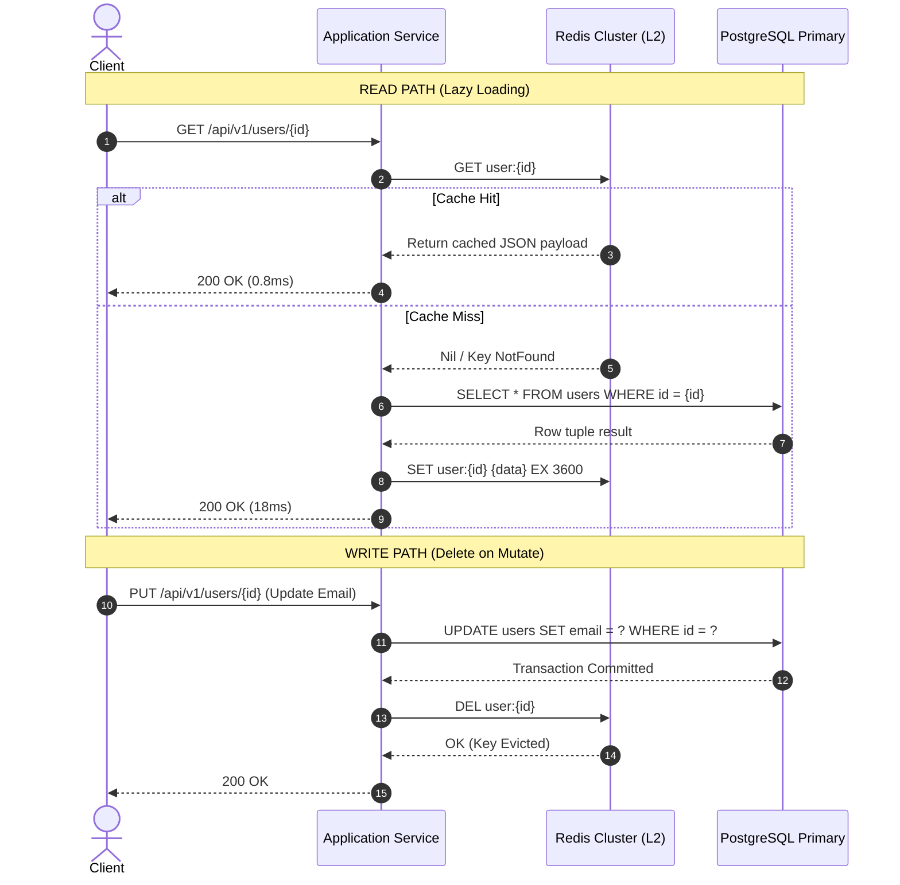
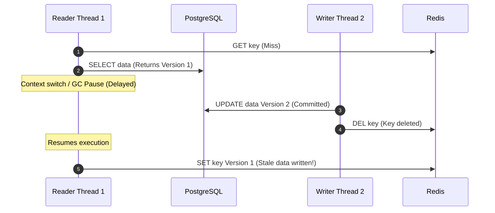
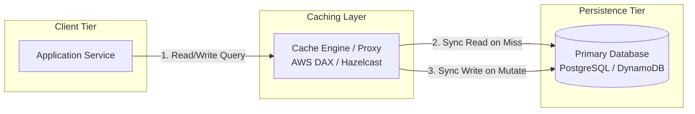
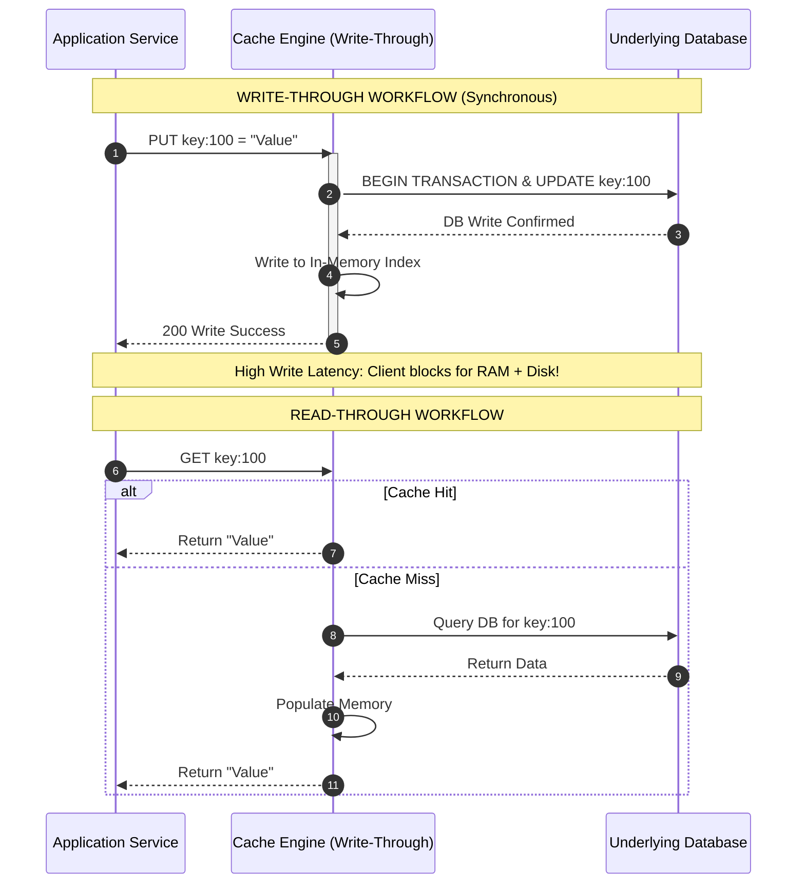
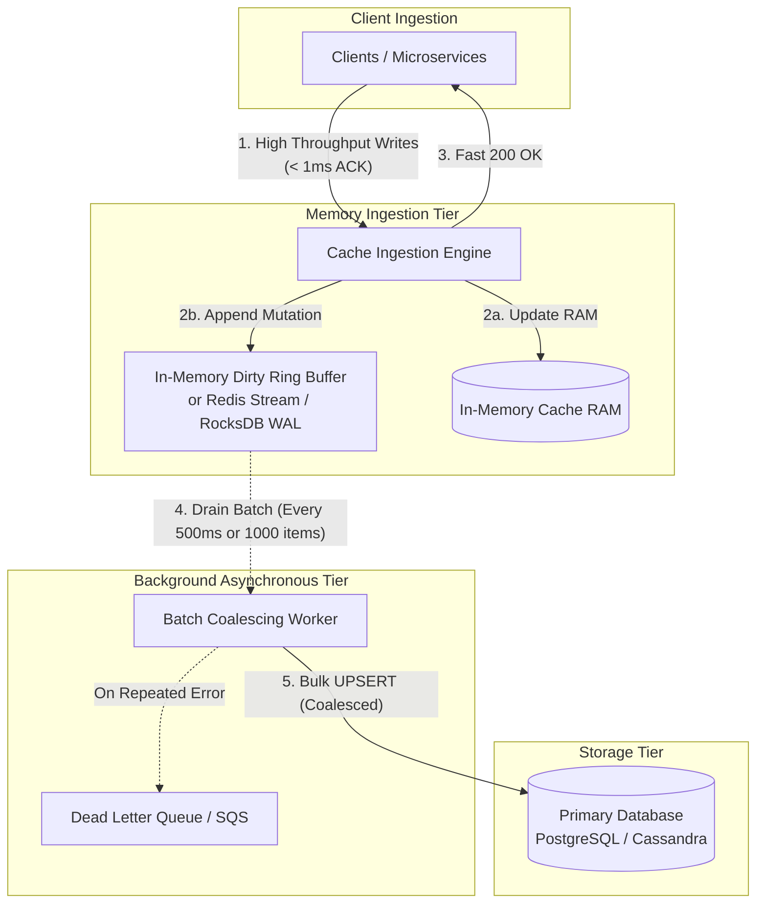
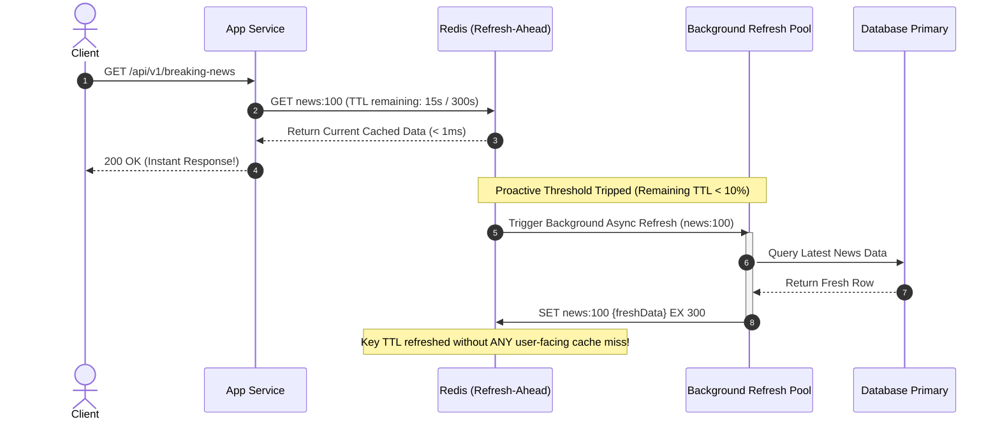
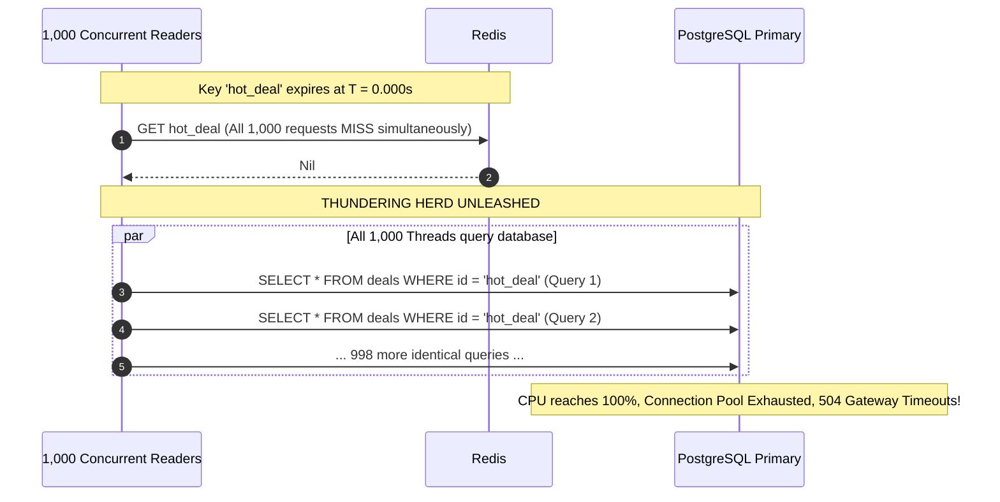
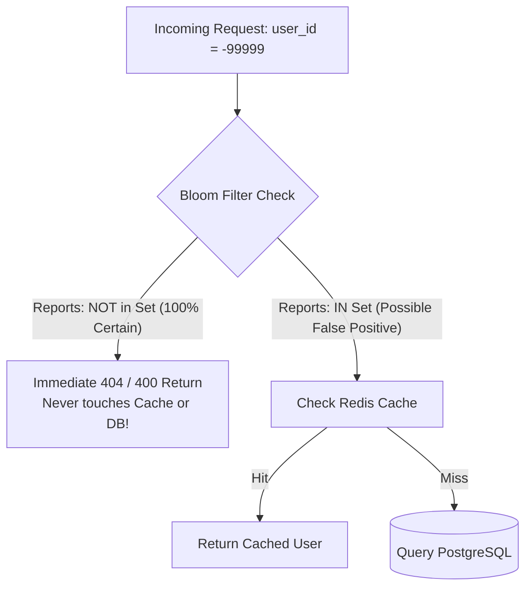
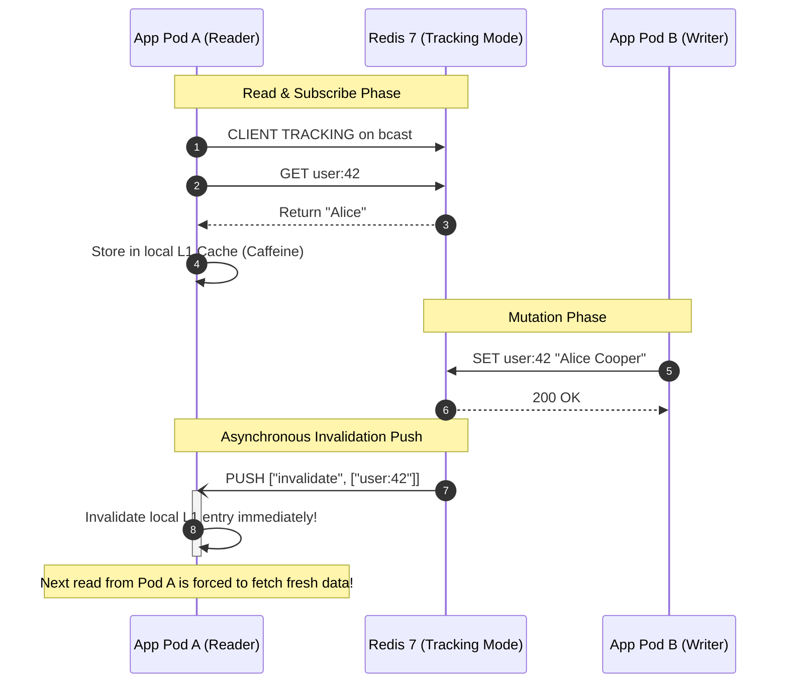

# Caching Strategies Deep Dive: Stampedes, Invalidation, Consistency & Multi-Tier Architecture

## 1. Executive Summary & Real-Life Production Scenarios

In high-scale distributed systems, caching is the single most potent architectural lever for decoupling read throughput from database capacity. While relational and document databases rely on disk-backed storage engines, B-Trees, Write-Ahead Logs (WAL), and ACID locking mechanisms, distributed in-memory caches operate directly in RAM, executing queries in sub-millisecond latencies.

However, caching introduces distributed state, which immediately triggers the classic computer science dilemma articulated by Phil Karlton:
> *"There are only two hard things in Computer Science: cache invalidation and naming things."*

```
                             THE SCALE DECOUPLING PROBLEM
                             
   [10,000,000 Read Requests / Sec]
          │             │             │
          ▼             ▼             ▼
   ┌─────────────────────────────────────────┐
   │       Distributed Cache Fleet (RAM)     │ ──► Latency: 200µs - 1ms
   │       (Redis Cluster / Memcached)       │     Hit Ratio: 99.5%
   └────────────────────┬────────────────────┘
                        │
                        │ 0.5% Cache Misses (50,000 RPS)
                        ▼
   ┌─────────────────────────────────────────┐
   │       Primary Database Fleet (Disk)     │ ──► Max Safe Capacity: 60,000 QPS
   │       (PostgreSQL / MySQL / Aurora)     │     Latency: 15ms - 80ms
   └─────────────────────────────────────────┘
                        ▲
                        │ FATAL BREACH:
                        │ If the Cache Hit Ratio dips from 99.5% to 98.0%,
                        │ database traffic quadruples from 50,000 to 200,000 QPS!
                        │ Result: Disk saturation, connection pool exhaustion,
                        │ cascading database failure, and global platform outage.
```

---

### Real-World Production Catastrophes

#### 1. Facebook (Meta) Memcached & Tao Outage
- **The Event:** A routine network partition and configuration push desynchronized Facebook's distributed caching cluster serving their social graph.
- **Failure Mechanism:** When an entire Memcached rack became unreachable, application servers flooded the MySQL master fleet with millions of queries per second for user graph connections. Because client threads did not coordinate misses, thousands of threads executed identical complex SQL joins simultaneously (**Thundering Herd / Stampede**). Database connection pools were starved in under 3 seconds, leading to cascading timeouts across the web tier.
- **The Architectural Remedy:** Facebook engineered two landmark solutions:
  1. **Distributed Leases:** Cache nodes issue unique 64-bit lease tokens on a miss. Only the token holder is permitted to query the database and write back to cache; all other concurrent requests wait or consume stale data.
  2. **Gutter Pools:** A dedicated, isolated pool of backup cache servers (10% capacity) that absorb traffic solely when primary cache servers fail, aggressively shedding load and bypassing the database entirely.

#### 2. Amazon Prime Day Outage (July 2018)
- **The Event:** Amazon's homepage and product detail pages crashed for hours during the launch of Prime Day, resulting in an estimated revenue loss exceeding $90 million.
- **Failure Mechanism:** Amazon's internal key-value cache layer (**Sable**) degraded under the sudden 5x traffic surge. The caching layer suffered from an internal cache avalanche: thousands of popular promotional items shared identical cache expiration intervals. When these keys expired simultaneously, traffic bypassed Sable and hit the primary datastores, exhausting internal RPC thread pools and causing the infamous "Dogs of Amazon" 503 error screens.

#### 3. Twitter / X Timeline Desynchronization
- **The Event:** During major breaking news and sporting events, users experienced "ghost tweets" and out-of-order timeline feeds where deleted posts reappeared and retweets vanished intermittently.
- **Failure Mechanism:** Twitter's write path used an asynchronous message queue to fan out timeline cache invalidations across hundreds of Redis instances. Under peak network ingestion, message queue lag reached 12 seconds. Concurrent HTTP read requests queried out-of-date cache nodes, repopulated their local thread caches with stale snapshot data, and permanently masked recent deletes until the TTL expired.

---

## 2. Core Caching Mechanics, Hardware Internals & Mathematical Foundations

### 2.1 The Hardware Memory Hierarchy & Latency Numbers

To design resilient caching topologies, you must ground your architectural decisions in the physical realities of modern hardware:

```
┌────────────────────────────────────────────────────────────────────────┐
│                        PHYSICAL LATENCY SPECTRUM                       │
└────────────────────────────────────────────────────────────────────────┘

 L1 CPU Cache Reference:        0.5 - 1 ns  ██
 L2 CPU Cache Reference:        3 - 4 ns    ████
 L3 CPU Cache Reference:        10 - 20 ns  ████████
 Main Memory (RAM) Access:      50 - 100 ns ████████████████
 NVMe SSD Read:                 10 - 50 µs  (100x slower than RAM)
 Redis (In-Memory, Local AZ):   0.2 - 1 ms  (10,000x slower than RAM)
 PostgreSQL Disk Read (SSD):    5 - 25 ms   (50,000x slower than RAM)
 Cross-Region Network Roundtrip: 70 - 150 ms (1,000,000x slower than RAM)
```

| Storage Medium / Tier | Typical Latency | Throughput per Node | Cost / GB | Volatility |
| :--- | :--- | :--- | :--- | :--- |
| **In-Process JVM/Go RAM (L1)** | $10 - 50 \text{ ns}$ | $> 50,000,000 \text{ ops/sec}$ | High (Shares App RAM) | Volatile (Process crash wipes state) |
| **Distributed Redis / Memcached (L2)** | $200\mu\text{s} - 1.5 \text{ ms}$ | $100,000 - 1,000,000 \text{ ops/sec}$ | $\$5 - \$15$ / GB | Semi-Persistent (RDB/AOF snapshots) |
| **Edge CDN (L3)** | $15 - 45 \text{ ms}$ | Millions of edge requests | Low (Bandwidth tiered) | Ephemeral / Edge LRU |
| **Disk-Backed Relational DB (Aurora/Postgres)** | $5 - 80 \text{ ms}$ | $5,000 - 40,000 \text{ QPS}$ | $\$0.10 - \$0.30$ / GB | Non-Volatile (ACID WAL on NVMe) |

---

### 2.2 Hit Ratio Mathematics & Amdahl's Law of Caching

The average latency of an application tier fetching data is governed by the weighted sum of its cache hit and miss latencies:

$$T_{effective} = (H \cdot T_{cache}) + ((1 - H) \cdot T_{origin})$$

Where:
- $H$ is the **Cache Hit Ratio** ($0.0 \le H \le 1.0$).
- $T_{cache}$ is the cache response time (e.g., $0.5\text{ ms}$).
- $T_{origin}$ is the origin database response time including network, query execution, and serialization (e.g., $25\text{ ms}$).

#### The Non-Linear Origin Load Explosion
Engineers often assume that improving the cache hit ratio from $98\%$ to $99\%$ yields an insignificant $1\%$ performance improvement. In reality, the load on the origin database is proportional to the **miss ratio** $(1 - H)$:

$$\text{Origin Query Volume} = Q_{total} \times (1 - H)$$

```
  Hit Ratio (H)   Miss Ratio (1 - H)   Origin DB Load (at 1M RPS)   Impact on Database
  ─────────────   ──────────────────   ──────────────────────────   ──────────────────
  99.9%           0.1%                 1,000 QPS                    Idling
  99.0%           1.0%                 10,000 QPS                   Comfortable baseline
  98.0%           2.0%                 20,000 QPS                   2x DB Load spike!
  95.0%           5.0%                 50,000 QPS                   5x DB Load spike! (Near DB limit)
  90.0%           10.0%                100,000 QPS                  10x DB Load (CATASTROPHIC COLLAPSE)
```

> [!WARNING]
> A tiny drop of $4\%$ in cache hit ratio (from $99\%$ to $95\%$) produces a **$500\%$ load surge** on your database fleet. High-scale architectures must be engineered to ensure that cache hit degradation does not cause systemic collapse.

---

### 2.3 Eviction Policies: Algorithms, Data Structures & Complexity

When cache memory fills to capacity, an eviction policy decides which keys must be discarded to make room for incoming writes.

```
┌────────────────────────────────────────────────────────────────────────┐
│                        CACHE EVICTION TAXONOMY                         │
└────────────────────────────────────────────────────────────────────────┘

 1. LRU (Least Recently Used):
    Discards the item that has not been accessed for the longest time.
    Data Structure: Hash Map + Doubly Linked List.
    Complexity: O(1) read, O(1) write.
    Weakness: Vulnerable to "Scan Pollution" (a single bulk query evicts the entire working set).

 2. LFU (Least Frequently Used):
    Tracks access frequency counters. Discards items with the lowest count.
    Data Structure: Hash Map + Doubly Linked Lists of Frequency Buckets.
    Complexity: O(1) read, O(1) write.
    Weakness: Historical frequency bias (historical items remain trapped in cache forever).

 3. W-TinyLFU (Window TinyLFU - Caffeine Cache Engine):
    Combines an LRU "Window" (Eden space) with a Segmented LRU and a 4-bit Count-Min Sketch.
    New items enter the Window. On eviction from the Window, they compete against the
    victim of the Main cache using frequency estimates from the Count-Min Sketch.
    Complexity: O(1) operations with near-optimal hit ratio and tiny memory footprint (8 bits/key).
```

#### Redis Approximated LRU/LFU Internals
Standard LRU requires two 64-bit pointers (16 bytes) per entry for a doubly linked list, plus node overhead—consuming megabytes of memory solely for eviction pointers.
Redis eliminates this overhead using an **Approximated LRU Algorithm**:
1. Every Redis object header stores a 24-bit field `lru`: the timestamp of the last access (reduced to 1-second resolution).
2. When memory exceeds `maxmemory`, Redis does **not** scan all keys. Instead, it randomly samples $N$ keys (default $N=5$, configurable via `maxmemory-samples`).
3. It evaluates the sampled keys in an in-memory 16-entry eviction pool (ordered by ascending idle time) and evicts the key with the highest idle time.
4. At $N=10$, Redis's approximated LRU is virtually indistinguishable from mathematical true LRU, while saving hundreds of megabytes of RAM.

---

## 3. Comprehensive Deep Dive into Architectural Caching Patterns

We analyze the four foundational caching patterns, dissecting their **High-Level Design (HLD)** and **Low-Level Design (LLD)**.

---

## Pattern 1: Cache-Aside (Lazy Loading / Application-Managed)

Cache-Aside is the industry standard for read-heavy transactional architectures. The application code explicitly coordinates communication between the cache and the primary database. The cache has no awareness of the underlying persistence layer.

### High-Level Design (HLD)



#### When to Use Cache-Aside:
- General-purpose read-heavy web applications.
- Applications where read patterns are unpredictable or bursty (data is loaded on-demand).
- Systems that can tolerate eventual consistency during key invalidation.

---

### Low-Level Design (LLD)

#### 1. Why You Must DELETE Rather Than UPDATE the Cache
A common junior mistake is updating the cache with the new value during a write (`SET key newValue`) instead of invalidating it (`DEL key`). Under concurrent requests, this introduces a permanent data corruption race condition:

```
  TIME    CLIENT A (Write: Name="Bob")          CLIENT B (Write: Name="Charlie")      REDIS STATE
   │
   ├─ T1 ─► UPDATE users SET name = 'Bob'        │                                     (DB: name='Bob')
   │
   ├─ T2 ─►                                      UPDATE users SET name = 'Charlie'     (DB: name='Charlie')
   │
   ├─ T3 ─►                                      SET user:1 '{"name": "Charlie"}'      user:1 = 'Charlie'
   │
   ├─ T4 ─► SET user:1 '{"name": "Bob"}'                                               user:1 = 'Bob' (CORRUPTED!)
   ▼
```
- **The Consequence:** Because network latencies between the application instances and the cache cluster fluctuate, Client A's cache write executed *after* Client B's cache write, even though Client B committed to the database *last*.
- The database now contains `Charlie`, but the cache permanently contains `Bob`.
- **The Golden Rule:** Always execute `DEL key` on write. Invalidations are idempotent and force the next reader to fetch the canonical database truth.

---

#### 2. The Classic Read-Write Race Condition in Cache-Aside
Even with `DEL`, an ultra-rare race condition theoretically exists:
1. Thread 1 experiences a cache miss, queries DB, receives `value_old`.
2. Thread 2 updates DB to `value_new`, executes `DEL key`.
3. Thread 1 (delayed by a garbage collection pause or network blip) finally executes `SET key value_old`.



**Why this is rare in practice:** Step 2 and Step 3 require a database write and cache deletion to complete *entirely within* the window between Thread 1's read and Thread 1's write. Since database writes are 10x-50x slower than database reads, this window is nanoseconds wide.
**Production Defense:**
- Use short TTLs (e.g., 300 seconds) so stale values self-heal.
- Implement **Delayed Double Deletion**: The writer deletes the cache key, commits the database write, waits $500\text{ms}$ (via an asynchronous worker queue), and deletes the cache key a second time to eradicate any in-flight reads that wrote stale data.

---

#### 3. Production-Grade Cache-Aside Implementation in Go

The following implementation features circuit breaking, non-blocking asynchronous cache population, and context-aware timeouts:

```go
package cache

import (
	"context"
	"database/sql"
	"encoding/json"
	"errors"
	"fmt"
	"time"

	"github.com/redis/go-redis/v9"
	"github.com/sony/gobreaker"
)

type User struct {
	ID        int64     `json:"id"`
	Username  string    `json:"username"`
	Email     string    `json:"email"`
	UpdatedAt time.Time `json:"updated_at"`
}

type UserRepository struct {
	db      *sql.DB
	rdb     *redis.Client
	cb      *gobreaker.CircuitBreaker
	ttl     time.Duration
}

func NewUserRepository(db *sql.DB, rdb *redis.Client) *UserRepository {
	// Circuit breaker to protect Redis from cascading failures
	st := gobreaker.Settings{
		Name:        "RedisCacheBreaker",
		MaxRequests: 5,
		Interval:    10 * time.Second,
		Timeout:     5 * time.Second,
		ReadyToTrip: func(counts gobreaker.Counts) bool {
			failureRatio := float64(counts.TotalFailures) / float64(counts.Requests)
			return counts.Requests >= 20 && failureRatio >= 0.6
		},
	}

	return &UserRepository{
		db:  db,
		rdb: rdb,
		cb:  gobreaker.NewCircuitBreaker(st),
		ttl: 1 * time.Hour,
	}
}

// GetUserByID implements robust Cache-Aside with circuit-breaker protection
func (r *UserRepository) GetUserByID(ctx context.Context, userID int64) (*User, error) {
	cacheKey := fmt.Sprintf("user:%d", userID)

	// Step 1: Attempt to read from Cache (wrapped in Circuit Breaker)
	cacheVal, err := r.cb.Execute(func() (interface{}, error) {
		ctxTimeout, cancel := context.WithTimeout(ctx, 50*time.Millisecond)
		defer cancel()
		return r.rdb.Get(ctxTimeout, cacheKey).Result()
	})

	if err == nil {
		if rawStr, ok := cacheVal.(string); ok {
			var u User
			if jsonErr := json.Unmarshal([]byte(rawStr), &u); jsonErr == nil {
				return &u, nil // Cache Hit!
			}
		}
	} else if !errors.Is(err, redis.Nil) {
		// Log warning: Cache failure or circuit breaker open; fall through to DB
		// High-scale rule: Never fail the user request if cache fails!
	}

	// Step 2: Cache Miss or Cache Unavailable -> Query Database
	user, dbErr := r.fetchUserFromDB(ctx, userID)
	if dbErr != nil {
		return nil, dbErr
	}

	// Step 3: Populate Cache Asynchronously to avoid blocking client return path
	go func(u *User) {
		payload, err := json.Marshal(u)
		if err != nil {
			return
		}
		// Write back to Redis with a 200ms background timeout
		bgCtx, cancel := context.WithTimeout(context.Background(), 200*time.Millisecond)
		defer cancel()

		_ = r.rdb.Set(bgCtx, cacheKey, payload, r.ttl).Err()
	}(user)

	return user, nil
}

// UpdateUserEmail writes to primary DB and evicts cache key
func (r *UserRepository) UpdateUserEmail(ctx context.Context, userID int64, newEmail string) error {
	cacheKey := fmt.Sprintf("user:%d", userID)

	// Step 1: Execute transactional database update
	query := `UPDATE users SET email = $1, updated_at = NOW() WHERE id = $2`
	result, err := r.db.ExecContext(ctx, query, newEmail, userID)
	if err != nil {
		return fmt.Errorf("failed to update db: %w", err)
	}

	rows, _ := result.RowsAffected()
	if rows == 0 {
		return errors.New("user not found")
	}

	// Step 2: Invalidate Cache Key immediately
	delCtx, cancel := context.WithTimeout(context.Background(), 100*time.Millisecond)
	defer cancel()

	if delErr := r.rdb.Del(delCtx, cacheKey).Err(); delErr != nil {
		// Emit metric for alert: Invalidation failure risks temporary stale reads
		return fmt.Errorf("db updated, but cache invalidation failed: %w", delErr)
	}

	return nil
}

func (r *UserRepository) fetchUserFromDB(ctx context.Context, id int64) (*User, error) {
	query := `SELECT id, username, email, updated_at FROM users WHERE id = $1`
	row := r.db.QueryRowContext(ctx, query, id)

	var u User
	if err := row.Scan(&u.ID, &u.Username, &u.Email, &u.UpdatedAt); err != nil {
		return nil, err
	}
	return &u, nil
}
```

---

## Pattern 2: Read-Through & Write-Through (Engine / Middleware Managed)

In Read-Through and Write-Through architectures, the application treats the caching layer as its **Single Source of Truth (SSOT)**. The application never directly communicates with the database; instead, the cache engine or caching proxy acts as an intermediary, transparently loading from and writing to the backing datastore.

### High-Level Design (HLD)



#### Detailed Interaction Workflows



#### Concrete Production Implementations:
- **AWS DynamoDB Accelerator (DAX):** A fully managed, in-memory cache for DynamoDB. Microservices make standard DynamoDB SDK calls directly against the DAX endpoint. DAX handles read-through and write-through caching automatically.
- **Enterprise In-Memory Data Grids (IMDG):** Hazelcast, Apache Ignite, Oracle Coherence.

---

### Low-Level Design (LLD)

#### The Atomicity Dilemma in Write-Through
In Write-Through, the cache must orchestrate writes across two distinct physical storage mediums: volatile RAM and durable disk.
What happens if the cache memory updates, but the database write fails due to a constraint violation or network partition?

```
┌────────────────────────────────────────────────────────────────────────┐
│                  WRITE-THROUGH ATOMICITY MATRIX                        │
└────────────────────────────────────────────────────────────────────────┘

 Scenario A: Cache First, DB Second
 [App] ──► 1. Write RAM [Cache] (Succeeds) ──► 2. Write Disk [DB] (FAILS!)
 Result: Memory is corrupted with uncommitted data. Cache returns "phantom"
 data that does not exist in the database.

 Scenario B: DB First, Cache Second (STANDARD PROTOCOL)
 [App] ──► 1. Write Disk [DB] (Succeeds) ──► 2. Write RAM [Cache] (FAILS!)
 Result: Database is consistent, but cache is missing or stale.
 Mitigation: Cache engine rolls back or evicts the key, forcing next read to reload.
```

#### Benchmark Comparison: Cache-Aside vs. Write-Through

| Dimension | Cache-Aside | Write-Through |
| :--- | :--- | :--- |
| **Read Latency (Hit)** | $0.2 - 1.0\text{ ms}$ | $0.2 - 1.0\text{ ms}$ |
| **Read Latency (Miss)** | High (Application round-trip overhead) | Lower (Engine internal query execution) |
| **Write Latency** | Low (Single DB write + async DEL) | **High** (Blocks on RAM write + DB disk sync) |
| **Data Consistency** | Eventual (Window of stale data possible) | **Strong** (Cache and DB always in lock-step) |
| **Code Complexity** | High (Every service handles misses/deletes) | Low (Simplified application code) |
| **Cache Churn** | Low (Only requested data is cached) | High (Every write is cached, even if never read) |

---

## Pattern 3: Write-Behind (Write-Back / Asynchronous Persistence)

In a Write-Behind architecture, the application writes directly to in-memory cache at blazing speed. The cache acknowledges the write **immediately** (sub-millisecond latency). An asynchronous background process or streaming worker batches the accumulated writes and flushes them to the persistent database periodically or when a buffer threshold is reached.

### High-Level Design (HLD)



#### Real-World Use Cases:
- **Massive Gaming Leaderboards:** Millions of players updating scores every second.
- **IoT Sensor Telemetry:** Thousands of connected cars emitting GPS coordinates every 100ms.
- **Ad Click Tracking & View Counters:** Social media platforms aggregating billions of post impressions before flushing to analytics warehouses.

---

### Low-Level Design (LLD)

#### 1. The Write Coalescing (Collapsing) Superpower
The primary computational advantage of Write-Behind is **Write Coalescing**. If a single record is mutated 10,000 times within a 2-second window (e.g., a viral video view counter), Write-Behind collapses all 10,000 mutations into a **single SQL UPDATE**:

```sql
-- Without Coalescing: 10,000 separate disk-syncing transactions
UPDATE video_metrics SET views = views + 1 WHERE video_id = 999; -- x 10,000 times!

-- With Write-Behind Coalescing: Exactly 1 single bulk write to disk
UPDATE video_metrics SET views = views + 10000 WHERE video_id = 999;
```
This reduces primary database I/O by up to **99.9%**.

---

#### 2. The Catastrophic Threat Model: Node Crashes & Data Loss
If the cache node crashes before the dirty buffer flushes to the database, all unpersisted writes are permanently destroyed.
**Enterprise Defense Strategies:**
1. **Durable Local Write-Ahead Log (WAL):** The write buffer is mirrored to an append-only file on NVMe SSD with `fsync` or backed by a local embedded RocksDB instance.
2. **Synchronous Master-Replica Replication:** In Redis, writes are mirrored to replica nodes via in-memory replication streams before acknowledging the caller (e.g., using Redis `WAIT 1 100`).
3. **Kafka / Distributed Log Buffer:** Instead of volatile RAM, mutations are published to an Apache Kafka partitioned topic. The memory cache reads from the topic to serve reads, while a separate consumer flushes batched records to the database.

---

#### 3. Complete Production Implementation: Write-Behind Flusher in Go

```go
package writebehind

import (
	"context"
	"database/sql"
	"fmt"
	"sync"
	"time"
)

type CounterUpdate struct {
	ResourceID string
	Delta      int64
	Timestamp  time.Time
}

type WriteBehindFlusher struct {
	db            *sql.DB
	bufferLock    sync.Mutex
	dirtyMap      map[string]int64
	flushInterval time.Duration
	maxBatchSize  int
	stopChan      chan struct{}
}

func NewWriteBehindFlusher(db *sql.DB, interval time.Duration, maxBatch int) *WriteBehindFlusher {
	w := &WriteBehindFlusher{
		db:            db,
		dirtyMap:      make(map[string]int64),
		flushInterval: interval,
		maxBatchSize:  maxBatch,
		stopChan:      make(chan struct{}),
	}
	go w.backgroundFlushWorker()
	return w
}

// RecordIncrement updates the in-memory state in microseconds
func (w *WriteBehindFlusher) RecordIncrement(resourceID string, delta int64) {
	w.bufferLock.Lock()
	defer w.bufferLock.Unlock()

	// In-memory write coalescing
	w.dirtyMap[resourceID] += delta

	// If dirty map exceeds batch threshold, trigger early flush
	if len(w.dirtyMap) >= w.maxBatchSize {
		go w.Flush()
	}
}

// Flush extracts accumulated mutations and writes them to PostgreSQL in one batch
func (w *WriteBehindFlusher) Flush() {
	w.bufferLock.Lock()
	if len(w.dirtyMap) == 0 {
		w.bufferLock.Unlock()
		return
	}

	// Swap dirty map atomically to unblock incoming client writes immediately
	batch := w.dirtyMap
	w.dirtyMap = make(map[string]int64)
	w.bufferLock.Unlock()

	// Execute bulk database persistence
	if err := w.persistBatch(batch); err != nil {
		fmt.Printf("ERROR: Database write-behind flush failed: %v\n", err)
		// Re-queue failed items back into dirty map to avoid data loss
		w.bufferLock.Lock()
		for k, v := range batch {
			w.dirtyMap[k] += v
		}
		w.bufferLock.Unlock()
	}
}

func (w *WriteBehindFlusher) persistBatch(batch map[string]int64) error {
	ctx, cancel := context.WithTimeout(context.Background(), 5*time.Second)
	defer cancel()

	tx, err := w.db.BeginTx(ctx, nil)
	if err != nil {
		return err
	}
	defer tx.Rollback()

	stmt, err := tx.PrepareContext(ctx, `
		INSERT INTO resource_counters (resource_id, count, updated_at)
		VALUES ($1, $2, NOW())
		ON CONFLICT (resource_id)
		DO UPDATE SET count = resource_counters.count + EXCLUDED.count, updated_at = NOW()
	`)
	if err != nil {
		return err
	}
	defer stmt.Close()

	for resourceID, delta := range batch {
		if _, execErr := stmt.ExecContext(ctx, resourceID, delta); execErr != nil {
			return execErr
		}
	}

	return tx.Commit()
}

func (w *WriteBehindFlusher) backgroundFlushWorker() {
	ticker := time.NewTicker(w.flushInterval)
	defer ticker.Stop()

	for {
		select {
		case <-ticker.C:
			w.Flush()
		case <-w.stopChan:
			w.Flush() // Drain final buffer on graceful shutdown
			return
		}
	}
}

func (w *WriteBehindFlusher) Stop() {
	close(w.stopChan)
}
```

---

## Pattern 4: Refresh-Ahead (Proactive Asynchronous Reloading)

In Refresh-Ahead, the caching layer monitors key access patterns. If a key is frequently accessed and its remaining Time-To-Live (TTL) drops below a defined threshold (e.g., $10\%$ of TTL remaining), the cache automatically schedules an asynchronous background task to re-query the database and refresh the key *before* it expires.

### High-Level Design (HLD)



#### Advantages:
- Eliminates user-facing cache miss latencies completely for hot items.
- Guarantees that hot keys never experience an in-line cache stampede.

#### Risks:
- Wasted database I/O if the background engine predicts incorrectly and refreshes keys that are never read again.

---

## 4. The Four Critical Cache Catastrophes & Hardened Solutions

Distributed caching layers are susceptible to four catastrophic failure modes that can instantly overwhelm your origin database:

```
┌────────────────────────────────────────────────────────────────────────┐
│                   THE 4 CRITICAL CACHE CATASTROPHES                    │
└────────────────────────────────────────────────────────────────────────┘

 1. Cache Stampede (Thundering Herd):
    One single hot key expires. Thousands of concurrent requests experience
    a miss simultaneously and hammer the database with the exact same query.

 2. Cache Avalanche:
    Thousands of keys expire at the exact same second (synchronized TTLs)
    or an entire cache shard crashes. Global DB load spikes to 100%.

 3. Cache Penetration:
    Malicious or non-existent keys (e.g. ID = -99999) bypass the cache entirely
    because the database has no row to store in cache. 100% of requests hit DB.

 4. Cache Pollution:
    A batch job or table scan reads 1,000,000 cold records into cache once,
    evicting the entire active working set of hot keys from memory.
```

---

### Catastrophe 1: Cache Stampede (Thundering Herd) Deep Dive

When a key with $50,000\text{ RPS}$ expires, in the $20\text{ms}$ required for the database to compute the query and write the result back to cache, $1,000$ distinct concurrent threads fire identical expensive queries at the database.



---

#### Solution 1A: SingleFlight Pattern (Intra-Process Request Collapsing)
In Go and Node.js microservices, the `singleflight` primitive suppresses duplicate function calls. If 1,000 goroutines on the same server request the same key simultaneously, only **one** goroutine executes the database query; the remaining 999 wait and share the result.

```go
package stampede

import (
	"context"
	"fmt"
	"golang.org/x/sync/singleflight"
	"time"
)

type ProductService struct {
	sfGroup singleflight.Group
}

func (s *ProductService) GetProductData(ctx context.Context, productID string) (string, error) {
	// Attempt Cache Read first...
	data, found := readFromRedis(productID)
	if found {
		return data, nil
	}

	// Cache Miss! Use SingleFlight to collapse duplicate in-flight DB queries
	res, err, shared := s.sfGroup.Do(productID, func() (interface{}, error) {
		// Exactly ONE thread executes this database fetch per application pod
		return fetchProductFromDatabase(productID)
	})

	if err != nil {
		return "", err
	}

	if shared {
		// Telemetry: Increment counter indicating stampede prevented locally
		fmt.Printf("Stampede prevented! Query result shared for key: %s\n", productID)
	}

	val := res.(string)
	// Write back to Redis so subsequent calls don't hit SingleFlight
	writeToRedis(productID, val, 300*time.Second)

	return val, nil
}

func readFromRedis(key string) (string, bool)       { return "", false }
func fetchProductFromDatabase(key string) (string, error) { return "payload", nil }
func writeToRedis(key string, val string, ttl time.Duration) {}
```

---

#### Solution 1B: Distributed Mutex Locking (Inter-Process Locking)
SingleFlight protects against thundering herds *within a single process*. Across a fleet of 500 Kubernetes pods, you need an inter-node distributed lock using Redis `SET key value NX PX`:

```python
import redis
import time
import uuid

r = redis.Redis(host='localhost', port=6379, decode_responses=True)

# Lua script to release lock atomically only if token matches
RELEASE_LOCK_LUA = """
if redis.call("get", KEYS[1]) == ARGV[1] then
    return redis.call("del", KEYS[1])
else
    return 0
end
"""

def get_product_with_distributed_mutex(product_id: str, ttl_seconds: int = 300) -> str:
    cache_key = f"product:{product_id}"
    val = r.get(cache_key)
    if val:
        return val

    # Cache Miss! Compete for distributed lock
    lock_key = f"lock:{cache_key}"
    lock_token = str(uuid.uuid4())
    lock_acquired = r.set(lock_key, lock_token, nx=True, px=5000) # 5s auto-expiry

    if lock_acquired:
        try:
            # Exactly ONE worker across the entire global fleet queries the DB
            data = query_database_for_product(product_id)
            r.set(cache_key, data, ex=ttl_seconds)
            return data
        finally:
            # Atomically release lock using Lua
            r.eval(RELEASE_LOCK_LUA, 1, lock_key, lock_token)
    else:
        # All other workers sleep and retry cache read
        time.sleep(0.05) # 50ms backoff
        return get_product_with_distributed_mutex(product_id, ttl_seconds)

def query_database_for_product(id: str) -> str:
    return '{"id": 42, "name": "4K OLED TV"}'
```

---

#### Solution 1C: Probabilistic Early Expiration (The XFetch Algorithm)
Engineered by Vattani et al. in their research paper *"Optimal Probabilistic Cache Stampede Prevention"*, the **XFetch** algorithm completely eliminates distributed locks and mutex contention.
Instead of refreshing at expiration, readers evaluate a probabilistic function on every read:

$$\Delta - \beta \cdot \ln(\text{rand}()) > \text{TTL}_{\text{remaining}}$$

Where:
- $\Delta$ is the delta computation time (how many seconds the database takes to recompute the value).
- $\beta > 0$ is an aggressiveness constant (typically set to $1.0$).
- $\text{rand}() \in (0, 1]$ is a uniform random floating-point number.
- $\text{TTL}_{\text{remaining}} = \text{ExpiryTime} - \text{CurrentTime}$.

```
┌────────────────────────────────────────────────────────────────────────┐
│                     XFETCH PROBABILITY PROFILE                         │
└────────────────────────────────────────────────────────────────────────┘

 Probability of
 Background Refresh
     100% │                                                ████████
          │                                           ███████
      50% │                                    ████████
          │                              ███████
      10% │                    ███████████
       0% └────────────────────┴───────────────────────────┴───────────►
          Time: 0s            270s                        300s (Expiry)
                               │
                               ▲ As TTL approaches 0, probability of a reader
                                 proactively refreshing the key approaches 100%.
```

```python
import math
import random
import time
import json
import redis

r = redis.Redis(host='localhost', port=6379, decode_responses=True)

def xfetch_read(key: str, beta: float = 1.0) -> str:
    raw = r.get(key)
    if not raw:
        return refresh_and_set(key)

    record = json.loads(raw)
    data = record["data"]
    delta = record["delta"]          # Computation time in seconds
    expiry_time = record["expiry"]  # Unix timestamp

    time_remaining = expiry_time - time.time()

    # Probabilistic condition: As time_remaining drops, probability spikes!
    if (delta * beta * (-math.log(random.random()))) > time_remaining:
        # Asynchronously trigger refresh or execute immediately
        return refresh_and_set(key)

    return data

def refresh_and_set(key: str, ttl: int = 300) -> str:
    start = time.time()
    fresh_data = query_expensive_database(key)
    compute_delta = time.time() - start

    payload = json.dumps({
        "data": fresh_data,
        "delta": compute_delta,
        "expiry": time.time() + ttl
    })

    r.set(key, payload, ex=ttl * 2) # Physical TTL is double logical TTL
    return fresh_data

def query_expensive_database(k: str) -> str:
    time.sleep(0.04) # Simulate 40ms query
    return '{"status": "OK"}'
```

---

### Catastrophe 2: Cache Penetration Deep Dive & Solutions

**The Vulnerability:** An attacker queries high volumes of non-existent keys:
`GET /api/v1/users?id=1298379128371982`
Because the user does not exist in PostgreSQL, the application returns a 404, never writing anything to Redis. Every subsequent request bypasses the cache, hitting the database directly and saturating query execution threads.

#### Solution 2A: Bloom Filters at the Ingestion Gateway
A Bloom Filter is a space-efficient, probabilistic data structure. It can answer:
- *"Is this item definitely NOT in the dataset?"* $\to$ **$100\%$ accuracy (Zero False Negatives)**.
- *"Is this item in the dataset?"* $\to$ **May produce a False Positive**, but never a false negative.



#### Low-Level Bloom Filter Memory Math
For $n = 100,000,000$ records with a false positive probability $p = 0.01$ ($1\%$):
- Optimal bit array size: $m = -\frac{n \ln p}{(\ln 2)^2} \approx 958,505,836 \text{ bits} \approx 114 \text{ MB}$.
- Optimal hash functions: $k = \frac{m}{n} \ln 2 \approx 7 \text{ hashes}$.
- **Result:** You can guard 100 million records against penetration using only **$114\text{ MB}$ of RAM**!

```python
# RedisBloom native command usage via Redis CLI:
# 1. Reserve filter with 0.1% error rate for 10M keys:
# BF.RESERVE user_bloom 0.001 10000000

# 2. Add existing user IDs during registration:
# BF.ADD user_bloom "user:101"

# 3. Check membership on incoming request:
# BF.EXISTS user_bloom "user:-99999" -> Returns 0 (Reject immediately!)
```

#### Solution 2B: Negative Caching (Null Object Pattern)
If the database confirms a record does not exist, store a sentinel value in Redis with a short, aggressive TTL ($30-60\text{ seconds}$):
```python
def get_user_with_negative_caching(user_id: int):
    cache_key = f"user:{user_id}"
    cached = r.get(cache_key)
    
    if cached == "$$NULL_KEY$$":
        return None # Short-circuit! DB has already confirmed this does not exist.
    if cached:
        return json.loads(cached)

    user = db.find_user(user_id)
    if user is None:
        # Cache the NULL object with 60s TTL to absorb attack traffic
        r.set(cache_key, "$$NULL_KEY$$", ex=60)
        return None

    r.set(cache_key, json.dumps(user), ex=3600)
    return user
```

---

### Catastrophe 3: Cache Avalanche Deep Dive & Solutions

**The Vulnerability:** A backend cron job imports $500,000$ product catalogs at midnight, caching every record with `EX 86400` (24 hours).
At exactly 00:00:00 the following night, all $500,000$ keys expire at the exact same microsecond. The next wave of user traffic triggers half a million concurrent database misses, collapsing the database.

#### The Solution: Cryptographic TTL Jitter
Never assign a static TTL to keys written in batches. Inject uniform random jitter:

$$\text{TTL}_{\text{actual}} = \text{TTL}_{\text{base}} \pm \text{Random}(0, \text{JitterWindow})$$

```python
import random

def set_key_with_jitter(key: str, value: str, base_ttl: int = 3600, jitter_percentage: float = 0.15):
    """
    Applies symmetric jitter. For base_ttl=3600 and jitter=0.15,
    actual TTL is evenly distributed between 3060 and 4140 seconds.
    """
    jitter_range = int(base_ttl * jitter_percentage)
    random_jitter = random.randint(-jitter_range, jitter_range)
    final_ttl = base_ttl + random_jitter
    
    r.set(key, value, ex=final_ttl)
```

---

## 5. Cache Invalidation & Consistency Strategies

Cache invalidation is where distributed consistency breaks down. We evaluate the primary architectural strategies for keeping cache and storage in alignment.

```
┌────────────────────────────────────────────────────────────────────────┐
│                   CACHE INVALIDATION TAXONOMY                          │
└────────────────────────────────────────────────────────────────────────┘

 1. Dual-Write Invalidation:
    Application updates DB, then application issues DEL to Redis.
    Risk: Network partition between App and Redis leaves stale cache permanently.

 2. Transactional Change Data Capture (CDC):
    Application writes ONLY to DB. Debezium reads the database Write-Ahead Log
    (WAL/binlog) and streams invalidation events to Kafka -> Invalidation Worker.
    Advantage: 100% guaranteed delivery, completely decoupling application code.

 3. Facebook Leases Protocol:
    Cache nodes return 64-bit lease tokens on misses. Writes invalidate the token.
    Stale in-flight reads are rejected if their lease token has been invalidated.
```

---

### Strategy: CDC-Driven Asynchronous Invalidation Pipeline

```mermaid
flowchart LR
    subgraph Application Tier
        App[Application Services]
    end

    subgraph Database Tier
        DB[(PostgreSQL Primary)]
        WAL[(Write-Ahead Log / Binlog)]
    end

    subgraph Streaming Pipeline
        Debezium[Debezium CDC Connector]
        Kafka{{Kafka Topic: db.cdc.users}}
        Worker[Cache Invalidator Daemon]
    end

    subgraph Cache Fleet
        Redis[(Redis Cluster)]
    end

    App -- "1. UPDATE users SET ... (Committed)" --> DB
    DB -. "2. Appends Commit Record" .-> WAL
    WAL -. "3. Tail Engine" .-> Debezium
    Debezium -- "4. Publish JSON Event" --> Kafka
    Kafka -- "5. Consume Record" --> Worker
    Worker -- "6. DEL user:{id}" --> Redis
```



#### Why CDC is the Gold Standard for Cache Invalidation:
1. **Zero Dual-Write Failure:** If an application pod crashes immediately after updating the database, the update is already recorded in the database's Write-Ahead Log. CDC guarantees that the invalidation event will eventually be produced and processed.
2. **Order Preservation:** Kafka partitions partitioned by resource ID (`user_id`) guarantee that cache invalidations are processed in the strict sequential order that the database committed them.
3. **Decoupled Architecture:** Developers writing backend features never need to clutter business logic with manual Redis eviction calls.

---

## 6. Multi-Tier Distributed Caching Architecture (L1 / L2 / L3)

Enterprise architectures deploy multi-tiered caching across physical boundaries to combine nanosecond in-process latencies with terabyte-scale distributed capacity.

```
┌────────────────────────────────────────────────────────────────────────────────────────────────────────┐
│                                 MULTI-TIER CACHING TOPOLOGY                                             │
└────────────────────────────────────────────────────────────────────────────────────────────────────────┘

   [Global Internet Client / Mobile Device]
                    │
                    ▼ (L3 Tier: Edge CDN - Cloudflare / CloudFront)
                    │  Latency: 15ms - 35ms | Scope: Edge PoPs globally
                    │  Stores: Static assets, full HTTP edge-cached responses, public API payloads
                    ▼
   [API Gateway / Ingress Router]
                    │
                    ▼
   ┌─────────────────────────────────────────────────────────────┐
   │ Kubernetes Application Pod                                  │
   │                                                             │
   │   ┌──────────────────────────────────────────────────────┐  │
   │   │ L1 Cache: In-Process RAM (Go FreeCache / Caffeine)   │  │
   │   │ Latency: 25 - 60 nanoseconds                         │  │
   │   │ Scope: Local to single container OS process          │  │
   │   └──────────────────────────┬───────────────────────────┘  │
   │                              │ (L1 Miss)                    │
   └──────────────────────────────┼──────────────────────────────┘
                                  ▼
   ┌─────────────────────────────────────────────────────────────┐
   │ L2 Tier: Distributed Cache Cluster (Redis 7.x / Memcached)  │
   │ Latency: 300µs - 1.2ms                                      │
   │ Scope: Shared across all 500 Kubernetes Application Pods    │
   └──────────────────────────────┬──────────────────────────────┘
                                  │ (L2 Miss)
                                  ▼
   ┌─────────────────────────────────────────────────────────────┐
   │ Origin Persistence Fleet (Amazon Aurora PostgreSQL Primary) │
   │ Latency: 10ms - 45ms                                        │
   │ Scope: Authoritative Source of Truth                        │
   └─────────────────────────────────────────────────────────────┘
```

---

### The L1/L2 Consistency Dilemma & Redis Client-Side Tracking

While L1 process caching provides nanosecond speeds, it introduces an extreme cache coherence challenge:
If **Pod A** updates a user's record and deletes the key in the L2 Redis cluster, **Pod B's** L1 in-process cache still holds the stale record in its local JVM/Go RAM!

```
┌────────────────────────────────────────────────────────────────────────┐
│                     THE L1 STALE DESYNC PROBLEM                        │
└────────────────────────────────────────────────────────────────────────┘

 [Pod A] ──► UPDATE user:100 ──► Invalidates L2 (Redis)
                                        │
 [Pod B] ──► Reads local L1 (Caffeine) ─┘ ◄── DOES NOT KNOW L2 CHANGED!
             Result: Pod B serves stale data for the remaining local TTL!
```

#### The Modern Solution: Redis 6+ Client-Side Tracking (RESP3 Invalidation Bus)
Redis 6 introduced native **Client-Side Caching Tracking**. Redis tracks which keys each client connection has read. When any client modifies a key, Redis pushes an asynchronous invalidation message (`invalidate`) over the connection to all clients caching that key!



---

## 7. Real-World Case Studies

### 1. Meta (Facebook) Tao: Scaling Graph Caching
Facebook's social graph comprises billions of nodes (users, comments, pages) and trillions of edges (friendships, likes). Relational databases could not scale to this topology.
- **The Solution:** Facebook created **Tao**, a geographically distributed caching layer for the social graph.
- **Master/Slave Consistency:** Tao divides the world into regions. One region contains the master database, while other regions host read-only Tao follower caches.
- **Write-Through Followers:** When a user in Europe "likes" a photo, the European Tao follower proxies the write directly to the master database in the US. Upon committing, the master database issues invalidation messages along an inverse tree structure back to all Tao follower caches worldwide.

### 2. Netflix EVCache: Multi-Region Resilience
Netflix streams billions of hours of video across AWS regions (us-east-1, us-west-2, eu-west-1).
- **The Architecture:** Netflix engineered **EVCache** (Ephemeral Volatile Cache), a wrapper around Memcached integrated with Spinnaker and Eureka.
- **Cross-Region Replication:** When a user pauses a movie in California, EVCache writes to the local Memcached cluster and asynchronously replicates the mutation via Kafka to the European and East Coast clusters within $400\text{ms}$.
- **Pre-Warming on Deployment:** When Netflix deploys a new version of their recommendation engine, they spin up a fresh EVCache cluster and "warm" it by replaying production read traffic snapshots before cutting over traffic, preventing cache stampedes during deployments.

---

## 8. Quantitative Benchmarks & Operational Cheat Sheet

### Latency, Throughput & Cost Comparison Matrix

| Caching Approach / Tier | P50 Latency | P99 Latency | Max Throughput / Node | Primary Risk | Mitigation |
| :--- | :--- | :--- | :--- | :--- | :--- |
| **L1 Process Cache (Go/JVM)** | $20 \text{ ns}$ | $100 \text{ ns}$ | $> 50,000,000 \text{ RPS}$ | Memory bloat & Pod desync | Redis RESP3 Tracking / short TTL |
| **L2 Distributed Cache (Redis)** | $400 \mu\text{s}$ | $2.5 \text{ ms}$ | $100,000 - 800,000 \text{ RPS}$ | Network partitions & Stampedes | Mutex locks, XFetch, Clustering |
| **Write-Through Caching** | $25 \text{ ms}$ | $80 \text{ ms}$ | $5,000 - 20,000 \text{ RPS}$ | High write latency | Asynchronous Write-Behind |
| **Write-Behind Caching** | $0.8 \text{ ms}$ | $2.0 \text{ ms}$ | $500,000 \text{ RPS}$ | Node crash data loss | Durable WAL / Kafka message queue |
| **Refresh-Ahead Caching** | $0.3 \text{ ms}$ | $1.0 \text{ ms}$ | $300,000 \text{ RPS}$ | Wasted DB compute | Probabilistic prediction tuning |

---

### Senior Staff System Design Interview Cheat Sheet

When designing caching systems in high-scale technical interviews:

1. **Default Pattern:** Always lead with **Cache-Aside** paired with `DEL` on write (not `SET`). Explain that invalidation prevents concurrent write race conditions.
2. **Defend the Database Against Stampedes:**
   - Single Pod: Use `SingleFlight` request collapsing.
   - Distributed Fleet: Use Redis Distributed Mutex Locks (`SET NX PX` with Lua unlock) or **XFetch probabilistic early expiration**.
3. **Defend Against Malicious Penetration:** Mention placing a **Bloom Filter** at the API gateway or caching empty sentinel values with a 60-second TTL.
4. **Prevent Avalanche on Bulk Imports:** Apply **TTL Jitter** ($\pm 15\%$ uniform randomization) to disperse expirations across time.
5. **Decouple Invalidation from Business Logic:** Recommend **Change Data Capture (CDC via Debezium + Kafka)** tailing the database WAL rather than fragile dual writes in application code.
6. **Multi-Tiering Coherence:** When proposing L1 in-process + L2 distributed caching, proactively address stale L1 memory using **Redis 6+ Client-Side Tracking (RESP3 invalidation broadcasts)**.
