# Database Sharding Strategies: Horizontal Scaling, Consistent Hashing & Distributed Data Architecture

## 1. Executive Summary & Production Foundations

In modern web-scale engineering, persistence layers inevitably hit the physical ceiling of single-node hardware. While vertical scaling (upgrading to instances with 128+ vCPUs, 4TB RAM, and ultra-fast NVMe storage) temporarily staves off collapse, it encounters fundamental economic and physical barriers:

1. **Hardware Economics & The Diminishing Return Curve:** Multi-terabyte RAM enterprise instances cost exponentially more than equivalent clusters of commodity instances.
2. **Write Saturation:** Read replicas scale read queries via replication streams, but **every write must still execute on the single primary master**.
3. **Database Engine Ceilings:** Relational storage engines (PostgreSQL, MySQL InnoDB) suffer severe throughput degradation under high lock contention, checkpointing IOPS saturation, single-WAL bottlenecks, and multi-hour vacuuming/maintenance locks on tables exceeding 500 million rows.

```
                           THE VERTICAL SCALING CLIFF
     Throughput
       (IOPS)
         ▲
         │                                    /── Horizontally Sharded Cluster
         │                                   /    (Linearly Scalable: O(N))
         │                                  /
         │                     ┌───────────/
         │                    ┌┘
         │                   ┌┘
         │                 ┌─┘
         │               ┌─┘  ◄── Vertical Scale Hardware Limit
         │             ┌─┘        (Max IOPS / Lock Contention / Vacuum Bottleneck)
         │           ┌─┘
         │         ┌─┘
         │       ┌─┘
         │     ┌─┘
         │   ┌─┘
         └───┴──────────────────────────────────────────► Total Data Volume / Concurrency
```

**Database Sharding** is the architectural practice of horizontally partitioning a database into independent, autonomous database servers called **shards**. Each shard holds an identical schema but a distinct, non-overlapping subset of the total dataset. Together, the shards form a single logical database capable of scaling write throughput and storage linearly ($O(N)$).

---

### Mathematical Underpinnings: The Scatter-Gather Latency Explosion

While sharding scales storage capacity, it introduces the **Scatter-Gather Latency Penalty**. When a query cannot be isolated to a single shard via its shard key, the query coordinator must broadcast ("scatter") the request to all $N$ shards, wait for their responses, and aggregate ("gather") the results.

If an individual shard has a probability $P(T \le t)$ of responding within latency $t$, and shard response latencies are independent, the probability that a scatter-gather query across $N$ shards completes within time $t$ is:

$$P(\text{Query Latency} \le t) = \prod_{i=1}^{N} P(T_i \le t) = [P(T \le t)]^N$$

#### Tail Latency Amplification Table

| Number of Shards ($N$) | Single Shard $P99$ ($1 - P = 0.01$) | Overall Scatter-Gather Success at Single-Shard $P99$ | Effective System Tail Latency |
|:---|:---|:---|:---|
| **1 (Monolith)** | $99.0\%$ | $99.0\%$ | $P99$ |
| **5 Shards** | $99.0\%$ | $(0.99)^5 \approx 95.1\%$ | $\sim P95$ |
| **20 Shards** | $99.0\%$ | $(0.99)^{20} \approx 81.8\%$ | $\sim P82$ |
| **50 Shards** | $99.0\%$ | $(0.99)^{50} \approx 60.5\%$ | $\sim P60$ |
| **100 Shards** | $99.0\%$ | $(0.99)^{100} \approx 36.6\%$ | $\sim P37$ (Severe Latency Collapse) |

> [!WARNING]
> In a 100-shard cluster, a scatter-gather query has only a $36.6\%$ probability of finishing within the single-shard $P99$ response window. **$63.4\%$ of all scatter-gather requests will experience degraded tail latencies** because the entire query is bound by the slowest responding shard in the fleet. Hence, ideal sharding designs aim for **$95\%+$ single-shard query routing**.

---

### Real-World Production Crises: The Catalysts of Modern Sharding

#### 1. Pinterest (2011–2012): The MySQL Saturation Crisis
- **The Context:** Pinterest experienced explosive user growth in 2011, adding tens of millions of pins, boards, and repins monthly.
- **The Breaking Point:** Running on the largest AWS EC2 instance available (`m2.4xlarge`), MySQL CPU utilization stayed pinned at $100\%$, disk write queues saturated, and memcached hit saturation limits.
- **The Architectural Pivot:** In early 2012, instead of adopting immature distributed NoSQL systems, Pinterest built an **application-level sharded MySQL architecture**. They partitioned data into thousands of virtual shards across hundreds of physical MySQL instances, using a deterministic 64-bit ID encoding the shard ID directly into the primary key.

#### 2. Discord (2017 & 2022): MongoDB to Cassandra to ScyllaDB
- **The Context:** Discord stores hundreds of billions of chat messages.
- **The Breaking Point (Cassandra):** In 2017, Discord migrated from MongoDB to Apache Cassandra, sharding by `channel_id`. By 2022, storing trillions of messages, Cassandra hit JVM garbage collection pauses, hot partitions on popular public servers, and catastrophic tombstone storms during bulk message deletions.
- **The Architectural Pivot:** Discord re-architected their persistence layer around **ScyllaDB** (C++ reimplementation of Cassandra) with a composite shard key `(channel_id, bucket)` where buckets segment messages into 10-day time windows, preventing unbounded partition growth.

#### 3. Notion (2021): PostgreSQL Sharding with 480 Logical Shards
- **The Context:** Notion started with a single monolithic PostgreSQL database on AWS RDS.
- **The Breaking Point:** High write volume from collaborative block editing led to PostgreSQL autovacuum falling behind, disk IOPS throttling, and imminent threat of Transaction ID (XID) wraparound shutdown.
- **The Architectural Pivot:** Notion sharded their data into **32 physical RDS instances** containing **480 logical PostgreSQL databases**, routed via a custom application-level routing layer partitioned by workspace ID.

---

### Core Sharding Glossary

```
┌──────────────────────────────────────────────────────────────────────────────────┐
│                             CORE SHARDING TERMINOLOGY                            │
└──────────────────────────────────────────────────────────────────────────────────┘

 • Physical Shard:       A distinct, dedicated hardware server or virtual database
                         instance (e.g., an AWS RDS db.r6g.4xlarge instance).
 • Logical Shard:        A discrete database or schema residing on a physical shard.
                         Multiple logical shards can run on one physical shard.
 • Shard Key:            The specific column or attribute (e.g., user_id, tenant_id)
                         used by the routing engine to determine data placement.
 • Coordinator / Router: The proxy or client driver that intercepts queries, evaluates
                         the shard key, and routes traffic to target physical shards.
 • Scatter-Gather:       A distributed query pattern where the coordinator queries all
                         shards in parallel and merges the result sets in memory.
 • Resharding:           The process of altering shard count or boundaries, requiring
                         data re-distribution across the cluster.
 • Virtual Node (VNode): A token representation on a consistent hash ring allowing a
                         single physical shard to manage multiple non-contiguous ranges.
```

---

## 2. Sharding Routing Topologies: Where Does Routing Live?

Before examining sharding strategies, a system designer must decide **where the query routing logic executes**. There are three primary topologies:

```
                      THE 3 SHARD ROUTING TOPOLOGIES
                      
  1. Client-Side Routing             2. Proxy-Based Routing         3. Storage-Engine Native
   ┌──────────────────┐               ┌──────────────────┐           ┌──────────────────┐
   │ Application Host │               │ Application Host │           │ Application Host │
   │ ┌──────────────┐ │               │                  │           │                  │
   │ │ Smart Client │ │               └────────┬─────────┘           └────────┬─────────┘
   │ └──────┬───────┘ │                        │ (Standard SQL)               │ (Standard SQL)
   └────────┼─────────┘                        ▼                              ▼
            │                         ┌──────────────────┐           ┌──────────────────┐
            │                         │  Routing Proxy   │           │ Coordinator Node │
            │ (Direct Conn)           │  (e.g., VTGate)  │           │ (e.g., Cockroach)│
            │                         └────────┬─────────┘           └────────┬─────────┘
            ▼                                  ▼                              ▼
  ┌───────────────────┐              ┌───────────────────┐          ┌───────────────────┐
  │ Physical Shards   │              │ Physical Shards   │          │ Raft Range Shards │
  │ [S1]  [S2]  [S3]  │              │ [S1]  [S2]  [S3]  │          │ [R1]  [R2]  [R3]  │
  └───────────────────┘              └───────────────────┘          └───────────────────┘
```

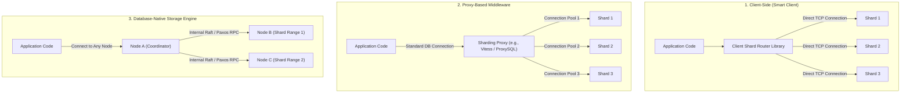

### Topology Comparison Matrix

| Dimension | Client-Side Routing (Smart Client) | Proxy-Based Routing (Middleware) | Database-Native (Distributed SQL) |
|:---|:---|:---|:---|
| **Examples** | Pinterest Pinlater, Instagram Client, Kafka Producer | Vitess (VTGate), Citus Coordinator, Apache ShardingSphere, ProxySQL | CockroachDB, TiDB, Google Cloud Spanner, YugabyteDB |
| **Network Hops** | **1 hop** (App $\to$ Shard) | **2 hops** (App $\to$ Proxy $\to$ Shard) | **1–2 hops** (App $\to$ Random Node $\to$ Range Owner) |
| **Connection Overhead** | **High:** $M \text{ Apps} \times N \text{ Shards}$ open connections. Vulnerable to connection exhaustion. | **Low:** Proxies multiplex and pool connections to shards. | **Low:** Native connection pooling managed internally. |
| **Language Neutrality** | **Poor:** Routing library must be re-implemented for every programming language used. | **High:** Exposes standard MySQL/PostgreSQL wire protocol. | **High:** Native PostgreSQL/MySQL wire compatibility. |
| **Operational Complexity**| Low infrastructure overhead, high client deployment coordination. | Medium infrastructure overhead (monitoring and scaling proxy fleet). | High underlying cluster complexity (Raft consensus, distributed transactions). |

---

## 3. Deep Dive into the 6 Core Sharding Strategies

```
+--------------------------------------------------------------------------------------------------+
|                                    TAXONOMY OF SHARDING STRATEGIES                               |
+--------------------------------------------------------------------------------------------------+
|                                                                                                  |
| 1. Range-Based:            Data partitioned by ordered key intervals ([1-100k], [100k-200k]).    |
| 2. Hash-Based (Modulus):   Shard ID = Hash(key) % N. Algorithmic, stateless, uniform.            |
| 3. Consistent Hashing:     Nodes and keys placed on circular token ring. Minimal resharding.     |
| 4. Directory-Based:        Lookup service stores explicit (Key -> Shard) mapping table.        |
| 5. Geographic / Location:  Partitioned by legal jurisdiction, latency zone, or country code.     |
| 6. Entity / Tenant-Based:  Co-locates all records belonging to a tenant/workspace on one shard.   |
+--------------------------------------------------------------------------------------------------+
```

---

### Strategy 1: Range-Based Sharding

Range-based sharding partitions data across shards based on discrete, contiguous intervals of the shard key.

```
Key Space: [ 0 ──────────────────────── 50,000,000 ──────────────────────── 100,000,000+ ]
               │                                │                                │
               ▼                                ▼                                ▼
       ┌───────────────┐                ┌───────────────┐                ┌───────────────┐
       │    Shard 1    │                │    Shard 2    │                │    Shard 3    │
       │ [0 - 49.99M]  │                │ [50M - 99.9M] │                │ [100M - Max]  │
       └───────────────┘                └───────────────┘                └───────────────┘
```

#### High-Level Design (HLD)

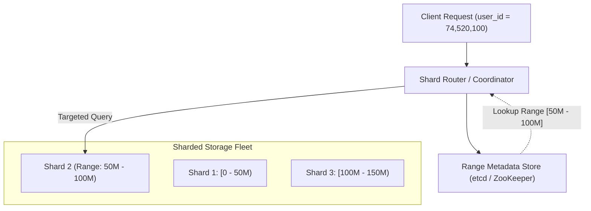

#### Low-Level Design (LLD)

1. **Routing Mechanism:** The router maintains an ordered lookup table (in-memory red-black tree, skip list, or B-Tree) mapping ranges $[K_{\text{start}}, K_{\text{end}})$ to physical shard connection pools.
2. **Search Complexity:** Finding the target shard takes $O(\log S)$ time, where $S$ is the number of range splits.
3. **Dynamic Range Splitting Protocol:** When a shard exceeds a storage threshold (e.g., 64GB in Google Bigtable / HBase):
   - The coordinator freezes writes to the target range.
   - Finds the median key $K_{\text{split}}$.
   - Creates two child ranges: $[K_{\text{low}}, K_{\text{split}})$ and $[K_{\text{split}}, K_{\text{high}})$.
   - Copies data or reassigns storage pointers.
   - Atomically updates the central metadata catalog via a distributed transaction (e.g., Raft in etcd).

#### Critical Vulnerability: The Monotonic Write Hotspot
If the shard key is monotonically increasing (e.g., `auto_increment ID`, `created_at` timestamp, or sequential UUIDs):
- **$100\%$ of all write traffic lands exclusively on the highest range shard.**
- All historical shards sit completely idle for writes.
- The system bottleneck reduces to that of a single-node database.

#### Production Python Implementation: Range-Based Router with Dynamic Splitting

```python
import bisect
import threading
from typing import Dict, List, Optional, Tuple

class RangeShard:
    def __init__(self, shard_id: str, low: int, high: Optional[int]):
        self.shard_id = shard_id
        self.low = low          # Inclusive lower bound
        self.high = high        # Exclusive upper bound (None = infinity)
        self.storage: Dict[int, dict] = {}
        self.lock = threading.Lock()

    def insert(self, key: int, record: dict) -> bool:
        with self.lock:
            self.storage[key] = record
            return True

    def get(self, key: int) -> Optional[dict]:
        with self.lock:
            return self.storage.get(key)

    def size(self) -> int:
        with self.lock:
            return len(self.storage)

class RangeBasedRouter:
    def __init__(self, split_threshold: int = 5):
        self.split_threshold = split_threshold
        # Ordered list of upper bounds for binary search
        self.upper_bounds: List[int] = []
        # Mapping: upper_bound -> RangeShard
        self.routes: Dict[int, RangeShard] = {}
        self.inf_shard: Optional[RangeShard] = None
        self.global_lock = threading.RLock()
        
        # Initialize default shard covering [0, Infinity)
        initial_shard = RangeShard("shard_0", 0, None)
        self.inf_shard = initial_shard

    def _locate_shard(self, key: int) -> RangeShard:
        with self.global_lock:
            idx = bisect.bisect_right(self.upper_bounds, key)
            if idx < len(self.upper_bounds):
                return self.routes[self.upper_bounds[idx]]
            return self.inf_shard

    def insert(self, key: int, record: dict):
        shard = self._locate_shard(key)
        shard.insert(key, record)
        
        # Check if dynamic range split is required
        if shard.size() >= self.split_threshold:
            self._split_shard(shard)

    def get(self, key: int) -> Optional[dict]:
        shard = self._locate_shard(key)
        return shard.get(key)

    def _split_shard(self, old_shard: RangeShard):
        with self.global_lock:
            if old_shard.size() < self.split_threshold:
                return  # Race check

            sorted_keys = sorted(old_shard.storage.keys())
            median_idx = len(sorted_keys) // 2
            split_key = sorted_keys[median_idx]

            # Create new child shard
            new_shard_id = f"shard_{len(self.routes) + 1}"
            new_shard = RangeShard(new_shard_id, split_key, old_shard.high)
            
            # Rebalance records to new shard
            with old_shard.lock, new_shard.lock:
                for k in sorted_keys[median_idx:]:
                    new_shard.storage[k] = old_shard.storage.pop(k)
                old_shard.high = split_key

            # Update routing metadata
            if old_shard.high is not None:
                bisect.insort(self.upper_bounds, split_key)
                self.routes[split_key] = old_shard
            
            if new_shard.high is None:
                self.inf_shard = new_shard
            else:
                self.routes[new_shard.high] = new_shard

# Example Verification
if __name__ == "__main__":
    router = RangeBasedRouter(split_threshold=4)
    for user_id in [10, 25, 30, 45, 80, 95, 120, 150]:
        router.insert(user_id, {"name": f"user_{user_id}"})

    print("Key 25 in:", router._locate_shard(25).shard_id)
    print("Key 120 in:", router._locate_shard(120).shard_id)
```

---

### Strategy 2: Hash-Based (Modulus / Algorithmic) Sharding

Hash-based sharding applies a deterministic hashing algorithm to the shard key and computes the target shard using the modulo operator:

$$\text{Shard ID} = \text{Hash}(\text{Shard Key}) \pmod N$$

Where $N$ is the total number of physical shards in the cluster.

```
                       MODULUS HASH-BASED ROUTING
                       
                      ┌────────────────────────┐
                      │ user_id = "usr_8921a"  │
                      └───────────┬────────────┘
                                  │
                                  ▼
                      ┌────────────────────────┐
                      │ MurmurHash3(user_id)   │ ──► Hash = 3,421,987,122
                      └───────────┬────────────┘
                                  │
                                  ▼
                      ┌────────────────────────┐
                      │ 3,421,987,122 % 4 (N)  │ ──► Remainder = 2
                      └───────────┬────────────┘
                                  │
                                  ▼
                       ┌──────────────────────┐
                       │  Route to Shard #2   │
                       └──────────────────────┘
```

#### High-Level Design (HLD)

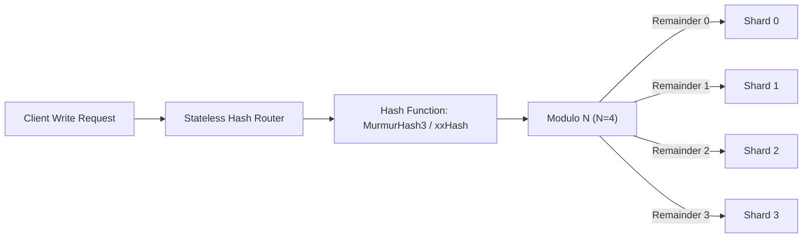

#### Low-Level Design (LLD)

1. **Hash Function Selection:**
   - **DO NOT USE Cryptographic Hashes (MD5, SHA-256):** Excessive CPU cycle consumption ($10\times$ slower than non-cryptographic hashes) without operational benefit.
   - **USE Non-Cryptographic Fast Hashes:** **MurmurHash3**, **xxHash64**, or **CityHash**. These provide uniform distribution across output bits (high avalanche effect) with minimal CPU cycles.
2. **Evaluation:** Routing computation is $O(1)$ in time and $O(1)$ in memory. No central metadata store or routing catalog is required.

#### The Resharding Catastrophe (The Modulo Trap)
The fatal vulnerability of standard modulus sharding occurs when expanding capacity from $N$ to $N+1$ shards.

$$\text{P}(\text{Key Rehashed to Different Shard}) = 1 - \frac{1}{N+1} = \frac{N}{N+1}$$

When expanding from 9 shards to 10 shards, $\frac{9}{10} = \mathbf{90\%}$ **of all existing keys in the entire database must be relocated across the network!** This triggers massive network saturation, database lockups, and severe cluster degradation during resharding.

#### Production Python Implementation: Modulus Hash Router

```python
import mmh3  # MurmurHash3 C-bindings
from typing import Dict, Any, List

class ModulusHashRouter:
    def __init__(self, shard_nodes: List[str]):
        if not shard_nodes:
            raise ValueError("Shard cluster must contain at least 1 node.")
        self.shards = shard_nodes
        self.num_shards = len(shard_nodes)

    def route_key(self, key: str) -> str:
        # 32-bit MurmurHash3 unsigned integer
        hash_val = mmh3.hash(key, signed=False)
        shard_idx = hash_val % self.num_shards
        return self.shards[shard_idx]

    def simulate_resharding_impact(self, keys: List[str], new_node: str) -> float:
        """Calculates the percentage of keys that must migrate when adding 1 node."""
        moved_keys = 0
        new_shards = self.shards + [new_node]
        new_count = len(new_shards)

        for k in keys:
            orig_hash = mmh3.hash(k, signed=False) % self.num_shards
            new_hash = mmh3.hash(k, signed=False) % new_count
            if self.shards[orig_hash] != new_shards[new_hash]:
                moved_keys += 1

        migration_percentage = (moved_keys / len(keys)) * 100
        return migration_percentage

# Verification
if __name__ == "__main__":
    nodes = [f"db_node_{i}" for i in range(8)]
    router = ModulusHashRouter(nodes)
    
    test_keys = [f"user_session_{i}" for i in range(100_000)]
    churn = router.simulate_resharding_impact(test_keys, "db_node_8")
    print(f"Modulus Resharding Churn (8 -> 9 nodes): {churn:.2f}% of data relocated!")
    # Output is consistently ~88.8%, proving the N/(N+1) migration catastrophe!
```

---

### Strategy 3: Consistent Hashing with Virtual Nodes (Tokens)

Consistent hashing maps both **physical shards** and **data keys** onto a circular $2^{32}-1$ integer token ring. A key is assigned to the first shard encountered when traversing the ring clockwise.

```
                          CONSISTENT HASH RING
                               0 / 2^32
                                  ▲
                         Key K1   │
                           \      │   Node_A (Token 250)
                            \     │   /
                             ▼    │  ▼
                  ┌───────────────┴───────────────┐
                  │                               │
       Node_C ────┤                               ├──── Node_B (Token 1,200)
    (Token 3,100) │                               │
                  │                               │
                  └───────────────┬───────────────┘
                                  │
                                  ▼
                             Node_A-vnode-2
```

#### High-Level Design (HLD)

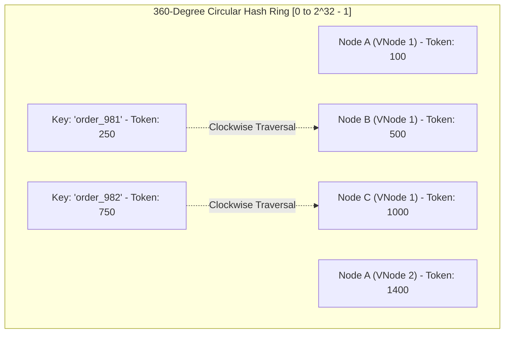

#### Low-Level Design (LLD)

1. **Minimal Resharding Invariant:** When a new physical shard is added to an $N$-node cluster, only $\frac{K}{N+1}$ keys relocate on average (where $K$ is total keys). Only immediate neighbor keys on the ring migrate.
2. **Virtual Nodes (VNodes) Mechanics:**
   - Without VNodes, physical nodes create non-uniform token gaps, leading to hot shards.
   - With VNodes, each physical shard is mapped to $V$ (typically $100 \le V \le 300$) distinct pseudo-random tokens across the ring (e.g., `NodeA-vnode-0`, `NodeA-vnode-1`).
   - By the **Law of Large Numbers**, the standard deviation of data distribution across shards shrinks proportionally:
   
$$\frac{\sigma}{\mu} \approx \frac{1}{\sqrt{V}}$$

Where $\sigma$ is standard deviation, $\mu$ is mean key count per shard, and $V$ is virtual node count.

#### Production Python Implementation: Consistent Hash Ring with Replicas & Migration Diff

```python
import bisect
import hashlib
from typing import Dict, List, Optional, Set, Tuple

class ConsistentHashRing:
    def __init__(self, replicas: int = 150):
        self.replicas = replicas      # Virtual nodes per physical shard
        self.ring: List[int] = []     # Sorted list of token hashes
        self.token_to_node: Dict[int, str] = {}
        self.nodes: Set[str] = set()

    def _hash(self, key: str) -> int:
        # MD5 truncated to 32 bits for clean, fast integer tokens
        digest = hashlib.md5(key.encode('utf-8')).digest()
        return int.from_bytes(digest[:4], byteorder='big')

    def add_shard(self, node: str) -> List[Tuple[int, int]]:
        """Adds a physical shard and returns token ranges acquired."""
        if node in self.nodes:
            return []
        self.nodes.add(node)
        ranges_acquired = []

        for i in range(self.replicas):
            vnode_token = self._hash(f"{node}#vnode_{i}")
            bisect.insort(self.ring, vnode_token)
            self.token_to_node[vnode_token] = node

        return ranges_acquired

    def remove_shard(self, node: str):
        """Removes a shard and cleans up virtual node tokens."""
        if node not in self.nodes:
            return
        self.nodes.remove(node)

        for i in range(self.replicas):
            vnode_token = self._hash(f"{node}#vnode_{i}")
            idx = bisect.bisect_left(self.ring, vnode_token)
            if idx < len(self.ring) and self.ring[idx] == vnode_token:
                del self.ring[idx]
                del self.token_to_node[vnode_token]

    def get_shard(self, key: str) -> Optional[str]:
        """Finds the primary shard for a given key via clockwise ring traversal."""
        if not self.ring:
            return None

        token = self._hash(key)
        idx = bisect.bisect_right(self.ring, token)
        
        # Clockwise wrap-around
        if idx == len(self.ring):
            idx = 0
            
        return self.token_to_node[self.ring[idx]]

    def get_replica_shards(self, key: str, count: int) -> List[str]:
        """Returns distinct physical shards for replica-set write quorum."""
        if len(self.nodes) < count:
            raise ValueError("Not enough physical nodes to satisfy replica count.")

        results: List[str] = []
        token = self._hash(key)
        idx = bisect.bisect_right(self.ring, token)

        while len(results) < count:
            if idx == len(self.ring):
                idx = 0
            physical_node = self.token_to_node[self.ring[idx]]
            if physical_node not in results:
                results.append(physical_node)
            idx += 1

        return results

# Verification
if __name__ == "__main__":
    ring = ConsistentHashRing(replicas=200)
    for shard in ["shard-us-east-1", "shard-us-west-1", "shard-eu-central-1"]:
        ring.add_shard(shard)

    print("Primary Shard for user_450:", ring.get_shard("user_450"))
    print("Replication Set (N=2):", ring.get_replica_shards("user_450", 2))
```

---

### Strategy 4: Directory-Based / Lookup Service Sharding

Directory-based sharding decouples the shard key from physical addresses by maintaining an explicit mapping service that maps `Entity ID -> Shard ID`.

```
                    DIRECTORY-BASED SHARDING TOPOLOGY
                    
                             ┌──────────────────┐
                             │ Application Host │
                             └────────┬─────────┘
                                      │
              1. Query Shard Location │  Entity = "tenant_enterprise_acme"
                                      ▼
                       ┌───────────────────────────────┐
                       │   Directory Routing Engine    │
                       │   ┌─────────────────────────┐ │
                       │   │ Local L1 Cache (LRU)    │ │
                       │   └────────────┬────────────┘ │
                       └────────────────┼──────────────┘
                                        │ (Cache Miss)
                                        ▼
                       ┌───────────────────────────────┐
                       │  Distributed Route Catalog    │
                       │     (etcd / PostgreSQL)       │
                       └────────────────┼──────────────┘
                                        │
           2. Returns Shard_07          ▼
      ◄─────────────────────────────────┘
      │
      │ 3. Execute Direct Query
      ▼
┌───────────────┐               ┌───────────────┐               ┌───────────────┐
│    Shard 01   │               │   Shard 07    │               │    Shard 12   │
│  (Multi-tenant│               │ (Dedicated to │               │  (Multi-tenant│
│     Pool)     │               │     Acme)     │               │     Pool)     │
└───────────────┘               └───────────────┘               └───────────────┘
```

#### High-Level Design (HLD)

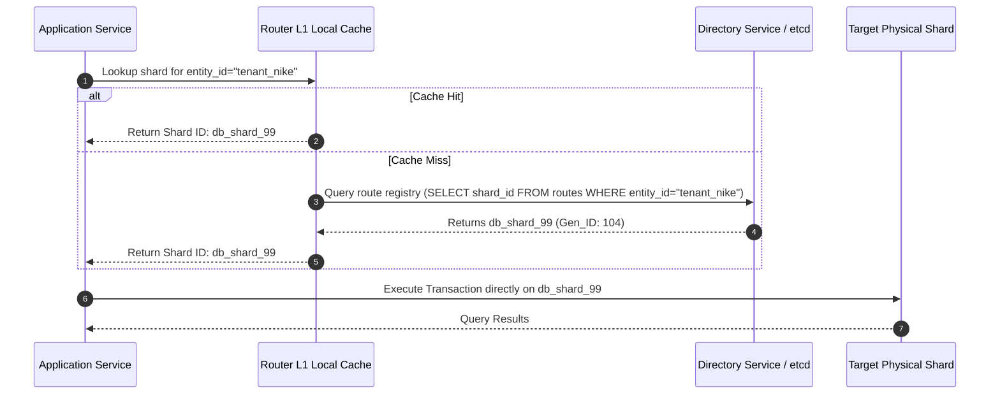

#### Low-Level Design (LLD)

1. **Database Schema for Route Directory:**
```sql
CREATE TABLE entity_shard_directory (
    entity_type VARCHAR(32) NOT NULL,
    entity_id   VARCHAR(64) NOT NULL,
    shard_id    VARCHAR(32) NOT NULL,
    generation  BIGINT NOT NULL DEFAULT 1,  -- Monotonic version for cache invalidation
    updated_at  TIMESTAMP WITH TIME ZONE DEFAULT CURRENT_TIMESTAMP,
    PRIMARY KEY (entity_type, entity_id)
);
CREATE INDEX idx_shard_distribution ON entity_shard_directory(shard_id);
```

2. **Zero-Downtime Tenant Migration Power:**
   - When a customer grows into a mega-enterprise (e.g., Slack onboarding IBM), the customer's data can be migrated from a shared multi-tenant cluster to a dedicated high-performance database instance.
   - Once data is synced, updating **exactly one row** in `entity_shard_directory` instantaneously re-routes all application queries to the new physical instance.

3. **Trade-offs:**
   - **Double Network Hop:** Every query risks making an extra network hop to the directory service before hitting the database.
   - **Mitigation:** Extreme client-side L1 caching with lease times and asynchronous change notification streams (e.g., ZooKeeper watches or Redis pub/sub).

#### Production Python Implementation: Directory Router with L1 Cache & Safe Invalidation

```python
import time
from typing import Dict, Optional, Tuple

class DirectoryShardRouter:
    def __init__(self, ttl_seconds: float = 60.0):
        # Persistent central directory (Simulating etcd/Consul/DB)
        self._central_directory: Dict[str, Tuple[str, int]] = {}
        # Application L1 local cache: entity_id -> (shard_id, generation, expiry)
        self._l1_cache: Dict[str, Tuple[str, int, float]] = {}
        self._ttl = ttl_seconds

    def register_entity(self, entity_id: str, shard_id: str):
        """Authoritative admin route registration."""
        gen = 1
        if entity_id in self._central_directory:
            gen = self._central_directory[entity_id][1] + 1
        self._central_directory[entity_id] = (shard_id, gen)

    def route_entity(self, entity_id: str) -> str:
        """High-speed routing with L1 cache-aside pattern."""
        now = time.time()
        
        # Check Local L1 Cache
        if entity_id in self._l1_cache:
            shard_id, gen, expires_at = self._l1_cache[entity_id]
            if now < expires_at:
                return shard_id

        # Cache Miss or Expired: Query Central Directory
        if entity_id not in self._central_directory:
            raise KeyError(f"Entity '{entity_id}' has no designated shard assignment.")

        shard_id, gen = self._central_directory[entity_id]
        self._l1_cache[entity_id] = (shard_id, gen, now + self._ttl)
        return shard_id

    def migrate_entity(self, entity_id: str, new_shard_id: str):
        """Atomic migration update that invalidates all caches on next access."""
        if entity_id not in self._central_directory:
            raise KeyError(f"Entity '{entity_id}' does not exist.")
        
        current_shard, current_gen = self._central_directory[entity_id]
        # Increment generation to detect stale caches
        self._central_directory[entity_id] = (new_shard_id, current_gen + 1)
        # Invalidate local cache immediately
        self._l1_cache.pop(entity_id, None)

# Verification
if __name__ == "__main__":
    router = DirectoryShardRouter(ttl_seconds=2.0)
    router.register_entity("tenant_uber", "shard_shared_us_east")
    
    print("Initial Route:", router.route_entity("tenant_uber"))
    
    # Live migration to dedicated shard
    router.migrate_entity("tenant_uber", "shard_dedicated_enterprise_01")
    print("Post-Migration Route:", router.route_entity("tenant_uber"))
```

---

### Strategy 5: Geographic / Location-Based Sharding

Geographic sharding partitions datasets based on physical geography, geopolitical boundaries, or regulatory jurisdictions (e.g., GDPR in the European Union, HIPAA in the US, or Data Security Laws in APAC).

```
                      GLOBAL GEOGRAPHIC SHARDING
                      
                       ┌────────────────────────┐
                       │ Global GeoDNS / Ingress│
                       └───────────┬────────────┘
                                   │
         ┌─────────────────────────┼─────────────────────────┐
         │ (User in Germany)       │ (User in USA)           │ (User in Singapore)
         ▼                         ▼                         ▼
┌──────────────────┐      ┌──────────────────┐      ┌──────────────────┐
│ EU Region Shard  │      │ US Region Shard  │      │ APAC Region Shard│
│ (Frankfurt, AWS) │      │ (N. Virginia)    │      │ (Singapore)      │
│                  │      │                  │      │                  │
│ • GDPR Compliant │      │ • CCPA Compliant │      │ • Local Regs     │
│ • Sub-10ms RTT   │      │ • Sub-10ms RTT   │      │ • Sub-10ms RTT   │
└──────────────────┘      └──────────────────┘      └──────────────────┘
```

#### High-Level Design (HLD)

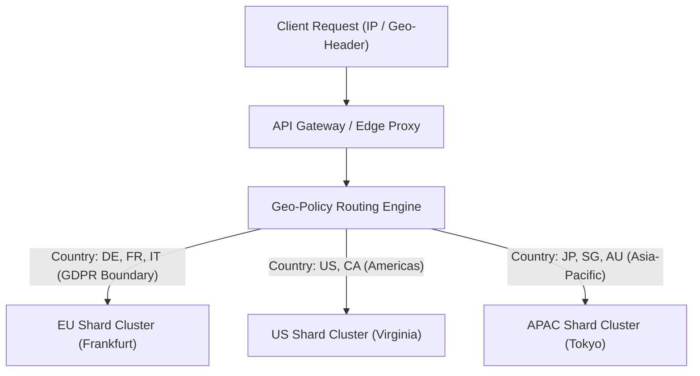

#### Low-Level Design (LLD)

1. **Shard Key Design:** Composite key prefixed with jurisdiction:
   - `pk = "{country_iso}#{user_uuid}"` (e.g., `"DE#550e8400-e29b-41d4-a716-446655440000"`).
2. **The "Roaming User" Dilemma:**
   - When a European user logs into their account from a flight terminal in New York, where do writes go?
   - **Strict Data Residency:** Writes **must** travel cross-ocean to the home European shard (`eu-central-1`) to avoid violating international residency laws.
   - **Cross-Region Read Acceleration:** Frequently read global profiles are replicated asynchronously via a global read-only cache (e.g., AWS DynamoDB Global Tables or Aurora Global Database).

---

### Strategy 6: Entity-Group / Tenant-Based Sharding (Multi-Tenant B2B)

In SaaS platforms (Slack, Salesforce, Workday), datasets are naturally partitioned by **Tenant / Organization ID**.

```
                   MULTI-TENANT ENTITY-GROUP SHARDING
                   
      Shard 01 (Shared Pool)              Shard 02 (Dedicated VIP)
 ┌───────────────────────────────┐     ┌───────────────────────────────┐
 │ Tenant: "StartupA"            │     │ Tenant: "GlobalBank_Corp"     │
 │  ├── Users (10)               │     │  ├── Users (250,000)          │
 │  ├── Channels (5)             │     │  ├── Channels (80,000)        │
 │  └── Messages (2,000)         │     │  └── Messages (500,000,000)   │
 │                               │     │                               │
 │ Tenant: "StartupB"            │     │                               │
 │  ├── Users (25)               │     │  Local Joins: FULLY PRESERVED │
 │  └── Messages (15,000)        │     │  Cross-Shard Overhead: ZERO   │
 └───────────────────────────────┘     └───────────────────────────────┘
```

#### High-Level Design (HLD)

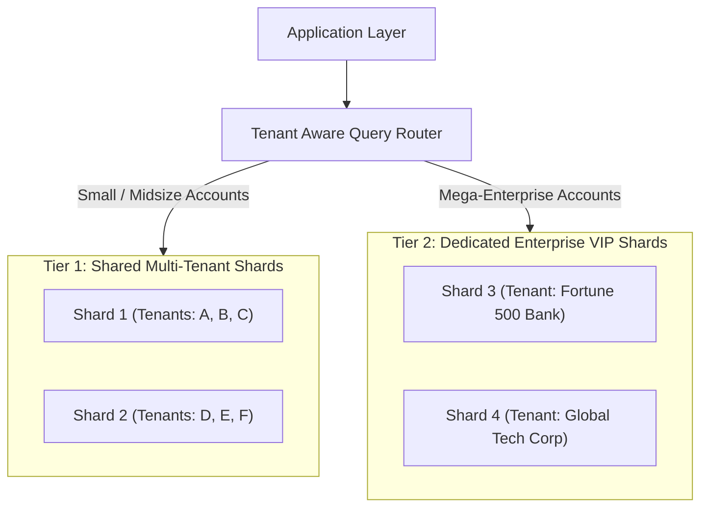

#### Low-Level Design (LLD)

1. **Entity-Group Co-location Invariant:** All tables related to an organization carry the `tenant_id` column:
   ```sql
   CREATE TABLE workspaces (tenant_id UUID PRIMARY KEY, name TEXT);
   CREATE TABLE channels   (tenant_id UUID, channel_id UUID, PRIMARY KEY (tenant_id, channel_id));
   CREATE TABLE messages   (tenant_id UUID, channel_id UUID, message_id BIGINT, body TEXT, PRIMARY KEY (tenant_id, message_id));
   ```
2. **Benefit:** Every intra-tenant query (`JOIN messages WITH channels`) executes locally on a single physical shard. Local ACID guarantees, foreign keys, and indexes remain $100\%$ operational!
3. **The "Mega-Tenant" / Noisy Neighbor Trap:** A single enterprise account generating millions of operations can starve neighboring tenants on a shared shard. Systems must implement dynamic tenant quota throttles and automated migration to dedicated shards.

---

### Master Sharding Strategy Comparison

| Strategy | Data Uniformity | Resharding Complexity | Hotspot Vulnerability | Join Feasibility | Typical Production Use Case |
|:---|:---|:---|:---|:---|:---|
| **Range-Based** | Clustered | Low (Split ranges) | **Extreme** (Monotonic keys) | High (within range) | Time-series, analytics, financial logs |
| **Hash-Based** | **Ultra-High** | **Extreme** (Full shuffle) | Low | Impossible across keys | High-throughput uniform OLTP |
| **Consistent Hashing** | High (with VNodes) | **Minimal** ($\frac{K}{N}$ keys) | Low | Impossible across keys | Elastic cloud DBs, Cassandra, DynamoDB |
| **Directory-Based** | Completely Tunable | **Zero** (Update catalog) | Low | High (co-located) | Multi-tenant B2B, regulated industries |
| **Geographic** | Clustered by region | Medium (Country move) | Medium (Regional spikes) | High (within region) | Sovereign compliance, low-latency global |
| **Entity-Group** | Clustered by tenant | Low (Move tenant) | High (Mega-tenants) | **Ultra-High** (Local joins) | B2B SaaS (Slack, Notion, Salesforce) |

---

## 4. Shard Key Selection: The Make-or-Break Architectural Decision

Choosing a shard key is an **irreversible architectural commitment**. Changing a shard key in a live multi-terabyte production database requires rebuilding the entire persistence layer.

```
┌──────────────────────────────────────────────────────────────────────────────────┐
│                      THE 4 GOLDEN RULES OF SHARD KEY SELECTION                   │
└──────────────────────────────────────────────────────────────────────────────────┘

 1. High Cardinality:      Must contain millions of distinct values (e.g., user_uuid,
                           NOT gender or order_status).
 2. Low Frequency Skew:    No single value should account for > 0.01% of total traffic
                           (avoids the "Celebrity / Justin Bieber" hotspot).
 3. Non-Monotonic Writes:  Successive writes must scatter uniformly across shards
                           (avoids pinning write queues to a single instance).
 4. Query Colocation:      Must match the filtering predicate of >= 95% of read/write
                           queries (eliminates scatter-gather queries).
```

### The Celebrity / Hotspot Problem & Key Salting

If an e-commerce platform shards products by `product_id`, a flash sale on an iPhone creates a catastrophic write and read hotspot on a single physical shard.

#### Mitigation: Shard Key Salting
To distribute a hot entity across $S$ shards, append an algorithmic salt:

$$\text{Salted Key} = \text{Entity ID} + \text{"#"} + \text{RandomInt}(0, S-1)$$

```
  Hot Entity: "product_iphone_16"
       │
       ├──► Write 1: "product_iphone_16#0" ──► Shard 0
       ├──► Write 2: "product_iphone_16#1" ──► Shard 1
       ├──► Write 3: "product_iphone_16#2" ──► Shard 2
       └──► Write 4: "product_iphone_16#3" ──► Shard 3
```

- **Write Advantage:** Writes distribute evenly across $S$ independent shards.
- **Read Trade-off:** Reading total inventory requires a scatter-gather query across all $S$ salted shards, aggregating counts in memory.

---

### Secondary Indexing Across Shards

When queries filter by an attribute *other* than the shard key (e.g., query orders by `email` when data is sharded by `order_id`), secondary indexes are mandatory.

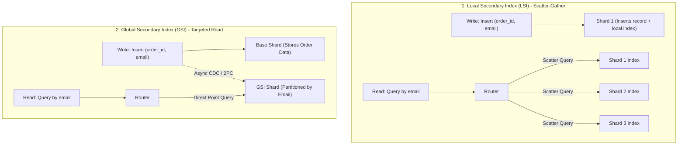

| Indexing Model | Write Latency | Read Latency | Consistency | Failure Impact |
|:---|:---|:---|:---|:---|
| **Local Secondary Index (LSI)** | **Ultra-Fast:** Index updated locally in same ACID transaction. | **Slow:** Requires Scatter-Gather across **all** shards. | Strong (Local) | Single shard failure fails scatter-gather. |
| **Global Secondary Index (GSI)**| **Slower:** Requires cross-shard network write or CDC stream. | **Ultra-Fast:** Direct $O(1)$ point lookup to GSI shard. | Eventual Consistency | Index shard failure only impacts that search key. |

---

## 5. Distributed Unique ID Generation Across Shards

In a single-instance database, primary keys rely on `AUTO_INCREMENT` or `SERIAL` sequences. In a sharded cluster with 64 independent database instances:
- If Shard 1 generates `ID = 101`, and Shard 2 generates `ID = 101`, merging, aggregating, or referencing records across shards results in **primary key collision disasters**.

### 1. Twitter Snowflake Architecture (64-Bit Time-Sortable ID)

The Twitter Snowflake format generates 64-bit, globally unique, time-ordered IDs without inter-node network communication:

```
 1 bit  | 41 bits (Millisecond Timestamp)     | 10 bits (Worker / Shard ID) | 12 bits (Sequence #)
+-------+-------------------------------------+-----------------------------+----------------------+
|   0   | Milliseconds elapsed since Epoch    | 0 to 1,023 Shard Nodes      | 0 to 4,095 per ms    |
+-------+-------------------------------------+-----------------------------+----------------------+
```

- **41-Bit Timestamp:** $2^{41} \text{ ms} \approx 69.7 \text{ years}$ of unique timestamps from a configured epoch.
- **10-Bit Shard/Worker ID:** Supports up to $2^{10} = 1,024$ physical shards without coordination.
- **12-Bit Sequence Number:** Supports up to $2^{12} = 4,096$ unique IDs per millisecond per shard ($4,096,000 \text{ IDs/sec}$ per node).
- **B-Tree Index Friendliness:** Because the high-order bits are timestamps, IDs are monotonically increasing, eliminating random page splits in B-Tree storage engines.

#### The NTP Clock Drift Anomaly
If the system clock synchronizing via NTP adjusts backward (leap second or clock slew correction), Snowflake can generate duplicate IDs.

#### Production Python Implementation: Snowflake with NTP Clock Drift Guard

```python
import time
import threading

class ProductionSnowflake:
    def __init__(self, shard_id: int, epoch: int = 1704067200000): # Epoch: 2024-01-01
        if not (0 <= shard_id < 1024):
            raise ValueError("Shard ID must be between 0 and 1023 (10 bits).")
        self.shard_id = shard_id
        self.epoch = epoch
        self.sequence = 0
        self.last_timestamp = -1
        self.lock = threading.Lock()

    def _current_timestamp_ms(self) -> int:
        return int(time.time() * 1000)

    def generate_id(self) -> int:
        with self.lock:
            now = self._current_timestamp_ms()

            # NTP Clock Drift Detection
            if now < self.last_timestamp:
                drift_ms = self.last_timestamp - now
                if drift_ms <= 5:
                    # Minor drift: Spin-wait until clock catches up
                    while now < self.last_timestamp:
                        time.sleep(0.001)
                        now = self._current_timestamp_ms()
                else:
                    raise RuntimeError(f"Severe clock drift detected: {drift_ms}ms backward jump!")

            if now == self.last_timestamp:
                self.sequence = (self.sequence + 1) & 0xFFF  # 12-bit mask (4095)
                if self.sequence == 0:
                    # Sequence exhausted for this millisecond: wait for next ms
                    while now <= self.last_timestamp:
                        now = self._current_timestamp_ms()
            else:
                self.sequence = 0

            self.last_timestamp = now

            # Bitwise Assembly: 41 bits timestamp | 10 bits shard | 12 bits sequence
            id_64 = ((now - self.epoch) << 22) | (self.shard_id << 12) | self.sequence
            return id_64

# Verification
if __name__ == "__main__":
    generator = ProductionSnowflake(shard_id=42)
    sample_id = generator.generate_id()
    print("Generated 64-bit Snowflake ID:", sample_id)
    print("Binary Representation:", bin(sample_id))
```

---

### 2. UUID v4 vs UUID v7: The B-Tree Index Fragmentation Disaster

Many teams adopt **UUID v4 (Random 128-bit)** to avoid building Snowflake generators. In high-scale databases, this causes severe performance degradation:

```
                            B-TREE PAGE SPLIT IMPACT
                            
 UUID v4 (Random Inserts):
   Page 1 [0x1a, 0x8f] ──► Insert 0x4b ──► PAGE FULL! Split page, write 2 pages to disk,
                                            fragment memory, flush buffer pool cache!
 
 UUID v7 (Time-Ordered Inserts):
   Page 1 [0x018f..., 0x018f...] ──► Append to rightmost leaf page with zero page splits!
```

```
 UUID v7 Bit Allocation:
  0                   1                   2                   3
  0 1 2 3 4 5 6 7 8 9 0 1 2 3 4 5 6 7 8 9 0 1 2 3 4 5 6 7 8 9 0 1
 +-+-+-+-+-+-+-+-+-+-+-+-+-+-+-+-+-+-+-+-+-+-+-+-+-+-+-+-+-+-+-+-+
 |                      unix_ts_ms (48 bits)                     |
 +-+-+-+-+-+-+-+-+-+-+-+-+-+-+-+-+-+-+-+-+-+-+-+-+-+-+-+-+-+-+-+-+
 |      unix_ts_ms (cont.)       |  ver (4)  |    rand_a (12)    |
 +-+-+-+-+-+-+-+-+-+-+-+-+-+-+-+-+-+-+-+-+-+-+-+-+-+-+-+-+-+-+-+-+
 |var (2)|                       rand_b (62 bits)                |
 +-+-+-+-+-+-+-+-+-+-+-+-+-+-+-+-+-+-+-+-+-+-+-+-+-+-+-+-+-+-+-+-+
```

- **UUID v4:** Fully random. When inserted into a MySQL InnoDB or PostgreSQL B-Tree index, keys insert randomly across leaf pages. Once the index exceeds RAM, every single insert triggers an expensive physical disk read, page split, and dirty page write. Write throughput degrades by up to $80\%$.
- **UUID v7 (RFC 9562):** Embeds a 48-bit millisecond UNIX timestamp in the most significant bits. Inserts always append sequentially to the rightmost leaf of the B-Tree, achieving the same indexing speed as sequential integers while remaining globally distributed.

---

## 6. The Hardest Engineering Challenges in Sharded Systems

### Challenge 1: Cross-Shard Joins & Scatter-Gather Latency

Executing a relational SQL `JOIN` across tables stored on different physical shards over network sockets is computationally prohibitive:

```sql
-- Shard 1 holds Customers; Shard 2 holds Orders
SELECT c.name, o.total 
FROM customers c 
JOIN orders o ON c.id = o.customer_id 
WHERE c.country = 'FR';
```

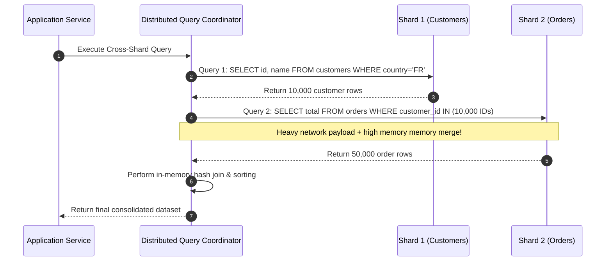

#### Pagination Across Shards: The Offset Disaster
Consider the query:
```sql
SELECT * FROM messages ORDER BY timestamp DESC LIMIT 20 OFFSET 10000;
```
If messages are distributed across 10 shards:
- The coordinator cannot simply ask each shard for 2 rows.
- **Every single shard must fetch $10,020$ rows.**
- Shards return a combined $100,200$ rows over the network.
- The coordinator sorts $100,200$ records in memory, discards $100,000$, and returns 20 rows.
- **Solution:** Cursor-based pagination (`WHERE timestamp < :last_seen_timestamp LIMIT 20`) eliminates the offset disaster.

---

### Challenge 2: Cross-Shard Distributed Transactions & Two-Phase Commit (2PC)

When a business transaction spans multiple shards (e.g., transferring \$500 from Account A on Shard 1 to Account B on Shard 2), local database transactions cannot provide atomicity.

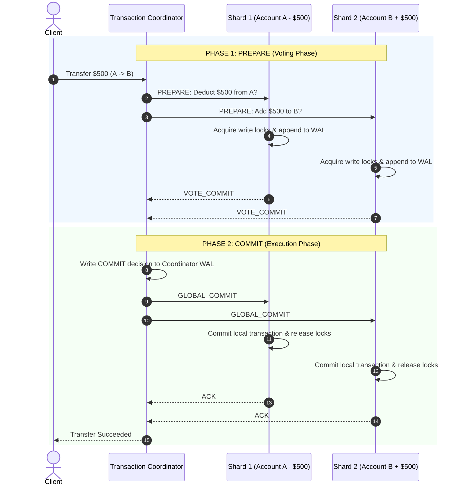

#### The Vulnerability of 2PC: Blocking Under Coordinator Failure
If the coordinator crashes **after** Shards 1 and 2 vote `VOTE_COMMIT`, but **before** sending `GLOBAL_COMMIT`:
- Shards 1 and 2 remain in the **In-Doubt State**.
- They hold exclusive row locks indefinitely on Accounts A and B.
- All subsequent transactions on those accounts block, causing cascading connection pool exhaustion across the entire cluster.
- **Modern Solution:** In high-scale architectures, avoid 2PC across shards. Adopt **Sagas with Compensating Transactions** or transactional outbox messaging via Kafka.

---

### Challenge 3: Live Zero-Downtime Resharding & Migration Pipeline

Expanding an active 16-shard cluster to 32 shards while processing 100,000 writes/sec requires a **Zero-Downtime Migration Architecture**:

```
                       5-PHASE ZERO-DOWNTIME RESHARDING
                       
 Phase 1: Dual-Write
   App ───► Write Old Shards (Primary)
     └────► Write New Shards (Secondary, asynchronous/shadow)

 Phase 2: Historical CDC Backfill
   Old Shards ──► Debezium CDC ──► Kafka ──► Consumer ──► New Shards
   (Replay historical records prior to dual-write marker)

 Phase 3: Continuous Catch-Up & Parity Check
   Reconciliation Engine verifies checksums between Old and New shards.

 Phase 4: Dark Read Validation (Shadow Traffic)
   App reads Old Shards, asynchronously reads New Shards, diffs payloads.

 Phase 5: Atomic Cutover
   App flips read/write traffic to New Shards. Decommission Old Shards.
```

```mermaid
sequenceDiagram
    autonumber
    participant App as Application Fleet
    participant OldS as Old Shards (Source)
    participant CDC as Debezium CDC + Kafka
    participant NewS as New Shards (Target)
    participant Recon as Parity Verifier

    Note over App,NewS: Stage 1: Dual-Writing Enabled
    App->>OldS: Write Primary Data
    App->>NewS: Write Shadow Data (Non-blocking)

    Note over OldS,NewS: Stage 2: Historical Backfill
    OldS->>CDC: Capture WAL changes & historic snapshot
    CDC->>NewS: Stream & Upsert records to new shard partition

    Note over Recon,NewS: Stage 3: Data Parity Verification
    Recon->>OldS: Hash rows for range [K1, K2]
    Recon->>NewS: Hash rows for range [K1, K2]
    Recon-->>Recon: Checksums match (Parity = 100%)

    Note over App,NewS: Stage 4: Cutover Complete
    App->>NewS: Read & Write Primary Traffic
    App->>OldS: Stop writes; archive historical instances
```

---

## 7. Real-World Case Studies & Production Architectures

### 1. Pinterest's Sharded MySQL Fleet

In 2012, Pinterest implemented an application-level sharded architecture built on standard MySQL that continues to serve billions of pins:

```
                            PINTEREST 64-BIT ID
                            
  +------------------+------------------+-----------------------------+
  | Shard ID (16 b)  | Type ID (10 b)   | Local Sequence ID (38 b)    |
  +------------------+------------------+-----------------------------+
  | 0 to 65,535      | Pin, Board, User | Auto-increment sequence     |
  +------------------+------------------+-----------------------------+
```

- **Zero-Lookup Direct Routing:** When the application needs to read Pin `0x002A...`, it extracts the first 16 bits (`Shard ID = 42`). The client connects directly to MySQL Shard 42 without querying a directory service or routing proxy.
- **Relational Entity Clustering:** A user and all pins created by that user share identical shard ID prefixes, ensuring all queries for a user's profile and pins execute locally on a single shard.

---

### 2. Discord: Cassandra to ScyllaDB Time-Bucketed Sharding

Discord stores trillions of messages. In 2017, Discord used Cassandra with `channel_id` as the partition key:

```sql
-- Discord's Original Schema (Cassandra)
CREATE TABLE messages (
    channel_id bigint,
    message_id bigint,
    author_id bigint,
    content text,
    PRIMARY KEY (channel_id, message_id)
) WITH CLUSTERING ORDER BY (message_id DESC);
```

#### The Breakdown
- Popular Discord servers (e.g., Fortnite, Midjourney) post millions of messages in a single channel.
- A single Cassandra partition grew beyond 100MB, causing extreme JVM garbage collection pauses and compaction storms.
- Deleting messages created Cassandra **tombstones**. Reading messages required scanning millions of tombstones, triggering read timeouts.

#### The Solution: Bucketed Partition Keys in ScyllaDB
Discord re-partitioned data using a composite partition key combining `channel_id` and a computed time bucket:

```sql
-- Discord's Evolved Schema (ScyllaDB)
CREATE TABLE messages_v2 (
    channel_id bigint,
    bucket int,          -- Derived: timestamp >> 22 / (1000 * 60 * 60 * 24 * 10) [10-day buckets]
    message_id bigint,
    author_id bigint,
    content text,
    PRIMARY KEY ((channel_id, bucket), message_id)
) WITH CLUSTERING ORDER BY (message_id DESC);
```

- **Outcome:** Partitions never exceed a few megabytes. Message reads target a single 10-day bucket. Disk read latency dropped from over 1 second to sub-15ms at $P99$.

---

### 3. Slack: Flannel Caching & Vitess Workspace Sharding

Slack manages millions of concurrent workspaces. Each workspace operates as an isolated community.

- **Routing Model:** Workspaces shard cleanly by `team_id`.
- **Query Proxying via Vitess:** Slack uses **Vitess** (the open-source database clustering system originally developed by YouTube). Vitess provides `VTGate` proxies that intercept standard MySQL queries from Slack application servers and route them to the specific underlying `VTTablet` managing that workspace's MySQL instance.
- **Flannel Edge Daemon:** To prevent read queries from overwhelming shards, Slack deployed **Flannel**, an application-tier caching daemon that sits next to the app hosts and caches the workspace's entire graph in memory.

---

### 4. Notion: Scaling PostgreSQL to 480 Logical Shards

In 2021, Notion split their monolithic AWS PostgreSQL database into **480 logical shards distributed across 32 physical instances**:

- **Shard Key:** Partitioned by Notion `workspace_id`.
- **Logical vs. Physical Isolation:** Instead of provisioning 480 separate physical servers, Notion created 480 distinct PostgreSQL logical databases distributed evenly (15 logical databases per physical server).
- **Smooth Scaling Path:** When a physical server approaches $70\%$ CPU utilization, Notion migrates individual logical databases from that server to a fresh physical instance using PostgreSQL streaming replication with minimal downtime.

---

## 8. Staff / Principal System Design Interview Playbook

When addressing database sharding in a Staff-level System Design interview, use this structured four-phase framework:

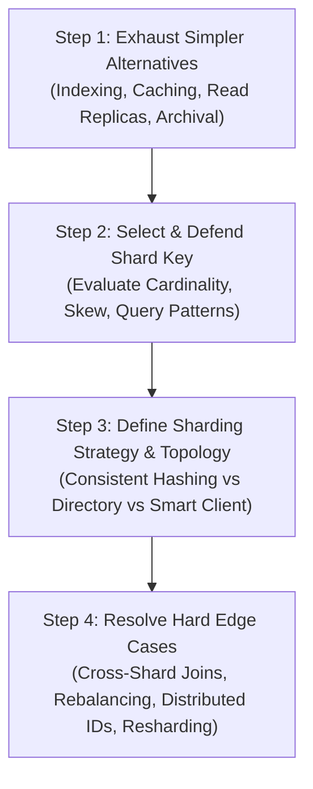

---

### Capacity Planning & Sizing Formula

During interviews, execute back-of-the-envelope calculations to justify the number of physical shards required:

#### Example Problem
- **Write Volume:** $50,000 \text{ writes/sec}$
- **Storage Growth:** $10 \text{ TB / month}$
- **Hardware Profile:** Standard database node safely sustains $3,000 \text{ IOPS}$ and $2 \text{ TB}$ of fast NVMe storage before backup/vacuum performance degrades.

#### Step 1: Compute Shards Required for Write Throughput
$$\text{Shards}_{\text{throughput}} = \frac{\text{Peak Write IOPS}}{\text{Safe IOPS per Shard}} = \frac{50,000}{3,000} \approx 16.6 \implies \mathbf{17 \text{ Shards}}$$

#### Step 2: Compute Shards Required for 2-Year Storage Horizon
$$\text{Total Storage (24 Mo)} = 10 \text{ TB} \times 24 = 240 \text{ TB}$$
$$\text{Shards}_{\text{storage}} = \frac{240 \text{ TB}}{2 \text{ TB}} = \mathbf{120 \text{ Shards}}$$

#### Step 3: Cluster Sizing Conclusion
The storage constraint dominates write throughput. The cluster requires at least **120 physical shards** (or 20 physical shards hosting 6 logical shards each) to accommodate growth safely.

---

### Strategy Selection Decision Flowchart

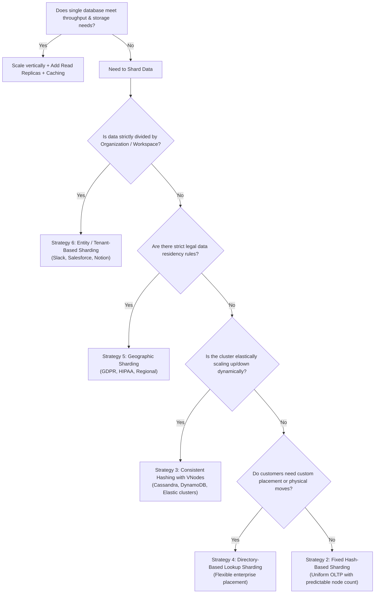

---

### Production Readiness & Failure Checklist

Before approving a production sharded architecture, verify every point on this checklist:

- [ ] **Deterministic Shard Key:** Does $\ge 95\%$ of application query traffic specify the shard key in the `WHERE` clause?
- [ ] **Distributed ID Collision Proofing:** Is a 64-bit Snowflake or UUID v7 generator implemented to prevent primary key collisions?
- [ ] **Cross-Shard Join Prevention:** Are all relational entities required for common transactions co-located under the same shard key?
- [ ] **Pagination Safety:** Have all cross-shard queries using `OFFSET` been converted to keyset/cursor pagination?
- [ ] **Hotspot Monitoring:** Are alert thresholds configured for CPU/IOPS imbalances across shards (e.g., alert if any shard deviates by $> 25\%$ from median load)?
- [ ] **Zero-Downtime Resharding Playbook:** Is there a verified CDC-driven backfill and dual-write cutover pipeline ready for cluster expansion?
- [ ] **Connection Multiplexing:** Is a proxy layer (e.g., ProxySQL, Vitess, PgBouncer) deployed to prevent application fleets from saturating database connection limits?
- [ ] **Replication & Split-Brain Guard:** Are shard primary nodes configured with Raft/Paxos consensus or semi-synchronous replication to prevent split-brain data corruption during network partitions?
