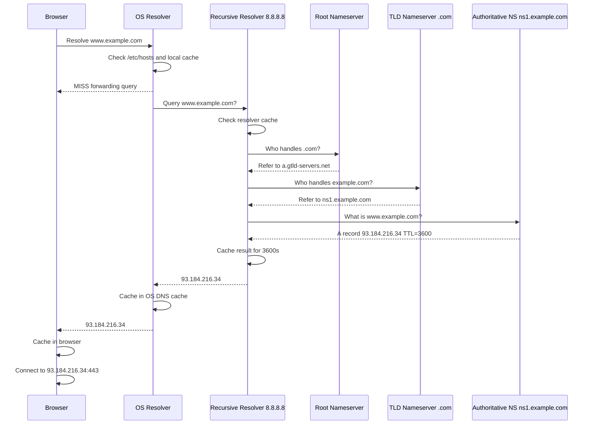
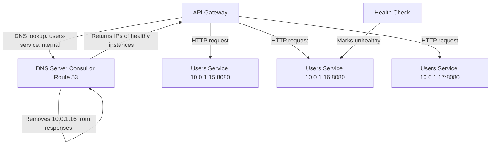
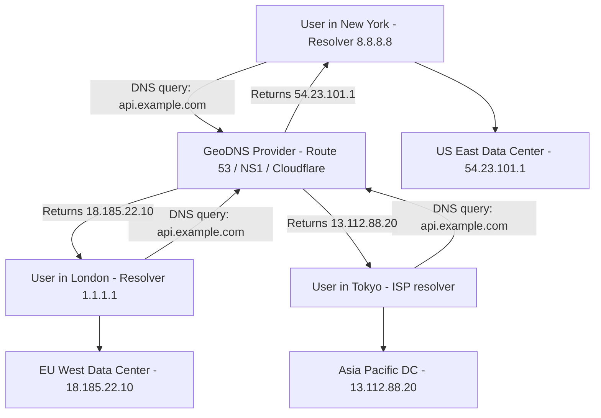
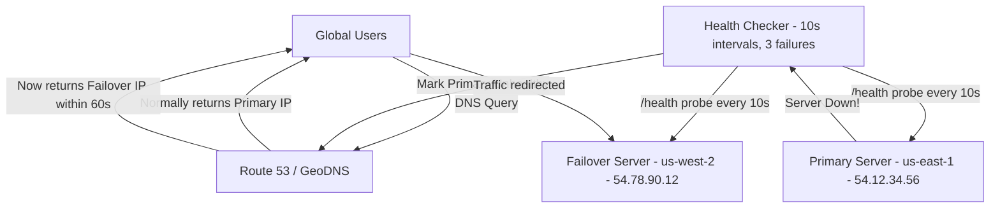
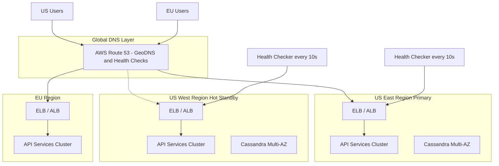

# 🌐 DNS & Networking Fundamentals for System Design
### *The Phone Book of the Internet — and Why Every Distributed System Lives or Dies By It*

---

> **"DNS is the most critical infrastructure component most engineers never think about — until it breaks at 3 AM and takes down your entire platform."**
> — Every senior SRE who has ever been paged

---

## 📚 Table of Contents

1. [Overview — What Is DNS?](#1-overview--what-is-dns)
2. [How DNS Resolution Works](#2-how-dns-resolution-works)
   - 2.1 [The Four Key Players](#21-the-four-key-players)
   - 2.2 [Full Resolution Flow — Step by Step](#22-full-resolution-flow--step-by-step)
   - 2.3 [Mermaid Diagram: Full DNS Resolution Flow](#23-mermaid-diagram-full-dns-resolution-flow)
3. [DNS Record Types — The Complete Guide](#3-dns-record-types--the-complete-guide)
   - 3.1 [A Record](#31-a-record)
   - 3.2 [AAAA Record](#32-aaaa-record)
   - 3.3 [CNAME Record](#33-cname-record)
   - 3.4 [MX Record](#34-mx-record)
   - 3.5 [TXT Record](#35-txt-record)
   - 3.6 [NS Record](#36-ns-record)
   - 3.7 [SRV Record](#37-srv-record)
   - 3.8 [PTR Record](#38-ptr-record)
   - 3.9 [SOA Record](#39-soa-record)
   - 3.10 [CAA Record](#310-caa-record)
   - 3.11 [DNS Record Types — Summary Table](#311-dns-record-types--summary-table)
4. [DNS Propagation and TTL](#4-dns-propagation-and-ttl)
   - 4.1 [What Is TTL?](#41-what-is-ttl)
   - 4.2 [How Propagation Works](#42-how-propagation-works)
   - 4.3 [The Propagation Trap](#43-the-propagation-trap)
5. [DNS Caching — Layers Upon Layers](#5-dns-caching--layers-upon-layers)
   - 5.1 [Browser Cache](#51-browser-cache)
   - 5.2 [OS Resolver Cache](#52-os-resolver-cache)
   - 5.3 [Recursive Resolver Cache](#53-recursive-resolver-cache)
   - 5.4 [Cache Poisoning Attacks](#54-cache-poisoning-attacks)
6. [Why DNS Matters in Distributed Systems](#6-why-dns-matters-in-distributed-systems)
   - 6.1 [Service Discovery](#61-service-discovery)
   - 6.2 [Global Routing](#62-global-routing)
   - 6.3 [Fault Isolation](#63-fault-isolation)
7. [DNS-Based Load Balancing](#7-dns-based-load-balancing)
   - 7.1 [Round Robin DNS](#71-round-robin-dns)
   - 7.2 [Weighted DNS](#72-weighted-dns)
   - 7.3 [Latency-Based Routing](#73-latency-based-routing)
8. [GeoDNS — Routing the World](#8-geodns--routing-the-world)
   - 8.1 [How GeoDNS Works](#81-how-geodns-works)
   - 8.2 [GeoDNS vs CDN](#82-geodns-vs-cdn)
9. [DNS Failover](#9-dns-failover)
   - 9.1 [Active-Passive Failover](#91-active-passive-failover)
   - 9.2 [Health Checks + DNS](#92-health-checks--dns)
   - 9.3 [Failover Architecture Diagram](#93-failover-architecture-diagram)
10. [Problems DNS Solves in System Design](#10-problems-dns-solves-in-system-design)
11. [Real-Life Scenario: The Startup Goes Global](#11-real-life-scenario-the-startup-goes-global)
12. [Big Tech Story: How Netflix + AWS Route 53 Survived Regional Outages](#12-big-tech-story-how-netflix--aws-route-53-survived-regional-outages)
13. [Trade-offs & Drawbacks](#13-trade-offs--drawbacks)
14. [Best Practices for DNS in Production](#14-best-practices-for-dns-in-production)
15. [When To Use DNS-Based Solutions vs. Alternatives](#15-when-to-use-dns-based-solutions-vs-alternatives)
16. [Summary / Key Takeaways](#16-summary--key-takeaways)

---

## 1. Overview — What Is DNS?

Imagine you want to call your friend Alex. You don't dial their entire social security number — you look up "Alex" in your phone book and get their number. **DNS (Domain Name System) is the internet's phone book.**

When you type `https://www.google.com` in your browser, your computer doesn't actually know where `www.google.com` lives. It knows how to route packets to IP addresses like `142.250.80.46`, but human beings are terrible at memorizing those. DNS is the translation layer that converts human-readable domain names into machine-readable IP addresses.

**Formally defined:**

> DNS is a hierarchical, distributed, and decentralized naming system for computers, services, or other resources connected to the Internet or a private network.

### Key Characteristics

| Property | Description |
|---|---|
| **Hierarchical** | Tree-structured namespace (root → TLD → domain → subdomain) |
| **Distributed** | No single server holds all records; thousands of servers share the load |
| **Decentralized** | No single point of control — ownership is delegated |
| **Eventually Consistent** | Changes propagate over time, not instantly |
| **Cacheable** | Responses are cached at multiple levels for performance |
| **UDP-first** | Uses UDP port 53 for speed; falls back to TCP for large responses |

### The Scale of DNS

To appreciate why DNS is an engineering marvel:

- There are **over 350 million registered domain names** worldwide
- DNS handles **tens of billions of queries per day** globally
- The average DNS resolution time should be **under 50ms**
- DNS downtime causes complete internet invisibility for a service
- **Every HTTP request starts with at least one DNS lookup**

> **Note:** DNS was designed in 1983 by Paul Mockapetris (RFC 882 & 883). The original design had no security — which is why we're still fighting DNS vulnerabilities today, 40+ years later.

---

## 2. How DNS Resolution Works

### 2.1 The Four Key Players

DNS resolution involves four distinct types of servers, each with a specific role. Think of it like asking for directions in a foreign city:

---

#### 🔍 1. Recursive Resolver (DNS Recursor)
**Also called:** Recursive nameserver, DNS resolver, full-service resolver

This is your **personal assistant** for DNS queries. When your computer needs to resolve a domain name, it sends the query to a recursive resolver — typically provided by your ISP, or a public one like Google (`8.8.8.8`), Cloudflare (`1.1.1.1`), or OpenDNS (`208.67.222.222`).

The recursive resolver does all the "legwork" — it queries other servers on your behalf, follows referrals, caches responses, and finally returns the answer to your client. You ask it once; it figures out the rest.

**Examples:**
- Your ISP's resolver (e.g., Comcast, AT&T)
- `8.8.8.8` / `8.8.4.4` — Google Public DNS
- `1.1.1.1` / `1.0.0.1` — Cloudflare
- `9.9.9.9` — Quad9

---

#### 🌍 2. Root Nameserver
**Also called:** Root server

This is the **top of the DNS hierarchy**. There are only **13 logical root nameserver addresses** (labeled A through M), operated by organizations like ICANN, Verisign, NASA, US Army, and others. However, these 13 addresses are served by **over 1,600 physical servers worldwide** using anycast routing.

The root server doesn't know the IP address for `www.google.com`. But it knows which servers are authoritative for `.com`. It responds with a referral: *"Go ask the .com nameservers."*

```
Root Nameservers:
a.root-servers.net  → 198.41.0.4      (Verisign)
b.root-servers.net  → 199.9.14.201    (USC-ISI)
c.root-servers.net  → 192.33.4.12     (Cogent)
d.root-servers.net  → 199.7.91.13     (University of Maryland)
e.root-servers.net  → 192.203.230.10  (NASA)
f.root-servers.net  → 192.5.5.241     (Internet Systems Consortium)
...
m.root-servers.net  → 202.12.27.33    (WIDE Project)
```

> **Note:** The limit of 13 logical root server addresses is a technical constraint from DNS's early days — a single UDP packet needed to carry all root server addresses, and with IPv4 addresses, 13 was the maximum that fit. Today, IPv6 and anycast allow massive expansion of the physical infrastructure behind these 13 addresses.

---

#### 🏷️ 3. TLD Nameserver (Top-Level Domain)
**Also called:** TLD server

This server manages a specific **top-level domain** — the last segment of a domain name. Examples:
- `.com` — managed by Verisign
- `.org` — managed by Public Interest Registry
- `.net` — managed by Verisign
- `.uk` — managed by Nominet
- `.io` — managed by NIC.IO
- `.dev` — managed by Google Registry

When the recursive resolver asks the TLD nameserver about `google.com`, the TLD server doesn't know the IP either. It responds: *"Go ask Google's authoritative nameservers at `ns1.google.com`."*

---

#### 🏠 4. Authoritative Nameserver
**Also called:** Authoritative DNS server, zone nameserver

This is the **final authority** — the server that actually holds the DNS records for a specific domain. If the recursive resolver is a detective, the authoritative nameserver is the witness who actually knows the truth.

When the recursive resolver queries `ns1.google.com` about `www.google.com`, it gets back the actual IP address: `142.250.80.46`. This is a **definitive answer**, not a referral.

Companies like Google, Netflix, and Amazon typically run their own authoritative nameservers, while smaller companies use services like:
- **AWS Route 53** (`ns-xxx.awsdns-xx.com`)
- **Cloudflare** (`ns1.cloudflare.com`)
- **GoDaddy** (`ns1.domaincontrol.com`)
- **NS1** (`dns1.p01.nsone.net`)

---

### 2.2 Full Resolution Flow — Step by Step

Let's trace a complete DNS resolution for `www.example.com` from your browser:

**Step 0: Browser Cache Check**
Your browser first checks its own DNS cache. Chrome keeps records for up to 1 minute (capped at the TTL). If found, no network call needed.

**Step 1: OS Resolver Cache Check**
If the browser cache misses, the OS's stub resolver checks its local cache (managed by the OS DNS client service). On Linux, this is `/etc/hosts` first, then the configured resolver.

**Step 2: Recursive Resolver Query**
Your OS sends a UDP query to the configured recursive resolver (e.g., `8.8.8.8`):
```
Query: "What is the IP address for www.example.com?"
```

**Step 3: Recursive Resolver → Root Server**
The recursive resolver checks its own cache. If it's a cold cache, it queries one of the 13 root nameservers:
```
Resolver → Root Server: "Who is authoritative for www.example.com?"
Root Server → Resolver: "I don't know, but the .com TLD servers are at:
                          a.gtld-servers.net (192.5.6.30)
                          b.gtld-servers.net (192.33.14.30)"
```

**Step 4: Recursive Resolver → TLD Server**
The resolver now queries a `.com` TLD server:
```
Resolver → TLD (.com): "Who is authoritative for example.com?"
TLD Server → Resolver: "I don't know the IP, but example.com's 
                         nameservers are:
                         ns1.example.com (205.251.196.1)
                         ns2.example.com (205.251.197.1)"
```

**Step 5: Recursive Resolver → Authoritative Nameserver**
The resolver queries example.com's authoritative nameserver:
```
Resolver → ns1.example.com: "What is the IP for www.example.com?"
Authoritative NS → Resolver: "93.184.216.34" (with TTL=3600)
```

**Step 6: Resolver Returns Answer + Caches**
The recursive resolver returns `93.184.216.34` to your computer and caches this record for 3600 seconds (1 hour) — the TTL dictated by the authoritative server.

**Step 7: Browser Connects**
Your browser now establishes a TCP connection to `93.184.216.34:443` and makes the HTTPS request.

**Total latency for a cold DNS resolution: 50–200ms. After caching: under 1ms.**

---

### 2.3 Mermaid Diagram: Full DNS Resolution Flow



---

## 3. DNS Record Types — The Complete Guide

DNS records are the actual data stored in authoritative nameservers. Each record has a **type**, a **name**, a **value**, and a **TTL**. Think of them as rows in a massive distributed database.

### 3.1 A Record

**A** = **Address**. The most fundamental DNS record — maps a hostname to an **IPv4 address**.

```
; Zone file format:
; NAME          TTL    CLASS  TYPE  VALUE
www.example.com.  3600   IN     A     93.184.216.34
api.example.com.  300    IN     A     54.23.101.15
api.example.com.  300    IN     A     54.23.101.16   ; Multiple A records = round-robin
api.example.com.  300    IN     A     54.23.101.17
```

**Use cases:**
- Mapping your website to a server IP
- Multiple A records for round-robin load balancing
- Pointing subdomains to specific servers

> **Note:** A short TTL (300s) on A records allows faster failover. A long TTL (86400s) reduces DNS query load but slows down changes.

---

### 3.2 AAAA Record

**AAAA** = **IPv6 Address** (four times the bits of an A record, hence "quadruple A"). Maps a hostname to an **IPv6 address**.

```
www.example.com.  3600  IN  AAAA  2606:2800:220:1:248:1893:25c8:1946
api.example.com.  300   IN  AAAA  2001:db8:85a3::8a2e:370:7334
```

**Use cases:**
- Modern infrastructure supporting IPv6
- Dual-stack deployments (both A and AAAA records for the same hostname)
- Required for compliance with IPv6 mandates (US federal government, etc.)

```
; Dual-stack example — browser tries AAAA first, falls back to A
www.example.com.  3600  IN  A     93.184.216.34
www.example.com.  3600  IN  AAAA  2606:2800:220:1:248:1893:25c8:1946
```

---

### 3.3 CNAME Record

**CNAME** = **Canonical Name**. Creates an **alias** — points one hostname to another hostname (not directly to an IP).

```
; www.example.com is an alias for example.com
www.example.com.    3600  IN  CNAME  example.com.

; blog subdomain points to a hosted platform
blog.example.com.   3600  IN  CNAME  mycompany.wordpress.com.

; CDN integration — point your domain to CDN edge
static.example.com. 300   IN  CNAME  example.com.cdn.cloudflare.net.

; AWS load balancer
api.example.com.    60    IN  CNAME  my-alb-1234567890.us-east-1.elb.amazonaws.com.
```

**Critical CNAME Rules:**
- A CNAME **cannot coexist** with other records for the same name (except DNSSEC records)
- You **cannot** create a CNAME at the **zone apex** (root domain like `example.com`) — this would break MX and NS records
- CNAME chains are followed (A → B → C → IP), but keep chains short!
- Some DNS providers offer **ALIAS** or **ANAME** records as a workaround for apex CNAME limitations

> **Warning:** Using deeply nested CNAME chains (4+ levels) increases resolution time significantly. Each CNAME hop is a potential additional lookup. Keep chains to 2-3 levels maximum.

---

### 3.4 MX Record

**MX** = **Mail Exchanger**. Specifies the **mail server** responsible for accepting email for a domain. Has a **priority** value — lower number = higher priority.

```
; Primary mail server (lowest priority number = highest priority)
example.com.  3600  IN  MX  10  mail1.example.com.
example.com.  3600  IN  MX  20  mail2.example.com.  ; backup
example.com.  3600  IN  MX  30  mail3.example.com.  ; tertiary backup

; Google Workspace example
example.com.  3600  IN  MX  1   aspmx.l.google.com.
example.com.  3600  IN  MX  5   alt1.aspmx.l.google.com.
example.com.  3600  IN  MX  5   alt2.aspmx.l.google.com.
example.com.  3600  IN  MX  10  alt3.aspmx.l.google.com.
example.com.  3600  IN  MX  10  alt4.aspmx.l.google.com.
```

**How it works:**
When someone sends an email to `user@example.com`, the sending mail server looks up the MX records for `example.com`, tries the lowest-priority (smallest number) server first, and falls back to higher-priority numbers if it fails.

---

### 3.5 TXT Record

**TXT** = **Text**. Stores arbitrary text data associated with a domain. Originally designed for human-readable information, now used extensively for **domain verification and security**.

```
; SPF — Sender Policy Framework (anti-spam)
example.com.  3600  IN  TXT  "v=spf1 ip4:192.0.2.0/24 include:_spf.google.com ~all"

; DKIM — DomainKeys Identified Mail
mail._domainkey.example.com.  3600  IN  TXT  "v=DKIM1; k=rsa; p=MIGfMA0GCSqGSIb3..."

; DMARC — Domain-based Message Authentication
_dmarc.example.com.  3600  IN  TXT  "v=DMARC1; p=reject; rua=mailto:dmarc@example.com"

; Domain verification (Google Search Console, etc.)
example.com.  3600  IN  TXT  "google-site-verification=abc123xyz789..."

; General information
example.com.  3600  IN  TXT  "This domain is owned by Example Corp, San Francisco, CA"
```

**Common TXT record use cases:**

| Purpose | Prefix | Example Value |
|---|---|---|
| SPF (anti-spoofing) | `@` | `v=spf1 include:mailgun.org ~all` |
| DKIM (email signing) | `selector._domainkey` | `v=DKIM1; k=rsa; p=MIIBIjAN...` |
| DMARC (email policy) | `_dmarc` | `v=DMARC1; p=quarantine` |
| Site verification | `@` | `google-site-verification=...` |
| Let's Encrypt ACME | `_acme-challenge` | `token-from-certbot` |
| Azure verification | `@` | `MS=ms12345678` |

---

### 3.6 NS Record

**NS** = **Nameserver**. Identifies the **authoritative nameservers** for a domain. These records tell the DNS system where to go for definitive answers about your domain.

```
; NS records for example.com — these are set at the registrar
example.com.  86400  IN  NS  ns1.example.com.
example.com.  86400  IN  NS  ns2.example.com.
example.com.  86400  IN  NS  ns3.example.com.
example.com.  86400  IN  NS  ns4.example.com.

; AWS Route 53 example
myapp.com.  172800  IN  NS  ns-123.awsdns-45.com.
myapp.com.  172800  IN  NS  ns-456.awsdns-78.net.
myapp.com.  172800  IN  NS  ns-789.awsdns-01.org.
myapp.com.  172800  IN  NS  ns-012.awsdns-34.co.uk.

; Delegating a subdomain to different nameservers
internal.example.com.  86400  IN  NS  ns1.internal-dns.example.com.
```

> **Important:** NS records have **very high TTLs** (24–48 hours) because changing nameservers is a major operation. You should plan nameserver migrations well in advance.

---

### 3.7 SRV Record

**SRV** = **Service**. Specifies the **location of a service** — hostname AND port. Critical for service discovery in microservices and protocols like SIP, XMPP, and Minecraft.

**Format:** `_service._proto.name. TTL class SRV priority weight port target.`

```
; SIP voice service
_sip._tcp.example.com.   3600  IN  SRV  10  60  5060  sipserver.example.com.
_sip._udp.example.com.   3600  IN  SRV  10  60  5060  sipserver.example.com.

; XMPP (Jabber) instant messaging
_xmpp-server._tcp.example.com.  3600  IN  SRV  5  0  5269  xmpp.example.com.
_xmpp-client._tcp.example.com.  3600  IN  SRV  5  0  5222  xmpp.example.com.

; Multiple instances with load balancing weights
_http._tcp.api.example.com.  300  IN  SRV  10  70  8080  api-server-1.example.com.
_http._tcp.api.example.com.  300  IN  SRV  10  20  8080  api-server-2.example.com.
_http._tcp.api.example.com.  300  IN  SRV  10  10  8080  api-server-3.example.com.
```

**SRV field meanings:**
- **Priority**: Lower = preferred (like MX)
- **Weight**: Among equal-priority records, higher weight = more traffic
- **Port**: The port the service listens on
- **Target**: The hostname of the server

---

### 3.8 PTR Record

**PTR** = **Pointer**. The **reverse** of an A record — maps an **IP address back to a hostname**. Used for reverse DNS lookups.

```
; Forward: www.example.com → 93.184.216.34
; Reverse: 93.184.216.34 → www.example.com
34.216.184.93.in-addr.arpa.  3600  IN  PTR  www.example.com.

; IPv6 reverse lookup
4.3.2.1.3.7.0.7.e.2.a.8.3.a.5.8.0.0.0.0.0.0.0.0.8.b.d.0.1.0.0.2.ip6.arpa.  3600  IN  PTR  mail.example.com.
```

**Why PTR records matter:**
- **Email deliverability**: Most mail servers do a PTR lookup on the sending IP. If it doesn't resolve to a matching hostname, the email is likely spam-filtered.
- **Security tools**: Intrusion detection systems log reverse DNS names for clarity
- **Logging and monitoring**: Human-readable hostnames in logs instead of raw IPs

---

### 3.9 SOA Record

**SOA** = **Start of Authority**. The first record in every DNS zone — contains **administrative information** about the zone.

```
example.com.  86400  IN  SOA  ns1.example.com. admin.example.com. (
    2024012501  ; Serial number (YYYYMMDDnn format)
    3600        ; Refresh — how often secondaries poll primary
    900         ; Retry — how long to wait before retrying after failure
    604800      ; Expire — how long secondary serves data without refresh
    300         ; Minimum TTL (also used for negative caching)
)
```

**SOA fields explained:**
| Field | Value | Meaning |
|---|---|---|
| Primary NS | `ns1.example.com.` | Master nameserver |
| Admin Email | `admin.example.com.` | `admin@example.com` (dots replace @) |
| Serial | `2024012501` | Version number; must increment on changes |
| Refresh | `3600` | Secondary polls every 1 hour |
| Retry | `900` | Retry failed refresh after 15 min |
| Expire | `604800` | Secondary data expires after 7 days |
| Min TTL | `300` | Negative response TTL (5 min) |

---

### 3.10 CAA Record

**CAA** = **Certification Authority Authorization**. Specifies which **Certificate Authorities (CAs)** are allowed to issue SSL/TLS certificates for your domain.

```
; Only Let's Encrypt can issue certs for example.com
example.com.  3600  IN  CAA  0  issue "letsencrypt.org"

; Allow Let's Encrypt for wildcard certs
example.com.  3600  IN  CAA  0  issuewild "letsencrypt.org"

; Send violation reports here
example.com.  3600  IN  CAA  0  iodef "mailto:security@example.com"

; Allow both DigiCert and Let's Encrypt
example.com.  3600  IN  CAA  0  issue "digicert.com"
example.com.  3600  IN  CAA  0  issue "letsencrypt.org"
```

This prevents rogue CAs from issuing unauthorized certificates for your domain — a critical security measure post the 2011 DigiNotar incident.

---

### 3.11 DNS Record Types — Summary Table

| Record | Full Name | Maps | Example Use Case | Typical TTL |
|---|---|---|---|---|
| **A** | Address | Hostname → IPv4 | `api.app.com → 1.2.3.4` | 300–3600s |
| **AAAA** | IPv6 Address | Hostname → IPv6 | `api.app.com → 2001:db8::1` | 300–3600s |
| **CNAME** | Canonical Name | Hostname → Hostname | `www → example.com` | 300–3600s |
| **MX** | Mail Exchanger | Domain → Mail server | Email routing | 3600s |
| **TXT** | Text | Domain → Text string | SPF, DKIM, verification | 300–3600s |
| **NS** | Nameserver | Domain → DNS servers | Zone delegation | 86400–172800s |
| **SRV** | Service | Service → Host + Port | Microservice discovery | 60–300s |
| **PTR** | Pointer | IPv4/IPv6 → Hostname | Reverse DNS lookups | 3600s |
| **SOA** | Start of Authority | Zone metadata | Zone administration | 86400s |
| **CAA** | CA Authorization | Domain → Allowed CAs | TLS cert security | 3600s |

---

## 4. DNS Propagation and TTL

### 4.1 What Is TTL?

**TTL** (Time To Live) is the number of **seconds** that a DNS record may be cached before it must be re-fetched from the authoritative nameserver. It is set by the domain owner and is included in every DNS response.

```
; TTL examples
www.example.com.  60     IN  A  1.2.3.4  ; Aggressive: cached only 60 seconds
www.example.com.  300    IN  A  1.2.3.4  ; Standard: 5 minutes
www.example.com.  3600   IN  A  1.2.3.4  ; Normal: 1 hour
www.example.com.  86400  IN  A  1.2.3.4  ; Stable: 24 hours
```

**The TTL Tradeoff:**

```
Low TTL (60s)                          High TTL (86400s)
─────────────────────────────────────────────────────────────
✅ Fast failover                        ✅ Fewer DNS queries
✅ Quick changes take effect            ✅ Better resolver caching
✅ Good for dynamic environments        ✅ Reduced DNS server load
❌ More DNS queries (higher cost)       ❌ Slow failover (24h!)
❌ Higher latency (more cache misses)   ❌ Changes take a day to propagate
❌ More load on authoritative servers   ❌ Bad for dynamic environments
```

### 4.2 How Propagation Works

DNS propagation is **not** a push mechanism. It's purely **TTL-driven pull**:

1. You update a record at your authoritative DNS provider
2. The **old record** is still cached at thousands of recursive resolvers worldwide — each with their own remaining TTL countdown
3. As each resolver's cached copy expires, it re-queries your authoritative server and gets the new record
4. Different resolvers expire at different times → users worldwide see **different results** during propagation

**Propagation timeline example:**
```
T=0:    You change A record from 1.1.1.1 → 2.2.2.2 (TTL was 3600s)
T=0:    Some resolvers had cached the record 59 minutes ago → expire in 1 minute
T=1min: Those resolvers re-query, get 2.2.2.2 ✅
T=30:   Some resolvers cached it 30 min ago → still serving 1.1.1.1 ❌
T=60:   Resolvers that cached it just before change → expire now ✅
T=?:    Some ISP resolvers ignore TTLs and cache for longer! ❗
```

### 4.3 The Propagation Trap

A common mistake: engineers set a high TTL of `86400` (24 hours) for their production A records. Then, on the day of a migration, they change the IP and expect traffic to shift quickly. But the old record is cached for up to 24 more hours across all resolvers worldwide.

**The correct approach — the TTL ladder-down technique:**

```
Step 1: 1 week before change
  Set TTL from 86400 → 300 (5 min)
  Wait 24+ hours for all caches to respect new TTL

Step 2: Day of change
  Update the A record to new IP
  TTL is 300s, so propagation is mostly done in 5-10 minutes

Step 3: After confirming everything works
  Ramp TTL back up to 86400 for stability
```

> **Important:** Always lower your TTL **before** you make critical changes. Doing it at the time of the change is too late — the high TTL is already cached everywhere.

---

## 5. DNS Caching — Layers Upon Layers

DNS performance and behavior is profoundly shaped by caching at multiple levels. Understanding each layer is critical for debugging DNS issues.

### 5.1 Browser Cache

Modern browsers (Chrome, Firefox, Safari) maintain their own DNS cache, separate from the OS.

```
Chrome:  chrome://net-internals/#dns   ← View and flush Chrome's DNS cache
Firefox: about:networking#dns          ← View Firefox DNS cache
```

**Chrome's caching behavior:**
- Caches DNS records for the **minimum of the TTL or 60 seconds**
- Failed lookups (NXDOMAIN) cached for **15 seconds** in older versions
- Has a maximum positive cache limit (not just TTL-based)

**Flushing browser cache:**
```bash
# Chrome: visit chrome://net-internals/#dns and click "Clear host cache"
# Or use: chrome://net-internals/#sockets and "Flush socket pools"

# Firefox: Tools → Options → Advanced → Network → Clear Now
```

### 5.2 OS Resolver Cache

The operating system has a DNS client that caches responses:

```powershell
# Windows — View DNS cache
ipconfig /displaydns

# Windows — Flush DNS cache
ipconfig /flushdns

# macOS
sudo dscacheutil -flushcache; sudo killall -HUP mDNSResponder

# Linux (systemd-resolved)
sudo systemd-resolve --flush-caches
sudo systemd-resolve --statistics   # View cache stats

# Linux (nscd)
sudo service nscd restart
```

**The `/etc/hosts` file** is checked BEFORE any DNS query — it's a local override table:
```
# /etc/hosts — takes priority over DNS
127.0.0.1    localhost
::1          localhost
192.168.1.100  devserver.local   # local development shortcut
```

### 5.3 Recursive Resolver Cache

This is the most impactful cache layer for production systems. When millions of users share a resolver (like `8.8.8.8`), the cache hit rate can be extremely high.

```
Cache Hit Rates for Popular Resolvers:
─────────────────────────────────────
Google 8.8.8.8:      ~85-90% cache hit rate for popular domains
Cloudflare 1.1.1.1:  ~80-85% cache hit rate
ISP resolvers:       ~70-80% (shared by fewer users)
Corporate resolvers: ~60-75% (private internal queries mostly)
```

**Negative caching (NXDOMAIN):** If a domain doesn't exist, resolvers cache this "no such domain" response for the SOA minimum TTL. This is good for performance but means typo fixes or new domain registrations take time to become visible.

### 5.4 Cache Poisoning Attacks

DNS cache poisoning (also called **DNS spoofing**) is an attack where malicious data is inserted into a resolver's cache, causing users to be directed to fraudulent servers.

**How a classic Kaminsky Attack works (discovered 2008):**

```
1. Attacker wants to poison resolver cache for bank.com
2. Attacker sends resolver a request: "Resolve attacker123.bank.com"
3. Resolver must query bank.com's authoritative server
4. While waiting, attacker floods resolver with forged responses:
   - Spoofed Source IP: bank.com's authoritative server
   - Random transaction IDs (guessing 16-bit space = 65,536 possibilities)
   - Answer: "bank.com = 10.evil.attacker.com"
   - Additional: "bank.com NS = ns1.evil-ns.com" (the poison!)
5. If attacker guesses the right transaction ID before legit response arrives:
   → Resolver caches malicious NS record for bank.com
   → All users using this resolver are now redirected to attacker's server
```

**Defenses against cache poisoning:**

| Defense | Mechanism | Status |
|---|---|---|
| **DNSSEC** | Cryptographic signatures on DNS records | Available, not universal |
| **DNS-over-HTTPS (DoH)** | Encrypts DNS queries end-to-end | Widely supported |
| **DNS-over-TLS (DoT)** | TLS-encrypted DNS | RFC 7858, growing adoption |
| **Source Port Randomization** | Makes guessing transaction ID harder | Now standard practice |
| **0x20 Encoding** | Random case in query name | Experimental |
| **QNAME Minimization** | Send minimal query data to each server | RFC 7816 |

```bash
# Check if DNSSEC is valid for a domain
dig +dnssec google.com

# Check DNSKEY records
dig DNSKEY google.com

# Test full resolution trace
dig +trace api.example.com
```

---

## 6. Why DNS Matters in Distributed Systems

DNS is not just "name resolution" — in modern distributed systems, it is a **foundational infrastructure layer** that enables some of the most critical capabilities.

### 6.1 Service Discovery

In a microservices architecture, services need to find each other. DNS is the oldest and most universal service discovery mechanism:

**Option A: Hardcoded IPs** ❌
```python
# Bad — hardcoded IP, breaks when server changes
response = requests.get("http://10.0.1.15:8080/users")
```

**Option B: DNS-based service discovery** ✅
```python
# Good — DNS resolves to current healthy instances
response = requests.get("http://users-service.internal:8080/users")
```



**Popular DNS-based service discovery systems:**
- **Consul DNS** — HashiCorp's service mesh with DNS interface (`service.consul`)
- **Kubernetes DNS (CoreDNS)** — Every K8s service gets `service.namespace.svc.cluster.local`
- **AWS Route 53** — Private hosted zones for internal AWS services
- **Eureka** — Netflix's service registry (REST-based but DNS integration available)

**Kubernetes DNS example:**
```bash
# Within a Kubernetes cluster, these all resolve:
users-service                                    # same namespace
users-service.production                         # cross-namespace
users-service.production.svc                     # explicit
users-service.production.svc.cluster.local       # fully qualified

# SRV record for port discovery
_http._tcp.users-service.production.svc.cluster.local
```

### 6.2 Global Routing

DNS enables **geographic routing** at a level no application-layer load balancer can easily replicate:

- A user in Tokyo gets routed to the Tokyo data center
- A user in London gets routed to the Frankfurt data center
- A user in New York gets routed to the Virginia data center

This works before even a single byte of application data is sent — purely through DNS returning different IP addresses based on the querier's location.

### 6.3 Fault Isolation

DNS enables **fault isolation** at the infrastructure level:

- Region goes down? Update DNS to route traffic elsewhere
- New deployment is bad? Update DNS to roll back (with appropriate TTLs)
- Database migration? Use a CNAME that can be repointed without app changes

---

## 7. DNS-Based Load Balancing

### 7.1 Round Robin DNS

The simplest form of DNS load balancing — multiple A records for the same name, and resolvers return them in rotating order.

```
; Round-robin — three servers share traffic
api.example.com.  300  IN  A  10.0.1.10
api.example.com.  300  IN  A  10.0.1.11
api.example.com.  300  IN  A  10.0.1.12
```

**How resolvers handle multiple A records:**
- Return all records but in different order each time
- Clients typically use the first IP in the response
- Some clients (like browsers) try multiple IPs if the first fails (Happy Eyeballs)

**Limitations of Round Robin DNS:**

| Limitation | Impact |
|---|---|
| No health awareness | Dead server still gets traffic until someone removes its DNS record |
| Unequal server capacity | No way to send more traffic to beefier servers |
| Client-side caching | Some clients pin to first IP for the life of the DNS TTL |
| Session affinity | No guarantee same client hits same server |
| Geographic blindness | Can't route by proximity |

### 7.2 Weighted DNS

Some DNS providers (Route 53, Cloudflare) support weighted routing — assigning a relative weight to each record:

```
; Canary deployment: 10% traffic to new version
; Route 53 policy example (conceptual):
api.example.com → 10.0.1.10 (weight: 90)  # v1 — old version
api.example.com → 10.0.1.20 (weight: 10)  # v2 — canary
```

This enables:
- **Canary deployments**: Route 1–5% traffic to new version
- **Blue-green deployments**: Shift traffic gradually
- **A/B testing at infrastructure level**

### 7.3 Latency-Based Routing

Route 53 and other advanced DNS providers can route traffic based on **network latency** between the resolver and each endpoint:

```
; Route 53 latency routing (pseudo-config):
api.example.com → us-east-1 endpoint  (for resolvers in US East)
api.example.com → eu-west-1 endpoint  (for resolvers in EU)
api.example.com → ap-northeast-1      (for resolvers in Asia Pacific)
```

AWS Route 53 continuously measures latency between its edge locations and AWS regions to make real-time routing decisions.

---

## 8. GeoDNS — Routing the World

### 8.1 How GeoDNS Works

GeoDNS (Geographic DNS) returns **different answers** to DNS queries based on the **geographic location** of the DNS resolver making the query.



**GeoDNS location detection methods:**

1. **IP Geolocation databases** — MaxMind GeoIP, IP2Location map IP ranges to cities/countries
2. **EDNS Client Subnet (ECS)** — RFC 7871 extension where resolvers send the client's subnet (not just their own IP) to authoritative servers, improving geo-accuracy
3. **Anycast + BGP** — Route packets to nearest physical server (not strictly DNS, but complementary)

**EDNS Client Subnet (ECS) explained:**

Without ECS:
```
User (NYC) → Google DNS (Mountain View) → GeoDNS sees Mountain View → Routes to US West ❌
```

With ECS:
```
User (NYC) → Google DNS → Google DNS includes NYC prefix in query → GeoDNS sees NYC → Routes to US East ✅
```

```bash
# Test ECS behavior with dig
dig @8.8.8.8 +subnet=1.2.3.0/24 api.example.com
```

**GeoDNS Routing Policies (AWS Route 53):**

```
1. Geolocation Routing  → Route based on continent/country/US state
2. Geoproximity Routing → Route based on resource location + bias dial
3. Latency Routing      → Route to lowest-latency endpoint
4. IP-Based Routing     → Route based on specific IP CIDR ranges
```

### 8.2 GeoDNS vs CDN

Often confused — these are complementary, not competing:

| Feature | GeoDNS | CDN |
|---|---|---|
| **What it routes** | DNS queries (before connection) | HTTP requests (after connection) |
| **Granularity** | Country/region level | City/PoP level (100s of locations) |
| **Cached content** | No caching | Full content caching at edge |
| **Dynamic content** | Routed to nearest origin | Typically not cached |
| **Setup complexity** | Simple DNS configuration | Requires CDN integration |
| **Cost model** | Per DNS query | Per data transfer + requests |
| **Best for** | API routing, origin selection | Static assets, media |

**In practice:** Large platforms use **both**. CDN handles static assets globally at 100+ PoPs. GeoDNS handles API routing to 3-5 regional data centers.

---

## 9. DNS Failover

### 9.1 Active-Passive Failover

DNS failover automatically updates DNS records when a server becomes unavailable, redirecting traffic to a healthy standby.

**How it works:**
1. Health checks continuously probe primary endpoint
2. If primary fails N consecutive checks → primary is marked unhealthy
3. DNS provider stops returning primary IP, returns failover IP instead
4. Traffic flows to secondary until primary recovers

**Time to failover = Health check interval × Failure threshold + TTL**
```
Example Route 53 failover:
  Health check interval: 10 seconds
  Failure threshold:     3 consecutive failures
  TTL on DNS record:     30 seconds
  
  Time to failover:  (10 × 3) + 30 = ~60 seconds worst case
```

### 9.2 Health Checks + DNS

```
Route 53 Health Check Types:
──────────────────────────────────────────
1. HTTP/HTTPS  → Checks endpoint returns 2xx/3xx
2. TCP         → Checks TCP connection succeeds
3. HTTP String Match → Response body must contain string
4. CloudWatch Alarm → Trigger on metric threshold
5. Calculated → Combine multiple health checks (AND/OR logic)
```

**Advanced health check configuration:**
```json
{
  "HealthCheckConfig": {
    "Type": "HTTPS",
    "FullyQualifiedDomainName": "api.example.com",
    "ResourcePath": "/health",
    "RequestInterval": 10,
    "FailureThreshold": 3,
    "EnableSNI": true,
    "Regions": ["us-east-1", "eu-west-1", "ap-northeast-1"],
    "InsufficientDataHealthStatus": "Healthy"
  }
}
```

> **Note:** Route 53 health checkers probe from **multiple AWS regions** simultaneously. A region-specific outage won't falsely fail your endpoint — only a globally unavailable endpoint will trigger failover.

### 9.3 Failover Architecture Diagram



---

## 10. Problems DNS Solves in System Design

Here is a summary of the core problems DNS addresses in modern system design:

| Problem | DNS Solution | Alternative Without DNS |
|---|---|---|
| **IP address changes** | Update A record; clients follow | Update every config file, every service |
| **Multi-region routing** | GeoDNS returns region-specific IPs | App-layer routing requiring global load balancer |
| **Load distribution** | Multiple A records / weighted routing | Dedicated L4/L7 load balancer for every entry point |
| **Service discovery** | SRV records + internal DNS zones | Hardcoded IPs or dedicated service registry |
| **Failover** | Health checks + DNS record swaps | Manual intervention or complex software load balancer |
| **CDN integration** | CNAME to CDN edge hostname | Requires IP-level routing or proxy |
| **Infrastructure abstraction** | CNAME lets teams change backends freely | Tight coupling between consumers and producers |
| **Email authentication** | MX + SPF + DKIM via DNS | No universal standard mechanism |
| **TLS certificate security** | CAA records restrict issuers | No enforcement layer; rogue cert risk |

---

## 11. 🚀 Real-Life Scenario: The Startup Goes Global

Let's follow **StreamSnap** — a video streaming startup — on their journey from a single US server to a globally distributed platform.

### Phase 1: The Naive Single-Server Setup

StreamSnap launched in 2022 with a single server in `us-east-1`:

```
; Initial DNS (Namecheap)
streamsnap.com.     3600  IN  A  54.23.101.15
www.streamsnap.com. 3600  IN  CNAME  streamsnap.com.
api.streamsnap.com. 3600  IN  A  54.23.101.15
```

They had 10,000 US users and everything was fine. Then they got **featured on Product Hunt**.

### Phase 2: The European Problem

Within 48 hours, they gained 30,000 new users, mostly from **Europe and Asia**. The problems started immediately:

- European users were complaining that videos buffered and pages took **8-12 seconds** to load
- Asian users were reporting **timeouts**
- The team was baffled — the US users had no issues

**Root cause analysis:**
```
Traceroute from London user to api.streamsnap.com:
  london user → DNS resolves to 54.23.101.15 (Virginia, US)
  Round-trip latency: ~140ms (transatlantic!)
  
  API response time: 140ms (network) + 50ms (server) = ~190ms/request
  Page requires 20 API calls:  20 × 190ms = 3.8 seconds just in API time
  + Video chunks: 140ms RTT for each TCP slow-start = buffering
```

The entire user experience was hampered by **network latency** — not server performance.

### Phase 3: The GeoDNS Revelation

A senior engineer joined and immediately recognized the problem. They migrated from Namecheap to **AWS Route 53** and set up regional infrastructure:

```
New infrastructure:
  us-east-1:      54.23.101.15   (Virginia)
  eu-west-1:      18.185.22.10   (Ireland)
  ap-northeast-1: 13.112.88.20   (Tokyo)
```

**Route 53 GeoDNS configuration:**
```
api.streamsnap.com → 54.23.101.15   (Default + North America)
api.streamsnap.com → 18.185.22.10   (Europe, Middle East, Africa)
api.streamsnap.com → 13.112.88.20   (Asia Pacific)
```

**Results after GeoDNS deployment:**

| Metric | Before GeoDNS | After GeoDNS | Improvement |
|---|---|---|---|
| US page load time | 1.2s | 1.0s | 17% faster |
| EU page load time | 8.4s | 1.3s | **84% faster** |
| Asia page load time | 12.1s | 1.5s | **88% faster** |
| EU bounce rate | 67% | 23% | -44 percentage points |
| EU conversion rate | 0.8% | 3.1% | 3.9x better |

### Phase 4: The TTL Lesson

Three months later, they needed to migrate their US server from `54.23.101.15` to `54.23.101.99`. Their TTL was `3600` (1 hour).

They changed the A record at 2 PM. By 2:30 PM, their US director was calling: *"Half our US users are getting errors — some are reaching the old server which is being decommissioned!"*

**The lesson**: They hadn't done the TTL ladder-down. The old IP was cached in resolvers for up to 1 more hour. They had to keep the old server alive for 2+ hours until all caches expired.

From then on, before every migration:
```
T-24h: Lower TTL from 3600 → 60
T-0:   Make DNS change (propagates in ~60 seconds now)
T+2h:  Raise TTL back to 3600
```

### Phase 5: The DNS Failover Safety Net

After a production outage took down `eu-west-1` for 45 minutes (a botched deployment), they added Route 53 health checks:

```
Health checks:
  eu-west-1: https://18.185.22.10/health (every 10s, threshold: 3)
  
Failover policy:
  If eu-west-1 unhealthy → route EU traffic to us-east-1 (higher latency, but not down)
  Alert: PagerDuty notification immediately
```

The next time eu-west-1 had issues (a disk-full event 6 months later), the failover kicked in automatically in **~60 seconds**. Users experienced a brief slowdown (higher latency from US) but no outage.

---

## 12. 🔥 Big Tech Story: How Netflix + AWS Route 53 Survived Regional Outages

### The Stakes

Netflix. 220+ million subscribers. $30 billion in annual revenue. At peak, Netflix accounts for **15% of all internet downstream traffic** globally. A 1-hour outage costs roughly **$8-10 million** in lost subscription value, plus incalculable brand damage.

Their infrastructure runs almost entirely on AWS — a deliberate choice, but also a calculated risk. When AWS has problems, Netflix potentially has problems. The question is: **how do you survive a cloud provider's regional failures?**

### Christmas Eve, 2012 — The First Great Test

On December 24, 2012, AWS US-East-1 suffered a major outage affecting **Elastic Load Balancing** in the region. For most companies on AWS, this meant a complete outage. For Netflix users on the East Coast — Christmas Eve, prime streaming time — this was potentially catastrophic.

But Netflix's streaming service kept running.

**How?**

Netflix had already invested years in their **"Chaos Engineering"** approach (they literally ran a tool called Chaos Monkey that randomly killed production instances). This forced them to build for failure from the ground up. Their DNS and traffic management was a critical part of this.

### Netflix's Multi-Region DNS Architecture

Netflix deployed a sophisticated multi-region architecture using Route 53:



### The Sophisticated Playbook: Route 53 + Hystrix + Eureka

Netflix didn't just use Route 53 for simple failover. They combined it with several systems:

**1. Route 53 Health Checks with CloudWatch**
```json
{
  "Type": "CLOUDWATCH_METRIC",
  "AlarmName": "Netflix-API-Availability-us-east-1",
  "InsufficientDataHealthStatus": "Healthy",
  "Regions": ["us-east-1", "eu-west-1", "us-west-2"]
}
```

Netflix wired CloudWatch alarms to Route 53 health checks. If their **composite API health metric** dropped below threshold (based on error rates, not just connectivity), Route 53 would automatically divert traffic.

**2. The "Ribbon" Client-Side Load Balancer**
Netflix's internal `api.netflix.com` resolved to multiple IPs. Their client-side library **Ribbon** would:
- Receive all IPs from the DNS response
- Ping-test each one to measure latency
- Route traffic proportionally based on latency (not just round-robin)
- Retry failed requests on different IPs from the DNS response

**3. The 2015 US-East-1 DynamoDB Degradation**

In September 2015, AWS DynamoDB in us-east-1 suffered a significant degradation affecting read performance. Netflix's services depended on DynamoDB for some metadata lookups.

**Their response:**
```
T+0:    CloudWatch alarms fire — API error rate > 0.5%
T+10s:  Route 53 health check registers API as unhealthy (3 failures × 10s intervals)
T+30s:  Route 53 begins routing new DNS queries to us-west-2
T+60s:  Most resolver caches have expired (TTL was 30s for critical endpoints)
T+90s:  ~80% of traffic now hitting us-west-2
T+3min: Incident acknowledged, manual ops review begins
T+45min: DynamoDB recovery in us-east-1
T+45min: Route 53 health check passes → us-east-1 re-enters rotation
```

**Key TTL strategy Netflix used:**
```
netflix.com         → 300s TTL  (main site, less critical)
api.netflix.com     → 30s TTL   (API, critical, fast failover needed)
cdn.netflix.com     → 86400s    (CDN CNAME, very stable)
play.netflix.com    → 60s TTL   (playback, medium critical)
```

**The cost of low TTL:** Netflix's low TTLs meant their authoritative nameservers received millions of additional queries per day compared to using 3600s TTLs. Route 53's pricing is $0.50/million queries, and at Netflix scale, this is a real cost. But it's vastly cheaper than a 45-minute outage.

### The 2019 AWS US-East-1 Kinesis Outage

In November 2019, AWS US-East-1 suffered a Kinesis service disruption that cascaded into failures for Cognito, CloudWatch, and dozens of other services — including Route 53 itself in some capacity.

Netflix largely avoided catastrophe because:

1. **Traffic was already distributed** across regions via GeoDNS — no single region had 100% of traffic
2. **Regional isolation** — each region ran independently, degrading gracefully
3. **Stateless API design** — their edge APIs could route to any region
4. **Pre-built runbooks** — ops teams had practiced regional failover quarterly

Netflix's engineering blog post on this: *"If us-east-1 goes down, we treat it like a planned regional evacuation, not an emergency."*

### Route 53's Role — The Numbers

At Netflix's scale, the Route 53 configuration for global traffic management looked like:

```
~500+ DNS records across 15+ hosted zones
~50+ health checks (HTTP, CloudWatch-based)
6 active geographic routing policies
Average TTL on production APIs: 30-60 seconds
DNS query volume handled by Route 53: hundreds of millions/day
Monthly Route 53 cost: ~$50,000 (trivial vs. downtime cost)
```

### The Lesson

Netflix's experience proves that **DNS is not just a utility** — it's a **strategic traffic management tool**. Their investment in:
- Low TTLs on critical endpoints
- Composite health checks wired to business metrics
- Multi-region DNS routing
- Rehearsed failover procedures

...is what allows 220+ million people to stream movies even when the world's largest cloud provider has a bad day.

---

## 13. Trade-offs & Drawbacks

DNS is powerful, but it's not a silver bullet. Every DNS-based solution comes with specific drawbacks you must understand.

### 13.1 The Full Trade-offs Table

| Trade-off | Description | Mitigation |
|---|---|---|
| **Propagation delay** | Changes take TTL-duration to propagate | Lower TTL before changes; use low TTLs for dynamic records |
| **Caching inaccuracy** | Old records cached; can't instantly update all clients | Accept delay, or use very low TTLs (with cost implications) |
| **No session affinity** | Round-robin DNS can scatter requests across servers | Use application-layer load balancer for sticky sessions |
| **Client-side TTL violations** | Some clients ignore TTL and cache longer | Can't be controlled; design for this reality |
| **Limited health awareness** | Basic DNS has no health checking | Use managed DNS with health checks (Route 53, NS1) |
| **GeoDNS inaccuracy** | Based on resolver IP, not user IP | Use EDNS Client Subnet; accept ~5-10% misrouting |
| **Single provider risk** | If DNS provider goes down, everything is unreachable | Use multiple authoritative nameservers; consider multi-provider |
| **DNSSEC complexity** | Adds signing overhead; key rotation is risky | Use managed DNSSEC; monitor key expiration carefully |
| **Cost at scale** | Low TTL = millions more DNS queries = higher cost | Balance TTL against query costs and failover requirements |
| **UDP reliability** | DNS over UDP can be lost (though resolvers retry) | DNS-over-TCP for large responses; EDNS for extensions |

### 13.2 The Single Point of Failure Problem — The 2016 Dyn Attack

DNS itself can be a SPOF. The 2016 Dyn DNS DDoS attack is the most famous example:

**October 21, 2016 — The Dyn Attack:**

Dyn was a major DNS provider. A massive **Mirai botnet** (compromised IoT devices) launched a DDoS attack against Dyn's infrastructure, generating **1.2 Tbps** of traffic — unprecedented at the time.

The result:
- **Twitter, Reddit, Netflix, GitHub, Spotify, CNN, PayPal, Airbnb** — all down or severely degraded
- Two major attack waves: 7:00 AM and 11:52 AM EST
- Affected users across the entire US East Coast and parts of Europe
- Root cause: **single DNS provider dependency**

```
Lesson: If your sole DNS provider goes down, your entire internet 
presence vanishes — even if every one of your servers is perfectly healthy.
```

**Solution — Multi-provider DNS:**
```
Primary NS:   ns1.route53.amazon.com  (AWS Route 53)
Secondary NS: ns1.cloudflare.com       (Cloudflare)
Tertiary NS:  ns1.nsone.net            (NS1)

All three providers serve identical zone data.
Any attack must take down ALL THREE simultaneously — virtually impossible.
```

### 13.3 The Caching Double-Edged Sword

```
Caching HELPS:
  ✅ Billions of DNS queries/day are served from cache (no auth server load)
  ✅ Resolution is near-instantaneous for cached domains
  ✅ Reduces load on your authoritative servers

Caching HURTS:
  ❌ Failover takes time to propagate (TTL remaining)
  ❌ Cache poisoning can redirect users to malicious servers
  ❌ Stale cached data can outlive your TTL if clients misbehave
  ❌ Negative caching (NXDOMAIN) can delay new domain/subdomain visibility
```

### 13.4 GeoDNS Accuracy Limitations

GeoDNS routes based on the **resolver's location**, not the user's actual location. This causes misrouting in several scenarios:

```
Scenario 1: Corporate VPN
  User is physically in Tokyo
  Corporate VPN routes DNS through resolver in New York
  → GeoDNS routes them to US East data center (wrong!)

Scenario 2: Google DNS (8.8.8.8)
  User is in Paris
  8.8.8.8 has PoPs worldwide; might answer from Frankfurt PoP
  → GeoDNS might route to EU West (correct, but not Paris-optimal)
  With ECS enabled: Google sends client's Paris prefix → better routing

Scenario 3: ISP Resolver Centralization
  Some ISPs (especially in developing countries) centralize all DNS through 
  one city — users in rural areas look like they're in the capital city
```

---

## 14. Best Practices for DNS in Production

### 14.1 TTL Management

```
Rule of thumb — TTL by record stability:

Static infrastructure records:
  NS records:     86400–172800s (1-2 days)
  MX records:     3600–86400s   (1-24 hours)
  CAA records:    3600s         (1 hour)

Normal application records:
  A/AAAA (stable): 3600s        (1 hour)
  CNAME:           3600s        (1 hour)

Dynamic/critical application records:
  A/AAAA (APIs):   300s         (5 minutes)
  Health-dependent: 60s         (1 minute)
  Failover records: 30s         (30 seconds)

Pre-migration protocol:
  - Lower TTL to 60s at least 24h before any planned change
  - Make the change
  - Verify success
  - Raise TTL back to normal after confidence period
```

### 14.2 Redundancy and Resiliency

```
DO:
  - Use at least 2 authoritative nameservers (most providers give you 4)
  - Distribute nameservers across different network providers/ASNs
  - Consider multi-provider DNS (Route 53 + Cloudflare)
  - Enable DNSSEC for critical domains
  - Monitor NS record health independently

DO NOT:
  - Rely on a single DNS provider for all authoritative DNS
  - Put all nameservers in the same data center
  - Set NS TTL to a low value (unnecessarily high query load)
  - Forget to monitor DNS resolution time from multiple global locations
```

### 14.3 Security Hardening

```
Email authentication (all three, or email is untrusted):
  ✅ SPF record:   v=spf1 include:sendgrid.net ~all
  ✅ DKIM:         Rotate keys every 6-12 months
  ✅ DMARC:        Start with p=none, progress to p=quarantine, then p=reject
  ✅ DMARC reports: rua=mailto:dmarc-reports@yourdomain.com

TLS/Certificate security:
  ✅ CAA records:  Restrict to your CA(s) only
  ✅ Monitor CT logs for unauthorized certificate issuance

DNS protocol security:
  ✅ DNSSEC:       Enable for critical domains (especially financial, healthcare)
  ✅ DNS-over-HTTPS: Support in resolver for privacy
  ✅ Disable zone transfers (AXFR) from unauthorized IPs
  ✅ Rate-limit DNS queries at the firewall level
```

### 14.4 Monitoring and Alerting

```
What to monitor:
  📊 DNS resolution time from multiple global locations (Pingdom, Datadog)
  📊 Answer correctness — is the right IP being returned?
  📊 TTL remaining — is it higher than expected (caching issue)?
  📊 NXDOMAIN rate — spike may indicate misconfiguration or attack
  📊 DNS query volume — sudden spikes can indicate DDoS or misconfigured clients
  📊 Certificate expiry — correlate with CAA records
  📊 SPF/DKIM/DMARC pass rates (from DMARC reports)

Tools for DNS monitoring:
  - DNScheck (ICANN)
  - Datadog DNS monitoring
  - Pingdom DNS check
  - StatusCake
  - catchpoint.com (synthetic DNS monitoring)
  - Cloudflare Radar
```

**Sample monitoring check script:**
```python
import dns.resolver
import time

def check_dns_propagation(domain: str, expected_ip: str, resolvers: list) -> dict:
    """Check if DNS change has propagated to all major resolvers."""
    results = {}
    
    for resolver_ip in resolvers:
        resolver = dns.resolver.Resolver()
        resolver.nameservers = [resolver_ip]
        
        start = time.time()
        try:
            answers = resolver.resolve(domain, 'A')
            latency = (time.time() - start) * 1000
            
            actual_ips = [r.address for r in answers]
            results[resolver_ip] = {
                'status': 'OK' if expected_ip in actual_ips else 'STALE',
                'ips': actual_ips,
                'latency_ms': round(latency, 2),
                'ttl': answers.rrset.ttl
            }
        except Exception as e:
            results[resolver_ip] = {'status': 'ERROR', 'error': str(e)}
    
    return results

# Check propagation across major resolvers
resolvers = ['8.8.8.8', '1.1.1.1', '9.9.9.9', '208.67.222.222']
result = check_dns_propagation('api.myapp.com', '2.2.2.2', resolvers)

for resolver, data in result.items():
    print(f"{resolver}: {data['status']} | IPs: {data.get('ips')} | TTL: {data.get('ttl')}s")
```

### 14.5 Operational Runbooks

```
Every team managing production DNS should have documented runbooks for:

1. Emergency DNS failover
   - Who has access to the DNS provider?
   - What are the failover target IPs/CNAMEs?
   - What is the step-by-step process?
   - Who needs to be notified?

2. DNS migration checklist
   - Current TTL lowered ≥24h before?
   - New IPs verified and tested?
   - Rollback plan documented?
   - Change window communication sent?

3. DNS provider outage response
   - Do we have secondary DNS provider credentials ready?
   - Is zone data backed up and current?
   - What's the process to activate secondary provider?

4. Certificate emergency (revocation)
   - CAA records confirmed?
   - New cert issuance process documented?
   - TTL on TXT records for ACME challenges?
```

---

## 15. When To Use DNS-Based Solutions vs. Alternatives

| Scenario | DNS-Based Solution | Alternative | Recommendation |
|---|---|---|---|
| **Global user routing** | GeoDNS | CDN, Anycast | GeoDNS + CDN together |
| **Load balancing (stateless)** | Round-robin A records | L4/L7 load balancer | L7 LB for most cases; DNS only for extreme scale |
| **Microservice discovery** | SRV + internal DNS zones | Consul, Kubernetes DNS, Eureka | Kubernetes DNS or Consul for cloud-native |
| **Failover (fast, under 30s)** | DNS failover + low TTL | Load balancer health checks | LB health checks are faster; DNS for multi-region |
| **Canary deployments** | Weighted DNS routing | Feature flags, Istio | Istio or feature flags for fine-grained control |
| **Session-aware routing** | Not possible with DNS | L7 LB with sticky sessions | Always use L7 LB for session affinity |
| **Sub-second failover** | Not possible | Active-active with LB | L7 load balancer; DNS is too slow |
| **Cost optimization** | Higher TTL = fewer queries | N/A | Balance TTL against failover speed requirement |

---

## 16. Summary / Key Takeaways

### The Essential DNS Mental Model

```
DNS is the internet's distributed, eventually-consistent, 
hierarchical database for name-to-address translation.

It is NOT:
  ❌ A real-time system
  ❌ Instantly consistent
  ❌ A load balancer replacement
  ❌ A security boundary (without DNSSEC)

It IS:
  ✅ The entry point for all internet traffic
  ✅ A powerful global routing tool
  ✅ A critical layer for service discovery
  ✅ A failover mechanism (with appropriate TTLs)
  ✅ The foundation of email authentication
```

### Key Takeaways

1. **DNS resolution has 4 key actors**: Recursive Resolver → Root NS → TLD NS → Authoritative NS. Each plays a specific, irreplaceable role.

2. **TTL is your most important lever**. It controls the tradeoff between cache efficiency and the speed of change propagation. Always lower TTL before planned changes.

3. **Record types serve different purposes**:
   - `A/AAAA` → bare IP mapping
   - `CNAME` → abstraction layer (but not at zone apex!)
   - `MX` → email routing
   - `SRV` → service discovery with port info
   - `TXT` → verification and email security
   - `NS` → zone delegation
   - `PTR` → reverse lookup (critical for email reputation)

4. **GeoDNS routes by resolver location, not user location**. EDNS Client Subnet helps but isn't universal. Design with ~5-10% misrouting tolerance.

5. **DNS-based load balancing has no session affinity**. Use it for geographic distribution; use application-layer load balancers for fine-grained routing.

6. **DNS failover time = (health check interval × failure threshold) + TTL**. For fast failover, you need both fast health checks AND low TTLs — but low TTLs cost more in query volume.

7. **The Dyn attack proved DNS is a SPOF**. Multi-provider DNS (Route 53 + Cloudflare + NS1) is the gold standard for critical infrastructure.

8. **Cache poisoning is a real threat**. Enable DNSSEC for critical domains, use DNS-over-HTTPS where possible, and ensure your DNS provider supports source port randomization.

9. **Netflix treats each AWS region as an independent unit**, connected by Route 53 GeoDNS and health checks. This is the pattern to aspire to for any globally distributed system.

10. **DNS is the first thing you configure and the last thing you touch** — get it right from day one, or a 3 AM outage will teach you the lesson the hard way.

---

### Quick Reference Card

```
┌─────────────────────────────────────────────────────────────────┐
│                    DNS QUICK REFERENCE                          │
├─────────────────────────────────────────────────────────────────┤
│ Port:           UDP/TCP 53  (DoH: 443, DoT: 853)               │
│ Root Servers:   13 logical (a-m.root-servers.net)              │
│ Public Resolvers: 8.8.8.8 (Google), 1.1.1.1 (Cloudflare)      │
├─────────────────────────────────────────────────────────────────┤
│ Record Quick Guide:                                             │
│   A      → hostname to IPv4           (most common)            │
│   AAAA   → hostname to IPv6                                     │
│   CNAME  → hostname alias (NOT at apex)                        │
│   MX     → email routing (has priority)                        │
│   TXT    → SPF, DKIM, DMARC, verification                      │
│   NS     → nameserver delegation                               │
│   SRV    → service + port discovery                            │
│   PTR    → reverse DNS (IP → hostname)                         │
│   SOA    → zone metadata (required, first record)              │
│   CAA    → restrict certificate issuers                        │
├─────────────────────────────────────────────────────────────────┤
│ TTL Guidelines:                                                 │
│   Stable (NS, MX):  86400s  (24h)                              │
│   Normal (A, AAAA): 3600s   (1h)                               │
│   Dynamic APIs:     300s    (5min)                             │
│   Failover-critical: 30-60s                                     │
│   Pre-migration:    60s     (lower 24h+ before change)         │
├─────────────────────────────────────────────────────────────────┤
│ Failover Time = (interval × threshold) + TTL                   │
│   Example: (10s × 3) + 30s = ~60 seconds                      │
├─────────────────────────────────────────────────────────────────┤
│ Diagnostic Commands:                                            │
│   dig A api.example.com @8.8.8.8                               │
│   dig +trace api.example.com                                   │
│   dig -x 93.184.216.34                    # reverse lookup     │
│   dig MX example.com                                           │
│   dig TXT _dmarc.example.com                                   │
│   nslookup api.example.com 1.1.1.1                             │
│   ipconfig /flushdns                      # Windows            │
│   sudo dscacheutil -flushcache            # macOS              │
└─────────────────────────────────────────────────────────────────┘
```

---

*This document is part of the **System Design Series**.*
*Next: Load Balancers — How to Distribute Traffic at Scale.*

*Last updated: July 2026 | System Design Series*
