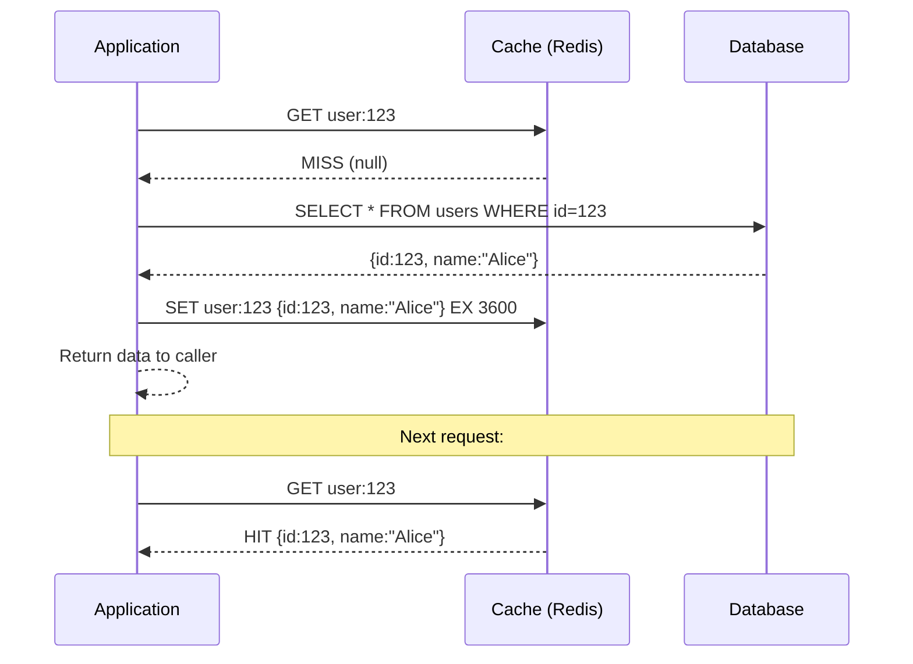
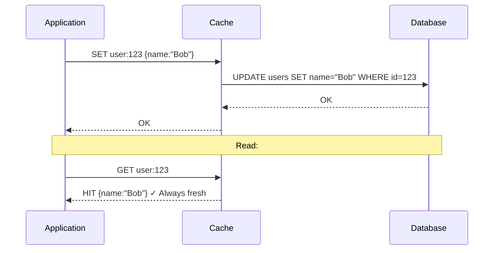
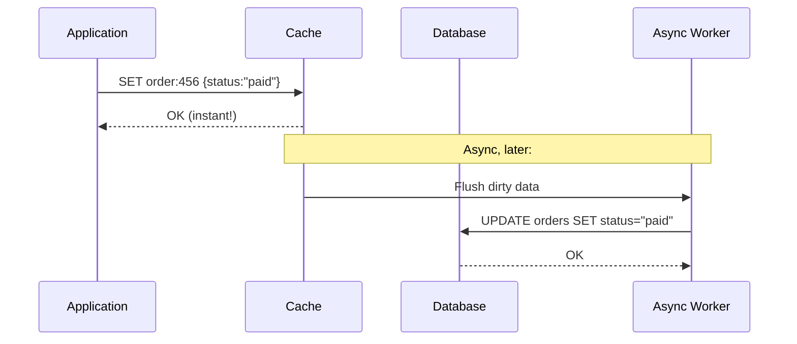
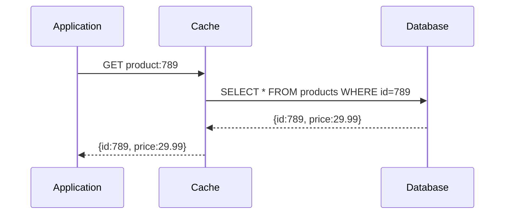
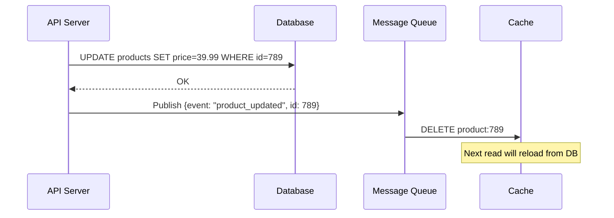

# 🗄️ Caching Systems — The Art of Making Things Fast

> *"There are only two hard things in Computer Science: cache invalidation and naming things."* — Phil Karlton

---

## 📋 Table of Contents

1. [What is Caching?](#what-is-caching)
2. [The Cache Hierarchy](#the-cache-hierarchy)
3. [Caching Strategies](#caching-strategies)
4. [Cache Eviction Policies](#cache-eviction-policies)
5. [Distributed Caching: Redis vs Memcached](#distributed-caching)
6. [Redis Internals Deep Dive](#redis-internals)
7. [Cache Stampede & Thundering Herd](#cache-stampede)
8. [Cache Invalidation](#cache-invalidation)
9. [CDN as a Cache](#cdn-as-a-cache)
10. [Hot Keys Problem](#hot-keys-problem)
11. [Real-Life Scenario](#real-life-scenario)
12. [🔥 Big Tech Story: Facebook's Memcache at Scale](#big-tech-story)
13. [Trade-offs & Drawbacks](#trade-offs)
14. [Best Practices](#best-practices)
15. [Key Takeaways](#key-takeaways)

---

## 🧠 What is Caching?

A **cache** is a high-speed data storage layer that stores a subset of data — typically transient — so that future requests for that data are served faster than by accessing the primary storage location.

The fundamental idea: **avoid repeating expensive work**.

Expensive work can mean:
- A slow database query that takes 200ms
- A CPU-intensive computation (e.g., rendering a report)
- A network call to a third-party API
- Reading from a slow disk

By storing results in fast memory (RAM), subsequent requests get served in **< 1ms** instead of 200ms. That's a **200x speedup**.

### Why is RAM so much faster than disk?

| Storage Type | Latency | Throughput |
|---|---|---|
| CPU L1 Cache | ~0.5 ns | Very High |
| CPU L2 Cache | ~7 ns | High |
| CPU L3 Cache | ~20 ns | High |
| RAM (DRAM) | ~100 ns | ~50 GB/s |
| NVMe SSD | ~100 µs | ~7 GB/s |
| SATA SSD | ~500 µs | ~500 MB/s |
| HDD | ~10 ms | ~150 MB/s |
| Network (same DC) | ~0.5 ms | ~10 Gbps |

**RAM is ~100,000x faster than a spinning disk.** Caching leverages this difference.

---

## 🏗️ The Cache Hierarchy

Caching exists at every layer of a computing system. Understanding the full hierarchy is critical.

```
   ┌─────────────────────────────────────┐
   │           Client Browser            │
   │   (HTTP Cache, Service Worker)      │
   └────────────────┬────────────────────┘
                    │
   ┌────────────────▼────────────────────┐
   │              CDN Edge               │
   │    (Cloudflare, CloudFront, Fastly) │
   └────────────────┬────────────────────┘
                    │
   ┌────────────────▼────────────────────┐
   │           Load Balancer             │
   │     (can cache TLS sessions)        │
   └────────────────┬────────────────────┘
                    │
   ┌────────────────▼────────────────────┐
   │         Application Server          │
   │  (In-process cache: Guava, Caffeine)│
   └────────────────┬────────────────────┘
                    │
   ┌────────────────▼────────────────────┐
   │       Distributed Cache Layer       │
   │       (Redis, Memcached)            │
   └────────────────┬────────────────────┘
                    │
   ┌────────────────▼────────────────────┐
   │            Database                 │
   │   (Query cache, Buffer pool)        │
   └─────────────────────────────────────┘
```

### Layer Details

**1. Browser Cache**
- Stores HTTP responses based on `Cache-Control` headers
- Eliminates network round-trips entirely for repeat visits
- Controlled by `max-age`, `ETag`, `Last-Modified` headers

**2. CDN Cache (Edge Cache)**
- Geographically distributed edge servers
- Caches static and sometimes dynamic content
- Reduces origin server load by 80–95% for media-heavy sites

**3. In-Process / Local Cache**
- Lives inside the application process (e.g., Java's Guava Cache, Caffeine)
- Ultra-fast: no network hop
- ⚠️ Problem: not shared across multiple app server instances → inconsistency

**4. Distributed Cache (Remote Cache)**
- Shared across all app servers (Redis, Memcached)
- Slightly slower than in-process (1–3ms network latency) but consistent
- The most common cache layer in production systems

**5. Database Buffer Pool**
- MySQL InnoDB's buffer pool caches frequently accessed pages in RAM
- Postgres has shared_buffers
- This is automatic and largely invisible to developers

---

## 🎯 Caching Strategies

This is where most engineers make mistakes. Choosing the wrong strategy leads to stale data, cache misses, or inconsistency.

### Strategy 1: Cache-Aside (Lazy Loading)

The application code directly manages the cache. Also called "lazy loading" because data is only loaded into cache on demand.

```
Application reads data:
   1. Check cache first
   2. Cache HIT → return data
   3. Cache MISS → read from DB, write to cache, return data
```



**Write path (updates):**
```
Application writes data:
   1. Write to DB
   2. Invalidate (delete) cache entry
   → Next read will be a cache miss and reload fresh data
```

**Pros:**
- Only requested data is cached (no wasted memory)
- Cache failure doesn't break the app (falls back to DB)
- Works well for read-heavy workloads

**Cons:**
- First request always misses (cold start)
- Potential for stale data between write and cache invalidation
- Three round-trips on cache miss (check cache → DB → write cache)

**When to use:** Most common strategy. Use it as your default for read-heavy systems with tolerable slight staleness.

---

### Strategy 2: Write-Through

Every write to the database is **also** written to the cache simultaneously.



**Pros:**
- Cache is always up-to-date (no stale reads)
- No cache miss on subsequent reads

**Cons:**
- Every write incurs double latency (cache + DB)
- Data written but never read wastes cache memory
- Write failures can cause inconsistency between cache and DB

**When to use:** When data read frequency is high and you cannot tolerate stale reads. Good for user profile data, settings.

---

### Strategy 3: Write-Behind (Write-Back)

Writes go to cache immediately and are **asynchronously** written to DB later.



**Pros:**
- Extremely low write latency (write returns immediately)
- DB gets batched writes → better throughput
- Can coalesce multiple writes (e.g., 100 counter increments → 1 DB write)

**Cons:**
- ⚠️ **Data loss risk**: If cache crashes before flush, writes are lost
- Complex to implement correctly
- Cache and DB temporarily inconsistent

**When to use:** Gaming leaderboards, analytics counters, anywhere you can tolerate potential data loss on crash.

---

### Strategy 4: Read-Through

Cache sits between app and DB. App always talks to cache, never directly to DB.



Cache is responsible for loading from DB on miss. In practice, Redis doesn't natively support this — it requires middleware (e.g., NCache, Ehcache) or application-level implementation.

**Pros:**
- Application code is simpler (always talks to cache)
- Data is automatically populated on first read

**Cons:**
- Cache failure = complete outage (no DB fallback)
- Harder to implement without middleware

---

### Strategy 5: Refresh-Ahead

Cache **proactively** refreshes data before TTL expires, based on predicted access patterns.

```
If a key is accessed and its TTL is < 20% remaining:
   → Asynchronously reload it in the background
   → Serve the (slightly stale) cached version to the current request
```

**Pros:**
- Eliminates cache miss latency for hot data
- No thundering herd on TTL expiry

**Cons:**
- May load data that won't be accessed again (wasted refresh)
- Harder to implement; requires prediction logic

---

### Strategy Comparison Table

| Strategy | Read Latency | Write Latency | Stale Risk | Complexity | Best For |
|---|---|---|---|---|---|
| Cache-Aside | Fast (after warmup) | Normal | Medium | Low | Most systems |
| Write-Through | Fast | Slow (2x) | None | Medium | Read-heavy, consistency critical |
| Write-Behind | Fast | Very Fast | High | High | Write-heavy, loss-tolerant |
| Read-Through | Fast | Normal | Medium | Medium | Simplify app code |
| Refresh-Ahead | Consistent fast | Normal | Low | High | Predictable hot data |

---

## 🗑️ Cache Eviction Policies

When the cache is full, it must decide what to remove. This is controlled by the eviction policy.

### LRU — Least Recently Used

Evicts the item that was **accessed least recently**.

```
Cache (max 3 items):
Access: A, B, C, D

After A: [A]
After B: [A, B]
After C: [A, B, C]
After D: FULL → evict A (oldest access) → [B, C, D]
Access B again → [C, D, B]  (B moves to front)
After E: FULL → evict C → [D, B, E]
```

**Implementation:** Doubly linked list + HashMap → O(1) get and put.

**When to use:** General purpose. Works well when recent access predicts future access (temporal locality). **Redis's default.**

---

### LFU — Least Frequently Used

Evicts the item with the **lowest access frequency**.

```
Cache (max 3):
A accessed 10x, B accessed 2x, C accessed 8x, D new entry
→ Evict B (lowest frequency: 2x)
```

**Problem:** Frequency counter never decays → items accessed heavily in the past but not recently never get evicted ("cache pollution").

**Solution:** LFU with decay — frequency counts decay over time (used by Redis's `allkeys-lfu` policy).

**When to use:** When access frequency truly predicts future need (e.g., product catalog where popular items stay popular).

---

### FIFO — First In, First Out

Evicts the **oldest inserted** item regardless of how recently or frequently it was accessed.

Simple but rarely optimal. Useful only when cache age is a strong predictor of staleness.

---

### TTL — Time To Live

Items automatically expire after a configured duration.

```
SET session:abc "data" EX 1800  # Expires in 30 minutes
```

Not really an eviction "policy" but a freshness mechanism. Always combine with LRU/LFU for when memory fills up.

---

### Redis Eviction Policies (Full List)

| Policy | Description |
|---|---|
| `noeviction` | Return error when memory limit reached |
| `allkeys-lru` | Evict LRU from all keys |
| `volatile-lru` | Evict LRU from keys with TTL set |
| `allkeys-lfu` | Evict LFU from all keys |
| `volatile-lfu` | Evict LFU from keys with TTL set |
| `allkeys-random` | Evict random key from all keys |
| `volatile-random` | Evict random key from keys with TTL |
| `volatile-ttl` | Evict key with shortest TTL |

**Production recommendation:** Use `allkeys-lru` for general caches. Use `volatile-lru` if you need some keys to never be evicted (set no TTL on them).

---

## 🔄 Distributed Caching: Redis vs Memcached

When your app runs on multiple servers, an in-process cache won't work — each server has its own separate cache. You need a **distributed cache** that all servers share.

### Memcached

- Simple key-value store
- Multi-threaded (scales well on multi-core CPUs)
- Only supports string values
- No persistence (pure in-memory, data lost on restart)
- No replication built in
- Used by: Facebook, YouTube (historically)

### Redis

- Single-threaded (I/O multiplexed via epoll)
- Rich data structures: strings, lists, sets, sorted sets, hashes, streams, HyperLogLog, geospatial
- Optional persistence (RDB snapshots + AOF log)
- Built-in replication (master-replica)
- Redis Cluster for horizontal sharding
- Redis Sentinel for HA + automatic failover
- Pub/Sub messaging
- Lua scripting for atomic operations
- Used by: Twitter, GitHub, Stack Overflow, Airbnb, Uber

### Head-to-Head Comparison

| Feature | Redis | Memcached |
|---|---|---|
| Data Structures | Rich (10+ types) | Only strings |
| Persistence | Yes (RDB + AOF) | No |
| Replication | Yes (built-in) | No (third-party) |
| Clustering | Yes (Redis Cluster) | Third-party only |
| Pub/Sub | Yes | No |
| Lua Scripting | Yes | No |
| Transactions | Yes (MULTI/EXEC) | No |
| Memory Efficiency | Good | Slightly better for pure strings |
| Multi-threading | No (single-threaded) | Yes |
| Max value size | 512 MB | 1 MB |
| **Use when** | Feature-rich cache + data store | Simple high-throughput string cache |

**Verdict:** In 2024, **choose Redis** unless you have a very specific reason for Memcached (e.g., extreme multi-core CPU utilization needs with pure string workloads). Redis has evolved into a full data structure server.

---

## 🔬 Redis Internals Deep Dive

### Data Structures

**Strings**
```bash
SET counter 0
INCR counter          # Atomic increment → 1
INCRBY counter 5      # → 6
SET session:xyz "eyJhbGciOiJ..." EX 3600  # With TTL
```

**Lists** (doubly linked list or ziplist for small sizes)
```bash
LPUSH notifications user:123 "You have a new message"
LRANGE notifications user:123 0 9  # Get latest 10
RPOPLPUSH queue:pending queue:processing  # Reliable queue
```

**Sets** (hash table)
```bash
SADD online_users "alice" "bob" "charlie"
SISMEMBER online_users "alice"  # O(1) membership check
SMEMBERS online_users
SUNION online_users_a online_users_b  # Union of two sets
```

**Sorted Sets / ZSets** (skip list + hash table)
```bash
ZADD leaderboard 9500 "player1"
ZADD leaderboard 8200 "player2"
ZADD leaderboard 9800 "player3"
ZREVRANGE leaderboard 0 9 WITHSCORES  # Top 10 with scores
ZRANK leaderboard "player1"           # Rank of player1
```
Sorted sets are the killer feature of Redis — they power leaderboards, timeline feeds, priority queues, and rate limiters.

**Hashes** (ziplist for small, hash table for large)
```bash
HSET user:123 name "Alice" email "alice@example.com" age 30
HGET user:123 name
HGETALL user:123
HINCRBY user:123 login_count 1
```

**HyperLogLog** (probabilistic cardinality estimation)
```bash
PFADD unique_visitors "user:a" "user:b" "user:c"
PFCOUNT unique_visitors  # Returns approximate count
# Uses only 12KB regardless of number of elements!
# ~0.81% error rate
```
Used for counting unique visitors, unique search queries, etc., at massive scale with fixed memory.

**Streams** (append-only log, like Kafka lite)
```bash
XADD events * type "purchase" user_id 123 amount 49.99
XREAD COUNT 10 STREAMS events 0  # Read events
XGROUP CREATE events mygroup $ MKSTREAM  # Consumer groups
```

### Redis Persistence

**RDB (Redis Database) — Snapshots**
- Periodically dumps the entire dataset to disk as a binary `.rdb` file
- Configured: `save 900 1` (save if at least 1 key changed in 900s)
- Fast restart, compact file
- ⚠️ Can lose up to the last few minutes of data

**AOF (Append-Only File) — Write Log**
- Logs every write operation in a text format
- `appendfsync always` — fsync after every write (slowest, safest)
- `appendfsync everysec` — fsync every second (good balance) ← **recommended**
- `appendfsync no` — OS decides (fastest, least safe)
- Larger files, slower restarts
- AOF rewrite compacts the log periodically

**Best practice:** Use **both** — RDB for fast restarts + AOF for durability. Configure `appendonly yes` and `appendfsync everysec`.

### Redis Replication

```
           ┌──────────────┐
           │    Master    │◄── Writes
           └──────┬───────┘
          ┌───────┼────────┐
          ▼       ▼        ▼
      Replica  Replica  Replica
         ► Reads   ► Reads   ► Reads
```

- Asynchronous by default (master doesn't wait for replica acknowledgment)
- `WAIT numreplicas timeout` for synchronous confirmation
- Replica reconnects and gets partial resync (PSYNC) on disconnect

### Redis Sentinel (High Availability)

```
     ┌──────────┐    ┌──────────┐    ┌──────────┐
     │Sentinel 1│    │Sentinel 2│    │Sentinel 3│
     └──────────┘    └──────────┘    └──────────┘
           │               │               │
           └───────────────┴───────────────┘
                           │
           Monitors: ──────┴───────
           ┌──────────┐         ┌──────────┐
           │  Master  │ ──────► │ Replica  │
           └──────────┘         └──────────┘
```

Sentinel provides:
- **Monitoring** — continuously checks if master is alive
- **Notification** — alerts via pub/sub on failure
- **Automatic failover** — promotes a replica to master if master is down (requires quorum of sentinels)
- **Configuration provider** — clients ask sentinel who the current master is

Minimum 3 sentinels for quorum-based failure detection.

### Redis Cluster (Horizontal Sharding)

Redis Cluster shards data across multiple nodes using **hash slots**.

- 16,384 hash slots total
- Each key is assigned to a slot: `slot = CRC16(key) % 16384`
- Each master node owns a range of slots

```
Node A: slots 0     – 5460
Node B: slots 5461  – 10922
Node C: slots 10923 – 16383
```

Each node has replicas for HA. Clients use `MOVED` and `ASK` redirects to find the right node.

```bash
# Hash tags force co-location:
SET {user:123}.profile "..."   # ← {user:123} determines slot
SET {user:123}.settings "..."  # ← Same slot as above
# This allows MGET across both keys!
```

---

## ⚡ Cache Stampede & Thundering Herd

This is one of the most dangerous failure modes in cached systems.

### The Problem

Imagine a popular product page cached with a 1-hour TTL.

```
At t=0:  Key set with TTL=3600s
At t=3600: TTL expires → Cache MISS for ALL concurrent requests
→ 10,000 requests hit the database simultaneously
→ Database gets overwhelmed → crashes or slows drastically
→ All requests are slow or fail
→ Users retry → more requests → death spiral
```

This is the **Thundering Herd** or **Cache Stampede** problem.

### Solution 1: Mutex Lock (Cache Lock)

Only allow one thread to reload the cache. Others wait.

```python
def get_with_lock(key, db_fetch_fn, ttl):
    value = cache.get(key)
    if value:
        return value
    
    lock_key = f"lock:{key}"
    acquired = cache.set(lock_key, "1", nx=True, ex=10)  # NX = only if not exists
    
    if acquired:
        # This thread won the lock - reload from DB
        try:
            value = db_fetch_fn()
            cache.set(key, value, ex=ttl)
        finally:
            cache.delete(lock_key)
        return value
    else:
        # Another thread is loading - wait and retry
        time.sleep(0.1)
        return get_with_lock(key, db_fetch_fn, ttl)  # Retry
```

**Pros:** Prevents stampede  
**Cons:** Waiting threads add latency; deadlock risk if lock holder crashes (mitigated by lock TTL)

### Solution 2: Probabilistic Early Expiration (XFetch)

Refresh the cache **before** it expires, probabilistically.

```python
import math, random, time

def get_with_early_refresh(key, db_fetch_fn, ttl, beta=1.0):
    value, delta, expiry = cache.get_with_metadata(key)
    
    now = time.time()
    # Probabilistically decide to refresh early
    if now - delta * beta * math.log(random.random()) >= expiry:
        # Refresh now (before TTL expires)
        value = db_fetch_fn()
        delta = time.time() - now  # How long the fetch took
        cache.set(key, value, delta=delta, ttl=ttl)
    
    return value
```

The further from expiry, the lower the probability of refresh. As TTL approaches, probability increases. The `beta` parameter controls aggressiveness.

**This is the most elegant solution — no locks, no waiting.**

### Solution 3: Background Refresh

Always serve stale data from cache, refresh asynchronously.

```python
def get_with_background_refresh(key, db_fetch_fn, ttl, stale_ttl):
    value = cache.get(key)
    
    if value is None:
        # Truly expired (even stale TTL passed) - synchronous reload
        value = db_fetch_fn()
        cache.set(key, value, ex=ttl, stale_ex=stale_ttl)
    elif cache.is_stale(key):
        # TTL expired but stale buffer active - serve stale, refresh async
        asyncio.create_task(refresh_async(key, db_fetch_fn, ttl))
    
    return value
```

Related: HTTP's `stale-while-revalidate` header does the same thing for web caches.

---

## 🔄 Cache Invalidation

The hardest problem in caching. When data in the DB changes, the cache must be updated or invalidated.

### Strategy 1: TTL-Based Expiration

Set a TTL and accept eventual staleness.

```
Cache entry: product:789 → {price: 29.99}  TTL: 5 minutes
If price changes in DB → cache serves stale price for up to 5 minutes
At TTL expiry → cache miss → reload fresh data
```

**Simplest approach.** Acceptable when a few minutes of staleness is tolerable.

### Strategy 2: Event-Driven Invalidation

When data changes, publish an event that invalidates the cache.



**More complex but real-time.** Used when staleness is not acceptable (e.g., inventory levels, pricing).

### Strategy 3: Write-Through (Avoid Invalidation Entirely)

Update both DB and cache atomically on every write. The cache is always fresh.

### The "Cache Invalidation is Hard" Problem

Consider a user profile cached on 3 different services:
- `user_service`: caches `{name, email}`
- `feed_service`: caches `{name, avatar}` for display in feeds
- `search_service`: caches `{name}` in search index

When the user changes their name, you need to invalidate all three. This gets exponentially complex in microservices. Solutions:
- **Event bus**: publish `user_updated` event, each service subscribes and invalidates own cache
- **Cache tags / surrogate keys**: tag cache entries and bulk-invalidate by tag
- **Short TTLs**: accept short-lived staleness instead of complex invalidation

---

## 🌐 CDN as a Cache

CDNs are fundamentally distributed caches at the network edge. Key concepts:

### Cache-Control Headers

```
Cache-Control: public, max-age=31536000, immutable
# Public: CDN can cache this
# max-age: browser/CDN cache for 1 year
# immutable: content will never change (use with content-hashed filenames)

Cache-Control: private, max-age=0, no-cache
# Private: only browser can cache (not CDN)
# no-cache: must revalidate with server before using cached copy

Cache-Control: public, max-age=300, stale-while-revalidate=60
# Serve stale for 60s extra while refreshing in background
```

### ETag / Last-Modified (Conditional Requests)

```
Server → Client: ETag: "v3a8b7c"
Client → Server: If-None-Match: "v3a8b7c"
Server → Client: 304 Not Modified  (no body sent → saves bandwidth)
```

---

## 🔥 Hot Keys Problem

In a distributed cache, some keys get far more traffic than others — these are "hot keys."

**Example:** A celebrity post on Twitter. The post data is stored in one Redis shard. During a viral moment, millions of requests/second hit that single shard. Even Redis (capable of ~100K ops/sec per node) can be overwhelmed.

### Solutions

**1. Local in-process cache for hot keys**
```python
# L1 cache: in-process (per app server)
# L2 cache: Redis (shared)

local_cache = {}  # Per-process

def get_post(post_id):
    if post_id in local_cache:
        return local_cache[post_id]  # Fastest: no network
    
    data = redis.get(f"post:{post_id}")
    if data:
        local_cache[post_id] = data  # Promote to L1
        return data
    
    # Fall through to DB...
```

**2. Key replication across multiple Redis nodes**
```
post:viral_123 → Store on all N nodes
Read: randomly pick one node to spread load

# Key naming:
post:viral_123:replica:0
post:viral_123:replica:1
post:viral_123:replica:2
# Read from random replica
```

**3. Read replicas for hot data**

Configure dedicated Redis replicas that handle only reads for hot keys.

**4. Consistent hashing with virtual nodes**

Good sharding distributes keys more evenly, preventing single-node hot spots.

---

## 🛒 Real-Life Scenario

### Problem: Social Media App — Feed Generation

**The situation:** You're building a social media app. When a user visits their home feed, you must:
1. Find all users they follow (say, 200 people)
2. Fetch latest posts from each of those 200 users
3. Sort all posts by time
4. Apply ranking algorithm
5. Return top 50 posts

This requires hundreds of DB queries per feed load. With 1 million daily active users, each loading feed 5x per day = **5 million complex queries/day**.

**Without caching:** Each feed page takes 500ms–2 seconds. DB gets crushed.

**With caching:**

```
Architecture decision: Fan-out on write

When user Alice posts:
  1. Save post to posts DB
  2. Find all of Alice's followers (say, 500 people)
  3. For each follower:
     → ZADD feed:{follower_id} {timestamp} {post_id}
     (Add post to their Redis sorted set feed)

When user Bob views feed:
  1. ZREVRANGE feed:{bob_id} 0 49  → Get top 50 post IDs instantly
  2. MGET post:{id1} post:{id2} ... → Batch fetch post data from Redis
  3. Return to user

Result: Feed load: 2ms instead of 500ms
```

**Problem with celebrities:** If a celebrity has 10 million followers, fan-out on every post writes to 10 million Redis keys. That's too slow!

**Hybrid solution:**
- Regular users (< 10K followers): fan-out on write (push model)
- Celebrities (> 10K followers): fan-out on read — pull their latest posts at read time and merge with pre-computed feed

This is exactly how Twitter and Instagram work.

---

## 🔥 Big Tech Story: Facebook's Memcache at Scale

### The Problem (2013)

Facebook had **over 1 billion users** generating an incomprehensible amount of read traffic. Their MySQL databases were drowning. A single user's page load could require hundreds of database queries — photos, friend lists, news feed, likes, comments.

Facebook's solution: deploy Memcached at a scale no one had ever attempted.

### The Scale

- **Thousands of Memcached servers** across multiple data centers
- **Billions of keys** cached at any moment
- **Trillions of requests per day** served from Memcache
- Single server could handle **~1 million requests/second**

### The Problems Facebook Encountered and Solved

**Problem 1: Thundering Herd / Lease Mechanism**

When a popular key expired, thousands of web servers would simultaneously request the DB.

Facebook invented the **"lease" mechanism**:
- On cache miss, Memcache gives the client a **lease token** (a number)
- Only the client with the lease can populate the cache
- Other clients for the same key wait briefly (or get stale data)
- Prevents stampede completely

**Problem 2: Stale Sets**

Race condition:
1. Client A reads key (miss)
2. Client B updates key → deletes from cache
3. Client A writes old value to cache → stale data!

Solution: Leases also prevent stale sets. A lease is invalidated when the key is deleted/updated.

**Problem 3: Intra-Cluster Failures (Gutter Pool)**

When a Memcache server fails, all its keys become cache misses → DB flood.

Facebook's "Gutter" pool: a small set of backup Memcache servers. When a primary server fails, clients automatically fall back to Gutter servers. Gutter handles the load until the primary is recovered.

**Problem 4: Regional Pools (Cross-Region Replication)**

Facebook has multiple data centers globally. When a key is invalidated in the US data center, the EU data center's cache must also be invalidated.

Solution: After DB writes, a **McSqueal daemon** reads MySQL's binary replication log and sends invalidation commands to all regional Memcache clusters.

### The Result

- **95%+ of read requests** served from Memcache
- Page load times reduced from seconds to milliseconds
- MySQL clusters could handle the remaining 5% easily

### Key Insight

Facebook published a paper "Scaling Memcache at Facebook" (NSDI 2013) that revealed something profound: **a cache layer is not just an optimization — at Facebook's scale, it IS the system.** The database is the fallback, not the primary read path.

---

## ⚖️ Trade-offs & Drawbacks

### 1. Stale Data
Every cache strategy except write-through risks serving outdated data. The question is: **how stale is acceptable?**
- User's own profile data: seconds is probably fine
- Stock price: zero tolerance (no caching, or very short TTL)
- Product description: minutes or hours is fine

### 2. Cache Invalidation Complexity
The "two hard things" problem is real. In a microservices system with 10 services each caching the same user data, invalidation becomes an event-sourcing exercise. Many teams underestimate this until they ship a bug where users see stale data for hours.

### 3. Memory Cost
RAM is expensive. A Redis cluster serving 100GB of cached data is a significant infrastructure cost. You must balance: how much cache do we need vs how much DB load can we afford?

### 4. Cold Start / Stampede on Restart
When your Redis cluster restarts (upgrade, crash), the cache is empty. The resulting DB flood can crash your entire system. **Cache warming scripts** are essential.

### 5. Cache Coherence in Multi-Region
Invalidating a cache key in one data center and ensuring all other data centers see the update within milliseconds is a distributed systems problem. Eventual consistency is the usual compromise.

### 6. Operational Complexity
Redis Cluster requires expertise to operate. Shard rebalancing, failover, memory tuning, eviction policy selection — these are non-trivial operational tasks.

### 7. Security
Redis by default has no authentication. A misconfigured Redis exposed to the internet has led to numerous data breaches. Always use `requirepass`, `bind` to internal interfaces, and firewall rules.

---

## ✅ Best Practices

1. **Always set a TTL** on cached keys. Keys without TTL can fill memory unexpectedly.

2. **Use namespace prefixes** for keys: `user:123`, `product:456`, `session:abc`. Prevents collisions and makes debugging easier.

3. **Cache at the right granularity.** Don't cache a full 10MB JSON blob if you only need 3 fields. Cache the minimal data needed.

4. **Handle cache failures gracefully.** Your app should fall back to the DB if Redis is down, not crash entirely (exception: if you have no DB fallback, document this clearly).

5. **Monitor cache hit rate.** A hit rate below 80–85% means your caching strategy is inefficient. Track `keyspace_hits / (keyspace_hits + keyspace_misses)`.

6. **Avoid caching mutable joins.** Caching complex joined data creates complex invalidation. Cache simple entities separately.

7. **Use connection pooling.** Don't create a new Redis connection per request. Use a pool (e.g., `redis-py`'s `ConnectionPool`).

8. **Size your cache appropriately.** A rough rule: cache the "hot" 20% of your data (Pareto principle) — this handles 80% of reads.

9. **Test cache invalidation paths.** Many bugs are in invalidation logic. Write tests specifically for cache invalidation scenarios.

10. **Use Redis pipeline for batch operations.**
    ```python
    pipe = redis.pipeline()
    for key in keys:
        pipe.get(key)
    results = pipe.execute()  # Single round trip for all
    ```

11. **Consider Redis Cluster for > 10GB of cached data.** Single Redis node has memory limits and is a SPOF even with Sentinel.

12. **Warm the cache before traffic arrives.** After deployment, run a script that pre-populates commonly accessed keys before the load balancer sends traffic.

---

## 🎯 Key Takeaways

| Concept | Core Insight |
|---|---|
| **Cache Hierarchy** | Caches exist at every layer; each layer has different speed/size tradeoffs |
| **Cache-Aside** | Default strategy; lazy-load on miss, invalidate on write |
| **Write-Through** | Keeps cache fresh but doubles write latency |
| **Write-Behind** | Lowest write latency but risks data loss |
| **LRU Eviction** | Best default; evicts least recently used items |
| **Cache Stampede** | TTL expiry + high traffic = DB flood; use mutex, probabilistic expiry, or stale-while-revalidate |
| **Cache Invalidation** | The hardest part; prefer TTL + event-driven invalidation |
| **Redis** | Default choice for distributed caching; rich data structures, persistence, clustering |
| **Hot Keys** | A viral key on one shard can overwhelm it; use local L1 cache + key replication |
| **Facebook's Lesson** | At massive scale, the cache IS the system; DB is just the fallback |

---

*Next: [04_Databases.md](04_Databases.md) — Deep dive into relational and NoSQL databases, ACID, sharding, and replication.*
