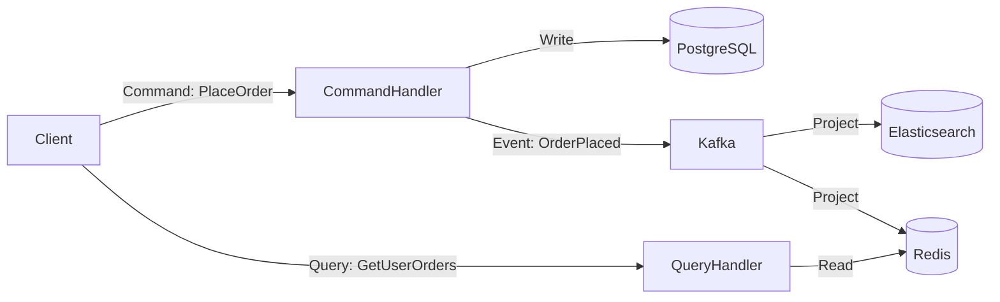

# 📨 Message Queues & Event-Driven Architecture

> *"Instead of services talking directly to each other like people yelling across an office, message queues are like a bulletin board — post your message, let interested parties read it on their own time."*

---

## 📋 Table of Contents

1. [What are Message Queues?](#what-are-message-queues)
2. [Producer-Consumer vs Pub-Sub](#producer-consumer-vs-pub-sub)
3. [Delivery Semantics](#delivery-semantics)
4. [Apache Kafka Deep Dive](#kafka)
5. [RabbitMQ Deep Dive](#rabbitmq)
6. [AWS SQS/SNS](#aws-sqs-sns)
7. [Event-Driven Architecture Patterns](#event-driven-patterns)
8. [CQRS — Command Query Responsibility Segregation](#cqrs)
9. [Event Sourcing](#event-sourcing)
10. [Saga Pattern](#saga-pattern)
11. [Outbox Pattern](#outbox-pattern)
12. [Message Ordering & Idempotency](#ordering-idempotency)
13. [Backpressure](#backpressure)
14. [Real-Life Scenario](#real-life-scenario)
15. [🔥 Big Tech Story: LinkedIn Invents Kafka](#big-tech-story)
16. [Trade-offs & Drawbacks](#trade-offs)
17. [Best Practices](#best-practices)
18. [Key Takeaways](#key-takeaways)

---

## 📬 What are Message Queues?

A **message queue** is middleware that allows services to communicate **asynchronously** by passing messages through a buffer. The sender (producer) doesn't need to wait for the receiver (consumer) to process the message.

**Without message queue (synchronous, tight coupling):**
```
Order Service ──HTTP──► Inventory Service (must be available)
              ──HTTP──► Notification Service (must be available)
              ──HTTP──► Analytics Service (must be available)

If any service is down → Order Service fails
If any service is slow → Order Service is slow
```

**With message queue (asynchronous, loose coupling):**
```
Order Service ──► [Order Queue] ◄── Inventory Service (reads when ready)
                                ◄── Notification Service
                                ◄── Analytics Service

Order Service publishes message and returns immediately (< 5ms)
Each downstream service processes at its own pace
If Notification Service is down → messages queue up, processed on recovery
```

**Core benefits:**
- **Decoupling:** Producer doesn't know about consumers
- **Resilience:** Consumer downtime doesn't fail the producer
- **Rate matching:** Queue absorbs bursts; consumers process at sustainable rate
- **Replayability:** Messages can be replayed (in Kafka) for reprocessing
- **Parallelism:** Multiple consumers process in parallel

---

## 🔀 Producer-Consumer vs Pub-Sub

### Point-to-Point (Producer-Consumer / Queue)

A message is consumed by **exactly one** consumer.

```
Producer ──► [Queue] ──► Consumer A (gets msg 1)
                    ──► Consumer B (gets msg 2)
                    ──► Consumer A (gets msg 3)
```

- Message is deleted after one consumer processes it
- Multiple consumers share the work (competing consumers pattern)
- Used for: job queues, task distribution, work queues
- **Examples:** RabbitMQ queues, AWS SQS

**Use case:** Video transcoding — each upload message should be processed by exactly one transcoding worker.

### Publish-Subscribe (Pub-Sub / Topic)

A message is delivered to **all** subscribers.

```
Publisher ──► [Topic] ──► Subscriber A (gets all messages)
                     ──► Subscriber B (gets all messages)
                     ──► Subscriber C (gets all messages)
```

- Each subscriber gets their own copy of every message
- Used for: event broadcasting, notifications, fan-out
- **Examples:** Kafka topics (each consumer group gets all messages), AWS SNS, Redis Pub/Sub

**Use case:** Order placed event — inventory service, notification service, and analytics service ALL need to process each order independently.

### The Hybrid: Kafka's Model

Kafka combines both models:
- Multiple **consumer groups** (each group = one logical subscriber → pub/sub)
- Within a consumer group, partitions split work across consumers (→ point-to-point)

```
Kafka Topic: "orders"
  Partition 0: [msg1, msg3, msg5]
  Partition 1: [msg2, msg4, msg6]

Consumer Group A (Inventory):
  Consumer A1 reads Partition 0
  Consumer A2 reads Partition 1
  → All messages processed once by the group

Consumer Group B (Analytics):
  Consumer B1 reads Partition 0
  Consumer B2 reads Partition 1
  → Same messages, independently processed
```

---

## 📜 Delivery Semantics

Arguably the most important concept in messaging systems.

### At-Most-Once

Message is delivered zero or one time. **Messages can be lost.** Fastest, simplest.

```
Producer: Send msg → Broker: Deliver to consumer immediately
If consumer crashes during processing → message is lost
```

**When to use:** High-frequency metrics/logs where losing a few messages is acceptable (counter analytics, monitoring samples).

### At-Least-Once

Message is delivered one or more times. **Messages will never be lost but may be duplicated.**

```
Producer: Send msg → Broker: Deliver to consumer
Consumer: Process msg → Ack to broker
If ack is lost → Broker resends → Consumer processes again (DUPLICATE!)
```

**When to use:** Most production systems. Consumers must be idempotent (processing the same message twice has the same effect as once).

### Exactly-Once

Message is delivered exactly once, never lost, never duplicated. The hardest to achieve.

**Kafka's implementation:**
1. **Idempotent producer:** Each message has a sequence number. Broker deduplicates resent messages (within a session).
2. **Transactional producer:** Messages written to multiple partitions atomically. Either all succeed or none.
3. **Transactional consumer:** Consumer commits offset as part of same transaction as database write. If the DB write fails, offset isn't committed → message reprocessed.

```python
# Kafka exactly-once with transactions
producer = KafkaProducer(transactional_id="order-processor-1")
producer.init_transactions()

try:
    producer.begin_transaction()
    producer.send("output-topic", key=order_id, value=processed_order)
    producer.send_offsets_to_transaction(consumer_offsets, consumer_group)
    producer.commit_transaction()
except Exception:
    producer.abort_transaction()
```

**When to use:** Financial transactions, inventory deductions — anywhere duplicates cause data corruption.

---

## ⚡ Apache Kafka Deep Dive

### Origin Story

LinkedIn built Kafka in 2010 to handle their data pipeline problem (see Big Tech Story). Open-sourced in 2011. Now the de facto standard for high-throughput event streaming.

### Core Concepts

**Topic:** A named stream of messages. Like a database table, but for a stream of events.

**Partition:** A topic is divided into partitions for parallelism. Each partition is an ordered, immutable sequence of messages.

```
Topic: "user-events"
  Partition 0: [login:alice, click:alice, purchase:alice]
  Partition 1: [login:bob, click:bob]
  Partition 2: [login:carol, search:carol, logout:carol]

Each partition is an append-only log.
```

**Offset:** Each message in a partition has a unique sequential number (offset). Consumers track which offset they've read.

**Broker:** A Kafka server. A Kafka cluster is multiple brokers. Each partition has one **leader broker** (handles reads/writes) and multiple **follower brokers** (replicas).

**Producer:** Application that writes messages to Kafka topics. Chooses which partition based on:
- Message key hash (same key → same partition → ordering guaranteed)
- Round-robin (no key → even distribution)
- Custom partitioner

**Consumer:** Application that reads messages. Maintains offset in a special `__consumer_offsets` topic.

**Consumer Group:** A set of consumers that cooperate to consume a topic. Each partition is assigned to exactly one consumer in the group. Adding consumers to a group = horizontal scaling.

```
Topic (3 partitions) + Consumer Group (3 consumers):
  Partition 0 → Consumer 1 (exclusive)
  Partition 1 → Consumer 2 (exclusive)
  Partition 2 → Consumer 3 (exclusive)

Topic (3 partitions) + Consumer Group (2 consumers):
  Partition 0, Partition 1 → Consumer 1
  Partition 2              → Consumer 2

More partitions than consumers = some consumers handle multiple
More consumers than partitions = some consumers are idle (wasteful)
```

### Why Kafka is Fast

**1. Sequential disk I/O**
Kafka's log is append-only. Every write is sequential. Sequential writes on HDD: ~1GB/s. Random writes: ~100MB/s. Kafka fully exploits this.

**2. Zero-Copy Transfer**
Traditional read flow (4 copies):
```
Disk → Kernel buffer → Application buffer → Socket buffer → NIC
```

Kafka uses `sendfile()` syscall (zero-copy):
```
Disk → Kernel buffer → NIC  (skips userspace entirely)
```

This is why a single Kafka broker can serve multiple GB/s.

**3. Page Cache**
Kafka relies on the OS page cache rather than maintaining its own in-memory cache. This allows Kafka to serve warm data (recent messages) from RAM with no extra copying.

**4. Batching**
Producers batch multiple messages into one network request. Consumers read batches. Compression applied at batch level (lz4, snappy, gzip, zstd).

### Kafka Replication

```
Partition 0 of Topic "orders":
  Broker 1: Leader (ISR)    ← Producer writes here
  Broker 2: Follower (ISR)  ← Replicating
  Broker 3: Follower (ISR)  ← Replicating
```

**ISR (In-Sync Replicas):** Set of replicas that are fully caught up with the leader. Messages are acknowledged to producers only when written to all ISR members (configurable via `acks`).

**Producer `acks` setting:**
- `acks=0`: Don't wait for any acknowledgment → fastest, highest data loss risk
- `acks=1`: Wait for leader to write → fast, data loss if leader crashes before replication
- `acks=all` (or `-1`): Wait for all ISR to write → slowest, highest durability ← **production default**

**Leader Election:** When a leader fails, a new leader is elected from the ISR. ZooKeeper (or KRaft) manages metadata and leader election.

### KRaft Mode (Kafka without ZooKeeper)

Historically Kafka required ZooKeeper for metadata management. As of Kafka 3.3+, KRaft (Kafka Raft) mode is production-ready.

- Metadata stored in Kafka itself (a special `@metadata` topic)
- Raft consensus for leader election among controllers
- Simpler operations (one fewer system to manage)
- 10x faster shutdown and startup
- Supports millions of partitions (ZooKeeper was limited to tens of thousands)

### Log Compaction

For topics representing state (not event streams), Kafka supports log compaction:
```
Before compaction (user profile updates):
  key=user:1, value={name:"Alice"}
  key=user:2, value={name:"Bob"}
  key=user:1, value={name:"Alice Smith"}  ← latest update for user:1
  key=user:3, value={name:"Carol"}
  key=user:2, value=null (delete)

After compaction:
  key=user:1, value={name:"Alice Smith"}  ← only latest retained
  key=user:3, value={name:"Carol"}
  key=user:2, value=null (tombstone, will be deleted after retention)
```

This turns Kafka into a **database-like store** for the latest state of each key, while retaining event history for new consumers to replay.

### Kafka Streams

A Java library for building stream processing applications on top of Kafka.

```java
StreamsBuilder builder = new StreamsBuilder();
KStream<String, Order> orders = builder.stream("orders");

// Count orders per user in a 1-hour window
orders
    .groupBy((key, order) -> order.getUserId())
    .windowedBy(TimeWindows.of(Duration.ofHours(1)))
    .count()
    .toStream()
    .to("order-counts-per-user");
```

Features: windowed aggregations, joins between streams and tables, stateful processing with RocksDB state store.

### Kafka Performance Numbers

| Metric | Value |
|---|---|
| Throughput per broker | 100 MB/s to 1 GB/s |
| Message latency | 2-10 ms (end-to-end) |
| Max messages stored | Petabytes (just disks) |
| Retention | Configurable (7 days default) |
| Max message size | 1 MB default (configurable) |
| LinkedIn's peak throughput | 7 trillion messages/day |

---

## 🐇 RabbitMQ Deep Dive

RabbitMQ is a traditional message broker implementing the **AMQP (Advanced Message Queuing Protocol)**.

### Core Concepts

**Exchange:** Receives messages from producers and routes them to queues based on routing rules.

**Queue:** Stores messages until consumers process them. Messages are deleted after acknowledgment.

**Binding:** Rules connecting exchanges to queues (routing key patterns).

**Exchange Types:**

**Direct Exchange:** Route to queue whose binding key exactly matches the message's routing key.
```
Exchange: order_exchange (direct)
Message routing key: "order.paid"
Binding: queue "payment_processor" bound with key "order.paid"
→ Message goes to "payment_processor" queue
```

**Topic Exchange:** Route based on wildcard pattern matching.
```
# wildcards: * (one word) and # (zero or more words)
Binding: queue "us_orders" bound with pattern "order.us.#"
Binding: queue "all_orders" bound with pattern "order.#"

Message "order.us.paid" → goes to both queues
Message "order.eu.paid" → goes to "all_orders" only
```

**Fanout Exchange:** Broadcasts to ALL bound queues (ignore routing key).
```
Exchange: notification_fanout
Bound queues: email_queue, sms_queue, push_queue
→ Every message goes to all three queues
```

**Headers Exchange:** Routes based on message header attributes instead of routing key.

### Dead Letter Queue (DLQ)

When a message cannot be processed (consumer rejects it, TTL expires, queue is full), it's sent to a **Dead Letter Exchange** and routed to a DLQ.

```
Normal Queue ──► Consumer fails 3 times ──► Dead Letter Exchange ──► DLQ
```

DLQ allows:
- Manual inspection of failed messages
- Replay after fixing the consumer bug
- Alerting on processing failures

### RabbitMQ vs Kafka

| Feature | RabbitMQ | Kafka |
|---|---|---|
| **Model** | Message broker (smart broker, dumb consumer) | Distributed log (dumb broker, smart consumer) |
| **Message deletion** | After consumer acks | After retention period (consumers track offset) |
| **Replay** | No (messages deleted) | Yes (seek to any offset) |
| **Throughput** | ~50K-100K msgs/sec | ~1M+ msgs/sec |
| **Ordering** | Per queue | Per partition |
| **Push vs Pull** | Push (broker pushes to consumer) | Pull (consumer polls) |
| **Routing** | Powerful (exchange types) | Simple (partition key) |
| **Consumer groups** | Competing consumers | Each group gets all messages |
| **Use case** | Complex routing, RPC, task queues | High-throughput event streaming, log aggregation |
| **Message size** | Small-medium | Small-medium (default 1MB) |
| **Persistence** | Optional | Yes (core feature) |

**Choose RabbitMQ when:** You need sophisticated routing logic, priority queues, request-reply patterns, or RPC over messaging.

**Choose Kafka when:** You need high throughput, event replay/reprocessing, audit log, or event sourcing.

---

## ☁️ AWS SQS / SNS

### SQS — Simple Queue Service

Fully managed message queue. No servers to manage.

**Standard Queue:**
- At-least-once delivery
- Messages may arrive out of order
- Unlimited throughput
- Messages retained for 4 days (configurable to 14 days)

**FIFO Queue:**
- Exactly-once processing (deduplication within 5-minute window)
- Strict ordering preserved
- 3,000 msgs/sec with batching (300 without)

**Key features:**

**Visibility Timeout:** When a consumer reads a message, the message becomes invisible to other consumers for a duration. If the consumer doesn't delete it within that time, it becomes visible again (re-delivery for retry).

```
Consumer reads message → message invisible for 30s
Consumer processes and deletes → message gone ✓
Consumer crashes → message reappears after 30s → another consumer retries ✓
```

**Dead Letter Queue integration:** Messages that fail processing N times go to a DLQ.

**Long polling:** Instead of polling every second (short poll), consumer waits up to 20 seconds for a message. Reduces API calls and cost.

### SNS — Simple Notification Service

Fully managed pub-sub. Fan-out to multiple destinations.

```
SNS Topic "order-placed"
  └──► SQS Queue (for inventory service)
  └──► SQS Queue (for notification service)
  └──► Lambda function (real-time analytics)
  └──► HTTP endpoint (third-party webhook)
  └──► Email (alert)
  └──► SMS
```

**Fan-out pattern (SNS + SQS):**
```
Order Service
    │
    ▼
SNS Topic
    ├──► SQS Queue A ──► Inventory Worker
    ├──► SQS Queue B ──► Email Worker
    └──► SQS Queue C ──► Analytics Worker
```

Each SQS queue acts as a buffer for each downstream service. Services are fully decoupled and independently scalable.

---

## 🏛️ Event-Driven Architecture Patterns

### What is Event-Driven Architecture (EDA)?

Services communicate by emitting and responding to **events** rather than direct API calls.

An event is a notification that something happened: `OrderPlaced`, `PaymentProcessed`, `ItemShipped`.

**Benefits:**
- Services are loosely coupled (emitter doesn't know who listens)
- New consumers can be added without changing the emitter
- Natural audit trail (event history)
- Resilience through asynchrony

---

## 🔄 CQRS — Command Query Responsibility Segregation

CQRS separates the **write model** (Commands) from the **read model** (Queries).

**Without CQRS (single model):**
```
Database: one schema serving both reads and writes
Write: INSERT INTO orders... (normalized, relational)
Read: SELECT o.*, u.name, p.title FROM orders o JOIN users... (complex JOIN)
→ Same database, same schema, tension between write optimization and read optimization
```

**With CQRS:**
```
Write Side (Command Model):
  → Normalized relational DB (optimized for integrity and write correctness)
  → Order placed → write to PostgreSQL orders table

Event Bus (synchronization):
  → OrderPlaced event → published to Kafka

Read Side (Query Model):
  → Denormalized read models (optimized for specific queries)
  → Elasticsearch index of orders with embedded user name and product details
  → Redis sorted set of recent orders per user
  → Pre-aggregated dashboard counters
```



**Benefits:**
- Write DB and read DB optimized independently
- Read DB can be scaled independently (add more Elasticsearch nodes)
- Different technologies for different access patterns

**Drawbacks:**
- Eventual consistency between write and read models
- More complex: multiple data stores to manage
- Read model may be temporarily stale after a write

---

## 📚 Event Sourcing

Instead of storing current state, store the **sequence of events** that led to the current state.

**Traditional state storage:**
```sql
Table: accounts
id | balance | last_updated
1  | 1500    | 2024-01-15
-- Balance changed, but HOW did it change? Lost!
```

**Event sourcing:**
```
Event store:
account_id | sequence | event_type    | amount | timestamp
1          | 1        | AccountOpened | 1000   | 2024-01-01
1          | 2        | MoneyDeposited| 500    | 2024-01-10
1          | 3        | MoneyWithdrawn| 200    | 2024-01-12  (oops, wrong amount)
1          | 4        | MoneyDeposited| 200    | 2024-01-12  (correction)

Current balance = 1000 + 500 - 200 + 200 = 1500 ✓
```

**Current state is derived by replaying events.**

**Benefits:**
- Complete audit trail — know the "how" and "why" for every state
- Time travel — reconstruct state at any past point in time
- Event replay — reprocess events with new logic (e.g., add a new feature to historical data)
- Natural fit with CQRS and event-driven architecture

**Drawbacks:**
- Query by current state is complex (must rebuild state from events or maintain projections)
- Event schema evolution is difficult (old events must still be replayable)
- Storage grows indefinitely (mitigated by snapshotting)

**Snapshotting:** Periodically save a snapshot of current state. On recovery, load latest snapshot + replay only events since snapshot.

**Event sourcing is best used for:** Financial systems, audit-heavy domains, systems that need "undo", complex domain logic (DDD bounded contexts).

---

## 🎭 Saga Pattern

Distributed transactions across multiple microservices without using 2PC (two-phase commit).

**Problem:** An order involves:
1. Reserve inventory (Inventory Service)
2. Charge payment (Payment Service)
3. Schedule delivery (Shipping Service)

Each is a separate service with its own DB. How do you ensure all succeed or all roll back?

### Choreography-Based Saga

Services react to events without a central coordinator.

```
Order Service   ──emit──►  OrderCreated event
Inventory Service ◄──────  Listens → Reserves inventory
                ──emit──►  InventoryReserved event
Payment Service  ◄──────  Listens → Charges payment
                ──emit──►  PaymentProcessed event
Shipping Service ◄──────  Listens → Schedules delivery
                ──emit──►  DeliveryScheduled event
Order Service   ◄──────  Listens → Marks order complete
```

**If payment fails:**
```
Payment Service ──emit──► PaymentFailed event
Inventory Service ◄──────  Listens → Releases reservation (compensating transaction)
Order Service   ◄──────  Listens → Marks order failed
```

**Pros:** Simple, no central SPOF, decoupled  
**Cons:** Hard to visualize overall flow, distributed debugging is complex

### Orchestration-Based Saga

A central **saga orchestrator** (or order saga) manages the flow and calls each service.

```
       ┌─────────────────────────────┐
       │       Saga Orchestrator     │
       │  (Order Saga / State Machine)│
       └─────────────────────────────┘
           │         │          │
    Reserve     Charge      Schedule
    Inventory   Payment     Delivery
           │         │          │
    If any fails:
    Orchestrator calls compensating transactions:
    - Release inventory reservation
    - Refund payment
    - Cancel delivery
```

**Pros:** Clear flow, easier debugging, centralized state  
**Cons:** Orchestrator is a SPOF if not carefully designed, more complex service

**Compensation:** Each step must have a corresponding compensation (rollback) action. Compensations are not the same as rollback — they're new events that undo the effect.

| Step | Compensation |
|---|---|
| Reserve inventory | Release reservation |
| Charge payment | Issue refund |
| Create shipment | Cancel shipment |

---

## 📮 Outbox Pattern

Solving the "dual write" problem: how do you atomically write to a DB and publish an event?

**The problem:**
```python
# Non-atomic dual write — DANGEROUS!
db.execute("INSERT INTO orders ...")  # Succeeds
kafka.send("order-placed", order)     # Crashes? Event lost!

# Or:
kafka.send("order-placed", order)     # Succeeds
db.execute("INSERT INTO orders ...")  # Crashes? Event published but order not saved!
```

**The Outbox Pattern:**
```
Step 1: In ONE database transaction:
  INSERT INTO orders (...)
  INSERT INTO outbox_events (event_type, payload, published=false)
  COMMIT; ← Atomic!

Step 2: Background worker (outbox relay):
  SELECT * FROM outbox_events WHERE published=false
  → Publish to Kafka
  → UPDATE outbox_events SET published=true

→ At-least-once delivery (same event may be published twice if worker crashes mid-way)
→ Make consumers idempotent
```

**Alternatively, use CDC (Change Data Capture):**
- Debezium reads the DB binlog/WAL
- Automatically publishes DB changes as Kafka events
- No outbox table needed (DB binlog IS the outbox)

---

## 🔢 Message Ordering & Idempotency

### Ordering

Kafka guarantees ordering **within a partition**. If you need messages for the same entity to be ordered:
- Use the entity ID as the partition key
- All messages for user:123 go to the same partition → ordered

```python
# Kafka producer with ordering
producer.send(
    topic="user-events",
    key=b"user:123",         # Same key → same partition → ordered
    value=json.dumps(event)
)
```

**Global ordering** across all partitions is expensive and limits parallelism. Avoid requiring it.

### Idempotency

At-least-once delivery means your consumer may process the same message multiple times. Design consumers to be **idempotent** — processing the same message N times has the same effect as processing it once.

**Idempotency strategies:**

**Unique constraint in DB:**
```sql
INSERT INTO processed_orders (order_id, ...)
ON CONFLICT (order_id) DO NOTHING;  -- Duplicate → ignored
```

**Idempotency key:**
```python
def process_payment(event):
    payment_id = event["payment_id"]
    
    # Check if already processed
    if db.exists("processed_payments", payment_id):
        return  # Skip duplicate
    
    # Process payment
    charge_customer(event)
    
    # Mark as processed
    db.insert("processed_payments", payment_id)
```

**Optimistic locking with version:**
```sql
UPDATE accounts
SET balance = balance + 100, version = version + 1
WHERE id = 123 AND version = 5;  -- Only applies once (version 5 → 6)
```

---

## 🛡️ Backpressure

When producers are faster than consumers, the queue fills up. **Backpressure** is the mechanism to signal to producers to slow down.

**Symptoms of missing backpressure:**
- Queue depth grows unboundedly
- Eventually: OOM, disk full, system crash

**Solutions:**

**1. Bounded queues + blocking producer**
```python
queue = Queue(maxsize=1000)  # Blocks when full
producer.put(message)  # Waits if queue is full
```

**2. Rate limiting on the producer side**
Monitor consumer lag (Kafka consumer group lag). If lag exceeds threshold, slow down the producer.

**3. Drop with notification**
If queue is full, drop message and emit a metric/alert. Acceptable for non-critical data (analytics samples).

**4. Reactive Streams**
Libraries like Project Reactor (Java) and RxJS implement backpressure protocols where consumers signal their capacity to producers.

---

## 📦 Real-Life Scenario: E-Commerce Order Processing

**The situation:** An e-commerce platform receives 50,000 orders per minute during a sale event.

**Naive implementation (synchronous):**
```
Order API receives order
  → Call Inventory Service (100ms)
  → Call Payment Service (200ms)
  → Call Notification Service (150ms)
  → Call Analytics Service (100ms)
  → Return to user after 550ms (serial)
  
If ANY service is slow/down → order fails
At 50K orders/min = 833/sec → all 4 services must handle 833 RPS each
```

**Event-driven implementation with Kafka:**

```
Order API receives order:
  1. Validate order (20ms)
  2. Save to DB (10ms)
  3. Publish "OrderCreated" event to Kafka (5ms)
  4. Return "Order accepted" to user (35ms total!)

Downstream (async):
  Inventory Consumer Group:
    - Reads OrderCreated events
    - Reserves inventory
    - Publishes "InventoryReserved" or "InsufficientInventory"
  
  Payment Consumer Group:
    - Reads "InventoryReserved" events
    - Charges payment
    - Publishes "PaymentProcessed" or "PaymentFailed"
  
  Notification Consumer Group:
    - Reads "PaymentProcessed" events
    - Sends confirmation email/SMS
  
  Analytics Consumer Group:
    - Reads all events
    - Updates real-time dashboards

Benefits:
  - User gets response in 35ms (not 550ms)
  - Each downstream service scales independently
  - Payment service being slow doesn't affect order acceptance
  - Notification service outage → messages queue up, delivered when it recovers
  - Replay all events to fix a bug in analytics calculation
```

**Kafka configuration for this system:**
```yaml
Topic: order-events
  Partitions: 50  (supports 50 parallel consumers per group)
  Replication factor: 3
  Retention: 7 days
  Acks: all  (durability for payment data)

Consumer Group: inventory-processors
  Consumers: 50  (one per partition)
  
Consumer Group: payment-processors
  Consumers: 50

Auto offset commit: false  (manual commit for exactly-once)
```

---

## 🔥 Big Tech Story: LinkedIn Invents Kafka

### The Year: 2010. The Problem: LinkedIn's Data Pipeline Hell.

LinkedIn was growing at breakneck speed. By 2010, they had 100 million users and were adding millions per week. Their engineers were drowning in a chaos of data pipelines.

**The problem they faced:**

LinkedIn had dozens of services (job recommendations, people you may know, ad targeting, analytics). Each service needed data from multiple other services. They built **point-to-point data pipelines** — essentially custom ETL jobs between every pair of services that needed data.

The result: a spiderweb of 50+ custom pipelines.

```
Service A ──► Pipeline 1 ──► Service B
Service A ──► Pipeline 2 ──► Service C
Service B ──► Pipeline 3 ──► Service D
Service C ──► Pipeline 4 ──► Service E
...
```

- Each pipeline had different reliability, latency, and format guarantees
- Adding a new service meant building 10 new pipelines (one per existing service it needed data from)
- No way to replay historical data for new models
- Operations nightmare: 50+ ETL jobs to monitor and maintain

**The insight:** Jay Kreps, Neha Narkhede, and Jun Rao at LinkedIn realized they were rebuilding a concept from operating systems — the **log**. A log is the simplest possible data structure: append-only, ordered by sequence. And it's the foundation of databases (WAL), version control (git), and replication.

What if they built a distributed log that all services could write to and read from?

**The solution: Apache Kafka**

Named after the author Franz Kafka (Jay Kreps liked Kafka's writing and the name had a "nice ring" to it for a system involving messaging).

```
Service A ──► Kafka ◄── Service B reads
Service B ──► Kafka ◄── Service C reads
Service C ──► Kafka ◄── Service D reads
...

All services write to Kafka.
All services read from Kafka.
Zero point-to-point pipelines.
```

**The key innovations:**
1. **The log is the contract.** Every event ever published is retained (for days/weeks). New consumers can read history. Bug fixes can replay events.
2. **Consumer groups** mean the same event stream serves multiple independent consumers.
3. **Partitioning** provides horizontal scale without sacrificing order within a partition.
4. **Sequential I/O** makes Kafka 100x faster than traditional message queues for high throughput.

**LinkedIn's results:**
- Replaced 50+ point-to-point pipelines with a single Kafka cluster
- Each new service needed to write to Kafka once and read once — done
- Historical data replay became trivial
- LinkedIn published the paper "Kafka: a Distributed Messaging System for Log Processing" at NetDB 2011

**Open sourced in 2011.** By 2014, Kafka was used by 30% of the Fortune 500. Today, companies like Netflix, Uber, Airbnb, Twitter, and Goldman Sachs process trillions of messages per day through Kafka.

Jay Kreps, Neha Narkhede, and Jun Rao left LinkedIn in 2014 to found **Confluent**, a company built around Kafka, now valued at billions of dollars.

**The lesson:** The best distributed systems solve a problem that is fundamentally annoying, universal, and unsolved — and often the solution is elegant simplicity, not complexity. The log — a concept as old as databases — became the foundation of modern data infrastructure.

---

## ⚖️ Trade-offs & Drawbacks

### Kafka Trade-offs

| Pro | Con |
|---|---|
| Extremely high throughput | High operational complexity |
| Event replay and reprocessing | ZooKeeper/KRaft expertise required |
| Retention-based durability | Not designed for small message counts |
| Horizontal scalability | Consumer lag monitoring needed |
| Exactly-once possible | Higher latency than in-memory queues |
| | Ordering only within partitions, not globally |

### RabbitMQ Trade-offs

| Pro | Con |
|---|---|
| Simple to get started | Lower throughput than Kafka |
| Complex routing (topic, fanout) | Messages deleted after consumption |
| Push model (lower consumer complexity) | No native replay |
| Mature, well-understood | Scaling requires careful setup |
| Good for small-scale task queues | Not designed for event streaming |

### Event-Driven Architecture Trade-offs

| Pro | Con |
|---|---|
| Loose coupling | Eventual consistency (hard to reason) |
| Independent scaling | Debugging distributed flows is complex |
| Natural resilience | Schema evolution is painful |
| Audit trail | Testing requires event simulation |
| | Idempotency must be carefully designed |

---

## ✅ Best Practices

1. **Design consumers to be idempotent.** Assume at-least-once delivery. Duplicate events WILL happen.

2. **Always set a Dead Letter Queue.** Failed messages should go somewhere for inspection, not disappear silently.

3. **Monitor consumer lag.** Kafka's consumer group lag (how many messages behind a consumer is) is your primary health metric. Lag > 100K messages = consumer is struggling.

4. **Choose partition count carefully.** Partitions are the unit of parallelism. You can only have as many consumers in a group as there are partitions. Increasing partition count later is possible but requires careful planning. Start with more than you think you need.

5. **Use meaningful event names.** Past tense, fact-based: `OrderPlaced`, `PaymentProcessed`, `UserDeactivated` — not `ProcessOrder`.

6. **Include schema versioning in events.** Use Avro with Schema Registry (Confluent) or Protobuf. Schema evolution breaks consumers if not managed.

7. **Keep events small.** Events should contain references (order_id) not full payloads. Large payloads increase Kafka storage and consumer memory. If consumers need full data, they fetch it from the source service.

8. **Use the Outbox Pattern** for reliable event publishing from a service. Never do dual writes (DB + Kafka) without a transaction mechanism.

9. **Set reasonable retention policies.** 7 days is a good default. Longer for audit/compliance (90 days, 1 year). Storage is cheap; losing events is expensive.

10. **Plan for event ordering requirements upfront.** If you need order events for user X to be processed in order, use user_id as partition key from day 1.

---

## 🎯 Key Takeaways

| Concept | Core Insight |
|---|---|
| **Async messaging** | Decouple producers from consumers; absorb traffic spikes |
| **Pub-Sub vs Queue** | Pub-Sub = all consumers get all messages; Queue = one consumer per message |
| **Exactly-once** | Hardest guarantee; use Kafka transactions or idempotent consumers with at-least-once |
| **Kafka** | Distributed log; high throughput; replay; consumer groups; partitioned ordering |
| **RabbitMQ** | Broker with complex routing; better for task queues and RPC patterns |
| **CQRS** | Separate write and read models for independent optimization |
| **Event Sourcing** | Store events not state; enables replay, audit, time travel |
| **Saga** | Distributed transactions via compensating events; choreography vs orchestration |
| **Outbox Pattern** | Atomic DB write + event publish without distributed transactions |
| **LinkedIn's Lesson** | The log is the universal foundation; a central event hub beats N×M pipelines |

---

*Next: [06_API_Design.md](06_API_Design.md) — REST, GraphQL, gRPC, and WebSockets for building powerful APIs.*
