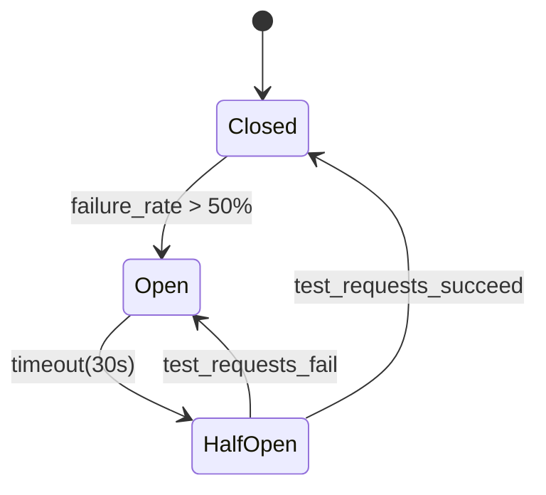

# 🏗️ Microservices Architecture

> *"Don't start with microservices. Earn them."* — Sam Newman

---

## 📋 Table of Contents

1. [Monolith vs SOA vs Microservices](#monolith-vs-soa-vs-microservices)
2. [Why Microservices?](#why-microservices)
3. [Domain-Driven Design (DDD)](#domain-driven-design)
4. [Service Communication Patterns](#service-communication)
5. [Service Discovery](#service-discovery)
6. [Resilience Patterns](#resilience-patterns)
7. [Distributed Tracing](#distributed-tracing)
8. [Service Mesh](#service-mesh)
9. [Containerization & Kubernetes](#kubernetes)
10. [12-Factor App Principles](#12-factor)
11. [Strangler Fig Pattern](#strangler-fig)
12. [Data Management in Microservices](#data-management)
13. [Real-Life Scenario: Netflix Architecture](#real-life-scenario)
14. [🔥 Big Tech Story: Amazon's Two-Pizza Team & API Mandate](#big-tech-story)
15. [Trade-offs & Drawbacks](#trade-offs)
16. [Best Practices](#best-practices)
17. [Key Takeaways](#key-takeaways)

---

## 🏛️ Monolith vs SOA vs Microservices

### The Monolith

A single deployable unit containing all application code.

```
┌─────────────────────────────────────────────┐
│               MONOLITH                      │
│                                             │
│  ┌──────────┐  ┌──────────┐  ┌──────────┐  │
│  │   User   │  │  Order   │  │ Product  │  │
│  │ Module   │  │  Module  │  │ Module   │  │
│  └──────────┘  └──────────┘  └──────────┘  │
│                                             │
│  ┌──────────┐  ┌──────────┐                 │
│  │ Payment  │  │Inventory │                 │
│  │ Module   │  │ Module   │                 │
│  └──────────┘  └──────────┘                 │
│                                             │
│         Single Database                     │
└─────────────────────────────────────────────┘
         Deployed as one unit
```

**When monolith is the right choice:**
- Early stage startup (need to move fast)
- Small team (< 10 engineers)
- Domain not well understood yet
- Prototype or MVP

### Service-Oriented Architecture (SOA)

Services communicate via an **Enterprise Service Bus (ESB)**. Popular in enterprises in the 2000s.

```
Service A ──┐
Service B ──┤── ESB (Enterprise Service Bus) ──► Service C
Service D ──┘    (orchestration, transformation,
                  routing all in one central place)
```

**Problems with SOA/ESB:**
- ESB is a central bottleneck and SPOF
- Heavy SOAP/WS-* protocols
- Centralized governance slows teams
- Difficult to scale individual services

### Microservices

Each service:
- Has its own codebase
- Has its own database
- Is independently deployable
- Communicates via lightweight APIs (REST, gRPC, events)
- Is owned by a small team

```
               ┌────────────────────────────┐
               │         API Gateway         │
               └────────────┬───────────────┘
                            │
     ┌──────────────────────┼──────────────────────┐
     │                      │                      │
┌────▼────┐           ┌─────▼────┐           ┌─────▼────┐
│  User   │           │  Order   │           │ Product  │
│ Service │           │ Service  │           │ Service  │
│  (DB)   │           │  (DB)    │           │  (DB)    │
└─────────┘           └─────┬────┘           └──────────┘
                            │ events
               ┌────────────┼────────────┐
               │            │            │
          ┌────▼────┐  ┌────▼────┐  ┌───▼─────┐
          │Inventory│  │Payment  │  │Notif.   │
          │ Service │  │ Service │  │ Service │
          │  (DB)   │  │  (DB)   │  │         │
          └─────────┘  └─────────┘  └─────────┘
```

### Comparison Table

| Aspect | Monolith | SOA | Microservices |
|---|---|---|---|
| Deployment | Single unit | Services + ESB | Independent per service |
| Team size | Any | Large (governance teams) | Small (2-pizza teams) |
| Technology | Single stack | Often standardized | Polyglot (each team chooses) |
| Scaling | Scale whole app | Scale services | Scale individual services |
| Failure isolation | No (one bug crashes all) | Partial | Yes (per service) |
| Complexity | Low | High (ESB) | High (distributed systems) |
| Development speed | Fast initially, slows at scale | Slow | Fast at scale |
| Data management | Single DB | Shared services | DB per service |

---

## 💡 Why Microservices?

### 1. Independent Deployment

```
Monolith:
  Bug in user registration → must redeploy entire app → all features disrupted
  Release coordination: 10 teams, 1 deployment window per week

Microservices:
  Bug in user service → deploy only user service
  Order team deploys 20x per day; user team deploys 10x per day; independent
```

### 2. Team Autonomy

**Conway's Law:** Organizations design systems that mirror their communication structures.

If you have 10 teams all working on one monolith, they constantly conflict (merge conflicts, stepping on each other's code, deployment coordination hell).

Microservices align with team structure. Each team owns one or more services end-to-end (design, build, deploy, operate).

### 3. Technology Diversity (Polyglot)

```
User Service:     Node.js (fast to build CRUD)
Order Service:    Java/Spring (mature, transaction management)
ML Service:       Python (TensorFlow, scikit-learn ecosystem)
Search Service:   Elasticsearch + Go adapter
Analytics:        Spark (JVM)
```

Each team uses the best tool for the job. Impossible with a monolith.

### 4. Fault Isolation

```
Monolith:
  Memory leak in video transcoding → OOM → entire app crashes → all features down

Microservices:
  Memory leak in video transcoding service → that service crashes/restarts
  User browsing, ordering, checkout: unaffected
  Circuit breaker activates → graceful degradation
```

### 5. Scalability

```
Monolith:
  Checkout is CPU-heavy → must scale entire app (even if user service needs no extra resources)
  All modules share the same server resources

Microservices:
  Checkout service CPU-bound → scale only checkout service (10 instances)
  User service low traffic → 2 instances
  Precise resource allocation → lower cost
```

---

## 🎯 Domain-Driven Design (DDD)

DDD is the primary methodology for decomposing a system into microservices.

### Bounded Contexts

A **bounded context** is a clear boundary within which a particular domain model applies. Each microservice typically maps to one bounded context.

```
E-commerce System:

┌─────────────────────┐  ┌─────────────────────┐
│   User Context      │  │   Catalog Context   │
│                     │  │                     │
│  User (identity)    │  │  Product            │
│  Profile            │  │  Category           │
│  Authentication     │  │  Inventory          │
│  Address            │  │  Price              │
└─────────────────────┘  └─────────────────────┘

┌─────────────────────┐  ┌─────────────────────┐
│   Order Context     │  │  Payment Context    │
│                     │  │                     │
│  Order              │  │  PaymentMethod      │
│  OrderItem          │  │  Transaction        │
│  Shipment           │  │  Refund             │
│  User (snapshot)    │  │  Fraud Detection    │
└─────────────────────┘  └─────────────────────┘
```

Notice: **"User"** appears in multiple contexts but means different things:
- In Order Context: `User` is a snapshot (name, shipping address at time of order — preserved forever)
- In User Context: `User` is the identity with authentication

This is intentional. **Each bounded context has its own model.** No sharing. No JOINs across services.

### Aggregates

An aggregate is a cluster of domain objects treated as a single unit. The **aggregate root** is the entry point.

```
Order Aggregate:
  Order (root)
  ├── OrderItem
  ├── ShippingAddress (value object)
  └── OrderStatus

Rules:
  - Always access via the root (Order)
  - OrderItem doesn't exist independently
  - All invariants enforced by the root
  - One database transaction per aggregate (never span two aggregates)
```

### Domain Events

Aggregates communicate across bounded contexts via domain events.

```
Order placed → emits: OrderPlaced { orderId, userId, items, total, timestamp }

Inventory Service receives OrderPlaced → reserves stock
Payment Service receives OrderPlaced → initiates charge
Shipping Service receives PaymentCompleted → schedules delivery
```

---

## 📡 Service Communication Patterns

### Synchronous (Request-Response)

**REST over HTTP**
```
Order Service → User Service: GET /users/{id}
User Service → Order Service: 200 OK {user data}
```

Simple, debuggable, human-readable. Introduces coupling: Order Service cannot respond until User Service responds.

**gRPC**
```
Order Service → User Service: GetUser(userId=123)
User Service → Order Service: User{id=123, name="Alice"}
```

High performance for internal communication. Protobuf binary encoding. Type-safe.

**When to use synchronous:** When you need the response to continue processing (e.g., validate user before creating order). Keep timeout short; always implement circuit breaker.

### Asynchronous (Event-Driven)

**Message Queue (Kafka, RabbitMQ)**
```
Order Service → Kafka: OrderPlaced event
Inventory Service ← Kafka: receives OrderPlaced → reserves stock
(Order Service doesn't wait for inventory response)
```

Decoupled. Higher resilience. But: eventual consistency, harder debugging.

**When to use asynchronous:** When downstream services don't need to respond immediately. Prefer async for non-critical downstream effects (notifications, analytics, index updates).

### Hybrid Recommendation

```
Synchronous:
  - User auth validation
  - Payment processing (must confirm before continuing)
  - Inventory check (must know if item is available)

Asynchronous:
  - Send order confirmation email
  - Update analytics/BI
  - Update search index
  - Generate invoice PDF
  - Trigger loyalty points calculation
```

---

## 🔍 Service Discovery

How does Service A find the network address of Service B when there are hundreds of instances and addresses change dynamically (containers restart, scale up/down)?

### Client-Side Discovery

The client itself queries a **service registry** and load-balances across available instances.

```
1. User Service registers: { name: "user-service", ip: "10.0.1.5", port: 8080 }
2. Order Service queries registry: "Where are user-service instances?"
3. Registry returns: [ {ip: "10.0.1.5", port: 8080}, {ip: "10.0.1.6", port: 8080} ]
4. Order Service load-balances and connects to 10.0.1.5
```

**Netflix Eureka** is the classic example. Used with Ribbon (client-side load balancer).

**Pros:** Client has full control over load balancing
**Cons:** Every client must implement discovery logic; language-specific client libraries needed

### Server-Side Discovery

The client talks to a load balancer/router that queries the registry.

```
Order Service → Load Balancer: "I want to talk to user-service"
Load Balancer → Service Registry: "Where is user-service?"
Service Registry → Load Balancer: [ instances ]
Load Balancer → Order Service: routes to an instance
```

**AWS ALB with ECS/EKS:** Services register in AWS Cloud Map or Kubernetes DNS.

**Kubernetes:** Services use DNS names (`user-service.default.svc.cluster.local`). kube-proxy handles routing to healthy pods.

**Pros:** Client logic is simpler; language-agnostic
**Cons:** Load balancer must be HA; added network hop

### DNS-Based Discovery (Kubernetes)

In Kubernetes, every Service gets a DNS name:
```
user-service.default.svc.cluster.local → resolves to ClusterIP
```

ClusterIP → kube-proxy routes to healthy pods via iptables/IPVS.

Simple, reliable, built into Kubernetes.

---

## 🛡️ Resilience Patterns

### Circuit Breaker

Prevents cascading failures by detecting when a downstream service is unhealthy and stopping calls to it temporarily.

```
States:
  CLOSED (Normal):
    All requests go through
    Monitor failure rate
    If failures > threshold → open circuit

  OPEN (Failing):
    All requests immediately fail (no waiting for timeout)
    After timeout → half-open

  HALF-OPEN (Testing):
    Allow a few test requests through
    If they succeed → close circuit
    If they fail → re-open circuit
```



**Without circuit breaker:**
```
Order Service calls Payment Service (which is timing out at 30s)
→ Order Service threads pile up waiting (30s each)
→ Order Service runs out of threads
→ Order Service stops responding
→ API Gateway waits for Order Service (timeout)
→ API Gateway threads pile up
→ Cascading failure takes down everything
```

**With circuit breaker:**
```
Payment Service starts failing
→ Circuit opens after threshold
→ Order Service immediately returns error to users (no waiting)
→ Order Service remains responsive
→ Downstream failure doesn't cascade
→ Users see "Payment temporarily unavailable" not complete app crash
```

**Implementations:** Resilience4j (Java), Hystrix (deprecated), Polly (.NET), PyBreaker (Python)

```java
// Resilience4j example
CircuitBreakerConfig config = CircuitBreakerConfig.custom()
    .failureRateThreshold(50)           // Open if 50% fail
    .waitDurationInOpenState(Duration.ofSeconds(30))
    .permittedNumberOfCallsInHalfOpenState(3)
    .build();

CircuitBreaker cb = CircuitBreaker.of("payment-service", config);

// Wrap the call
CheckedFunction0<PaymentResponse> decorated = 
    CircuitBreaker.decorateCheckedSupplier(cb, () -> paymentService.charge(request));

Try.of(decorated)
    .recover(CallNotPermittedException.class, ex -> fallbackResponse())
    .getOrElseThrow();
```

### Retry with Exponential Backoff + Jitter

```python
import random
import time

def retry_with_backoff(fn, max_retries=3, base_delay=1.0):
    for attempt in range(max_retries):
        try:
            return fn()
        except TransientError as e:
            if attempt == max_retries - 1:
                raise
            
            # Exponential backoff with jitter
            delay = base_delay * (2 ** attempt) + random.uniform(0, 1)
            time.sleep(delay)
            # Delays: ~1s, ~2-3s, ~4-5s
```

**Why jitter?** Without jitter, all services retry simultaneously after the same backoff → synchronized storm re-hitting the downstream service. Jitter spreads retries out in time.

**Retry only on transient errors:** Retry on 503 (Service Unavailable), 429 (Rate Limited), network timeout. **Do NOT retry on 4xx client errors** (400, 401, 404) — these won't be fixed by retrying.

### Bulkhead Pattern

Isolate resources (threads, connections) between services to prevent one slow service from consuming all resources.

```
Without bulkhead:
  Thread pool: 100 threads (shared)
  Payment Service slow → 100 threads waiting for payment
  Order Service, User Service → no threads available → everything fails

With bulkhead:
  Payment Thread Pool: 20 threads
  Order Thread Pool: 30 threads
  User Thread Pool: 30 threads
  Remaining: 20 threads (shared/other)
  
  Payment slow → only 20 threads occupied
  Order, User services: still have their own threads
```

### Timeouts

**Always set timeouts.** Without timeouts, a slow service causes thread/connection exhaustion.

```
Service call timeout hierarchy:
  Total request timeout: 2000ms
  Service A → Service B: 500ms
  Service B → Service C: 200ms
  Network timeout: 100ms
```

Rule: **Each call timeout must be shorter than the caller's timeout.** If Service A has a 2s timeout, Service A's call to Service B must be less than 2s (to leave time for error handling).

---

## 📊 Distributed Tracing

A single user request may touch 10+ services. How do you trace a slow request through the system?

**Distributed tracing** propagates a **trace ID** and **span IDs** through every service, allowing reconstruction of the full request path.

```
Request: GET /checkout (trace_id: abc123)

Span 1: API Gateway (trace: abc123, span: s1, parent: none)
  └─ Span 2: Order Service (trace: abc123, span: s2, parent: s1) [25ms]
       └─ Span 3: Inventory Service (trace: abc123, span: s3, parent: s2) [5ms]
       └─ Span 4: Payment Service (trace: abc123, span: s4, parent: s2) [200ms ⚠️ SLOW]
            └─ Span 5: Payment Gateway (trace: abc123, span: s5, parent: s4) [185ms]

Timeline:
|--Gateway(s1)-------------------------------------------|
    |--OrderService(s2)--------------------------------|
        |--Inventory(s3)--|
        |--Payment(s4)-------------------------------|
               |--PaymentGateway(s5)--------------|
```

Without distributed tracing: you'd have to search logs across 5 services, manually correlating timestamps. With tracing: one query in Jaeger shows the full waterfall.

### OpenTelemetry (OTel)

The industry standard for instrumentation (replacing Jaeger client, Zipkin client, etc.).

```python
from opentelemetry import trace
from opentelemetry.sdk.trace import TracerProvider
from opentelemetry.sdk.trace.export import BatchSpanProcessor
from opentelemetry.exporter.jaeger.thrift import JaegerExporter

# Setup
provider = TracerProvider()
jaeger_exporter = JaegerExporter(agent_host_name="jaeger", agent_port=6831)
provider.add_span_processor(BatchSpanProcessor(jaeger_exporter))
trace.set_tracer_provider(provider)

tracer = trace.get_tracer("order-service")

# Instrument
with tracer.start_as_current_span("process-order") as span:
    span.set_attribute("order.id", order_id)
    span.set_attribute("user.id", user_id)
    
    with tracer.start_as_current_span("check-inventory"):
        result = inventory_client.check(items)
    
    with tracer.start_as_current_span("process-payment"):
        payment = payment_client.charge(total)
```

**Context propagation:** Trace context (trace_id, span_id) propagated via HTTP headers:
```
traceparent: 00-abc123def456-span789-01
```

**Tracing backends:** Jaeger (open source), Zipkin (open source), AWS X-Ray (managed), Datadog APM, Honeycomb.

---

## 🕸️ Service Mesh

As microservices grow, cross-cutting concerns become repetitive:
- Every service must implement: mTLS, retry, circuit breaking, distributed tracing, load balancing

**Service mesh** moves these to a separate infrastructure layer, implemented as **sidecar proxies**.

### Sidecar Proxy Pattern

```
┌─────────────────────────────────────┐
│              Pod/VM                 │
│                                     │
│  ┌───────────────┐  ┌────────────┐  │
│  │    Your App   │←─│  Sidecar   │  │
│  │  (business    │──►  Proxy     │  │
│  │    logic)     │  │ (Envoy)    │  │
│  └───────────────┘  └────────────┘  │
│                           ↕         │
└───────────────────────────┼─────────┘
                            │
                    Mesh network (mTLS)
```

Your app talks to the sidecar (locally, no auth needed). The sidecar handles:
- mTLS between services (automatic encryption)
- Retry logic
- Circuit breaking
- Distributed tracing injection
- Traffic splitting (canary)
- Rate limiting
- Load balancing

### Istio

The most popular service mesh. Uses **Envoy** as the sidecar proxy and a control plane for configuration.

```yaml
# Istio VirtualService: 10% canary traffic to new version
apiVersion: networking.istio.io/v1alpha3
kind: VirtualService
metadata:
  name: order-service
spec:
  hosts:
  - order-service
  http:
  - match:
    route:
    - destination:
        host: order-service
        subset: v1
      weight: 90
    - destination:
        host: order-service
        subset: v2      # New version
      weight: 10        # 10% canary
```

```yaml
# Istio DestinationRule: Circuit breaking
apiVersion: networking.istio.io/v1alpha3
kind: DestinationRule
metadata:
  name: payment-service
spec:
  host: payment-service
  trafficPolicy:
    outlierDetection:
      consecutiveErrors: 5       # After 5 errors
      interval: 30s
      baseEjectionTime: 30s      # Eject for 30s
      maxEjectionPercent: 50     # Eject max 50% of endpoints
```

**Pros:** Centralized policy, works for any language, no code changes needed
**Cons:** Operational complexity, latency overhead (~5ms per hop), steep learning curve

---

## ☸️ Containerization & Kubernetes

### Docker (Containerization)

Containers package your application + its dependencies into a portable, isolated unit.

```dockerfile
FROM node:20-alpine
WORKDIR /app
COPY package*.json ./
RUN npm ci --only=production
COPY src/ ./src/
EXPOSE 3000
USER node
CMD ["node", "src/server.js"]
```

```bash
docker build -t order-service:v1.2.3 .
docker run -p 3000:3000 order-service:v1.2.3
```

Containers solve "works on my machine" — same image runs identically in dev, staging, production.

### Kubernetes (Container Orchestration)

Kubernetes manages containers at scale: scheduling, scaling, health checking, service discovery, rolling updates.

**Key concepts:**

**Pod:** Smallest deployable unit. One or more containers sharing network and storage.

**Deployment:** Manages a set of identical pods. Handles rolling updates and rollbacks.

```yaml
apiVersion: apps/v1
kind: Deployment
metadata:
  name: order-service
spec:
  replicas: 3              # 3 pods running
  strategy:
    type: RollingUpdate
    rollingUpdate:
      maxUnavailable: 1    # At most 1 pod down during update
      maxSurge: 1          # At most 1 extra pod during update
  selector:
    matchLabels:
      app: order-service
  template:
    metadata:
      labels:
        app: order-service
    spec:
      containers:
      - name: order-service
        image: order-service:v1.2.3
        ports:
        - containerPort: 3000
        resources:
          requests:
            cpu: "100m"    # 0.1 CPU cores guaranteed
            memory: "128Mi"
          limits:
            cpu: "500m"    # Max 0.5 CPU cores
            memory: "512Mi"
        readinessProbe:
          httpGet:
            path: /health
            port: 3000
          initialDelaySeconds: 10
          periodSeconds: 5
        livenessProbe:
          httpGet:
            path: /health
            port: 3000
          initialDelaySeconds: 30
          periodSeconds: 10
```

**Service:** Stable network endpoint for a set of pods. Abstracts away pod IP changes.

```yaml
apiVersion: v1
kind: Service
metadata:
  name: order-service
spec:
  selector:
    app: order-service
  ports:
  - port: 80
    targetPort: 3000
  type: ClusterIP     # Internal only
```

**Horizontal Pod Autoscaler (HPA):**

```yaml
apiVersion: autoscaling/v2
kind: HorizontalPodAutoscaler
metadata:
  name: order-service-hpa
spec:
  scaleTargetRef:
    apiVersion: apps/v1
    kind: Deployment
    name: order-service
  minReplicas: 2
  maxReplicas: 20
  metrics:
  - type: Resource
    resource:
      name: cpu
      target:
        type: Utilization
        averageUtilization: 70    # Scale when CPU > 70%
  - type: Resource
    resource:
      name: memory
      target:
        type: Utilization
        averageUtilization: 80
```

**Ingress:** Manages external access to services (L7 routing, SSL termination).

```yaml
apiVersion: networking.k8s.io/v1
kind: Ingress
metadata:
  name: api-ingress
  annotations:
    nginx.ingress.kubernetes.io/rate-limit: "100"
spec:
  tls:
  - hosts: [api.example.com]
    secretName: api-tls
  rules:
  - host: api.example.com
    http:
      paths:
      - path: /users
        backend:
          service:
            name: user-service
            port: { number: 80 }
      - path: /orders
        backend:
          service:
            name: order-service
            port: { number: 80 }
```

---

## 📋 12-Factor App Principles

The 12-Factor App methodology defines best practices for microservices that run in cloud environments.

| Factor | Description |
|---|---|
| 1. Codebase | One codebase per service, tracked in version control |
| 2. Dependencies | Explicitly declare and isolate dependencies (Dockerfile, package.json) |
| 3. Config | Store config in environment variables (not in code) |
| 4. Backing services | Treat DBs, caches, queues as attached resources (swappable) |
| 5. Build, release, run | Strictly separate build and run stages |
| 6. Processes | Execute app as stateless processes |
| 7. Port binding | Export services via port binding (no app server built in) |
| 8. Concurrency | Scale out via the process model (horizontal) |
| 9. Disposability | Fast startup, graceful shutdown |
| 10. Dev/prod parity | Keep dev, staging, production as similar as possible |
| 11. Logs | Treat logs as event streams (stdout, not log files) |
| 12. Admin processes | Run admin tasks as one-off processes |

**Most critical:** Factor 3 (Config) — secrets and config should never be in code. Use Kubernetes Secrets, AWS Secrets Manager, or HashiCorp Vault.

Factor 6 (Stateless) — all state must be in external stores (DB, cache). Pods can be killed and recreated without data loss.

---

## 🌳 Strangler Fig Pattern

How to migrate from a monolith to microservices without a risky big-bang rewrite.

Named after the Strangler Fig tree, which grows around an existing tree and eventually replaces it.

```
Phase 1: Route new traffic through facade
  All traffic → Monolith
  
Phase 2: Carve out first service (low risk feature)
  All traffic → Facade
  Facade → Monolith (most)
  Facade → User Service (new) [for /users/* routes]
  
Phase 3: Gradually extract more services
  Facade → Order Service [for /orders/* routes]
  Facade → Product Service [for /products/* routes]
  
Phase 4: Monolith is the "strangled" shell
  Most traffic → Microservices
  Facade → Monolith (only unextracted features)
  
Phase 5: Monolith retired
  Facade → All microservices
  Monolith: decommissioned
```

**Key principles:**
- Extract one service at a time
- Start with the easiest, lowest-risk service (e.g., authentication, notification)
- Use the API Gateway as the facade
- Run old and new code in parallel before switching traffic

---

## 💾 Data Management in Microservices

### Database Per Service Pattern

Each microservice owns its own database. Other services **cannot** directly query it.

```
User Service → PostgreSQL (users DB)
Order Service → MongoDB (orders DB)
Inventory Service → Redis + PostgreSQL (inventory + history)
Analytics → BigQuery (read-only, populated via events)
```

**Why?** Shared database creates coupling. If User Service changes its schema, it can break Order Service that's JOINing user tables. Database-per-service enforces independence.

### Handling Cross-Service Data Needs

**Problem:** Order Service needs user's name and address. It can't JOIN the users table (different DB).

**Solution 1: API Call**
```
Order Service → GET /users/{id} → User Service → {name, address}
```
Simple but: latency, availability dependency.

**Solution 2: Data Denormalization (Copy Data)**
```
When order is created: copy user.name, user.address into order record
Order { id, user_id, user_name (copy), user_address (copy), ... }
```
Order is self-contained. But: if user changes address, old orders show old address (usually correct — you want the address AT TIME OF ORDER).

**Solution 3: Event-Driven Data Sync**
```
User Service emits: UserAddressChanged event
Order Service listens → updates its local copy of user data
```
Eventually consistent. Complexity in sync logic.

---

## 📱 Real-Life Scenario: Netflix Microservices Architecture

Netflix is the canonical example of microservices at scale. They serve 200+ million subscribers globally.

**Architecture overview:**
```
User → Open Connect CDN (video delivery, 300K+ servers globally)
     → API Gateway → 700+ microservices

Key services:
  - API Gateway (Zuul): routing, auth, rate limiting
  - Eureka: service registry (open sourced by Netflix)
  - Ribbon: client-side load balancing (open sourced)
  - Hystrix: circuit breaker (open sourced, now deprecated in favor of Resilience4j)
  - Zuul: API gateway (open sourced)
  - Cassandra: distributed database for user data, viewing history
  - Kafka: event streaming for analytics and recommendations
  - Elasticsearch: search
  - S3: video storage
  - Transcoding: proprietary service converting uploads to 1000+ quality variants
```

**How a Netflix play request works:**
```
1. User clicks Play on "Stranger Things"
2. Browser → API Gateway (Zuul) → validates auth
3. Zuul → Playback Service: "start playback for user X, content Y"
4. Playback Service → Rights Service: "does user X have rights to content Y?" [synchronous]
5. Playback Service → Licensing Service: "which server can stream Y to user in region Z?"
6. Licensing → ABR Service: "generate signed manifest URL for content Y, user X"
7. ABR Service → Returns manifest URL (pointing to Open Connect CDN)
8. Player fetches manifest → fetches HLS segments from nearest CDN edge
9. [Async] Playback → Kafka: "playback_started" event
10. [Async] Analytics Service reads event → updates watch history
11. [Async] Recommendation Service reads event → refines recommendations
```

All within ~200ms from click to video playing.

---

## 🔥 Big Tech Story: Amazon's Two-Pizza Team & Jeff Bezos API Mandate

### The Monolith Era (1990s-early 2000s)

Amazon in 1998-2002 had a classic monolith: one enormous codebase, one deployment, all teams working on the same code. As they scaled, the problems compounded:

- Deploying a new feature required testing the entire system
- One engineer's code change could break another team's feature
- Database schema changes required coordination across dozens of teams
- Releases became infrequent, risky, and anxiety-inducing
- New engineers took months just to understand the system

Amazon's engineers were spending more time coordinating than building.

### The Jeff Bezos API Mandate (circa 2002)

The story of Bezos's internal memo has become legendary in software engineering circles. The mandate (paraphrased from Steve Yegge's famous "Google Platforms Rant"):

> All teams will henceforth expose their data and functionality through service interfaces.
>
> Teams must communicate with each other through these interfaces.
>
> There will be no other form of interprocess communication allowed: no direct linking, no direct reads of another team's data store, no shared-memory model, no back-doors whatsoever. The only communication allowed is via service interface calls over the network.
>
> It doesn't matter what technology they use. HTTP, Corba, Pubsub, custom protocols — doesn't matter.
>
> All service interfaces, without exception, must be designed from the ground up to be externalizable. That is to say, the team must plan and design to be able to expose the interface to developers in the outside world. No exceptions.
>
> Anyone who doesn't do this will be fired.
>
> Thank you; have a nice day!

This was not a gentle suggestion. It was a hard mandate with a termination threat.

### The Two-Pizza Rule

Alongside the technical mandate, Bezos introduced the **Two-Pizza Rule**: no team should be larger than what two pizzas can feed (~8 people).

The logic: small teams communicate efficiently, move fast, and produce focused outputs. Large teams breed bureaucracy and slow decisions.

Each two-pizza team would own one service end-to-end: design, build, deploy, operate.

### The Consequences

Amazon's engineers were forced to design their internal services as if they were public APIs — clean interfaces, proper contracts, versioning. This had an unexpected benefit:

When Amazon later launched **Amazon Web Services (AWS)** in 2006, they already HAD a collection of well-designed internal services. S3 was their internal object storage. EC2 was their internal compute. SQS was their internal queue.

They made them public, added billing, and created a $100 billion business.

The Bezos API mandate wasn't just about microservices — it was the strategic foundation that made AWS possible.

### Steve Yegge's Google Rant

Steve Yegge (a senior engineer at Google who had previously worked at Amazon) published a legendary internal post at Google in 2011 (accidentally made public) comparing Amazon's platform approach to Google's:

"Amazon chose to be a platform. Google chose to be a product." His argument: Amazon's internal services mandate created a platform culture. Google, despite building services, didn't have the discipline to make them usable by each other let alone externally. He listed numerous internal Google products (Google+) that failed because they didn't follow the platform-first principle.

### Lessons for System Designers

1. **Treat every service as a product** with external API consumers, even if it's internal
2. **Service boundaries force good design** — you can't take shortcuts when services must communicate via APIs
3. **Team structure dictates architecture** — organize teams around services, not the other way around
4. **The discipline of APIs creates leverage** — Amazon's internal API discipline directly created AWS and its $100B in revenue
5. **Two-pizza teams work** — small, autonomous teams with clear ownership move faster and build better software

---

## ⚖️ Trade-offs & Drawbacks

### 1. Distributed Systems Complexity

What was one function call in a monolith is now a network call in microservices. Network calls:
- Fail (connection refused, timeout)
- Are slow (~1ms vs ~1µs for function call)
- Require error handling, retry, circuit breaking
- Require serialization/deserialization (CPU cost)

**Mitigation:** Invest heavily in resilience patterns. Don't underestimate operational cost.

### 2. Data Consistency

Cross-service transactions are hard. Saga patterns add complexity. Eventual consistency is the norm.

**Mitigation:** Design carefully around what needs strong consistency vs what can be eventual. Use event sourcing where audit and replay are needed.

### 3. Debugging & Observability

A bug that surfaces to the user may have originated in service #7 of a 15-service chain. Without distributed tracing and centralized logging, debugging is nearly impossible.

**Mitigation:** Invest in observability BEFORE deploying to production. OpenTelemetry + Jaeger + centralized log aggregation are non-negotiable.

### 4. Operational Overhead

Each service is a:
- Separate deployment pipeline
- Separate log stream
- Separate set of metrics
- Separate on-call runbook
- Separate dependency to version

With 100 services, this is 100 of everything.

**Mitigation:** Platform engineering teams build internal developer platforms (IDPs) to standardize and automate these concerns.

### 5. Network Latency

A request that touches 10 services adds 10× network latency. Poorly designed service boundaries lead to chatty communication that kills performance.

**Mitigation:** Design bounded contexts to minimize cross-service calls. Batch multiple calls. Use async communication where possible.

### 6. When NOT to Use Microservices

- Small team (< 10 engineers): overhead kills productivity
- Unclear domain boundaries: wrong service splits are painful to fix later
- Early-stage product: too much uncertainty about what services to create
- High consistency requirements: distributed transactions are notoriously hard

---

## ✅ Best Practices

1. **Start with a well-factored monolith.** Identify module boundaries inside a monolith first. Extract to services when the monolith's deployment friction is a real problem, not prematurely.

2. **One team, one service.** Service ownership must be clear. If two teams own one service, you recreate the monolith coordination problem.

3. **Design for failure.** Every service call WILL fail sometimes. Implement circuit breaker, retry with jitter, timeout, and fallback for every external call.

4. **Invest in observability from day one.** Distributed tracing, structured logging with correlation IDs, and service-level SLO dashboards. You cannot debug microservices without them.

5. **Use async communication liberally.** Every synchronous call is a dependency. Prefer events for side effects. Reserve synchronous calls for operations where you need an immediate response.

6. **Define clear service APIs.** Use OpenAPI for REST or Protobuf for gRPC. Version from the start. Treat your internal APIs as if external developers will use them.

7. **Implement health and readiness endpoints** in every service. Kubernetes uses these to route traffic. Never route to an unhealthy pod.

8. **Use Kubernetes (or managed equivalent) for orchestration.** Manual VM management at microservices scale is unmanageable. k8s is the standard.

9. **Implement graceful shutdown.** On SIGTERM, finish in-flight requests (15-30s), stop accepting new ones, close DB connections cleanly. Prevents data corruption during rolling deploys.

10. **Standardize cross-cutting concerns** via a service mesh (Istio) or shared libraries. mTLS, logging format, tracing header propagation should be automatic, not per-service.

---

## 🎯 Key Takeaways

| Concept | Core Insight |
|---|---|
| **Microservices** | Independent deployment, team autonomy, fault isolation — but significant complexity cost |
| **DDD/Bounded Contexts** | Service boundaries should match business domain boundaries, not technical layers |
| **Database per service** | No shared DBs; cross-service data via APIs or events |
| **Circuit Breaker** | CLOSED→OPEN→HALF-OPEN; prevents cascading failures |
| **Retry + Jitter** | Retry transient errors with exponential backoff + randomization |
| **Service Discovery** | DNS (Kubernetes), client-side (Eureka), or server-side (ALB) |
| **Distributed Tracing** | OpenTelemetry + Jaeger; non-negotiable for debugging |
| **Service Mesh** | Moves cross-cutting concerns (mTLS, retry, tracing) out of service code |
| **Strangler Fig** | Migrate monolith incrementally; never do big-bang rewrites |
| **Amazon's Lesson** | API discipline at scale creates platform leverage; teams own their services end-to-end |

---

*Next: [09_Scalability_Patterns.md](09_Scalability_Patterns.md) — Consistent hashing, auto-scaling, cell-based architecture, and scaling from 10K to 100M users.*
