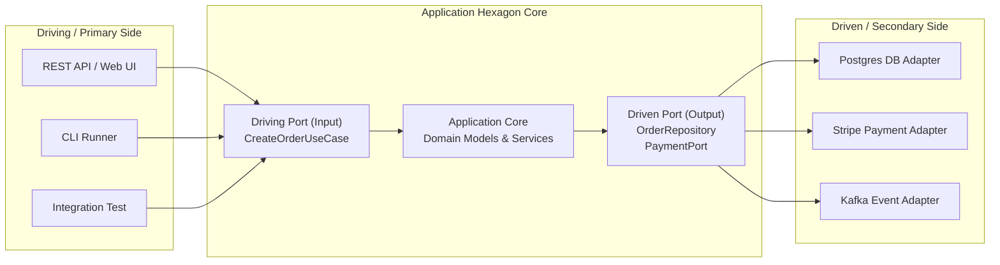
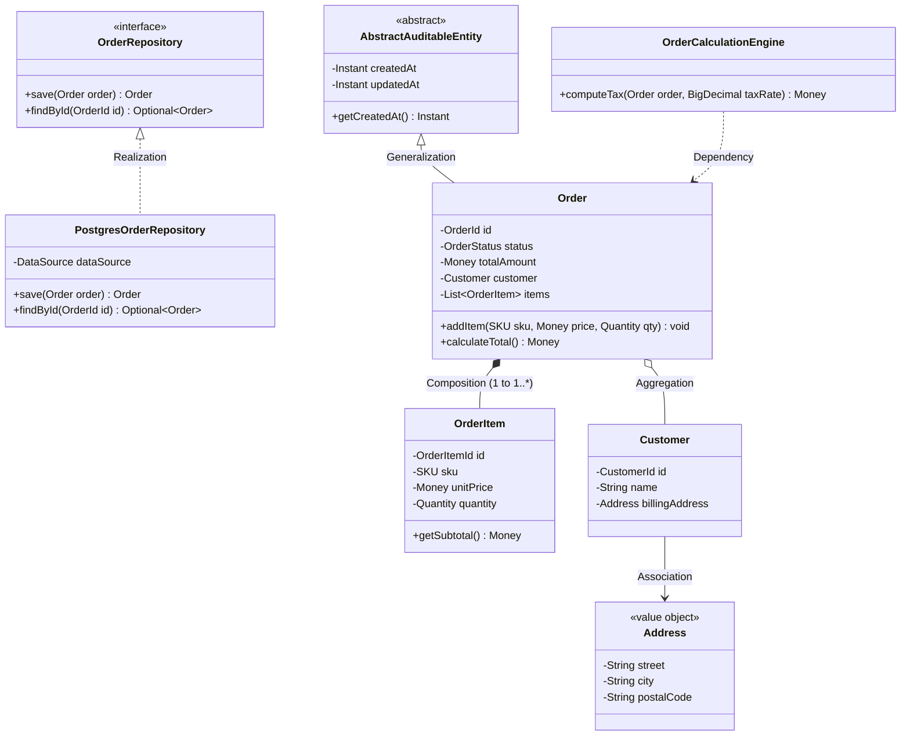
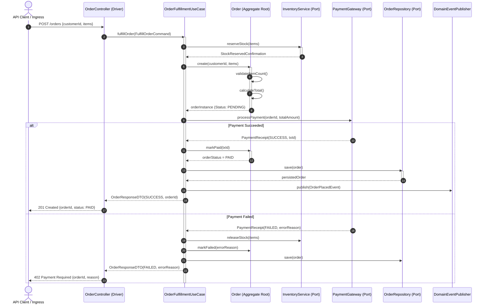

# Low-Level Design (LLD): Approaches, Paradigms & Architectural Patterns

## 1. Executive Overview & What is Low-Level Design (LLD)

Low-Level Design (LLD) represents the translation of high-level architectural blueprints, business domain rules, and non-functional requirements into a concrete, executable software system. Where High-Level Design (HLD) defines distributed topologies, network boundaries, database sharding strategies, caching tiers, and asynchronous messaging topologies, LLD dictates the internal mechanics of individual services and modules: class hierarchies, object lifecycles, memory layout, concurrency models, transactional boundaries, data structures, and algorithmic invariants.

```
┌─────────────────────────────────────────────────────────────────────────┐
│                        HIGH-LEVEL DESIGN (HLD)                          │
│  • Microservices Boundaries        • Message Queues (Kafka, RabbitMQ)   │
│  • Load Balancers & Ingress        • Database Sharding & Caching (Redis)│
└────────────────────────────────────┬────────────────────────────────────┘
                                     │ Cascading Constraints
                                     â–¼
┌─────────────────────────────────────────────────────────────────────────┐
│                        LOW-LEVEL DESIGN (LLD)                           │
│  • Class & Interface Contracts     • Concurrency Primitives & Threading │
│  • Domain Aggregates & Value Types • Invariant Validation & Error Paths │
│  • Design Patterns (GoF)           • Cache Invalidation & Data Structures│
└────────────────────────────────────┬────────────────────────────────────┘
                                     │ Direct Compilation
                                     â–¼
┌─────────────────────────────────────────────────────────────────────────┐
│                       BYTECODE & JVM RUNTIME                            │
│  • CPU Cache Lines (L1/L2/L3)      • Heap Allocation & Garbage Collection│
│  • OS Threads & Context Switching  • Memory Barriers & Assembly (JIT)   │
└─────────────────────────────────────────────────────────────────────────┘
```

### Comprehensive Comparison: HLD vs. LLD

| Dimension | High-Level Design (HLD) | Low-Level Design (LLD) |
| :--- | :--- | :--- |
| **Primary Scope** | Macro-level system topology and distributed communication | Micro-level class, interface, method, and package organization |
| **Focus Area** | Scalability, High Availability (HA), Network Latency, Fault Tolerance | Maintainability, Extensibility, Thread-Safety, Algorithmic Complexity |
| **Artifacts Produced**| Architecture diagrams, network maps, protocol specs (gRPC/HTTP), deployment manifests | UML Class diagrams, Sequence diagrams, State machine graphs, Java interfaces/classes |
| **Target Audience** | Enterprise Architects, Infrastructure Engineers, Engineering Leaders | Senior Software Engineers, Pair Programmers, Code Reviewers |
| **Key Metrics** | RPS, P99 Latency, Availability (99.99%), MTTR, RPO, Bandwidth costs | Cyclomatic Complexity, Connascence, Coupling, Cohesion, CPU cycles, Heap footprint |
| **Primary Failure Modes**| Cascading network partitions, split-brain, noisy neighbors, distributed deadlocks | Race conditions, memory leaks, thread starvation, NullPointerExceptions, brittle inheritance |
| **Tooling & Formats** | C4 Model (Context, Containers), CloudFormation, Terraform, Kubernetes YAML | UML 2.5, Clean Architecture, GoF Patterns, Static Analyzers (SpotBugs, SonarQube) |
| **Lifecycle Impact** | Difficult and expensive to change once deployed across infrastructure | Continuously refactored and evolved within codebase test harnesses |

### The Bridge: Cascading HLD Requirements to LLD Constraints

When an HLD specifies a requirement—such as *"The Payment Service must handle 10,000 requests per second with strict idempotency and zero duplicate charges"*—the LLD engineer must materialize this requirement through specific code constructs:
1. **Concurrency Control:** Replacing naive locks with non-blocking algorithms (`AtomicReference`, `StampedLock`) or striped cell counters (`LongAdder`).
2. **Idempotency Contracts:** Implementing an Idempotency Interceptor at the method level using an atomic CAS (`Compare-And-Swap`) check-and-insert token pattern against a persistence port.
3. **Immutability & Safety:** Modeling money and identifiers as immutable Value Objects (`record Money(BigDecimal amount, Currency currency)`) to prevent data corruption across concurrent worker threads.

---

## 2. Core LLD Paradigms

Software systems in production combine multiple paradigms to achieve clean separation of concerns, high throughput, and business expressiveness.

### 2.1 Object-Oriented Analysis & Design (OOAD)

OOAD structures systems around real-world domain concepts, encapsulating state and behavior within cohesive objects. Grady Booch formalized the four foundational pillars:

1. **Abstraction:** Exposing only essential characteristics while hiding background operational mechanics. An `OrderRepository` abstracts away whether data resides in Postgres, DynamoDB, or memory.
2. **Encapsulation:** Enforcing information hiding by bundling data with the methods that operate on it, preventing external components from violating internal state invariants.
3. **Modularity:** Decomposing systems into self-contained, loosely coupled modules with explicit dependency contracts.
4. **Hierarchy:** Organizing abstractions into taxonomic structures via subtyping (inheritance) or structural layering (composition).

#### Responsibility-Driven Design (RDD) & GRASP Principles
Craig Larman established the **General Responsibility Assignment Software Patterns (GRASP)** to guide object assignment:
- **Information Expert:** Assign a responsibility to the class that holds the information necessary to fulfill it.
- **Creator:** Class `B` should create Class `A` if `B` contains, records, closely uses, or initializes `A`.
- **Controller:** A non-UI class that coordinates system operations (e.g., `OrderFulfillmentController`).
- **Low Coupling & High Cohesion:** Minimize inter-module dependencies while keeping intra-module functions focused on a singular purpose.
- **Pure Fabrication:** Introducing an artificial class not found in the conceptual domain (e.g., `OrderValidator`, `EventPublisher`) to maintain low coupling and high cohesion.
- **Indirection:** Introducing an intermediary (an interface or adapter) between two components to decouple them.
- **Protected Variations:** Designing stable interfaces around unstable points of change.

### 2.2 Functional Programming in Modern Java

Modern Java (Java 17, 21+) blends functional idioms with OOP to eliminate mutable state hazards in concurrent environments:
- **Pure Functions:** Functions whose output depends solely on their input arguments without side-effects (no I/O, no mutation of global or external state).
- **Referential Transparency:** An expression can be replaced by its evaluated value without changing program behavior.
- **Function Composition:** Chaining transformations using `java.util.function.Function`, `Predicate`, `Supplier`, and `Consumer`.
- **Monadic Containers:** Using `Optional<T>` to eliminate `null` references and `CompletableFuture<T>` for composing asynchronous reactive workflows.

#### Functional vs. Imperative Pipeline Example
```java
// Imperative approach: Mutable accumulator, side-effects, high cognitive load
List<String> customerNames = new ArrayList<>();
for (Order order : orders) {
    if (order.getStatus() == OrderStatus.DELIVERED && order.getTotalAmount().compareTo(BigDecimal.valueOf(1000)) > 0) {
        Customer c = order.getCustomer();
        if (c != null && c.isActive()) {
            customerNames.add(c.getName().toUpperCase());
        }
    }
}

// Modern Java Functional Pipeline: Immutable, pure expressions, declarative
List<String> premiumDeliveredCustomerNames = orders.stream()
    .filter(order -> order.getStatus() == OrderStatus.DELIVERED)
    .filter(order -> order.getTotalAmount().compareTo(BigDecimal.valueOf(1000)) > 0)
    .map(Order::getCustomer)
    .filter(Objects::nonNull)
    .filter(Customer::isActive)
    .map(Customer::getName)
    .map(String::toUpperCase)
    .toList(); // Immutable list returned
```

### 2.3 Domain-Driven Design (DDD) Tactical Primitives

Domain-Driven Design (introduced by Eric Evans) aligns software implementation directly with the business domain model. The primary tactical building blocks include:

```
┌────────────────────────────────────────────────────────────────────────┐
│                        AGGREGATE BOUNDARY                              │
│                                                                        │
│   ┌──────────────────────────────────────────────────────────────┐     │
│   │             AGGREGATE ROOT (Entity: Order)                   │     │
│   │  - OrderId id (Identity)                                     │     │
│   │  - OrderStatus status                                        │     │
│   │  - Money totalAmount (Calculated Invariant)                  │     │
│   └───────────────┬───────────────────────────────┬──────────────┘     │
│                   │ 1                             │ 1                  │
│                   ▼ *                             ▼                    │
│   ┌──────────────────────────────┐   ┌───────────────────────────┐     │
│   │    ENTITY (OrderItem)        │   │   VALUE OBJECT (Address)  │     │
│   │  - OrderItemId id            │   │  - street, city, zipCode  │     │
│   │  - SKU productSku            │   │  - Immutable, no identity │     │
│   │  - Quantity qty              │   └───────────────────────────┘     │
│   └──────────────────────────────┘                                     │
│                                                                        │
│   Emits: [ OrderPlacedEvent, OrderCancelledEvent ] (Domain Events)     │
└────────────────────────────────────────────────────────────────────────┘
```

1. **Value Objects:** Immutable objects characterized purely by their attributes rather than a persistent identity. Two Value Objects with identical attributes are completely interchangeable. They validate their own invariants upon instantiation.
2. **Entities:** Objects defined by a continuous thread of identity that persists across state mutations over time. Two entities with identical attributes but distinct IDs represent distinct business entities.
3. **Aggregates & Aggregate Roots:** A cluster of associated entities and value objects treated as a single unit for data changes. The **Aggregate Root** is the sole gateway through which external objects may mutate or interact with the aggregate. The root strictly enforces all transactional invariants.
4. **Domain Events:** Immutable record of a significant event that occurred in the domain (e.g., `OrderPlacedEvent`, `PaymentFailedEvent`). Enables temporal decoupling and eventual consistency.
5. **Repositories:** Collection-oriented interfaces providing persistence and retrieval abstractions for Aggregates. Repositories operate strictly on Aggregate Roots.
6. **Domain Services:** Stateless services hosting business logic that does not naturally belong to a single Aggregate or spans multiple Aggregates.

---

## 3. Code-Level Architectural Patterns

Architectures at the code level dictate how modules, packages, and classes interact, enforcing separation of business logic from infrastructure frameworks.

### 3.1 Layered Architecture (Traditional N-Tier)

Traditional enterprise applications organize code into horizontal layers:
1. **Presentation / Web Layer:** Handles HTTP/REST/gRPC controllers, serialization, and input deserialization.
2. **Application / Service Layer:** Coordinates transaction boundaries, user authorization, and use-case workflow execution.
3. **Domain Layer:** Contains business entities and domain services.
4. **Data Access / Infrastructure Layer:** Manages ORM (Hibernate/JPA), SQL queries, and external API integrations.

```
┌────────────────────────────────────────┐
│           Presentation Layer           │ (Controllers, DTOs, Serializers)
└───────────────────┬────────────────────┘
                    │ Depends on
                    â–¼
┌────────────────────────────────────────┐
│            Service Layer               │ (Transaction management, Orchestration)
└───────────────────┬────────────────────┘
                    │ Depends on
                    â–¼
┌────────────────────────────────────────┐
│             Domain Layer               │ (Entities, Value Objects, Logic)
└───────────────────┬────────────────────┘
                    │ Depends on
                    â–¼
┌────────────────────────────────────────┐
│          Infrastructure Layer          │ (Spring Data, Hibernate, SQL, Redis)
└────────────────────────────────────────┘
```

#### The Anemic Domain Model Problem
In practice, layered architectures frequently suffer from architectural degradation:
- The Service layer absorbs all business logic into monolithic classes.
- Domain entities become **anemic data carriers** (getters/setters only), completely violating encapsulation.
- Upper layers directly depend on lower database infrastructure, making unit testing impossible without mocking heavy database sessions.

### 3.2 Clean Architecture & Onion Architecture

Robert C. Martin's **Clean Architecture** and Jeffrey Palermo's **Onion Architecture** invert the direction of dependencies. 

> **The Fundamental Dependency Rule:**
> Source code dependencies must point solely inward toward higher-level policies. Nothing in an inner circle can know anything about something in an outer circle.

```
       ┌──────────────────────────────────────────────────────────┐
       │ Frameworks & Drivers (Outer Layer)                       │
       │ Web, Spring MVC, Postgres, AWS S3, Kafka Producers       │
       │    ┌────────────────────────────────────────────────┐    │
       │    │ Interface Adapters                             │    │
       │    │ Controllers, Presenters, Gateways, Mappers     │    │
       │    │    ┌──────────────────────────────────────┐    │    │
       │    │    │ Application Business Rules           │    │    │
       │    │    │ Use Cases, Input/Output Ports        │    │    │
       │    │    │    ┌────────────────────────────┐    │    │    │
       │    │    │    │ Enterprise Business Rules  │    │    │    │
       │    │    │    │ Entities, Value Objects    │    │    │    │
       │    │    │    └────────────────────────────┘    │    │    │
       │    │    └──────────────────────────────────────┘    │    │
       │    └────────────────────────────────────────────────┘    │
       └──────────────────────────────────────────────────────────┘
```

- **Enterprise Business Rules (Core):** Pure domain models with zero dependencies on frameworks, databases, or UI.
- **Application Business Rules (Use Cases):** Implement specific user operations. They declare interfaces (Ports) for external actions (e.g., `SaveOrderPort`).
- **Interface Adapters:** Convert data from use-case formats to persistence or web formats.
- **Frameworks & Drivers:** Ephemeral delivery tools (Spring Boot, Hibernate, Netty). The framework depends on the code; the code never depends on the framework.

### 3.3 Hexagonal Architecture (Ports and Adapters)

Alistair Cockburn conceived Hexagonal Architecture to allow an application to equally be driven by users, batch scripts, or test harnesses, and to be developed and tested in isolation from runtime infrastructure.



- **Driving (Primary) Ports:** Interfaces invoked by external actors (REST Controller, Message Listener, CLI) to execute business operations.
- **Driven (Secondary) Ports:** Interfaces defined by the domain core to declare what capabilities it needs from the outside world (Persistence, Payment, Notification).
- **Adapters:** Concrete implementations of ports. A `PostgresOrderRepository` is an adapter that implements the `OrderRepository` port. If we swap Postgres for DynamoDB, the Hexagon core remains 100% untouched.

---

## 4. UML Class Diagram & Component Communication Modeling

### 4.1 UML Class Diagram Notation & The 5 Core OOP Relationships

A robust LLD requires precise visual specification of class couplings and lifecycles:

1. **Dependency (`..>`):** A weak, transient relationship where Class A temporarily uses Class B (e.g., as a method parameter, local variable, or return type). A changes if B changes, but A does not hold an ongoing reference to B.
2. **Association (`-->`):** A structural relationship where Class A maintains an instance reference to Class B as an attribute/field.
3. **Aggregation (`o--`):** A specialized "has-a" association representing a whole-part relationship where the child can exist independently of the parent. The lifecycle is decoupled (e.g., a Department and Professors).
4. **Composition (`*--`):** A strict "contains-a" relationship where the child lifecycle is tightly coupled to the parent. If the parent is destroyed, the child ceases to exist (e.g., an Order and OrderItems).
5. **Generalization / Realization (`--|>` / `..|>`):** Subtyping. Generalization is class inheritance (`extends`), Realization is interface implementation (`implements`).



### 4.2 Sequence Diagrams for Component Communication

A sequence diagram models interactions over time, tracing message exchanges between objects to fulfill a use case.



---

## 5. Core Quality Metrics in LLD

Designing scalable systems requires quantitative metrics to evaluate design choices before writing code.

### 5.1 High Cohesion vs. Low Coupling

```
┌───────────────────────────────────────────────┐
│              HIGH COHESION                    │
│  Classes have focused responsibilities.       │
│  Methods operate on the class's own data.     │
│  Changes are localized and deterministic.     │
└───────────────────────────────────────────────┘
                       â–²
                       │ Target State
                       â–¼
┌───────────────────────────────────────────────┐
│               LOW COUPLING                    │
│  Modules interact via minimal abstractions.   │
│  Implementation details are hidden.           │
│  Dependencies are easily mocked for tests.    │
└───────────────────────────────────────────────┘
```

#### Larry Constantine's Cohesion Spectrum (Best to Worst)
1. **Functional Cohesion (Optimal):** Every part of the module contributes to a single, well-defined task (e.g., `SHA256Hasher.hash(byte[] input)`).
2. **Sequential Cohesion:** Output from one step is input to the next step (e.g., Parse JSON -> Validate Schema -> Save Model).
3. **Communicational Cohesion:** Functions operate on the same dataset but perform distinct tasks (e.g., Retrieve Order Details & Generate Invoice from the same DB record).
4. **Procedural Cohesion:** Components execute in a specific order but are conceptually unrelated.
5. **Temporal Cohesion:** Operations grouped solely because they execute at the same time (e.g., `StartupService.init()` initializing caches, loading fonts, and opening socket pools).
6. **Logical Cohesion:** Functions grouped by generic classification with a control flag (e.g., `process(int flag)` switching behavior based on 1, 2, or 3).
7. **Coincidental Cohesion (Worst):** Random grouping of unrelated functions (e.g., a `CommonUtils` or `GeneralHelper` dumping ground).

#### Coupling Spectrum (Best to Worst)
1. **Data Coupling (Optimal):** Modules communicate strictly by passing primitive or minimal domain data arguments.
2. **Stamp (Data-Structure) Coupling:** Modules pass composite data structures, but the consumer only needs a small subset of fields.
3. **Control Coupling:** One module directs the internal control flow of another by passing flags or switches.
4. **Common (Global) Coupling:** Multiple modules read and write the same shared global state or memory space.
5. **Content Coupling (Worst):** One module directly accesses or modifies the private internal state of another module.

### 5.2 Cyclomatic Complexity ($M$)

Developed by Thomas McCabe, Cyclomatic Complexity measures the number of linearly independent paths through a program's source code:

$$M = E - N + 2P$$

Where:
- $E$ = Number of edges in the control-flow graph.
- $N$ = Number of nodes in the control-flow graph.
- $P$ = Number of connected components (usually 1 for a single method).

Alternatively, for a single method:

$$M = D + 1$$

Where $D$ is the count of decision points (`if`, `while`, `for`, `case`, `&&`, `||`, `?:`).

#### Quality Thresholds:
- **1 - 10:** Simple, low risk, highly testable.
- **11 - 20:** Moderate complexity, moderately testable.
- **21 - 50:** High risk, complex, difficult to test thoroughly.
- **> 50:** Untestable, extreme defect probability, immediate candidate for refactoring.

### 5.3 Connascence

Formulated by Meilir Page-Jones, Connascence is a software quality metric defining the degree to which change in one component necessitates change in another to maintain program correctness.

```
INCREASING STRENGTH (Harder to Maintain, Greater Refactoring Risk)
───────────────────────────────────────────────────────────────────────────────────►
Static:   [Name] ──► [Type] ──► [Meaning] ──► [Position] ──► [Algorithm]
Dynamic:  [Execution] ──► [Timing] ──► [Value] ──► [Identity]
```

#### Static Connascence (Analyzable at compile-time)
- **Connascence of Name (CoN):** Components must agree on the name of a method or field. Lowest strength; easily managed via IDE refactoring.
- **Connascence of Type (CoT):** Components must agree on an argument's type (e.g., passing an `OrderId` instead of raw `String`).
- **Connascence of Meaning (CoM):** Components must agree on the semantic interpretation of values (e.g., `status = 1` means Active, `status = 2` means Inactive). Resolved via `Enum`.
- **Connascence of Position (CoP):** Parameters must be passed in an exact positional order (e.g., `void transfer(String src, String dst, BigDecimal amt, String curr, boolean notify)`). Resolved via the **Builder Pattern** or parameter objects.
- **Connascence of Algorithm (CoA):** Two components must implement the exact same algorithmic steps (e.g., a custom checksum calculation in the client matching the checksum calculation in the server).

#### Dynamic Connascence (Observable only at runtime)
- **Connascence of Execution (CoE):** The order of execution matters (e.g., `connection.open()` must precede `connection.execute()`).
- **Connascence of Timing (CoT):** Timing between operations matters (e.g., Thread A must read from a buffer within 50ms before Thread B flushes it).
- **Connascence of Value (CoV):** Multiple components must share identical values (e.g., distributed transaction participants assuming identical hardcoded timeout ceilings).
- **Connascence of Identity (CoI):** Two components must share access to the exact same memory instance (e.g., shared mutable singletons across threads).

#### Page-Jones' Three Rules of Connascence:
1. **Strength Rule:** Convert strong connascence (dynamic) into weaker connascence (static).
2. **Locality Rule:** Components with high connascence must be physically close (same package or class). Distance multiplies the architectural penalty of connascence.
3. **Degree Rule:** Minimize the number of entities participating in the connascent relationship.

---

## 6. Top-Down vs. Bottom-Up Decomposition Walkthrough

When implementing complex enterprise logic, architects adopt either Top-Down or Bottom-Up decomposition:

- **Top-Down:** Begins with high-level user workflows (API controllers, use-case interactors), discovering domain boundaries and secondary ports as the high-level orchestration unfolds. Best for novel user journeys and API-first initiatives.
- **Bottom-Up:** Begins with core domain invariants, primitive value objects, and arithmetic logic, gradually aggregating them into entities, aggregates, and use-case orchestrators. Best for data-heavy, mathematically rigorous core domains (e.g., accounting ledgers, trading engines, inventory fulfillment).

We will model an **E-Commerce Order Fulfillment Module** using Hexagonal Architecture, Domain-Driven Design, and pure Java.

### Complete, Production-Ready Java Implementation

```java
package com.systemdesign.lld.fulfillment;

import java.math.BigDecimal;
import java.math.RoundingMode;
import java.time.Instant;
import java.util.*;
import java.util.concurrent.ConcurrentHashMap;
import java.util.regex.Pattern;

// ============================================================================
// 1. DOMAIN PRIMITIVES: VALUE OBJECTS (Bottom-Up Foundation)
// ============================================================================

/**
 * Immutable Value Object representing monetary values with currency.
 * Enforces arithmetic rounding and currency alignment invariants.
 */
public record Money(BigDecimal amount, Currency currency) implements Comparable<Money> {

    public Money {
        Objects.requireNonNull(amount, "Amount cannot be null");
        Objects.requireNonNull(currency, "Currency cannot be null");
        // Normalize to standard scale of 2 decimal places
        amount = amount.setScale(2, RoundingMode.HALF_EVEN);
    }

    public static Money of(String amountStr, String currencyCode) {
        return new Money(new BigDecimal(amountStr), Currency.getInstance(currencyCode));
    }

    public static Money zero(Currency currency) {
        return new Money(BigDecimal.ZERO, currency);
    }

    public Money add(Money other) {
        validateSameCurrency(other);
        return new Money(this.amount.add(other.amount), this.currency);
    }

    public Money multiply(long factor) {
        if (factor < 0) {
            throw new IllegalArgumentException("Factor cannot be negative: " + factor);
        }
        return new Money(this.amount.multiply(BigDecimal.valueOf(factor)), this.currency);
    }

    private void validateSameCurrency(Money other) {
        if (!this.currency.equals(other.currency)) {
            throw new IllegalArgumentException(
                "Currency mismatch: Cannot operate on " + this.currency + " and " + other.currency
            );
        }
    }

    @Override
    public int compareTo(Money other) {
        validateSameCurrency(other);
        return this.amount.compareTo(other.amount);
    }
}

/**
 * Value Object representing a Stock Keeping Unit (SKU).
 */
public record SKU(String code) {
    private static final Pattern SKU_PATTERN = Pattern.compile("^[A-Z0-9]{6,12}$");

    public SKU {
        Objects.requireNonNull(code, "SKU code cannot be null");
        if (!SKU_PATTERN.matcher(code).matches()) {
            throw new IllegalArgumentException("Invalid SKU format: " + code + ". Must be 6-12 uppercase alphanumeric.");
        }
    }
}

/**
 * Strongly typed Identifier Value Objects to prevent Primitive Obsession.
 */
public record OrderId(UUID value) {
    public OrderId {
        Objects.requireNonNull(value, "OrderId UUID cannot be null");
    }
    public static OrderId generate() {
        return new OrderId(UUID.randomUUID());
    }
}

public record CustomerId(String id) {
    public CustomerId {
        Objects.requireNonNull(id, "CustomerId cannot be null");
        if (id.isBlank()) {
            throw new IllegalArgumentException("CustomerId cannot be blank");
        }
    }
}

public record Quantity(int value) {
    public Quantity {
        if (value <= 0) {
            throw new IllegalArgumentException("Quantity must be strictly positive: " + value);
        }
    }
}

// ============================================================================
// 2. DOMAIN EVENTS
// ============================================================================

public sealed interface DomainEvent permits OrderPlacedEvent, OrderPaidEvent, OrderCancelledEvent {
    Instant occurredOn();
    OrderId orderId();
}

public record OrderPlacedEvent(OrderId orderId, CustomerId customerId, Money totalAmount, Instant occurredOn)
    implements DomainEvent {}

public record OrderPaidEvent(OrderId orderId, String transactionId, Instant occurredOn)
    implements DomainEvent {}

public record OrderCancelledEvent(OrderId orderId, String reason, Instant occurredOn)
    implements DomainEvent {}

// ============================================================================
// 3. DOMAIN ENTITY & AGGREGATE ROOT
// ============================================================================

public enum OrderStatus {
    CREATED,
    PAID,
    SHIPPED,
    CANCELLED
}

/**
 * Internal Entity within the Order Aggregate boundary.
 */
public class OrderItem {
    private final String itemId;
    private final SKU sku;
    private final Money unitPrice;
    private final Quantity quantity;

    public OrderItem(SKU sku, Money unitPrice, Quantity quantity) {
        this.itemId = UUID.randomUUID().toString();
        this.sku = Objects.requireNonNull(sku, "SKU cannot be null");
        this.unitPrice = Objects.requireNonNull(unitPrice, "Unit price cannot be null");
        this.quantity = Objects.requireNonNull(quantity, "Quantity cannot be null");
    }

    public Money computeSubtotal() {
        return unitPrice.multiply(quantity.value());
    }

    public SKU getSku() { return sku; }
    public Quantity getQuantity() { return quantity; }
    public Money getUnitPrice() { return unitPrice; }
}

/**
 * Aggregate Root enforcing transactional consistency and invariants.
 */
public class Order {
    private final OrderId id;
    private final CustomerId customerId;
    private final List<OrderItem> items;
    private final Currency currency;
    private OrderStatus status;
    private String paymentTransactionId;
    private final List<DomainEvent> domainEvents;

    private Order(OrderId id, CustomerId customerId, Currency currency) {
        this.id = Objects.requireNonNull(id);
        this.customerId = Objects.requireNonNull(customerId);
        this.currency = Objects.requireNonNull(currency);
        this.items = new ArrayList<>();
        this.status = OrderStatus.CREATED;
        this.domainEvents = new ArrayList<>();
    }

    public static Order create(CustomerId customerId, Currency currency) {
        OrderId newId = OrderId.generate();
        Order order = new Order(newId, customerId, currency);
        return order;
    }

    public void addItem(SKU sku, Money unitPrice, Quantity quantity) {
        if (this.status != OrderStatus.CREATED) {
            throw new IllegalStateException("Cannot add items to order in status: " + status);
        }
        if (!unitPrice.currency().equals(this.currency)) {
            throw new IllegalArgumentException("Item currency " + unitPrice.currency() + " does not match order currency " + this.currency);
        }
        this.items.add(new OrderItem(sku, unitPrice, quantity));
    }

    public Money calculateTotal() {
        if (items.isEmpty()) {
            return Money.zero(this.currency);
        }
        Money total = Money.zero(this.currency);
        for (OrderItem item : items) {
            total = total.add(item.computeSubtotal());
        }
        return total;
    }

    public void markAsPaid(String transactionId) {
        if (this.status != OrderStatus.CREATED) {
            throw new IllegalStateException("Order cannot be transitioned to PAID from: " + this.status);
        }
        if (items.isEmpty()) {
            throw new IllegalStateException("Cannot pay for an empty order");
        }
        this.paymentTransactionId = Objects.requireNonNull(transactionId, "Transaction ID required");
        this.status = OrderStatus.PAID;
        this.domainEvents.add(new OrderPaidEvent(this.id, transactionId, Instant.now()));
    }

    public void cancel(String reason) {
        if (this.status == OrderStatus.SHIPPED) {
            throw new IllegalStateException("Cannot cancel an order that has already shipped");
        }
        this.status = OrderStatus.CANCELLED;
        this.domainEvents.add(new OrderCancelledEvent(this.id, reason, Instant.now()));
    }

    public List<DomainEvent> pullDomainEvents() {
        List<DomainEvent> recorded = List.copyOf(this.domainEvents);
        this.domainEvents.clear();
        return recorded;
    }

    public OrderId getId() { return id; }
    public CustomerId getCustomerId() { return customerId; }
    public List<OrderItem> getItems() { return Collections.unmodifiableList(items); }
    public OrderStatus getStatus() { return status; }
    public String getPaymentTransactionId() { return paymentTransactionId; }
}

// ============================================================================
// 4. SECONDARY PORTS (Driven Interfaces)
// ============================================================================

public interface OrderRepository {
    void save(Order order);
    Optional<Order> findById(OrderId id);
}

public interface InventoryServicePort {
    boolean reserveStock(SKU sku, Quantity quantity);
    void releaseStock(SKU sku, Quantity quantity);
}

public interface PaymentGatewayPort {
    record PaymentResult(boolean success, String transactionId, String errorMessage) {}
    PaymentResult charge(CustomerId customerId, Money amount);
}

public interface DomainEventPublisher {
    void publish(List<DomainEvent> events);
}

// ============================================================================
// 5. PRIMARY PORT & APPLICATION SERVICE (Use Case Interactor)
// ============================================================================

public record ItemOrderRequest(String skuCode, BigDecimal unitPrice, int quantity) {}

public record PlaceOrderCommand(String customerId, String currencyCode, List<ItemOrderRequest> items) {}

public record OrderFulfillmentResult(boolean successful, OrderId orderId, String failureReason) {}

public interface OrderFulfillmentUseCase {
    OrderFulfillmentResult fulfillOrder(PlaceOrderCommand command);
}

public class OrderFulfillmentService implements OrderFulfillmentUseCase {

    private final OrderRepository orderRepository;
    private final InventoryServicePort inventoryService;
    private final PaymentGatewayPort paymentGateway;
    private final DomainEventPublisher eventPublisher;

    public OrderFulfillmentService(
            OrderRepository orderRepository,
            InventoryServicePort inventoryService,
            PaymentGatewayPort paymentGateway,
            DomainEventPublisher eventPublisher) {
        this.orderRepository = Objects.requireNonNull(orderRepository);
        this.inventoryService = Objects.requireNonNull(inventoryService);
        this.paymentGateway = Objects.requireNonNull(paymentGateway);
        this.eventPublisher = Objects.requireNonNull(eventPublisher);
    }

    @Override
    public OrderFulfillmentResult fulfillOrder(PlaceOrderCommand command) {
        CustomerId customerId = new CustomerId(command.customerId());
        Currency currency = Currency.getInstance(command.currencyCode());
        Order order = Order.create(customerId, currency);

        // Step 1: Construct Aggregate & Validate Items
        List<SKU> reservedSkus = new ArrayList<>();
        try {
            for (ItemOrderRequest itemReq : command.items()) {
                SKU sku = new SKU(itemReq.skuCode());
                Money unitPrice = new Money(itemReq.unitPrice(), currency);
                Quantity quantity = new Quantity(itemReq.quantity());

                // Step 2: Reserve Inventory
                boolean reserved = inventoryService.reserveStock(sku, quantity);
                if (!reserved) {
                    rollbackReservations(order);
                    return new OrderFulfillmentResult(false, null, "Insufficient stock for SKU: " + sku.code());
                }
                order.addItem(sku, unitPrice, quantity);
            }

            // Step 3: Compute Total & Authorize Payment
            Money totalAmount = order.calculateTotal();
            PaymentGatewayPort.PaymentResult paymentResult = paymentGateway.charge(customerId, totalAmount);

            if (!paymentResult.success()) {
                rollbackReservations(order);
                order.cancel("Payment failed: " + paymentResult.errorMessage());
                orderRepository.save(order);
                eventPublisher.publish(order.pullDomainEvents());
                return new OrderFulfillmentResult(false, order.getId(), paymentResult.errorMessage());
            }

            // Step 4: Finalize Domain State
            order.markAsPaid(paymentResult.transactionId());
            orderRepository.save(order);
            eventPublisher.publish(order.pullDomainEvents());

            return new OrderFulfillmentResult(true, order.getId(), null);

        } catch (Exception e) {
            rollbackReservations(order);
            return new OrderFulfillmentResult(false, null, "Order fulfillment aborted: " + e.getMessage());
        }
    }

    private void rollbackReservations(Order order) {
        for (OrderItem item : order.getItems()) {
            inventoryService.releaseStock(item.getSku(), item.getQuantity());
        }
    }
}

// ============================================================================
// 6. ADAPTERS (Infrastructure Layer Implementations)
// ============================================================================

public class InMemoryOrderRepository implements OrderRepository {
    private final Map<OrderId, Order> store = new ConcurrentHashMap<>();

    @Override
    public void save(Order order) {
        store.put(order.getId(), order);
    }

    @Override
    public Optional<Order> findById(OrderId id) {
        return Optional.ofNullable(store.get(id));
    }
}

public class MockInventoryServiceAdapter implements InventoryServicePort {
    private final Map<SKU, Integer> stock = new ConcurrentHashMap<>();

    public void setStock(SKU sku, int count) {
        stock.put(sku, count);
    }

    @Override
    public synchronized boolean reserveStock(SKU sku, Quantity quantity) {
        int current = stock.getOrDefault(sku, 0);
        if (current >= quantity.value()) {
            stock.put(sku, current - quantity.value());
            return true;
        }
        return false;
    }

    @Override
    public synchronized void releaseStock(SKU sku, Quantity quantity) {
        stock.merge(sku, quantity.value(), Integer::sum);
    }
}

public class MockPaymentGatewayAdapter implements PaymentGatewayPort {
    @Override
    public PaymentResult charge(CustomerId customerId, Money amount) {
        // Simulated deterministic payment execution
        if (amount.amount().compareTo(BigDecimal.valueOf(10000.00)) > 0) {
            return new PaymentResult(false, null, "Credit limit exceeded");
        }
        return new PaymentResult(true, "TXN-" + UUID.randomUUID(), null);
    }
}

public class ConsoleEventPublisherAdapter implements DomainEventPublisher {
    @Override
    public void publish(List<DomainEvent> events) {
        for (DomainEvent event : events) {
            System.out.println("[DOMAIN EVENT] Published: " + event.getClass().getSimpleName() + 
                               " for Order: " + event.orderId().value() + " at " + event.occurredOn());
        }
    }
}
```

### Architectural Step-by-Step Breakdown

1. **Primitive Obsession Elimination:** Rather than passing naked `String` and `BigDecimal` primitives throughout the system, we introduce Value Objects (`Money`, `SKU`, `OrderId`, `CustomerId`, `Quantity`). Any illegal state (negative money, invalid SKU format, zero quantity) fails immediately at the construction boundary via the **Fail-Fast Principle**.
2. **Strict Transactional Boundaries:** The `Order` class acts as the **Aggregate Root**. External actors cannot manipulate `OrderItem` elements directly. Invariants such as calculating totals, transitioning states, and emitting domain events are protected behind the root's methods.
3. **Hexagonal Decoupling:** The `OrderFulfillmentService` coordinates business flow without depending on database schemas or third-party HTTP SDKs. It binds strictly to interfaces (`OrderRepository`, `InventoryServicePort`, `PaymentGatewayPort`). Testing this business logic requires zero mock frameworks or Docker containers—plain Java mock classes (`InMemoryOrderRepository`, `MockPaymentGatewayAdapter`) can be wired directly via constructor injection.
4. **Idempotent Rollback Mechanics:** If payment fails midway through processing, the service executes compensating logic (`rollbackReservations`) to ensure inventory counters do not leak reserved units.
5. **Connascence Minimization:** The design exhibits low connascence:
   - **Name and Type Connascence:** Classes interact strictly via explicit interface types.
   - **No Position Connascence:** The `PlaceOrderCommand` encapsulates request arguments into a single semantic payload rather than a multi-argument method signature.
   - **Zero Algorithm Connascence:** External clients do not calculate totals; the `Order` aggregate retains sole authority over mathematical aggregation.
