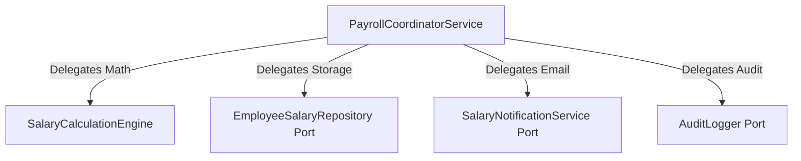
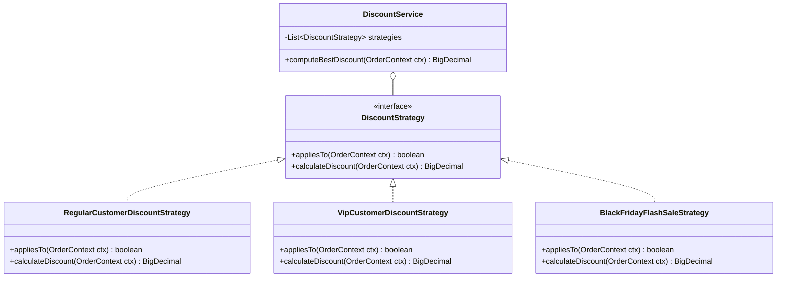
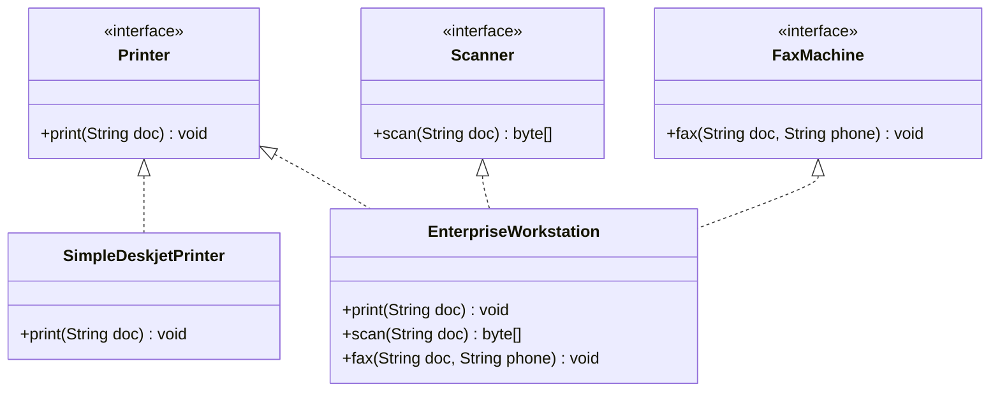

# SOLID & Modern Low-Level Design Principles: Production Architectural Guide

## 1. Executive Overview & The Physics of Software Rot

When software systems evolve without rigorous design discipline, they succumb to **software rot** (architectural decay). Robert C. Martin identified four primary symptoms of rotting code:
1. **Rigidity:** The system is difficult to change because every alteration forces a cascade of subsequent changes across unrelated modules.
2. **Fragility:** Changes break functionality in parts of the application that have no conceptual relationship to the code being modified.
3. **Immobility:** Code cannot be reused in other applications or contexts because it is tangled with environmental and infrastructure dependencies.
4. **Viscosity:** Doing things right (preserving the architecture) is harder than doing things wrong (hacking in a quick fix).

The **SOLID principles**—formulated by Robert C. Martin, Barbara Liskov, and Bertrand Meyer—alongside foundational software craftsmanship heuristics, provide the formal mathematical and structural boundaries necessary to keep low-level designs maintainable, testable, and robust.

```
┌─────────────────────────────────────────────────────────────────────────┐
│                           THE SOLID TAXONOMY                            │
├─────────────────────────────────────────────────────────────────────────┤
│  S ── Single Responsibility Principle (SRP)  ── Focus & Actors          │
│  O ── Open/Closed Principle (OCP)            ── Extensibility           │
│  L ── Liskov Substitution Principle (LSP)    ── Behavioral Subtyping    │
│  I ── Interface Segregation Principle (ISP)  ── Client-Driven Interfaces│
│  D ── Dependency Inversion Principle (DIP)    ── Inverted Coupling       │
└─────────────────────────────────────────────────────────────────────────┘
```

---

## 2. Single Responsibility Principle (SRP)

> **Formal Definition:**
> *"A class should have one, and only one, reason to change."*
> More specifically: *"A module should be responsible to one, and only one, actor or business stakeholder."*

### Violation Analysis
When a single class combines persistence, business calculations, network notifications, and validation, changes requested by different business actors (DBA, Financial Analyst, Marketing Team) converge on the same physical source file. This triggers merge conflicts, regression risks, and severe thread-safety synchronization bottlenecks.

#### Bad Code: The Monolithic God Class
```java
package com.systemdesign.lld.solid.srp.bad;

import java.io.FileWriter;
import java.io.IOException;
import java.math.BigDecimal;
import java.sql.Connection;
import java.sql.DriverManager;
import java.sql.PreparedStatement;
import java.sql.SQLException;

public class EmployeeManagementService {
    // VIOLATION: Combines 4 distinct actor responsibilities:
    // 1. HR/Payroll (Tax & Salary calculation)
    // 2. Database Administration (Direct SQL persistence)
    // 3. Infrastructure/Notification (SMTP/Email formatting)
    // 4. Compliance/Auditing (File-based audit logs)

    public void processMonthlySalary(String empId, String empName, BigDecimal baseSalary, String email) {
        // Actor 1: HR Payroll Logic
        BigDecimal tax = baseSalary.multiply(BigDecimal.valueOf(0.20));
        BigDecimal netSalary = baseSalary.subtract(tax);

        // Actor 2: Database Persistence
        try (Connection conn = DriverManager.getConnection("jdbc:postgresql://localhost:5432/payroll", "admin", "secret")) {
            String sql = "INSERT INTO salaries (emp_id, amount, processed_at) VALUES (?, ?, NOW())";
            try (PreparedStatement stmt = conn.prepareStatement(sql)) {
                stmt.setString(1, empId);
                stmt.setBigDecimal(2, netSalary);
                stmt.executeUpdate();
            }
        } catch (SQLException e) {
            System.err.println("Database write failed: " + e.getMessage());
        }

        // Actor 3: Email Notification
        String emailBody = "Dear " + empName + ", your salary of $" + netSalary + " has been processed.";
        System.out.println("Connecting to SMTP server at smtp.company.com:587...");
        System.out.println("Sending email to " + email + ": " + emailBody);

        // Actor 4: Compliance File Auditing
        try (FileWriter writer = new FileWriter("audit.log", true)) {
            writer.write("Salary processed for: " + empId + " | Amount: " + netSalary + "\n");
        } catch (IOException e) {
            System.err.println("Audit logging failed: " + e.getMessage());
        }
    }
}
```

### Refactored SRP Architecture



#### Good Code: Cohesive, Actor-Segregated Classes
```java
package com.systemdesign.lld.solid.srp.good;

import java.math.BigDecimal;
import java.math.RoundingMode;
import java.time.Instant;
import java.util.Objects;

// Value Object representing calculated pay
public record SalaryBreakdown(BigDecimal baseSalary, BigDecimal taxDeduction, BigDecimal netSalary) {
    public SalaryBreakdown {
        Objects.requireNonNull(baseSalary);
        Objects.requireNonNull(taxDeduction);
        Objects.requireNonNull(netSalary);
    }
}

// 1. Business Logic / HR Actor: Pure mathematical calculation
public class SalaryCalculationEngine {
    private static final BigDecimal TAX_RATE = new BigDecimal("0.20");

    public SalaryBreakdown calculate(BigDecimal baseSalary) {
        Objects.requireNonNull(baseSalary, "Base salary cannot be null");
        if (baseSalary.compareTo(BigDecimal.ZERO) < 0) {
            throw new IllegalArgumentException("Base salary cannot be negative");
        }
        BigDecimal tax = baseSalary.multiply(TAX_RATE).setScale(2, RoundingMode.HALF_EVEN);
        BigDecimal net = baseSalary.subtract(tax).setScale(2, RoundingMode.HALF_EVEN);
        return new SalaryBreakdown(baseSalary, tax, net);
    }
}

// 2. Persistence Contract / DBA Actor
public interface SalaryRepository {
    void recordSalaryPayment(String employeeId, BigDecimal netSalary, Instant timestamp);
}

// 3. Notification Contract / Ops Actor
public interface NotificationService {
    void notifySalaryDisbursed(String recipientEmail, String employeeName, BigDecimal amount);
}

// 4. Audit Contract / Compliance Actor
public interface AuditLogger {
    void log(String action, String entityId, String details);
}

// Orchestrator: High Cohesion, delegates strictly to specialists
public class PayrollCoordinatorService {
    private final SalaryCalculationEngine calculationEngine;
    private final SalaryRepository salaryRepository;
    private final NotificationService notificationService;
    private final AuditLogger auditLogger;

    public PayrollCoordinatorService(
            SalaryCalculationEngine calculationEngine,
            SalaryRepository salaryRepository,
            NotificationService notificationService,
            AuditLogger auditLogger) {
        this.calculationEngine = Objects.requireNonNull(calculationEngine);
        this.salaryRepository = Objects.requireNonNull(salaryRepository);
        this.notificationService = Objects.requireNonNull(notificationService);
        this.auditLogger = Objects.requireNonNull(auditLogger);
    }

    public void processMonthlySalary(String empId, String empName, BigDecimal baseSalary, String email) {
        SalaryBreakdown breakdown = calculationEngine.calculate(baseSalary);
        Instant now = Instant.now();

        salaryRepository.recordSalaryPayment(empId, breakdown.netSalary(), now);
        notificationService.notifySalaryDisbursed(email, empName, breakdown.netSalary());
        auditLogger.log("SALARY_DISBURSEMENT", empId, "Net: " + breakdown.netSalary());
    }
}
```

### Step-by-Step Breakdown
- **Isolated Testing:** `SalaryCalculationEngine` contains zero I/O and can be tested with instantaneous unit tests across thousands of boundary values.
- **Thread-Safety Impact:** The original class required synchronizing around file handles and database connections. The refactored classes are stateless, making them thread-safe for concurrent request pools without lock contention.

---

## 3. Open/Closed Principle (OCP)

> **Formal Definition:**
> *"Software entities (classes, modules, functions, etc.) should be open for extension, but closed for modification."*
> — Bertrand Meyer (1988)

### Violation Analysis
When business rules require branching logic (e.g., customer pricing, payment gateways, tax calculation), naive code uses `switch` statements or cascading `if-else` blocks. Every new requirement forces direct editing of existing, production-tested code, introducing regression risk.

#### Bad Code: Fragile Conditional Chains
```java
package com.systemdesign.lld.solid.ocp.bad;

import java.math.BigDecimal;

public class DiscountCalculator {
    public enum CustomerType {
        REGULAR,
        VIP,
        EMPLOYEE
    }

    // VIOLATION: Adding a new type (e.g. BLACK_FRIDAY) requires editing this method,
    // re-testing all prior customer types, and risking unexpected regression.
    public BigDecimal calculateDiscount(CustomerType type, BigDecimal orderTotal) {
        if (type == CustomerType.REGULAR) {
            return orderTotal.multiply(BigDecimal.valueOf(0.05));
        } else if (type == CustomerType.VIP) {
            return orderTotal.multiply(BigDecimal.valueOf(0.15));
        } else if (type == CustomerType.EMPLOYEE) {
            return orderTotal.multiply(BigDecimal.valueOf(0.30));
        }
        throw new IllegalArgumentException("Unknown customer type: " + type);
    }
}
```

### Refactored OCP Architecture (Strategy + Registry)



#### Good Code: Polymorphic Strategy with Open Extensibility
```java
package com.systemdesign.lld.solid.ocp.good;

import java.math.BigDecimal;
import java.math.RoundingMode;
import java.util.List;
import java.util.Objects;

public record OrderContext(String customerId, BigDecimal orderTotal, boolean isVip, boolean isEmployee, boolean isFlashSaleActive) {}

public interface DiscountStrategy {
    boolean appliesTo(OrderContext context);
    BigDecimal calculateDiscount(OrderContext context);
}

public class RegularDiscountStrategy implements DiscountStrategy {
    private static final BigDecimal FIVE_PERCENT = new BigDecimal("0.05");

    @Override
    public boolean appliesTo(OrderContext context) {
        return !context.isVip() && !context.isEmployee();
    }

    @Override
    public BigDecimal calculateDiscount(OrderContext context) {
        return context.orderTotal().multiply(FIVE_PERCENT).setScale(2, RoundingMode.HALF_EVEN);
    }
}

public class VipDiscountStrategy implements DiscountStrategy {
    private static final BigDecimal FIFTEEN_PERCENT = new BigDecimal("0.15");

    @Override
    public boolean appliesTo(OrderContext context) {
        return context.isVip();
    }

    @Override
    public BigDecimal calculateDiscount(OrderContext context) {
        return context.orderTotal().multiply(FIFTEEN_PERCENT).setScale(2, RoundingMode.HALF_EVEN);
    }
}

// NEW REQUIREMENT: Added by creating a brand-new class. ZERO modification to existing classes!
public class BlackFridayFlashSaleStrategy implements DiscountStrategy {
    private static final BigDecimal FIFTY_PERCENT = new BigDecimal("0.50");

    @Override
    public boolean appliesTo(OrderContext context) {
        return context.isFlashSaleActive();
    }

    @Override
    public BigDecimal calculateDiscount(OrderContext context) {
        return context.orderTotal().multiply(FIFTY_PERCENT).setScale(2, RoundingMode.HALF_EVEN);
    }
}

// Closed for modification, open for extension via Strategy injection
public class DiscountService {
    private final List<DiscountStrategy> strategies;

    public DiscountService(List<DiscountStrategy> strategies) {
        this.strategies = List.copyOf(Objects.requireNonNull(strategies));
    }

    public BigDecimal computeBestDiscount(OrderContext context) {
        return strategies.stream()
            .filter(strategy -> strategy.appliesTo(context))
            .map(strategy -> strategy.calculateDiscount(context))
            .max(BigDecimal::compareTo)
            .orElse(BigDecimal.ZERO.setScale(2, RoundingMode.HALF_EVEN));
    }
}
```

### Step-by-Step Breakdown
- When a new promotional event is launched (e.g., `NewYearPromoStrategy`), we implement the `DiscountStrategy` interface in a new source file.
- The `DiscountService` requires **zero lines of code changes**. It dynamically selects the strategy at runtime, satisfying the Open/Closed Principle.

---

## 4. Liskov Substitution Principle (LSP)

> **Mathematical Formalization:**
> Let $\phi(x)$ be a property provable about objects $x$ of type $T$. Then $\phi(y)$ should be true for objects $y$ of type $S$ where $S$ is a subtype of $T$.
> — Barbara Liskov & Jeannette Wing (1994)

### The Contractual Rules of Behavioral Subtyping
A subtype must conform to the behavioral invariants established by its parent:
1. **Contravariance of method arguments:** Subtype methods cannot accept narrower/stricter input types than the parent.
2. **Covariance of return types:** Subtype methods can return narrower/more specific types, but never broader types.
3. **Preconditions cannot be strengthened:** A subclass cannot demand stricter conditions before method execution than its superclass.
4. **Postconditions cannot be weakened:** A subclass cannot guarantee less outcome after method execution than its superclass.
5. **Invariants must be preserved:** All class invariants defined by the superclass must hold true in the subclass.
6. **History Rule (Constraint Rule):** Subclasses cannot introduce state mutations that violate the immutability or transition semantics of the superclass.

### Classic Violation: The Rectangle and Square Problem
Mathematically, a Square is a Rectangle. In object-oriented programming with mutable setters, this taxonomic inheritance destroys behavioral subtyping.

#### Bad Code: Setter Overriding Violating Invariants
```java
package com.systemdesign.lld.solid.lsp.bad;

public class Rectangle {
    protected int width;
    protected int height;

    public void setWidth(int width) { this.width = width; }
    public void setHeight(int height) { this.height = height; }
    public int getWidth() { return width; }
    public int getHeight() { return height; }
    public int computeArea() { return width * height; }
}

public class Square extends Rectangle {
    // VIOLATION: Side-effect coupling! Mutating width unexpectedly mutates height.
    @Override
    public void setWidth(int width) {
        this.width = width;
        this.height = width;
    }

    @Override
    public void setHeight(int height) {
        this.width = height;
        this.height = height;
    }
}

// Client code demonstrating unexpected system breakage:
class GeometryTestRunner {
    public static void verifyRectangleBehavior(Rectangle r) {
        r.setWidth(5);
        r.setHeight(10);
        // Postcondition assertion of Rectangle contract: Area MUST be 50!
        if (r.computeArea() != 50) {
            throw new AssertionError("LSP VIOLATION: Expected 50, but got: " + r.computeArea());
        }
    }

    public static void main(String[] args) {
        verifyRectangleBehavior(new Rectangle()); // Passes (Area: 50)
        verifyRectangleBehavior(new Square());    // CRASHES! Area: 100
    }
}
```

### Refactored Sound Hierarchy

#### Good Code: Immutable Common Abstraction
```java
package com.systemdesign.lld.solid.lsp.good;

import java.util.Objects;

// Sound base interface: Read-only geometric behavior
public interface Shape {
    int computeArea();
}

public final class Rectangle implements Shape {
    private final int width;
    private final int height;

    public Rectangle(int width, int height) {
        if (width <= 0 || height <= 0) {
            throw new IllegalArgumentException("Dimensions must be positive");
        }
        this.width = width;
        this.height = height;
    }

    public int getWidth() { return width; }
    public int getHeight() { return height; }

    @Override
    public int computeArea() {
        return width * height;
    }
}

public final class Square implements Shape {
    private final int side;

    public Square(int side) {
        if (side <= 0) {
            throw new IllegalArgumentException("Side must be positive");
        }
        this.side = side;
    }

    public int getSide() { return side; }

    @Override
    public int computeArea() {
        return side * side;
    }
}
```

### Secondary Violation: ReadOnly vs. Writable Repository
A common production LSP violation occurs when a developer subclasses a repository interface and overrides mutative methods to throw `UnsupportedOperationException`.

```java
// BAD: Violates LSP by throwing unexpected runtime exceptions
public interface Repository<T> {
    T findById(String id);
    void save(T entity);
    void delete(String id);
}

public class ReadOnlyArchiveRepository implements Repository<Document> {
    public Document findById(String id) { /* return from archive */ return null; }
    public void save(Document entity) {
        throw new UnsupportedOperationException("Archive is read-only!"); // LSP VIOLATION!
    }
    public void delete(String id) {
        throw new UnsupportedOperationException("Archive cannot be deleted!"); // LSP VIOLATION!
    }
}

// GOOD: Segregated contracts preserving substitutability
public interface ReadOnlyRepository<T> {
    Optional<T> findById(String id);
}

public interface WritableRepository<T> extends ReadOnlyRepository<T> {
    void save(T entity);
    void delete(String id);
}
```

---

## 5. Interface Segregation Principle (ISP)

> **Formal Definition:**
> *"Clients should not be forced to depend upon interfaces that they do not use."*
> — Robert C. Martin

### Violation Analysis
A "fat" or "polluted" interface bundles multiple unrelated capabilities into a single contract. When lightweight clients implement the interface, they are forced to provide dummy or throwing implementations for irrelevant methods. When any signature in the fat interface changes, all implementing classes are forced to recompile, even if the change is irrelevant to them.

#### Bad Code: The Bloated Multi-Function Device Contract
```java
package com.systemdesign.lld.solid.isp.bad;

public interface MultiFunctionDevice {
    void print(String document);
    void scan(String document);
    void fax(String document);
    void staple();
}

// VIOLATION: Simple deskjet printer does not support fax or staple,
// yet is forced to implement dummy methods or throw exceptions.
public class SimpleDeskjetPrinter implements MultiFunctionDevice {
    @Override
    public void print(String document) {
        System.out.println("Printing: " + document);
    }

    @Override
    public void scan(String document) {
        throw new UnsupportedOperationException("Scanning not supported on this model");
    }

    @Override
    public void fax(String document) {
        throw new UnsupportedOperationException("Fax not supported");
    }

    @Override
    public void staple() {
        throw new UnsupportedOperationException("Stapling unit missing");
    }
}
```

### Refactored ISP Architecture



#### Good Code: Focused Role Interfaces & Composition
```java
package com.systemdesign.lld.solid.isp.good;

public interface Printer {
    void print(String document);
    
    // Modern Java default method: Non-breaking backward compatibility
    default void printWithWatermark(String document, String watermark) {
        print("[" + watermark + "] " + document);
    }
}

public interface Scanner {
    byte[] scan(String documentPath);
}

public interface FaxMachine {
    void fax(String document, String destinationPhoneNumber);
}

// 1. Simple implementation: Depends solely on what it actually does
public class SimpleDeskjetPrinter implements Printer {
    @Override
    public void print(String document) {
        System.out.println("Deskjet rendering: " + document);
    }
}

// 2. High-end hardware: Implements multiple cohesive role interfaces
public class EnterpriseOfficeCenter implements Printer, Scanner, FaxMachine {
    @Override
    public void print(String document) {
        System.out.println("High-speed laser printing: " + document);
    }

    @Override
    public byte[] scan(String documentPath) {
        System.out.println("Scanning document at 1200 DPI: " + documentPath);
        return new byte[]{0x01, 0x02};
    }

    @Override
    public void fax(String document, String destinationPhoneNumber) {
        System.out.println("Transmitting fax to " + destinationPhoneNumber);
    }
}
```

---

## 6. Dependency Inversion Principle (DIP)

> **Formal Definition:**
> 1. *High-level modules should not depend on low-level modules. Both should depend on abstractions.*
> 2. *Abstractions should not depend on details. Details should depend on abstractions.*
> — Robert C. Martin

### Inversion of Control (IoC) vs. Dependency Injection (DI)
- **Inversion of Control (IoC):** An architectural philosophy where the framework or runtime manages the control flow and object lifecycles, rather than individual classes directly calling constructors.
- **Dependency Injection (DI):** A concrete design pattern implementing IoC by passing dependencies into a class from the outside (via Constructor, Setter, or Interface), eliminating the `new` operator inside business logic.

#### Bad Code: Hardcoded Instantiation Coupling
```java
package com.systemdesign.lld.solid.dip.bad;

// Low-Level Detail 1
public class SendGridEmailClient {
    public void sendEmail(String to, String message) {
        System.out.println("Sending email via SendGrid API to: " + to);
    }
}

// Low-Level Detail 2
public class TwilioSmsClient {
    public void sendSms(String phone, String text) {
        System.out.println("Sending SMS via Twilio to: " + phone);
    }
}

// High-Level Module: Order Dispatcher
public class OrderNotificationService {
    // VIOLATION: Direct coupling to concrete low-level infrastructure!
    // Cannot unit test without real network credentials. Cannot swap vendors.
    private final SendGridEmailClient emailClient = new SendGridEmailClient();
    private final TwilioSmsClient smsClient = new TwilioSmsClient();

    public void notifyOrderPlaced(String email, String phone, String orderId) {
        emailClient.sendEmail(email, "Order " + orderId + " has been placed.");
        smsClient.sendSms(phone, "Order " + orderId + " placed.");
    }
}
```

### Refactored DIP Architecture (Pure Java IoC Container)

```mermaid
flowchart TD
    subgraph High-Level Policy
        Service[OrderNotificationService]
    end

    subgraph Abstractions / Ports
        EmailPort["<<interface>>\nEmailClientPort"]
        SmsPort["<<interface>>\nSmsClientPort"]
    end

    subgraph Low-Level Adapters
        SendGrid[SendGridAdapter]
        AWS_SES[AwsSesAdapter]
        Twilio[TwilioAdapter]
    end

    Service --> EmailPort
    Service --> SmsPort
    SendGrid ..|> EmailPort
    AWS_SES ..|> EmailPort
    Twilio ..|> SmsPort
```

#### Good Code: Abstraction-Centric Inversion with Pure Java DI
```java
package com.systemdesign.lld.solid.dip.good;

import java.util.Objects;

// 1. Abstractions owned by the High-Level domain
public interface EmailClientPort {
    void sendEmail(String recipient, String message);
}

public interface SmsClientPort {
    void sendSms(String phoneNumber, String message);
}

// 2. High-Level Domain Service: Zero knowledge of vendors
public class OrderNotificationService {
    private final EmailClientPort emailClient;
    private final SmsClientPort smsClient;

    // Constructor Injection: Dependencies are explicit and immutable
    public OrderNotificationService(EmailClientPort emailClient, SmsClientPort smsClient) {
        this.emailClient = Objects.requireNonNull(emailClient, "Email client must not be null");
        this.smsClient = Objects.requireNonNull(smsClient, "Sms client must not be null");
    }

    public void notifyOrderPlaced(String email, String phone, String orderId) {
        emailClient.sendEmail(email, "Order " + orderId + " confirmed.");
        smsClient.sendSms(phone, "Order " + orderId + " confirmed.");
    }
}

// 3. Low-Level Adapters
public class SendGridEmailAdapter implements EmailClientPort {
    private final String apiKey;

    public SendGridEmailAdapter(String apiKey) {
        this.apiKey = Objects.requireNonNull(apiKey);
    }

    @Override
    public void sendEmail(String recipient, String message) {
        System.out.println("Transmitting through SendGrid API [Key: " + apiKey.substring(0, 4) + "...] to " + recipient);
    }
}

public class TwilioSmsAdapter implements SmsClientPort {
    private final String sid;

    public TwilioSmsAdapter(String sid) {
        this.sid = Objects.requireNonNull(sid);
    }

    @Override
    public void sendSms(String phoneNumber, String message) {
        System.out.println("Transmitting through Twilio API [SID: " + sid + "] to " + phoneNumber);
    }
}

// 4. Pure Java Inversion of Control (IoC) Bootstrap
public class ApplicationBootstrap {
    public static void main(String[] args) {
        // Composition Root: Only place where concrete classes are instantiated
        EmailClientPort emailAdapter = new SendGridEmailAdapter("SG-prod-key-9912");
        SmsClientPort smsAdapter = new TwilioSmsAdapter("AC-twilio-prod-8812");

        // Injecting adapters into high-level service
        OrderNotificationService service = new OrderNotificationService(emailAdapter, smsAdapter);
        service.notifyOrderPlaced("alice@example.com", "+1234567890", "ORD-9901");
    }
}
```

### Mapping to Spring Boot Dependency Injection
In a Spring Boot enterprise environment, the manual instantiation in `ApplicationBootstrap` is delegated to the `ApplicationContext`:
- Interfaces (`EmailClientPort`) serve as Spring Bean injection targets (`@Autowired` or constructor args).
- Adapters are marked with `@Component` or `@Service`.
- Profiles (`@Profile("test")` vs `@Profile("prod")`) allow instant swapping of in-memory mock adapters for production cloud adapters without modifying the `OrderNotificationService`.

---

## 7. Additional Essential Low-Level Design Principles

Beyond SOLID, world-class low-level design requires strict adherence to foundational design heuristics.

### 7.1 DRY (Don't Repeat Yourself) vs. WET & The Rule of Three

> **Principle:** Every piece of knowledge or domain rule must have a single, unambiguous, authoritative representation within a system.
> — Andy Hunt & Dave Thomas (The Pragmatic Programmer)

- **The Rule of Three:** Do not prematurely abstract code that looks similar twice. When a pattern repeats for the third time, extract the abstraction.
- **Incidental Duplication vs. True Duplication:** Two pieces of code that look identical today but evolve for different business reasons (e.g., User billing address format vs. Shipping warehouse address format) must **not** be unified. Unifying incidental duplication creates accidental coupling.

#### Bad Code: Duplicated Validation Rules (Incidental Drift Risk)
```java
public class UserRegistrationService {
    public void registerUser(String email, String password) {
        if (!email.contains("@") || email.length() > 254) {
            throw new IllegalArgumentException("Invalid email format");
        }
        // Save user...
    }
}

public class NewsletterSubscriptionService {
    public void subscribe(String email) {
        // VIOLATION: Duplicated validation logic. If regex updates, one service will drift out of sync.
        if (!email.contains("@") || email.length() > 254) {
            throw new IllegalArgumentException("Invalid email format");
        }
        // Save subscriber...
    }
}
```

#### Good Code: Encapsulated Value Object
```java
// Encapsulates the domain invariant once and only once
public record EmailAddress(String value) {
    private static final java.util.regex.Pattern EMAIL_REGEX = 
        java.util.regex.Pattern.compile("^[A-Za-z0-9+_.-]+@[A-Za-z0-9.-]+$");

    public EmailAddress {
        Objects.requireNonNull(value, "Email cannot be null");
        if (value.length() > 254 || !EMAIL_REGEX.matcher(value).matches()) {
            throw new IllegalArgumentException("Invalid email format: " + value);
        }
    }
}
```

---

### 7.2 KISS (Keep It Simple, Stupid) & YAGNI (You Aren't Gonna Need It)

> **KISS:** Systems perform best when kept simple rather than made complex.
> **YAGNI:** Always implement things when you actually need them, never when you just foresee that you might need them.

#### Bad Code: Premature Over-Engineering (Factory of Factories for Simple String Lookup)
```java
// VIOLATION: 5 interfaces, 4 factories, and reflection to format a simple date string!
public interface FormatterFactoryProvider {
    AbstractFormatterFactory getFactory(String type);
}
public interface AbstractFormatterFactory {
    StringFormatter createFormatter();
}
public interface StringFormatter {
    String format(String input);
}
```

#### Good Code: Simple, Direct Implementation
```java
// Clean, standard Java standard library call satisfying the immediate requirement
public final class DateFormatUtil {
    private static final java.time.format.DateTimeFormatter FORMATTER = 
        java.time.format.DateTimeFormatter.ISO_INSTANT;

    private DateFormatUtil() {} // Utility class prevention of instantiation

    public static String formatUtc(java.time.Instant instant) {
        return FORMATTER.format(Objects.requireNonNull(instant));
    }
}
```

---

### 7.3 Law of Demeter (Principle of Least Knowledge)

> **Formal Rule:**
> A method $M$ of an object $O$ may only invoke methods of:
> 1. $O$ itself
> 2. Parameters passed into $M$
> 3. Objects created or instantiated within $M$
> 4. Direct component instance variables of $O$
> 
> *Do not talk to strangers; only talk to your immediate friends.*

#### Bad Code: "Train Wreck" Dot Navigation
```java
public class CheckoutService {
    public void chargeCustomer(Customer customer, BigDecimal amount) {
        // VIOLATION: Train wreck navigation! CheckoutService knows deep structural 
        // layout of Customer -> Wallet -> PaymentMethod -> CreditCard -> Account.
        customer.getWallet().getPrimaryPaymentMethod().getCreditCard().getAccount().deduct(amount);
    }
}
```

#### Good Code: Tell, Don't Ask & Delegation
```java
public class Customer {
    private final Wallet wallet;

    public Customer(Wallet wallet) {
        this.wallet = Objects.requireNonNull(wallet);
    }

    // Tell the customer to charge, letting the aggregate navigate internal hierarchy
    public void charge(BigDecimal amount) {
        this.wallet.deductFromPrimaryMethod(amount);
    }
}

public class CheckoutService {
    public void chargeCustomer(Customer customer, BigDecimal amount) {
        // Complies with Law of Demeter: Interacting only with immediate friend
        customer.charge(amount);
    }
}
```

---

### 7.4 Composition Over Inheritance

> **Rule:**
> *"Favor object composition over class inheritance."*
> — Gang of Four (GoF Design Patterns) & Joshua Bloch (Effective Java Item 18)

Class inheritance breaks encapsulation because a subclass depends on implementation details of its superclass (The **Fragile Base Class Problem**).

#### Bad Code: Inheriting HashSet and Breaking Counting Invariants
```java
package com.systemdesign.lld.solid.composition.bad;

import java.util.Collection;
import java.util.HashSet;
import java.util.List;

public class InstrumentedHashSet<E> extends HashSet<E> {
    private int addCount = 0;

    @Override
    public boolean add(E e) {
        addCount++;
        return super.add(e);
    }

    @Override
    public boolean addAll(Collection<? extends E> c) {
        addCount += c.size();
        // VIOLATION: HashSet.addAll() internally calls add() for each element!
        // As a result, elements are double-counted!
        return super.addAll(c);
    }

    public int getAddCount() { return addCount; }

    public static void main(String[] args) {
        InstrumentedHashSet<String> set = new InstrumentedHashSet<>();
        set.addAll(List.of("A", "B", "C"));
        // Expected: 3. Actual output: 6!
        System.out.println("Add count: " + set.getAddCount());
    }
}
```

#### Good Code: Forwarding Decorator Pattern (Composition)
```java
package com.systemdesign.lld.solid.composition.good;

import java.util.Collection;
import java.util.HashSet;
import java.util.List;
import java.util.Objects;
import java.util.Set;

// 1. Forwarding Wrapper implementing the Set contract
public class ForwardingSet<E> implements Set<E> {
    private final Set<E> delegate;

    public ForwardingSet(Set<E> delegate) {
        this.delegate = Objects.requireNonNull(delegate);
    }

    @Override public int size() { return delegate.size(); }
    @Override public boolean isEmpty() { return delegate.isEmpty(); }
    @Override public boolean contains(Object o) { return delegate.contains(o); }
    @Override public boolean add(E e) { return delegate.add(e); }
    @Override public boolean remove(Object o) { return delegate.remove(o); }
    @Override public boolean addAll(Collection<? extends E> c) { return delegate.addAll(c); }
    @Override public void clear() { delegate.clear(); }
    @Override public java.util.Iterator<E> iterator() { return delegate.iterator(); }
    @Override public Object[] toArray() { return delegate.toArray(); }
    @Override public <T> T[] toArray(T[] a) { return delegate.toArray(a); }
    @Override public boolean containsAll(Collection<?> c) { return delegate.containsAll(c); }
    @Override public boolean retainAll(Collection<?> c) { return delegate.retainAll(c); }
    @Override public boolean removeAll(Collection<?> c) { return delegate.removeAll(c); }
}

// 2. Cohesive Instrumenting Decorator
public class InstrumentedSet<E> extends ForwardingSet<E> {
    private int addCount = 0;

    public InstrumentedSet(Set<E> set) {
        super(set);
    }

    @Override
    public boolean add(E e) {
        addCount++;
        return super.add(e);
    }

    @Override
    public boolean addAll(Collection<? extends E> c) {
        addCount += c.size();
        return super.addAll(c); // Safe from internal base class double-counting
    }

    public int getAddCount() { return addCount; }

    public static void main(String[] args) {
        InstrumentedSet<String> set = new InstrumentedSet<>(new HashSet<>());
        set.addAll(List.of("A", "B", "C"));
        System.out.println("Add count: " + set.getAddCount()); // Correctly prints 3
    }
}
```

---

### 7.5 Favor Immutability & Defensive Copying

> **Rule:** Classes should be immutable unless there is a compelling reason to make them mutable. Immutable objects are inherently thread-safe and free from data race conditions.

#### Bad Code: Leaking Internal References
```java
public class UserSession {
    private final List<String> permissions;

    public UserSession(List<String> permissions) {
        this.permissions = permissions; // VIOLATION: Stores external mutable reference!
    }

    public List<String> getPermissions() {
        return permissions; // VIOLATION: Exposes internal mutable reference!
    }
}

// External caller can bypass security:
// List<String> perms = new ArrayList<>();
// UserSession session = new UserSession(perms);
// perms.add("ADMIN"); // Session corrupted from the outside!
```

#### Good Code: Immutable Record with Defensive Copying
```java
public record UserSession(List<String> permissions) {
    public UserSession {
        // Defensive copy on constructor ingestion + unmodifiable wrapper
        Objects.requireNonNull(permissions, "Permissions cannot be null");
        permissions = List.copyOf(permissions); // Returns an unmodifiable, fully isolated copy
    }

    @Override
    public List<String> permissions() {
        return permissions; // Guaranteed safe; unmodifiable
    }
}
```

---

### 7.6 Fail-Fast Principle

> **Rule:** A system should fail immediately and visibly at the point of an invariant violation, rather than continuing execution with corrupt state to fail mysteriously later.

#### Bad Code: Silent Failure Leading to Distant NullPointerExceptions
```java
public class PaymentGateway {
    public void processPayment(String accountId, BigDecimal amount) {
        if (accountId == null || amount == null) {
            // VIOLATION: Fails silently or returns null!
            return;
        }
        // Logic proceeds with potentially invalid state...
    }
}
```

#### Good Code: Explicit Fail-Fast Argument Checking
```java
public class PaymentGateway {
    public void processPayment(String accountId, BigDecimal amount) {
        Objects.requireNonNull(accountId, "accountId must not be null for payment processing");
        Objects.requireNonNull(amount, "amount must not be null for payment processing");
        
        if (accountId.isBlank()) {
            throw new IllegalArgumentException("accountId must not be empty or blank");
        }
        if (amount.compareTo(BigDecimal.ZERO) <= 0) {
            throw new IllegalArgumentException("amount must be strictly positive, was: " + amount);
        }
        
        // Business logic runs with absolute parameter certainty
    }
}
```
