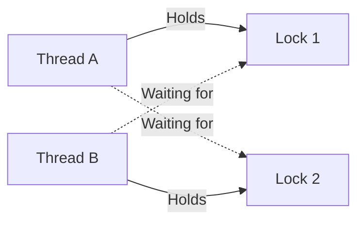

# Thread Safety & Concurrency in Low-Level Design: The Definitive Java Guide

## 1. Executive Overview & Fundamentals of Concurrency

In modern multi-core server architectures, building high-throughput low-level systems requires mastering concurrency at the JVM and hardware levels. Concurrency introduces asynchronous non-determinism: multiple execution threads interleave their operations on shared mutable memory. Without rigorous thread-safety mechanisms, systems suffer from **data corruption, lost updates, deadlocks, memory leaks, and CPU cache thrashing**.

```
┌────────────────────────────────────────────────────────────────────────┐
│                        PROCESS ADDRESS SPACE                           │
│                                                                        │
│  ┌──────────────────────────────────────────────────────────────────┐  │
│  │                    SHARED HEAP MEMORY                            │  │
│  │  • Objects, Class Instances, Arrays                              │  │
│  │  • Metaspace (Static variables, bytecode metadata)               │  │
│  │  • Susceptible to Race Conditions & Concurrent Data Mutation     │  │
│  └──────────────────────────────────┬───────────────────────────────┘  │
│                                     │                                  │
│         ┌───────────────────────────┼───────────────────────────┐      │
│         ▼                           ▼                           ▼      │
│  ┌───────────────┐           ┌───────────────┐           ┌───────────┐ │
│  │   THREAD 1    │           │   THREAD 2    │           │ THREAD 3  │ │
│  │  ┌─────────┐  │           │  ┌─────────┐  │           │ ┌───────┐ │ │
│  │  │ Stack   │  │           │  │ Stack   │  │           │ │ Stack │ │ │
│  │  │ Frame 1 │  │           │  │ Frame 1 │  │           │ └───────┘ │ │
│  │  ├─────────┤  │           │  ├─────────┤  │           │ Native    │ │
│  │  │ Local   │  │           │  │ Local   │  │           │ Method    │ │
│  │  │ Vars    │  │           │  │ Vars    │  │           │ Stack     │ │
│  │  └─────────┘  │           │  └─────────┘  │           └───────────┘ │
│  │  Program      │           │  Program      │                         │
│  │  Counter (PC) │           │  Counter (PC) │                         │
│  └───────────────┘           └───────────────┘                         │
└────────────────────────────────────────────────────────────────────────┘
```

### Processes vs. Threads
- **Process:** An operating system execution container with its own isolated virtual address space, file descriptors, security context, and environment. Inter-Process Communication (IPC) requires expensive OS kernel transitions (Sockets, Pipes, Shared Memory).
- **Thread:** The smallest schedulable unit of execution within a process. Threads share the same heap memory, open files, and address space, but each thread possesses its own **Private Stack**, **Program Counter (PC)**, and **Native Method Stack**. Context-switching threads within the same process is significantly cheaper than process switching, but shared memory introduces data race hazards.

### The Stack vs. The Heap
- **Stack:** Local primitive variables (`int`, `long`, `boolean`) and object reference pointers reside in stack frames. Stack memory is thread-confined, allocated and deallocated automatically as methods enter and return ($O(1)$ push/pop). **Stack variables are inherently thread-safe.**
- **Heap:** All Java objects (`new Object()`) live on the heap. Any object referenced by multiple threads is subject to concurrent reads and writes, requiring synchronization.

### ThreadLocal: Mechanics, Patterns & Memory Leak Hazards

`ThreadLocal<T>` provides thread-confined variables. Each thread accessing a `ThreadLocal` holds an independent, isolated copy of the value.

```
 Thread Object (Thread-1)
 ┌────────────────────────────────────────┐
 │ threadLocals: ThreadLocalMap           │
 │  ┌──────────────────────────────────┐  │
 │  │ Entry[0]: WeakRef(TL1) -> Val1   │  │
 │  │ Entry[1]: WeakRef(TL2) -> Val2   │  │
 │  └──────────────────────────────────┘  │
 └────────────────────────────────────────┘
```

#### The Thread Pool Memory Leak Hazard
In application servers (Tomcat, Netty, Spring Boot), worker threads are pooled and reused across thousands of HTTP requests. 
- The `ThreadLocalMap` in `Thread` maintains an array of `Entry` objects.
- An `Entry` extends `WeakReference<ThreadLocal<?>>`.
- While the key (`ThreadLocal` object) is weakly referenced and can be collected by GC, the **value** is strongly referenced by the long-lived thread!
- If a thread returns to the pool without calling `ThreadLocal.remove()`, the value remains retained in the heap indefinitely, triggering an **OutOfMemoryError (OOM: Metaspace / Java heap space)**.

```java
package com.systemdesign.lld.concurrency.threadlocal;

import java.util.Objects;
import java.util.UUID;

public class SecurityContextHolder {
    // ThreadLocal isolating user authentication state per worker thread
    private static final ThreadLocal<UserContext> CONTEXT = new ThreadLocal<>();

    public record UserContext(String userId, String tenantId, String correlationId) {}

    public static void set(UserContext context) {
        CONTEXT.set(Objects.requireNonNull(context));
    }

    public static UserContext get() {
        return CONTEXT.get();
    }

    /**
     * CRITICAL: Must be invoked inside a finally block when executing in thread pools.
     */
    public static void clear() {
        CONTEXT.remove();
    }
}

// Production Usage Pattern: Always wrap in try-finally
class RequestFilterInterceptor {
    public void handleRequest(String userId, String tenantId, Runnable requestPipeline) {
        try {
            SecurityContextHolder.set(new SecurityContextHolder.UserContext(
                userId, tenantId, UUID.randomUUID().toString()
            ));
            requestPipeline.run(); // Execute controller / service workflow
        } finally {
            // PREVENTS THREAD POOL LEAKS:
            SecurityContextHolder.clear();
        }
    }
}
```

---

## 2. The Java Memory Model (JMM) & Hardware Architecture

To write correct concurrent code, one must understand how multi-core CPUs execute instructions across cache hierarchies.

```
┌────────────────────────────────────────────────────────┐
│                      MAIN MEMORY (DRAM)                │
└───────────────────────────┬────────────────────────────┘
                            │
              ┌─────────────┴─────────────┐
              â–¼                           â–¼
       ┌──────────────┐            ┌──────────────┐
       │   L3 CACHE   │            │   L3 CACHE   │ (Shared across cores)
       └──────┬───────┘            └──────┬───────┘
              │                           │
       ┌──────┴───────┐            ┌──────┴───────┐
       │   L2 CACHE   │            │   L2 CACHE   │ (Per core)
       └──────┬───────┘            └──────┬───────┘
              │                           │
       ┌──────┴───────┐            ┌──────┴───────┐
       │   L1 CACHE   │            │   L1 CACHE   │ (Per core: L1d / L1i)
       └──────┬───────┘            └──────┬───────┘
              │                           │
       ┌──────┴───────┐            ┌──────┴───────┐
       │ STORE BUFFER │            │ STORE BUFFER │
       └──────┬───────┘            └──────┬───────┘
              │                           │
       ┌──────┴───────┐            ┌──────┴───────┐
       │  CPU CORE 0  │            │  CPU CORE 1  │
       └──────────────┘            └──────────────┘
```

### The Three Concurrency Pillars
1. **Visibility:** When Thread A updates a shared variable in its L1/L2 cache, when does Thread B on Core 1 observe the update in memory?
2. **Atomicity:** Can an operation execute as an indivisible unit without being interrupted or partially observed by other threads?
3. **Ordering:** Can the compiler, JIT, or CPU reorder instructions to optimize pipeline execution, altering the sequential logic of the program?

### Instruction Reordering & Hardware Memory Barriers
CPUs and compilers aggressively reorder instructions as long as single-threaded execution semantics (as-if-serial) are preserved. In multi-threaded execution, reordering causes catastrophic state corruption.

```java
// Thread 1                     // Thread 2
a = 1;                         while (!ready) {} // Spin
ready = true;                  System.out.println(a);
```
Without synchronization, the compiler or CPU can reorder `ready = true;` before `a = 1;`. Thread 2 observes `ready == true` and prints `a = 0`!

### The Happens-Before Relationship ($hb(a, b)$)
Defined in JSR-133 (Java Memory Model Specification), if operation $a$ *happens-before* operation $b$, then the memory writes performed by $a$ are guaranteed to be visible to $b$, and the order of $a$ before $b$ is strictly maintained.

#### Core Happens-Before Rules:
1. **Program Order Rule:** Each action in a single thread happens-before every action in that thread that comes later in programmatic order.
2. **Monitor Lock Rule:** An unlock on a monitor (exiting `synchronized`) happens-before every subsequent lock on that exact same monitor.
3. **Volatile Variable Rule:** A write to a `volatile` field happens-before every subsequent read of that exact same `volatile` field.
4. **Thread Start Rule:** A call to `Thread.start()` on a thread happens-before any action in the started thread.
5. **Thread Termination Rule:** Any action in a thread happens-before any other thread successfully detects that the thread has terminated (via `Thread.join()` or `Thread.isAlive() == false`).
6. **Transitivity Rule:** If $hb(a, b)$ and $hb(b, c)$, then $hb(a, c)$.

---

## 3. Low-Level Concurrency Primitives

### 3.1 `volatile` Keyword: Semantics & Memory Barriers

Declaring a field `volatile` instructs the JVM and JIT compiler:
- Writes must flush immediately through the store buffer to shared cache/memory.
- Reads must invalidate L1/L2 caches and load directly from main memory/L3 cache.
- Prevents instruction reordering around the read/write using hardware **Memory Barriers**:
  - **LoadLoad:** Prevents reordering of subsequent loads above prior loads.
  - **StoreStore:** Ensures all prior stores are flushed before the volatile write.
  - **LoadStore:** Ensures loads are finished before subsequent stores.
  - **StoreLoad:** Heavy barrier; ensures prior volatile store is visible globally before any subsequent load.

#### The Fatal Compound Action Trap: `volatile` is NOT Atomic
```java
package com.systemdesign.lld.concurrency.primitives;

import java.util.concurrent.CountDownLatch;
import java.util.concurrent.ExecutorService;
import java.util.concurrent.Executors;

public class VolatileCounterTrap {
    // VIOLATION: volatile guarantees visibility, NOT atomicity!
    private volatile int counter = 0;

    public void increment() {
        // Compound operation: 
        // 1. READ counter from memory
        // 2. MODIFY value (counter + 1)
        // 3. WRITE value back to memory
        counter++; 
    }

    public static void main(String[] args) throws InterruptedException {
        VolatileCounterTrap trap = new VolatileCounterTrap();
        int threadCount = 10;
        int incrementsPerThread = 1000;
        ExecutorService executor = Executors.newFixedThreadPool(threadCount);
        CountDownLatch latch = new CountDownLatch(threadCount);

        for (int i = 0; i < threadCount; i++) {
            executor.submit(() -> {
                for (int j = 0; j < incrementsPerThread; j++) {
                    trap.increment();
                }
                latch.countDown();
            });
        }

        latch.await();
        executor.shutdown();
        // EXPECTED: 10,000 | ACTUAL: Almost always < 10,000 (e.g. 8421) due to lost updates!
        System.out.println("Final Counter: " + trap.counter);
    }
}
```

---

### 3.2 `synchronized` & HotSpot Monitor Locks

Every object in Java has an internal header containing a **Mark Word** (64 bits on modern 64-bit JVMs).

```
 64-Bit Mark Word Layout (HotSpot):
 ┌─────────────────────────────────────────────────────────────┬──────┬────┐
 │ Bit Pattern / State Description                             │epoch │lock│
 ├─────────────────────────────────────────────────────────────┼──────┼────┤
 │ Unlocked:        [unused:25 | hashcode:31 | age:4]          │  --  │ 01 │
 │ Biased Lock:     [ThreadID:54 | epoch:2 | age:4]            │  00  │ 01 │
 │ Lightweight Lock:[Pointer to Lock Record in Thread Stack]   │  --  │ 00 │
 │ Heavyweight Lock:[Pointer to OS ObjectMonitor structure]    │  --  │ 10 │
 │ Marked for GC:   [GC metadata]                              │  --  │ 11 │
 └─────────────────────────────────────────────────────────────┴──────┴────┘
```

#### Lock Escalation Pipeline:
1. **Unlocked (01):** No thread holds the lock.
2. **Lightweight Locking (00):** Thread attempts to acquire lock via a hardware `CAS` instruction pointing to a `BasicObjectLock` record on its execution stack. If uncontended, lock acquisition takes ~10 nanoseconds without kernel mediation.
3. **Spin Locking:** If a second thread arrives, it spins in a tight loop executing pause instructions (`PAUSE`) awaiting release.
4. **Heavyweight Inflation (10):** If contention persists (spin threshold exceeded), the lock inflates into an **OS Heavyweight Mutex** (`ObjectMonitor`). The spinning thread is suspended by the OS scheduler (`futex` on Linux), incurring a 1–5 microsecond context-switch penalty.

#### JVM Lock Optimizations
- **Lock Coarsening:** Merging consecutive synchronized blocks operating on the same monitor into a single larger block.
- **Lock Elision:** The JIT compiler uses **Escape Analysis** to prove an object never escapes the method scope, stripping out the `synchronized` monitors entirely at runtime.

---

### 3.3 Explicit Locks: `java.util.concurrent.locks`

#### 1. `ReentrantLock`
Offers fairness policies, timeout-based acquisition (`tryLock`), interruptible locks (`lockInterruptibly`), and fine-grained `Condition` variables.

```java
package com.systemdesign.lld.concurrency.locks;

import java.util.concurrent.TimeUnit;
import java.util.concurrent.locks.Condition;
import java.util.concurrent.locks.ReentrantLock;

public class BoundedBuffer<T> {
    private final Object[] items;
    private int putIndex, takeIndex, count;

    // Fair lock prevents thread starvation at the expense of lower throughput
    private final ReentrantLock lock = new ReentrantLock(true);
    private final Condition notFull = lock.newCondition();
    private final Condition notEmpty = lock.newCondition();

    public BoundedBuffer(int capacity) {
        if (capacity <= 0) throw new IllegalArgumentException("Capacity must be positive");
        this.items = new Object[capacity];
    }

    public void put(T x) throws InterruptedException {
        lock.lockInterruptibly();
        try {
            while (count == items.length) {
                // Must use while loop to guard against spurious wakeups!
                notFull.await();
            }
            items[putIndex] = x;
            if (++putIndex == items.length) putIndex = 0;
            count++;
            notEmpty.signal(); // Notify waiting consumers
        } finally {
            lock.unlock(); // Guaranteed unlock
        }
    }

    @SuppressWarnings("unchecked")
    public T take() throws InterruptedException {
        lock.lockInterruptibly();
        try {
            while (count == 0) {
                notEmpty.await();
            }
            T item = (T) items[takeIndex];
            items[takeIndex] = null; // Prevent memory leak
            if (++takeIndex == items.length) takeIndex = 0;
            count--;
            notFull.signal(); // Notify waiting producers
            return item;
        } finally {
            lock.unlock();
        }
    }

    public boolean tryPut(T x, long timeoutMs) throws InterruptedException {
        if (!lock.tryLock(timeoutMs, TimeUnit.MILLISECONDS)) {
            return false; // Lock acquisition timed out; avoids indefinite blocking
        }
        try {
            if (count == items.length) return false;
            items[putIndex] = x;
            if (++putIndex == items.length) putIndex = 0;
            count++;
            notEmpty.signal();
            return true;
        } finally {
            lock.unlock();
        }
    }
}
```

#### 2. `ReentrantReadWriteLock`
Maintains a pair of associated locks: one for read-only operations (shared) and one for writing (exclusive).
- **Read Starvation Hazard:** If continuous readers arrive, a writer thread may starve indefinitely.
- **Lock Downgrading:** Holding write lock -> acquiring read lock -> releasing write lock (Permitted).
- **Lock Upgrading:** Holding read lock -> attempting to acquire write lock (**Deadlock hazard; strictly prohibited**).

#### 3. `StampedLock` (Java 8+)
Provides **Optimistic Reading**, bypassing memory barriers entirely if no write occurred during the read window.

```java
package com.systemdesign.lld.concurrency.locks;

import java.util.concurrent.locks.StampedLock;

public class Point2D {
    private double x, y;
    private final StampedLock sl = new StampedLock();

    public void move(double deltaX, double deltaY) {
        long stamp = sl.writeLock(); // Exclusive write lock
        try {
            x += deltaX;
            y += deltaY;
        } finally {
            sl.unlockWrite(stamp);
        }
    }

    public double distanceFromOrigin() {
        // Step 1: Optimistic read without acquiring a lock
        long stamp = sl.tryOptimisticRead();
        double currentX = x;
        double currentY = y;

        // Step 2: Validate if a write occurred between tryOptimisticRead and reading values
        if (!sl.validate(stamp)) {
            // Step 3: Fall back to pessimistic shared read lock
            stamp = sl.readLock();
            try {
                currentX = x;
                currentY = y;
            } finally {
                sl.unlockRead(stamp);
            }
        }
        return Math.hypot(currentX, currentY);
    }
}
```

---

### 3.4 Lock-Free Programming & Compare-And-Swap (CAS)

Lock-free algorithms use hardware atomic primitives (`LOCK CMPXCHG` on x86) to mutate state without blocking threads.

```
                  HARDWARE CAS WORKFLOW
 ┌────────────────────────────────────────────────────────┐
 │ Expected Value: E     Target Memory: V     New Value: N│
 └───────────────────────────┬────────────────────────────┘
                             │
                  Is Current V == E?
                 ┌───────────┴───────────┐
             YES │                       │ NO
                 â–¼                       â–¼
    [Set V = N atomically]     [Reject mutation (abort/retry)]
    [Return true]              [Return false]
```

#### The ABA Problem & `AtomicStampedReference`
If Thread 1 reads value `A`, gets suspended, and Thread 2 changes `A -> B -> A`, Thread 1's subsequent CAS succeeds even though the state mutated in the interim! In memory reclamation or pointer-based stacks (Treiber Stack), this leads to dangling pointer corruption.

```java
package com.systemdesign.lld.concurrency.cas;

import java.util.concurrent.atomic.AtomicStampedReference;

public class AbaResolution {
    public static void main(String[] args) {
        String initialRef = "StateA";
        int initialStamp = 1;
        AtomicStampedReference<String> stampedRef = new AtomicStampedReference<>(initialRef, initialStamp);

        int[] holder = new int[1];
        String ref = stampedRef.get(holder);
        int stamp = holder[0];

        // Thread 2 mutates A -> B -> A
        stampedRef.compareAndSet("StateA", "StateB", stamp, stamp + 1);
        stampedRef.compareAndSet("StateB", "StateA", stamp + 1, stamp + 2);

        // Thread 1 attempts CAS with old stamp
        boolean success = stampedRef.compareAndSet("StateA", "StateC", stamp, stamp + 1);
        // Returns FALSE because stamp is 3, while expected was 1!
        System.out.println("CAS Success with Stamp: " + success);
    }
}
```

#### `LongAdder` vs. `AtomicLong`: Resolving False Sharing & Cache Bouncing
Under extreme write contention across 64+ cores, threads executing CAS on a single `AtomicLong` cause continuous **Cache Line Invalidation** across CPU cores (Cache Line Bouncing).
- `LongAdder` uses **Cell Striping**: It maintains an array of `Cell` objects, padding each cell with 128 bytes to prevent **False Sharing** (two variables residing on the same 64-byte L1 cache line).
- Threads hash to separate cells, updating their own cell without contention. The total sum is computed by aggregating all cells only when `sum()` is called.

---

## 4. Thread-Safe Data Structures Internals

### 4.1 `ConcurrentHashMap` (Java 8+) Architecture

```
 ConcurrentHashMap Hash Table
 ┌───────────────────────────────────────────────────────────┐
 │ Table: Node<K,V>[] (Power-of-two size)                    │
 ├─────┬─────────────────────────────────────────────────────┤
 │ [0] │ Node1 ──► Node2 (Bucket Lock: synchronized(Node1))  │
 │ [1] │ null (Inserted via atomic CAS: no lock!)            │
 │ [2] │ TreeBin (Red-Black Tree: when bucket count >= 8)    │
 │ [3] │ ForwardingNode (Points to nextTable during resize)  │
 └─────┴─────────────────────────────────────────────────────┘
```

1. **Bucket-Level Synchronization:** Instead of locking the whole table or segments, Java 8+ locks only the **first node of each bucket** (`synchronized (f)`).
2. **CAS for Unoccupied Bins:** If a bin is empty, the new node is inserted using lock-free `CAS` (`casTabAt`).
3. **TreeBins for Collision Resilience:** When collisions in a bin exceed `TREEIFY_THRESHOLD = 8` and table size $\ge 64$, the linked list converts to a Red-Black Tree (`TreeBin`), reducing worst-case lookup from $O(N)$ to $O(\log N)$.
4. **Concurrent Cooperative Resizing:** When resizing, a `ForwardingNode` with hash `-1` (`MOVED`) is placed at completed bins. Other threads attempting to write to moved bins detect this and cooperatively assist in migrating nodes to the new table.

### 4.2 `CopyOnWriteArrayList`
- Reads are lock-free and iterate over an immutable snapshot of the underlying array without throwing `ConcurrentModificationException`.
- Every mutation (`add`, `set`, `remove`) acquires a `ReentrantLock` and **creates an entirely new copy** of the underlying array ($O(N)$ allocation).
- **Use Case:** Exclusively suited for read-heavy, write-rare scenarios (e.g., Event Listeners, Routing Tables).

### 4.3 The `BlockingQueue` Family

| Queue Implementation | Bounded? | Concurrency Mechanism | Primary Use Case |
| :--- | :--- | :--- | :--- |
| **`ArrayBlockingQueue`** | Strictly Bounded | Single `ReentrantLock` with two conditions (`notFull`, `notEmpty`) | Predictable memory footprint; low variance |
| **`LinkedBlockingQueue`** | Optionally Bounded | Dual locks: `putLock` and `takeLock` allowing simultaneous read and write | High-throughput producer-consumer pipelines |
| **`PriorityBlockingQueue`** | Unbounded | Single lock + heap-based array restructuring | Priority task execution (e.g., SLA routing) |
| **`SynchronousQueue`** | Zero Capacity | Dual-stack / Dual-queue lock-free handoff algorithms | Direct thread handoff (`CachedThreadPool`) |

---

## 5. Concurrency Hazards & Anti-Patterns

### 5.1 Deadlock: The Coffman Conditions & Resolution

A deadlock occurs when two or more threads are unable to proceed because each is waiting for the other to release a lock.



#### The Four Necessary and Sufficient Coffman Conditions:
1. **Mutual Exclusion:** Resources cannot be shared; only one thread can hold a resource at a time.
2. **Hold and Wait:** A thread holding a resource can request additional resources without releasing its current ones.
3. **No Preemption:** Resources cannot be forcibly confiscated from a thread holding them.
4. **Circular Wait:** A closed chain of threads exists where each thread holds a resource needed by the next.

#### Breaking Circular Wait: Deterministic Lock Ordering
To eliminate deadlocks, enforce a global strict order on lock acquisition.

```java
package com.systemdesign.lld.concurrency.hazards;

import java.math.BigDecimal;
import java.util.Objects;

public class DeadlockFreeAccountTransfer {

    public static class Account implements Comparable<Account> {
        private final String accountNumber;
        private BigDecimal balance;

        public Account(String accountNumber, BigDecimal balance) {
            this.accountNumber = Objects.requireNonNull(accountNumber);
            this.balance = Objects.requireNonNull(balance);
        }

        public void debit(BigDecimal amount) { balance = balance.subtract(amount); }
        public void credit(BigDecimal amount) { balance = balance.add(amount); }

        @Override
        public int compareTo(Account other) {
            return this.accountNumber.compareTo(other.accountNumber);
        }
    }

    public void transfer(Account from, Account to, BigDecimal amount) {
        if (from == to) {
            throw new IllegalArgumentException("Cannot transfer to identical account");
        }

        // DETERMINISTIC LOCK ORDERING:
        // By always acquiring locks based on alphanumeric account number order,
        // we mathematically destroy Coffman's Circular Wait condition!
        Account firstLock = from.compareTo(to) < 0 ? from : to;
        Account secondLock = from.compareTo(to) < 0 ? to : from;

        synchronized (firstLock) {
            synchronized (secondLock) {
                if (from.balance.compareTo(amount) < 0) {
                    throw new IllegalStateException("Insufficient funds");
                }
                from.debit(amount);
                to.credit(amount);
            }
        }
    }
}
```

### 5.2 Livelock, Starvation & Thread Leaks
- **Livelock:** Threads actively change their internal state in response to each other without making functional forward progress (e.g., two people in a narrow hallway constantly stepping left and right simultaneously). Resolved via randomized retry backoffs (Jitter).
- **Starvation:** A thread is perpetually denied CPU execution time due to greedy locks or strict thread priorities. Resolved using **Fair ReentrantLocks**.
- **Thread Leaks:** Continuously spawning raw `new Thread(...)` instances without pooling. Each OS thread allocates 1MB of stack memory off-heap, causing `java.lang.OutOfMemoryError: unable to create new native thread`.

---

## 6. Thread Pools & The Executor Framework

### 6.1 `ThreadPoolExecutor` Core Parameters & Tuning

```
                  TASK SUBMISSION FLOW
 ┌────────────────────────────────────────────────────────┐
 │ execute(Runnable task)                                 │
 └───────────────────────────┬────────────────────────────┘
                             │
            Active Threads < corePoolSize?
           ┌─────────────────┴─────────────────┐
       YES │                                   │ NO
           â–¼                                   â–¼
 [Spawn new Core Worker Thread]    Is WorkQueue Full?
                                  ┌────────────┴────────────┐
                              NO  │                         │ YES
                                  â–¼                         â–¼
                        [Enqueue Task in Queue]   Active Threads < maxPoolSize?
                                                 ┌──────────┴──────────┐
                                             YES │                     │ NO
                                                 â–¼                     â–¼
                                       [Spawn Non-Core Thread]  [Trigger Rejection Handler]
```

#### Saturation & Rejection Policies:
1. **`ThreadPoolExecutor.AbortPolicy` (Default):** Throws `RejectedExecutionException`. Protects internal state, but client receives an abrupt failure.
2. **`ThreadPoolExecutor.CallerRunsPolicy` (Recommended for Backpressure):** The calling thread (e.g., HTTP request thread) executes the task itself. This naturally slows down incoming request arrival, providing graceful backpressure.
3. **`ThreadPoolExecutor.DiscardPolicy`:** Silently discards the task without notice. High data loss risk.
4. **`ThreadPoolExecutor.DiscardOldestPolicy`:** Drops the task at the head of the work queue and retries task submission.

#### Mathematical Thread Pool Sizing

$$\text{Optimal Pool Size} = N_{\text{CPU}} \times U_{\text{CPU}} \times \left(1 + \frac{W}{C}\right)$$

Where:
- $N_{\text{CPU}}$ = Number of available CPU cores (`Runtime.getRuntime().availableProcessors()`).
- $U_{\text{CPU}}$ = Target CPU utilization ($0.0 \le U_{\text{CPU}} \le 1.0$).
- $W$ = Average waiting time (I/O, database queries, network calls).
- $C$ = Average computing time (CPU processing, serialization, hashing).

#### Sizing Heuristics:
- **CPU-Bound Tasks (Heavy computation, crypto, image rendering):** $N_{\text{threads}} = N_{\text{CPU}} + 1$. The extra thread covers occasional page faults.
- **I/O-Bound Tasks (Microservice calls, DB queries):** If a task spends 90% of its time waiting for I/O ($W/C = 9$), on a 8-core CPU: $8 \times 1.0 \times (1 + 9) = 80$ threads.

---

## 7. Real-World Concurrency Patterns in LLD

### 7.1 Thread-Safe Singleton: The Three Robust Approaches

#### Approach 1: Double-Checked Locking with `volatile`
```java
package com.systemdesign.lld.concurrency.patterns;

public class DoubleCheckedSingleton {
    // CRITICAL: volatile is strictly required!
    // Without volatile, the JVM JIT compiler can reorder instructions during instantiation:
    // 1. Allocate memory
    // 2. Assign memory address to reference 'instance'
    // 3. Invoke constructor
    // Another thread could observe 'instance != null' and consume a partially initialized object!
    private static volatile DoubleCheckedSingleton instance;

    private DoubleCheckedSingleton() {
        // Prevent reflection instantiation attacks
        if (instance != null) {
            throw new IllegalStateException("Instance already created");
        }
    }

    public static DoubleCheckedSingleton getInstance() {
        if (instance == null) { // 1st Check (No lock: fast path)
            synchronized (DoubleCheckedSingleton.class) {
                if (instance == null) { // 2nd Check (Inside lock: safe path)
                    instance = new DoubleCheckedSingleton();
                }
            }
        }
        return instance;
    }
}
```

#### Approach 2: Bill Pugh Singleton (Initialization-on-Demand Holder)
Leverages JVM classloader thread-safety guarantees. The nested class is loaded only upon the first invocation of `getInstance()`.

```java
public class BillPughSingleton {
    private BillPughSingleton() {}

    private static class InstanceHolder {
        // Class initialization is guaranteed to be atomic, thread-safe, and lazy by JVM Spec §12.4.2
        private static final BillPughSingleton INSTANCE = new BillPughSingleton();
    }

    public static BillPughSingleton getInstance() {
        return InstanceHolder.INSTANCE;
    }
}
```

#### Approach 3: Enum Singleton (Joshua Bloch's Gold Standard)
```java
public enum EnumSingleton {
    INSTANCE;

    public void executeBusinessLogic() {
        // 100% thread-safe, immune to reflection and serialization duplication
    }
}
```

---

### 7.2 Custom High-Throughput Ring Buffer (Producer-Consumer)

A production-grade implementation of an in-memory ring buffer using `ReentrantLock` and dual `Condition` variables.

```java
package com.systemdesign.lld.concurrency.patterns;

import java.util.Objects;
import java.util.concurrent.locks.Condition;
import java.util.concurrent.locks.ReentrantLock;

public class HighThroughputRingBuffer<T> {
    private final Object[] ring;
    private final int capacity;
    private int head = 0;
    private int tail = 0;
    private int size = 0;

    private final ReentrantLock lock;
    private final Condition notFull;
    private final Condition notEmpty;

    public HighThroughputRingBuffer(int capacity, boolean fair) {
        if (capacity <= 0) throw new IllegalArgumentException("Capacity must be positive");
        this.capacity = capacity;
        this.ring = new Object[capacity];
        this.lock = new ReentrantLock(fair);
        this.notFull = lock.newCondition();
        this.notEmpty = lock.newCondition();
    }

    public void publish(T element) throws InterruptedException {
        Objects.requireNonNull(element, "Published element cannot be null");
        lock.lockInterruptibly();
        try {
            while (size == capacity) {
                notFull.await(); // Buffer full: block producer
            }
            ring[tail] = element;
            tail = (tail + 1) % capacity;
            size++;
            notEmpty.signal(); // Awaken sleeping consumer
        } finally {
            lock.unlock();
        }
    }

    @SuppressWarnings("unchecked")
    public T consume() throws InterruptedException {
        lock.lockInterruptibly();
        try {
            while (size == 0) {
                notEmpty.await(); // Buffer empty: block consumer
            }
            T item = (T) ring[head];
            ring[head] = null; // Prevent memory leak / GC pinning
            head = (head + 1) % capacity;
            size--;
            notFull.signal(); // Awaken sleeping producer
            return item;
        } finally {
            lock.unlock();
        }
    }

    public int size() {
        lock.lock();
        try {
            return size;
        } finally {
            lock.unlock();
        }
    }
}
```

---

### 7.3 Fork/Join Framework & Work Stealing

The **ForkJoinPool** uses a **Work-Stealing Algorithm**:
- Each worker thread manages its own double-ended queue (**Deque**).
- When a thread forks a subtask, it pushes the task onto the **head** of its own deque (LIFO order to preserve cache locality).
- When a worker exhausts its own deque, it steals tasks from the **tail** of another thread's deque (FIFO order to minimize contention).

```java
package com.systemdesign.lld.concurrency.patterns;

import java.util.concurrent.ForkJoinPool;
import java.util.concurrent.RecursiveTask;

/**
 * High-performance parallel array sum using ForkJoin divide-and-conquer.
 */
public class ParallelArraySumTask extends RecursiveTask<Long> {
    private static final int SEQUENTIAL_THRESHOLD = 50_000;
    private final long[] data;
    private final int start;
    private final int end;

    public ParallelArraySumTask(long[] data, int start, int end) {
        this.data = data;
        this.start = start;
        this.end = end;
    }

    @Override
    protected Long compute() {
        int length = end - start;
        if (length <= SEQUENTIAL_THRESHOLD) {
            long sum = 0;
            for (int i = start; i < end; i++) {
                sum += data[i];
            }
            return sum;
        }

        int mid = start + (length / 2);
        ParallelArraySumTask leftSubtask = new ParallelArraySumTask(data, start, mid);
        ParallelArraySumTask rightSubtask = new ParallelArraySumTask(data, mid, end);

        // Asynchronously fork left subtask into thread's local deque
        leftSubtask.fork();

        // Compute right subtask directly in current thread to minimize scheduling overhead
        long rightResult = rightSubtask.compute();

        // Await completion and steal/join left subtask
        long leftResult = leftSubtask.join();

        return leftResult + rightResult;
    }

    public static void main(String[] args) {
        long[] numbers = new long[10_000_000];
        for (int i = 0; i < numbers.length; i++) {
            numbers[i] = i;
        }

        ForkJoinPool pool = ForkJoinPool.commonPool();
        ParallelArraySumTask rootTask = new ParallelArraySumTask(numbers, 0, numbers.length);
        long totalSum = pool.invoke(rootTask);

        System.out.println("Computed Parallel Sum: " + totalSum);
    }
}
```
