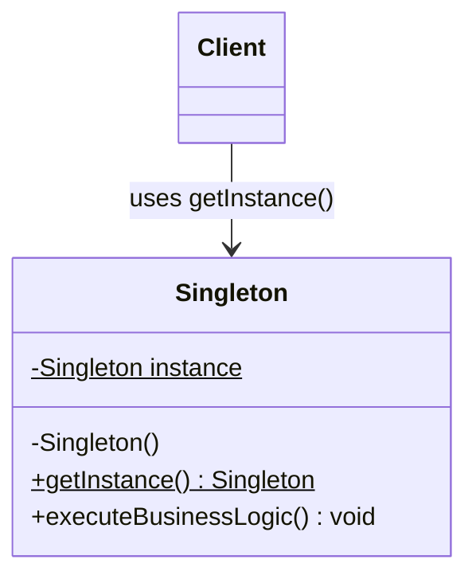

# Singleton Pattern: Production Architecture & Low-Level Design in Java

> **Category:** [Creational Design Patterns](./04-creational-design-patterns.md) | **Navigation:** [Back to Creational Index](./04-creational-design-patterns.md) | [Master LLD Index](./00-index.md)

---


### 1.1 Intent, Architecture & Problem Context
The **Singleton Pattern** ensures that a class has only one instance within a given JVM/ClassLoader boundary and provides a global, unified point of access to it. It is commonly used for shared hardware or infrastructure abstractions: hardware drivers, thread pools, telemetry registries, database connection pools, and distributed lock managers.

```
+-------------------------------------------------------------+
|                          Singleton                          |
+-------------------------------------------------------------+
| - instance: Singleton {static}                              |
+-------------------------------------------------------------+
| - Singleton()                                               |
| + getInstance(): Singleton {static}                         |
| + executeBusinessLogic(): void                              |
+-------------------------------------------------------------+
```



---

### 1.2 The Five Java Implementations & Thread Safety Analysis

#### Approach 1: Eager Initialization (Thread-Safe, High Simplicity)
The instance is instantiated at class loading time by the JVM.

```java
package com.systemdesign.creational.singleton;

import java.time.Instant;

/**
 * Eagerly initialized Singleton.
 * Thread-safe via JVM ClassLoader guarantees (JLS 12.4.2).
 * Trade-off: Resource allocation occurs even if the instance is never consumed.
 */
public final class EagerSingleton {

    // Instance allocated at class loading time
    private static final EagerSingleton INSTANCE = new EagerSingleton();
    
    private final Instant startupTimestamp;

    private EagerSingleton() {
        // Prevent instantiation via reflection
        if (INSTANCE != null) {
            throw new IllegalStateException("Instance already initialized!");
        }
        this.startupTimestamp = Instant.now();
    }

    public static EagerSingleton getInstance() {
        return INSTANCE;
    }

    public Instant getStartupTimestamp() {
        return this.startupTimestamp;
    }
}
```

* **Thread Safety**: 100% thread-safe. Guaranteed by the JVM during class initialization.
* **Drawback**: Wastes heap memory if initialization is resource-intensive and never requested.

---

#### Approach 2: Synchronized Method (Thread-Safe, Low Performance)
The instance is lazily allocated, but access is synchronized across all threads.

```java
package com.systemdesign.creational.singleton;

public final class SynchronizedMethodSingleton {

    private static SynchronizedMethodSingleton instance;

    private SynchronizedMethodSingleton() {}

    /**
     * Synchronized on the Class object monitor.
     * Introduces a massive 10x-100x contention bottleneck under high concurrency.
     */
    public static synchronized SynchronizedMethodSingleton getInstance() {
        if (instance == null) {
            instance = new SynchronizedMethodSingleton();
        }
        return instance;
    }
}
```

* **Thread Safety**: Thread-safe via monitor lock on `SynchronizedMethodSingleton.class`.
* **Drawback**: High performance penalty. Synchronization is only needed on the *first* call; subsequent reads still pay the synchronization cost.

---

#### Approach 3: Double-Checked Locking (DCL) with `volatile`
Lazy initialization that synchronizes only during initial creation, utilizing a two-tier check.

```java
package com.systemdesign.creational.singleton;

import java.io.Serial;
import java.io.Serializable;

/**
 * Double-Checked Locking Singleton with JMM volatile semantics.
 */
public final class DoubleCheckedLockingSingleton implements Serializable, Cloneable {

    @Serial
    private static final long serialVersionUID = 1L;

    // MANDATORY: volatile prevents instruction reordering and ensures visibility
    private static volatile DoubleCheckedLockingSingleton instance;

    private DoubleCheckedLockingSingleton() {
        // Guard against reflection attack
        if (instance != null) {
            throw new IllegalStateException("Singleton instance already exists!");
        }
    }

    public static DoubleCheckedLockingSingleton getInstance() {
        DoubleCheckedLockingSingleton localRef = instance; // Read volatile once into local variable
        if (localRef == null) {
            synchronized (DoubleCheckedLockingSingleton.class) {
                localRef = instance;
                if (localRef == null) {
                    instance = localRef = new DoubleCheckedLockingSingleton();
                }
            }
        }
        return localRef;
    }

    @Serial
    private Object readResolve() {
        // Preserve singleton property during deserialization
        return getInstance();
    }

    @Override
    protected Object clone() throws CloneNotSupportedException {
        throw new CloneNotSupportedException("Cloning of Singleton is strictly prohibited!");
    }
}
```

##### Deep Dive: Why `volatile` is Non-Negotiable in DCL
In the Java Virtual Machine, the bytecode execution for `instance = new DoubleCheckedLockingSingleton()` comprises three discrete operations:
1. `mem = allocate(sizeof(DoubleCheckedLockingSingleton));` // Allocate heap memory
2. `ctor(mem);`                                             // Invoke constructor to initialize fields
3. `instance = mem;`                                       // Assign reference to `instance` variable

Without the `volatile` modifier, the JIT compiler and hardware CPU caches are legally permitted under the Java Memory Model (JSR-133) to reorder steps 2 and 3:
1. `mem = allocate(...)`
2. `instance = mem;`   // Variable is now NON-NULL, but object fields are uninitialized!
3. `ctor(mem);`

```
Thread A: Step 1 (Allocate) -> Step 3 (Assign non-null ref)
                             |
Thread B: Calls getInstance() -> checks (instance == null) -> FALSE!
Thread B: Receives partially constructed object -> crashes with NullPointer/IllegalState!
                             |
Thread A: Step 2 (Runs constructor)
```

Declaring `instance` as `volatile` establishes a **happens-before** memory barrier (specifically a `StoreStore` and `StoreLoad` barrier), guaranteeing that constructor writes are flushed to main memory before the reference assignment is made visible to other CPU cores.

---

#### Approach 4: Bill Pugh Static Inner Helper Class (Lazy & Performant)
Leverages the JVM's class-loading mechanism to achieve lazy initialization without explicit synchronization overhead.

```java
package com.systemdesign.creational.singleton;

/**
 * Bill Pugh Singleton.
 * Thread-safe, lazy, high-performance without locks.
 */
public final class BillPughSingleton {

    private BillPughSingleton() {
        if (Holder.INSTANCE != null) {
            throw new IllegalStateException("Instance already allocated!");
        }
    }

    /**
     * Loaded into memory ONLY when Holder.INSTANCE is first dereferenced.
     */
    private static final class Holder {
        private static final BillPughSingleton INSTANCE = new BillPughSingleton();
    }

    public static BillPughSingleton getInstance() {
        return Holder.INSTANCE;
    }
}
```

* **How it works**: When `BillPughSingleton` is loaded by the ClassLoader, the static nested class `Holder` is **not** loaded. It is only loaded when `getInstance()` is called, prompting the JVM to initialize `Holder` and execute its static initializer in a thread-safe manner guaranteed by section 12.4.2 of the Java Language Specification.

---

#### Approach 5: Enum Singleton (Joshua Bloch's Recommended Standard)
The ultimate defense against reflection, serialization, and multi-threading vulnerabilities.

```java
package com.systemdesign.creational.singleton;

import java.util.concurrent.atomic.AtomicLong;

/**
 * Enum Singleton.
 * Immune to reflection, serialization, and multi-threading hazards.
 */
public enum EnumSingleton {
    INSTANCE;

    private final AtomicLong executionCounter = new AtomicLong(0);

    public long performWork(String task) {
        long count = executionCounter.incrementAndGet();
        System.out.printf("[EnumSingleton] Executed %s (Total tasks: %d)%n", task, count);
        return count;
    }

    public long getCount() {
        return executionCounter.get();
    }
}
```

---

### 1.3 Attack Vectors & Defenses

```
+----------------------------------------------------------------------------------+
|                             Singleton Attack Vectors                             |
+--------------------------+-----------------------------+-------------------------+
|     Reflection Attack    |    Serialization Attack     |      Cloning Attack     |
| (setAccessible bypass)   | (readObject new instance)   |   (Object.clone bypass) |
+--------------------------+-----------------------------+-------------------------+
| Defense: Constructor     | Defense: readResolve()      | Defense: Override       |
| flag / instance check    | returns existing instance   | clone() to throw        |
| OR use Enum              | OR use Enum                 | CloneNotSupportedEx     |
+--------------------------+-----------------------------+-------------------------+
```

#### Defending Against Reflection Attacks
```java
private Singleton() {
    if (instance != null) {
        throw new IllegalStateException("Reflection access denied: Singleton already created.");
    }
}
```
*Note: Java reflection cannot instantiate Enum types under any circumstances. Invoking `Constructor.newInstance()` on an Enum throws `IllegalArgumentException: Cannot reflectively create enum objects` directly from the JVM.*

#### Defending Against Deserialization Attacks
When a serialized singleton is deserialized, Java creates a brand new instance bypassing constructors.
```java
@Serial
private Object readResolve() {
    return getInstance(); // Replaces deserialized copy with original singleton instance
}
```

#### Defending Against Cloning Attacks
```java
@Override
protected Object clone() throws CloneNotSupportedException {
    throw new CloneNotSupportedException("Cloning Singleton is strictly disallowed");
}
```

---

### 1.4 Real-World Enterprise Usage
* **JDK**: `java.lang.Runtime.getRuntime()`, `java.awt.Desktop.getDesktop()`, `java.lang.System.getSecurityManager()`.
* **Spring Framework**: By default, every `@Component`, `@Service`, and `@Bean` registered in the `ApplicationContext` is managed as a Singleton (within the scope of that specific Spring IoC container).

---

---

## Navigation & Related Patterns
* [Back to Creational Patterns Index](./04-creational-design-patterns.md)
* [Master LLD Index](./00-index.md)
* [Next: 04-02-factory-method-pattern.md](./04-02-factory-method-pattern.md)
