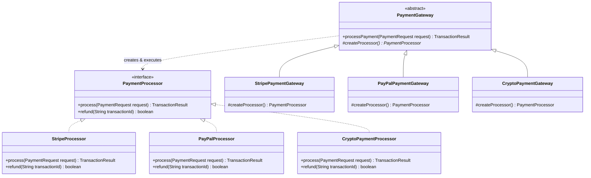

# Factory Method Pattern: Production Architecture & Low-Level Design in Java

> **Category:** [Creational Design Patterns](./04-creational-design-patterns.md) | **Navigation:** [Back to Creational Index](./04-creational-design-patterns.md) | [Master LLD Index](./00-index.md)

---


### 2.1 Intent, Problem Context & Architecture
The **Factory Method Pattern** (GoF) defines an interface for creating an object, but lets subclasses decide which class to instantiate. Factory Method lets a class defer instantiation to subclasses.

This resolves the violation of the **Open/Closed Principle (OCP)**: client code depends on abstract creator and product interfaces rather than tight couplings to concrete implementations (`new PayPalProcessor()`, `new StripeProcessor()`).

```
+---------------------------+                +-------------------------+
|      PaymentGateway       |                |    PaymentProcessor     |
+---------------------------+                +-------------------------+
| + processPayment(...)     |                | + process(PaymentReq)   |
| # createProcessor()*      |                | + refund(String)        |
+---------------------------+                +-------------------------+
              ^                                           ^
              |                                           |
    +---------+---------+                       +---------+---------+
    |                   |                       |                   |
+----------------+ +----------------+       +----------------+ +----------------+
| StripeGateway  | | PayPalGateway  |       | StripeProcessor| | PayPalProcessor|
+----------------+ +----------------+       +----------------+ +----------------+
| # createProc() | | # createProc() |       | + process(...) | | + process(...) |
+----------------+ +----------------+       +----------------+ +----------------+
```



---

### 2.2 Production Implementation: Multi-Provider Payment Gateway

```java
package com.systemdesign.creational.factorymethod;

import java.math.BigDecimal;
import java.util.Objects;
import java.util.UUID;

// 1. Data Transfer Objects
public record PaymentRequest(String customerId, BigDecimal amount, String currency, String idempotencyKey) {
    public PaymentRequest {
        Objects.requireNonNull(customerId, "Customer ID must not be null");
        Objects.requireNonNull(amount, "Amount must not be null");
        Objects.requireNonNull(currency, "Currency must not be null");
        if (amount.compareTo(BigDecimal.ZERO) <= 0) {
            throw new IllegalArgumentException("Payment amount must be positive");
        }
    }
}

public record TransactionResult(String transactionId, boolean success, String provider, String message) {}

// 2. Product Interface
public interface PaymentProcessor {
    TransactionResult process(PaymentRequest request);
    boolean refund(String transactionId);
}

// 3. Concrete Product A: Stripe
public final class StripeProcessor implements PaymentProcessor {
    private final String apiKey;

    public StripeProcessor(String apiKey) {
        this.apiKey = Objects.requireNonNull(apiKey);
    }

    @Override
    public TransactionResult process(PaymentRequest request) {
        String txId = "stripe_tx_" + UUID.randomUUID();
        System.out.printf("[Stripe] Charging %s %s for customer %s with key %s...%n",
                request.amount(), request.currency(), request.customerId(), apiKey.substring(0, 4) + "***");
        return new TransactionResult(txId, true, "STRIPE", "Payment successfully processed via Stripe");
    }

    @Override
    public boolean refund(String transactionId) {
        System.out.printf("[Stripe] Refunding transaction %s%n", transactionId);
        return true;
    }
}

// 4. Concrete Product B: PayPal
public final class PayPalProcessor implements PaymentProcessor {
    private final String clientId;
    private final String clientSecret;

    public PayPalProcessor(String clientId, String clientSecret) {
        this.clientId = Objects.requireNonNull(clientId);
        this.clientSecret = Objects.requireNonNull(clientSecret);
    }

    @Override
    public TransactionResult process(PaymentRequest request) {
        String txId = "paypal_tx_" + UUID.randomUUID();
        System.out.printf("[PayPal] Executing PayPal checkout for %s %s with clientId %s...%n",
                request.amount(), request.currency(), clientId);
        return new TransactionResult(txId, true, "PAYPAL", "Payment approved via PayPal Express Checkout");
    }

    @Override
    public boolean refund(String transactionId) {
        System.out.printf("[PayPal] Issuing reverse transfer for %s%n", transactionId);
        return true;
    }
}

// 5. Concrete Product C: Crypto (e.g. USDC/Ethereum)
public final class CryptoPaymentProcessor implements PaymentProcessor {
    private final String walletAddress;

    public CryptoPaymentProcessor(String walletAddress) {
        this.walletAddress = Objects.requireNonNull(walletAddress);
    }

    @Override
    public TransactionResult process(PaymentRequest request) {
        String txHash = "0x" + UUID.randomUUID().toString().replace("-", "");
        System.out.printf("[Crypto] Routing on-chain payment of %s %s to wallet %s...%n",
                request.amount(), request.currency(), walletAddress);
        return new TransactionResult(txHash, true, "CRYPTO_USDC", "On-chain transaction submitted with 12 confirmations");
    }

    @Override
    public boolean refund(String transactionId) {
        System.out.printf("[Crypto] Generating reverse contract transaction for hash %s%n", transactionId);
        return true;
    }
}

// 6. Creator Abstract Class (Defines the Factory Method)
public abstract class PaymentGateway {

    /**
     * The Factory Method.
     * Subclasses override this to supply their specific PaymentProcessor.
     */
    protected abstract PaymentProcessor createProcessor();

    /**
     * Core business operation utilizing the product.
     * Contains shared workflow logic: logging, audit, error handling.
     */
    public TransactionResult processPayment(PaymentRequest request) {
        // Enforce audit and pre-flight checks
        System.out.printf("[Gateway Audit] Initiating payment request %s for amount %s %s%n",
                request.idempotencyKey(), request.amount(), request.currency());
        
        PaymentProcessor processor = createProcessor();
        TransactionResult result = processor.process(request);

        System.out.printf("[Gateway Audit] Completed payment with status: %s (Tx: %s)%n",
                result.success(), result.transactionId());
        return result;
    }
}

// 7. Concrete Creators
public final class StripePaymentGateway extends PaymentGateway {
    private final String apiKey;

    public StripePaymentGateway(String apiKey) {
        this.apiKey = apiKey;
    }

    @Override
    protected PaymentProcessor createProcessor() {
        return new StripeProcessor(this.apiKey);
    }
}

public final class PayPalPaymentGateway extends PaymentGateway {
    private final String clientId;
    private final String clientSecret;

    public PayPalPaymentGateway(String clientId, String clientSecret) {
        this.clientId = clientId;
        this.clientSecret = clientSecret;
    }

    @Override
    protected PaymentProcessor createProcessor() {
        return new PayPalProcessor(this.clientId, this.clientSecret);
    }
}

public final class CryptoPaymentGateway extends PaymentGateway {
    private final String merchantWallet;

    public CryptoPaymentGateway(String merchantWallet) {
        this.merchantWallet = merchantWallet;
    }

    @Override
    protected PaymentProcessor createProcessor() {
        return new CryptoPaymentProcessor(this.merchantWallet);
    }
}
```

---

### 2.3 Parameterized (Simple) Factory vs Subclass Factory Method
* **Simple / Parameterized Factory**: Uses a single class with a switch-case or map lookup to return an instance based on an input parameter (e.g., `PaymentProcessorFactory.create("STRIPE")`). 
  - *Drawback*: Violates the Open/Closed Principle because adding a new provider forces modification of the factory switch statement.
* **GoF Factory Method**: Uses inheritance and polymorphism. The base creator class specifies an abstract `createProcessor()` method, and derived classes provide the specific implementation.
  - *Advantage*: Completely open for extension, closed for modification. Adding `ApplePayPaymentGateway` requires zero modifications to existing classes.

---

### 2.4 Real-World Enterprise Usage
* **JDK**: `java.util.Collection.iterator()` is a Factory Method where each collection implementation (`ArrayList`, `HashSet`, `LinkedList`) yields its own concrete `Iterator`.
* **Spring Framework**: `FactoryBean<T>` interface where `getObject()` is a factory method used to create complex bean instances.

---

---

## Navigation & Related Patterns
* [Back to Creational Patterns Index](./04-creational-design-patterns.md)
* [Master LLD Index](./00-index.md)
* [Previous: 04-01-singleton-pattern.md](./04-01-singleton-pattern.md)
* [Next: 04-03-abstract-factory-pattern.md](./04-03-abstract-factory-pattern.md)
