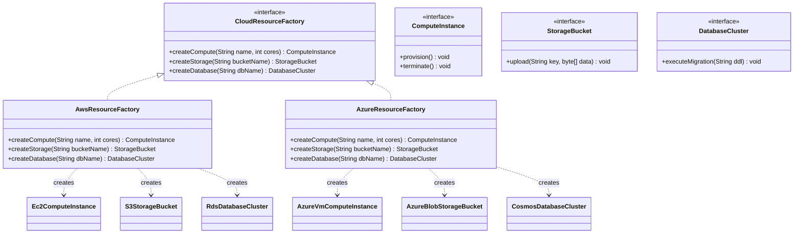

# Abstract Factory Pattern: Production Architecture & Low-Level Design in Java

> **Category:** [Creational Design Patterns](./04-creational-design-patterns.md) | **Navigation:** [Back to Creational Index](./04-creational-design-patterns.md) | [Master LLD Index](./00-index.md)

---


### 3.1 Intent & Problem Context
The **Abstract Factory Pattern** provides an interface for creating families of related or dependent objects without specifying their concrete classes. While the Factory Method pattern produces a single product, the Abstract Factory produces **multiple coordinated products** that belong to a cohesive theme or family.

```
                    +---------------------------+
                    |    CloudResourceFactory   |
                    +---------------------------+
                    | + createCompute()         |
                    | + createStorage()         |
                    | + createDatabase()        |
                    +---------------------------+
                                  ^
          +-----------------------+-----------------------+
          |                                               |
+---------------------+                       +---------------------+
|   AwsResourceFactory|                       |  AzureResourceFactory|
+---------------------+                       +---------------------+
| + createCompute()   | -> Ec2ComputeInstance | + createCompute()   | -> AzureVmComputeInstance
| + createStorage()   | -> S3StorageBucket    | + createStorage()   | -> BlobStorageBucket
| + createDatabase()  | -> RdsDatabaseCluster | + createDatabase()  | -> CosmosDatabaseCluster
+---------------------+                       +---------------------+
```



---

### 3.2 Production Implementation: Multi-Cloud Infrastructure Provisioner

```java
package com.systemdesign.creational.abstractfactory;

import java.util.Objects;

// ==========================================
// 1. Abstract Products
// ==========================================
public interface ComputeInstance {
    void provision();
    void terminate();
    String getInstanceId();
}

public interface StorageBucket {
    void upload(String key, byte[] content);
    byte[] download(String key);
    String getBucketUri();
}

public interface DatabaseCluster {
    void executeMigration(String ddl);
    String getConnectionString();
}

// ==========================================
// 2. Concrete AWS Products
// ==========================================
public final class Ec2ComputeInstance implements ComputeInstance {
    private final String name;
    private final int cores;
    private final String instanceId;

    public Ec2ComputeInstance(String name, int cores) {
        this.name = name;
        this.cores = cores;
        this.instanceId = "i-" + Long.toHexString(System.currentTimeMillis());
    }

    @Override
    public void provision() {
        System.out.printf("[AWS EC2] Provisioning EC2 instance '%s' (%d vCPUs) ID: %s%n", name, cores, instanceId);
    }

    @Override
    public void terminate() {
        System.out.printf("[AWS EC2] Terminating EC2 instance ID: %s%n", instanceId);
    }

    @Override
    public String getInstanceId() { return instanceId; }
}

public final class S3StorageBucket implements StorageBucket {
    private final String bucketName;

    public S3StorageBucket(String bucketName) {
        this.bucketName = bucketName;
    }

    @Override
    public void upload(String key, byte[] content) {
        System.out.printf("[AWS S3] Uploaded %d bytes to s3://%s/%s%n", content.length, bucketName, key);
    }

    @Override
    public byte[] download(String key) {
        System.out.printf("[AWS S3] Downloading s3://%s/%s%n", bucketName, key);
        return new byte[0];
    }

    @Override
    public String getBucketUri() { return "s3://" + bucketName; }
}

public final class RdsDatabaseCluster implements DatabaseCluster {
    private final String dbName;

    public RdsDatabaseCluster(String dbName) {
        this.dbName = dbName;
    }

    @Override
    public void executeMigration(String ddl) {
        System.out.printf("[AWS RDS] Executing DDL on PostgreSQL Aurora Cluster '%s': %s%n", dbName, ddl);
    }

    @Override
    public String getConnectionString() {
        return "jdbc:aws:rds://" + dbName + ".cluster-xyz.us-east-1.rds.amazonaws.com:5432";
    }
}

// ==========================================
// 3. Concrete Azure Products
// ==========================================
public final class AzureVmComputeInstance implements ComputeInstance {
    private final String name;
    private final int cores;
    private final String vmId;

    public AzureVmComputeInstance(String name, int cores) {
        this.name = name;
        this.cores = cores;
        this.vmId = "vm-" + System.currentTimeMillis();
    }

    @Override
    public void provision() {
        System.out.printf("[Azure Compute] Provisioning D4s_v5 VM '%s' (%d cores) with ID: %s%n", name, cores, vmId);
    }

    @Override
    public void terminate() {
        System.out.printf("[Azure Compute] Deallocating Azure VM: %s%n", vmId);
    }

    @Override
    public String getInstanceId() { return vmId; }
}

public final class AzureBlobStorageBucket implements StorageBucket {
    private final String containerName;

    public AzureBlobStorageBucket(String containerName) {
        this.containerName = containerName;
    }

    @Override
    public void upload(String key, byte[] content) {
        System.out.printf("[Azure Blob] Uploaded %d bytes to blob.core.windows.net/%s/%s%n", content.length, containerName, key);
    }

    @Override
    public byte[] download(String key) {
        System.out.printf("[Azure Blob] Fetching blob %s/%s%n", containerName, key);
        return new byte[0];
    }

    @Override
    public String getBucketUri() { return "https://storage.blob.core.windows.net/" + containerName; }
}

public final class CosmosDatabaseCluster implements DatabaseCluster {
    private final String accountName;

    public CosmosDatabaseCluster(String accountName) {
        this.accountName = accountName;
    }

    @Override
    public void executeMigration(String ddl) {
        System.out.printf("[Azure CosmosDB] Applying schema change to document collection '%s': %s%n", accountName, ddl);
    }

    @Override
    public String getConnectionString() {
        return "AccountEndpoint=https://" + accountName + ".documents.azure.com:443/;";
    }
}

// ==========================================
// 4. Abstract Factory Interface
// ==========================================
public interface CloudResourceFactory {
    ComputeInstance createCompute(String name, int cores);
    StorageBucket createStorage(String bucketName);
    DatabaseCluster createDatabase(String databaseName);
}

// ==========================================
// 5. Concrete Factories
// ==========================================
public final class AwsResourceFactory implements CloudResourceFactory {
    @Override
    public ComputeInstance createCompute(String name, int cores) {
        return new Ec2ComputeInstance(name, cores);
    }

    @Override
    public StorageBucket createStorage(String bucketName) {
        return new S3StorageBucket(bucketName);
    }

    @Override
    public DatabaseCluster createDatabase(String databaseName) {
        return new RdsDatabaseCluster(databaseName);
    }
}

public final class AzureResourceFactory implements CloudResourceFactory {
    @Override
    public ComputeInstance createCompute(String name, int cores) {
        return new AzureVmComputeInstance(name, cores);
    }

    @Override
    public StorageBucket createStorage(String bucketName) {
        return new AzureBlobStorageBucket(bucketName);
    }

    @Override
    public DatabaseCluster createDatabase(String databaseName) {
        return new CosmosDatabaseCluster(databaseName);
    }
}

// ==========================================
// 6. Client Orchestration Engine
// ==========================================
public final class CloudInfrastructureDeployer {
    private final CloudResourceFactory factory;

    public CloudInfrastructureDeployer(CloudResourceFactory factory) {
        this.factory = Objects.requireNonNull(factory, "Factory cannot be null");
    }

    public void deployEnvironment(String envName) {
        System.out.println(">>> Deploying Stack for Environment: " + envName);
        ComputeInstance vm = factory.createCompute(envName + "-web", 8);
        StorageBucket bucket = factory.createStorage(envName + "-assets");
        DatabaseCluster db = factory.createDatabase(envName + "-db");

        vm.provision();
        bucket.upload("init.txt", "system_ready".getBytes());
        db.executeMigration("CREATE TABLE users (id UUID PRIMARY KEY, name VARCHAR(255));");
        System.out.printf("Stack live. DB Endpoint: %s%n", db.getConnectionString());
    }
}
```

---

### 3.3 Comparison: Factory Method vs Abstract Factory

| Dimension | Factory Method | Abstract Factory |
| :--- | :--- | :--- |
| **Primary Scope** | Creates a **single product** | Creates an entire **family of related products** |
| **Pattern Mechanism** | Uses **inheritance** (subclasses override factory method) | Uses **object composition** (factory object passed to client) |
| **Extension Point** | Override a method in a child class | Implement a completely new factory interface |
| **Modification Cost** | Adding a new Product requires adding a new Creator subclass | Adding a new product type requires updating the Abstract Factory interface and all concrete factories |

---

---

## Navigation & Related Patterns
* [Back to Creational Patterns Index](./04-creational-design-patterns.md)
* [Master LLD Index](./00-index.md)
* [Previous: 04-02-factory-method-pattern.md](./04-02-factory-method-pattern.md)
* [Next: 04-04-builder-pattern.md](./04-04-builder-pattern.md)
