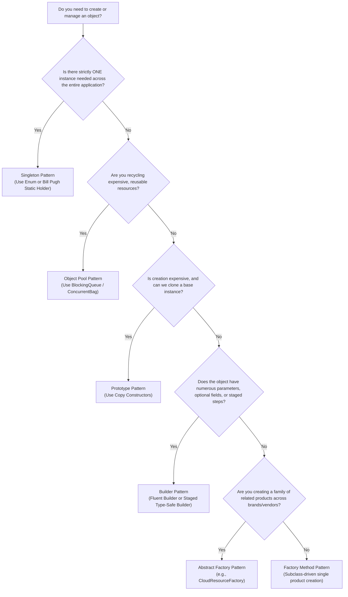

# Creational Design Patterns: Production Architecture & Low-Level Design in Java

Creational design patterns abstract the instantiation process of objects. In complex enterprise systems, hardcoding concrete class instantiations (`new ConcreteService()`) scatters coupling throughout the codebase, breaks the **Single Responsibility Principle (SRP)** and **Open/Closed Principle (OCP)**, complicates unit testing and mocking, and prevents flexible runtime lifecycle management (such as pooling, lazy instantiation, singleton caching, or dynamic subtype resolution).

This document provides an architectural overview, definitions, comparison matrices, and decision guides for all six creational design patterns. Each pattern has a dedicated, production-grade guide with complete Java 21 implementations, thread-safety analysis, and real-world failure mode discussions.

---

## Creational Patterns Comparison Matrix

| Pattern | Primary Intent | Instantiation Control | Coupling Level | Key Production Benefit |
| :--- | :--- | :--- | :--- | :--- |
| **Singleton** | Ensures exactly one instance exists per ClassLoader/JVM | Hidden private constructor; global access point | High (if overused) | Centralized state/resource management (metrics, connection pools, configuration) |
| **Factory Method** | Defines an interface for object creation, deferring instantiation to subclasses | Delegated to concrete subclass creator methods | Loose (via interfaces) | Decouples caller from concrete product classes; adheres strictly to OCP |
| **Abstract Factory** | Creates families of related or dependent objects without specifying concrete classes | Delegated to concrete factory implementations | Loose (via abstract factories & products) | Enforces consistency across product suites (e.g., cross-cloud infrastructure) |
| **Builder** | Separates complex object construction from its representation | Step-by-step assembly via fluent helper | Decoupled | Eliminates telescoping constructors; guarantees immutability and thread safety |
| **Prototype** | Creates new objects by copying an existing prototype instance | Cloning existing configured instances | Loose (via Prototype interface) | Avoids expensive initialization (DB queries, network calls, complex parsing) |
| **Object Pool** | Reuses a fixed pool of expensive, stateful, or limited resources | Centralized check-out / check-in manager | Decoupled | Prevents resource exhaustion and high GC pressure for heavy objects (sockets, threads) |

---

## Creational Design Patterns Catalog

Explore the detailed architectural guides, Java 21 implementations, and thread-safety analyses for each creational pattern:

| # | Pattern | Key Intent & Production Mechanism | Deep-Dive Guide |
| :--- | :--- | :--- | :--- |
| **1** | **Singleton** | Ensures exactly one instance exists per JVM; 5 thread-safe implementations (DCL with volatile, Bill Pugh, Enum); reflection, serialization, and cloning attack defenses. | [`04-01-singleton-pattern.md`](./04-01-singleton-pattern.md) |
| **2** | **Factory Method** | Defines an interface for object creation, deferring instantiation to subclasses; full OCP compliance; multi-provider payment gateway. | [`04-02-factory-method-pattern.md`](./04-02-factory-method-pattern.md) |
| **3** | **Abstract Factory** | Creates families of related or dependent objects without specifying concrete classes; cross-cloud infrastructure provisioner (AWS vs Azure). | [`04-03-abstract-factory-pattern.md`](./04-03-abstract-factory-pattern.md) |
| **4** | **Builder** | Separates complex object construction from representation; eliminates telescoping constructors; guarantees immutability; Staged/Wizard compile-time builder. | [`04-04-builder-pattern.md`](./04-04-builder-pattern.md) |
| **5** | **Prototype** | Creates new objects by copying existing prototypes; deep vs shallow copy; cloneable pitfalls and copy constructors in network configuration registries. | [`04-05-prototype-pattern.md`](./04-05-prototype-pattern.md) |
| **6** | **Object Pool** | Reuses expensive, stateful resources; thread-safe generic object pool with `LinkedBlockingQueue`, lease timeouts, and leak detection. | [`04-06-object-pool-pattern.md`](./04-06-object-pool-pattern.md) |

---

## Creational Design Patterns Decision Guide

Use this flowchart to select the appropriate creational pattern for your architectural requirements:

---

## Summary of Architectural Anti-Patterns & Best Practices

1. **Avoid overusing Singletons**: Singletons introduce hidden global state and temporal coupling between unit tests. In modern architectures, prefer managing single-instance lifecycles via **Dependency Injection** (e.g., Spring container) rather than hardcoded `getInstance()` singletons.
2. **Never rely on `Cloneable`**: Always implement deep copy constructors or copy factory methods instead of relying on `Object.clone()`.
3. **Always validate in `Builder.build()`**: Never allow a builder to construct a partially valid object. Cross-field invariants must be checked inside `build()` immediately before instantiation.
4. **Mandate `volatile` with Double-Checked Locking**: In any multithreaded runtime environment, omitting `volatile` in DCL causes random, non-deterministic `NullPointerExceptions` due to instruction reordering.
5. **Always enclose Object Pool check-outs in `try-finally`**: Failure to release resources back to the pool in a `finally` block guarantees resource starvation and application outages under load.
