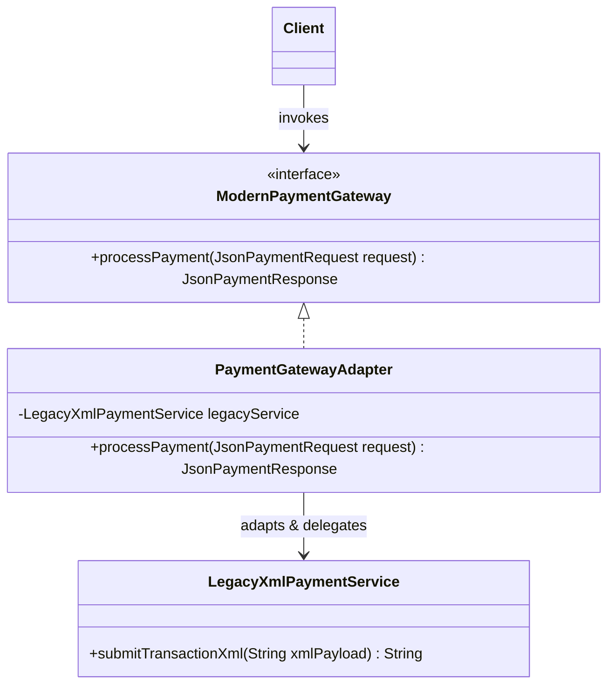

# Adapter Pattern: Production Architecture & Low-Level Design in Java

> **Category:** [Structural Design Patterns](./05-structural-design-patterns.md) | **Navigation:** [Back to Structural Index](./05-structural-design-patterns.md) | [Master LLD Index](./00-index.md)

---


### 1.1 Intent & Problem Context
The **Adapter Pattern** (Wrapper) converts the interface of a class into another interface that clients expect. It enables classes to cooperate that otherwise could not due to incompatible interfaces.

```
Client ----> [ ModernPaymentGateway Interface ]
                          ^
                          |
             [ PaymentGatewayAdapter ] --------> [ LegacyXmlPaymentService ]
```



---

### 1.2 Object Adapter vs Class Adapter
* **Object Adapter (Favored in Java)**: Relies on **object composition**. The adapter implements the target interface and holds an instance of the adaptee. Because Java does not support multiple class inheritance, Object Adapter allows adapting an adaptee and any of its subclasses seamlessly.
* **Class Adapter**: Relies on **multiple inheritance** (in C++). In Java, a Class Adapter subclass can extend the Adaptee class and implement the Target interface. However, it tightly binds the adapter to one specific concrete adaptee class.

---

### 1.3 Production Implementation: Adapting Legacy XML Payment to Modern JSON Gateway

```java
package com.systemdesign.structural.adapter;

import java.math.BigDecimal;
import java.time.Instant;
import java.util.Objects;
import java.util.UUID;

// 1. Target Interface: Modern JSON-based Payment API
public interface ModernPaymentGateway {
    JsonPaymentResponse processPayment(JsonPaymentRequest request);
}

// 2. Modern Domain Transfer Objects
public record JsonPaymentRequest(
        String customerId,
        BigDecimal amount,
        String currencyCode,
        String idempotencyKey
) {
    public JsonPaymentRequest {
        Objects.requireNonNull(customerId, "customerId is required");
        Objects.requireNonNull(amount, "amount is required");
        Objects.requireNonNull(currencyCode, "currencyCode is required");
        Objects.requireNonNull(idempotencyKey, "idempotencyKey is required");
    }
}

public record JsonPaymentResponse(
        String paymentReference,
        boolean successful,
        BigDecimal chargedAmount,
        String message,
        Instant processedAt
) {}

// 3. Adaptee: Legacy Enterprise Service (Requires XML Payloads)
public final class LegacyXmlPaymentService {

    public String submitTransactionXml(String xmlPayload) {
        System.out.println("[LegacyXmlPaymentService] Received raw XML request:\n" + xmlPayload);

        // Simulate internal XML processing
        if (!xmlPayload.contains("<amount>") || !xmlPayload.contains("<currency>")) {
            return "<response><status>FAILED</status><error>MISSING_REQUIRED_TAGS</error></response>";
        }

        String txId = "XML-TX-" + UUID.randomUUID();
        return String.format(
                "<response><status>SUCCESS</status><transactionId>%s</transactionId><authCode>AUTH-9921</authCode></response>",
                txId
        );
    }
}

// 4. Object Adapter: Translates between JSON DTOs and Legacy XML
public final class PaymentGatewayAdapter implements ModernPaymentGateway {

    private final LegacyXmlPaymentService legacyXmlService;

    public PaymentGatewayAdapter(LegacyXmlPaymentService legacyXmlService) {
        this.legacyXmlService = Objects.requireNonNull(legacyXmlService, "Legacy service must not be null");
    }

    @Override
    public JsonPaymentResponse processPayment(JsonPaymentRequest request) {
        // Step 1: Translate Modern JSON Request -> Legacy XML
        String xmlPayload = convertToXml(request);

        // Step 2: Invoke the Adaptee
        String xmlResponse = legacyXmlService.submitTransactionXml(xmlPayload);

        // Step 3: Parse Legacy XML -> Modern JSON Response
        return parseXmlResponse(xmlResponse, request.amount());
    }

    private String convertToXml(JsonPaymentRequest req) {
        return "<paymentRequest>" +
                "<customerId>" + escapeXml(req.customerId()) + "</customerId>" +
                "<amount>" + req.amount().toPlainString() + "</amount>" +
                "<currency>" + escapeXml(req.currencyCode()) + "</currency>" +
                "<idempotencyKey>" + escapeXml(req.idempotencyKey()) + "</idempotencyKey>" +
                "</paymentRequest>";
    }

    private JsonPaymentResponse parseXmlResponse(String xmlResponse, BigDecimal originalAmount) {
        // In production, use a secure XML parser (DOM/SAX/Jackson XML) configured to disable XXE
        boolean isSuccess = xmlResponse.contains("<status>SUCCESS</status>");
        String txId = extractXmlTag(xmlResponse, "transactionId");

        if (isSuccess && txId != null) {
            return new JsonPaymentResponse(
                    txId,
                    true,
                    originalAmount,
                    "Transaction successfully cleared via legacy provider",
                    Instant.now()
            );
        } else {
            String error = extractXmlTag(xmlResponse, "error");
            return new JsonPaymentResponse(
                    "N/A",
                    false,
                    BigDecimal.ZERO,
                    "Legacy payment failure: " + (error != null ? error : "UNKNOWN_ERROR"),
                    Instant.now()
            );
        }
    }

    private String extractXmlTag(String xml, String tag) {
        String open = "<" + tag + ">";
        String close = "</" + tag + ">";
        int start = xml.indexOf(open);
        int end = xml.indexOf(close);
        if (start != -1 && end != -1) {
            return xml.substring(start + open.length(), end);
        }
        return null;
    }

    private String escapeXml(String input) {
        return input.replace("&", "&amp;")
                    .replace("<", "&lt;")
                    .replace(">", "&gt;")
                    .replace("\"", "&quot;")
                    .replace("'", "&apos;");
    }
}
```

---

### 1.4 Real-World Enterprise Usage
* **JDK**: `java.util.Arrays.asList(T...)` adapts a raw array to the `List<T>` interface.
* **JDK**: `java.io.InputStreamReader(InputStream)` adapts a byte stream to a character-oriented `Reader`.
* **Spring MVC**: `HandlerAdapter` decouples the `DispatcherServlet` from diverse controller architectures (`@Controller`, `HttpRequestHandler`).

---

---

## Navigation & Related Patterns
* [Back to Structural Patterns Index](./05-structural-design-patterns.md)
* [Master LLD Index](./00-index.md)
* [Next: 05-02-bridge-pattern.md](./05-02-bridge-pattern.md)
