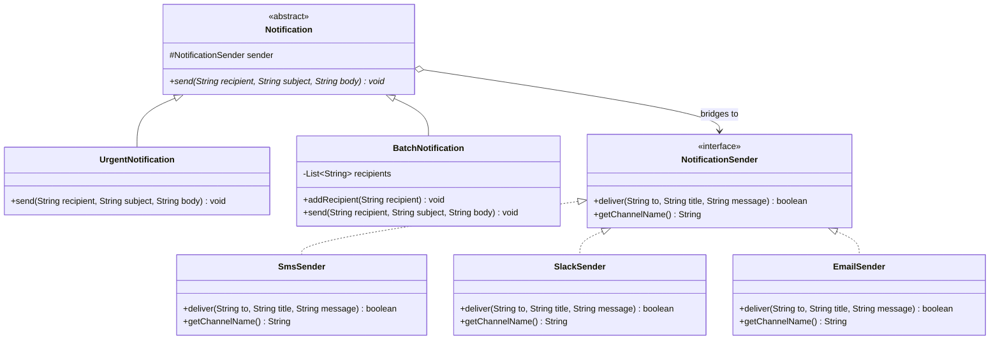

# Bridge Pattern: Production Architecture & Low-Level Design in Java

> **Category:** [Structural Design Patterns](./05-structural-design-patterns.md) | **Navigation:** [Back to Structural Index](./05-structural-design-patterns.md) | [Master LLD Index](./00-index.md)

---


### 2.1 Intent & The Orthogonal Explosion Problem
The **Bridge Pattern** decouples an abstraction from its implementation so that both can vary independently.

#### The Problem: Subclass Explosion
Suppose a system sends notifications with two independent dimensions:
1. **Type of Notification**: `StandardAlert`, `UrgentAlert`, `BatchAlert`.
2. **Delivery Channel**: `Email`, `SMS`, `Slack`, `PushNotification`.

If using inheritance, $M \times N$ classes are required: `UrgentEmailAlert`, `UrgentSmsAlert`, `BatchSlackAlert`, etc. Adding one channel requires subclassing every alert type.

```
Inheritance Explosion: M x N = 12 classes
[UrgentNotification] ---> [UrgentEmailNotification], [UrgentSmsNotification], ...
[BatchNotification]  ---> [BatchEmailNotification], [BatchSmsNotification], ...

Bridge Pattern: M + N = 7 classes
[Notification Abstraction Hierarchy] o-----> [NotificationSender Implementation Hierarchy]
```



---

### 2.2 Production Implementation: Multi-Channel Alerting Engine

```java
package com.systemdesign.structural.bridge;

import java.util.*;

// ==========================================
// 1. Implementor Interface
// ==========================================
public interface NotificationSender {
    boolean deliver(String destination, String title, String content);
    String getChannelName();
}

// ==========================================
// 2. Concrete Implementors
// ==========================================
public final class EmailSender implements NotificationSender {
    private final String smtpServer;

    public EmailSender(String smtpServer) {
        this.smtpServer = Objects.requireNonNull(smtpServer);
    }

    @Override
    public boolean deliver(String destination, String title, String content) {
        System.out.printf("[Email via %s] To: %s | Subject: %s | Body: %s%n",
                smtpServer, destination, title, content);
        return true;
    }

    @Override
    public String getChannelName() { return "EMAIL"; }
}

public final class SmsSender implements NotificationSender {
    private final String teleProviderKey;

    public SmsSender(String teleProviderKey) {
        this.teleProviderKey = Objects.requireNonNull(teleProviderKey);
    }

    @Override
    public boolean deliver(String destination, String title, String content) {
        System.out.printf("[SMS API] Sending to %s (Auth: %s): [%s] %s%n",
                destination, teleProviderKey.substring(0, 3) + "***", title, content);
        return true;
    }

    @Override
    public String getChannelName() { return "SMS"; }
}

public final class SlackSender implements NotificationSender {
    private final String webhookUrl;

    public SlackSender(String webhookUrl) {
        this.webhookUrl = Objects.requireNonNull(webhookUrl);
    }

    @Override
    public boolean deliver(String destination, String title, String content) {
        System.out.printf("[Slack Webhook: %s] Channel: %s | Alert: %s - %s%n",
                webhookUrl, destination, title, content);
        return true;
    }

    @Override
    public String getChannelName() { return "SLACK"; }
}

// ==========================================
// 3. Abstraction
// ==========================================
public abstract class Notification {
    // The Bridge: composition reference to the implementor
    protected final NotificationSender sender;

    protected Notification(NotificationSender sender) {
        this.sender = Objects.requireNonNull(sender, "Sender must not be null");
    }

    public abstract void notifyUser(String target, String headline, String details);
}

// ==========================================
// 4. Refined Abstraction A: Standard Notification
// ==========================================
public final class StandardNotification extends Notification {

    public StandardNotification(NotificationSender sender) {
        super(sender);
    }

    @Override
    public void notifyUser(String target, String headline, String details) {
        sender.deliver(target, headline, details);
    }
}

// ==========================================
// 5. Refined Abstraction B: Urgent Notification (With Retry & Escalation)
// ==========================================
public final class UrgentNotification extends Notification {

    private final int maxRetries;

    public UrgentNotification(NotificationSender sender, int maxRetries) {
        super(sender);
        if (maxRetries < 1) throw new IllegalArgumentException("maxRetries must be >= 1");
        this.maxRetries = maxRetries;
    }

    @Override
    public void notifyUser(String target, String headline, String details) {
        String urgentHeadline = "[CRITICAL URGENT] " + headline;
        boolean delivered = false;

        for (int attempt = 1; attempt <= maxRetries; attempt++) {
            System.out.printf("[Urgent Notification] Dispatch attempt %d/%d via %s...%n",
                    attempt, maxRetries, sender.getChannelName());
            delivered = sender.deliver(target, urgentHeadline, details);
            if (delivered) break;
        }

        if (!delivered) {
            System.err.printf("[Urgent Notification] FAILED to deliver to %s after %d retries!%n",
                    target, maxRetries);
        }
    }
}

// ==========================================
// 6. Refined Abstraction C: Batch Notification
// ==========================================
public final class BatchNotification extends Notification {

    private final List<String> targetList = new ArrayList<>();

    public BatchNotification(NotificationSender sender) {
        super(sender);
    }

    public void addTarget(String target) {
        this.targetList.add(Objects.requireNonNull(target));
    }

    @Override
    public void notifyUser(String ignoredSingleTarget, String headline, String details) {
        System.out.printf("[Batch Dispatch] Broadcasting to %d destinations via %s%n",
                targetList.size(), sender.getChannelName());
        for (String destination : targetList) {
            sender.deliver(destination, headline, details);
        }
    }
}
```

---

### 2.3 Real-World Enterprise Usage
* **Java Database Connectivity (JDBC)**: The driver abstraction (`java.sql.DriverManager` and `java.sql.Connection`) is decoupled from database-specific driver implementations (`org.postgresql.Driver`, `com.mysql.cj.jdbc.Driver`).
* **SLF4J**: The logging facade defines the abstraction API (`Logger`), while log implementations (`Logback`, `Log4j2`, `java.util.logging`) act as the concrete implementors.

---

---

## Navigation & Related Patterns
* [Back to Structural Patterns Index](./05-structural-design-patterns.md)
* [Master LLD Index](./00-index.md)
* [Previous: 05-01-adapter-pattern.md](./05-01-adapter-pattern.md)
* [Next: 05-03-composite-pattern.md](./05-03-composite-pattern.md)
