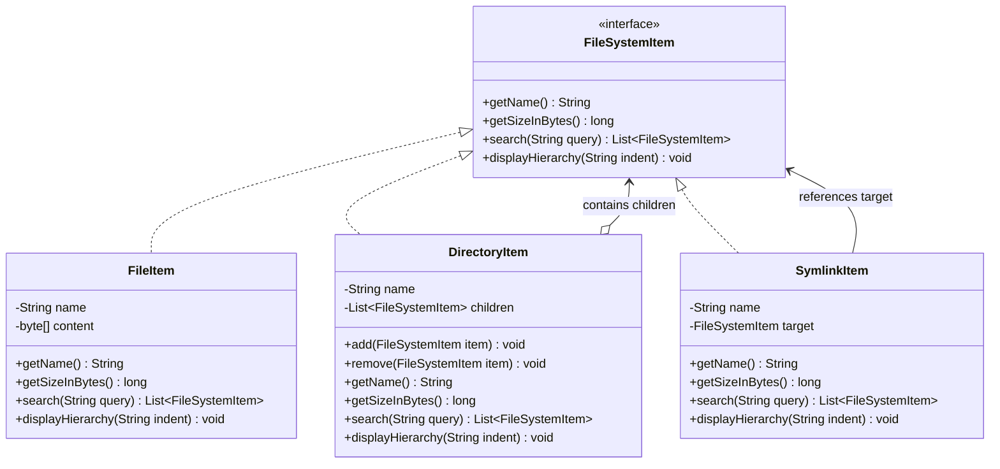

# Composite Pattern: Production Architecture & Low-Level Design in Java

> **Category:** [Structural Design Patterns](./05-structural-design-patterns.md) | **Navigation:** [Back to Structural Index](./05-structural-design-patterns.md) | [Master LLD Index](./00-index.md)

---


### 3.1 Intent & Problem Context
The **Composite Pattern** composes objects into tree structures to represent part-whole hierarchies. Composite lets clients treat individual objects (leaf nodes) and compositions of objects (composite nodes) uniformly.

```
                            [ FileSystemItem ] (Component)
                                   ^
            +----------------------+----------------------+
            |                                             |
       [ FileItem ] (Leaf)                       [ DirectoryItem ] (Composite)
                                                  - items: List<FileSystemItem>
```



---

### 3.2 Design Trade-Off: Safety vs Transparency
* **Transparency**: Declare all child-management methods (`add()`, `remove()`, `getChild()`) in the root `Component` interface. 
  - *Benefit*: Uniformity; clients treat Leaves and Composites identically.
  - *Risk*: Type safety violation; leaves must throw `UnsupportedOperationException` when `add()` is called.
* **Safety**: Declare child-management methods **only** in the `DirectoryItem` (Composite) class.
  - *Benefit*: Leaves cannot receive illegal method calls at compile time.
  - *Drawback*: Clients must downcast or use `instanceof` before calling `add()`.

---

### 3.3 Production Implementation: Enterprise Virtual File System

```java
package com.systemdesign.structural.composite;

import java.util.*;

// 1. Component Interface
public interface FileSystemItem {
    String getName();
    long getSizeInBytes();
    List<FileSystemItem> search(String query);
    void displayHierarchy(String indent);
}

// 2. Leaf: FileItem
public final class FileItem implements FileSystemItem {

    private final String name;
    private final byte[] content;

    public FileItem(String name, byte[] content) {
        this.name = Objects.requireNonNull(name);
        this.content = Objects.requireNonNull(content).clone();
    }

    @Override
    public String getName() {
        return name;
    }

    @Override
    public long getSizeInBytes() {
        return content.length;
    }

    @Override
    public List<FileSystemItem> search(String query) {
        if (name.toLowerCase().contains(query.toLowerCase())) {
            return List.of(this);
        }
        return Collections.emptyList();
    }

    @Override
    public void displayHierarchy(String indent) {
        System.out.printf("%s- File: %s (%d bytes)%n", indent, name, getSizeInBytes());
    }
}

// 3. Leaf / Pointer: SymlinkItem (With Cycle-Detection Guard)
public final class SymlinkItem implements FileSystemItem {

    private final String name;
    private final FileSystemItem target;

    public SymlinkItem(String name, FileSystemItem target) {
        this.name = Objects.requireNonNull(name);
        this.target = Objects.requireNonNull(target);
    }

    @Override
    public String getName() {
        return name + " -> " + target.getName();
    }

    @Override
    public long getSizeInBytes() {
        return 4; // Virtual pointer overhead
    }

    @Override
    public List<FileSystemItem> search(String query) {
        if (name.toLowerCase().contains(query.toLowerCase())) {
            return List.of(this);
        }
        return Collections.emptyList();
    }

    @Override
    public void displayHierarchy(String indent) {
        System.out.printf("%s- Symlink: %s -> %s%n", indent, name, target.getName());
    }
}

// 4. Composite: DirectoryItem
public final class DirectoryItem implements FileSystemItem {

    private final String name;
    private final List<FileSystemItem> children = new ArrayList<>();

    public DirectoryItem(String name) {
        this.name = Objects.requireNonNull(name);
    }

    public synchronized void add(FileSystemItem item) {
        Objects.requireNonNull(item, "Cannot add null item");
        children.add(item);
    }

    public synchronized boolean remove(FileSystemItem item) {
        return children.remove(item);
    }

    @Override
    public String getName() {
        return name;
    }

    @Override
    public synchronized long getSizeInBytes() {
        // Recursive aggregation across children
        long totalBytes = 0;
        for (FileSystemItem child : children) {
            totalBytes += child.getSizeInBytes();
        }
        return totalBytes;
    }

    @Override
    public synchronized List<FileSystemItem> search(String query) {
        List<FileSystemItem> results = new ArrayList<>();
        if (name.toLowerCase().contains(query.toLowerCase())) {
            results.add(this);
        }
        for (FileSystemItem child : children) {
            results.addAll(child.search(query));
        }
        return results;
    }

    @Override
    public synchronized void displayHierarchy(String indent) {
        System.out.printf("%s+ Directory: %s (Total: %d bytes)%n", indent, name, getSizeInBytes());
        String childIndent = indent + "    ";
        for (FileSystemItem child : children) {
            child.displayHierarchy(childIndent);
        }
    }
}
```

---

### 3.4 Real-World Enterprise Usage
* **JDK UI Frameworks**: `java.awt.Container` extends `java.awt.Component` while holding collections of `Component` instances.
* **Document Object Model (DOM)**: `org.w3c.dom.Node` acts as the component, `Element` as the composite, and `Text` / `Attr` as leaves.
* **Jackson JSON Tree**: `com.fasterxml.jackson.databind.JsonNode` with composite containers `ObjectNode`, `ArrayNode` and leaves `TextNode`, `IntNode`, `BooleanNode`.

---

---

## Navigation & Related Patterns
* [Back to Structural Patterns Index](./05-structural-design-patterns.md)
* [Master LLD Index](./00-index.md)
* [Previous: 05-02-bridge-pattern.md](./05-02-bridge-pattern.md)
* [Next: 05-04-decorator-pattern.md](./05-04-decorator-pattern.md)
