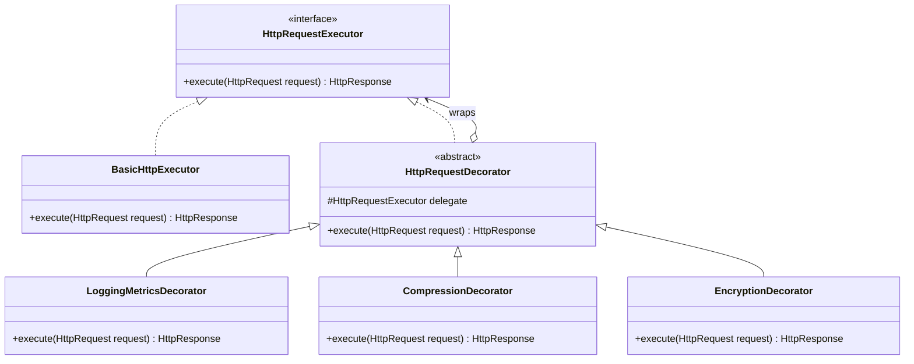

# Decorator Pattern: Production Architecture & Low-Level Design in Java

> **Category:** [Structural Design Patterns](./05-structural-design-patterns.md) | **Navigation:** [Back to Structural Index](./05-structural-design-patterns.md) | [Master LLD Index](./00-index.md)

---


### 4.1 Intent & Comparison with Inheritance
The **Decorator Pattern** attaches additional responsibilities to an object dynamically. Decorators provide a flexible alternative to subclassing for extending functionality.

#### Inheritance vs Dynamic Decoration
* **Subclassing (Static)**: Extension happens at compile-time. If you have an `HttpRequestExecutor`, subclassing for each permutation (`GzipExecutor`, `EncryptedExecutor`, `GzipAndEncryptedExecutor`, `LoggedGzipAndEncryptedExecutor`) leads to an exponential explosion of classes ($2^N$).
* **Decoration (Dynamic)**: Responsibilities are composed at runtime like an onion. Each layer wraps the previous layer, implementing the exact same interface and delegating to the enclosed instance.

```
Client ----> [ EncryptionDecorator ]
                   | wraps
                   v
             [ CompressionDecorator ]
                   | wraps
                   v
             [ LoggingDecorator ]
                   | wraps
                   v
             [ BasicHttpExecutor ]
```



---

### 4.2 Production Implementation: HTTP Request/Response Filter Pipeline

```java
package com.systemdesign.structural.decorator;

import java.nio.charset.StandardCharsets;
import java.time.Duration;
import java.time.Instant;
import java.util.*;

// 1. Domain Models
public record HttpRequest(String url, Map<String, String> headers, byte[] payload) {
    public HttpRequest {
        Objects.requireNonNull(url);
        headers = new HashMap<>(headers);
        payload = payload.clone();
    }
}

public record HttpResponse(int statusCode, Map<String, String> headers, byte[] payload) {}

// 2. Component Interface
public interface HttpRequestExecutor {
    HttpResponse execute(HttpRequest request);
}

// 3. Concrete Component: Core Network Dispatcher
public final class BasicHttpExecutor implements HttpRequestExecutor {

    @Override
    public HttpResponse execute(HttpRequest request) {
        System.out.printf("[BasicHttpExecutor] Transmitting raw payload (%d bytes) to URL: %s%n",
                request.payload().length, request.url());

        // Simulate network dispatch latency
        try {
            Thread.sleep(20);
        } catch (InterruptedException e) {
            Thread.currentThread().interrupt();
        }

        Map<String, String> responseHeaders = new HashMap<>();
        responseHeaders.put("Server", "EdgeGateway/3.1");
        return new HttpResponse(200, responseHeaders, "{\"status\":\"ACCEPTED\"}".getBytes(StandardCharsets.UTF_8));
    }
}

// 4. Base Decorator
public abstract class HttpRequestDecorator implements HttpRequestExecutor {

    protected final HttpRequestExecutor delegate;

    protected HttpRequestDecorator(HttpRequestExecutor delegate) {
        this.delegate = Objects.requireNonNull(delegate, "Delegate executor must not be null");
    }

    @Override
    public HttpResponse execute(HttpRequest request) {
        return delegate.execute(request);
    }
}

// 5. Concrete Decorator A: Metrics & Latency Logger
public final class LoggingMetricsDecorator extends HttpRequestDecorator {

    public LoggingMetricsDecorator(HttpRequestExecutor delegate) {
        super(delegate);
    }

    @Override
    public HttpResponse execute(HttpRequest request) {
        Instant start = Instant.now();
        String traceId = UUID.randomUUID().toString().substring(0, 8);
        System.out.printf("[Metrics %s] Outgoing %s | Size: %d bytes%n", traceId, request.url(), request.payload().length);

        HttpResponse response = super.execute(request);

        Duration elapsed = Duration.between(start, Instant.now());
        System.out.printf("[Metrics %s] Response %d | Elapsed: %d ms%n", traceId, response.statusCode(), elapsed.toMillis());
        return response;
    }
}

// 6. Concrete Decorator B: Payload Compression
public final class CompressionDecorator extends HttpRequestDecorator {

    public CompressionDecorator(HttpRequestExecutor delegate) {
        super(delegate);
    }

    @Override
    public HttpResponse execute(HttpRequest request) {
        byte[] original = request.payload();
        byte[] compressed = compress(original);

        Map<String, String> updatedHeaders = new HashMap<>(request.headers());
        updatedHeaders.put("Content-Encoding", "gzip");
        updatedHeaders.put("X-Original-Size", String.valueOf(original.length));

        System.out.printf("[Compression] Compressed payload from %d bytes to %d bytes%n",
                original.length, compressed.length);

        HttpRequest compressedRequest = new HttpRequest(request.url(), updatedHeaders, compressed);
        return super.execute(compressedRequest);
    }

    private byte[] compress(byte[] data) {
        // Simulate compression savings
        int simulatedSize = Math.max(1, (int) (data.length * 0.4));
        return Arrays.copyOf(data, simulatedSize);
    }
}

// 7. Concrete Decorator C: Payload Encryption
public final class EncryptionDecorator extends HttpRequestDecorator {

    private final String secretKey;

    public EncryptionDecorator(HttpRequestExecutor delegate, String secretKey) {
        super(delegate);
        this.secretKey = Objects.requireNonNull(secretKey);
    }

    @Override
    public HttpResponse execute(HttpRequest request) {
        byte[] plainBytes = request.payload();
        byte[] cipherBytes = encrypt(plainBytes, secretKey);

        Map<String, String> updatedHeaders = new HashMap<>(request.headers());
        updatedHeaders.put("X-Payload-Encryption", "AES-256-GCM");

        System.out.printf("[Encryption] Encrypted payload using key %s*** (%d bytes)%n",
                secretKey.substring(0, 3), cipherBytes.length);

        HttpRequest encryptedRequest = new HttpRequest(request.url(), updatedHeaders, cipherBytes);
        return super.execute(encryptedRequest);
    }

    private byte[] encrypt(byte[] data, String key) {
        byte[] cipher = new byte[data.length + 16]; // Simulate 16-byte GCM tag
        System.arraycopy(data, 0, cipher, 0, data.length);
        return cipher;
    }
}
```

#### Order Sensitivity in Decorators
Decorators are order-dependent. In the above example:
* **Compression -> Encryption**: Compressing the plaintext first shrinks data based on natural language repetition, then encryption randomizes it into ciphertext.
* **Encryption -> Compression**: Encrypting first produces high-entropy pseudo-random output that cannot be compressed.

---

### 4.3 Real-World Enterprise Usage
* **JDK `java.io`**:
  ```java
  InputStream in = new BufferedInputStream(new GZIPInputStream(new FileInputStream("data.bin")));
  ```
* **Spring Security**: `FilterChainProxy` wraps the underlying HTTP execution with multiple authentication and CSRF decorators.

---

---

## Navigation & Related Patterns
* [Back to Structural Patterns Index](./05-structural-design-patterns.md)
* [Master LLD Index](./00-index.md)
* [Previous: 05-03-composite-pattern.md](./05-03-composite-pattern.md)
* [Next: 05-05-facade-pattern.md](./05-05-facade-pattern.md)
