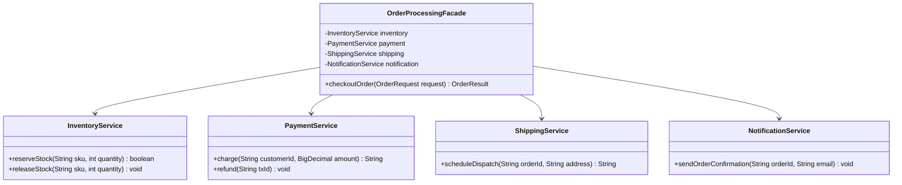

# Facade Pattern: Production Architecture & Low-Level Design in Java

> **Category:** [Structural Design Patterns](./05-structural-design-patterns.md) | **Navigation:** [Back to Structural Index](./05-structural-design-patterns.md) | [Master LLD Index](./00-index.md)

---


### 5.1 Intent & Problem Context
The **Facade Pattern** provides a unified, higher-level interface to a set of interfaces in a subsystem. Facade defines an interface that makes the subsystem easier to use by hiding subsystem complexity and managing coordinating workflows.

```
                          [ Client Application ]
                                    |
                                    v
                     +------------------------------+
                     |  OrderProcessingFacade       |
                     +------------------------------+
                       /       |          |        \
                      /        |          |         \
                     v         v          v          v
              [Inventory]  [Payment]  [Shipping]  [Notification]
```



---

### 5.2 Architectural Comparison: Facade vs Adapter vs Mediator vs Proxy

| Pattern | Intent | Relationship to Existing Classes | Key Distinction |
| :--- | :--- | :--- | :--- |
| **Facade** | Simplifies a complex subsystem via a single unified entry point | Does not alter subsystem interfaces; coordinates them | Operates unidirectional (top-down) from client to subsystem |
| **Adapter** | Converts an incompatible interface to an expected interface | Adapts a single class/interface to match another specification | Bridges two existing mismatched contracts |
| **Mediator** | Centralizes multidirectional communication between peer objects | Replaces direct connections between colleague components | Peers know about the mediator; communication is bidirectional |
| **Proxy** | Controls access to a single target object without altering its interface | Implements the identical interface as the subject | Adds behavior (caching, security, lazy init) transparently |

---

### 5.3 Production Implementation: E-Commerce Order Placement Facade

```java
package com.systemdesign.structural.facade;

import java.math.BigDecimal;
import java.util.*;

// 1. Subsystem 1: Inventory
public final class InventoryService {
    public boolean reserveStock(String sku, int qty) {
        System.out.printf("[InventoryService] Reserved %d units of SKU: %s%n", qty, sku);
        return true;
    }
    public void releaseStock(String sku, int qty) {
        System.out.printf("[InventoryService] Compensating transaction: Released %d units of SKU: %s%n", qty, sku);
    }
}

// 2. Subsystem 2: Fraud Detection
public final class FraudCheckService {
    public boolean verifyCustomer(String customerId, BigDecimal amount) {
        System.out.printf("[FraudCheckService] Cleared customer %s for transaction value %s%n", customerId, amount);
        return true;
    }
}

// 3. Subsystem 3: Payment Gateway
public final class PaymentGatewayService {
    public String executeCharge(String customerId, BigDecimal amount) {
        String txId = "PAY-" + UUID.randomUUID().toString().substring(0, 8);
        System.out.printf("[PaymentGatewayService] Charged %s to customer %s (Tx: %s)%n", amount, customerId, txId);
        return txId;
    }
    public void refund(String txId) {
        System.out.printf("[PaymentGatewayService] Compensating transaction: Refunded Tx: %s%n", txId);
    }
}

// 4. Subsystem 4: Shipping Logistics
public final class ShippingService {
    public String arrangeCarrier(String orderId, String address) {
        String trackingNumber = "FEDEX-" + System.currentTimeMillis();
        System.out.printf("[ShippingService] Scheduled delivery to '%s'. Tracking: %s%n", address, trackingNumber);
        return trackingNumber;
    }
}

// 5. Subsystem 5: Notifications
public final class CustomerNotificationService {
    public void sendEmailConfirmation(String email, String orderId, String trackingNumber) {
        System.out.printf("[NotificationService] Order confirmation dispatched to %s (Order: %s, Track: %s)%n",
                email, orderId, trackingNumber);
    }
}

// 6. Data Transfer Objects
public record OrderRequest(String customerId, String email, String shippingAddress, String sku, int quantity, BigDecimal totalAmount) {}

public record OrderResult(boolean success, String orderId, String trackingNumber, String message) {}

// 7. The Facade: Orchestrates workflow with rollback compensation
public final class OrderProcessingFacade {

    private final InventoryService inventoryService;
    private final FraudCheckService fraudCheckService;
    private final PaymentGatewayService paymentService;
    private final ShippingService shippingService;
    private final CustomerNotificationService notificationService;

    public OrderProcessingFacade(InventoryService inventoryService,
                                 FraudCheckService fraudCheckService,
                                 PaymentGatewayService paymentService,
                                 ShippingService shippingService,
                                 CustomerNotificationService notificationService) {
        this.inventoryService = Objects.requireNonNull(inventoryService);
        this.fraudCheckService = Objects.requireNonNull(fraudCheckService);
        this.paymentService = Objects.requireNonNull(paymentService);
        this.shippingService = Objects.requireNonNull(shippingService);
        this.notificationService = Objects.requireNonNull(notificationService);
    }

    public OrderResult checkout(OrderRequest order) {
        String orderId = "ORD-" + UUID.randomUUID().toString().substring(0, 8);
        System.out.printf("=== [OrderFacade] Commencing checkout for Order %s ===%n", orderId);

        // Step 1: Fraud Evaluation
        if (!fraudCheckService.verifyCustomer(order.customerId(), order.totalAmount())) {
            return new OrderResult(false, orderId, null, "Order declined by risk engine");
        }

        // Step 2: Inventory Reservation
        if (!inventoryService.reserveStock(order.sku(), order.quantity())) {
            return new OrderResult(false, orderId, null, "Item is out of stock");
        }

        // Step 3: Payment Capture
        String paymentTxId;
        try {
            paymentTxId = paymentService.executeCharge(order.customerId(), order.totalAmount());
        } catch (Exception ex) {
            // Compensate inventory
            inventoryService.releaseStock(order.sku(), order.quantity());
            return new OrderResult(false, orderId, null, "Payment processing failed: " + ex.getMessage());
        }

        // Step 4: Shipping Logistics
        String trackingNumber;
        try {
            trackingNumber = shippingService.arrangeCarrier(orderId, order.shippingAddress());
        } catch (Exception ex) {
            // Compensate payment and inventory
            paymentService.refund(paymentTxId);
            inventoryService.releaseStock(order.sku(), order.quantity());
            return new OrderResult(false, orderId, null, "Logistics dispatch failed: " + ex.getMessage());
        }

        // Step 5: Asynchronous Notification
        notificationService.sendEmailConfirmation(order.email(), orderId, trackingNumber);

        System.out.printf("=== [OrderFacade] Order %s fulfilled successfully! ===%n", orderId);
        return new OrderResult(true, orderId, trackingNumber, "Order successfully processed and confirmed");
    }
}
```

---

### 5.4 Real-World Enterprise Usage
* **Spring Framework**: `org.springframework.jdbc.core.JdbcTemplate` serves as a facade over low-level JDBC boilerplate (`Connection`, `PreparedStatement`, `ResultSet`, `SQLExceptionTranslator`).
* **SLF4J**: `LoggerFactory.getLogger(...)` abstracts multiple underlying logging engines.

---

---

## Navigation & Related Patterns
* [Back to Structural Patterns Index](./05-structural-design-patterns.md)
* [Master LLD Index](./00-index.md)
* [Previous: 05-04-decorator-pattern.md](./05-04-decorator-pattern.md)
* [Next: 05-06-flyweight-pattern.md](./05-06-flyweight-pattern.md)
