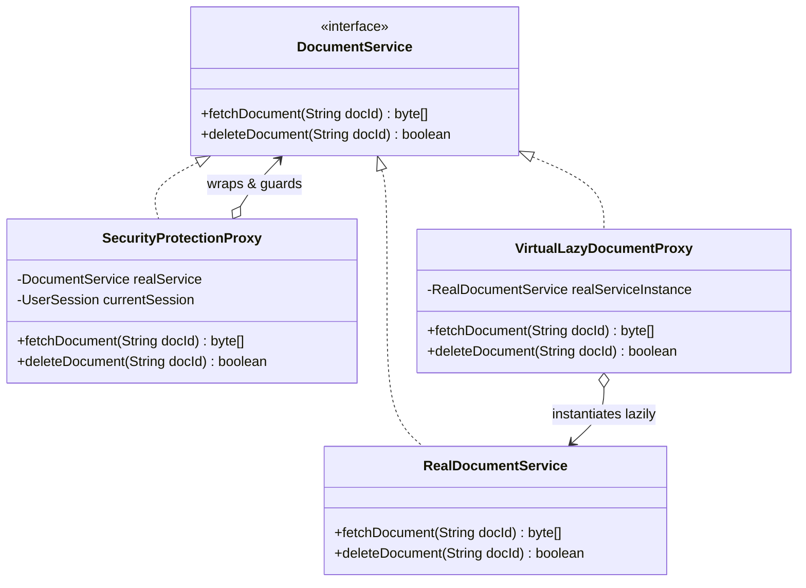

# Proxy Pattern: Production Architecture & Low-Level Design in Java

> **Category:** [Structural Design Patterns](./05-structural-design-patterns.md) | **Navigation:** [Back to Structural Index](./05-structural-design-patterns.md) | [Master LLD Index](./00-index.md)

---


### 7.1 Intent & Core Variants
The **Proxy Pattern** provides a surrogate or placeholder for another object to control access to it.

```
Client ----> [ Proxy Object ] ----(controls access)----> [ Real Subject Object ]
```



#### Primary Proxy Variants
1. **Virtual Proxy**: Defers expensive instantiation of a heavyweight object until it is first accessed (Lazy Initialization).
2. **Protection / Security Proxy**: Controls access based on permissions, roles, or security tokens (RBAC).
3. **Remote Proxy**: Represents an object in a different address space or remote server (RMI / RPC stub).
4. **Caching / Logging / Metrics Proxy**: Intercepts requests to inject non-functional concerns (e.g., returning cached responses or recording execution metrics).

---

### 7.2 Production Implementation: Security & Virtual Lazy Proxy

```java
package com.systemdesign.structural.proxy;

import java.nio.charset.StandardCharsets;
import java.util.*;

// 1. Subject Interface
public interface DocumentRepository {
    byte[] readDocument(String documentId);
    void deleteDocument(String documentId);
}

// 2. Real Subject: Heavy Storage Service
public final class RealDocumentRepository implements DocumentRepository {

    public RealDocumentRepository() {
        System.out.println("[RealDocumentRepository] Initializing heavy S3 / SAN network connections...");
        try {
            Thread.sleep(100); // Simulate expensive connection establishment
        } catch (InterruptedException e) {
            Thread.currentThread().interrupt();
        }
        System.out.println("[RealDocumentRepository] Storage backend connected.");
    }

    @Override
    public byte[] readDocument(String documentId) {
        System.out.printf("[RealDocumentRepository] Fetching document '%s' from S3 storage%n", documentId);
        return ("CONFIDENTIAL CONTENT FOR " + documentId).getBytes(StandardCharsets.UTF_8);
    }

    @Override
    public void deleteDocument(String documentId) {
        System.out.printf("[RealDocumentRepository] Permanent deletion of '%s' executed%n", documentId);
    }
}

// 3. User Context & Roles
public record UserPrincipal(String username, Set<String> roles) {
    public boolean hasRole(String role) {
        return roles.contains(role);
    }
}

// 4. Protection & Virtual Proxy Combined
public final class SecureLazyDocumentProxy implements DocumentRepository {

    private final UserPrincipal currentUser;
    // Volatile reference for thread-safe lazy loading
    private volatile RealDocumentRepository realRepository;

    public SecureLazyDocumentProxy(UserPrincipal currentUser) {
        this.currentUser = Objects.requireNonNull(currentUser);
    }

    /**
     * Virtual Proxy: Lazily initializes the heavy real repository using Double-Checked Locking.
     */
    private RealDocumentRepository getRealRepository() {
        RealDocumentRepository localRef = realRepository;
        if (localRef == null) {
            synchronized (this) {
                localRef = realRepository;
                if (localRef == null) {
                    System.out.println("[Proxy] First request received: Instantiating RealDocumentRepository lazily...");
                    realRepository = localRef = new RealDocumentRepository();
                }
            }
        }
        return localRef;
    }

    @Override
    public byte[] readDocument(String documentId) {
        // Protection Proxy: Verify Read Permission
        if (!currentUser.hasRole("ROLE_READER") && !currentUser.hasRole("ROLE_ADMIN")) {
            throw new SecurityException("Access Denied: User " + currentUser.username() + " lacks read permissions!");
        }

        System.out.printf("[Proxy Audit] User '%s' authorized to read '%s'%n", currentUser.username(), documentId);
        return getRealRepository().readDocument(documentId);
    }

    @Override
    public void deleteDocument(String documentId) {
        // Protection Proxy: Verify Delete Permission
        if (!currentUser.hasRole("ROLE_ADMIN")) {
            throw new SecurityException("Access Denied: User " + currentUser.username() + " is not an ADMIN!");
        }

        System.out.printf("[Proxy Audit] ADMIN '%s' authorized for deletion of '%s'%n", currentUser.username(), documentId);
        getRealRepository().deleteDocument(documentId);
    }
}
```

---

### 7.3 Dynamic Proxies in Java (`java.lang.reflect.Proxy`)
Java provides built-in runtime proxying via reflection. A dynamic proxy creates an implementation of one or more interfaces at runtime, dispatching all method calls through an `InvocationHandler`.

```java
package com.systemdesign.structural.proxy;

import java.lang.reflect.InvocationHandler;
import java.lang.reflect.Method;
import java.lang.reflect.Proxy;
import java.time.Duration;
import java.time.Instant;

/**
 * Universal dynamic proxy that injects performance telemetry and logging.
 */
public final class TelemetryInvocationHandler implements InvocationHandler {

    private final Object target;

    private TelemetryInvocationHandler(Object target) {
        this.target = target;
    }

    @SuppressWarnings("unchecked")
    public static <T> T createProxy(T target, Class<T> interfaceType) {
        return (T) Proxy.newProxyInstance(
                interfaceType.getClassLoader(),
                new Class<?>[]{interfaceType},
                new TelemetryInvocationHandler(target)
        );
    }

    @Override
    public Object invoke(Object proxy, Method method, Object[] args) throws Throwable {
        Instant start = Instant.now();
        System.out.printf("[DynamicProxy Telemetry] Invoking method: %s.%s()%n",
                target.getClass().getSimpleName(), method.getName());

        try {
            Object result = method.invoke(target, args);
            Duration elapsed = Duration.between(start, Instant.now());
            System.out.printf("[DynamicProxy Telemetry] Method %s() finished in %d ms%n",
                    method.getName(), elapsed.toMillis());
            return result;
        } catch (Exception ex) {
            System.err.printf("[DynamicProxy Telemetry] Method %s() threw exception: %s%n",
                    method.getName(), ex.getMessage());
            throw ex;
        }
    }
}
```

#### Usage of Dynamic Proxy
```java
DocumentRepository realRepo = new RealDocumentRepository();
DocumentRepository telemetryProxy = TelemetryInvocationHandler.createProxy(realRepo, DocumentRepository.class);

// Intercepted transparently
telemetryProxy.readDocument("tax-filing-2026.pdf");
```

---

### 7.4 Real-World Enterprise Usage
* **Spring AOP**:
  - Uses **JDK Dynamic Proxies** when the target class implements an interface.
  - Uses **CGLIB / ByteBuddy** to generate subclass proxies when no interface exists.
  - Powers annotations such as `@Transactional`, `@Async`, `@Cacheable`, and `@PreAuthorize`.
* **Hibernate**: Employs lazy entity proxies (`ByteBuddy`) so navigating `order.getCustomer()` executes SQL queries only when customer fields are dereferenced.

---

---

## Navigation & Related Patterns
* [Back to Structural Patterns Index](./05-structural-design-patterns.md)
* [Master LLD Index](./00-index.md)
* [Previous: 05-06-flyweight-pattern.md](./05-06-flyweight-pattern.md)
