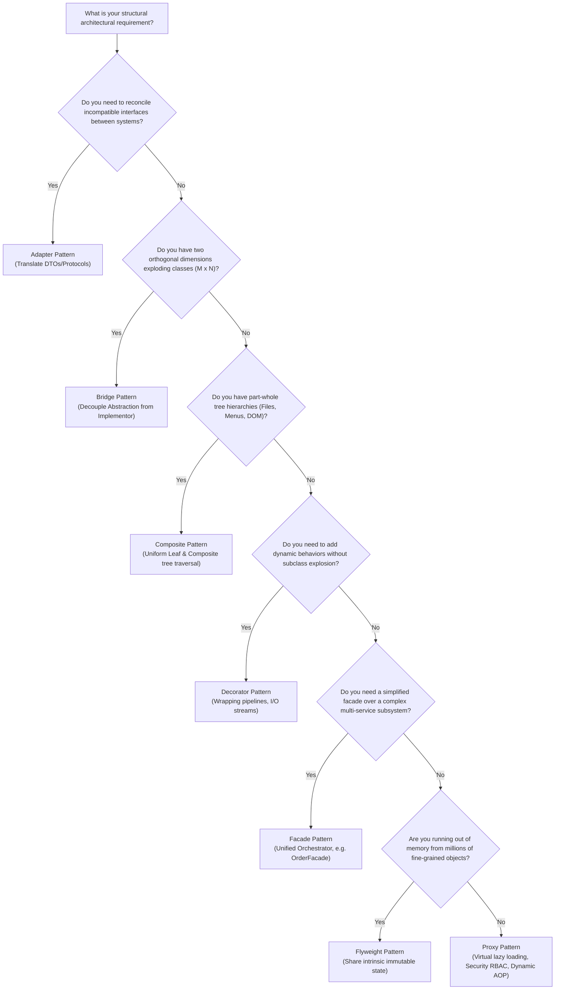

# Structural Design Patterns: Production Architecture & Low-Level Design in Java

Structural design patterns are concerned with how classes and objects are composed to form larger, more flexible, and more efficient architectures. Rather than relying on rigid, compile-time inheritance hierarchies—which lead to combinatorial class explosion, fragile base classes, and tight coupling—structural patterns leverage **composition, aggregation, and interface segregation** to build extensible runtime software topologies.

This document provides an architectural overview, definitions, comparison matrices, and decision guides for all seven structural design patterns in Java. Each pattern has a dedicated, production-grade guide with complete Java 21 implementations, thread-safety analysis, and real-world failure mode discussions.

---

## Structural Patterns Comparison Matrix

| Pattern | Primary Intent | Composition Technique | Coupling Direction | Key Production Benefit |
| :--- | :--- | :--- | :--- | :--- |
| **Adapter** | Converts the interface of a class into another interface clients expect | Wrapping/delegation (Object) or multiple inheritance (Class) | Client $\rightarrow$ Target $\leftarrow$ Adapter $\rightarrow$ Adaptee | Enables legacy integration and 3rd-party vendor interoperability without rewriting clients |
| **Bridge** | Decouples an abstraction from its implementation so both can vary independently | Has-a aggregation between abstraction and implementor | Abstraction $\diamond\rightarrow$ Implementor | Prevents Cartesian product class explosion ($M \times N \rightarrow M + N$) across orthogonal axes |
| **Composite** | Composes objects into tree structures to represent part-whole hierarchies | Recursive composition of Leaves and Composite nodes | Client $\rightarrow$ Component $\leftarrow$ Composite $\rightarrow$ Component | Clients treat individual leaf items and composite branches uniformly |
| **Decorator** | Attaches additional responsibilities to an object dynamically at runtime | Recursive wrapping of interface-compatible layers | Decorator $\rightarrow$ Component | Dynamic, flexible feature extension without static subclass explosion ($2^N$) |
| **Facade** | Provides a unified, simplified interface to a set of interfaces in a subsystem | High-level orchestrator calling subsystem components | Client $\rightarrow$ Facade $\rightarrow$ Subsystems | Reduces client-subsystem coupling and enforces clean architectural boundaries |
| **Flyweight** | Supports large numbers of fine-grained objects efficiently by sharing state | Separation of Intrinsic (shared) and Extrinsic (context) state | Client $\rightarrow$ FlyweightFactory $\rightarrow$ Flyweight | Drastic heap memory reduction when handling millions of lightweight domain entities |
| **Proxy** | Provides a surrogate or placeholder for another object to control access to it | Interception wrapper implementing the Subject interface | Client $\rightarrow$ Proxy $\rightarrow$ RealSubject | Transparent access control, lazy initialization, remote RPC stubbing, and security checks |

---

## Structural Design Patterns Catalog

Explore the detailed architectural guides, Java 21 implementations, and thread-safety analyses for each structural pattern:

| # | Pattern | Key Intent & Production Mechanism | Deep-Dive Guide |
| :--- | :--- | :--- | :--- |
| **1** | **Adapter** | Converts incompatible interfaces; Object Adapter vs Class Adapter; legacy XML payment to modern JSON payment API. | [`05-01-adapter-pattern.md`](./05-01-adapter-pattern.md) |
| **2** | **Bridge** | Decouples abstraction from implementation to prevent $M \times N$ class explosion; multi-channel notification engine (SMS, Email, Slack). | [`05-02-bridge-pattern.md`](./05-02-bridge-pattern.md) |
| **3** | **Composite** | Treats individual objects and composition trees uniformly; virtual file system with files, directories, and symlinks. | [`05-03-composite-pattern.md`](./05-03-composite-pattern.md) |
| **4** | **Decorator** | Attaches additional responsibilities dynamically without subclass explosion; HTTP filter pipeline with Logging, Compression, and Encryption. | [`05-04-decorator-pattern.md`](./05-04-decorator-pattern.md) |
| **5** | **Facade** | Provides a unified, high-level interface to a complex subsystem; e-commerce order checkout orchestrator with transactional compensation. | [`05-05-facade-pattern.md`](./05-05-facade-pattern.md) |
| **6** | **Flyweight** | Shares fine-grained state to support massive quantities of objects; Intrinsic vs Extrinsic state; rich text formatting glyph engine. | [`05-06-flyweight-pattern.md`](./05-06-flyweight-pattern.md) |
| **7** | **Proxy** | Provides a surrogate or placeholder controlling access; Virtual, Protection/RBAC, and Java Dynamic Proxies with `java.lang.reflect.Proxy`. | [`05-07-proxy-pattern.md`](./05-07-proxy-pattern.md) |

---

## Structural Design Patterns Architectural Decision Tree

Use this flowchart to select the appropriate structural pattern for your architectural requirements:

---

## Summary of Structural Anti-Patterns & Best Practices

1. **Avoid God Facades**: A Facade must coordinate a specific subsystem workflow. If a Facade begins managing 50 unrelated services, it becomes an anti-pattern. Split facades by bounded context (e.g., `OrderFulfillmentFacade`, `CustomerOnboardingFacade`).
2. **Beware Deep Decorator Stacks**: Stacking 10+ decorators creates debugging nightmares and deep call stacks. Use meaningful abstractions or interceptor chains when the pipeline exceeds 4-5 layers.
3. **Never Mutate Flyweight Intrinsic State**: The intrinsic state in a Flyweight **must be strictly immutable**. Mutating intrinsic state in one thread corrupts the representation across all other contexts in the application.
4. **Do Not Confuse Proxy and Decorator**: While both wrap an underlying object with the same interface, their **intents differ**:
   - A **Proxy** manages lifecycle, controls access, or defers object creation. The proxy often creates or owns the subject.
   - A **Decorator** enhances capabilities or adds responsibilities dynamically. The client typically supplies the component to be decorated.
