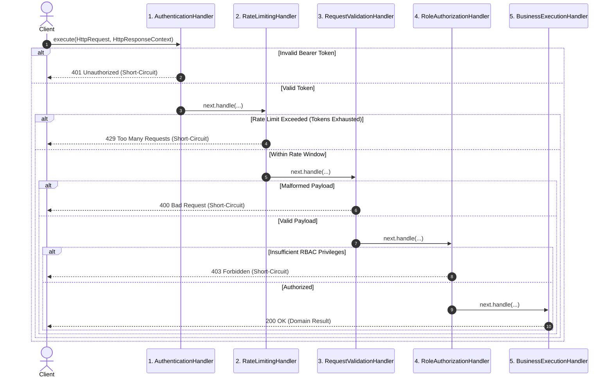

# Chain of Responsibility Pattern: Production Architecture & Low-Level Design in Java

> **Category:** [Behavioral Design Patterns](./06-behavioral-design-patterns.md) | **Navigation:** [Back to Behavioral Index](./06-behavioral-design-patterns.md) | [Master LLD Index](./00-index.md)

---


### 1.1 Intent, Architecture & Mechanics

The **Chain of Responsibility** pattern decouples the sender of a request from its potential receivers by giving more than one object a chance to handle the request. Incoming requests traverse sequentially through a pipeline of handlers. Each handler inspects the request and makes one of three decisions:
1. **Handle and Terminate**: Completely process the request and short-circuit the pipeline (e.g., authentication failure, rate-limit violation).
2. **Handle and Propagate**: Perform inspecting or mutating operations (e.g., logging, token enrichment, distributed tracing injection) and pass the request to the next handler.
3. **Pass-Through**: Determine that the request does not match its domain and immediately delegate to the successor.



### 1.2 Production-Grade Java Implementation: Multi-Tier API Filter Pipeline

Below is a production-grade, thread-safe, extensible HTTP filter pipeline. Handlers are stateless with respect to individual requests, storing request-scoped state exclusively in `HttpRequestContext`. Thread safety across concurrent threads is enforced using lock-free data structures (`ConcurrentHashMap`, `AtomicInteger`).

```java
package com.systemdesign.lld.behavioral.chain;

import java.time.Instant;
import java.util.*;
import java.util.concurrent.ConcurrentHashMap;
import java.util.concurrent.atomic.AtomicInteger;

/**
 * Immutable HTTP Request representation.
 */
public final class HttpRequest {
    private final String requestId;
    private final String method;
    private final String path;
    private final Map<String, String> headers;
    private final String body;
    private final String clientIp;

    public HttpRequest(String requestId, String method, String path, 
                       Map<String, String> headers, String body, String clientIp) {
        this.requestId = Objects.requireNonNull(requestId, "requestId must not be null");
        this.method = Objects.requireNonNull(method, "method must not be null");
        this.path = Objects.requireNonNull(path, "path must not be null");
        this.headers = Collections.unmodifiableMap(new HashMap<>(headers));
        this.body = body != null ? body : "";
        this.clientIp = Objects.requireNonNull(clientIp, "clientIp must not be null");
    }

    public String getRequestId() { return requestId; }
    public String getMethod() { return method; }
    public String getPath() { return path; }
    public Map<String, String> getHeaders() { return headers; }
    public String getHeader(String name) { return headers.get(name); }
    public String getBody() { return body; }
    public String getClientIp() { return clientIp; }
}
```

```java
package com.systemdesign.lld.behavioral.chain;

import java.util.Collections;
import java.util.HashMap;
import java.util.Map;
import java.util.concurrent.ConcurrentHashMap;

/**
 * Context carried alongside the request through the chain.
 * Holds mutable state isolated to a single thread/request execution.
 */
public final class HttpResponseContext {
    private int statusCode = 200;
    private String responseBody = "";
    private boolean shortCircuited = false;
    private final Map<String, String> responseHeaders = new ConcurrentHashMap<>();
    private final Map<String, Object> attributes = new ConcurrentHashMap<>();

    public int getStatusCode() { return statusCode; }
    public String getResponseBody() { return responseBody; }
    public boolean isShortCircuited() { return shortCircuited; }
    public Map<String, String> getResponseHeaders() { return Collections.unmodifiableMap(responseHeaders); }

    public void setAttribute(String key, Object value) {
        attributes.put(key, value);
    }

    @SuppressWarnings("unchecked")
    public <T> T getAttribute(String key) {
        return (T) attributes.get(key);
    }

    public void addHeader(String key, String value) {
        responseHeaders.put(key, value);
    }

    public void shortCircuit(int statusCode, String responseBody) {
        this.statusCode = statusCode;
        this.responseBody = responseBody;
        this.shortCircuited = true;
    }

    public void complete(int statusCode, String responseBody) {
        this.statusCode = statusCode;
        this.responseBody = responseBody;
    }
}
```

```java
package com.systemdesign.lld.behavioral.chain;

/**
 * Abstract Handler defining chain linking and standard traversal template.
 */
public abstract class AbstractHandler {
    private AbstractHandler next;

    public AbstractHandler setNext(AbstractHandler next) {
        this.next = next;
        return next;
    }

    public final void handle(HttpRequest request, HttpResponseContext context) {
        if (context.isShortCircuited()) {
            return;
        }

        process(request, context);

        if (!context.isShortCircuited() && next != null) {
            next.handle(request, context);
        }
    }

    protected abstract void process(HttpRequest request, HttpResponseContext context);
}
```

```java
package com.systemdesign.lld.behavioral.chain;

import java.util.Map;
import java.util.Set;
import java.util.concurrent.ConcurrentHashMap;

/**
 * 1. Authentication Handler: Validates API Bearer Tokens.
 */
public final class AuthenticationHandler extends AbstractHandler {
    private static final String AUTH_HEADER = "Authorization";
    private static final String BEARER_PREFIX = "Bearer ";

    // Simulated token identity store: token -> username
    private final Map<String, String> validTokens = new ConcurrentHashMap<>();

    public AuthenticationHandler() {
        validTokens.put("token_admin_999", "admin_user");
        validTokens.put("token_regular_123", "regular_customer");
    }

    @Override
    protected void process(HttpRequest request, HttpResponseContext context) {
        String authHeader = request.getHeader(AUTH_HEADER);
        if (authHeader == null || !authHeader.startsWith(BEARER_PREFIX)) {
            context.shortCircuit(401, "{\"error\": \"Unauthorized: Missing or invalid Authorization header\"}");
            return;
        }

        String token = authHeader.substring(BEARER_PREFIX.length()).trim();
        String username = validTokens.get(token);

        if (username == null) {
            context.shortCircuit(401, "{\"error\": \"Unauthorized: Invalid or expired Bearer token\"}");
            return;
        }

        // Propagate authenticated identity into context
        context.setAttribute("authenticatedUser", username);
    }
}
```

```java
package com.systemdesign.lld.behavioral.chain;

import java.time.Instant;
import java.util.concurrent.ConcurrentHashMap;
import java.util.concurrent.atomic.AtomicInteger;

/**
 * 2. Rate Limiting Handler: Enforces sliding fixed-window requests per IP.
 */
public final class RateLimitingHandler extends AbstractHandler {
    private final int maxRequestsPerWindow;
    private final long windowMillis;

    private static class CounterWindow {
        final long windowStartEpochMs;
        final AtomicInteger count;

        CounterWindow(long startEpochMs) {
            this.windowStartEpochMs = startEpochMs;
            this.count = new AtomicInteger(1);
        }
    }

    private final ConcurrentHashMap<String, CounterWindow> clientCounters = new ConcurrentHashMap<>();

    public RateLimitingHandler(int maxRequestsPerWindow, long windowMillis) {
        this.maxRequestsPerWindow = maxRequestsPerWindow;
        this.windowMillis = windowMillis;
    }

    @Override
    protected void process(HttpRequest request, HttpResponseContext context) {
        String ip = request.getClientIp();
        long now = Instant.now().toEpochMilli();

        CounterWindow window = clientCounters.compute(ip, (key, existing) -> {
            if (existing == null || (now - existing.windowStartEpochMs) > windowMillis) {
                return new CounterWindow(now);
            }
            existing.count.incrementAndGet();
            return existing;
        });

        if (window.count.get() > maxRequestsPerWindow) {
            context.addHeader("Retry-After", String.valueOf(windowMillis / 1000));
            context.shortCircuit(429, "{\"error\": \"Too Many Requests: Rate limit exceeded\"}");
        }
    }
}
```

```java
package com.systemdesign.lld.behavioral.chain;

/**
 * 3. Payload Validation Handler: Asserts mandatory structure & payload sanity.
 */
public final class RequestValidationHandler extends AbstractHandler {
    private final int maxBodyLengthBytes;

    public RequestValidationHandler(int maxBodyLengthBytes) {
        this.maxBodyLengthBytes = maxBodyLengthBytes;
    }

    @Override
    protected void process(HttpRequest request, HttpResponseContext context) {
        if ("POST".equalsIgnoreCase(request.getMethod()) || "PUT".equalsIgnoreCase(request.getMethod())) {
            String body = request.getBody();
            if (body == null || body.trim().isEmpty()) {
                context.shortCircuit(400, "{\"error\": \"Bad Request: Body required for mutating methods\"}");
                return;
            }

            if (body.getBytes().length > maxBodyLengthBytes) {
                context.shortCircuit(413, "{\"error\": \"Payload Too Large: Exceeded allowed limit\"}");
                return;
            }

            if (!body.trim().startsWith("{") || !body.trim().endsWith("}")) {
                context.shortCircuit(400, "{\"error\": \"Bad Request: Invalid JSON body format\"}");
            }
        }
    }
}
```

```java
package com.systemdesign.lld.behavioral.chain;

import java.util.*;

/**
 * 4. Role Authorization Handler: Verifies RBAC roles against endpoint restrictions.
 */
public final class RoleAuthorizationHandler extends AbstractHandler {
    private final Map<String, Set<String>> userRoles = new HashMap<>();
    private final String requiredRole;

    public RoleAuthorizationHandler(String requiredRole) {
        this.requiredRole = requiredRole;
        userRoles.put("admin_user", Set.of("ROLE_USER", "ROLE_ADMIN"));
        userRoles.put("regular_customer", Set.of("ROLE_USER"));
    }

    @Override
    protected void process(HttpRequest request, HttpResponseContext context) {
        String username = context.getAttribute("authenticatedUser");
        if (username == null) {
            context.shortCircuit(401, "{\"error\": \"Unauthorized: Missing principal\"}");
            return;
        }

        Set<String> roles = userRoles.getOrDefault(username, Collections.emptySet());
        if (!roles.contains(requiredRole)) {
            context.shortCircuit(403, "{\"error\": \"Forbidden: Requires " + requiredRole + "\"}");
        }
    }
}
```

```java
package com.systemdesign.lld.behavioral.chain;

/**
 * 5. Terminal Business Execution Handler: Final dispatcher into business layer.
 */
public final class BusinessExecutionHandler extends AbstractHandler {
    @Override
    protected void process(HttpRequest request, HttpResponseContext context) {
        String username = context.getAttribute("authenticatedUser");
        context.addHeader("Content-Type", "application/json");
        context.complete(200, String.format(
            "{\"status\": \"SUCCESS\", \"user\": \"%s\", \"path\": \"%s\", \"data\": \"Resource processed successfully\"}",
            username, request.getPath()
        ));
    }
}
```

```java
package com.systemdesign.lld.behavioral.chain;

import java.util.Map;

/**
 * Chain Construction & Verification Demonstration.
 */
public class ChainOfResponsibilityDemo {
    public static void main(String[] args) {
        // Construct pipeline
        AbstractHandler pipeline = new AuthenticationHandler();
        pipeline.setNext(new RateLimitingHandler(2, 60_000))
                .setNext(new RequestValidationHandler(1024))
                .setNext(new RoleAuthorizationHandler("ROLE_ADMIN"))
                .setNext(new BusinessExecutionHandler());

        System.out.println("=== 1. Test Unauthenticated Request ===");
        HttpRequest req1 = new HttpRequest("req-1", "POST", "/api/v1/resource", Map.of(), "{\"action\": \"create\"}", "192.168.1.10");
        HttpResponseContext ctx1 = new HttpResponseContext();
        pipeline.handle(req1, ctx1);
        System.out.println("Status: " + ctx1.getStatusCode() + " | Body: " + ctx1.getResponseBody());

        System.out.println("\n=== 2. Test Forbidden Role Request ===");
        HttpRequest req2 = new HttpRequest("req-2", "POST", "/api/v1/resource", 
            Map.of("Authorization", "Bearer token_regular_123"), "{\"action\": \"create\"}", "192.168.1.10");
        HttpResponseContext ctx2 = new HttpResponseContext();
        pipeline.handle(req2, ctx2);
        System.out.println("Status: " + ctx2.getStatusCode() + " | Body: " + ctx2.getResponseBody());

        System.out.println("\n=== 3. Test Successful Admin Request ===");
        HttpRequest req3 = new HttpRequest("req-3", "POST", "/api/v1/resource", 
            Map.of("Authorization", "Bearer token_admin_999"), "{\"action\": \"create\"}", "192.168.1.10");
        HttpResponseContext ctx3 = new HttpResponseContext();
        pipeline.handle(req3, ctx3);
        System.out.println("Status: " + ctx3.getStatusCode() + " | Body: " + ctx3.getResponseBody());

        System.out.println("\n=== 4. Test Rate Limit Trigger (Second Admin Request from same IP) ===");
        HttpRequest req4 = new HttpRequest("req-4", "POST", "/api/v1/resource", 
            Map.of("Authorization", "Bearer token_admin_999"), "{\"action\": \"create\"}", "192.168.1.10");
        HttpResponseContext ctx4 = new HttpResponseContext();
        pipeline.handle(req4, ctx4);
        System.out.println("Status: " + ctx4.getStatusCode() + " | Body: " + ctx4.getResponseBody());

        System.out.println("\n=== 5. Test Rate Limit Exceeded (Third Admin Request from same IP) ===");
        HttpRequest req5 = new HttpRequest("req-5", "POST", "/api/v1/resource", 
            Map.of("Authorization", "Bearer token_admin_999"), "{\"action\": \"create\"}", "192.168.1.10");
        HttpResponseContext ctx5 = new HttpResponseContext();
        pipeline.handle(req5, ctx5);
        System.out.println("Status: " + ctx5.getStatusCode() + " | Body: " + ctx5.getResponseBody());
    }
}
```

### 1.3 Step-by-Step Code Walkthrough & Concurrency Analysis
1. **Stateless Handler Nodes**: The handler objects (`AuthenticationHandler`, `RateLimitingHandler`, etc.) are instantiated once as singletons within the application container. They hold no per-request mutable state.
2. **Context-Driven Flow**: Request state and accumulated metadata (`authenticatedUser`, HTTP response codes) are encapsulated within `HttpResponseContext`, which is created per-request and passed down the call stack.
3. **Atomic Rate Counter**: The `RateLimitingHandler` maintains a `ConcurrentHashMap` mapping IP addresses to `CounterWindow`. Using `compute()` and `AtomicInteger` ensures thread-safe, lock-free rate tracking under high concurrent load without thread starvation.
4. **Short-Circuit Invariant**: The template method `AbstractHandler.handle(...)` enforces `if (context.isShortCircuited()) return;` before delegating downstream. This guarantees that once a failure condition is detected, downstream computation is halted immediately.

### 1.4 Failure Modes & Anti-Patterns
- **Unterminated Chains (Broken Chains)**: If the tail handler does not produce a response or if an unhandled exception escapes, requests hang or fall through silently. Handlers must provide default terminal fallbacks.
- **Deep Recursion & StackOverflowError**: When handler chains exceed several hundred links, recursive execution risks exhausting thread stack space (`-Xss`). In high-depth chains, an iterative loop over a `List<Handler>` (similar to Tomcat's `ApplicationFilterChain`) is preferred.
- **Thread-Safety Leaks**: Storing mutable per-request fields directly inside `AbstractHandler` subclasses causes data races across concurrent requests. All mutable state must reside in `HttpResponseContext`.

### 1.5 Real-World Framework References
- **Servlet Specification**: `javax.servlet.Filter` and `javax.servlet.FilterChain`.
- **Spring Security**: `SecurityFilterChain` containing `CorsFilter`, `CsrfFilter`, `UsernamePasswordAuthenticationFilter`, `FilterSecurityInterceptor`.
- **Netty**: `ChannelPipeline` containing inbound and outbound `ChannelHandler` implementations.

---

---

## Navigation & Related Patterns
* [Back to Behavioral Patterns Index](./06-behavioral-design-patterns.md)
* [Master LLD Index](./00-index.md)
* [Next: 06-02-command-pattern.md](./06-02-command-pattern.md)
