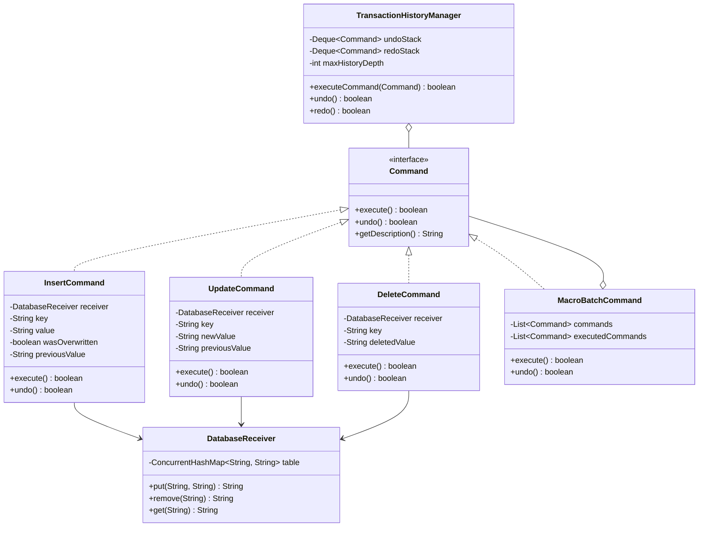

# Command Pattern: Production Architecture & Low-Level Design in Java

> **Category:** [Behavioral Design Patterns](./06-behavioral-design-patterns.md) | **Navigation:** [Back to Behavioral Index](./06-behavioral-design-patterns.md) | [Master LLD Index](./00-index.md)

---


### 2.1 Intent, Architecture & Mechanics

The **Command Pattern** encapsulates a request as an object, thereby letting you parameterize clients with different requests, queue or log requests, and support undoable operations. It decouples the **Invoker** (which initiates the command) from the **Receiver** (which performs the actual domain operation).

```
   ┌─────────────┐
   │   Client    │──────creates──────►┌───────────────────┐
   └──────┬──────┘                    │ ConcreteCommand   │
          │                           └─────────┬─────────┘
      configures                                │
          │                                 references
          ▼                                     │
   ┌─────────────┐                              ▼
   │   Invoker   │                     ┌─────────────────┐
   │ (Queue /    │─────invokes────────►│    Receiver     │
   │  Manager)   │                     │(Database Engine)│
   └─────────────┘                     └─────────────────┘
```



### 2.2 Production-Grade Java Implementation: Transactional In-Memory Database Engine

```java
package com.systemdesign.lld.behavioral.command;

import java.util.Collections;
import java.util.Map;
import java.util.concurrent.ConcurrentHashMap;

/**
 * The Receiver: Internal storage engine for the database.
 */
public final class DatabaseReceiver {
    private final ConcurrentHashMap<String, String> storage = new ConcurrentHashMap<>();

    public String put(String key, String value) {
        return storage.put(key, value);
    }

    public String remove(String key) {
        return storage.remove(key);
    }

    public String get(String key) {
        return storage.get(key);
    }

    public boolean containsKey(String key) {
        return storage.containsKey(key);
    }

    public Map<String, String> getSnapshot() {
        return Collections.unmodifiableMap(new ConcurrentHashMap<>(storage));
    }
}
```

```java
package com.systemdesign.lld.behavioral.command;

/**
 * Universal Command Interface.
 */
public interface Command {
    boolean execute();
    boolean undo();
    String getDescription();
}
```

```java
package com.systemdesign.lld.behavioral.command;

import java.util.Objects;

/**
 * Concrete Command: Inserts a key-value record.
 */
public final class InsertCommand implements Command {
    private final DatabaseReceiver receiver;
    private final String key;
    private final String value;
    private boolean executed = false;
    private boolean wasOverwritten = false;
    private String previousValue;

    public InsertCommand(DatabaseReceiver receiver, String key, String value) {
        this.receiver = Objects.requireNonNull(receiver, "receiver required");
        this.key = Objects.requireNonNull(key, "key required");
        this.value = Objects.requireNonNull(value, "value required");
    }

    @Override
    public boolean execute() {
        if (receiver.containsKey(key)) {
            wasOverwritten = true;
            previousValue = receiver.put(key, value);
        } else {
            wasOverwritten = false;
            receiver.put(key, value);
        }
        executed = true;
        return true;
    }

    @Override
    public boolean undo() {
        if (!executed) return false;
        if (wasOverwritten) {
            receiver.put(key, previousValue);
        } else {
            receiver.remove(key);
        }
        executed = false;
        return true;
    }

    @Override
    public String getDescription() {
        return String.format("INSERT [key=%s, val=%s]", key, value);
    }
}
```

```java
package com.systemdesign.lld.behavioral.command;

import java.util.Objects;

/**
 * Concrete Command: Updates an existing record.
 */
public final class UpdateCommand implements Command {
    private final DatabaseReceiver receiver;
    private final String key;
    private final String newValue;
    private String oldValue;
    private boolean executed = false;

    public UpdateCommand(DatabaseReceiver receiver, String key, String newValue) {
        this.receiver = Objects.requireNonNull(receiver);
        this.key = Objects.requireNonNull(key);
        this.newValue = Objects.requireNonNull(newValue);
    }

    @Override
    public boolean execute() {
        if (!receiver.containsKey(key)) {
            return false; // Cannot update non-existent key
        }
        oldValue = receiver.put(key, newValue);
        executed = true;
        return true;
    }

    @Override
    public boolean undo() {
        if (!executed) return false;
        receiver.put(key, oldValue);
        executed = false;
        return true;
    }

    @Override
    public String getDescription() {
        return String.format("UPDATE [key=%s, new=%s, old=%s]", key, newValue, oldValue);
    }
}
```

```java
package com.systemdesign.lld.behavioral.command;

import java.util.Objects;

/**
 * Concrete Command: Deletes an existing record.
 */
public final class DeleteCommand implements Command {
    private final DatabaseReceiver receiver;
    private final String key;
    private String deletedValue;
    private boolean executed = false;

    public DeleteCommand(DatabaseReceiver receiver, String key) {
        this.receiver = Objects.requireNonNull(receiver);
        this.key = Objects.requireNonNull(key);
    }

    @Override
    public boolean execute() {
        if (!receiver.containsKey(key)) {
            return false;
        }
        deletedValue = receiver.remove(key);
        executed = true;
        return true;
    }

    @Override
    public boolean undo() {
        if (!executed) return false;
        receiver.put(key, deletedValue);
        executed = false;
        return true;
    }

    @Override
    public String getDescription() {
        return String.format("DELETE [key=%s, val=%s]", key, deletedValue);
    }
}
```

```java
package com.systemdesign.lld.behavioral.command;

import java.util.ArrayList;
import java.util.Collections;
import java.util.List;

/**
 * Macro Command: Batches multiple commands atomically with reverse-rollback on partial failure.
 */
public final class MacroBatchCommand implements Command {
    private final List<Command> commands;
    private final List<Command> successfullyExecuted = new ArrayList<>();

    public MacroBatchCommand(List<Command> commands) {
        this.commands = List.copyOf(commands);
    }

    @Override
    public boolean execute() {
        successfullyExecuted.clear();
        for (Command cmd : commands) {
            boolean success = cmd.execute();
            if (!success) {
                // Rollback partially executed commands in reverse order
                Collections.reverse(successfullyExecuted);
                for (Command rollbackCmd : successfullyExecuted) {
                    rollbackCmd.undo();
                }
                successfullyExecuted.clear();
                return false;
            }
            successfullyExecuted.add(cmd);
        }
        return true;
    }

    @Override
    public boolean undo() {
        List<Command> reverseList = new ArrayList<>(successfullyExecuted);
        Collections.reverse(reverseList);
        for (Command cmd : reverseList) {
            cmd.undo();
        }
        successfullyExecuted.clear();
        return true;
    }

    @Override
    public String getDescription() {
        return "MACRO_BATCH [size=" + commands.size() + "]";
    }
}
```

```java
package com.systemdesign.lld.behavioral.command;

import java.util.ArrayDeque;
import java.util.Deque;
import java.util.concurrent.locks.ReentrantLock;

/**
 * The Invoker: Manages execution, bounded Undo/Redo stacks, and serialization.
 */
public final class TransactionHistoryManager {
    private final Deque<Command> undoStack = new ArrayDeque<>();
    private final Deque<Command> redoStack = new ArrayDeque<>();
    private final int maxHistoryDepth;
    private final ReentrantLock historyLock = new ReentrantLock();

    public TransactionHistoryManager(int maxHistoryDepth) {
        this.maxHistoryDepth = maxHistoryDepth;
    }

    public boolean execute(Command command) {
        historyLock.lock();
        try {
            boolean success = command.execute();
            if (success) {
                if (undoStack.size() >= maxHistoryDepth) {
                    undoStack.removeLast(); // Discard oldest history
                }
                undoStack.push(command);
                redoStack.clear(); // Clear redo history upon new execution
            }
            return success;
        } finally {
            historyLock.unlock();
        }
    }

    public boolean undo() {
        historyLock.lock();
        try {
            if (undoStack.isEmpty()) {
                return false;
            }
            Command command = undoStack.pop();
            boolean success = command.undo();
            if (success) {
                redoStack.push(command);
            }
            return success;
        } finally {
            historyLock.unlock();
        }
    }

    public boolean redo() {
        historyLock.lock();
        try {
            if (redoStack.isEmpty()) {
                return false;
            }
            Command command = redoStack.pop();
            boolean success = command.execute();
            if (success) {
                undoStack.push(command);
            }
            return success;
        } finally {
            historyLock.unlock();
        }
    }
}
```

```java
package com.systemdesign.lld.behavioral.command;

import java.util.concurrent.BlockingQueue;
import java.util.concurrent.LinkedBlockingQueue;
import java.util.concurrent.atomic.AtomicBoolean;

/**
 * Asynchronous Worker Queue for decoupling command submission from execution.
 */
public final class AsyncCommandWorkerPool implements AutoCloseable {
    private final BlockingQueue<Command> queue = new LinkedBlockingQueue<>(1000);
    private final Thread workerThread;
    private final AtomicBoolean running = new AtomicBoolean(true);

    public AsyncCommandWorkerPool(TransactionHistoryManager historyManager) {
        this.workerThread = new Thread(() -> {
            while (running.get() || !queue.isEmpty()) {
                try {
                    Command cmd = queue.take();
                    historyManager.execute(cmd);
                } catch (InterruptedException e) {
                    Thread.currentThread().interrupt();
                    break;
                }
            }
        }, "AsyncCommandWorker");
        this.workerThread.start();
    }

    public boolean submit(Command command) {
        return queue.offer(command);
    }

    @Override
    public void close() {
        running.set(false);
        workerThread.interrupt();
    }
}
```

```java
package com.systemdesign.lld.behavioral.command;

import java.util.List;

public class CommandPatternDemo {
    public static void main(String[] args) {
        DatabaseReceiver db = new DatabaseReceiver();
        TransactionHistoryManager history = new TransactionHistoryManager(10);

        System.out.println("=== 1. Execute Individual Commands ===");
        history.execute(new InsertCommand(db, "user:100", "Alice"));
        history.execute(new InsertCommand(db, "user:200", "Bob"));
        history.execute(new UpdateCommand(db, "user:100", "Alice Smith"));
        System.out.println("DB Snapshot: " + db.getSnapshot());

        System.out.println("\n=== 2. Undo Last Two Operations (Update, then Bob Insert) ===");
        history.undo();
        System.out.println("After 1st Undo (revert update): " + db.getSnapshot());
        history.undo();
        System.out.println("After 2nd Undo (revert insert Bob): " + db.getSnapshot());

        System.out.println("\n=== 3. Redo Operation ===");
        history.redo();
        System.out.println("After Redo: " + db.getSnapshot());

        System.out.println("\n=== 4. Macro Batch Command with Rollback on Failure ===");
        Command validInsert = new InsertCommand(db, "user:300", "Charlie");
        Command invalidUpdate = new UpdateCommand(db, "user:999", "Ghost"); // Non-existent key fails
        MacroBatchCommand batch = new MacroBatchCommand(List.of(validInsert, invalidUpdate));

        boolean batchResult = history.execute(batch);
        System.out.println("Batch execution status: " + batchResult);
        System.out.println("DB Snapshot (Charlie rolled back): " + db.getSnapshot());
    }
}
```

### 2.3 Step-by-Step Code Walkthrough & Concurrency Analysis
1. **Self-Contained State Restoration**: Each concrete command stores the prior state of the touched receiver key before executing. `InsertCommand` captures `wasOverwritten` and `previousValue`, allowing full reversal upon `undo()`.
2. **Atomic Batch Rollback**: The `MacroBatchCommand` executes elements sequentially. If step $K$ fails, it iterates backwards from $K-1$ down to 0, invoking `undo()` on all previously completed commands, satisfying atomic all-or-nothing transactional guarantees.
3. **Synchronization & Bounded Memory**: `TransactionHistoryManager` uses a `ReentrantLock` to protect the non-thread-safe `ArrayDeque` undo/redo stacks. A maximum capacity (`maxHistoryDepth`) evicts oldest operations via `removeLast()`, preventing out-of-memory errors in long-running applications.

### 2.4 Failure Modes & Anti-Patterns
- **Stale State During Undo**: If external threads modify the receiver out-of-band without using commands, invoking `undo()` can overwrite newer data with stale historical state.
- **Unbounded Memory Retention**: Keeping entire object graphs inside commands indefinitely prevents garbage collection. Commands should retain minimal primitive identifiers and state diffs.
- **Asymmetric Execute/Undo Contracts**: If `execute()` mutates state but `undo()` fails to revert every side effect (e.g., leaving dangling cache entries or audit records), history desynchronizes.

### 2.5 Real-World Framework References
- **JDK Core**: `java.lang.Runnable`, `java.util.concurrent.Callable`, `java.lang.reflect.InvocationHandler`.
- **GUI Toolkits**: `javax.swing.undo.UndoManager` and `javax.swing.Action`.
- **Spring Transaction**: `TransactionInterceptor` and `TransactionTemplate`.

---

---

## Navigation & Related Patterns
* [Back to Behavioral Patterns Index](./06-behavioral-design-patterns.md)
* [Master LLD Index](./00-index.md)
* [Previous: 06-01-chain-of-responsibility-pattern.md](./06-01-chain-of-responsibility-pattern.md)
* [Next: 06-03-interpreter-pattern.md](./06-03-interpreter-pattern.md)
