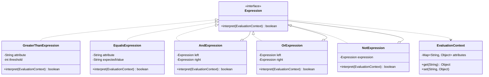

# Interpreter Pattern: Production Architecture & Low-Level Design in Java

> **Category:** [Behavioral Design Patterns](./06-behavioral-design-patterns.md) | **Navigation:** [Back to Behavioral Index](./06-behavioral-design-patterns.md) | [Master LLD Index](./00-index.md)

---


### 3.1 Intent, Architecture & Mechanics

The **Interpreter Pattern** specifies how to evaluate sentences in a language by defining an explicit class hierarchy for grammar rules. Each grammar rule is represented by either a **Terminal Expression** (leaf node containing direct values) or a **Non-Terminal Expression** (composite node combining child expressions via logical or arithmetic operators).



### 3.2 Production-Grade Java Implementation: SQL WHERE Clause DSL Evaluator

Below is a complete, self-contained Domain Specific Language (DSL) engine that tokenizes, parses via recursive descent, builds an Abstract Syntax Tree (AST), and evaluates complex boolean expressions (e.g., `(age > 18 AND status = 'ACTIVE') OR role = 'SUPERADMIN'`).

```java
package com.systemdesign.lld.behavioral.interpreter;

import java.util.Collections;
import java.util.HashMap;
import java.util.Map;
import java.util.concurrent.ConcurrentHashMap;

/**
 * Thread-safe evaluation context carrying entity attributes.
 */
public final class EvaluationContext {
    private final Map<String, Object> attributes = new ConcurrentHashMap<>();

    public EvaluationContext() {}

    public EvaluationContext(Map<String, Object> initial) {
        this.attributes.putAll(initial);
    }

    public void set(String key, Object value) {
        attributes.put(key, value);
    }

    public Object get(String key) {
        return attributes.get(key);
    }

    public Map<String, Object> getAll() {
        return Collections.unmodifiableMap(attributes);
    }
}
```

```java
package com.systemdesign.lld.behavioral.interpreter;

/**
 * AST Node Interface.
 */
public interface Expression {
    boolean interpret(EvaluationContext context);
}
```

```java
package com.systemdesign.lld.behavioral.interpreter;

import java.util.Objects;

/**
 * Terminal Expression: Checks equality (attribute = 'expected').
 */
public final class EqualsExpression implements Expression {
    private final String attribute;
    private final String expectedValue;

    public EqualsExpression(String attribute, String expectedValue) {
        this.attribute = Objects.requireNonNull(attribute);
        this.expectedValue = Objects.requireNonNull(expectedValue);
    }

    @Override
    public boolean interpret(EvaluationContext context) {
        Object actual = context.get(attribute);
        return actual != null && expectedValue.equalsIgnoreCase(String.valueOf(actual));
    }
}
```

```java
package com.systemdesign.lld.behavioral.interpreter;

import java.util.Objects;

/**
 * Terminal Expression: Checks numeric inequality (attribute > threshold).
 */
public final class GreaterThanExpression implements Expression {
    private final String attribute;
    private final long threshold;

    public GreaterThanExpression(String attribute, long threshold) {
        this.attribute = Objects.requireNonNull(attribute);
        this.threshold = threshold;
    }

    @Override
    public boolean interpret(EvaluationContext context) {
        Object val = context.get(attribute);
        if (val instanceof Number) {
            return ((Number) val).longValue() > threshold;
        }
        if (val instanceof String) {
            try {
                return Long.parseLong((String) val) > threshold;
            } catch (NumberFormatException ignored) {}
        }
        return false;
    }
}
```

```java
package com.systemdesign.lld.behavioral.interpreter;

import java.util.Objects;

/**
 * Non-Terminal Expression: Logical AND.
 */
public final class AndExpression implements Expression {
    private final Expression left;
    private final Expression right;

    public AndExpression(Expression left, Expression right) {
        this.left = Objects.requireNonNull(left);
        this.right = Objects.requireNonNull(right);
    }

    @Override
    public boolean interpret(EvaluationContext context) {
        // Short-circuiting evaluation
        return left.interpret(context) && right.interpret(context);
    }
}
```

```java
package com.systemdesign.lld.behavioral.interpreter;

import java.util.Objects;

/**
 * Non-Terminal Expression: Logical OR.
 */
public final class OrExpression implements Expression {
    private final Expression left;
    private final Expression right;

    public OrExpression(Expression left, Expression right) {
        this.left = Objects.requireNonNull(left);
        this.right = Objects.requireNonNull(right);
    }

    @Override
    public boolean interpret(EvaluationContext context) {
        // Short-circuiting evaluation
        return left.interpret(context) || right.interpret(context);
    }
}
```

```java
package com.systemdesign.lld.behavioral.interpreter;

import java.util.Objects;

/**
 * Non-Terminal Expression: Logical NOT.
 */
public final class NotExpression implements Expression {
    private final Expression expression;

    public NotExpression(Expression expression) {
        this.expression = Objects.requireNonNull(expression);
    }

    @Override
    public boolean interpret(EvaluationContext context) {
        return !expression.interpret(context);
    }
}
```

```java
package com.systemdesign.lld.behavioral.interpreter;

import java.util.ArrayList;
import java.util.List;

/**
 * Production-grade Lexer & Recursive Descent Parser for SQL WHERE clauses.
 * Grammar:
 *   Expression -> OrTerm
 *   OrTerm     -> AndTerm ( "OR" AndTerm )*
 *   AndTerm    -> Factor ( "AND" Factor )*
 *   Factor     -> "NOT" Factor | "(" Expression ")" | Comparison
 *   Comparison -> IDENTIFIER ("=" | ">") (STRING_LITERAL | NUMBER)
 */
public final class SqlWhereParser {
    private final List<String> tokens;
    private int cursor = 0;

    public SqlWhereParser(String query) {
        this.tokens = tokenize(query);
    }

    public static Expression parse(String query) {
        return new SqlWhereParser(query).parseExpression();
    }

    private Expression parseExpression() {
        return parseOrTerm();
    }

    private Expression parseOrTerm() {
        Expression expr = parseAndTerm();
        while (match("OR")) {
            Expression right = parseAndTerm();
            expr = new OrExpression(expr, right);
        }
        return expr;
    }

    private Expression parseAndTerm() {
        Expression expr = parseFactor();
        while (match("AND")) {
            Expression right = parseFactor();
            expr = new AndExpression(expr, right);
        }
        return expr;
    }

    private Expression parseFactor() {
        if (match("NOT")) {
            return new NotExpression(parseFactor());
        }
        if (match("(")) {
            Expression expr = parseExpression();
            consume(")");
            return expr;
        }
        return parseComparison();
    }

    private Expression parseComparison() {
        String attribute = nextToken();
        String operator = nextToken();
        String literal = nextToken();

        // Strip single quotes if string literal
        if (literal.startsWith("'") && literal.endsWith("'") && literal.length() >= 2) {
            literal = literal.substring(1, literal.length() - 1);
        }

        if ("=".equals(operator)) {
            return new EqualsExpression(attribute, literal);
        } else if (">".equals(operator)) {
            return new GreaterThanExpression(attribute, Long.parseLong(literal));
        }
        throw new IllegalArgumentException("Unsupported operator: " + operator);
    }

    private List<String> tokenize(String query) {
        List<String> list = new ArrayList<>();
        StringBuilder sb = new StringBuilder();
        boolean inQuote = false;

        for (int i = 0; i < query.length(); i++) {
            char c = query.charAt(i);
            if (c == '\'') {
                inQuote = !inQuote;
                sb.append(c);
            } else if (inQuote) {
                sb.append(c);
            } else if (c == '(' || c == ')' || c == '=' || c == '>') {
                if (sb.length() > 0) {
                    list.add(sb.toString().trim());
                    sb.setLength(0);
                }
                list.add(String.valueOf(c));
            } else if (Character.isWhitespace(c)) {
                if (sb.length() > 0) {
                    list.add(sb.toString().trim());
                    sb.setLength(0);
                }
            } else {
                sb.append(c);
            }
        }
        if (sb.length() > 0) {
            list.add(sb.toString().trim());
        }
        return list;
    }

    private boolean match(String expected) {
        if (cursor < tokens.size() && tokens.get(cursor).equalsIgnoreCase(expected)) {
            cursor++;
            return true;
        }
        return false;
    }

    private void consume(String expected) {
        if (!match(expected)) {
            throw new IllegalStateException("Expected token '" + expected + "' but got: " 
                + (cursor < tokens.size() ? tokens.get(cursor) : "EOF"));
        }
    }

    private String nextToken() {
        if (cursor >= tokens.size()) {
            throw new IllegalStateException("Unexpected end of tokens");
        }
        return tokens.get(cursor++);
    }
}
```

```java
package com.systemdesign.lld.behavioral.interpreter;

import java.util.Map;

public class InterpreterPatternDemo {
    public static void main(String[] args) {
        String query = "(age > 18 AND status = 'ACTIVE') OR role = 'SUPERADMIN'";
        Expression ast = SqlWhereParser.parse(query);

        System.out.println("Testing AST for query: " + query);

        EvaluationContext user1 = new EvaluationContext(Map.of("age", 25, "status", "ACTIVE", "role", "USER"));
        System.out.println("User 1 (Age 25, Active): " + ast.interpret(user1)); // Expected: true

        EvaluationContext user2 = new EvaluationContext(Map.of("age", 16, "status", "ACTIVE", "role", "USER"));
        System.out.println("User 2 (Age 16, Active): " + ast.interpret(user2)); // Expected: false

        EvaluationContext user3 = new EvaluationContext(Map.of("age", 15, "status", "SUSPENDED", "role", "SUPERADMIN"));
        System.out.println("User 3 (Age 15, Suspended, SUPERADMIN): " + ast.interpret(user3)); // Expected: true
    }
}
```

### 3.3 Step-by-Step Code Walkthrough & Concurrency Analysis
1. **Thread-Safe Immutable AST**: The expression nodes (`AndExpression`, `EqualsExpression`, etc.) are deeply immutable after construction. Once parsed, a single AST instance can be shared across thousands of concurrent worker threads safely.
2. **Context Isolation**: Variable evaluation occurs strictly against the `EvaluationContext` argument passed into `interpret(context)`. No shared mutable state exists across evaluation invocations.
3. **Short-Circuit Semantics**: Java's native boolean short-circuit operators (`&&`, `||`) are utilized inside `AndExpression` and `OrExpression`, minimizing unnecessary leaf evaluations.

### 3.4 Failure Modes & Anti-Patterns
- **Grammar Explosion**: When a grammar grows to support dozens of statements, operators, functions, and nested scopes, manual AST classes become unmaintainable. Tools like ANTLR or JavaCC should be adopted for large grammars.
- **Deep Recursion & CPU Spikes**: Highly nested ASTs evaluate via recursive stack frames. Hostile inputs can induce `StackOverflowError`. Parsing depth must be explicitly bounded.

### 3.5 Real-World Framework References
- **Spring Expression Language (SpEL)**: `SpelExpressionParser` generating AST `SpelNode` trees.
- **JDK Core**: `java.util.regex.Pattern` compiling regular expressions into state machines.
- **JPA & Hibernate**: Hibernate HQL / JPQL Criteria API AST parsers.

---

---

## Navigation & Related Patterns
* [Back to Behavioral Patterns Index](./06-behavioral-design-patterns.md)
* [Master LLD Index](./00-index.md)
* [Previous: 06-02-command-pattern.md](./06-02-command-pattern.md)
* [Next: 06-04-iterator-pattern.md](./06-04-iterator-pattern.md)
