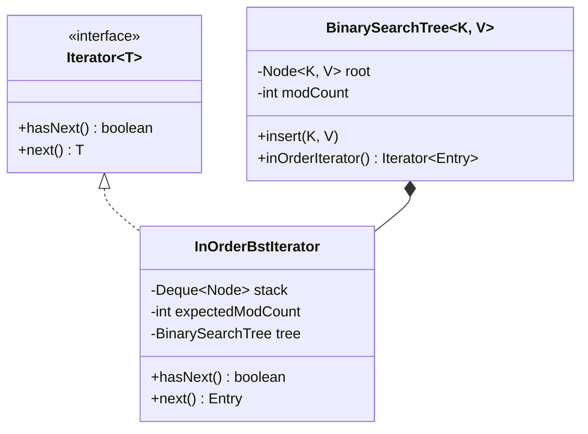

# Iterator Pattern: Production Architecture & Low-Level Design in Java

> **Category:** [Behavioral Design Patterns](./06-behavioral-design-patterns.md) | **Navigation:** [Back to Behavioral Index](./06-behavioral-design-patterns.md) | [Master LLD Index](./00-index.md)

---


### 4.1 Intent, Architecture & Mechanics

The **Iterator Pattern** provides a way to access the elements of an aggregate object sequentially without exposing its underlying internal data representation (array, linked list, tree, skip list, or graph).

Crucially, in enterprise Java development, iterators must navigate concurrency dynamics:
- **Fail-Fast Iterators**: Detect concurrent structural modification immediately and throw `ConcurrentModificationException` rather than returning inconsistent data.
- **Fail-Safe / Fail-Weak Iterators**: Traverse a point-in-time snapshot of the underlying aggregate or safely accommodate concurrent mutations without throwing exceptions.



### 4.2 Production-Grade Java Implementation: Binary Search Tree In-Order Iterator with Fail-Fast Detection

```java
package com.systemdesign.lld.behavioral.iterator;

import java.util.*;

/**
 * Custom Binary Search Tree with structural modification tracking and In-Order iterator.
 */
public final class BinarySearchTree<K extends Comparable<K>, V> implements Iterable<Map.Entry<K, V>> {
    
    private static final class Node<K, V> {
        final K key;
        V value;
        Node<K, V> left;
        Node<K, V> right;

        Node(K key, V value) {
            this.key = key;
            this.value = value;
        }
    }

    private Node<K, V> root;
    private int size = 0;
    // Volatile modification counter incremented upon every structural change
    private volatile int modCount = 0;

    public synchronized void put(K key, V value) {
        Objects.requireNonNull(key);
        root = insert(root, key, value);
    }

    private Node<K, V> insert(Node<K, V> current, K key, V value) {
        if (current == null) {
            size++;
            modCount++;
            return new Node<>(key, value);
        }
        int cmp = key.compareTo(current.key);
        if (cmp < 0) {
            current.left = insert(current.left, key, value);
        } else if (cmp > 0) {
            current.right = insert(current.right, key, value);
        } else {
            current.value = value; // Value replacement is NOT a structural mutation
        }
        return current;
    }

    public synchronized int size() { return size; }
    public int getModCount() { return modCount; }

    @Override
    public Iterator<Map.Entry<K, V>> iterator() {
        return new InOrderBstIterator(this);
    }

    /**
     * Fail-Fast In-Order Iterator maintaining an explicit traversal stack.
     */
    private static final class InOrderBstIterator<K extends Comparable<K>, V> implements Iterator<Map.Entry<K, V>> {
        private final BinarySearchTree<K, V> tree;
        private final int expectedModCount;
        private final Deque<Node<K, V>> stack = new ArrayDeque<>();

        InOrderBstIterator(BinarySearchTree<K, V> tree) {
            this.tree = tree;
            this.expectedModCount = tree.modCount;
            synchronized (tree) {
                pushLeftBranch(tree.root);
            }
        }

        private void pushLeftBranch(Node<K, V> node) {
            while (node != null) {
                stack.push(node);
                node = node.left;
            }
        }

        private void checkConcurrentModification() {
            if (tree.modCount != expectedModCount) {
                throw new ConcurrentModificationException(
                    "BST structurally modified during iteration! modCount=" + tree.modCount + ", expected=" + expectedModCount
                );
            }
        }

        @Override
        public boolean hasNext() {
            checkConcurrentModification();
            return !stack.isEmpty();
        }

        @Override
        public Map.Entry<K, V> next() {
            checkConcurrentModification();
            if (stack.isEmpty()) {
                throw new NoSuchElementException("Exhausted BST iteration");
            }

            Node<K, V> node = stack.pop();
            Map.Entry<K, V> entry = new AbstractMap.SimpleImmutableEntry<>(node.key, node.value);

            if (node.right != null) {
                pushLeftBranch(node.right);
            }
            return entry;
        }
    }
}
```

```java
package com.systemdesign.lld.behavioral.iterator;

import java.util.ConcurrentModificationException;
import java.util.Iterator;
import java.util.Map;

public class IteratorPatternDemo {
    public static void main(String[] args) {
        BinarySearchTree<Integer, String> bst = new BinarySearchTree<>();
        bst.put(50, "Fifty");
        bst.put(30, "Thirty");
        bst.put(70, "Seventy");
        bst.put(20, "Twenty");
        bst.put(40, "Forty");
        bst.put(60, "Sixty");
        bst.put(80, "Eighty");

        System.out.println("=== 1. Standard In-Order Traversal (Sorted Order) ===");
        for (Map.Entry<Integer, String> entry : bst) {
            System.out.println(entry.getKey() + " -> " + entry.getValue());
        }

        System.out.println("\n=== 2. Fail-Fast Concurrent Modification Verification ===");
        try {
            Iterator<Map.Entry<Integer, String>> it = bst.iterator();
            if (it.hasNext()) {
                System.out.println("First element: " + it.next());
                // Concurrent structural mutation
                System.out.println("Injecting mutating insertion: bst.put(25, 'TwentyFive')...");
                bst.put(25, "TwentyFive");
                // Next access must trigger fail-fast exception
                it.next();
            }
        } catch (ConcurrentModificationException e) {
            System.out.println("Successfully caught expected exception: " + e.getMessage());
        }
    }
}
```

### 4.3 Deep Dive: Fail-Fast vs Fail-Safe vs Fail-Weak Iterators

| Traversal Paradigm | Underlying Mechanism | Throws `ConcurrentModificationException`? | Consistency Guarantee | Memory Overhead | Typical Collections |
| :--- | :--- | :--- | :--- | :--- | :--- |
| **Fail-Fast** | Compares `modCount` to local `expectedModCount` on every call. | **Yes** (Best effort) | Stale view rejected immediately upon modification. | Minimal ($O(1)$ scalar counter) | `ArrayList`, `HashMap`, `TreeMap`, `HashSet` |
| **Fail-Safe (Snapshot)** | Iterates over an immutable, point-in-time array snapshot created at iterator instantiation. | **No** | Perfectly consistent view of the collection as it existed when the iterator was created. | High on mutation ($O(N)$ full array copy per write). | `CopyOnWriteArrayList`, `CopyOnWriteArraySet` |
| **Fail-Weak (Weakly Consistent)** | Traverses live nodes linked via volatile pointers. Survives concurrent node insertions and deletions. | **No** | Reflects all elements at creation time; may or may not reflect subsequent mutations. Never throws CME. | Zero additional allocation. | `ConcurrentHashMap.keySet().iterator()`, `ConcurrentLinkedQueue` |

---

---

## Navigation & Related Patterns
* [Back to Behavioral Patterns Index](./06-behavioral-design-patterns.md)
* [Master LLD Index](./00-index.md)
* [Previous: 06-03-interpreter-pattern.md](./06-03-interpreter-pattern.md)
* [Next: 06-05-mediator-pattern.md](./06-05-mediator-pattern.md)
