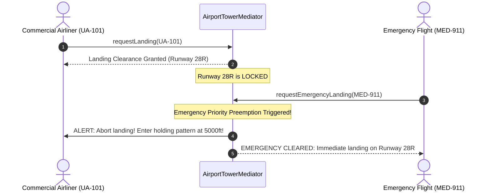

# Mediator Pattern: Production Architecture & Low-Level Design in Java

> **Category:** [Behavioral Design Patterns](./06-behavioral-design-patterns.md) | **Navigation:** [Back to Behavioral Index](./06-behavioral-design-patterns.md) | [Master LLD Index](./00-index.md)

---


### 5.1 Intent, Architecture & Mechanics

The **Mediator Pattern** restricts direct point-to-point communication between colleagues by forcing them to communicate solely through a mediator object. This replaces an unmaintainable $O(N^2)$ communication mesh with a clean $O(N)$ star topology.

```
Direct Point-to-Point Anti-Pattern (N^2 Complexity):
[Aircraft A] <======> [Aircraft B]
     ^   \           /   ^
     |    \         /    |
     |     \       /     |
     v      â–¼     â–¼      v
[Aircraft C] <======> [Aircraft D]

Mediator Star Topology (N Complexity):
[Aircraft A]    [Aircraft B]
       \            /
        â–¼          â–¼
    ┌──────────────────────┐
    │  Air Traffic Control │
    │     (Mediator)       │
    └──────────────────────┘
        â–²          â–²
       /            \
[Aircraft C]    [Aircraft D]
```



### 5.2 Production-Grade Java Implementation: Air Traffic Control (ATC) System

```java
package com.systemdesign.lld.behavioral.mediator;

public enum FlightPriority {
    ROUTINE,
    CARGO,
    EMERGENCY
}
```

```java
package com.systemdesign.lld.behavioral.mediator;

/**
 * Colleague Interface representing an aircraft in airspace.
 */
public interface AircraftColleague {
    String getCallsign();
    FlightPriority getPriority();
    void receiveTransmission(String message);
    void enterHoldingPattern();
    void clearForLanding(String runwayId);
    void clearForTakeoff(String runwayId);
}
```

```java
package com.systemdesign.lld.behavioral.mediator;

/**
 * Mediator Interface for Air Traffic Control Tower.
 */
public interface AtcMediator {
    void registerAircraft(AircraftColleague aircraft);
    boolean requestLandingClearance(AircraftColleague aircraft);
    boolean requestTakeoffClearance(AircraftColleague aircraft);
    void notifyRunwayVacated(String runwayId, AircraftColleague aircraft);
    void broadcastEmergency(String emergencyMessage, AircraftColleague declaringAircraft);
}
```

```java
package com.systemdesign.lld.behavioral.mediator;

import java.util.*;
import java.util.concurrent.ConcurrentHashMap;
import java.util.concurrent.PriorityBlockingQueue;
import java.util.concurrent.locks.ReentrantLock;

/**
 * Production Mediator managing runways, aircraft queues, and emergency preemptions.
 */
public final class AirportTowerMediator implements AtcMediator {
    private final Map<String, AircraftColleague> registeredAirspace = new ConcurrentHashMap<>();
    private final Map<String, ReentrantLock> runwayLocks = new ConcurrentHashMap<>();
    private final Map<String, AircraftColleague> runwayOccupants = new ConcurrentHashMap<>();

    // Landing queue prioritizing Emergency flights over Routine flights
    private final PriorityBlockingQueue<AircraftColleague> landingQueue = new PriorityBlockingQueue<>(
        20, Comparator.comparing(AircraftColleague::getPriority).reversed()
    );

    public AirportTowerMediator(List<String> runways) {
        for (String runway : runways) {
            runwayLocks.put(runway, new ReentrantLock(true)); // Fair locks
        }
    }

    @Override
    public void registerAircraft(AircraftColleague aircraft) {
        registeredAirspace.put(aircraft.getCallsign(), aircraft);
        aircraft.receiveTransmission("Tower: Identified on radar. Airspace contact established.");
    }

    @Override
    public boolean requestLandingClearance(AircraftColleague aircraft) {
        if (aircraft.getPriority() == FlightPriority.EMERGENCY) {
            return handleEmergencyLanding(aircraft);
        }

        // Routine flight handling
        for (Map.Entry<String, ReentrantLock> entry : runwayLocks.entrySet()) {
            String runway = entry.getKey();
            ReentrantLock lock = entry.getValue();

            if (lock.tryLock()) {
                runwayOccupants.put(runway, aircraft);
                aircraft.clearForLanding(runway);
                return true;
            }
        }

        // No runways currently vacant
        landingQueue.offer(aircraft);
        aircraft.enterHoldingPattern();
        return false;
    }

    private boolean handleEmergencyLanding(AircraftColleague emergencyAircraft) {
        broadcastEmergency("EMERGENCY IN PROGRESS: Priority landing for " + emergencyAircraft.getCallsign(), emergencyAircraft);

        // Preempt first available runway
        for (Map.Entry<String, ReentrantLock> entry : runwayLocks.entrySet()) {
            String runway = entry.getKey();
            AircraftColleague currentOccupant = runwayOccupants.get(runway);

            if (currentOccupant != null && currentOccupant.getPriority() != FlightPriority.EMERGENCY) {
                currentOccupant.receiveTransmission("Tower ALERT: Abort approach on " + runway + "! Preempted by emergency!");
                currentOccupant.enterHoldingPattern();
                runwayOccupants.put(runway, emergencyAircraft);
                emergencyAircraft.clearForLanding(runway);
                return true;
            } else if (entry.getValue().tryLock()) {
                runwayOccupants.put(runway, emergencyAircraft);
                emergencyAircraft.clearForLanding(runway);
                return true;
            }
        }
        return false;
    }

    @Override
    public boolean requestTakeoffClearance(AircraftColleague aircraft) {
        for (Map.Entry<String, ReentrantLock> entry : runwayLocks.entrySet()) {
            String runway = entry.getKey();
            ReentrantLock lock = entry.getValue();

            if (lock.tryLock()) {
                runwayOccupants.put(runway, aircraft);
                aircraft.clearForTakeoff(runway);
                return true;
            }
        }
        aircraft.receiveTransmission("Tower: Hold position. Runway congested.");
        return false;
    }

    @Override
    public void notifyRunwayVacated(String runwayId, AircraftColleague aircraft) {
        ReentrantLock lock = runwayLocks.get(runwayId);
        if (lock != null && lock.isHeldByCurrentThread()) {
            runwayOccupants.remove(runwayId);
            lock.unlock();
            aircraft.receiveTransmission("Tower: Runway " + runwayId + " vacated confirmed.");

            // Drain waiting landing queue
            AircraftColleague nextWaiting = landingQueue.poll();
            if (nextWaiting != null) {
                requestLandingClearance(nextWaiting);
            }
        }
    }

    @Override
    public void broadcastEmergency(String message, AircraftColleague declaringAircraft) {
        for (AircraftColleague aircraft : registeredAirspace.values()) {
            if (!aircraft.getCallsign().equals(declaringAircraft.getCallsign())) {
                aircraft.receiveTransmission("ALL STATIONS BROADCAST: " + message);
            }
        }
    }
}
```

```java
package com.systemdesign.lld.behavioral.mediator;

import java.util.Objects;

/**
 * Concrete Aircraft Colleague.
 */
public final class Airplane implements AircraftColleague {
    private final String callsign;
    private final FlightPriority priority;
    private final AtcMediator tower;

    public Airplane(String callsign, FlightPriority priority, AtcMediator tower) {
        this.callsign = Objects.requireNonNull(callsign);
        this.priority = Objects.requireNonNull(priority);
        this.tower = Objects.requireNonNull(tower);
    }

    @Override
    public String getCallsign() { return callsign; }

    @Override
    public FlightPriority getPriority() { return priority; }

    @Override
    public void receiveTransmission(String message) {
        System.out.println("[" + callsign + " RECEIVE] " + message);
    }

    @Override
    public void enterHoldingPattern() {
        System.out.println("[" + callsign + " ACTION] Entering 6000ft holding circle waiting for runway.");
    }

    @Override
    public void clearForLanding(String runwayId) {
        System.out.println("[" + callsign + " ACTION] Intercepting ILS glide path on " + runwayId + ".");
    }

    @Override
    public void clearForTakeoff(String runwayId) {
        System.out.println("[" + callsign + " ACTION] Full throttle applied. Taking off from " + runwayId + ".");
    }

    public void land() {
        tower.requestLandingClearance(this);
    }

    public void vacateRunway(String runwayId) {
        tower.notifyRunwayVacated(runwayId, this);
    }
}
```

```java
package com.systemdesign.lld.behavioral.mediator;

import java.util.List;

public class MediatorPatternDemo {
    public static void main(String[] args) {
        // Tower initialized with a single runway: Runway 28L
        AirportTowerMediator tower = new AirportTowerMediator(List.of("Runway-28L"));

        Airplane ua101 = new Airplane("UA-101", FlightPriority.ROUTINE, tower);
        Airplane dl456 = new Airplane("DL-456", FlightPriority.ROUTINE, tower);
        Airplane medivac = new Airplane("MEDIVAC-911", FlightPriority.EMERGENCY, tower);

        tower.registerAircraft(ua101);
        tower.registerAircraft(dl456);
        tower.registerAircraft(medivac);

        System.out.println("\n=== 1. Flight UA-101 Requests Landing ===");
        ua101.land(); // Obtains Runway-28L

        System.out.println("\n=== 2. Flight DL-456 Requests Landing (Runway Occupied) ===");
        dl456.land(); // Forced into holding pattern

        System.out.println("\n=== 3. Emergency MEDIVAC-911 Requests Immediate Landing ===");
        medivac.land(); // Priority preemption triggered!
    }
}
```

### 5.3 Comparison: Mediator vs Observer vs Facade

| Dimension | Mediator | Observer | Facade |
| :--- | :--- | :--- | :--- |
| **Communication Flow** | Bi-directional, centralized multi-party coordination. | Unidirectional broadcast from 1 Subject to $N$ Observers. | Unidirectional client-to-subsystem simplification. |
| **Coupling** | Colleagues know only the Mediator; Mediator knows Colleagues. | Subject knows only the generic `Observer` interface. | Client knows only the Facade; subsystem classes know nothing of Facade. |
| **Intent** | Centralize complex behavioral workflows between peers. | Distribute state change notifications automatically. | Provide a simple unified interface over a complex library/subsystem. |
| **State Retention** | Frequently stores shared workflow states and locks. | Typically stateless dispatch mechanism. | Stateless wrapper/orchestrator. |

---

---

## Navigation & Related Patterns
* [Back to Behavioral Patterns Index](./06-behavioral-design-patterns.md)
* [Master LLD Index](./00-index.md)
* [Previous: 06-04-iterator-pattern.md](./06-04-iterator-pattern.md)
* [Next: 06-06-memento-pattern.md](./06-06-memento-pattern.md)
