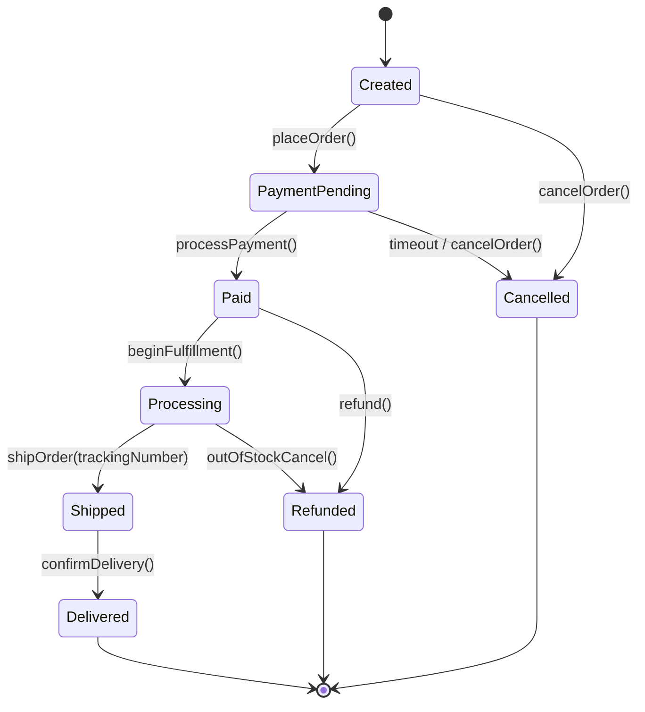

# State Pattern: Production Architecture & Low-Level Design in Java

> **Category:** [Behavioral Design Patterns](./06-behavioral-design-patterns.md) | **Navigation:** [Back to Behavioral Index](./06-behavioral-design-patterns.md) | [Master LLD Index](./00-index.md)

---


### 8.1 Intent, Architecture & Mechanics

The **State Pattern** allows an object to alter its behavior when its internal state changes. The object appears to change its class. Instead of monolithic `switch-case` or `if-else` blocks controlling lifecycle transitions, each state is modeled as an independent class implementing a shared interface.



### 8.2 Production-Grade Java Implementation: E-Commerce Order Lifecycle State Machine

```java
package com.systemdesign.lld.behavioral.state;

/**
 * Universal State Interface defining permissible order lifecycle operations.
 */
public interface OrderState {
    void processPayment(OrderContext context, double amount);
    void cancelOrder(OrderContext context, String reason);
    void beginFulfillment(OrderContext context);
    void shipOrder(OrderContext context, String trackingNumber);
    void confirmDelivery(OrderContext context);
    void refundOrder(OrderContext context);
    String getStateName();
}
```

```java
package com.systemdesign.lld.behavioral.state;

import java.util.Objects;
import java.util.concurrent.atomic.AtomicReference;

/**
 * The Context: Maintains current state atomically and exposes business actions.
 */
public final class OrderContext {
    private final String orderId;
    private final double totalAmount;
    private final AtomicReference<OrderState> currentState;
    private String trackingNumber;

    public OrderContext(String orderId, double totalAmount) {
        this.orderId = Objects.requireNonNull(orderId);
        this.totalAmount = totalAmount;
        this.currentState = new AtomicReference<>(new CreatedState());
    }

    public String getOrderId() { return orderId; }
    public double getTotalAmount() { return totalAmount; }
    public String getTrackingNumber() { return trackingNumber; }
    public void setTrackingNumber(String trackingNumber) { this.trackingNumber = trackingNumber; }

    public void transitionTo(OrderState nextState) {
        OrderState prev = currentState.getAndSet(nextState);
        System.out.printf("[ORDER %s] State Transition: %s ===> %s%n", 
            orderId, prev.getStateName(), nextState.getStateName());
    }

    public OrderState getCurrentState() {
        return currentState.get();
    }

    // Delegated operations
    public void processPayment(double amount) { currentState.get().processPayment(this, amount); }
    public void cancelOrder(String reason) { currentState.get().cancelOrder(this, reason); }
    public void beginFulfillment() { currentState.get().beginFulfillment(this); }
    public void shipOrder(String trackingNumber) { currentState.get().shipOrder(this, trackingNumber); }
    public void confirmDelivery() { currentState.get().confirmDelivery(this); }
    public void refundOrder() { currentState.get().refundOrder(this); }
}
```

```java
package com.systemdesign.lld.behavioral.state;

public final class CreatedState implements OrderState {
    @Override
    public void processPayment(OrderContext context, double amount) {
        if (amount < context.getTotalAmount()) {
            throw new IllegalArgumentException("Insufficient payment amount");
        }
        context.transitionTo(new PaidState());
    }

    @Override
    public void cancelOrder(OrderContext context, String reason) {
        context.transitionTo(new CancelledState(reason));
    }

    @Override
    public void beginFulfillment(OrderContext context) {
        throw new IllegalStateException("Cannot fulfill unpaid order.");
    }

    @Override
    public void shipOrder(OrderContext context, String trackingNumber) {
        throw new IllegalStateException("Cannot ship unpaid order.");
    }

    @Override
    public void confirmDelivery(OrderContext context) {
        throw new IllegalStateException("Order has not been shipped.");
    }

    @Override
    public void refundOrder(OrderContext context) {
        throw new IllegalStateException("Cannot refund unpaid order.");
    }

    @Override
    public String getStateName() { return "CREATED"; }
}
```

```java
package com.systemdesign.lld.behavioral.state;

public final class PaidState implements OrderState {
    @Override
    public void processPayment(OrderContext context, double amount) {
        throw new IllegalStateException("Order is already paid.");
    }

    @Override
    public void cancelOrder(OrderContext context, String reason) {
        context.transitionTo(new RefundedState("Cancelled after payment: " + reason));
    }

    @Override
    public void beginFulfillment(OrderContext context) {
        context.transitionTo(new ProcessingState());
    }

    @Override
    public void shipOrder(OrderContext context, String trackingNumber) {
        throw new IllegalStateException("Order must be packaged in PROCESSING state before shipping.");
    }

    @Override
    public void confirmDelivery(OrderContext context) {
        throw new IllegalStateException("Order not shipped yet.");
    }

    @Override
    public void refundOrder(OrderContext context) {
        context.transitionTo(new RefundedState("Direct customer refund"));
    }

    @Override
    public String getStateName() { return "PAID"; }
}
```

```java
package com.systemdesign.lld.behavioral.state;

public final class ProcessingState implements OrderState {
    @Override
    public void processPayment(OrderContext context, double amount) {
        throw new IllegalStateException("Already paid.");
    }

    @Override
    public void cancelOrder(OrderContext context, String reason) {
        context.transitionTo(new RefundedState("Processing aborted: " + reason));
    }

    @Override
    public void beginFulfillment(OrderContext context) {
        throw new IllegalStateException("Already processing.");
    }

    @Override
    public void shipOrder(OrderContext context, String trackingNumber) {
        context.setTrackingNumber(trackingNumber);
        context.transitionTo(new ShippedState());
    }

    @Override
    public void confirmDelivery(OrderContext context) {
        throw new IllegalStateException("Order is still processing in warehouse.");
    }

    @Override
    public void refundOrder(OrderContext context) {
        context.transitionTo(new RefundedState("Processing refund"));
    }

    @Override
    public String getStateName() { return "PROCESSING"; }
}
```

```java
package com.systemdesign.lld.behavioral.state;

public final class ShippedState implements OrderState {
    @Override
    public void processPayment(OrderContext context, double amount) {
        throw new IllegalStateException("Order already paid and shipped.");
    }

    @Override
    public void cancelOrder(OrderContext context, String reason) {
        throw new IllegalStateException("Cannot cancel order that has already shipped. Must request return.");
    }

    @Override
    public void beginFulfillment(OrderContext context) {
        throw new IllegalStateException("Already fulfilled.");
    }

    @Override
    public void shipOrder(OrderContext context, String trackingNumber) {
        throw new IllegalStateException("Already shipped with tracking: " + context.getTrackingNumber());
    }

    @Override
    public void confirmDelivery(OrderContext context) {
        context.transitionTo(new DeliveredState());
    }

    @Override
    public void refundOrder(OrderContext context) {
        throw new IllegalStateException("Cannot refund in-transit shipment.");
    }

    @Override
    public String getStateName() { return "SHIPPED"; }
}
```

```java
package com.systemdesign.lld.behavioral.state;

public final class DeliveredState implements OrderState {
    @Override
    public void processPayment(OrderContext context, double amount) { throw new IllegalStateException("Delivered."); }
    @Override
    public void cancelOrder(OrderContext context, String reason) { throw new IllegalStateException("Cannot cancel delivered order."); }
    @Override
    public void beginFulfillment(OrderContext context) { throw new IllegalStateException("Delivered."); }
    @Override
    public void shipOrder(OrderContext context, String trackingNumber) { throw new IllegalStateException("Delivered."); }
    @Override
    public void confirmDelivery(OrderContext context) { throw new IllegalStateException("Already delivered."); }
    @Override
    public void refundOrder(OrderContext context) { context.transitionTo(new RefundedState("Return accepted after delivery")); }
    @Override
    public String getStateName() { return "DELIVERED"; }
}
```

```java
package com.systemdesign.lld.behavioral.state;

public final class CancelledState implements OrderState {
    private final String reason;
    public CancelledState(String reason) { this.reason = reason; }

    @Override public void processPayment(OrderContext context, double amount) { throw new IllegalStateException("Order is cancelled: " + reason); }
    @Override public void cancelOrder(OrderContext context, String reason) { throw new IllegalStateException("Order is already cancelled."); }
    @Override public void beginFulfillment(OrderContext context) { throw new IllegalStateException("Order is cancelled."); }
    @Override public void shipOrder(OrderContext context, String trackingNumber) { throw new IllegalStateException("Order is cancelled."); }
    @Override public void confirmDelivery(OrderContext context) { throw new IllegalStateException("Order is cancelled."); }
    @Override public void refundOrder(OrderContext context) { throw new IllegalStateException("Order is cancelled without payment."); }
    @Override public String getStateName() { return "CANCELLED"; }
}
```

```java
package com.systemdesign.lld.behavioral.state;

public final class RefundedState implements OrderState {
    private final String reason;
    public RefundedState(String reason) { this.reason = reason; }

    @Override public void processPayment(OrderContext context, double amount) { throw new IllegalStateException("Order is refunded."); }
    @Override public void cancelOrder(OrderContext context, String reason) { throw new IllegalStateException("Order is refunded."); }
    @Override public void beginFulfillment(OrderContext context) { throw new IllegalStateException("Order is refunded."); }
    @Override public void shipOrder(OrderContext context, String trackingNumber) { throw new IllegalStateException("Order is refunded."); }
    @Override public void confirmDelivery(OrderContext context) { throw new IllegalStateException("Order is refunded."); }
    @Override public void refundOrder(OrderContext context) { throw new IllegalStateException("Already refunded: " + reason); }
    @Override public String getStateName() { return "REFUNDED"; }
}
```

```java
package com.systemdesign.lld.behavioral.state;

public class StatePatternDemo {
    public static void main(String[] args) {
        OrderContext order = new OrderContext("ORD-90210", 150.00);

        System.out.println("=== 1. Valid Lifecycle Transitions ===");
        order.processPayment(150.00);
        order.beginFulfillment();
        order.shipOrder("FEDEX-TRACK-7890");
        order.confirmDelivery();

        System.out.println("\n=== 2. Invalid Transition Defense ===");
        try {
            order.cancelOrder("Customer changed mind");
        } catch (IllegalStateException e) {
            System.out.println("Blocked illegal transition: " + e.getMessage());
        }
    }
}
```

### 8.3 State vs Strategy Pattern Comparison

While State and Strategy share nearly identical class diagrams (Context delegating to an interface), their **intents and lifecycles** differ fundamentally:

| Dimension | State Pattern | Strategy Pattern |
| :--- | :--- | :--- |
| **Intent** | Model lifecycle transitions where behavior shifts dynamically in response to state mutations. | Select interchangeable algorithmic variations independently of state. |
| **Awareness of Peers** | Concrete State classes know about other States and explicitly trigger transitions (`context.transitionTo(new PaidState())`). | Concrete Strategies are completely oblivious to each other; selected and swapped externally by the client. |
| **Mutation Rate** | Swapped continuously during an object's operational lifecycle. | Frequently configured once at instantiation or swapped infrequently at runtime. |
| **Exceptions** | Invalid actions throw domain exceptions (`IllegalStateException`). | Irrelevant; any valid strategy performs the contract. |

---

---

## Navigation & Related Patterns
* [Back to Behavioral Patterns Index](./06-behavioral-design-patterns.md)
* [Master LLD Index](./00-index.md)
* [Previous: 06-07-observer-pattern.md](./06-07-observer-pattern.md)
* [Next: 06-09-strategy-pattern.md](./06-09-strategy-pattern.md)
