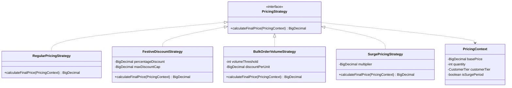

# Strategy Pattern: Production Architecture & Low-Level Design in Java

> **Category:** [Behavioral Design Patterns](./06-behavioral-design-patterns.md) | **Navigation:** [Back to Behavioral Index](./06-behavioral-design-patterns.md) | [Master LLD Index](./00-index.md)

---


### 9.1 Intent, Architecture & Mechanics

The **Strategy Pattern** defines a family of algorithms, encapsulates each one, and makes them interchangeable. Strategy lets the algorithm vary independently of the clients that use it.



### 9.2 Production-Grade Java Implementation: Dynamic E-Commerce Pricing Engine

```java
package com.systemdesign.lld.behavioral.strategy;

import java.math.BigDecimal;
import java.util.Objects;

public enum CustomerTier {
    STANDARD,
    SILVER,
    GOLD,
    PLATINUM
}
```

```java
package com.systemdesign.lld.behavioral.strategy;

import java.math.BigDecimal;
import java.util.Objects;

/**
 * Parameter Context passed into pricing algorithms.
 */
public final class PricingContext {
    private final BigDecimal unitPrice;
    private final int quantity;
    private final CustomerTier customerTier;
    private final boolean rushHour;

    public PricingContext(BigDecimal unitPrice, int quantity, CustomerTier customerTier, boolean rushHour) {
        this.unitPrice = Objects.requireNonNull(unitPrice);
        this.quantity = quantity;
        this.customerTier = Objects.requireNonNull(customerTier);
        this.rushHour = rushHour;
    }

    public BigDecimal getUnitPrice() { return unitPrice; }
    public int getQuantity() { return quantity; }
    public CustomerTier getCustomerTier() { return customerTier; }
    public boolean isRushHour() { return rushHour; }

    public BigDecimal getRawSubtotal() {
        return unitPrice.multiply(BigDecimal.valueOf(quantity));
    }
}
```

```java
package com.systemdesign.lld.behavioral.strategy;

import java.math.BigDecimal;

/**
 * Strategy Interface. Functional Interface enabling lambda expressions.
 */
@FunctionalInterface
public interface PricingStrategy {
    BigDecimal calculateTotal(PricingContext context);
}
```

```java
package com.systemdesign.lld.behavioral.strategy;

import java.math.BigDecimal;

/**
 * Standard baseline pricing: unitPrice * quantity.
 */
public final class RegularPricingStrategy implements PricingStrategy {
    @Override
    public BigDecimal calculateTotal(PricingContext context) {
        return context.getRawSubtotal();
    }
}
```

```java
package com.systemdesign.lld.behavioral.strategy;

import java.math.BigDecimal;
import java.math.RoundingMode;

/**
 * Festive Discount: Percentage reduction with maximum cap.
 */
public final class FestiveDiscountStrategy implements PricingStrategy {
    private final BigDecimal discountPercent;
    private final BigDecimal maxCap;

    public FestiveDiscountStrategy(BigDecimal discountPercent, BigDecimal maxCap) {
        this.discountPercent = discountPercent;
        this.maxCap = maxCap;
    }

    @Override
    public BigDecimal calculateTotal(PricingContext context) {
        BigDecimal subtotal = context.getRawSubtotal();
        BigDecimal discount = subtotal.multiply(discountPercent).divide(BigDecimal.valueOf(100), 2, RoundingMode.HALF_UP);
        if (discount.compareTo(maxCap) > 0) {
            discount = maxCap;
        }
        return subtotal.subtract(discount);
    }
}
```

```java
package com.systemdesign.lld.behavioral.strategy;

import java.math.BigDecimal;

/**
 * Bulk Volume Tier: Discounts applied when purchasing above threshold volume.
 */
public final class BulkOrderVolumeStrategy implements PricingStrategy {
    private final int minimumUnits;
    private final BigDecimal perUnitDiscount;

    public BulkOrderVolumeStrategy(int minimumUnits, BigDecimal perUnitDiscount) {
        this.minimumUnits = minimumUnits;
        this.perUnitDiscount = perUnitDiscount;
    }

    @Override
    public BigDecimal calculateTotal(PricingContext context) {
        BigDecimal subtotal = context.getRawSubtotal();
        if (context.getQuantity() >= minimumUnits) {
            BigDecimal totalDiscount = perUnitDiscount.multiply(BigDecimal.valueOf(context.getQuantity()));
            return subtotal.subtract(totalDiscount);
        }
        return subtotal;
    }
}
```

```java
package com.systemdesign.lld.behavioral.strategy;

import java.math.BigDecimal;
import java.math.RoundingMode;

/**
 * Surge Pricing: Demand-based multiplier during peak hours.
 */
public final class SurgePricingStrategy implements PricingStrategy {
    private final BigDecimal multiplier;

    public SurgePricingStrategy(BigDecimal multiplier) {
        this.multiplier = multiplier;
    }

    @Override
    public BigDecimal calculateTotal(PricingContext context) {
        BigDecimal subtotal = context.getRawSubtotal();
        if (context.isRushHour()) {
            return subtotal.multiply(multiplier).setScale(2, RoundingMode.HALF_UP);
        }
        return subtotal;
    }
}
```

```java
package com.systemdesign.lld.behavioral.strategy;

import java.math.BigDecimal;
import java.util.Objects;

/**
 * Checkout service orchestrating runtime strategy execution.
 */
public final class CheckoutService {
    private PricingStrategy pricingStrategy;

    public CheckoutService(PricingStrategy initialStrategy) {
        this.pricingStrategy = Objects.requireNonNull(initialStrategy);
    }

    public void setPricingStrategy(PricingStrategy pricingStrategy) {
        this.pricingStrategy = Objects.requireNonNull(pricingStrategy);
    }

    public BigDecimal checkout(PricingContext context) {
        return pricingStrategy.calculateTotal(context);
    }
}
```

```java
package com.systemdesign.lld.behavioral.strategy;

import java.math.BigDecimal;

public class StrategyPatternDemo {
    public static void main(String[] args) {
        PricingContext bulkContext = new PricingContext(new BigDecimal("100.00"), 50, CustomerTier.GOLD, false);
        PricingContext rushContext = new PricingContext(new BigDecimal("20.00"), 1, CustomerTier.STANDARD, true);

        CheckoutService checkout = new CheckoutService(new RegularPricingStrategy());
        System.out.println("Regular Subtotal (50 @ $100): $" + checkout.checkout(bulkContext));

        checkout.setPricingStrategy(new FestiveDiscountStrategy(new BigDecimal("20.00"), new BigDecimal("500.00")));
        System.out.println("Festive Discounted Total (20% capped at $500): $" + checkout.checkout(bulkContext));

        checkout.setPricingStrategy(new BulkOrderVolumeStrategy(20, new BigDecimal("15.00")));
        System.out.println("Bulk Volume Discounted Total ($15 off/unit): $" + checkout.checkout(bulkContext));

        checkout.setPricingStrategy(new SurgePricingStrategy(new BigDecimal("1.50")));
        System.out.println("Surge Rush-Hour Total ($20 * 1.5x): $" + checkout.checkout(rushContext));

        // Modern Java Idiom: In-line Lambda Strategy
        checkout.setPricingStrategy(ctx -> {
            BigDecimal subtotal = ctx.getRawSubtotal();
            return ctx.getCustomerTier() == CustomerTier.GOLD 
                ? subtotal.multiply(new BigDecimal("0.70")) // 30% Gold VIP discount
                : subtotal;
        });
        System.out.println("Lambda VIP Strategy Total: $" + checkout.checkout(bulkContext));
    }
}
```

### 9.3 Modern Functional Java Idioms
Because `PricingStrategy` contains exactly one abstract method, it qualifies as a `@FunctionalInterface`. In modern Java 8+, developers eliminate verbose boilerplate classes by passing lambdas (`ctx -> ctx.getRawSubtotal().multiply(...)`) or method references (`TaxEngine::computeExportVAT`) directly into contexts.

---

---

## Navigation & Related Patterns
* [Back to Behavioral Patterns Index](./06-behavioral-design-patterns.md)
* [Master LLD Index](./00-index.md)
* [Previous: 06-08-state-pattern.md](./06-08-state-pattern.md)
* [Next: 06-10-template-method-pattern.md](./06-10-template-method-pattern.md)
