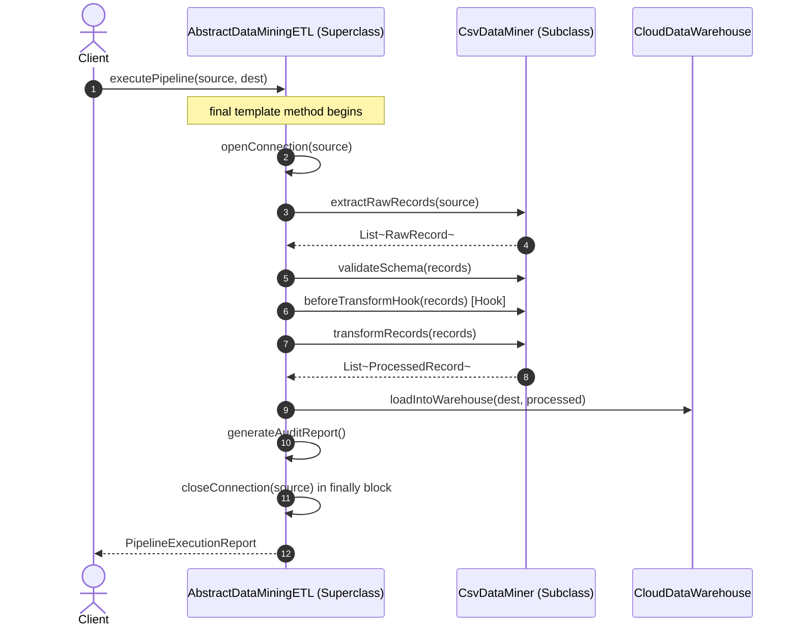

# Template Method Pattern: Production Architecture & Low-Level Design in Java

> **Category:** [Behavioral Design Patterns](./06-behavioral-design-patterns.md) | **Navigation:** [Back to Behavioral Index](./06-behavioral-design-patterns.md) | [Master LLD Index](./00-index.md)

---


### 10.1 Intent, Architecture & Mechanics

The **Template Method Pattern** defines the invariant skeleton of an algorithm in a base class, deferring some steps to subclasses without altering the algorithm's overarching structure.

It strictly implements the **Hollywood Principle**: *"Don't call us, we'll call you."* The superclass calls operations in a subclass, not the other way around.



### 10.2 Production-Grade Java Implementation: Enterprise ETL Data Mining Pipeline

```java
package com.systemdesign.lld.behavioral.templatemethod;

import java.util.List;
import java.util.Objects;

public final class RawDataRecord {
    private final String id;
    private final String payload;

    public RawDataRecord(String id, String payload) {
        this.id = id;
        this.payload = payload;
    }

    public String getId() { return id; }
    public String getPayload() { return payload; }
}
```

```java
package com.systemdesign.lld.behavioral.templatemethod;

public final class TransformedRecord {
    private final String id;
    private final String cleanData;
    private final long checksum;

    public TransformedRecord(String id, String cleanData, long checksum) {
        this.id = id;
        this.cleanData = cleanData;
        this.checksum = checksum;
    }

    @Override
    public String toString() {
        return String.format("[ID=%s, Data='%s', CRC=%d]", id, cleanData, checksum);
    }
}
```

```java
package com.systemdesign.lld.behavioral.templatemethod;

import java.time.Duration;
import java.time.Instant;
import java.util.List;
import java.util.Objects;

/**
 * Abstract Base Class defining the invariant ETL template algorithm.
 */
public abstract class AbstractDataMiningPipeline {

    /**
     * The Template Method. Marked final to prohibit subclasses from altering flow.
     */
    public final void executePipeline(String sourceUri, String destinationTable) {
        Instant start = Instant.now();
        System.out.println(">>> Starting ETL Pipeline for: " + sourceUri);

        try {
            connectToSource(sourceUri);
            List<RawDataRecord> rawRecords = extractRawData(sourceUri);
            validateSchema(rawRecords);

            // Optional Hook step
            if (isSanitizationEnabled()) {
                rawRecords = sanitizeData(rawRecords);
            }

            List<TransformedRecord> transformed = transformData(rawRecords);
            loadToDestination(destinationTable, transformed);

            Duration duration = Duration.between(start, Instant.now());
            generateAuditMetrics(rawRecords.size(), transformed.size(), duration);
        } catch (Exception e) {
            handlePipelineFailure(sourceUri, e);
            throw new RuntimeException("ETL Pipeline failed for source: " + sourceUri, e);
        } finally {
            disconnectFromSource(sourceUri);
        }
    }

    // Invariant step 1: Connection establishment
    private void connectToSource(String source) {
        System.out.println("[ETL Invariant] Establishing secure TLS socket to: " + source);
    }

    // Invariant step 2: Connection teardown
    private void disconnectFromSource(String source) {
        System.out.println("[ETL Invariant] Gracefully closed connection to: " + source);
    }

    // Abstract primitive step: Subclasses must extract data
    protected abstract List<RawDataRecord> extractRawData(String sourceUri);

    // Abstract primitive step: Subclasses must validate format
    protected abstract void validateSchema(List<RawDataRecord> records);

    // Abstract primitive step: Subclasses must transform domain structures
    protected abstract List<TransformedRecord> transformData(List<RawDataRecord> raw);

    // Abstract primitive step: Subclasses load to target database
    protected abstract void loadToDestination(String destinationTable, List<TransformedRecord> records);

    // Hook Method: Default implementation provides no-op or default behavior
    protected boolean isSanitizationEnabled() {
        return true;
    }

    // Hook Method: Subclasses can override for custom sanitization
    protected List<RawDataRecord> sanitizeData(List<RawDataRecord> raw) {
        return raw; // Default no-op
    }

    // Concrete base step
    private void generateAuditMetrics(int rawCount, int transformedCount, Duration duration) {
        System.out.printf("[ETL Audit] Completed in %d ms. Ingested: %d, Loaded: %d%n",
            duration.toMillis(), rawCount, transformedCount);
    }

    // Concrete error handling step
    private void handlePipelineFailure(String source, Exception e) {
        System.err.printf("[ETL Failure] Alert emitted to PagerDuty for source %s. Error: %s%n",
            source, e.getMessage());
    }
}
```

```java
package com.systemdesign.lld.behavioral.templatemethod;

import java.util.ArrayList;
import java.util.List;

/**
 * Concrete Implementation for CSV files.
 */
public final class CsvDataMiningPipeline extends AbstractDataMiningPipeline {
    @Override
    protected List<RawDataRecord> extractRawData(String sourceUri) {
        System.out.println("[CSV Miner] Parsing comma-separated lines from: " + sourceUri);
        return List.of(
            new RawDataRecord("1", "AAPL,150.25,BUY"),
            new RawDataRecord("2", "GOOG,2800.50,SELL")
        );
    }

    @Override
    protected void validateSchema(List<RawDataRecord> records) {
        System.out.println("[CSV Miner] Validating CSV column count and header consistency.");
    }

    @Override
    protected List<TransformedRecord> transformData(List<RawDataRecord> raw) {
        List<TransformedRecord> list = new ArrayList<>();
        for (RawDataRecord r : raw) {
            String[] tokens = r.getPayload().split(",");
            String formatted = String.format("Ticker=%s | Price=$%s | Action=%s", tokens[0], tokens[1], tokens[2]);
            list.add(new TransformedRecord(r.getId(), formatted, formatted.hashCode()));
        }
        return list;
    }

    @Override
    protected void loadToDestination(String destinationTable, List<TransformedRecord> records) {
        System.out.printf("[CSV Miner] Appending %d records into PostgreSQL table: %s%n", 
            records.size(), destinationTable);
    }
}
```

```java
package com.systemdesign.lld.behavioral.templatemethod;

import java.util.ArrayList;
import java.util.List;

/**
 * Concrete Implementation for JSON REST APIs.
 */
public final class JsonRestApiDataMiningPipeline extends AbstractDataMiningPipeline {
    @Override
    protected List<RawDataRecord> extractRawData(String sourceUri) {
        System.out.println("[JSON Miner] Executing HTTP GET and deserializing JSON array from: " + sourceUri);
        return List.of(
            new RawDataRecord("101", "{\"symbol\": \"BTC\", \"usd\": 65000}"),
            new RawDataRecord("102", "{\"symbol\": \"ETH\", \"usd\": 3500}")
        );
    }

    @Override
    protected void validateSchema(List<RawDataRecord> records) {
        System.out.println("[JSON Miner] Validating payload against JSON Schema draft-07.");
    }

    @Override
    protected List<TransformedRecord> transformData(List<RawDataRecord> raw) {
        List<TransformedRecord> list = new ArrayList<>();
        for (RawDataRecord r : raw) {
            String clean = r.getPayload().replace("\"", "");
            list.add(new TransformedRecord(r.getId(), clean, clean.hashCode()));
        }
        return list;
    }

    @Override
    protected void loadToDestination(String destinationTable, List<TransformedRecord> records) {
        System.out.printf("[JSON Miner] Bulk upserting %d records into ClickHouse table: %s%n", 
            records.size(), destinationTable);
    }
}
```

```java
package com.systemdesign.lld.behavioral.templatemethod;

public class TemplateMethodDemo {
    public static void main(String[] args) {
        System.out.println("=== 1. Execute CSV ETL Pipeline ===");
        AbstractDataMiningPipeline csvPipeline = new CsvDataMiningPipeline();
        csvPipeline.executePipeline("s3://bucket/financials/q3_trades.csv", "fact_trades");

        System.out.println("\n=== 2. Execute JSON REST ETL Pipeline ===");
        AbstractDataMiningPipeline jsonPipeline = new JsonRestApiDataMiningPipeline();
        jsonPipeline.executePipeline("https://api.binance.com/v3/ticker/price", "fact_crypto_prices");
    }
}
```

### 10.3 Template Method vs Strategy Pattern

| Criteria | Template Method Pattern | Strategy Pattern |
| :--- | :--- | :--- |
| **Mechanism** | **Class Inheritance** (Compile-time subclassing). | **Object Composition** (Runtime object delegation). |
| **Code Invariance** | Base class controls the invariant skeleton; subclasses customize specific steps. | Algorithm is replaced in its entirety as a cohesive unit. |
| **Coupling** | Tightly coupled to parent class hierarchy (super calls, base class assumptions). | Loosely coupled; strategy communicates solely through public interfaces. |
| **Flexibility** | Static; cannot switch algorithms dynamically at runtime for the same instance. | Dynamic; client can swap strategies on the fly via setter injection. |

---

---

## Navigation & Related Patterns
* [Back to Behavioral Patterns Index](./06-behavioral-design-patterns.md)
* [Master LLD Index](./00-index.md)
* [Previous: 06-09-strategy-pattern.md](./06-09-strategy-pattern.md)
* [Next: 06-11-visitor-pattern.md](./06-11-visitor-pattern.md)
