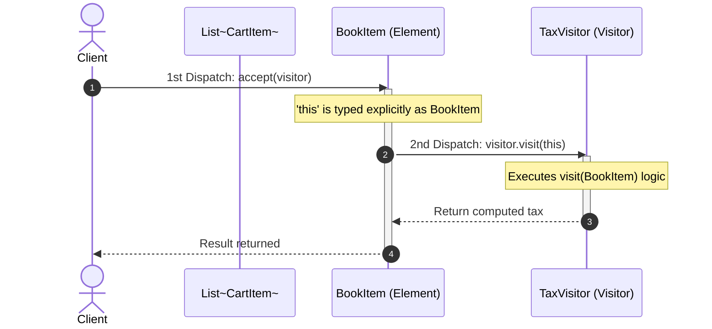

# Visitor Pattern: Production Architecture & Low-Level Design in Java

> **Category:** [Behavioral Design Patterns](./06-behavioral-design-patterns.md) | **Navigation:** [Back to Behavioral Index](./06-behavioral-design-patterns.md) | [Master LLD Index](./00-index.md)

---


### 11.1 Intent, Architecture & Mechanics

The **Visitor Pattern** represents an operation to be performed on elements of an object structure. It lets you define a new operation without changing the classes of the elements on which it operates.

### The Double Dispatch Mechanism in Java
Standard Java uses **Single Dynamic Dispatch**: when you call `receiver.method(argument)`, the JVM selects which concrete method to execute based solely on the runtime type of the `receiver`. The argument's type is resolved **statically at compile time**.

Because of single dispatch, polymorphic method overloading (`visitor.visit(item)`) fails if you pass an interface reference (`CartItem item`). The compiler cannot know which overloaded method to invoke.

The Visitor pattern solves this via **Double Dispatch**:
1. **First Dispatch**: The client calls `element.accept(visitor)`. The JVM dynamically resolves the concrete `element` subclass at runtime.
2. **Second Dispatch**: Inside `accept(visitor)`, the element calls `visitor.visit(this)`. Because `this` is explicitly typed to the concrete element subclass, the compiler binds to the precise overloaded `visit(...)` method on the visitor!



### 11.2 Production-Grade Java Implementation: E-Commerce Shopping Cart System

```java
package com.systemdesign.lld.behavioral.visitor;

import java.math.BigDecimal;

/**
 * Visitor Interface defining overloaded visit operations for every concrete element.
 */
public interface CartVisitor {
    void visit(BookItem book);
    void visit(ElectronicItem electronic);
    void visit(GroceryItem grocery);
}
```

```java
package com.systemdesign.lld.behavioral.visitor;

/**
 * Element Interface defining the acceptance entrypoint for double dispatch.
 */
public interface CartItem {
    void accept(CartVisitor visitor);
}
```

```java
package com.systemdesign.lld.behavioral.visitor;

import java.math.BigDecimal;
import java.util.Objects;

public final class BookItem implements CartItem {
    private final String isbn;
    private final String title;
    private final BigDecimal price;
    private final double weightKg;

    public BookItem(String isbn, String title, BigDecimal price, double weightKg) {
        this.isbn = Objects.requireNonNull(isbn);
        this.title = Objects.requireNonNull(title);
        this.price = Objects.requireNonNull(price);
        this.weightKg = weightKg;
    }

    public String getIsbn() { return isbn; }
    public String getTitle() { return title; }
    public BigDecimal getPrice() { return price; }
    public double getWeightKg() { return weightKg; }

    @Override
    public void accept(CartVisitor visitor) {
        // Double Dispatch Hook: 'this' binds to visit(BookItem) at compile time!
        visitor.visit(this);
    }
}
```

```java
package com.systemdesign.lld.behavioral.visitor;

import java.math.BigDecimal;
import java.util.Objects;

public final class ElectronicItem implements CartItem {
    private final String sku;
    private final String brand;
    private final BigDecimal price;
    private final double weightKg;
    private final boolean containsLithiumBattery;

    public ElectronicItem(String sku, String brand, BigDecimal price, double weightKg, boolean containsLithiumBattery) {
        this.sku = Objects.requireNonNull(sku);
        this.brand = Objects.requireNonNull(brand);
        this.price = Objects.requireNonNull(price);
        this.weightKg = weightKg;
        this.containsLithiumBattery = containsLithiumBattery;
    }

    public String getSku() { return sku; }
    public String getBrand() { return brand; }
    public BigDecimal getPrice() { return price; }
    public double getWeightKg() { return weightKg; }
    public boolean isContainsLithiumBattery() { return containsLithiumBattery; }

    @Override
    public void accept(CartVisitor visitor) {
        visitor.visit(this);
    }
}
```

```java
package com.systemdesign.lld.behavioral.visitor;

import java.math.BigDecimal;
import java.util.Objects;

public final class GroceryItem implements CartItem {
    private final String name;
    private final BigDecimal price;
    private final double weightKg;
    private final boolean perishable;

    public GroceryItem(String name, BigDecimal price, double weightKg, boolean perishable) {
        this.name = Objects.requireNonNull(name);
        this.price = Objects.requireNonNull(price);
        this.weightKg = weightKg;
        this.perishable = perishable;
    }

    public String getName() { return name; }
    public BigDecimal getPrice() { return price; }
    public double getWeightKg() { return weightKg; }
    public boolean isPerishable() { return perishable; }

    @Override
    public void accept(CartVisitor visitor) {
        visitor.visit(this);
    }
}
```

```java
package com.systemdesign.lld.behavioral.visitor;

import java.math.BigDecimal;
import java.math.RoundingMode;

/**
 * Concrete Visitor 1: Calculates localized taxation per category.
 */
public final class TaxCalculationVisitor implements CartVisitor {
    private BigDecimal totalTax = BigDecimal.ZERO;

    public BigDecimal getTotalTax() {
        return totalTax.setScale(2, RoundingMode.HALF_UP);
    }

    @Override
    public void visit(BookItem book) {
        // Books enjoy educational tax exemption (0% or 5% reduced VAT)
        BigDecimal tax = book.getPrice().multiply(new BigDecimal("0.05"));
        totalTax = totalTax.add(tax);
    }

    @Override
    public void visit(ElectronicItem electronic) {
        // Luxury standard electronics tax (18%)
        BigDecimal tax = electronic.getPrice().multiply(new BigDecimal("0.18"));
        totalTax = totalTax.add(tax);
    }

    @Override
    public void visit(GroceryItem grocery) {
        // Essential food items are completely tax exempt
        if (!grocery.isPerishable()) {
            BigDecimal tax = grocery.getPrice().multiply(new BigDecimal("0.02"));
            totalTax = totalTax.add(tax);
        }
    }
}
```

```java
package com.systemdesign.lld.behavioral.visitor;

import java.math.BigDecimal;

/**
 * Concrete Visitor 2: Calculates shipping costs based on weight and hazardous material constraints.
 */
public final class ShippingCostVisitor implements CartVisitor {
    private BigDecimal totalShippingCost = BigDecimal.ZERO;

    public BigDecimal getTotalShippingCost() {
        return totalShippingCost;
    }

    @Override
    public void visit(BookItem book) {
        // Standard media rate: $1.50 per kg
        BigDecimal cost = BigDecimal.valueOf(book.getWeightKg()).multiply(new BigDecimal("1.50"));
        totalShippingCost = totalShippingCost.add(cost);
    }

    @Override
    public void visit(ElectronicItem electronic) {
        // Fragile electronics + hazardous materials surcharge for batteries
        BigDecimal cost = BigDecimal.valueOf(electronic.getWeightKg()).multiply(new BigDecimal("3.00"));
        if (electronic.isContainsLithiumBattery()) {
            cost = cost.add(new BigDecimal("10.00")); // Battery handling fee
        }
        totalShippingCost = totalShippingCost.add(cost);
    }

    @Override
    public void visit(GroceryItem grocery) {
        // Perishables require refrigerated cold-chain courier
        BigDecimal cost = BigDecimal.valueOf(grocery.getWeightKg()).multiply(new BigDecimal("2.00"));
        if (grocery.isPerishable()) {
            cost = cost.add(new BigDecimal("15.00")); // Cold pack fee
        }
        totalShippingCost = totalShippingCost.add(cost);
    }
}
```

```java
package com.systemdesign.lld.behavioral.visitor;

import java.math.BigDecimal;
import java.util.List;

public class VisitorPatternDemo {
    public static void main(String[] args) {
        List<CartItem> cart = List.of(
            new BookItem("978-0134685991", "Effective Java", new BigDecimal("45.00"), 0.8),
            new ElectronicItem("SKU-LAPTOP-1", "MacBook Pro", new BigDecimal("2499.00"), 2.1, true),
            new GroceryItem("Organic Fresh Milk", new BigDecimal("4.50"), 1.0, true)
        );

        System.out.println("=== 1. Pass 1: Tax Calculation Visitor ===");
        TaxCalculationVisitor taxVisitor = new TaxCalculationVisitor();
        for (CartItem item : cart) {
            item.accept(taxVisitor);
        }
        System.out.println("Total Sales Tax Due: $" + taxVisitor.getTotalTax());

        System.out.println("\n=== 2. Pass 2: Shipping Logistics Visitor ===");
        ShippingCostVisitor shippingVisitor = new ShippingCostVisitor();
        for (CartItem item : cart) {
            item.accept(shippingVisitor);
        }
        System.out.println("Total Shipping Cost: $" + shippingVisitor.getTotalShippingCost());
    }
}
```

### 11.3 Visitor Pattern Architectural Trade-Offs

The Visitor pattern represents a major architectural choice governed by the **Expression Problem**:

```
                       ┌────────────────────────────────────────────────────────┐
                       │          The Visitor Pattern Trade-off Matrix          │
                       └────────────────────────────────────────────────────────┘
                       
           Axis: Adding New Operations (Visitors) 
                 vs. Adding New Element Classes
                 
    Adding New Operations                      Adding New Concrete Elements
    (TaxVisitor, ShippingVisitor,               (e.g., FurnitureItem, ClothingItem)
     DiscountVisitor, ExportVisitor)
    
    [+] EXTREMELY EASY                         [-] EXTREMELY HARD & COSTLY
    Simply create a new class implementing     Requires updating the CartVisitor interface,
    CartVisitor. Zero modifications to         forcing recompilation and edits across EVERY
    existing Element classes!                  existing concrete visitor class in the system.
    (Open/Closed Principle satisfied)          (Open/Closed Principle severely violated)
```

> [!IMPORTANT]
> **When to Use Visitor**: Use Visitor when the object structure's class hierarchy is **stable and rarely changes**, but you frequently need to define new operations over the structure (e.g., Compilers/ASTs, Document Object Models, Static Analysis tools). If the element hierarchy changes frequently, avoid Visitor.

---

---

## Navigation & Related Patterns
* [Back to Behavioral Patterns Index](./06-behavioral-design-patterns.md)
* [Master LLD Index](./00-index.md)
* [Previous: 06-10-template-method-pattern.md](./06-10-template-method-pattern.md)
