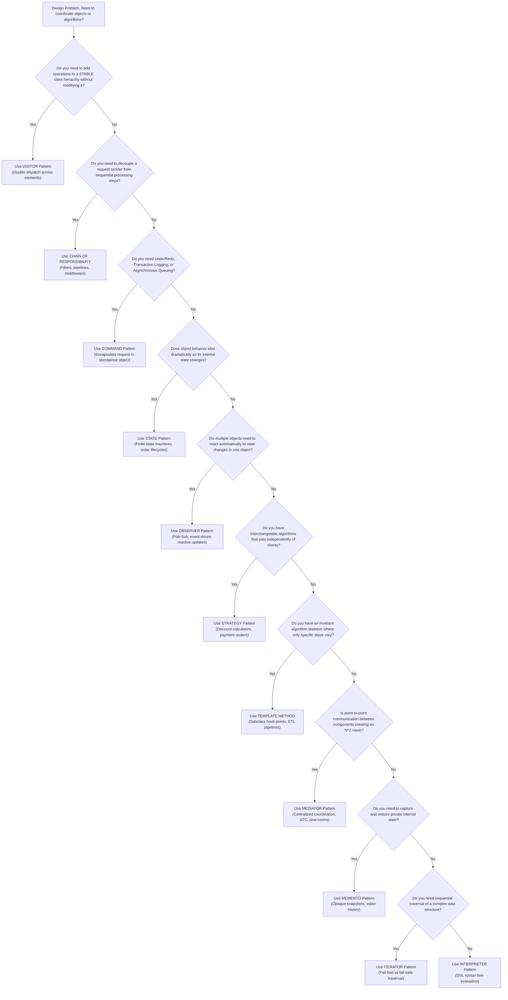

# Behavioral Design Patterns: Architecture, Concurrency, and Production Implementations in Java

Behavioral design patterns characterize the ways in which classes and objects interact and distribute responsibility. Rather than focusing on how objects are instantiated (**Creational Patterns**) or how classes and objects are composed into larger structures (**Structural Patterns**), behavioral patterns concentrate on the **algorithms, message dispatch mechanisms, control flow orchestration, and state coordination** that govern an enterprise system.

In modern multi-threaded Java architectures, behavioral patterns solve fundamental low-level design challenges:
1. **Decoupling message producers from consumers** without introducing brittle point-to-point bindings.
2. **Encapsulating mutating business transactions** to provide complete undo/redo capabilities, asynchronous queuing, and fault tolerance.
3. **Managing distributed or local object lifecycles** with explicit state machines that prevent illegal state transitions under high concurrency.
4. **Isolating algorithmic variability** behind swappable strategy abstractions to adhere strictly to the Open/Closed Principle.
5. **Decoupling complex multi-party interactions** to eliminate $O(N^2)$ communication topologies in distributed components.

---

## Behavioral Patterns Master Taxonomy

Behavioral patterns operate at two primary levels of abstraction: **Class Behavioral Patterns** (leveraging inheritance to distribute behavior across subclasses) and **Object Behavioral Patterns** (leveraging object composition, encapsulation, and delegation).

```
                             ┌─────────────────────────────────────────┐
                             │       Behavioral Design Patterns        │
                             └────────────────────┬────────────────────┘
                                                  │
                ┌─────────────────────────────────┴─────────────────────────────────┐
                ▼                                                                   ▼
    ┌─────────────────────────┐                                         ┌─────────────────────────┐
    │ Class Behavioral Scope  │                                         │ Object Behavioral Scope │
    │ (Inheritance-Centric)   │                                         │ (Composition & Pointers)│
    └───────────┬─────────────┘                                         └───────────┬─────────────┘
                │                                                                   │
    ┌───────────┴─────────────┐             ┌───────────────────────────────────────┼───────────────────────────────────────┐
    │ 1. Template Method      │             │                                       │                                       │
    │ 2. Interpreter          │             ▼                                       ▼                                       ▼
    └─────────────────────────┘   ┌───────────────────┐                   ┌───────────────────┐                   ┌───────────────────┐
                                  │ Request & Command │                   │  State & Control  │                   │   Data Traversal  │
                                  │    Processing     │                   │    Coordination   │                   │    & Extension    │
                                  └─────────┬─────────┘                   └─────────┬─────────┘                   └─────────┬─────────┘
                                            │                                       │                                       │
                          ┌─────────────────┴─────────────────┐       ┌─────────────┴─────────────────┐       ┌─────────────┴─────────────┐
                          │ • Chain of Responsibility         │       │ • State                       │       │ • Iterator                │
                          │ • Command                         │       │ • Observer                    │       │ • Visitor                 │
                          │ • Strategy                        │       │ • Mediator                    │       └───────────────────────────┘
                          └───────────────────────────────────┘       │ • Memento                     │
                                                                      └───────────────────────────────┘
```

| Pattern | Scope | Primary Intent | Key Java Concurrency / JMM Dimension | Common JDK / Spring Reference |
| :--- | :--- | :--- | :--- | :--- |
| **Chain of Responsibility** | Object | Pass requests along a dynamic chain of handlers until one or more process it. | Thread-safe stateless handlers, thread-local request contexts. | `javax.servlet.Filter`, Spring `SecurityFilterChain` |
| **Command** | Object | Encapsulate request, arguments, and receiver execution into standalone objects. | Thread-safe queues (`BlockingQueue`), asynchronous execution, atomic undo/redo stacks. | `java.lang.Runnable`, `java.util.concurrent.Callable` |
| **Interpreter** | Class | Define grammar representation and recursive evaluator for domain-specific languages. | Immutable AST nodes, thread-safe evaluation contexts (`ConcurrentHashMap`). | `java.text.Format`, Spring Expression Language (`SpEL`) |
| **Iterator** | Object | Access elements of aggregate sequentially without exposing underlying representation. | Fail-Fast (`modCount` race conditions) vs Fail-Safe/Fail-Weak concurrent snapshots. | `java.util.Iterator`, `java.util.Spliterator` |
| **Mediator** | Object | Centralize complex communications and control flow between loosely coupled colleagues. | Fine-grained reentrant locks, serialized message channels, deadlock prevention. | `java.util.concurrent.ExecutorService`, Spring `ApplicationContext` |
| **Memento** | Object | Capture and externalize an object's internal state without breaking encapsulation. | Immutable snapshot objects, copy-on-write memory optimization, volatile snapshot pointers. | `java.io.Serializable`, Spring WebFlow State Management |
| **Observer** | Object | One-to-many publish-subscribe dependency where state change triggers notifications. | `CopyOnWriteArrayList` subscriber registry, non-blocking asynchronous dispatch, weak references. | `java.util.concurrent.Flow`, Spring Application Events |
| **State** | Object | Alter an object's behavior when internal state changes; simulates dynamic class switching. | Atomic state references (`AtomicReference`), CAS transition loops, race-free state transitions. | Spring StateMachine, JPA Entity Lifecycle states |
| **Strategy** | Object | Define a family of interchangeable algorithms selected dynamically at runtime. | Stateless functional strategies, lambda expressions, thread-safe strategy registries. | `java.util.Comparator`, Spring `Resource` abstraction |
| **Template Method** | Class | Define the invariant skeleton of an algorithm in a base class, deferring steps to subclasses. | Subclass hook synchronization, thread-safe template execution methods (`final`). | `java.util.AbstractList`, Spring `JdbcTemplate` |
| **Visitor** | Object | Add new operations to existing heterogeneous object hierarchies without modifying them. | Double dispatch mechanism, thread-safe traversal over immutable composite models. | `java.nio.file.FileVisitor`, ASM bytecode `ClassVisitor` |

---

## Behavioral Design Patterns Catalog

Explore the detailed architectural guides, Java 21 implementations, and thread-safety analyses for each behavioral pattern:

| # | Pattern | Key Intent & Production Mechanism | Deep-Dive Guide |
| :--- | :--- | :--- | :--- |
| **1** | **Chain of Responsibility** | Decouples sender and receivers by chaining handlers along a pipeline; API request filter with lock-free sliding window rate limiter. | [`06-01-chain-of-responsibility-pattern.md`](./06-01-chain-of-responsibility-pattern.md) |
| **2** | **Command** | Encapsulates requests as standalone objects with parameters; transactional in-memory DB with bounded undo/redo stack and async worker queue. | [`06-02-command-pattern.md`](./06-02-command-pattern.md) |
| **3** | **Interpreter** | Represents and evaluates grammar for domain-specific languages; custom Lexer, AST, and recursive descent parser evaluating SQL WHERE clauses. | [`06-03-interpreter-pattern.md`](./06-03-interpreter-pattern.md) |
| **4** | **Iterator** | Traverses elements of an aggregate sequentially without exposing internal representation; Binary Search Tree in-order iterator; Fail-Fast vs Fail-Safe/Fail-Weak. | [`06-04-iterator-pattern.md`](./06-04-iterator-pattern.md) |
| **5** | **Mediator** | Centralizes complex communication and control flow between colleagues; Air Traffic Control tower coordinating runways with priority queues. | [`06-05-mediator-pattern.md`](./06-05-mediator-pattern.md) |
| **6** | **Memento** | Captures and restores an object's internal state without violating encapsulation; rich text document editor with immutable snapshots and caretaker history. | [`06-06-memento-pattern.md`](./06-06-memento-pattern.md) |
| **7** | **Observer** | Defines a one-to-many subscription dependency; high-frequency stock price ticker with `CopyOnWriteArrayList` and non-blocking thread pool dispatch. | [`06-07-observer-pattern.md`](./06-07-observer-pattern.md) |
| **8** | **State** | Alters behavior when internal state changes without conditional explosion; e-commerce order lifecycle state machine with atomic CAS state transitions. | [`06-08-state-pattern.md`](./06-08-state-pattern.md) |
| **9** | **Strategy** | Defines a family of interchangeable algorithms selected at runtime; dynamic e-commerce pricing engine with Java `@FunctionalInterface` lambdas. | [`06-09-strategy-pattern.md`](./06-09-strategy-pattern.md) |
| **10** | **Template Method** | Invariant algorithm skeleton with customizable subclass hooks; enterprise ETL data mining pipeline following the Hollywood Principle. | [`06-10-template-method-pattern.md`](./06-10-template-method-pattern.md) |
| **11** | **Visitor** | Double dispatch mechanism allowing new operations on object structures without class modification; shopping cart tax and shipping fee visitors. | [`06-11-visitor-pattern.md`](./06-11-visitor-pattern.md) |

---

## Comprehensive Behavioral Pattern Comparison Matrix

| Pattern | Primary Intent | Coupling Level | Typical Concurrency Hazards | Primary Extensibility Axis | Common Anti-Patterns |
| :--- | :--- | :--- | :--- | :--- | :--- |
| **Chain of Responsibility** | Pipeline request processing | Loose (successor pointer) | Shared mutable state in singleton handlers | Add new handler links to chain | Broken chains (unterminated), stack overflow recursion |
| **Command** | Encapsulate action as an object | Loose (Receiver decoupled from Invoker) | Data races in undo stacks, non-atomic macro rollbacks | Add new command types | Retaining large receiver memory graphs indefinitely |
| **Interpreter** | Evaluate sentences in DSL | Moderate (AST composite nodes) | Evaluation context contention | Add new grammar expression types | Massive AST depth triggering `StackOverflowError` |
| **Iterator** | Sequential aggregate traversal | Loose (interface iteration) | Concurrent modifications during traversal | Custom traversals (in-order, pre-order, BFS) | Ignoring `modCount` checks; silent data inconsistency |
| **Mediator** | Centralize colleague communication | High toward Mediator; Colleague-to-Colleague zero | Deadlocks across coordinated locks | Add new colleague types | God Mediator anti-pattern (monolithic mediator) |
| **Memento** | State capture without encapsulation breach | Low (Caretaker treats memento as black box) | Memory leaks from infinite undo histories | Add new snapshot attributes | Breaking encapsulation via public snapshot getters |
| **Observer** | Publish-subscribe state propagation | Loose (Observer interface) | Slow subscribers blocking publisher threads; CME during registration | Add new subscribers | Memory leaks from uncollected listener registrations |
| **State** | Lifecycle-dependent behavior mutation | Moderate (States know peer transitions) | Concurrent invalid state transitions | Add new lifecycle states | State explosion; creating states for trivial boolean flags |
| **Strategy** | Interchangeable runtime algorithms | Loose (Client depends on Strategy interface) | Thread contention if strategies maintain internal state | Add new algorithm implementations | Over-engineering when a simple switch statement suffices |
| **Template Method** | Invariant skeleton with subclass hooks | High (Superclass / Subclass inheritance) | Race conditions in unsynchronized hook overrides | Override primitive abstract steps | Subclasses overriding the template method directly |
| **Visitor** | Add operations without modifying elements | High (Visitor knows all concrete elements) | Thread safety when visitor accumulates mutable sums | Add new operations across elements | Applying Visitor to rapidly mutating element hierarchies |

---

## Architectural Decision Guide & Flowchart

When designing a backend component, use the following decision tree to select the appropriate behavioral pattern:


