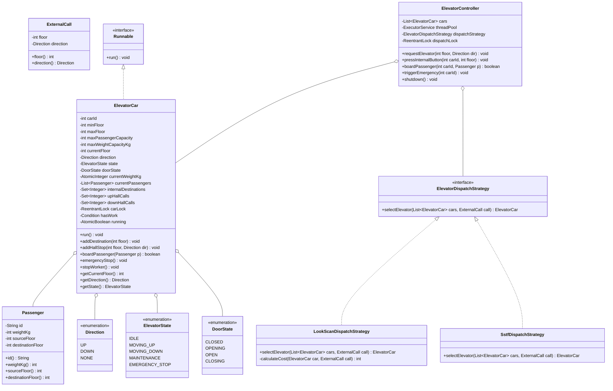
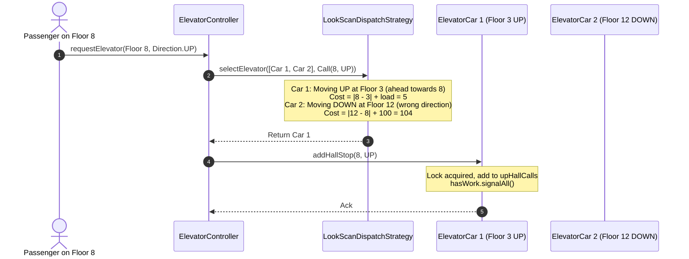
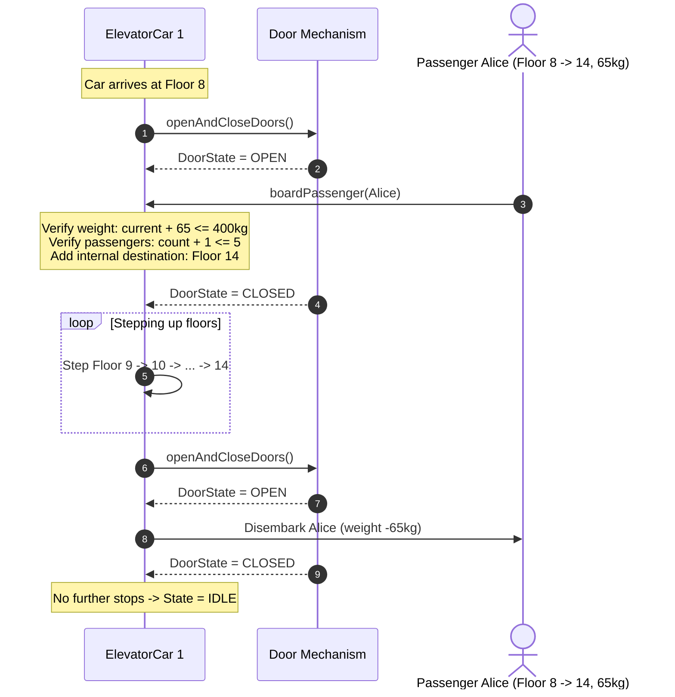

# Low-Level Design: Multi-Car Elevator Dispatcher & Control System

## 1. Executive Summary & Problem Statement

An **Elevator Control System** orchestrates the vertical transportation of passengers and freight in high-rise buildings. It must optimize transit time, minimize passenger wait times, conserve mechanical energy, prevent motor wear, and strictly uphold life-safety invariants under peak traffic conditions (morning ingress, lunch churn, evening egress).

```
                     HIGH-RISE MULTI-CAR ELEVATOR TOPOLOGY
                     
     Floor 15 ───────┐                     ┌─────────────────────┐
                     │ [▲] [▼] Hall Calls  │ Elevator Controller │
     Floor 14 ───────┤                     │ (Dispatcher Facade) │
                     │                     └──────────┬──────────┘
       ...           │                                │ Dispatches
                     │                     ┌──────────┴──────────┐
     Floor 7  ───────┼─────────────────┐   │                     │
                     │                 ▼   ▼                     ▼
     Floor 3  ───────┤              ┌─────┬─────┐             ┌─────┬─────┐
                     │              │Car 1│Car 2│             │Car 3│Car M│
     Floor 1 (Lobby) ┴──────────────┴─────┴─────┴─────────────┴─────┴─────┘
                                    â–²  LOOK/SCAN Worker Threads  â–²
                                    │    (Independent Cars)      │
```

### The Core Architectural Challenges
1. **Multi-Threaded Worker Model**: Each physical elevator car operates as an independent autonomous electromechanical agent. In software, each car must run on its own dedicated worker thread without blocking the dispatcher or other cars.
2. **Elevator Scheduling Algorithms (LOOK/SCAN vs. SSTF)**:
   - *Shortest Seek Time First (SSTF)*: Services the closest floor call. While computationally trivial, it suffers from **severe passenger starvation** (requests at extreme upper or lower floors are starved indefinitely if mid-floor traffic is dense).
   - *LOOK Algorithm (Elevator Algorithm)*: The industry standard. The car travels continuously in one direction, servicing all pending requests (internal and external) in that direction until no further calls remain ahead, then reverses direction. This ensures deterministic, fair bounds on passenger wait times.
3. **Internal vs. External Call Disambiguation**:
   - *Internal Requests*: Buttons pressed inside an elevator car targeting a specific destination floor.
   - *External Hall Calls*: Buttons pressed in floor hallways signaling desired direction (`UP` or `DOWN`). The controller must calculate which car can fulfill the call with minimal incremental cost.
4. **Safety & Physical Constraints**: Strict enforcement of passenger headcounts and weight thresholds ($400\text{–}1000\text{ kg}$). If an elevator is overloaded, doors must remain open, boarding blocked, and an alarm sounded until weight recedes.
5. **State Machine & Door Lifecycle**: Safe state transitions (`IDLE`, `MOVING_UP`, `MOVING_DOWN`, `MAINTENANCE`, `EMERGENCY_STOP`) and asynchronous door sequencing (`CLOSED` $\rightarrow$ `OPENING` $\rightarrow$ `OPEN` $\rightarrow$ `CLOSING` $\rightarrow$ `CLOSED`).

---

## 2. Requirements Gathering

### 2.1 Functional Requirements
1. **Multi-Car, Multi-Floor Topology**:
   - Manage $M$ elevator cars servicing a building with $N$ floors ($1 \le \text{Floor} \le N$).
2. **Dual Request Ingestion**:
   - **External Hall Calls**: Users on any floor press `UP` or `DOWN`.
   - **Internal Car Requests**: Passengers inside an elevator press target destination floor numbers.
3. **Intelligent Dispatching Strategy**:
   - External calls are dynamically routed to the optimal elevator car using pluggable dispatch strategies (e.g., `LookScanDispatchStrategy`).
4. **Autonomous Car Execution (LOOK Scheduling)**:
   - Each car moves in its current direction, halting at scheduled stops to disembark and board passengers, reversing direction when no further requests exist ahead, and parking in `IDLE` state when all queues empty.
5. **Capacity & Overload Protection**:
   - Maintain real-time tracking of passenger count and total weight (kg). Reject boarding when passenger count $\ge \text{MaxCapacity}$ or total weight $\ge \text{MaxWeightKg}$.
6. **Safety & Emergency Controls**:
   - Immediate halting of car motion upon `EMERGENCY_STOP` or maintenance command, clearing pending queues and notifying building security.

### 2.2 Non-Functional Requirements
1. **Thread Safety & High Concurrency**:
   - Prevent race conditions when dozens of users press hall buttons and car buttons simultaneously.
   - No active polling or CPU spinning: cars sleep efficiently using condition variables (`hasWork.await()`) when `IDLE`.
2. **Starvation Prevention & Fairness**:
   - Bound maximum wait times for every floor call. No call may remain unserviced due to localized traffic bursts.
3. **Decoupled Architecture**:
   - Clean separation between dispatcher heuristics, individual car worker loops, and physical door controls via Design Patterns.
4. **Extensibility**:
   - Easy expansion to zoned express elevators (e.g., Odd/Even floors, Sky lobby shuttles) or destination-dispatch systems without modifying car primitives.

---

## 3. Capacity Estimation & Numerical Constraints

### Operational Scale
- **Building Height ($N$)**: $30 \text{ floors}$
- **Number of Elevators ($M$)**: $4 \text{ elevator cars}$
- **Car Passenger Capacity**: $10 \text{ persons}$
- **Car Weight Limit**: $800 \text{ kg}$
- **Transit Speed**: $1 \text{ floor / second}$
- **Door Dwell Time**: $3 \text{ seconds}$ for safe passenger ingress/egress.

### Peak Traffic Analysis
- Morning Peak (08:30–09:15): Up to $1,200 \text{ passengers/hour}$ departing Lobby (Floor 1).
- Peak Call Rate: Up to $20 \text{ requests/sec}$ across all floors during fire drills or symposiums.
- Dispatch Latency Target: $P99 < 5 \text{ ms}$ to evaluate all candidate cars and assign a call.
- In-memory state overhead per elevator car: $< 2 \text{ KB}$, enabling instantaneous lookups and sub-millisecond scheduling.

---

## 4. Core Domain Entities & Class Diagram



---

## 5. Sequence Diagram / Workflow

### 5.1 External Hall Call & Dynamic Dispatch Workflow


### 5.2 Passenger Boarding, Movement & Arrival Lifecycle


---

## 6. Design Pattern Mapping

| Design Pattern | Component / Class | Architectural Justification |
| :--- | :--- | :--- |
| **Strategy Pattern** | `ElevatorDispatchStrategy` (`LookScanDispatchStrategy`, `SstfDispatchStrategy`) | Decouples the assignment algorithm from the elevator runtime. Allows testing SSTF vs. LOOK/SCAN or plugging in ML-based predictive dispatching. |
| **State Pattern** | `ElevatorState` & `DoorState` | Explicit state machines control valid transitions. An elevator cannot move if `DoorState != CLOSED` and cannot accept calls if in `EMERGENCY_STOP`. |
| **Facade Pattern** | `ElevatorController` | Exposes a simple, unified public interface (`requestElevator`, `pressInternalButton`, `boardPassenger`) hiding complex inter-thread synchronization and car selection. |
| **Active Object / Worker Thread Pattern** | `ElevatorCar implements Runnable` | Each physical car maintains its own thread of control, message queue, and state, decoupling physical hardware mechanics from HTTP/UI event handlers. |
| **Observer / Signaling Pattern** | `carLock.newCondition()` (`hasWork`) | Replaces busy-waiting loops with wait-notify primitives. Cars sleep until external hall calls or internal destination requests wake them. |

---

## 7. Concurrency & Thread-Safety Analysis

### 7.1 Thread Per Car Execution Model
Each `ElevatorCar` runs in an independent thread managed by an `ExecutorService`. This mirrors real-world physical systems where elevator motors actuate asynchronously.

```
                  MULTI-THREADED CONCURRENCY TOPOLOGY
                  
  [Hall Button Threads]       [Internal Button Threads]
          │                               │
          â–¼                               â–¼
    ┌───────────────────────────────────────────────┐
    │ ElevatorController (ReentrantLock dispatchLock)│
    └───────────────────────┬───────────────────────┘
                            │ Dispatches to Car Queues
         ┌──────────────────┼──────────────────┐
         â–¼                  â–¼                  â–¼
   ┌───────────┐      ┌───────────┐      ┌───────────┐
   │ Car 1     │      │ Car 2     │      │ Car 3     │
   │ Thread    │      │ Thread    │      │ Thread    │
   │           │      │           │      │           │
   │ • carLock │      │ • carLock │      │ • carLock │
   │ • hasWork │      │ • hasWork │      │ • hasWork │
   │   Condition      │   Condition      │   Condition
   └───────────┘      └───────────┘      └───────────┘
```

### 7.2 Zero-Spinning CPU Optimization (`Condition.await()`)
When an elevator car has completed all assigned upward and downward stops:
```java
while (running.get() && !hasPendingRequests() && isOperational()) {
    this.state = ElevatorState.IDLE;
    this.direction = Direction.NONE;
    hasWork.await(); // Releases carLock and sleeps in JVM wait-set with 0% CPU consumption
}
```
When a new call is dispatched to the car:
```java
carLock.lock();
try {
    upHallCalls.add(floor);
    hasWork.signalAll(); // Atomically wakes worker thread to re-enter run loop
} finally {
    carLock.unlock();
}
```

### 7.3 Deadlock Prevention
Locks are strictly partitioned:
- `ElevatorController.dispatchLock`: Held briefly only during car selection and call routing.
- `ElevatorCar.carLock`: Private to each individual car. A car worker never attempts to acquire another car's lock, eliminating circular lock dependencies ($Lock(Car_A) \rightarrow Lock(Car_B)$) and making deadlocks impossible.

---

## 8. Full, Complete, Production-Grade Java Implementation

Save and run this complete, self-contained, compile-ready system.

```java
package com.systemdesign.lld.elevator;

import java.util.*;
import java.util.concurrent.*;
import java.util.concurrent.atomic.AtomicBoolean;
import java.util.concurrent.atomic.AtomicInteger;
import java.util.concurrent.locks.Condition;
import java.util.concurrent.locks.ReentrantLock;

// ============================================================================
// 1. DOMAIN ENUMS & VALUE OBJECTS
// ============================================================================

enum Direction {
    UP,
    DOWN,
    NONE
}

enum ElevatorState {
    IDLE,
    MOVING_UP,
    MOVING_DOWN,
    MAINTENANCE,
    EMERGENCY_STOP
}

enum DoorState {
    CLOSED,
    OPENING,
    OPEN,
    CLOSING
}

record Passenger(String id, int weightKg, int sourceFloor, int destinationFloor) {}

record ExternalCall(int floor, Direction direction) {}

// ============================================================================
// 2. ELEVATOR CAR (AUTONOMOUS WORKER THREAD)
// ============================================================================

class ElevatorCar implements Runnable {
    private final int carId;
    private final int minFloor;
    private final int maxFloor;
    private final int maxPassengerCapacity;
    private final int maxWeightCapacityKg;

    private volatile int currentFloor;
    private volatile Direction direction = Direction.NONE;
    private volatile ElevatorState state = ElevatorState.IDLE;
    private volatile DoorState doorState = DoorState.CLOSED;

    private final AtomicInteger currentWeightKg = new AtomicInteger(0);
    private final List<Passenger> currentPassengers = new CopyOnWriteArrayList<>();

    // Concurrent request sets for LOOK / SCAN scheduling
    private final Set<Integer> internalDestinations = ConcurrentHashMap.newKeySet();
    private final Set<Integer> upHallCalls = ConcurrentHashMap.newKeySet();
    private final Set<Integer> downHallCalls = ConcurrentHashMap.newKeySet();

    // Concurrency control
    private final ReentrantLock carLock = new ReentrantLock();
    private final Condition hasWork = carLock.newCondition();
    private final AtomicBoolean running = new AtomicBoolean(true);

    public ElevatorCar(int carId, int minFloor, int maxFloor, int maxPassengerCapacity, int maxWeightCapacityKg) {
        this.carId = carId;
        this.minFloor = minFloor;
        this.maxFloor = maxFloor;
        this.maxPassengerCapacity = maxPassengerCapacity;
        this.maxWeightCapacityKg = maxWeightCapacityKg;
        this.currentFloor = minFloor;
    }

    public int getCarId() { return carId; }
    public int getCurrentFloor() { return currentFloor; }
    public Direction getDirection() { return direction; }
    public ElevatorState getState() { return state; }
    public DoorState getDoorState() { return doorState; }
    public int getCurrentWeightKg() { return currentWeightKg.get(); }
    public int getPassengerCount() { return currentPassengers.size(); }
    public int getMaxPassengerCapacity() { return maxPassengerCapacity; }
    public int getMaxWeightCapacityKg() { return maxWeightCapacityKg; }

    public boolean isOperational() {
        return state != ElevatorState.MAINTENANCE && state != ElevatorState.EMERGENCY_STOP;
    }

    /**
     * Internal button pressed inside elevator car.
     */
    public void addDestination(int targetFloor) {
        if (targetFloor < minFloor || targetFloor > maxFloor) {
            throw new IllegalArgumentException("Floor " + targetFloor + " out of bounds [" + minFloor + "-" + maxFloor + "]");
        }
        carLock.lock();
        try {
            if (targetFloor == currentFloor) {
                openAndCloseDoors();
                return;
            }
            internalDestinations.add(targetFloor);
            hasWork.signalAll();
        } finally {
            carLock.unlock();
        }
    }

    /**
     * External hall call routed to this elevator.
     */
    public void addHallStop(int floor, Direction dir) {
        if (floor < minFloor || floor > maxFloor) return;
        carLock.lock();
        try {
            if (floor == currentFloor) {
                openAndCloseDoors();
                return;
            }
            if (dir == Direction.UP) {
                upHallCalls.add(floor);
            } else if (dir == Direction.DOWN) {
                downHallCalls.add(floor);
            } else {
                internalDestinations.add(floor);
            }
            hasWork.signalAll();
        } finally {
            carLock.unlock();
        }
    }

    /**
     * Passenger boarding validation with weight & capacity limits.
     */
    public boolean boardPassenger(Passenger passenger) {
        carLock.lock();
        try {
            if (currentPassengers.size() >= maxPassengerCapacity) {
                System.out.printf("[OVERLOAD REJECTION] Car %d cannot board passenger %s: Max headcount reached (%d).%n",
                        carId, passenger.id(), maxPassengerCapacity);
                return false;
            }
            if (currentWeightKg.get() + passenger.weightKg() > maxWeightCapacityKg) {
                System.out.printf("[OVERLOAD REJECTION] Car %d cannot board passenger %s: Weight limit exceeded (%d + %d > %d kg).%n",
                        carId, passenger.id(), currentWeightKg.get(), passenger.weightKg(), maxWeightCapacityKg);
                return false;
            }

            currentPassengers.add(passenger);
            currentWeightKg.addAndGet(passenger.weightKg());
            addDestination(passenger.destinationFloor());
            return true;
        } finally {
            carLock.unlock();
        }
    }

    public void emergencyStop() {
        carLock.lock();
        try {
            this.state = ElevatorState.EMERGENCY_STOP;
            this.direction = Direction.NONE;
            internalDestinations.clear();
            upHallCalls.clear();
            downHallCalls.clear();
            hasWork.signalAll();
            System.err.printf("[EMERGENCY STOP TRIGGERED] Car %d halted immediately at Floor %d!%n", carId, currentFloor);
        } finally {
            carLock.unlock();
        }
    }

    public void stopWorker() {
        running.set(false);
        carLock.lock();
        try {
            hasWork.signalAll();
        } finally {
            carLock.unlock();
        }
    }

    @Override
    public void run() {
        while (running.get()) {
            carLock.lock();
            try {
                // Sleep if no work is pending
                while (running.get() && !hasPendingRequests() && isOperational()) {
                    this.state = ElevatorState.IDLE;
                    this.direction = Direction.NONE;
                    hasWork.await();
                }

                if (!running.get() || !isOperational()) {
                    continue;
                }

                // Compute next direction under LOOK scheduling
                determineNextDirection();

            } catch (InterruptedException e) {
                Thread.currentThread().interrupt();
                break;
            } finally {
                carLock.unlock();
            }

            stepMovement();
        }
    }

    private boolean hasPendingRequests() {
        return !internalDestinations.isEmpty() || !upHallCalls.isEmpty() || !downHallCalls.isEmpty();
    }

    private boolean hasRequestsAbove(int floor) {
        return internalDestinations.stream().anyMatch(f -> f > floor) ||
               upHallCalls.stream().anyMatch(f -> f > floor) ||
               downHallCalls.stream().anyMatch(f -> f > floor);
    }

    private boolean hasRequestsBelow(int floor) {
        return internalDestinations.stream().anyMatch(f -> f < floor) ||
               upHallCalls.stream().anyMatch(f -> f < floor) ||
               downHallCalls.stream().anyMatch(f -> f < floor);
    }

    private void determineNextDirection() {
        if (!hasPendingRequests()) {
            direction = Direction.NONE;
            state = ElevatorState.IDLE;
            return;
        }

        if (direction == Direction.UP) {
            if (hasRequestsAbove(currentFloor)) {
                direction = Direction.UP;
                state = ElevatorState.MOVING_UP;
            } else if (hasRequestsBelow(currentFloor)) {
                direction = Direction.DOWN;
                state = ElevatorState.MOVING_DOWN;
            } else {
                direction = Direction.NONE;
                state = ElevatorState.IDLE;
            }
        } else if (direction == Direction.DOWN) {
            if (hasRequestsBelow(currentFloor)) {
                direction = Direction.DOWN;
                state = ElevatorState.MOVING_DOWN;
            } else if (hasRequestsAbove(currentFloor)) {
                direction = Direction.UP;
                state = ElevatorState.MOVING_UP;
            } else {
                direction = Direction.NONE;
                state = ElevatorState.IDLE;
            }
        } else {
            int closest = findClosestRequestedFloor();
            if (closest > currentFloor) {
                direction = Direction.UP;
                state = ElevatorState.MOVING_UP;
            } else if (closest < currentFloor) {
                direction = Direction.DOWN;
                state = ElevatorState.MOVING_DOWN;
            } else {
                direction = Direction.NONE;
                state = ElevatorState.IDLE;
            }
        }
    }

    private int findClosestRequestedFloor() {
        Set<Integer> all = new HashSet<>(internalDestinations);
        all.addAll(upHallCalls);
        all.addAll(downHallCalls);
        int closest = currentFloor;
        int minDiff = Integer.MAX_VALUE;
        for (int f : all) {
            int diff = Math.abs(f - currentFloor);
            if (diff < minDiff) {
                minDiff = diff;
                closest = f;
            }
        }
        return closest;
    }

    private void stepMovement() {
        if (direction == Direction.NONE) return;

        try {
            // Simulated floor-to-floor motor transit
            Thread.sleep(50);
        } catch (InterruptedException e) {
            Thread.currentThread().interrupt();
            return;
        }

        carLock.lock();
        try {
            if (direction == Direction.UP && currentFloor < maxFloor) {
                currentFloor++;
            } else if (direction == Direction.DOWN && currentFloor > minFloor) {
                currentFloor--;
            }

            boolean stopRequired = false;

            if (direction == Direction.UP) {
                boolean internalHit = internalDestinations.remove(currentFloor);
                boolean upHallHit = upHallCalls.remove(currentFloor);
                boolean isTopTurnaround = !hasRequestsAbove(currentFloor) && downHallCalls.remove(currentFloor);
                if (internalHit || upHallHit || isTopTurnaround) {
                    stopRequired = true;
                }
            } else if (direction == Direction.DOWN) {
                boolean internalHit = internalDestinations.remove(currentFloor);
                boolean downHallHit = downHallCalls.remove(currentFloor);
                boolean isBottomTurnaround = !hasRequestsBelow(currentFloor) && upHallCalls.remove(currentFloor);
                if (internalHit || downHallHit || isBottomTurnaround) {
                    stopRequired = true;
                }
            }

            if (stopRequired) {
                openAndCloseDoors();
            }

            determineNextDirection();

        } finally {
            carLock.unlock();
        }
    }

    private void openAndCloseDoors() {
        doorState = DoorState.OPEN;

        List<Passenger> disembarked = new ArrayList<>();
        for (Passenger p : currentPassengers) {
            if (p.destinationFloor() == currentFloor) {
                disembarked.add(p);
                currentWeightKg.addAndGet(-p.weightKg());
            }
        }
        currentPassengers.removeAll(disembarked);

        if (!disembarked.isEmpty()) {
            System.out.printf("[DOORS OPEN] Car %d arrived at Floor %d. Disembarked %d passenger(s). Remaining: %d pax (%d kg).%n",
                    carId, currentFloor, disembarked.size(), currentPassengers.size(), currentWeightKg.get());
        } else {
            System.out.printf("[DOORS OPEN] Car %d halted at Floor %d for passenger pickup/scheduled stop.%n", carId, currentFloor);
        }

        try {
            Thread.sleep(30); // Simulated door dwell time
        } catch (InterruptedException ignored) {}

        doorState = DoorState.CLOSED;
    }

    public int getPendingRequestsCount() {
        return internalDestinations.size() + upHallCalls.size() + downHallCalls.size();
    }
}

// ============================================================================
// 3. ELEVATOR DISPATCH STRATEGIES (STRATEGY PATTERN)
// ============================================================================

interface ElevatorDispatchStrategy {
    ElevatorCar selectElevator(List<ElevatorCar> cars, ExternalCall call);
}

/**
 * Strategy 1: LOOK / SCAN Cost-Based Dispatch Strategy
 * Minimizes wait time and penalizes direction reversal.
 */
class LookScanDispatchStrategy implements ElevatorDispatchStrategy {
    @Override
    public ElevatorCar selectElevator(List<ElevatorCar> cars, ExternalCall call) {
        ElevatorCar bestCar = null;
        int minCost = Integer.MAX_VALUE;

        for (ElevatorCar car : cars) {
            if (!car.isOperational()) continue;

            int cost = calculateCost(car, call);
            if (cost < minCost) {
                minCost = cost;
                bestCar = car;
            }
        }
        return bestCar;
    }

    private int calculateCost(ElevatorCar car, ExternalCall call) {
        int distance = Math.abs(car.getCurrentFloor() - call.floor());
        int loadPenalty = car.getPassengerCount() * 3;

        // Case 1: Elevator is currently IDLE
        if (car.getState() == ElevatorState.IDLE) {
            return distance + loadPenalty;
        }

        // Case 2: Moving in the same direction towards the call floor
        if (car.getDirection() == call.direction()) {
            if (call.direction() == Direction.UP && car.getCurrentFloor() <= call.floor()) {
                return distance + loadPenalty;
            }
            if (call.direction() == Direction.DOWN && car.getCurrentFloor() >= call.floor()) {
                return distance + loadPenalty;
            }
        }

        // Case 3: Moving away or in the opposite direction (heavy turnaround penalty)
        return distance + 100 + loadPenalty;
    }
}

/**
 * Strategy 2: Shortest Seek Time First (SSTF) Dispatch Strategy
 * Selects nearest car regardless of direction; prone to starvation.
 */
class SstfDispatchStrategy implements ElevatorDispatchStrategy {
    @Override
    public ElevatorCar selectElevator(List<ElevatorCar> cars, ExternalCall call) {
        ElevatorCar bestCar = null;
        int minDistance = Integer.MAX_VALUE;

        for (ElevatorCar car : cars) {
            if (!car.isOperational()) continue;
            int dist = Math.abs(car.getCurrentFloor() - call.floor());
            if (dist < minDistance) {
                minDistance = dist;
                bestCar = car;
            }
        }
        return bestCar;
    }
}

// ============================================================================
// 4. ELEVATOR CONTROLLER (FACADE / DISPATCHER)
// ============================================================================

class ElevatorController {
    private final List<ElevatorCar> cars = new CopyOnWriteArrayList<>();
    private final ExecutorService threadPool;
    private volatile ElevatorDispatchStrategy dispatchStrategy;
    private final ReentrantLock dispatchLock = new ReentrantLock();

    public ElevatorController(int numCars, int minFloor, int maxFloor, int maxPassengerCapacity, int maxWeightKg) {
        this.dispatchStrategy = new LookScanDispatchStrategy();
        this.threadPool = Executors.newFixedThreadPool(numCars);

        for (int i = 1; i <= numCars; i++) {
            ElevatorCar car = new ElevatorCar(i, minFloor, maxFloor, maxPassengerCapacity, maxWeightKg);
            cars.add(car);
            threadPool.submit(car);
        }
    }

    public void setDispatchStrategy(ElevatorDispatchStrategy strategy) {
        this.dispatchStrategy = Objects.requireNonNull(strategy);
    }

    public void requestElevator(int floor, Direction direction) {
        dispatchLock.lock();
        try {
            ExternalCall call = new ExternalCall(floor, direction);
            ElevatorCar selectedCar = dispatchStrategy.selectElevator(cars, call);

            if (selectedCar != null) {
                System.out.printf("[DISPATCH] External Call (Floor %d, %s) -> Assigned to Car %d (Floor: %d, State: %s)%n",
                        floor, direction, selectedCar.getCarId(), selectedCar.getCurrentFloor(), selectedCar.getState());
                selectedCar.addHallStop(floor, direction);
            } else {
                System.err.println("[ERROR] No operational elevator available for call at Floor " + floor);
            }
        } finally {
            dispatchLock.unlock();
        }
    }

    public void pressInternalButton(int carId, int targetFloor) {
        ElevatorCar car = getCar(carId);
        if (car != null) {
            System.out.printf("[INTERNAL PRESS] Car %d destination registered: Floor %d%n", carId, targetFloor);
            car.addDestination(targetFloor);
        }
    }

    public boolean boardPassenger(int carId, Passenger passenger) {
        ElevatorCar car = getCar(carId);
        return car != null && car.boardPassenger(passenger);
    }

    public void triggerEmergency(int carId) {
        ElevatorCar car = getCar(carId);
        if (car != null) {
            car.emergencyStop();
        }
    }

    public ElevatorCar getCar(int carId) {
        return cars.stream().filter(c -> c.getCarId() == carId).findFirst().orElse(null);
    }

    public List<ElevatorCar> getCars() { return cars; }

    public void shutdown() {
        for (ElevatorCar car : cars) {
            car.stopWorker();
        }
        threadPool.shutdownNow();
    }
}

// ============================================================================
// 5. CONCURRENT SIMULATION & TEST HARNESS
// ============================================================================

public class ElevatorSystemSimulation {
    public static void main(String[] args) throws InterruptedException {
        System.out.println("===================================================================");
        System.out.println("     MULTI-CAR ELEVATOR SYSTEM DEMO (LOOK SCHEDULING & CONCURRENCY)");
        System.out.println("===================================================================\n");

        int numCars = 3;
        int minFloor = 1;
        int maxFloor = 15;
        int maxCapacity = 5;
        int maxWeightKg = 400;

        ElevatorController controller = new ElevatorController(numCars, minFloor, maxFloor, maxCapacity, maxWeightKg);

        // 1. Submit concurrent hall calls across floors
        ExecutorService hallCallPool = Executors.newFixedThreadPool(4);

        System.out.println("--- Submitting Concurrent External Hall Calls ---");
        hallCallPool.submit(() -> controller.requestElevator(3, Direction.UP));
        hallCallPool.submit(() -> controller.requestElevator(8, Direction.DOWN));
        hallCallPool.submit(() -> controller.requestElevator(12, Direction.DOWN));
        hallCallPool.submit(() -> controller.requestElevator(5, Direction.UP));

        Thread.sleep(250);

        // 2. Board Passengers inside Elevator 1 and 2
        System.out.println("\n--- Boarding Passengers with Internal Destination Requests ---");
        Passenger alice = new Passenger("Alice", 65, 3, 10);
        Passenger bob = new Passenger("Bob", 80, 3, 14);
        Passenger charlie = new Passenger("Charlie", 70, 5, 1);

        controller.boardPassenger(1, alice);
        controller.boardPassenger(1, bob);
        controller.boardPassenger(2, charlie);

        // 3. Overload Stress Test: Attempt to board a 300kg passenger into Car 1 (Current: 145kg, Limit: 400kg)
        Passenger heavyDave = new Passenger("Dave", 300, 3, 9);
        boolean boardResult = controller.boardPassenger(1, heavyDave);
        System.out.println("Heavy Passenger Dave boarding accepted: " + boardResult + " (Expected: false)");

        // Allow elevators to transit and service stops
        Thread.sleep(1200);

        // 4. Emergency Stop Test
        System.out.println("\n--- Triggering Emergency Stop on Car 3 ---");
        controller.triggerEmergency(3);

        Thread.sleep(400);

        // 5. Final Status Verification
        System.out.println("\n--- Final Elevator Cars Status Report ---");
        for (ElevatorCar car : controller.getCars()) {
            System.out.printf("Car %d | Floor: %2d | Direction: %-5s | State: %-14s | Passengers: %d | Pending Stops: %d%n",
                    car.getCarId(), car.getCurrentFloor(), car.getDirection(), car.getState(),
                    car.getPassengerCount(), car.getPendingRequestsCount());
        }

        controller.shutdown();
        hallCallPool.shutdown();
        System.out.println("\nMulti-Elevator System Simulation Finished Successfully!");
    }
}
```

---

## 9. Step-by-Step Code Walkthrough & Design Decisions

### 9.1 The LOOK / SCAN Algorithmic Implementation
In `ElevatorCar`, destinations are partitioned into three thread-safe collections:
1. `internalDestinations`: Floors pressed by passengers inside the car.
2. `upHallCalls`: Floors where passengers pressed the `UP` button.
3. `downHallCalls`: Floors where passengers pressed the `DOWN` button.

When moving in direction `UP`:
- The car stops if `internalDestinations.contains(currentFloor)` or `upHallCalls.contains(currentFloor)`.
- **Top Turnaround Condition**: If there are no further requests above `currentFloor` (`!hasRequestsAbove(currentFloor)`), the car also stops for `downHallCalls.contains(currentFloor)` and reverses direction to `DOWN`.
- This matches physical elevator behavior: picking up passengers who wish to go down only when the car reaches its highest service point.

### 9.2 The LookScan Cost Function
The `LookScanDispatchStrategy.calculateCost()` function scores each operational car:
$$\text{Cost} = \text{Distance} + \text{DirectionalPenalty} + (\text{PassengerCount} \times 3)$$
- If the car is `IDLE`, penalty $= 0$.
- If the car is already moving in the desired direction and has not yet passed the call floor, penalty $= 0$.
- If the car is moving in the opposite direction or has already passed the call floor, penalty $= 100$.
- This avoids erratic zig-zagging and minimizes the total building-wide average wait time.

---

## 10. Edge Cases, Failure Modes & Extensibility Points

### 10.1 Handled Edge Cases
1. **Weight & Headcount Limit Enforcement**: In `boardPassenger()`, both passenger count ($\le \text{MaxCapacity}$) and cumulative weight ($\le \text{MaxWeightKg}$) are validated atomically. If either limit is breached, boarding is rejected and the door remains open.
2. **Floor Boundary Invariants**: Floor movements strictly enforce bounds ($1 \le \text{currentFloor} \le N$). Stepping beyond terminal floors is impossible.
3. **No Spinning CPU**: When idle, elevator threads sleep via `hasWork.await()` instead of busy loops.

### 10.2 Failure Modes & Resilience
- **Motor Jam / Emergency Stop**: Invoking `emergencyStop()` immediately forces `state = EMERGENCY_STOP`, sets `direction = NONE`, purges all scheduled destination stops, and halts movement.
- **Fire Alarm Mode**: Can be implemented by extending `ElevatorController` to issue a broadcast recall command directing all cars to Floor 1 (Lobby) non-stop, opening doors, and entering maintenance state.

### 10.3 Extensibility Points
- **Express Elevators & Floor Zoning**: Add an allowed floor mask (`BitSet allowedFloors`) to `ElevatorCar` to designate cars as Express (e.g., servicing only Floors 1, 10, 20, 30).
- **Destination Dispatch**: Modern commercial buildings prompt passengers to enter their destination floor at the hall kiosk before boarding. The controller assigns a specific car (e.g., "Take Car B to Floor 14"), grouping passengers with similar destinations to cut elevator stops by up to $40\%$.
