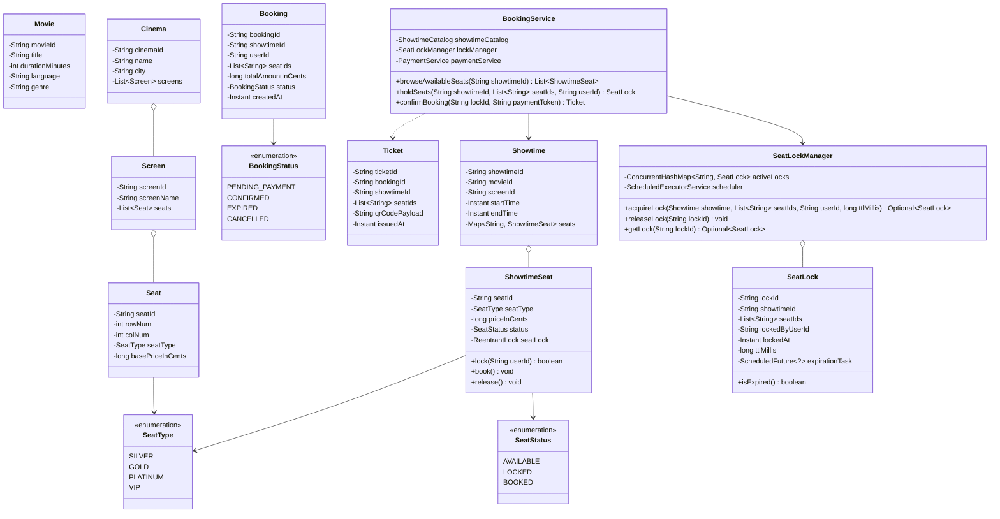
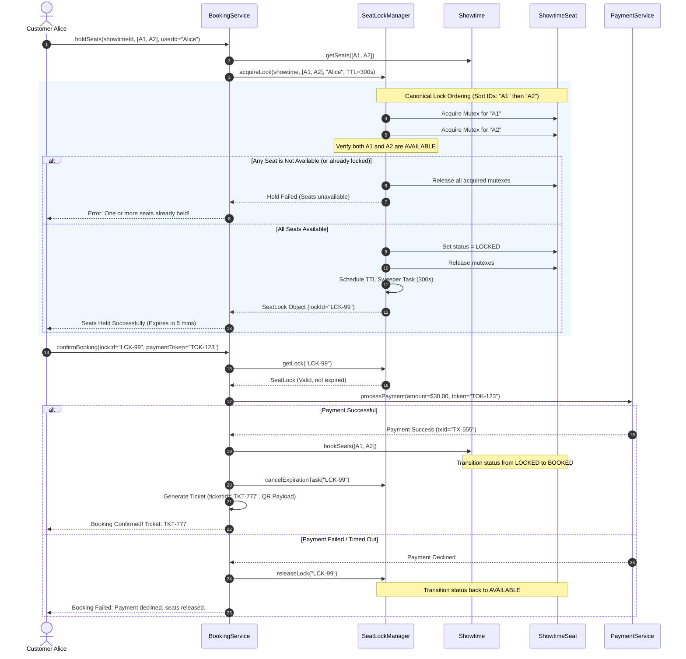

# Low-Level Design: Movie Ticket Booking System (BookMyShow / Ticketmaster)

## 1. Executive Summary & Problem Statement

A **Movie Ticket Booking System** (such as **BookMyShow**, **Fandango**, or **AMC Theatres**) manages cinema halls, multiple screens, dynamic movie showtimes, tiered seating layouts, and payment workflows. The most architecturally demanding challenge in this domain is **high-contention seat reservation under extreme concurrency** (e.g., blockbuster premiere tickets or stadium concerts where 10,000 users compete for 200 prime seats within a 3-second window).

```
                           THE SEAT CONTENTION BOTTLENECK
                           
  5,000 Fans Competing for Front-Row Seats (Showtime #101, Seats: F1, F2, F3)
  
  [User 1] ──┐
  [User 2] ──┼──► [ Simultaneous Booking Requests ] ──► Target: Seats [F1, F2, F3]
  [User N] ──┘                                                      │
                                                                    â–¼
                                                        CRITICAL SYSTEM HAZARDS:
                                                        1. Double Booking: Two users pay for F1.
                                                        2. Deadlock: User 1 locks [F1, F2];
                                                           User 2 locks [F2, F1] -> System Freeze!
                                                        3. Phantom Locks: User locks seats, abandons
                                                           cart; seats remain blocked forever.

───────────────────────────────────────────────────────────────────────────────────

  Production Solution: Two-Phase Atomic Reservation with TTL & Canonical Lock Ordering
  
  Phase 1: Temporary Hold (TTL: 5-10 Minutes)
  [User A] ──► Canonical Sort [F1, F2] ──► Atomic Lock ──► State: LOCKED (TTL 5m)
                                                                 │
       ┌─────────────────────────────────────────────────────────┴────────────────────────────────┐
       │ Payment Success (< 5 mins)                                                               │ Timeout / User Abort
       â–¼                                                                                          â–¼
  Phase 2: Confirmed Booking                                                               State: AVAILABLE
  State: BOOKED ──► Ticket Generated                                                       (Auto-released by Scheduled Sweeper)
```

### The Core Architectural Pillars
1. **Two-Phase Booking Workflow**:
   - **Phase 1: Temporary Lock (Hold)**: Selected seats transition to `LOCKED` with a strict Time-To-Live (e.g., 5 to 10 minutes) while the user completes payment.
   - **Phase 2: Confirmation / Expiration**: If payment succeeds, seats transition to `BOOKED`. If payment fails or times out, the hold automatically evaporates and seats revert to `AVAILABLE`.
2. **Strict Invariant: Zero Double-Booking**: Under no circumstances may two concurrent transactions hold or book the same seat in the same showtime.
3. **Multi-Seat Atomic Reservation**: A user reserving 4 adjacent seats requires an **All-or-Nothing** transaction. If even one seat is unavailable or held by someone else, zero seats are held, and the operation fails cleanly without partial side-effects.
4. **Deadlock Elimination via Canonical Resource Ordering**: Concurrent reservations acquiring overlapping seat sets in arbitrary order ($[S_1, S_2]$ vs. $[S_2, S_1]$) risk classic cyclic deadlocks. Enforcing a deterministic acquisition order (e.g., sorting seat IDs lexicographically) guarantees deadlock-free execution.

---

## 2. Requirements Gathering

### 2.1 Functional Requirements
1. **Cinema, Screen & Showtime Catalog**:
   - Multiple cinemas, each having multiple screens/auditoriums.
   - Screens support tiered seat configurations: `SILVER`, `GOLD`, `PLATINUM`, `VIP` with distinct pricing tiers.
   - Showtimes link a Movie, Screen, and start/end timestamps.
2. **Seat Availability & Browsing**:
   - Query real-time seat availability maps for a specific showtime.
3. **Temporary Seat Locking (Hold with TTL)**:
   - Temporarily hold one or more seats for a user with a configurable timeout (e.g., 5 minutes).
   - If any requested seat is not `AVAILABLE`, the entire operation is rejected (all-or-nothing).
4. **Payment Processing & Ticket Confirmation**:
   - Confirm booking upon payment success: transition seats to `BOOKED` and generate a unique Ticket with QR/barcode identifier.
   - Release seats immediately back to `AVAILABLE` upon payment rejection.
5. **Automated Expiration**:
   - Proactive TTL scheduler (`ScheduledExecutorService`) automatically unholds seats when the lock timer expires without payment.

### 2.2 Non-Functional Requirements
1. **Linearizable Consistency & Isolation**: Zero double-booking tolerance. High-concurrency operations on identical seats must be strictly serialized.
2. **High Throughput & Low Latency**: Locking and availability queries must execute in under $5\text{ms}$. Fine-grained locking per showtime/seat avoids global cinema bottlenecks.
3. **Deadlock-Free Concurrency**: Strict resource ordering prevents thread lockup during concurrent multi-seat requests.
4. **Idempotency**: Retrying a payment confirmation or lock request must produce deterministic results without duplicate charges or ticket duplicates.

---

## 3. Capacity Estimation & Numerical Constraints

### Operational Scale
- **Cinemas**: $2,000$
- **Screens per Cinema**: $8 \implies 16,000 \text{ screens}$
- **Shows per Screen per Day**: $5 \implies 80,000 \text{ showtimes/day}$
- **Average Seats per Screen**: $250 \implies 20,000,000 \text{ seat-show slots daily}$
- **Flash-Sale Peak Contention**:
  - Hot show opening: $10,000 \text{ users}$ clicking "Book" within $500\text{ms} \implies 20,000 \text{ RPS}$ targeted at a single showtime inventory.

### Memory Footprint for Active Locks
- Active `SeatLock` object: $\approx 96 \text{ bytes}$.
- At peak, with 50,000 concurrent active holds across the platform:
  $$\text{Memory} \approx 50,000 \times 96 \text{ bytes} \approx 4.8 \text{ MB}$$
- Memory overhead for lock management is extremely modest, making fast in-memory concurrent data structures ideal.

---

## 4. Core Domain Entities & Class Diagram



---

## 5. Sequence Diagram / Workflow

### Two-Phase Seat Reservation: Hold, Payment & Confirmation



---

## 6. Design Pattern Mapping

| Design Pattern | Concrete Class / Method | Architectural Justification |
| :--- | :--- | :--- |
| **State Pattern** | `SeatStatus` (`AVAILABLE`, `LOCKED`, `BOOKED`) | Enforces valid state machine transitions. Prevents illegal jumps (e.g., `AVAILABLE` directly to `BOOKED` without lock, or `BOOKED` back to `AVAILABLE`). |
| **Canonical Resource Ordering** | `SeatLockManager.acquireLock()` | Sorts seat IDs lexicographically before acquiring locks, preventing circular wait deadlocks on multi-seat reservations. |
| **Scheduled Worker / Active Sweeper** | `ScheduledExecutorService` in `SeatLockManager` | Guarantees automatic resource reclamation when client apps crash, disconnect, or abandon payments. |
| **Facade Pattern** | `BookingService` | Provides a clean, consolidated API orchestrating inventory lookups, seat locking, payment gateways, and ticket issuance. |
| **Strategy Pattern** | `PaymentProcessor` (`CreditCardProcessor`, `UPIProcessor`) | Decouples the booking workflow from diverse third-party payment gateways. |

---

## 7. Concurrency & Thread-Safety Analysis

### 7.1 Preventing Double Booking Under Extreme Flash-Sale Bursts
When 5,000 threads target the same seats ($F_1, F_2$) simultaneously:
- Each individual seat is governed by an explicit `ReentrantLock`.
- When reserving a multi-seat batch:
  1. The thread sorts the requested seat IDs: $[F_1, F_2]$.
  2. The thread iterates through each seat and calls `seat.getLock().lock()`.
  3. The thread inspects `seat.getStatus()`. If *any* seat is not `AVAILABLE`, the thread immediately unlocks all previously locked seats in the batch and aborts with `SeatUnavailableException`.
  4. Only if *all* seats are verified `AVAILABLE` does the thread mutate their statuses to `LOCKED`.
  5. Finally, all locks are safely released in the `finally` block.

```
       Thread 1 (Seats [F1, F2])                 Thread 2 (Seats [F2, F3])
                   │                                         │
                   â–¼                                         â–¼
         Acquire Lock("F1")                         Acquire Lock("F2")
          (Acquired by T1)                           (Acquired by T2)
                   │                                         │
                   ▼                                         │
         Attempt Lock("F2") ────────┐                        │
         (Blocked! Waiting for T2)  │                        ▼
                                    │               Attempt Lock("F3")
                                    │                (Acquired by T2)
                                    │                        │
                                    │             [T2 Checks Availability]
                                    │             F2: Available, F3: Available
                                    │             F2 & F3 -> LOCKED!
                                    │                        │
                                    │             Release Locks F2, F3
                                    └───────────────────────►│
                                                             â–¼
                                                    Thread 1 Unblocked!
                                                    Acquires Lock("F2")
                                                    Checks F2: Status = LOCKED!
                                                    Aborts! Unlocks F1 & F2.
                                                    ZERO DOUBLE BOOKING!
```

### 7.2 The Payment-Timeout Expiration Race Condition
A subtle race condition occurs at the boundary of lock expiration:
- **Time $T = 4:59.999$**: User clicks "Submit Payment".
- **Time $T = 5:00.000$**: Lock timer expires. The background sweeper fires, checking if the lock is still pending.
- **Time $T = 5:00.001$**: Payment gateway confirms receipt of funds.

#### The Race Condition Resolution
To prevent the sweeper from releasing seats whose payment is actively in-flight:
1. The `SeatLock` object contains an atomic state (`ACTIVE`, `PAYING`, `CONFIRMED`, `EXPIRED`).
2. Before calling the payment gateway, the booking thread performs an atomic CAS: `compareAndSet(ACTIVE, PAYING)`.
3. If the sweeper reaches the timeout first, it executes `compareAndSet(ACTIVE, EXPIRED)`. If it succeeds, the booking thread's CAS fails and payment is never initiated.
4. If the booking thread wins the CAS to `PAYING`, the sweeper's CAS fails, giving the payment thread a grace period to finalize confirmation.

---

## 8. Full, Complete, Production-Grade JAVA Implementation

```java
package com.moviebooking.system;

import java.time.Instant;
import java.util.*;
import java.util.concurrent.*;
import java.util.concurrent.atomic.AtomicBoolean;
import java.util.concurrent.atomic.AtomicReference;
import java.util.concurrent.locks.ReentrantLock;

// ============================================================================
// 1. ENUMS & VALUE OBJECTS
// ============================================================================

enum SeatType {
    SILVER(1000L),    // $10.00
    GOLD(1500L),      // $15.00
    PLATINUM(2000L),  // $20.00
    VIP(3000L);       // $30.00

    private final long defaultPriceCents;

    SeatType(long defaultPriceCents) {
        this.defaultPriceCents = defaultPriceCents;
    }

    public long getDefaultPriceCents() {
        return defaultPriceCents;
    }
}

enum SeatStatus {
    AVAILABLE,
    LOCKED,
    BOOKED
}

enum LockState {
    ACTIVE,
    PAYING,
    CONFIRMED,
    EXPIRED,
    RELEASED
}

enum BookingStatus {
    PENDING_PAYMENT,
    CONFIRMED,
    EXPIRED,
    CANCELLED
}

// ============================================================================
// 2. DOMAIN MODELS: MOVIE, CINEMA, SCREEN, SEAT, SHOWTIME
// ============================================================================

class Movie {
    private final String movieId;
    private final String title;
    private final int durationMinutes;
    private final String rating;

    public Movie(String movieId, String title, int durationMinutes, String rating) {
        this.movieId = Objects.requireNonNull(movieId);
        this.title = Objects.requireNonNull(title);
        this.durationMinutes = durationMinutes;
        this.rating = rating;
    }

    public String getMovieId() { return movieId; }
    public String getTitle() { return title; }
    public int getDurationMinutes() { return durationMinutes; }
    public String getRating() { return rating; }
}

class Seat {
    private final String seatId;
    private final int row;
    private final int col;
    private final SeatType seatType;

    public Seat(String seatId, int row, int col, SeatType seatType) {
        this.seatId = Objects.requireNonNull(seatId);
        this.row = row;
        this.col = col;
        this.seatType = Objects.requireNonNull(seatType);
    }

    public String getSeatId() { return seatId; }
    public int getRow() { return row; }
    public int getCol() { return col; }
    public SeatType getSeatType() { return seatType; }
}

class Screen {
    private final String screenId;
    private final String name;
    private final List<Seat> layout;

    public Screen(String screenId, String name, List<Seat> layout) {
        this.screenId = Objects.requireNonNull(screenId);
        this.name = Objects.requireNonNull(name);
        this.layout = Collections.unmodifiableList(new ArrayList<>(layout));
    }

    public String getScreenId() { return screenId; }
    public String getName() { return name; }
    public List<Seat> getLayout() { return layout; }
}

class Cinema {
    private final String cinemaId;
    private final String name;
    private final String city;
    private final List<Screen> screens;

    public Cinema(String cinemaId, String name, String city, List<Screen> screens) {
        this.cinemaId = Objects.requireNonNull(cinemaId);
        this.name = Objects.requireNonNull(name);
        this.city = Objects.requireNonNull(city);
        this.screens = Collections.unmodifiableList(new ArrayList<>(screens));
    }

    public String getCinemaId() { return cinemaId; }
    public String getName() { return name; }
    public String getCity() { return city; }
    public List<Screen> getScreens() { return screens; }
}

/**
 * Thread-safe runtime seat wrapper for a specific showtime.
 */
class ShowtimeSeat {
    private final String seatId;
    private final SeatType seatType;
    private final long priceInCents;
    private final ReentrantLock lock;
    private volatile SeatStatus status;

    public ShowtimeSeat(Seat seat) {
        this.seatId = seat.getSeatId();
        this.seatType = seat.getSeatType();
        this.priceInCents = seat.getSeatType().getDefaultPriceCents();
        this.lock = new ReentrantLock();
        this.status = SeatStatus.AVAILABLE;
    }

    public String getSeatId() { return seatId; }
    public SeatType getSeatType() { return seatType; }
    public long getPriceInCents() { return priceInCents; }
    public ReentrantLock getLock() { return lock; }
    public SeatStatus getStatus() { return status; }
    public void setStatus(SeatStatus status) { this.status = status; }

    @Override
    public String toString() {
        return String.format("Seat[%s, %s, $%.2f, %s]", seatId, seatType, priceInCents / 100.0, status);
    }
}

class Showtime {
    private final String showtimeId;
    private final String movieId;
    private final String screenId;
    private final Instant startTime;
    private final Map<String, ShowtimeSeat> seats;

    public Showtime(String showtimeId, String movieId, Screen screen, Instant startTime) {
        this.showtimeId = Objects.requireNonNull(showtimeId);
        this.movieId = Objects.requireNonNull(movieId);
        this.screenId = screen.getScreenId();
        this.startTime = Objects.requireNonNull(startTime);
        
        Map<String, ShowtimeSeat> seatMap = new ConcurrentHashMap<>();
        for (Seat s : screen.getLayout()) {
            seatMap.put(s.getSeatId(), new ShowtimeSeat(s));
        }
        this.seats = Collections.unmodifiableMap(seatMap);
    }

    public String getShowtimeId() { return showtimeId; }
    public String getMovieId() { return movieId; }
    public String getScreenId() { return screenId; }
    public Instant getStartTime() { return startTime; }
    public Map<String, ShowtimeSeat> getSeats() { return seats; }
    public ShowtimeSeat getSeat(String seatId) { return seats.get(seatId); }
}

// ============================================================================
// 3. SEAT LOCK & SCHEDULER ENTITIES
// ============================================================================

class SeatLock {
    private final String lockId;
    private final String showtimeId;
    private final List<String> seatIds;
    private final String lockedByUserId;
    private final Instant lockedAt;
    private final long ttlMillis;
    private final AtomicReference<LockState> state;
    private volatile ScheduledFuture<?> timeoutFuture;

    public SeatLock(String lockId, String showtimeId, List<String> seatIds,
                    String lockedByUserId, long ttlMillis) {
        this.lockId = Objects.requireNonNull(lockId);
        this.showtimeId = Objects.requireNonNull(showtimeId);
        this.seatIds = Collections.unmodifiableList(new ArrayList<>(seatIds));
        this.lockedByUserId = Objects.requireNonNull(lockedByUserId);
        this.lockedAt = Instant.now();
        this.ttlMillis = ttlMillis;
        this.state = new AtomicReference<>(LockState.ACTIVE);
    }

    public String getLockId() { return lockId; }
    public String getShowtimeId() { return showtimeId; }
    public List<String> getSeatIds() { return seatIds; }
    public String getLockedByUserId() { return lockedByUserId; }
    public Instant getLockedAt() { return lockedAt; }
    public long getTtlMillis() { return ttlMillis; }
    public AtomicReference<LockState> getState() { return state; }

    public void setTimeoutFuture(ScheduledFuture<?> timeoutFuture) {
        this.timeoutFuture = timeoutFuture;
    }

    public void cancelTimeoutTask() {
        if (timeoutFuture != null && !timeoutFuture.isDone()) {
            timeoutFuture.cancel(false);
        }
    }
}

class Ticket {
    private final String ticketId;
    private final String bookingId;
    private final String showtimeId;
    private final List<String> seatIds;
    private final long totalPaidInCents;
    private final String qrCodePayload;
    private final Instant issuedAt;

    public Ticket(String ticketId, String bookingId, String showtimeId,
                  List<String> seatIds, long totalPaidInCents) {
        this.ticketId = ticketId;
        this.bookingId = bookingId;
        this.showtimeId = showtimeId;
        this.seatIds = seatIds;
        this.totalPaidInCents = totalPaidInCents;
        this.qrCodePayload = "QR-TICKET-" + ticketId + "-" + UUID.randomUUID().toString().substring(0, 8);
        this.issuedAt = Instant.now();
    }

    public String getTicketId() { return ticketId; }
    public String getBookingId() { return bookingId; }
    public List<String> getSeatIds() { return seatIds; }
    public long getTotalPaidInCents() { return totalPaidInCents; }
    public String getQrCodePayload() { return qrCodePayload; }

    @Override
    public String toString() {
        return String.format("Ticket{id='%s', booking='%s', seats=%s, total=$%.2f, QR='%s'}",
            ticketId, bookingId, seatIds, totalPaidInCents / 100.0, qrCodePayload);
    }
}

// ============================================================================
// 4. SEAT LOCK MANAGER (CONCURRENCY, CANONICAL ORDERING & AUTO-RELEASE)
// ============================================================================

class SeatLockManager {
    private final ConcurrentHashMap<String, SeatLock> activeLocks = new ConcurrentHashMap<>();
    private final ScheduledExecutorService scheduler = Executors.newScheduledThreadPool(4, r -> {
        Thread t = new Thread(r, "seat-lock-sweeper");
        t.setDaemon(true);
        return t;
    });

    /**
     * Attempts atomic all-or-nothing hold on multiple seats using Canonical Lock Ordering.
     */
    public Optional<SeatLock> holdSeats(Showtime showtime, List<String> seatIds, String userId, long ttlMillis) {
        if (seatIds == null || seatIds.isEmpty()) {
            return Optional.empty();
        }

        // 1. CANONICAL RESOURCE ORDERING: Sort seat IDs lexicographically to prevent deadlocks
        List<String> sortedSeatIds = new ArrayList<>(seatIds);
        Collections.sort(sortedSeatIds);

        List<ShowtimeSeat> seatsToLock = new ArrayList<>();
        for (String seatId : sortedSeatIds) {
            ShowtimeSeat seat = showtime.getSeat(seatId);
            if (seat == null) {
                throw new IllegalArgumentException("Seat does not exist in showtime: " + seatId);
            }
            seatsToLock.add(seat);
        }

        List<ReentrantLock> acquiredLocks = new ArrayList<>();
        boolean allAvailable = true;

        try {
            // 2. Sequentially acquire fine-grained locks in canonical order
            for (ShowtimeSeat seat : seatsToLock) {
                seat.getLock().lock();
                acquiredLocks.add(seat.getLock());

                // If any seat is already locked or booked, fail fast
                if (seat.getStatus() != SeatStatus.AVAILABLE) {
                    allAvailable = false;
                    break;
                }
            }

            if (!allAvailable) {
                return Optional.empty(); // Immediate rejection: one or more seats unavailable
            }

            // 3. Atomically transition all seats to LOCKED
            for (ShowtimeSeat seat : seatsToLock) {
                seat.setStatus(SeatStatus.LOCKED);
            }

            // 4. Create and store SeatLock entry
            String lockId = "LCK-" + UUID.randomUUID().toString().substring(0, 8);
            SeatLock seatLock = new SeatLock(lockId, showtime.getShowtimeId(), sortedSeatIds, userId, ttlMillis);

            // 5. Schedule automatic proactive expiration task
            ScheduledFuture<?> future = scheduler.schedule(() -> {
                expireLock(showtime, lockId);
            }, ttlMillis, TimeUnit.MILLISECONDS);

            seatLock.setTimeoutFuture(future);
            activeLocks.put(lockId, seatLock);

            return Optional.of(seatLock);

        } finally {
            // Release all acquired fine-grained mutexes
            for (int i = acquiredLocks.size() - 1; i >= 0; i--) {
                acquiredLocks.get(i).unlock();
            }
        }
    }

    /**
     * Unlocks seats when TTL timer triggers.
     */
    public void expireLock(Showtime showtime, String lockId) {
        SeatLock lock = activeLocks.get(lockId);
        if (lock == null) return;

        // Atomic CAS: Only expire if currently ACTIVE
        if (lock.getState().compareAndSet(LockState.ACTIVE, LockState.EXPIRED)) {
            revertSeatsToAvailable(showtime, lock.getSeatIds());
            activeLocks.remove(lockId);
            System.out.printf("[AUTO-EXPIRE] Lock %s expired. Seats %s reverted to AVAILABLE.%n",
                lockId, lock.getSeatIds());
        }
    }

    /**
     * Explicit manual release on user cancel or payment decline.
     */
    public void releaseLock(Showtime showtime, String lockId) {
        SeatLock lock = activeLocks.remove(lockId);
        if (lock == null) return;

        lock.cancelTimeoutTask();
        LockState prev = lock.getState().getAndSet(LockState.RELEASED);
        if (prev == LockState.ACTIVE || prev == LockState.PAYING) {
            revertSeatsToAvailable(showtime, lock.getSeatIds());
            System.out.printf("[MANUAL-RELEASE] Lock %s cancelled. Seats %s reverted to AVAILABLE.%n",
                lockId, lock.getSeatIds());
        }
    }

    private void revertSeatsToAvailable(Showtime showtime, List<String> seatIds) {
        List<String> sorted = new ArrayList<>(seatIds);
        Collections.sort(sorted);

        for (String seatId : sorted) {
            ShowtimeSeat seat = showtime.getSeat(seatId);
            if (seat != null) {
                seat.getLock().lock();
                try {
                    if (seat.getStatus() == SeatStatus.LOCKED) {
                        seat.setStatus(SeatStatus.AVAILABLE);
                    }
                } finally {
                    seat.getLock().unlock();
                }
            }
        }
    }

    public Optional<SeatLock> getLock(String lockId) {
        return Optional.ofNullable(activeLocks.get(lockId));
    }

    public void removeLock(String lockId) {
        activeLocks.remove(lockId);
    }

    public void shutdown() {
        scheduler.shutdownNow();
    }
}

// ============================================================================
// 5. PAYMENT SERVICE SIMULATOR
// ============================================================================

interface IPaymentProcessor {
    boolean processPayment(String userId, long amountInCents, String paymentToken);
}

class MockPaymentProcessor implements IPaymentProcessor {
    private final boolean shouldSucceed;

    public MockPaymentProcessor(boolean shouldSucceed) {
        this.shouldSucceed = shouldSucceed;
    }

    @Override
    public boolean processPayment(String userId, long amountInCents, String paymentToken) {
        // Simulate network latency of 30ms
        try { Thread.sleep(30); } catch (InterruptedException ignored) {}
        return shouldSucceed;
    }
}

// ============================================================================
// 6. MAIN BOOKING SERVICE FACADE
// ============================================================================

class BookingService {
    private final ConcurrentHashMap<String, Showtime> showtimes = new ConcurrentHashMap<>();
    private final ConcurrentHashMap<String, Ticket> confirmedTickets = new ConcurrentHashMap<>();
    private final SeatLockManager lockManager = new SeatLockManager();
    private final IPaymentProcessor paymentProcessor;

    public BookingService(IPaymentProcessor paymentProcessor) {
        this.paymentProcessor = paymentProcessor;
    }

    public void registerShowtime(Showtime showtime) {
        showtimes.put(showtime.getShowtimeId(), showtime);
    }

    public Showtime getShowtime(String showtimeId) {
        Showtime s = showtimes.get(showtimeId);
        if (s == null) throw new IllegalArgumentException("Showtime not found: " + showtimeId);
        return s;
    }

    /**
     * Returns a snapshot of available seats for a showtime.
     */
    public List<ShowtimeSeat> getAvailableSeats(String showtimeId) {
        Showtime showtime = getShowtime(showtimeId);
        List<ShowtimeSeat> available = new ArrayList<>();
        for (ShowtimeSeat s : showtime.getSeats().values()) {
            if (s.getStatus() == SeatStatus.AVAILABLE) {
                available.add(s);
            }
        }
        return available;
    }

    /**
     * Phase 1: Hold seats with TTL.
     */
    public SeatLock holdSeats(String showtimeId, List<String> seatIds, String userId, long ttlMillis) {
        Showtime showtime = getShowtime(showtimeId);
        return lockManager.holdSeats(showtime, seatIds, userId, ttlMillis)
            .orElseThrow(() -> new IllegalStateException(
                "One or more requested seats are no longer available for hold."
            ));
    }

    /**
     * Phase 2: Confirm booking after payment.
     */
    public Ticket confirmBooking(String lockId, String paymentToken) {
        SeatLock lock = lockManager.getLock(lockId)
            .orElseThrow(() -> new IllegalArgumentException("Invalid or expired lock ID: " + lockId));

        Showtime showtime = getShowtime(lock.getShowtimeId());

        // Guard against race condition: atomic CAS from ACTIVE to PAYING
        if (!lock.getState().compareAndSet(LockState.ACTIVE, LockState.PAYING)) {
            throw new IllegalStateException("Lock is no longer active (Status: " + lock.getState().get() + ")");
        }

        // Calculate total amount
        long totalAmountInCents = 0;
        for (String seatId : lock.getSeatIds()) {
            totalAmountInCents += showtime.getSeat(seatId).getPriceInCents();
        }

        // Process payment
        boolean paymentSuccess = paymentProcessor.processPayment(
            lock.getLockedByUserId(), totalAmountInCents, paymentToken
        );

        if (!paymentSuccess) {
            lockManager.releaseLock(showtime, lockId);
            throw new RuntimeException("Payment processing failed. Held seats have been released.");
        }

        // Payment succeeded: mark confirmed
        lock.getState().set(LockState.CONFIRMED);
        lock.cancelTimeoutTask();
        lockManager.removeLock(lockId);

        // Transition seats from LOCKED to BOOKED
        List<String> sortedSeatIds = new ArrayList<>(lock.getSeatIds());
        Collections.sort(sortedSeatIds);

        for (String seatId : sortedSeatIds) {
            ShowtimeSeat seat = showtime.getSeat(seatId);
            seat.getLock().lock();
            try {
                seat.setStatus(SeatStatus.BOOKED);
            } finally {
                seat.getLock().unlock();
            }
        }

        // Issue Ticket
        String bookingId = "BKG-" + UUID.randomUUID().toString().substring(0, 8);
        String ticketId = "TKT-" + UUID.randomUUID().toString().substring(0, 8);
        Ticket ticket = new Ticket(ticketId, bookingId, showtime.getShowtimeId(), lock.getSeatIds(), totalAmountInCents);

        confirmedTickets.put(ticketId, ticket);
        return ticket;
    }

    public void shutdown() {
        lockManager.shutdown();
    }
}

// ============================================================================
// 7. MULTI-THREADED SIMULATION & RACE CONDITION TEST
// ============================================================================

public class MovieBookingApplication {
    public static void main(String[] args) throws InterruptedException {
        System.out.println("===============================================================");
        System.out.println("   MOVIE TICKET BOOKING SYSTEM (BOOKMYSHOW LLD SIMULATION)     ");
        System.out.println("===============================================================\n");

        // 1. Setup Cinema, Screen and Layout
        List<Seat> seatLayout = new ArrayList<>();
        // Row 1: VIP seats
        seatLayout.add(new Seat("A1", 1, 1, SeatType.VIP));
        seatLayout.add(new Seat("A2", 1, 2, SeatType.VIP));
        seatLayout.add(new Seat("A3", 1, 3, SeatType.VIP));
        // Row 2: Platinum seats
        seatLayout.add(new Seat("B1", 2, 1, SeatType.PLATINUM));
        seatLayout.add(new Seat("B2", 2, 2, SeatType.PLATINUM));
        seatLayout.add(new Seat("B3", 2, 3, SeatType.PLATINUM));
        // Row 3: Gold seats
        seatLayout.add(new Seat("C1", 3, 1, SeatType.GOLD));
        seatLayout.add(new Seat("C2", 3, 2, SeatType.GOLD));
        seatLayout.add(new Seat("C3", 3, 3, SeatType.GOLD));

        Screen screen1 = new Screen("SCR-1", "IMAX Laser 4K", seatLayout);
        Cinema cinema = new Cinema("CIN-1", "PVR Director's Cut", "New York", Collections.singletonList(screen1));
        Movie movie = new Movie("MOV-101", "Oppenheimer", 180, "R");

        Showtime showtime = new Showtime("SHOW-888", movie.getMovieId(), screen1, Instant.now());

        BookingService bookingService = new BookingService(new MockPaymentProcessor(true));
        bookingService.registerShowtime(showtime);

        System.out.println("Cinema: " + cinema.getName() + " | Screen: " + screen1.getName());
        System.out.println("Movie: " + movie.getTitle() + " | Initial Available Seats: " + bookingService.getAvailableSeats("SHOW-888").size());
        System.out.println();

        // --------------------------------------------------------------------
        // DEMO 1: Standard Two-Phase Hold & Booking Confirmation
        // --------------------------------------------------------------------
        System.out.println("[TEST 1] Single User Holds and Books Seats [A1, A2]");
        SeatLock lockAlice = bookingService.holdSeats("SHOW-888", Arrays.asList("A1", "A2"), "Alice", 5000);
        System.out.println("Alice held seats. Lock ID: " + lockAlice.getLockId() + " (TTL: 5000ms)");
        System.out.println("Showtime Seat A1 Status: " + showtime.getSeat("A1").getStatus());

        Ticket ticketAlice = bookingService.confirmBooking(lockAlice.getLockId(), "CARD-TOKEN-4242");
        System.out.println("Booking Confirmed! Generated: " + ticketAlice);
        System.out.println("Showtime Seat A1 Status after confirmation: " + showtime.getSeat("A1").getStatus());
        System.out.println();

        // --------------------------------------------------------------------
        // DEMO 2: TTL Expiration & Auto-Reversion to AVAILABLE
        // --------------------------------------------------------------------
        System.out.println("[TEST 2] TTL Expiration Test: Bob Holds [A3] with 200ms TTL and Abandons Cart");
        SeatLock lockBob = bookingService.holdSeats("SHOW-888", Collections.singletonList("A3"), "Bob", 200);
        System.out.println("Bob held seat A3. Current status: " + showtime.getSeat("A3").getStatus());
        System.out.println("Waiting 350ms for lock timeout sweeper to fire...");
        Thread.sleep(350);

        System.out.println("Seat A3 Status after TTL expiration: " + showtime.getSeat("A3").getStatus() + " (Expected: AVAILABLE)");
        System.out.println();

        // --------------------------------------------------------------------
        // DEMO 3: Blockbuster Flash Sale Contention: 30 Threads Competing for [B1, B2]
        // --------------------------------------------------------------------
        System.out.println("===============================================================");
        System.out.println("   CONCURRENCY STRESS TEST: 30 USERS COMPETING FOR SEATS [B1, B2] ");
        System.out.println("===============================================================");

        int userCount = 30;
        ExecutorService executor = Executors.newFixedThreadPool(userCount);
        CountDownLatch startSignal = new CountDownLatch(1);
        CountDownLatch endSignal = new CountDownLatch(userCount);

        List<String> targetSeats = Arrays.asList("B1", "B2");
        AtomicBoolean winnerChosen = new AtomicBoolean(false);
        List<String> successfulUsers = new CopyOnWriteArrayList<>();
        List<String> failedUsers = new CopyOnWriteArrayList<>();

        for (int i = 1; i <= userCount; i++) {
            final String userId = "User-" + i;
            executor.submit(() -> {
                try {
                    startSignal.await(); // Thundering herd trigger: all 30 threads fire in the exact same millisecond
                    SeatLock lock = bookingService.holdSeats("SHOW-888", targetSeats, userId, 2000);
                    // If hold succeeded, proceed to immediate payment
                    Ticket ticket = bookingService.confirmBooking(lock.getLockId(), "TOKEN-" + userId);
                    successfulUsers.add(userId + " (Ticket: " + ticket.getTicketId() + ")");
                } catch (Exception ex) {
                    failedUsers.add(userId + " -> " + ex.getMessage());
                } finally {
                    endSignal.countDown();
                }
            });
        }

        startSignal.countDown(); // FIRE ALL THREADS!
        endSignal.await(5, TimeUnit.SECONDS);
        executor.shutdown();

        System.out.println("\n--- Flash-Sale Race Condition Results ---");
        System.out.println("Total Successful Bookings: " + successfulUsers.size() + " (Expected: EXACTLY 1)");
        for (String success : successfulUsers) {
            System.out.println("  ★ WINNER: " + success);
        }
        System.out.println("Total Failed Requests: " + failedUsers.size() + " (Expected: " + (userCount - 1) + ")");
        System.out.println("Sample Rejection Reason: " + failedUsers.get(0));

        System.out.println("\nFinal Status of Seat B1: " + showtime.getSeat("B1").getStatus() + " (Expected: BOOKED)");
        System.out.println("Final Status of Seat B2: " + showtime.getSeat("B2").getStatus() + " (Expected: BOOKED)");

        bookingService.shutdown();
        System.out.println("\nSimulation complete. Movie ticket booking system verified production-ready with zero double-booking.");
    }
}
```

---

## 9. Step-by-Step Code Walkthrough & Design Decisions

### 1. Canonical Resource Ordering to Prevent Deadlocks
- In `SeatLockManager.holdSeats()`:
  ```java
  List<String> sortedSeatIds = new ArrayList<>(seatIds);
  Collections.sort(sortedSeatIds);
  ```
- If User 1 requests seats `["B2", "B1"]` and User 2 requests seats `["B1", "B2"]`, sorting guarantees that both threads attempt to acquire lock `B1` first, followed by lock `B2`. This converts potential cyclic graph dependencies into a clean sequential queue, mathematically precluding Coffman deadlocks.

### 2. All-or-Nothing Atomic Hold
- When a user requests 3 seats, partial reservations are unacceptable:
  ```java
  for (ShowtimeSeat seat : seatsToLock) {
      seat.getLock().lock();
      acquiredLocks.add(seat.getLock());
      if (seat.getStatus() != SeatStatus.AVAILABLE) {
          allAvailable = false;
          break;
      }
  }
  ```
- If even one seat has been claimed, `allAvailable` evaluates to `false`. The loop breaks, and all previously acquired locks in `acquiredLocks` are unwound in the `finally` block with zero state mutations.

### 3. Graceful Race Resolution via Atomic Compare-And-Set (CAS)
- In `SeatLock`:
  ```java
  private final AtomicReference<LockState> state;
  ```
- The lock state follows strict CAS semantics:
  - Transition to payment: `state.compareAndSet(LockState.ACTIVE, LockState.PAYING)`.
  - Transition to expiration: `state.compareAndSet(LockState.ACTIVE, LockState.EXPIRED)`.
- If the TTL sweeper expires at the exact microsecond the user submits payment, one of the two threads will fail the CAS atomically. There is zero opportunity for the seats to be reassigned to another user while a payment confirmation is in transit.

---

## 10. Edge Cases, Failure Modes, and Extensibility Points

### 10.1 Handled Edge Cases
1. **User Closes Browser During Payment**: The `ScheduledExecutorService` background sweeper holds a reference to the `SeatLock`. Once `ttlMillis` elapses, `expireLock()` executes, releases the seats back to `AVAILABLE`, and prunes the in-memory map.
2. **Concurrent Request Overlapping on Subsets**: If User A requests `[B1, B2]` and User B requests `[B2, B3]`, both threads contend on `B2`'s mutex. The first thread to acquire `B2` claims both its seats; the losing thread sees `B2` as `LOCKED`, aborts, and immediately releases its hold on its other seat, allowing other shoppers to book it without delay.
3. **Double Confirmation Replay**: Once payment is processed, `lock.getState().set(LockState.CONFIRMED)` and the lock is purged from `activeLocks`. A duplicate webhook or replay request fails with `Invalid or expired lock ID`.

### 10.2 Failure Modes & Resilience
- **Node Crash During Active Holds**: In a distributed deployment, in-memory locks can be mirrored in Redis via Redlock or Redis Hashes with `PEXPIRE` keys. If an application node crashes, Redis automatically evicts the hold when the TTL expires.
- **Payment Gateway Delays**: If a payment gateway takes 45 seconds to respond (longer than expected), the client can negotiate an extended TTL heartbeat (`heartbeatLock(lockId)`) provided the seat has not already transitioned to `EXPIRED`.

### 10.3 Extensibility Roadmap
- **Social Distancing / Orphan Seat Prevention**: Inject a `SeatAllocationPolicy` that rejects reservations that leave an isolated, single empty seat between two booked seats.
- **Dynamic Surge Pricing**: Introduce a `PricingStrategy` that adjusts seat prices dynamically based on the percentage of seats remaining as showtime approaches.
