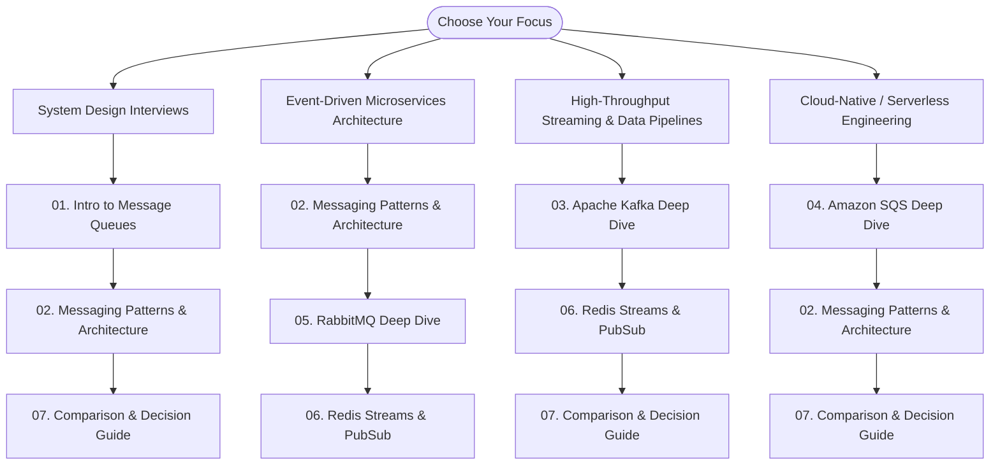

# Message Queues & Distributed Event Streaming: System Design Masterclass

Welcome to the **Message Queues and Distributed Event Streaming** series. This repository provides an exhaustive, production-grade reference for modern asynchronous architectures, distributed logs, task queues, and message brokers. 

Every guide in this module is engineered with comprehensive **High-Level Designs (HLD)** and **Low-Level Designs (LLD)**, exploring architectural topologies, wire protocols, storage engine internals, memory models, consensus algorithms, failover mechanics, and production implementation code.

---

## 📚 Curriculum & Module Directory

### [01. Introduction to Message Queues](01_Introduction_to_Message_Queues.md)
* **Core Philosophy**: Why message queues exist, distributed systems evolution (RPC vs Shared DB vs Asynchronous Messaging), and multi-dimensional decoupling (space, time, synchronization, format).
* **Communication Paradigms**: Synchronous vs Asynchronous (cascading latency, thread starvation), Push vs Pull consumer models, Point-to-Point (Queues) vs Publish-Subscribe (Topics) vs Distributed Append-Only Logs.
* **High-Level Design (HLD)**: Distributed message broker architecture, producer gateways, routing/exchange engines, consumer coordinators, end-to-end message lifecycle sequence, and broker cluster topologies (Active-Passive vs Quorum Consensus).
* **Low-Level Design (LLD)**: Binary frame envelope schema, in-memory lock-free ring buffers (Disruptor pattern), disk-backed append-only logs with sparse indexing, reactor threading models, TCP backpressure, and credit-based flow control.
* **Reliability & Guarantees**: Delivery semantics (At-Most-Once, At-Least-Once, Exactly-Once with PID and Sequence Numbers), partition-level ordering with MurmurHash2, and DLQ state machines with full jitter exponential backoff.
* **Runnable Implementation**: Complete in-memory thread-safe message queue engine with visibility timeout leases and DLQ routing.

### [02. Messaging Patterns and Architecture](02_Messaging_Patterns_and_Architecture.md)
* **Enterprise Patterns with HLD & LLD**:
  1. *Competing Consumers*: Worker pool scaling, prefetch tuning, visibility leases, lock extension heartbeats.
  2. *Fan-Out & Pub-Sub*: Exchange/topic routing, trie-based wildcard matching (`*.news.#`), copy-on-write buffers.
  3. *Request-Reply (Async RPC)*: Dynamic ephemeral vs shared reply queues, correlation ID mapping tables, timeout timers.
  4. *Transactional Outbox & CDC*: Resolving dual-writes, outbox table schema, polling `SKIP LOCKED` vs WAL tailing (Debezium).
  5. *Saga Pattern*: Choreography vs Orchestration, Saga Execution Coordinator (SEC) state machine, forward vs compensating transactions, pivot steps.
  6. *Multi-Tier Retry & Dead Letter Queue (DLQ)*: Stepped retry queues with exponential backoff and full jitter, automated redrive.
  7. *Priority Queues & Fair Scheduling*: Priority binary heaps vs multi-queue Weighted Round Robin (WRR) to prevent starvation.
  8. *Message Deduplication & Idempotent Consumer*: Redis `SETNX` fast-path + relational DB atomic upserts and state machines.
  9. *Claim Check Pattern*: Large payload offloading to S3/GCS, pointer message envelope, atomic garbage collection lifecycle.
  10. *Delayed & Scheduled Messaging*: Hierarchical Timing Wheels (HTW), min-heap schedulers, Redis Sorted Sets (`ZADD`/`ZRANGEBYSCORE`).
  11. *Circuit Breakers & Backpressure*: Downstream overload protection, token bucket flow control, closed/open/half-open state machines.
* **End-to-End Enterprise Case Study**: Comprehensive e-commerce order fulfillment pipeline architecture and sequence trace.

### [03. Apache Kafka Deep Dive](03_Apache_Kafka_Deep_Dive.md)
* **High-Level Design (HLD)**: Distributed append-only commit log architecture, KRaft consensus metadata quorum (`@metadata` topic) replacing ZooKeeper, broker cluster topologies, partition distribution, active controller elections, and unclean leader election risks.
* **Low-Level Design (LLD) - Storage Engine**: File system layout, binary byte layouts of `.log`, `.index`, `.timeindex`, `.txnindex`, and `leader-epoch-checkpoint`. Sparse index binary search and seek algorithms. Log compaction SkimpyOffsetMap internals.
* **Low-Level Design (LLD) - Kernel & Zero-Copy I/O**: Linux Page Cache write-through and read-ahead mechanics, `sendfile()` system call flow (2 context switches, 0 CPU buffer copies, DMA transfer directly from Page Cache to network socket).
* **Low-Level Design (LLD) - Producer Internals**: `RecordAccumulator`, `MemoryPool` direct `ByteBuffer` allocation, `Sender` I/O thread, Murmur2 hashing, idempotent producer (PID + Sequence Numbers), and Transaction Coordinator 2-Phase Commit state machine.
* **Low-Level Design (LLD) - Consumer Internals & Coordination**: Consumer Group Coordinator state machine, Eager vs Incremental Cooperative Rebalance protocols, `HeartbeatThread` vs `max.poll.interval.ms` worker thread, and `FetchSessionCache`.
* **Low-Level Design (LLD) - Replication & Durability**: In-Sync Replicas (ISR), Log End Offset (LEO), High Watermark (HW), Leader Epoch checkpoint bug mitigation, and mathematical durability proofs (`acks=all` with `min.insync.replicas`).
* **Ecosystem & Code**: Kafka Streams (KTable/KStream, RocksDB state stores), Kafka Connect, Confluent Schema Registry (Avro binary wire protocol), and production Python/Go code.

### [04. Amazon SQS Deep Dive](04_Amazon_SQS_Deep_Dive.md)
* **High-Level Design (HLD)**: AWS multi-AZ distributed queue infrastructure, frontend request gateways, partition locator / request router, distributed storage fleet (quorum replication ring), metadata coordinator, and message lifecycle.
* **Low-Level Design (LLD) - Lease Engine & Visibility Timeout**: Message in-flight state machine, Receipt Handle cryptographic token anatomy (Node ID, Partition ID, Message ID, Expiration Epoch, HMAC secret), dynamic lease extension watchdog daemon.
* **Low-Level Design (LLD) - Standard vs FIFO Queues**: Standard queue weighted random sampling across storage hosts; FIFO 5-minute sliding window deduplication engine (SHA-256 content hashing vs explicit IDs), Message Group ID sequential locking, and High-Throughput FIFO partitioning.
* **Low-Level Design (LLD) - Polling Mechanics**: Short polling (random subset sampling) vs Long polling (distributed epoll/multiplexing wait queues, up to 20s), cost and network efficiency profiles.
* **Integration Architectures**: SQS + SNS cross-account fan-out with JSON filter policy engines, SQS Extended Client (S3 payload pointer envelope, multipart uploads, lifecycle rules).
* **Production Code & Operations**: Resilient long-polling worker with automated visibility extension thread, partial batch failure handling (`ReportBatchItemFailures`), and automated DLQ redrive.

### [05. RabbitMQ Deep Dive](05_RabbitMQ_Deep_Dive.md)
* **High-Level Design (HLD)**: Erlang OTP & BEAM virtual machine architecture (lightweight BEAM processes per connection, per channel, and per queue; asynchronous message passing via Erlang mailboxes), Mnesia distributed schema database, and vHost multi-tenancy.
* **Low-Level Design (LLD) - AMQP 0-9-1 Protocol Frame Layout**: Binary wire format (Method, Header, Body, Heartbeat frames, Frame End octet `0xCE`), `basic.publish` frame sequence, connection and channel multiplexing over a single TCP socket.
* **Low-Level Design (LLD) - Exchange Routing Trie**: Direct (hash table), Fanout (broadcast), Topic (trie wildcard matching with `*` and `#`), and Headers (bitmask matching).
* **Low-Level Design (LLD) - Storage Engines & Quorum Queues**: Classic Queues (`msg_store_persistent`/`msg_store_transient` paging) vs Quorum Queues (Raft consensus log, WAL compaction, state machine replication), credit-based flow control, and memory high watermark alarms.
* **Reliability & Topologies**: Publisher Confirms and fsync correlation, consumer ACKs (`basic.ack`, `basic.nack`, `basic.reject`), channel vs consumer prefetch QoS, Dead Letter Exchanges (DLX), and RabbitMQ Delayed Message Plugin (min-heap scheduler).
* **Production Code & Clustering**: Resilient publisher with confirms and mandatory returns, multi-threaded consumer worker with manual ack, and cluster split-brain mitigation (`pause_minority` vs `autoheal`).

### [06. Redis Streams and Pub/Sub Deep Dive](06_Redis_Streams_and_PubSub_Deep_Dive.md)
* **Messaging Evolution in Redis**: Key-Value -> Lists (`LPUSH`/`BRPOP`) -> Pub/Sub -> Sorted Sets -> Streams (Redis 5.0+).
* **Redis Pub/Sub LLD**: Brokerless push architecture, C internal data structures (`pubsub_channels` dictionary and `pubsub_patterns` linked list), client output buffer limits, and at-most-once fire-and-forget semantics.
* **Redis Lists as Task Queues**: Reliable processing queues using `RPOPLPUSH` / `LMOVE`, consumer crash recovery workers, and single-consumer limitations.
* **Redis Streams High-Level Design (HLD)**: Append-only in-memory log, fan-out stream reading vs Consumer Group load balancing, stream offsets, and worker state coordination.
* **Redis Streams Low-Level Design (LLD)**: Radix Tree (`rax`) containing `listpack` arrays, delta encoding of entry IDs, field-value string compression, 128-bit Entry ID anatomy (`<millisecondsTime>-<sequenceNumber>`), and monotonic clock guarantees.
* **Consumer Groups & PEL LLD**: Pending Entries List (`streamPendingEntry` radix tree tracking delivery timestamp, consumer pointer, delivery count), `XREADGROUP`, `XACK`, stalled worker detection (`XPENDING`), claiming via `XCLAIM` / `XAUTOCLAIM`, and DLQ routing.
* **Memory Management & Clustering**: Exact (`=`) vs Approximate (`~`) trimming (O(1) listpack eviction), `MINID` time-based eviction, Redis Cluster single-slot hash tags (`{stream_key}`), and AOF/RDB durability trade-offs.
* **Production Code**: Full producer/consumer worker suite with automatic claim thread and poison pill dead-lettering.

### [07. Message Queue Comparison and Decision Guide](07_Message_Queue_Comparison_and_Decision_Guide.md)
* **Core Paradigms Compared**:
  1. *Distributed Commit Log Paradigm* (Apache Kafka)
  2. *Traditional Smart Broker Paradigm* (RabbitMQ)
  3. *Cloud-Native Managed Queue Paradigm* (Amazon SQS)
  4. *In-Memory Append-Only Log Paradigm* (Redis Streams)
* **Exhaustive Comparison Matrix**: 25+ technical dimensions evaluated across all 4 systems (storage engine, memory model, throughput, latency, ordering scope, delivery semantics, pull vs push, replayability, multi-tenancy, ops complexity).
* **Low-Level Mechanics Deep-Dive**: Storage disk I/O, consumer tracking protocols, consensus algorithms, latency vs throughput trade-off curves under heavy stress.
* **Multi-Dimensional Decision Framework**: Comprehensive decision flowchart guiding architects through key constraints (throughput, latency, retention, routing complexity, cloud lock-in).
* **Hybrid Architectures (HLD & LLD)**: Kafka + SQS (Backbone + Shock Absorber), Kafka + Redis Streams (Log + Speed Layer), RabbitMQ + Kafka (Microservice RPC + Data Lake).
* **Zero-Downtime Migration Playbooks**: Step-by-step blueprints for RabbitMQ -> Kafka, SQS -> Kafka, and Kafka -> Redis Streams (Dual-writing, CDC Outbox, shadow consumer validation, traffic shifting).
* **Anti-Patterns & Traps**: Common pitfalls in production deployments.
* **Senior/Staff Interview Guide**: 20 rigorous system design interview questions and expert answers.

---

## 🎯 Recommended Reading Paths

| Role / Objective | Recommended Sequence | Key Focus Areas |
| :--- | :--- | :--- |
| **System Design Interview Prep** | `01` ➔ `02` ➔ `07` ➔ `03` | Delivery semantics, Transactional Outbox, Saga, Storage internals, Technology trade-offs |
| **Microservices Backend Architect** | `01` ➔ `02` ➔ `05` ➔ `06` | Competing consumers, Request-Reply, DLQ topologies, AMQP routing, Redis task queues |
| **Data Platform & Streaming Engineer** | `01` ➔ `03` ➔ `06` ➔ `07` | Commit log internals, Page cache zero-copy, Partition rebalancing, KRaft consensus, Schema Registry |
| **AWS Cloud-Native / Serverless Engineer** | `01` ➔ `04` ➔ `02` ➔ `07` | Visibility timeouts, FIFO deduplication, SNS fan-out, Lambda ESM scaling, S3 claim check |

---

## 🛠️ Technology Quick Comparison

| Dimension | Apache Kafka | Amazon SQS | RabbitMQ | Redis Streams |
| :--- | :--- | :--- | :--- | :--- |
| **Primary Paradigm** | Distributed Append-Only Log | Distributed Cloud Queue | Smart Broker / Exchange | In-Memory Log Structure |
| **Throughput Capacity** | Millions msg/sec | Hundreds of thousands msg/sec | 50,000 - 100,000 msg/sec | 100,000+ msg/sec per node |
| **p99 Latency** | 2 - 10 ms | 15 - 50 ms | 1 - 5 ms | < 1 ms (Sub-millisecond) |
| **Storage Medium** | Disk (OS Page Cache sequential) | Distributed Multi-AZ SSDs | RAM first, pages to disk | RAM first, AOF/RDB persistence |
| **Consumer Model** | Pull (Long-poll batching) | Pull (HTTP Long-poll) | Push (`basic.consume`) / Pull | Pull (`XREADGROUP` blocking) |
| **Message Ordering** | Strict per partition | Best-effort (Std) / Strict (FIFO) | Strict per queue | Strict per stream |
| **Message Replay** | Native (Offset rewind) | Unsupported (Deleted on ACK) | Unsupported (Deleted on ACK) | Native (`XRANGE` / offset rewind) |
| **Routing Flexibility** | Low (Partition key hash) | Low (Queue destination) | Extremely High (Topic/Direct/Headers) | Low (Stream key) |
| **Operational Overhead** | High (KRaft / JVM / OS tuning) | Zero (Fully managed serverless) | Medium (Erlang BEAM / Clustering) | Low-Medium (Redis Cluster / Memory) |
