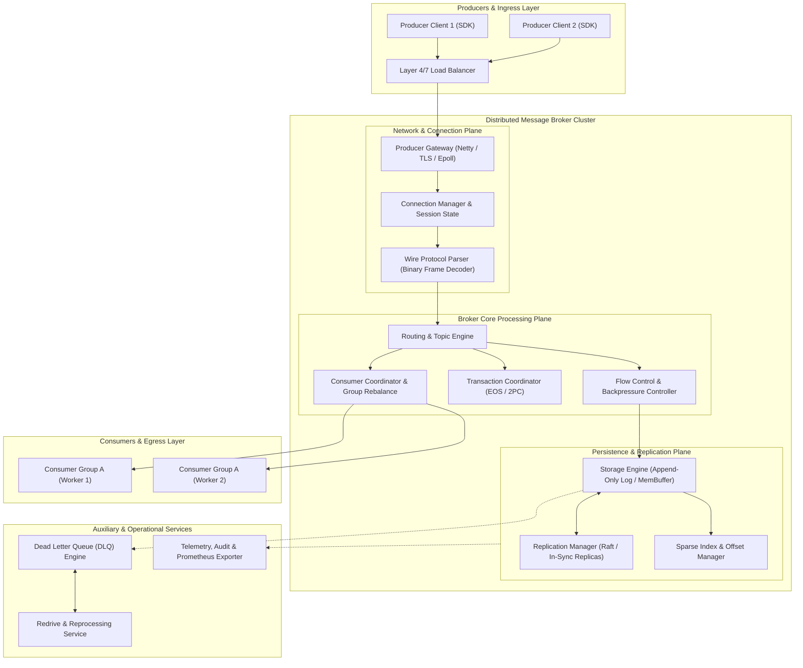
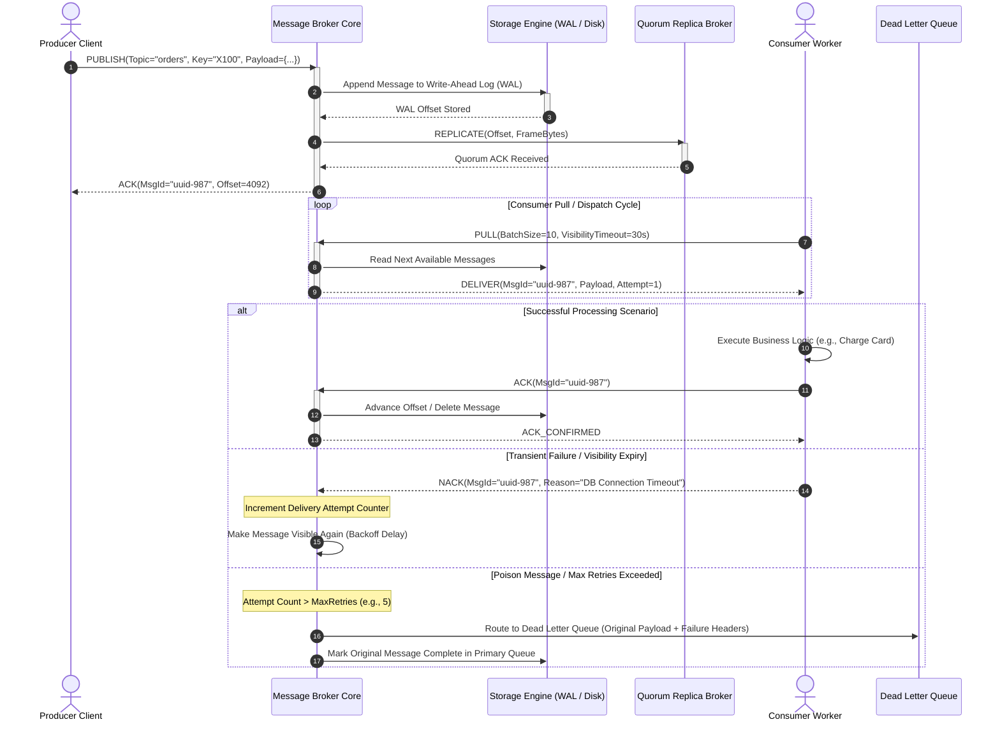
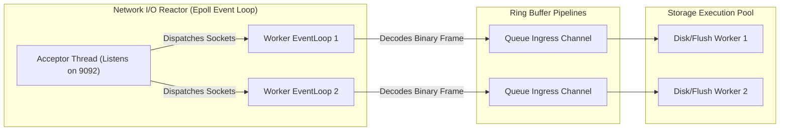
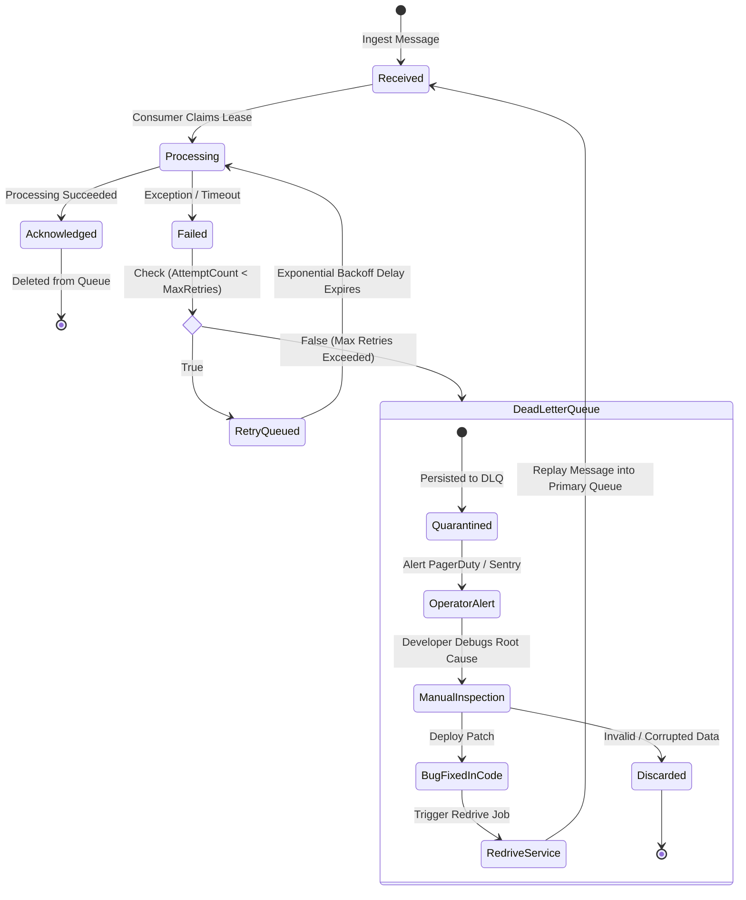

# Introduction to Message Queues: The Definitive Architectural Guide

## 1. Executive Overview & Historical Evolution

### 1.1 The Genesis of Asynchronous Messaging
In early distributed architectures, service-to-service communication was modeled predominantly around **Remote Procedure Calls (RPC)** and synchronous request-response protocols (HTTP/REST, CORBA, SOAP). While intuitive—mimicking local function invocation—synchronous paradigms enforce severe operational coupling:

```
[Service A] --(blocks thread)--> [Service B] --(blocks thread)--> [Service C]
    |                                 |                                 |
    +-----> Latency = Sum(L_A + L_B + L_C) + NetworkRTT                |
    +-----> Availability = Avail(A) * Avail(B) * Avail(C)              |
    +-----> If Service C fails -> Service B exhausts thread pool -> Service A collapses (Cascading Failure)
```

Distributed computing also experimented with **Shared Database Integration**, where services communicated by reading and writing to a centralized database. This created crippling database lock contention, schema coupling, and a single catastrophic point of failure (SPOF).

To resolve these systemic failure modes, **Asynchronous Message Queuing** emerged. A message queue acts as an intermediary, durable buffer that accepts messages from producers and delivers them to consumers asynchronously. The sender does not wait for the receiver to process the payload; instead, delivery and execution are decoupled across space, time, and computational capacity.

| Integration Pattern | Coupling Level | Availability Formula ($N$ services) | Failure Characteristics | Throughput Scalability |
| :--- | :--- | :--- | :--- | :--- |
| **Synchronous RPC / REST** | Tight (Temporal & Spatial) | $A_{system} = \prod_{i=1}^N A_i$ | Cascading failure, thread starvation, timeout cascades | Limited by slowest downstream dependency |
| **Shared Database** | Tight (Schema & Storage) | Single Point of Failure (DB) | Lock contention, deadlock risk, schema migration hell | Constrained by database write IOPS |
| **Message Queue / Log** | Loose (Fully Decoupled) | $A_{system} = A_{producer} \times A_{broker}$ | Isolated failure domains, traffic buffering, graceful retries | Independent horizontal scaling of producers/consumers |

---

### 1.2 The Four Dimensions of Decoupling
An architectural message queue establishes decoupling across four fundamental dimensions:

1. **Space (Location) Decoupling**:
   - The producer needs no knowledge of the consumer's identity, IP address, port, or network topology.
   - The producer targets a logical abstraction (queue, topic, exchange). Service discovery and routing are offloaded entirely to the message broker.
2. **Time (Temporal) Decoupling**:
   - The producer and consumer do not need to be concurrently available.
   - A producer can publish millions of messages while the consumer is offline or undergoing maintenance. When the consumer restarts, it consumes the queued backlog at its own pace.
3. **Synchronization Decoupling (Non-Blocking Execution)**:
   - Producers fire a message onto the broker and regain control immediately (typically sub-millisecond network ACK).
   - Calling threads are never blocked waiting for heavyweight downstream tasks (e.g., PDF generation, payment settlement, fraud machine-learning inference).
4. **Format & Protocol Decoupling (Schema Boundary)**:
   - The message payload acts as an immutable data contract (Protocol Buffers, Avro, JSON Schema).
   - Producers and consumers can evolve across different runtime environments (e.g., a Rust ingestion gateway sending protobuf messages consumed by a Python ML worker).

---

### 1.3 Core Distributed Systems Benefits

```
                  UNBUFFERED (TRAFFIC SPIKE COLLAPSE)
Traffic (RPS) 
     ▲
100k ┼         /\
     │        /  \   <-- Spike overwhelms database connection pool
 10k ┼───────/────\─────────────────────────── System Capacity
     │      /      \
     └─────┴────────┴───────────────────────► Time

                   BUFFERED VIA MESSAGE QUEUE (LOAD LEVELING)
Traffic (RPS)
     ▲
100k ┼         /\    [ Enqueued in Durable Queue ]
     │        /  \   
 10k ┼───────/────\──[ Consumer Pool Pulls at Steady 10k RPS ]──────► DB Safe
     │      /      \
     └─────┴────────┴───────────────────────► Time
```

- **Traffic Spike Buffering / Load Leveling ("Leaky Bucket" Effect)**: Absorbs extreme peak ingestion rates (e.g., Black Friday flash sales) and meters delivery to downstream databases and APIs at a sustainable processing rate.
- **Blast Radius & Fault Isolation**: If downstream workers crash due to memory leaks or deadlocks, incoming traffic is not rejected. The broker persists incoming messages until the consumer tier heals.
- **Elastic Horizontal Scaling**: Producers and consumers scale independently based on orthogonal metrics: producers scale on ingress network bandwidth, while consumers scale dynamically based on **queue backlog depth** (lag).
- **Asynchronous Fan-Out**: A single business event (e.g., `OrderPlaced`) can be broadcast to dozens of decoupled microservices (Inventory, Billing, Notifications, Analytics) with zero performance degradation on the primary checkout flow.

---

## 2. Core Architectural Approaches & Communication Paradigms

### 2.1 Synchronous vs Asynchronous Communication: System Dynamics

Synchronous communication creates an interconnected dependency graph where latency and failure probabilities compound multiplicatively.

#### 1. Latency Cascading & Tail Latency Amplification
In a synchronous chain $S_1 \rightarrow S_2 \rightarrow S_3 \dots \rightarrow S_n$, overall latency is additive. Worse, distributed tail latency ($P_{99}$) compounds exponentially. If each service has a $P_{99}$ latency of 100ms:
$$\text{Probability that a request touches a } P_{99} \text{ latency path} = 1 - (1 - 0.01)^n$$
For a call graph of 10 services, over 9.5% of all requests suffer from $P_{99}$ latency degradation.

#### 2. Thread Exhaustion & Starvation
Synchronous HTTP/1.1 and blocking RPC clients allocate a dedicated operating system thread per in-flight request. If downstream service $S_2$ slows down from 20ms to 2000ms, connections pile up in $S_1$'s connection pool. Thread pools saturate within seconds, rejecting incoming client requests with `503 Service Unavailable` or crashing the JVM/runtime with `OutOfMemoryError: unable to create new native thread`.

#### 3. Temporal Coupling
If any downstream participant in a synchronous chain is unreachable, the entire user-facing transaction aborts unless fallback logic is meticulously engineered.

---

### 2.2 Four Messaging Paradigms Deep Dive

Modern distributed architectures deploy four distinct messaging paradigms:

```
1. POINT-TO-POINT (QUEUE)           2. PUBLISH-SUBSCRIBE (TOPIC)
   [P] ---> [ Queue ]                  [P] ---> [ Topic ]
               ├──► [C1] (Msg 1)                   ├──► [C1] (Msg 1, Msg 2)
               └──► [C2] (Msg 2)                   └──► [C2] (Msg 1, Msg 2)

3. APPEND-ONLY LOG (STREAM)         4. TASK / JOB QUEUE
   [P] ---> [ Partition 0 ]            [P] ---> [ Priority Queue ]
            [0][1][2][3][4]                        ├── Delay / Scheduled
               ▲     ▲                             ├── Exponential Retries
             (C1)   (C2)                           └── Worker Heartbeats
```

#### 1. Point-to-Point (Queue-Based)
- **Mechanics**: Messages are delivered to a named queue. Multiple consumers can listen to the queue, but **each message is processed by exactly one consumer**. The broker deletes or archives the message once acknowledged.
- **Work Distribution**: Competing Consumers Pattern. Enables straightforward horizontal scaling of worker processes.
- **Representative Systems**: RabbitMQ, AWS SQS, ActiveMQ.

#### 2. Publish-Subscribe (Topic-Based)
- **Mechanics**: Producers publish messages to a logical topic. The broker broadcasts a copy of each message to all subscribed consumer channels or queues.
- **Topology**: One-to-Many fanout. Producers have zero awareness of who is listening.
- **Representative Systems**: Google Cloud Pub/Sub, AWS SNS, Azure Service Bus Topics.

#### 3. Distributed Append-Only Commit Log (Stream-Based)
- **Mechanics**: Instead of treating messages as transient entities that disappear upon consumption, the broker records them sequentially in an immutable, append-only disk log.
- **State Model**: The broker is fundamentally stateless with respect to individual consumers. Consumers maintain their own read cursor (**offset**).
- **Multi-Reader & Replayability**: Multiple independent consumer groups read from the exact same log without interfering with each other. If a consumer introduces a bug, it can rewind its offset to epoch 0 and reprocess historical data.
- **Representative Systems**: Apache Kafka, Apache Pulsar, AWS Kinesis.

#### 4. Distributed Job/Task Queues
- **Mechanics**: Specialized point-to-point queues designed around complex execution workflows.
- **Features**: Built-in support for delayed execution, task deduplication windows, priority queues, automatic heartbeat monitoring, worker preemption, and DAG orchestration.
- **Representative Systems**: Celery, BullMQ, Sidekiq, Temporal (workflow orchestration engine).

---

### 2.3 Consumption Models: Push vs. Pull

The mechanism by which messages transition from the broker to the consumer determines system stability under heavy load.

```
PUSH MODEL (Broker-Driven)               PULL MODEL (Consumer-Driven)
 Broker ──────────Push Message─────────► Consumer   Consumer ─────────Fetch Request────────► Broker
 (Risks overwhelming consumer)                      (Consumer pulls strictly at its own capacity)
```

#### 1. Push Model (Broker-Driven)
- **Mechanism**: The broker maintains an open socket (TCP/WebSocket) to connected consumers and immediately pushes messages as they arrive in the queue.
- **Latency**: Minimal latency—messages are pushed immediately upon arrival.
- **The Flow Control Challenge**: If messages arrive at 50,000/sec and the consumer takes 100ms per message (capacity = 10/sec), the consumer's memory buffer quickly overflows, leading to OOM crashes.
- **Mitigation - Credit-Based Flow Control (e.g., AMQP 1.0, RabbitMQ Basic.QoS)**:
  - The consumer issues a prefetch credit (e.g., `prefetch_count = 100`).
  - The broker delivers up to 100 unacknowledged messages. As the consumer sends ACKs, credits replenish.

#### 2. Pull Model (Consumer-Driven / Long-Polling)
- **Mechanism**: The consumer continuously sends fetch requests (`GET /messages?max=50&timeout=20s`) to the broker.
- **Backpressure by Design**: The consumer requests only as many messages as it has idle worker threads or memory capacity for. It is physically impossible for the broker to overwhelm the consumer.
- **Batching & Throughput**: Enables massive batching optimizations. A single pull request can fetch 1MB of compressed records, maximizing network and disk I/O efficiency.
- **Long-Polling Optimization**: If the queue is empty, the broker holds the HTTP/TCP request open for a configured window (e.g., 20 seconds) until a message arrives, eliminating tight CPU-burning polling loops.

---

## 3. High-Level Design (HLD) of a Distributed Message Broker

### 3.1 Distributed Broker Architecture Topology

The following diagram illustrates the architecture of a fault-tolerant, horizontally scalable distributed message broker:



#### Core Subsystem Responsibilities
1. **Producer Gateway & Wire Protocol Parser**: Terminates TLS, authenticates client certificates/tokens, manages long-lived multiplexed TCP sockets, and decodes binary frames into structured in-memory commands.
2. **Routing Engine**: Inspects topic names, partitions, or routing keys (AMQP exchanges, Kafka topic-partitions) and resolves destination queues or physical storage partitions.
3. **Storage Engine**: Persists message envelopes into high-throughput storage structures (in-memory ring buffers, disk-backed segmented logs, or LSM-trees).
4. **Replication Manager**: Ensures durability by replicating message state across a quorum of peer brokers using consensus protocols (e.g., Raft, Paxos, or Kafka ISR).
5. **Consumer Coordinator**: Manages consumer memberships, partition assignments, heartbeat monitors, and distributed group rebalances.
6. **Dead Letter Queue (DLQ) & Redrive Engine**: Automatically quarantines unprocessable "poison" messages and exposes interfaces for replay.

---

### 3.2 Message Lifecycle End-to-End Sequence Diagram

The following sequence illustrates the complete end-to-end lifecycle of a durable, acknowledged message:



---

### 3.3 Broker High Availability & Clustering Topologies

#### 1. Active-Passive with Shared Storage (e.g., SAN/NFS or Shared EBS)
- **Architecture**: A primary broker processes all reads and writes. A standby broker sits idle, mounted to the same underlying network block storage.
- **Failover**: Heartbeat timeouts trigger an automated takeover by the standby broker.
- **Drawbacks**: Risk of split-brain if fencing mechanisms fail; slow failover (storage unmount/mount cycle); storage throughput bottleneck.

#### 2. Distributed Active-Active with Master-Replica Partitions (Kafka/Pulsar Model)
- **Architecture**: Topics are divided into multiple independent partitions. For each partition, one broker acts as **Partition Leader** while other brokers act as **Followers (Replicas)**.
- **Load Distribution**: Every broker in the cluster acts as a leader for some partitions and a follower for others, saturating CPU and network interfaces across all nodes.
- **Failover**: Millisecond-level leader election when a broker node drops out.

#### 3. Consensus Quorum Topologies (Raft / Paxos)
- **Architecture**: In-Sync Replicas (ISR) or dedicated Raft consensus groups (e.g., KRaft, RabbitMQ Quorum Queues based on Raft).
- **Durability Invariant**: A write is acknowledged to the producer only when written to a strict majority quorum:
$$Q = \left\lfloor \frac{N}{2} \right\rfloor + 1$$
For a 3-node cluster, 2 nodes must acknowledge. Can tolerate $F = \lfloor (N - 1) / 2 \rfloor = 1$ node failure without downtime.

---

## 4. Low-Level Design (LLD) of Message Queue Internals

### 4.1 Message Envelope & Wire Protocol Frame Binary Layout

To minimize network overhead and CPU serialization costs, production brokers utilize fixed-offset, binary framed protocols rather than verbose text formats like JSON or XML.

```
 0                   1                   2                   3
 0 1 2 3 4 5 6 7 8 9 0 1 2 3 4 5 6 7 8 9 0 1 2 3 4 5 6 7 8 9 0 1
+-+-+-+-+-+-+-+-+-+-+-+-+-+-+-+-+-+-+-+-+-+-+-+-+-+-+-+-+-+-+-+-+
|                      Magic Bytes (0xDEADBEEF)                 |
+-+-+-+-+-+-+-+-+-+-+-+-+-+-+-+-+-+-+-+-+-+-+-+-+-+-+-+-+-+-+-+-+
|        Protocol Version       |          Frame Flags          |
+-+-+-+-+-+-+-+-+-+-+-+-+-+-+-+-+-+-+-+-+-+-+-+-+-+-+-+-+-+-+-+-+
|                                                               |
+                       Message UUID (128-bit)                  +
|                                                               |
+-+-+-+-+-+-+-+-+-+-+-+-+-+-+-+-+-+-+-+-+-+-+-+-+-+-+-+-+-+-+-+-+
|                                                               |
+                     Correlation ID (128-bit)                  +
|                                                               |
+-+-+-+-+-+-+-+-+-+-+-+-+-+-+-+-+-+-+-+-+-+-+-+-+-+-+-+-+-+-+-+-+
|                     Timestamp (Epoch Nanos)                   |
|                                                               |
+-+-+-+-+-+-+-+-+-+-+-+-+-+-+-+-+-+-+-+-+-+-+-+-+-+-+-+-+-+-+-+-+
|      Routing Key Length       |     Routing Key (UTF-8) ...   |
+-+-+-+-+-+-+-+-+-+-+-+-+-+-+-+-+-+-+-+-+-+-+-+-+-+-+-+-+-+-+-+-+
|      Headers Length (Bytes)   |     Headers Key-Value Map ... |
+-+-+-+-+-+-+-+-+-+-+-+-+-+-+-+-+-+-+-+-+-+-+-+-+-+-+-+-+-+-+-+-+
|      Payload Length (Bytes)   |     Payload Binary Content... |
+-+-+-+-+-+-+-+-+-+-+-+-+-+-+-+-+-+-+-+-+-+-+-+-+-+-+-+-+-+-+-+-+
|                        CRC32 Checksum                         |
+-+-+-+-+-+-+-+-+-+-+-+-+-+-+-+-+-+-+-+-+-+-+-+-+-+-+-+-+-+-+-+-+
```

#### Binary Frame Field Breakdown Table

| Field Name | Byte Offset | Type / Size | Purpose & Technical Specification |
| :--- | :--- | :--- | :--- |
| **Magic Bytes** | `0x00 - 0x03` | `uint32` (4B) | Protocol delimiter (`0xDEADBEEF`). Confirms valid frame boundaries over raw TCP byte streams. |
| **Protocol Version** | `0x04 - 0x05` | `uint16` (2B) | Wire protocol version for backward/forward compatibility negotiation. |
| **Frame Flags** | `0x06 - 0x07` | `uint16` (2B) | Bitmask flags: Bit 0 = Compressed (Gzip/Snappy/Zstd), Bit 1 = Idempotent, Bit 2 = Transactional. |
| **Message UUID** | `0x08 - 0x17` | `uint128` (16B) | Universally unique message identifier generated by broker or producer for deduplication. |
| **Correlation ID** | `0x18 - 0x27` | `uint128` (16B) | Distributed tracing identifier (e.g., OpenTelemetry trace ID) propagating across microservices. |
| **Timestamp** | `0x28 - 0x2F` | `uint64` (8B) | Unix epoch nanosecond timestamp at ingestion. Used for SLA latency tracking and retention purge. |
| **Routing Key Length** | `0x30 - 0x31` | `uint16` (2B) | Size ($K$) of the routing key in bytes. |
| **Routing Key** | `0x32 - (0x32+K)` | `byte[K]` | UTF-8 encoded topic name, partition key, or direct routing exchange target. |
| **Headers Length** | Variable | `uint32` (4B) | Size ($H$) of the user attributes / message metadata dictionary. |
| **Headers Map** | Variable | `byte[H]` | Serialized key-value attributes (e.g., `content-type`, `auth-context`, `retry-count`). |
| **Payload Length** | Variable | `uint32` (4B) | Size ($P$) of the raw message body. |
| **Payload Bytes** | Variable | `byte[P]` | Unstructured or serialized binary payload (Protobuf, Avro, JSON). |
| **CRC32 Checksum** | End - 4B | `uint32` (4B) | Cyclic Redundancy Check validating frame integrity against bit rot and network corruption. |

---

### 4.2 Storage Engine Data Structures

Brokers utilize specialized storage engines engineered around specific throughput, latency, and access pattern trade-offs.

#### 1. In-Memory Ring Buffer (Lock-Free Disruptor Pattern)
For ultra-low latency, in-memory queues (e.g., LMAX Disruptor, Redis memory queue), traditional mutexes create severe CPU lock contention and thread context-switching overhead.
- **Data Structure**: A pre-allocated, fixed-size circular array of size $2^n$.
- **Index Masking**: Array index calculations bypass costly modulo division (`%`) using bitwise AND:
  $$\text{Index} = \text{Sequence} \ \& \ (\text{BufferCapacity} - 1)$$
- **Cache Line Padding**: Sequence pointers (`head`, `tail`) are padded with 56 dummy bytes (7 `uint64` words) to ensure they reside on distinct 64-byte L1/L2 CPU cache lines, completely eliminating **False Sharing** across CPU cores.
- **Lock-Free Concurrency**: Producers claim slots using atomic Compare-And-Swap (`atomic.CompareAndSwapUint64`).

```
                    LOCK-FREE CIRCULAR RING BUFFER
                      [Slot 0]      [Slot 1]
                   ┌────────────┬────────────┐
         [Slot 7]  │            │            │  [Slot 2]
       ┌───────────┼────────────┴────────────┼───────────┐
       │           │                         │           │
       │   Padded  │  Array Size = 2^N       │   Padded  │
       │   Tail    │  Index = Seq & (2^N -1) │   Head    │
       │ (Atomic)  │                         │ (Atomic)  │
       │           │                         │           │
       └───────────┼────────────┬────────────┼───────────┘
         [Slot 6]  │            │            │  [Slot 3]
                   └────────────┴────────────┘
                      [Slot 5]      [Slot 4]
```

#### 2. Disk-Based Append-Only Commit Log with Sparse Index
Used by high-throughput streaming systems (Kafka, Pulsar).
- **Physical Structure**: A partition log is sliced into **Segment Files** (e.g., 1 GB per segment: `0000000000.log`) accompanied by a **Sparse Index File** (`0000000000.index`).
- **Sequential Disk I/O**: Writes only append to the tail of the active segment file, achieving sequential write speeds of 600+ MB/s on NVMe SSDs and avoiding random-access disk head seeks.
- **Sparse Indexing**: Instead of indexing every message, the index stores an entry every $4\text{ KB}$ of physical data:
  $$\text{Index Entry} = (\text{Logical Offset}: \text{uint32}, \text{Physical File Position}: \text{uint32})$$
  When seeking offset $N$, the broker performs an in-memory **Binary Search** over the sparse index to locate the nearest physical offset, followed by a short sequential scan in the log.
- **Memory-Mapped I/O (`mmap`) & Zero-Copy (`sendfile`)**: The sparse index and active log files are memory-mapped directly into the OS kernel page cache. Reading messages to send to network sockets bypasses user-space memory copying entirely via the Linux `sendfile(2)` system call:
  $$\text{Page Cache} \xrightarrow{\text{DMA Transfer}} \text{Network Interface Card (NIC) Buffer}$$

#### 3. B-Tree / Key-Value Backed State (RocksDB / LevelDB)
Traditional brokers like RabbitMQ or cloud queues like AWS SQS need to maintain granular per-message state: `AVAILABLE`, `IN_FLIGHT (VISIBILITY_LEASE)`, `ACKNOWLEDGED`, `DELAYED`.
- State transitions are recorded using Log-Structured Merge (LSM) trees or embedded B-Trees (RocksDB).
- Key layout for visibility lease timeouts:
  $$\text{Key} = \text{TenantID} \mathbin{\Vert} \text{QueueID} \mathbin{\Vert} \text{VisibilityDeadlineTimestamp} \mathbin{\Vert} \text{MsgUUID}$$
- An internal background sweeper scans this prefix sequentially to instantly identify expired leases and re-queue messages.

---

### 4.3 Concurrency, Threading, and I/O Multiplexing Model

High-performance brokers handle hundreds of thousands of concurrent client connections using an **Asynchronous Non-Blocking Reactor Pattern** (e.g., Netty, Java NIO Epoll/KQueue):



1. **Boss / Acceptor Reactor**: A single thread dedicated to accepting new TCP handshakes and registering socket channels with the OS `epoll(7)` / `kqueue(2)` selector.
2. **Worker EventLoop Group**: A pool of $2 \times N_{\text{cores}}$ threads. Each thread continuously polls ready I/O events, decodes binary message frames, and checks CRC32 sums. No blocking disk or database calls occur inside the EventLoop.
3. **Micro-Batching Buffers (`linger.ms` / `batch.size`)**:
   Instead of executing a disk write and network packet per message, incoming frames are collected in a memory buffer. The buffer flushes when:
   - Size limit reached: e.g., $\ge 64\text{ KB}$
   - Time limit reached: e.g., `linger.ms = 5ms`
   This transforms random, small I/O operations into massive sequential batch writes, multiplying broker throughput by orders of magnitude.

---

### 4.4 Flow Control, Congestion Control & Backpressure LLD

When ingress rates exceed consumption capacity, brokers enforce multi-tiered backpressure to protect against `OutOfMemoryError` failures:

1. **Credit-Based Flow Control (Protocol-Level)**:
   Consumers periodically advertise a credit balance $C$. For every message delivered, $C \leftarrow C - 1$. When $C = 0$, the broker suspends delivery immediately. The consumer grants additional credits only after freeing worker capacity.
2. **TCP Window Clamping**:
   If broker in-memory buffers approach critical memory thresholds (e.g., 85% JVM heap limit), the broker halts reading from the producer's TCP socket. The OS TCP receive buffer fills up, forcing the TCP sliding window size to zero (`TCP ZeroWindow`). The producer's local OS kernel halts its write buffer, applying immediate backpressure back up to the producing application thread.
3. **Token Bucket Rate Limiting**:
   Producers are metered using a token bucket algorithm with capacity $B$ and replenishment rate $R$ tokens/second. Bursts up to $B$ are permitted; sustained traffic above $R$ is rejected with a `RateLimitExceededException (429)`.

---

## 5. Delivery Semantics & Reliability Guarantees

Every message queue architecture must choose trade-offs along the spectrum of reliability, latency, and computational cost.

```
+---------------------------------------------------------------------------------------+
|                              DELIVERY SEMANTIC SPECTRUM                               |
+------------------------------+---------------------------+----------------------------+
|        AT-MOST-ONCE          |       AT-LEAST-ONCE       |        EXACTLY-ONCE        |
|  "Fire & Forget / Zero ACK"  |  "Redeliver Until ACKed"  | "Atomic Multi-Stage State" |
|  - Fastest, Zero Overhead    |  - Industry Standard      | - Highest Computational    |
|  - Message Loss Possible     |  - Duplicates Possible    |   & Coordination Overhead  |
|  - Use: Metrics, Sensor Data |  - Use: Payments, Orders  | - Use: Ledger Accounting   |
+------------------------------+---------------------------+----------------------------+
```

### 5.1 At-Most-Once Delivery
- **Mechanism**: The producer sends a message and assumes success without waiting for a broker ACK. The broker delivers to the consumer and marks it deleted immediately without waiting for a consumer ACK.
- **Failure Modes**:
  - Network drop between producer and broker $\rightarrow$ Message permanently lost.
  - Consumer crashes mid-processing $\rightarrow$ Message unrecoverable.
- **Use Cases**: High-volume telemetry, video stream telemetry, raw sensor metrics where losing 0.01% of samples is acceptable.

---

### 5.2 At-Least-Once Delivery
- **Mechanism**:
  1. Producer waits for an explicit persistence confirmation ACK from the broker. If a timeout occurs, the producer retries.
  2. The broker delivers the message to a consumer with a **Visibility Timeout Lease** (e.g., 30 seconds).
  3. The consumer must process the payload and send an explicit `ACK` back to the broker before the lease expires.
  4. If the consumer crashes or times out, the lease expires, and the broker re-queues the message for redelivery.
- **The Duplicate Problem**:
  If the consumer successfully executes the business logic (e.g., charges a credit card) but the network fails just before the ACK reaches the broker, the broker redelivers the message to another consumer. **Duplicates are guaranteed to occur**.
- **Mandatory Idempotent Consumer Pattern**:
  Downstream consumers must be strictly idempotent. This is implemented via a **Deduplication Store / Unique Constraint**:

```sql
-- Transactional Deduplication Table
BEGIN TRANSACTION;
  INSERT INTO processed_messages (message_id, processed_at) VALUES ('msg_uuid_987', NOW());
  -- If insert fails with UniqueConstraintViolation, abort transaction: duplicate detected!
  UPDATE accounts SET balance = balance - 100 WHERE account_id = 'acc_456';
COMMIT;
```

---

### 5.3 Exactly-Once Semantics (EOS) Deep Dive

True "Exactly-Once" processing across a distributed network is theoretically impossible without end-to-end coordination between producer, broker, and consumer. Modern systems achieve **Effectively-Once** processing via coordinated sub-mechanisms:

#### 1. Idempotent Producer (Deduplication at Ingestion)
The broker allocates each producer a unique 64-bit **Producer ID (PID)** during handshake. For each partition, the producer maintains a monotonically incrementing **Sequence Number ($S$)**.
- When the broker receives a frame with sequence $S$:
  - If $S = S_{\text{last}} + 1$: The broker appends the message, updates state to $S$, and returns an ACK.
  - If $S \le S_{\text{last}}$: The broker recognizes a duplicate (caused by a retried publish), drops the payload, but re-sends the ACK.
  - If $S > S_{\text{last}} + 1$: The broker detects an out-of-order gap and rejects the message with an error.

#### 2. Atomic Two-Phase Commit (2PC) & Transaction Coordinator
When a stream processor reads an input message, updates an internal database, and produces an output message, it must commit both operations atomically:
- A dedicated **Transaction Coordinator** tracks state transitions via a transactional log:
  $$\text{ONGOING} \longrightarrow \text{PREPARE_COMMIT} \longrightarrow \text{COMMITTED}$$
- Output messages are tagged with a transactional marker. Downstream consumers configured with `read_committed` isolation will buffer these messages and release them to client code **only when the COMMIT transaction marker arrives**.

#### 3. The Transactional Outbox Pattern
For monolithic or microservice architectures modifying a local relational database and publishing to a message broker, the **Transactional Outbox Pattern** ensures that database writes and message dispatches occur atomically without fragile distributed 2PC transactions:

```
[ Application Service ]
         │
         ▼ (Single ACID DB Transaction)
┌──────────────────────────────────────────────┐
│  Local RDBMS                                 │
│  ├── INSERT INTO orders (...)                │
│  └── INSERT INTO outbox_table (msg_payload)  │
└──────────────────────────────────────────────┘
         ▲
         │ (Tails Transaction Log / CDC)
┌──────────────────────────────────────────────┐
│  Outbox Relay / CDC Worker (Debezium)        │
└──────────────────────────────────────────────┘
         │
         ▼ (Publishes with At-Least-Once Retry)
┌──────────────────────────────────────────────┐
│  Message Broker (Kafka / RabbitMQ)           │
└──────────────────────────────────────────────┘
```

---

## 6. Message Ordering, Partitioning & Sharding LLD

### 6.1 Total Global Order vs Partition-Level Key Ordering

```
TOTAL GLOBAL ORDER (Single Log)             PARTITION-LEVEL ORDERING (Sharded)
 Throughput: Limited to ~50k msgs/sec       Throughput: Horizontally Scalable (Millions/sec)
 [P] ──► [ Partition 0 ] ──► [C]            [P] ──► [Hash(Key) % 3] ┬─► [Part 0 (Key A)] ──► [C1]
         (Single-threaded bottleneck)                               ├─► [Part 1 (Key B)] ──► [C2]
                                                                    └─► [Part 2 (Key C)] ──► [C3]
```

- **Total Global Order**: Requires routing all messages through a single physical partition/queue managed by a single leader thread. Throughput is fundamentally bounded by single-core CPU execution and single-disk write limits (typically $20\text{k} - 50\text{k}$ msgs/sec).
- **Partition-Level (Keyed) Ordering**: Scales throughput linearly by sharding topics into independent partitions. Messages sharing the same **Partition Key** (e.g., `user_id`, `order_id`) are routed to the exact same partition, preserving strict chronological ordering for related entity events while processing disjoint entities completely in parallel.

---

### 6.2 Consistent Hashing & MurmurHash2 Partitioning Algorithm

When a producer publishes a message with a string key, the SDK computes the target partition using a fast, uniform non-cryptographic hashing algorithm (e.g., MurmurHash2):

$$\text{PartitionIndex} = \left( \text{MurmurHash2}(\text{KeyBytes}) \ \& \ \text{0x7FFFFFFF} \right) \pmod{\text{NumPartitions}}$$

```python
def get_partition(key: str, num_partitions: int) -> int:
    import mmh3  # MurmurHash3
    # Mask with 0x7FFFFFFF to force positive integer representation
    hash_value = mmh3.hash(key) & 0x7FFFFFFF
    return hash_value % num_partitions
```

#### Consistent Hashing Ring for Dynamic Broker Topologies
If partitions scale up dynamically, standard modulo hashing causes massive partition remapping (cache invalidation). A **Consistent Hashing Ring** with virtual nodes maps keys to the nearest clockwise broker node, ensuring that when a broker is added or removed, only $K/N$ keys require re-routing.

---

### 6.3 Head-of-Line (HoL) Blocking: Root Causes and Mitigations

Head-of-Line blocking occurs when a single problematic message at the front of an ordered queue blocks all subsequent valid messages from being processed.

```
UNMITIGATED HoL BLOCKING:
Queue: [Msg 5 (Valid)] -> [Msg 4 (Valid)] -> [Msg 3 (POISON PILL)] 
                                                    │
                                                    ▼
                                           [Consumer Crashes]
                                           (All subsequent messages stalled!)

MITIGATED VIA PARALLELIZED SUB-QUEUE / DEAD-LETTERING:
Primary Log:  [Msg 5] ──► [Active Consumer Thread 2]
              [Msg 4] ──► [Active Consumer Thread 1]
Poison Log:   [Msg 3] ──► Max Retries Exceeded ──► [Routed to DLQ]
```

#### Mitigation Strategies
1. **Per-Key Sub-Queuing / Concurrency**: Consumers pull batches from a partition and fan them out internally into an array of in-memory queues partitioned by `entity_id`. A stuck `user_123` message halts only tasks for `user_123`, allowing tasks for `user_456` through `user_999` to proceed unimpeded.
2. **Immediate DLQ Offloading**: If an individual message fails processing with a non-retryable exception (e.g., JSON schema violation), the consumer must immediately bypass standard retries and ship the record directly to a Dead Letter Queue.
3. **Short Visibility Leases with Fast Exponential Escalation**: Keep initial visibility leases short (e.g., 5 seconds) to quickly detect healthy retry potential, but double the lease duration dynamically for subsequent retries.

---

## 7. Dead Letter Queues (DLQ) & Failure Recovery LLD

### 7.1 DLQ Lifecycle State Machine

A Dead Letter Queue is a specialized isolation queue that holds messages that the system cannot successfully process after repeated attempts.



---

### 7.2 Exponential Backoff with Full Jitter

When a consumer encounters a transient dependency failure (e.g., database connection pool exhaustion), retrying immediately exacerbates the bottleneck, resulting in a **Thundering Herd Problem**.

Systems must apply **Exponential Backoff with Full Jitter** (as formulated by AWS Architecture research):

$$\text{Sleep} = \text{random}(0, \ \min(\text{Cap}, \ \text{Base} \times 2^{\text{attempt}}))$$

```
Backoff Time (s)
     ▲
  32 ┼                                         ┌───────── Cap = 32s
     │                                     ┌───┤
  16 ┼                                 ┌───┤   │
     │                             ┌───┤   │   │  Full Jitter randomly
   8 ┼                         ┌───┤   │   │   │  picks any point within
     │                     ┌───┤   │   │   │   │  the shaded range [0, Backoff]
   4 ┼                 ┌───┤   │   │   │   │   │
     │             ┌───┤   │   │   │   │   │   │
   2 ┼         ┌───┤   │   │   │   │   │   │   │
     │     ┌───┤   │   │   │   │   │   │   │   │
   1 ┼─────┴───┴───┴───┴───┴───┴───┴───┴───┴───┴────────► Attempt Count
           1   2   3   4   5   6   7   8   9   10
```

#### Production Python Implementation: Full Jitter vs Equal Jitter
```python
import random
import time

def calculate_backoff_full_jitter(
    attempt: int, 
    base_backoff: float = 0.5, 
    max_backoff: float = 30.0
) -> float:
    """
    Computes sleep duration using Exponential Backoff with Full Jitter.
    Spreads retry traffic uniformly across the entire backoff interval.
    """
    # Calculate exponential cap: base * 2^attempt
    calculated_backoff = base_backoff * (2 ** attempt)
    # Clamp to maximum ceiling
    sleep_ceiling = min(max_backoff, calculated_backoff)
    # Pick uniform random float between 0 and ceiling
    return random.uniform(0.0, sleep_ceiling)

def calculate_backoff_equal_jitter(
    attempt: int, 
    base_backoff: float = 0.5, 
    max_backoff: float = 30.0
) -> float:
    """
    Equal Jitter: Preserves half the backoff deterministically, 
    jitters the remaining half to guarantee minimum spacing.
    """
    calculated_backoff = min(max_backoff, base_backoff * (2 ** attempt))
    half = calculated_backoff / 2.0
    return half + random.uniform(0.0, half)
```

---

### 7.3 Poison Message Detection & Quarantine Strategy

A **Poison Message** is a payload that invariably triggers an unhandled crash or fatal runtime exception whenever a consumer attempts to deserialize or execute it (e.g., malformed syntax, recursive JSON, illegal memory operation).

#### Production Defense Blueprint:
1. **Pre-Flight Schema Validation**: Validate against a registered schema (Protobuf, JSON Schema) before yielding to business logic.
2. **Explicit Non-Retryable Error Classification**:
   - `SerializationException`, `ValidationException`, `MalformedDataException`: Move directly to DLQ on `attempt == 1`.
   - `TimeoutException`, `ConnectionRefusedException`: Transient; eligible for exponential retry cycles.
3. **Execution Sandboxing & Crash Interception**: Wrap worker execution inside broad defensive catch blocks to prevent thread pool termination:
   ```python
   try:
       message = parse_and_validate(raw_bytes)
       process_business_logic(message)
       queue.ack(message.delivery_tag)
   except NonRetryableError as fatal_err:
       logger.error("Poison message detected: %s. Quarantining immediately.", fatal_err)
       dlq.route(raw_bytes, failure_context=str(fatal_err))
       queue.ack(delivery_tag)  # Drop from primary queue to unblock workers
   except TransientError as transient_err:
       queue.nack(delivery_tag, requeue=True)
   ```

---

## 8. Concrete Low-Level Code Implementation

Below is a complete, runnable, production-quality Python implementation of an in-memory, thread-safe message queue engine demonstrating:
- Custom binary-ready `MessageEnvelope` with metadata headers.
- Visibility timeout lease management.
- Concurrent worker processing with `Ack`, `Nack`, and `ExtendLease`.
- Automatic DLQ routing upon exceeding maximum delivery attempts.
- Re-entrant locks (`RLock`) and Condition variables (`Condition`) for thread synchronization.

```python
#!/usr/bin/env python3
"""
Production-grade Thread-Safe In-Memory Message Queue Engine
Demonstrating Visibility Timeouts, Leases, Retries, and DLQ Routing.
"""

import time
import uuid
import threading
from typing import Dict, Any, Optional, List
from dataclasses import dataclass, field
from enum import Enum, auto


class MessageState(Enum):
    AVAILABLE = auto()
    IN_FLIGHT = auto()
    ACKNOWLEDGED = auto()
    DEAD_LETTERED = auto()


@dataclass
class MessageEnvelope:
    payload: Any
    message_id: str = field(default_factory=lambda: str(uuid.uuid4()))
    correlation_id: str = field(default_factory=lambda: str(uuid.uuid4()))
    attributes: Dict[str, Any] = field(default_factory=dict)
    delivery_count: int = 0
    max_retries: int = 3
    state: MessageState = MessageState.AVAILABLE
    visibility_deadline: float = 0.0
    created_at: float = field(default_factory=time.time)

    def is_visible(self, now: float) -> bool:
        """Returns True if message is available for consumption."""
        if self.state == MessageState.AVAILABLE:
            return True
        if self.state == MessageState.IN_FLIGHT and now >= self.visibility_deadline:
            return True
        return False


class DistributedMessageQueue:
    def __init__(self, name: str, default_visibility_timeout: float = 5.0, max_retries: int = 3):
        self.name = name
        self.default_visibility_timeout = default_visibility_timeout
        self.max_retries = max_retries

        # Primary storage tables
        self._lock = threading.RLock()
        self._not_empty = threading.Condition(self._lock)
        
        # Message containers
        self._messages: Dict[str, MessageEnvelope] = {}
        self._available_keys: List[str] = []
        self._dlq: Dict[str, MessageEnvelope] = {}

        # Daemon thread to sweep expired visibility leases
        self._is_running = True
        self._sweeper_thread = threading.Thread(
            target=self._sweep_expired_leases, 
            name=f"{name}-lease-sweeper", 
            daemon=True
        )
        self._sweeper_thread.start()

    def publish(self, payload: Any, attributes: Optional[Dict[str, Any]] = None) -> str:
        """Enqueues a new message onto the broker."""
        with self._lock:
            envelope = MessageEnvelope(
                payload=payload,
                attributes=attributes or {},
                max_retries=self.max_retries
            )
            self._messages[envelope.message_id] = envelope
            self._available_keys.append(envelope.message_id)
            # Wake up one waiting consumer thread
            self._not_empty.notify()
            return envelope.message_id

    def poll(self, timeout: Optional[float] = None) -> Optional[MessageEnvelope]:
        """
        Retrieves a message from the queue, acquiring a visibility lease.
        Blocks until a message is available or timeout expires.
        """
        start_time = time.time()
        with self._lock:
            while not self._has_visible_messages():
                if timeout is not None:
                    elapsed = time.time() - start_time
                    remaining = timeout - elapsed
                    if remaining <= 0:
                        return None
                    self._not_empty.wait(timeout=remaining)
                else:
                    self._not_empty.wait()

            now = time.time()
            # Select the first visible message
            for idx, msg_id in enumerate(self._available_keys):
                msg = self._messages.get(msg_id)
                if msg and msg.is_visible(now):
                    # Remove from available queue
                    self._available_keys.pop(idx)
                    
                    # Update lease parameters
                    msg.delivery_count += 1
                    msg.state = MessageState.IN_FLIGHT
                    msg.visibility_deadline = now + self.default_visibility_timeout
                    return msg

            return None

    def ack(self, message_id: str) -> bool:
        """Acknowledges successful processing; permanently removes message."""
        with self._lock:
            msg = self._messages.get(message_id)
            if not msg:
                return False
            
            msg.state = MessageState.ACKNOWLEDGED
            del self._messages[message_id]
            return True

    def nack(self, message_id: str, error_reason: str = "") -> None:
        """
        Negative acknowledgement: Aborts current lease and forces retry or DLQ routing.
        """
        with self._lock:
            msg = self._messages.get(message_id)
            if not msg:
                return

            msg.attributes["last_error"] = error_reason
            self._handle_retry_or_dlq(msg)

    def extend_lease(self, message_id: str, additional_seconds: float) -> bool:
        """Extends visibility timeout for long-running processing jobs."""
        with self._lock:
            msg = self._messages.get(message_id)
            if not msg or msg.state != MessageState.IN_FLIGHT:
                return False
            
            now = time.time()
            if now >= msg.visibility_deadline:
                # Lease already expired!
                return False
            
            msg.visibility_deadline += additional_seconds
            return True

    def get_dlq_messages(self) -> List[MessageEnvelope]:
        """Inspects all quarantined dead-letter messages."""
        with self._lock:
            return list(self._dlq.values())

    def _has_visible_messages(self) -> bool:
        now = time.time()
        return any(
            self._messages[m_id].is_visible(now) 
            for m_id in self._available_keys 
            if m_id in self._messages
        )

    def _handle_retry_or_dlq(self, msg: MessageEnvelope) -> None:
        """Internal logic to evaluate retry threshold or quarantine to DLQ."""
        if msg.delivery_count >= msg.max_retries:
            # Maximum retries exceeded: Route to DLQ
            msg.state = MessageState.DEAD_LETTERED
            self._dlq[msg.message_id] = msg
            if msg.message_id in self._messages:
                del self._messages[msg.message_id]
        else:
            # Re-enqueue for retry
            msg.state = MessageState.AVAILABLE
            msg.visibility_deadline = 0.0
            if msg.message_id not in self._available_keys:
                self._available_keys.append(msg.message_id)
            self._not_empty.notify()

    def _sweep_expired_leases(self) -> None:
        """Continuous background sweeper that detects timed-out leases."""
        while self._is_running:
            time.sleep(0.5)
            with self._lock:
                now = time.time()
                for msg_id, msg in list(self._messages.items()):
                    if msg.state == MessageState.IN_FLIGHT and now >= msg.visibility_deadline:
                        # Visibility lease expired! Re-evaluate retry or DLQ
                        self._handle_retry_or_dlq(msg)

    def shutdown(self) -> None:
        """Gracefully stops background maintenance threads."""
        self._is_running = False
        with self._lock:
            self._not_empty.notify_all()


# =====================================================================
# Verification & Multi-Threaded Simulation Driver
# =====================================================================
if __name__ == "__main__":
    import logging
    logging.basicConfig(level=logging.INFO, format="%(asctime)s [%(threadName)s] %(message)s")

    queue = DistributedMessageQueue(name="order-events", default_visibility_timeout=2.0, max_retries=2)

    def worker_consumer(worker_id: int):
        while True:
            msg = queue.poll(timeout=1.0)
            if not msg:
                break

            logging.info(f"Worker-{worker_id} acquired MsgID={msg.message_id[:8]} "
                         f"(Attempt {msg.delivery_count}/{msg.max_retries}) | Payload={msg.payload}")

            # Simulate poison message handling
            if msg.payload == "POISON_PAYLOAD":
                logging.warning(f"Worker-{worker_id} encountered fatal poison pill! Sending NACK.")
                queue.nack(msg.message_id, error_reason="SyntaxError: Malformed Record")
                continue

            # Simulate long-running task requiring lease extension
            if msg.payload == "HEAVY_TASK":
                time.sleep(1.0)
                extended = queue.extend_lease(msg.message_id, additional_seconds=2.0)
                logging.info(f"Worker-{worker_id} extended lease: {extended}")
                time.sleep(1.5)
                queue.ack(msg.message_id)
                logging.info(f"Worker-{worker_id} ACKed MsgID={msg.message_id[:8]}")
                continue

            # Standard fast processing
            time.sleep(0.2)
            queue.ack(msg.message_id)
            logging.info(f"Worker-{worker_id} successfully ACKed MsgID={msg.message_id[:8]}")

    # Enqueue a batch of heterogeneous messages
    queue.publish(payload={"order_id": 1001, "amount": 49.99})
    queue.publish(payload="POISON_PAYLOAD")  # Will be retried and moved to DLQ
    queue.publish(payload="HEAVY_TASK")      # Will test lease extension
    queue.publish(payload={"order_id": 1002, "amount": 12.50})

    # Spawn concurrent worker pool
    threads = []
    for i in range(2):
        t = threading.Thread(target=worker_consumer, args=(i + 1,), name=f"Worker-{i+1}")
        threads.append(t)
        t.start()

    for t in threads:
        t.join()

    # Verify DLQ contents
    dlq_items = queue.get_dlq_messages()
    logging.info(f"Execution complete. DLQ Item Count: {len(dlq_items)}")
    for item in dlq_items:
        logging.info(f"Quarantined DLQ Item: {item.message_id[:8]} | "
                     f"Payload: {item.payload} | Error: {item.attributes.get('last_error')}")

    queue.shutdown()
```

---

## 9. Real-World Architectural Case Studies

### 9.1 Case Study 1: E-Commerce Distributed Checkout Pipeline

An e-commerce checkout flow requires orchestrating multiple independent microservices (Payment, Inventory, Shipping, Notification, Analytics) while ensuring high availability, fault tolerance, and eventual consistency.

```mermaid
flowchart TD
    Client["Mobile / Web Client"] -->|1. POST /checkout| APIGW["API Gateway"]
    APIGW -->|2. Create Order (Status: PENDING)| OrderSvc["Order Service"]
    OrderSvc -->|3. Persist Order| OrderDB[("Order DB")]
    OrderSvc -->|4. Publish OrderCreated Event| TopicOrder["Topic: order.created"]

    subgraph MessagingTier ["Distributed Message Broker (Kafka / RabbitMQ)"]
        TopicOrder
        TopicPayment["Topic: payment.processed"]
        TopicInventory["Topic: inventory.reserved"]
        DLQCheckout["Dead Letter Queue: checkout-dlq"]
    end

    TopicOrder -->|Consume| PaymentSvc["Payment Service"]
    PaymentSvc -->|Execute Charge| Stripe["Stripe API Gateway"]
    PaymentSvc -->|Publish PaymentSuccess| TopicPayment
    PaymentSvc -.->|Failed 3x| DLQCheckout

    TopicPayment -->|Consume| InventorySvc["Inventory Service"]
    InventorySvc -->|Deduct Stock| InventoryDB[("Inventory DB")]
    InventorySvc -->|Publish StockDeducted| TopicInventory

    TopicPayment -->|Consume| NotifSvc["Notification Service"]
    NotifSvc -->|Send Push/Email| SendGrid["SendGrid / Twilio"]

    TopicInventory -->|Consume| ShippingSvc["Fulfillment & Shipping Service"]
    ShippingSvc -->|Create Waybill| Logistics["Logistics API"]
    TopicInventory -->|Update Status: CONFIRMED| OrderSvc
```

#### Architectural Execution Rules:
1. **User Experience**: The user receives an immediate `202 Accepted` response with an `order_id` in $< 150\text{ ms}$. Heavy payment calls and inventory locks are moved off the critical path.
2. **Saga Choreography**: Microservices react to domain events. If payment succeeds but inventory reservation encounters an out-of-stock condition, a compensating transaction event (`inventory.failed`) is emitted to trigger an automated refund via the Payment Service.
3. **Failure Isolation**: If SendGrid undergoes a 30-minute outage, notification events queue safely in the broker without impeding payment settlement or order fulfillment.

---

### 9.2 Case Study 2: High-Throughput Log & Telemetry Ingestion Pipeline (10M msgs/sec)

```
[ 100,000 App Pods ]
         │ (High-speed UDP / Local FluentBit Daemon)
         ▼
[ Edge Ingress Layer (Envoy / L4 Network Load Balancers) ]
         │ (Multiplexed TCP / mTLS)
         ▼
[ Ingestion Gateway Fleet (Go / Rust Netty Epoll) ]
         │ (Micro-batching: linger.ms=10ms, batch.size=128KB, Snappy Compression)
         ▼
[ Partitioned Append-Only Streaming Cluster (Kafka / Pulsar) ]
  ├── Partition 0  ──► Consumer Group Stream Processor (Apache Flink)
  ├── Partition 1  ──► Real-Time Anomaly Detection Engine
  └── Partition N  ──► Long-term S3 Parquet Archiver (Vector / ClickHouse)
```

#### Key Architecture Optimizations:
- **Client-Side Batching & Compression**: Edge agents buffer logs locally and compress them with Snappy/Zstandard, slashing network payload size by 75% and reducing TCP packet count by 98%.
- **Zero-Copy Disk Flushing**: Ingestion brokers write sequentially to append-only logs, relying on the Linux OS Page Cache.
- **Partition Capacity Sizing**: To sustain 10,000,000 messages/sec at 500 bytes/message ($5\text{ GB/sec}$ aggregate ingress):
  $$\text{Partitions Required} = \frac{5{,}000\text{ MB/sec}}{25\text{ MB/sec per partition max write limit}} = 200 \text{ Partitions minimum}$$
  Sizing with a $2\times$ safety margin yields 400 partitions distributed uniformly across a 40-node broker cluster.

---

## 10. Architectural Trade-offs & Decision Matrix

| Dimension | Point-to-Point (e.g., SQS, RabbitMQ) | Publish-Subscribe (e.g., SNS, Cloud Pub/Sub) | Append-Only Log (e.g., Kafka, Redpanda) | Task / Job Queue (e.g., Celery, BullMQ) |
| :--- | :--- | :--- | :--- | :--- |
| **Primary Abstraction** | Message Queue | Topic & Subscription | Partitioned Commit Log | Priority / Delayed Task Queue |
| **Consumption Model** | Competing Consumers (Push or Pull) | Fan-out Broadcast (Push) | Consumer Groups over Offsets (Pull) | Worker Thread Pool (Pull / Leases) |
| **Message Deletion** | Immediately deleted upon ACK | Deleted after fan-out delivery | Retained by Time/Size (e.g., 7 days) | Deleted or saved to task history |
| **Replayability** | No (destructive consumption) | No (destructive consumption) | **Yes** (Rewind offset cursor to epoch) | Limited (re-queue failed jobs) |
| **Throughput Ceiling** | Moderate ($10\text{k} - 100\text{k}$ msgs/sec) | High ($100\text{k} - 500\text{k}$ msgs/sec) | **Extreme** ($1\text{M} - 10\text{M}+$ msgs/sec) | Low to Moderate ($1\text{k} - 20\text{k}$ tasks/sec) |
| **End-to-End Latency** | Sub-millisecond to low millisecond | Low millisecond (10–50ms) | Low millisecond (5–20ms due to batching) | Moderate (50–500ms scheduling) |
| **Ordering Guarantees** | FIFO mode available (low throughput) | None (best-effort) | **Strict Total Order per Partition** | Priority-ordered, no strict FIFO |
| **Delayed / Scheduled** | Native support (visibility delay) | No | No (requires external state store) | **First-Class Native Support** |
| **Storage Model** | RAM + Disk overflow (B-Tree/LSM) | Ephemeral / In-Memory | Disk-backed sequential append-only log | Redis / Database / Mongo backing |
| **Ideal Use Case** | Decoupling microservice tasks, order handling | Broad event notification, multi-system fanout | High-throughput streaming, event sourcing, CDC | Background image rendering, scheduled cron jobs |

---

## 11. Senior/Staff-Level System Design Interview Questions & Rigorous Answers

### Q1: How do you guarantee strictly ordered processing across a horizontally scaled consumer group?
**Answer:**
Strict global ordering is mutually exclusive with horizontal scalability because a single queue cannot be processed concurrently by multiple workers without races. To achieve both ordering and scalability, use **Key-Based Partitioning**:
1. Partition the topic into $N$ shards.
2. Route messages using a deterministic partition key (e.g., `MurmurHash2(CustomerID) % N`). All events for a specific customer always land on the exact same partition.
3. Enforce the invariant that **each partition is assigned to exactly one consumer instance** within a consumer group.
4. Inside the consumer, if multi-threading is utilized, messages must be dispatched to internal worker threads using an in-memory queue hashed on the entity ID to prevent internal out-of-order execution.

---

### Q2: What is the Thundering Herd problem in message consumers, and how do you prevent it?
**Answer:**
The Thundering Herd problem occurs when a shared dependency (e.g., primary PostgreSQL database) recovers from an outage, or when thousands of messages simultaneously become visible after a batch retry timeout. Hundreds of consumers concurrently hammer the recovering service, immediately crashing it again.
**Prevention Architecture**:
1. **Exponential Backoff with Full Jitter**: Randomize retry sleep durations across $[0, \ 2^{\text{attempt}} \times \text{Base}]$ to uniformly disperse retry requests across time.
2. **Dynamic Prefetch Clamping**: Reduce consumer prefetch credit buffers during error states to prevent workers from greedily pulling hundreds of messages before processing capacity is verified.
3. **Circuit Breakers**: Place a circuit breaker (e.g., Resilience4j) on the consumer. If downstream error rates exceed 50%, trip the breaker, pause consumption via the Consumer Coordinator, and periodically ping the dependency with canary probes.

---

### Q3: Explain how Kafka achieves sub-millisecond latencies and millions of ops/sec while writing to magnetic disks or SSDs.
**Answer:**
Kafka's performance stems from five foundational operating-system and hardware optimizations:
1. **Sequential Disk I/O**: Kafka appends records strictly to the end of segment files. Sequential disk access achieves bandwidth parity with RAM ($>600\text{ MB/s}$ on modern NVMe drives), bypassing random-access head seeks and page fragmentation.
2. **Exploitation of the OS Page Cache**: Kafka avoids JVM heap caching (eliminating GC pauses and object memory overhead). Data is written directly to the OS page cache; consumers reading real-time streams hit RAM directly without disk reads.
3. **Zero-Copy Network Transfers (`sendfile`)**: Data is copied directly from the kernel page cache into the NIC buffer using DMA (Direct Memory Access), eliminating context switches between user-space and kernel-space.
4. **End-to-End Batching & Compression**: Producers batch messages into chunks before transmission. Batches remain compressed (Snappy, Zstandard) throughout network transit, broker storage, and consumer delivery, decompressing only at the final consumer.

---

### Q4: How do you handle a "Poison Pill" message that crashes your consumer workers upon deserialization?
**Answer:**
1. **Try-Catch Isolation at the Frame Decoder**: Wrap the deserialization logic in a top-level defensive catch block that intercepts runtime exceptions (`JsonParseException`, `ClassCastException`, etc.).
2. **Immediate Redirection to DLQ**: Do not execute a standard NACK or retry loop. The consumer writes the raw, unparsed byte array directly to a Dead Letter Queue along with diagnostic headers:
   - `x-exception-message`: Stack trace string.
   - `x-original-topic`: Source topic name.
   - `x-failure-timestamp`: Unix epoch.
3. **Acknowledge and Advance**: ACK the poisoned message in the primary queue to unblock the partition or queue offset.
4. **Observability**: Trigger an alert (Prometheus metric increment `poison_message_quarantined_total`) to notify on-call engineers.

---

### Q5: In an At-Least-Once system, how do you architect consumers to ensure idempotency when processing payment events?
**Answer:**
To achieve idempotency across duplicated events:
1. **Unique Idempotency Key**: Every message must carry an immutable unique identifier generated at the source (e.g., `payment_tx_uuid`).
2. **Atomic State Check via RDBMS Unique Constraints**:
   Wrap processing in a local database transaction:
   ```sql
   BEGIN TRANSACTION;
     INSERT INTO processed_transactions (idempotency_key, created_at) 
     VALUES ('tx_987654321', NOW());
     -- If unique constraint fails, catch exception and ROLLBACK -> Send ACK to Broker
     UPDATE user_wallets SET balance = balance - 100 WHERE user_id = 'user_abc';
   COMMIT;
   ```
3. **Distributed Caching (Redis SETNX)**:
   For non-relational workflows, acquire a short-term lock/key:
   ```python
   acquired = redis.set(f"lock:{tx_id}", "in_progress", nx=True, ex=60)
   if not acquired:
       return  # Duplicate request currently processing or already handled
   ```

---

### Q6: What is a Split-Brain scenario in a clustered message broker, and how do modern consensus protocols prevent it?
**Answer:**
Split-Brain occurs when a network partition divides a broker cluster into isolated network segments. If both segments believe they are the authoritative cluster, both elect a leader and accept writes to the same queue or partition, creating irreconcilable data divergence and data corruption.
**Prevention via Quorum Consensus (Raft / Paxos / Zab)**:
- A leader can only be elected, and a log entry can only be committed, if approved by a **strict majority quorum**:
  $$Q = \left\lfloor \frac{N}{2} \right\rfloor + 1$$
- In a 5-node cluster, a quorum requires 3 nodes. If the network splits into a 3-node partition and a 2-node partition:
  - The 3-node segment possesses a majority, elects a leader, and processes writes safely.
  - The 2-node segment cannot form a majority ($2 < 3$), rejects incoming writes, and enters a read-only or suspended state.

---

### Q7: When would you choose RabbitMQ over Apache Kafka, and vice versa?
**Answer:**
- **Choose RabbitMQ when**:
  - Complex routing topologies are needed (AMQP Topic, Fanout, Direct, and Headers Exchanges).
  - Granular per-message state tracking and visibility timeouts are required.
  - Native support for priority queues, delayed/scheduled delivery, and per-message TTL is critical.
  - Workload involves traditional job/task distribution across competing consumers with immediate message deletion upon ACK.
- **Choose Kafka when**:
  - Extremely high throughput is required ($100\text{k}$ to millions of msgs/sec).
  - Event replayability is mandatory (Event Sourcing, CQRS, stream processing with Flink/Kafka Streams).
  - Consumers operate at wildly differing processing speeds (Kafka log retention isolates consumers).
  - Data must be preserved for days or weeks in an immutable, partitioned append-only log.

---

### Q8: How does the Transactional Outbox Pattern prevent dual-write inconsistencies between a database and a message queue?
**Answer:**
A "dual-write" problem occurs when an application updates a database and publishes an event to a message queue in two non-atomic network operations. If the database write succeeds but the queue publish fails (or vice versa), the system enters an inconsistent state.
**The Outbox Solution**:
1. The application executes its business update and inserts an event record into an `outbox` table within the **same local ACID database transaction**:
   ```sql
   BEGIN;
     INSERT INTO orders (...) VALUES (...);
     INSERT INTO outbox (id, topic, payload) VALUES (uuid, 'orders', json);
   COMMIT;
   ```
2. A separate background worker (or Change Data Capture engine like Debezium reading the database Write-Ahead Log) reads the `outbox` table and publishes the messages to the broker with At-Least-Once delivery guarantees.
3. Once the broker returns an ACK, the relay marks the outbox row as processed.

---

### Q9: How do you size the number of partitions for an event-streaming topic during initial system design?
**Answer:**
Topic partition sizing is bounded by two performance vectors: Target Ingestion Throughput ($T_p$) and Maximum Downstream Consumer Throughput ($T_c$):
$$N = \max\left( \left\lceil \frac{\text{Target Ingress Rate (MB/s)}}{T_p} \right\rceil, \ \left\lceil \frac{\text{Target Egress Rate (MB/s)}}{T_c} \right\rceil \right)$$
Where:
- $T_p \approx 20\text{--}30\text{ MB/sec}$ (Typical sustainable write throughput per partition leader).
- $T_c \approx 5\text{--}10\text{ MB/sec}$ (Typical consumer processing throughput, especially if executing database writes or external RPCs).
**Operational Constraints**:
- Over-partitioning increases end-to-end latency during broker metadata syncs and leader elections.
- Partition count dictates the maximum number of active consumers in a single consumer group (additional consumers remain idle).

---

### Q10: How do you design a graceful zero-downtime drain and migration of an active message queue with 50 million messages?
**Answer:**
1. **Deploy the New Target Queue**: Provision the new queue/cluster and configure replication/firewall access.
2. **Dual-Writing / Ingress Redirection**:
   - Update producer application configurations to redirect 100% of new incoming traffic to the *new* queue.
   - The old queue ceases receiving new writes; its backlog (50 million messages) becomes static.
3. **Consumer Dual-Subscription / Scale-Out Drain**:
   - Consumer fleet spins up dedicated worker pools:
     - Worker Pool A: Dedicated to processing and draining the old queue.
     - Worker Pool B: Dedicated to consuming real-time events from the new queue.
   - Scale Worker Pool A horizontally to maximum downstream capacity to drain the 50M backlog.
4. **Cutover & Decommissioning**:
   - Monitor the old queue's depth metric. When the queue depth reaches zero and remains at zero for a verification window, safely shut down Worker Pool A and tear down the old queue infrastructure.
