# Enterprise Messaging Patterns and Distributed System Architectures: The Authoritative Master Guide

## 1. Executive Architectural Overview & The Foundations of Messaging

As distributed systems scale across multiple microservices, geographical regions, and organizational boundaries, synchronous point-to-point communication (such as HTTP/REST or raw gRPC) becomes an architectural liability. Synchronous systems suffer from temporal coupling (both caller and callee must be available simultaneously), spatial coupling (the caller must know the network location of the callee), and cascading failure vulnerability (a latency spike or failure in a downstream dependency propagates upward, exhausting thread pools and starving resources).

Asynchronous messaging provides the architectural foundation to decouple distributed systems across three dimensions:
- **Temporal Decoupling**: Producers and consumers do not need to run concurrently. Producers can emit events during consumer maintenance windows or network partitions; messages buffer safely within the broker.
- **Spatial Decoupling**: Producers have zero knowledge of who consumes their messages, their network topology, or how many consumers exist.
- **Throughput / Concurrency Decoupling**: Brokers absorb sudden ingress spikes (load leveling), allowing downstream consumers to process workloads at their own sustainable steady-state pace.

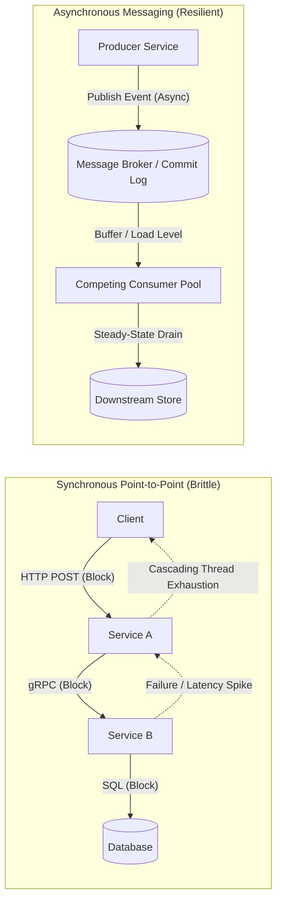

### The Fallacies of Distributed Computing in Messaging
Engineering enterprise-grade messaging requires confronting the physical realities of distributed networks:
1. **The Network is Unreliable**: Network partitions, TCP resets, and packet loss mean that message delivery acknowledgments (ACKs) can be lost. **At-least-once delivery is the standard reality of distributed brokers.** True "exactly-once" delivery across network boundaries is physically impossible without end-to-end consumer idempotency.
2. **Latency is Non-Zero**: Serialization, queue scheduling, disk persistence, and network traversal introduce variable latency distributions ($p50, p99, p99.9$).
3. **Bandwidth is Finite**: Giant payloads saturate network interfaces, exhaust broker memory, and trigger stop-the-world garbage collection cycles.

### Delivery Semantics Deep Dive
| Semantic Guarantee | Producer Behavior | Broker Guarantee | Consumer Requirement | Latency / Throughput Profile |
| :--- | :--- | :--- | :--- | :--- |
| **At-Most-Once** | Fire-and-forget; no retries on network timeout. | Does not require persistent disk sync; drops unacknowledged messages. | Can process messages without deduplication; tolerates loss. | Lowest latency, highest throughput (e.g., telemetry, non-critical metrics). |
| **At-Least-Once** | Retries publish until broker returns persistent ACK. | Persists message to disk / replicates across quorum before ACK. | **Must be strictly idempotent**; will receive duplicate deliveries during partition recovery. | Moderate latency, high throughput; the standard for enterprise commerce. |
| **Effectively-Once** | Idempotent producer (PID + sequence numbers) prevents duplicate writes to log. | Enforces transactional multi-partition log commits. | Consumer atomic commit of read offset + state write, or standard At-Least-Once paired with an Idempotent Consumer filter. | Higher latency, bounded throughput due to two-phase commits or deduplication lookup overhead. |

---

## 2. Competing Consumers Pattern

### Overview, Intent & Use Cases
The **Competing Consumers Pattern** enables multiple worker instances to concurrently process messages from a single shared channel. Rather than routing identical messages to every worker (which is Fan-Out), the broker coordinates message distribution such that **each message is processed by exactly one worker**.

**Primary Use Cases:**
- Heavy compute workloads (video transcribing, OCR document parsing, ML inference).
- Order fulfillment and payment capture pipelines.
- Elastic auto-scaling worker fleets responding to queue depth metrics (e.g., AWS SQS + KEDA).

### HLD Architecture
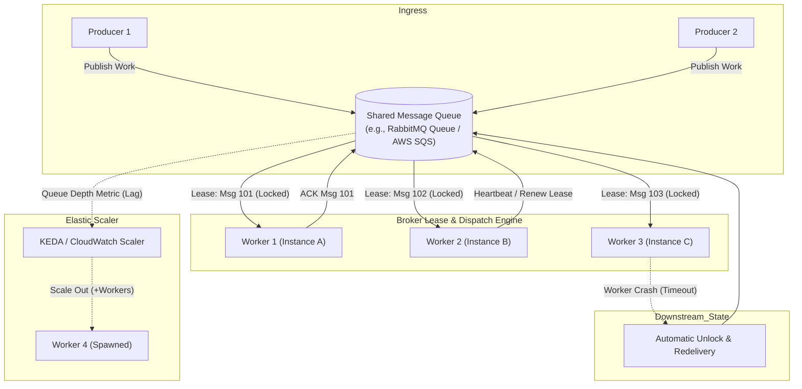

### LLD Mechanics & Engineering Internals

#### 1. Prefetch Count Tuning (QoS)
In push-based brokers (e.g., RabbitMQ via AMQP `basic.qos`), the broker pushes messages across the open TCP socket to the client buffer. If `prefetch_count` is unset (unlimited) or set too high, the broker dumps thousands of messages into a single worker's memory buffer:
- **Head-of-Line (HoL) Blocking**: Fast tasks get queued behind a slow, multi-second task inside the worker's internal buffer, while idle workers sit starved.
- **Out of Memory (OOM)**: A single worker crash drops or locks an enormous batch of tasks.

The optimal prefetch formula balances network round-trip time (RTT) against message processing duration:

$$\text{Optimal Prefetch} = \max\left(1, \left\lceil \frac{\text{Processing Time per Message}}{\text{Network RTT}} \right\rceil \times \text{Worker Concurrency}\right)$$

- **Heterogeneous / Variable Workloads (e.g., 50ms to 10s)**: Enforce `prefetch_count = 1`. This guarantees fair dispatch; as soon as a worker finishes, it pulls the next available message.
- **Homogeneous / Ultra-Fast Workloads (e.g., < 2ms)**: Set `prefetch_count = 50-200` to pipeline messages over TCP and eliminate network starvation.

#### 2. Message Lease Visibility & Lock Heartbeats
In pull-based systems (e.g., AWS SQS, Azure Service Bus), a consumer receives a message lease:
- The message is not deleted; its **Visibility Timeout** is set to $T_{\text{lease}}$ (e.g., 30 seconds).
- The message becomes invisible to other competing consumers.
- If the worker does not explicitly send `ACK (Delete)` or extend the lease before $T_{\text{lease}}$ elapses, the broker assumes the worker died and makes the message immediately visible to another worker.

**The Long-Running Task Dilemma**: If a task takes 45 seconds, setting a static visibility timeout of 60 seconds risks a 60-second delay if the worker dies immediately. Conversely, setting 30 seconds causes another worker to pick up the task while Worker 1 is still processing, causing **duplicate parallel execution**.

**Solution: Background Heartbeat (Lock Extension Thread)**
A daemon process regularly inspects task progress and sends lease extensions (`ChangeMessageVisibility`) at intervals of $\frac{T_{\text{lease}}}{2}$ or $\frac{T_{\text{lease}}}{3}$.

```python
import threading
import time
import boto3

class MessageLeaseRenewer(threading.Thread):
    def __init__(self, sqs_client, queue_url, receipt_handle, lease_interval_sec=30):
        super().__init__(daemon=True)
        self.sqs = sqs_client
        self.queue_url = queue_url
        self.receipt_handle = receipt_handle
        self.interval = lease_interval_sec
        self.stop_signal = threading.Event()

    def run(self):
        while not self.stop_signal.wait(self.interval / 2):
            try:
                # Extend visibility by lease_interval_sec from this moment
                self.sqs.change_message_visibility(
                    QueueUrl=self.queue_url,
                    ReceiptHandle=self.receipt_handle,
                    VisibilityTimeout=self.interval
                )
            except Exception as e:
                # Log warning; network failure or message already expired/processed
                break

    def stop(self):
        self.stop_signal.set()

# Consumer execution pattern
def process_competing_task(sqs_client, queue_url, msg):
    receipt_handle = msg['ReceiptHandle']
    renewer = MessageLeaseRenewer(sqs_client, queue_url, receipt_handle, lease_interval_sec=30)
    renewer.start()
    try:
        execute_complex_business_logic(msg['Body'])
        # Business logic succeeded: Acknowledge & Delete
        sqs_client.delete_message(QueueUrl=queue_url, ReceiptHandle=receipt_handle)
    finally:
        renewer.stop()
```

---

## 3. Fan-Out & Topic-Based Routing Pattern

### Overview, Intent & Use Cases
The **Fan-Out & Topic-Based Routing Pattern** distributes a single event emitted by a producer to multiple independent consumer subsystems, where each subsystem receives its own dedicated copy of the message. 

- **Pure Fan-Out (Broadcast)**: Every subscribed queue receives an exact duplicate of every message unconditionally (e.g., AMQP `fanout` exchange).
- **Topic-Based Routing (Selective Fan-Out)**: Messages are tagged with a routing key (e.g., `orders.us.electronics.created`). Queues bind to topics using wildcard patterns, receiving only messages matching their specific criteria (e.g., AMQP `topic` exchange, Kafka partitioned topics, Google Cloud Pub/Sub subscriptions with SQL filter expressions).

### HLD Architecture
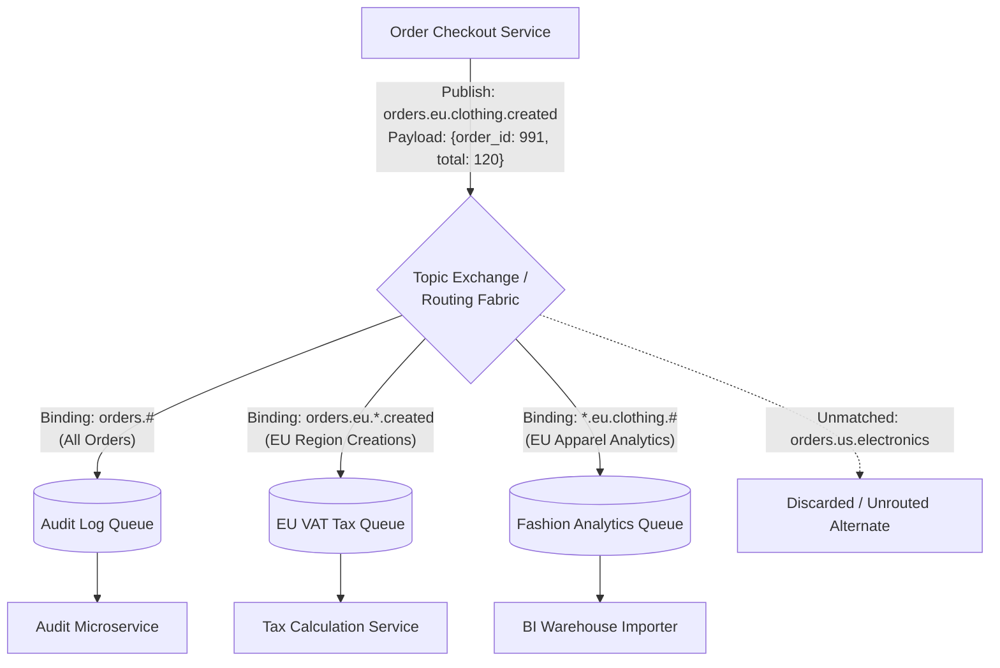

### LLD Mechanics & Engineering Internals

#### 1. Trie-Based Topic Matching Algorithm
When a broker routes millions of messages per second across tens of thousands of dynamic binding keys, evaluating regex patterns sequentially yields $O(N \times M)$ complexity, causing severe CPU saturation. High-performance brokers (e.g., RabbitMQ, EMQX, HiveMQ) compile topic bindings into an in-memory **Radix Tree / Trie structure**.

In a Topic Trie:
- Topic strings are tokenized by delimiters (e.g., `.` or `/`).
- Literal tokens form specific branches.
- `*` represents a single-word wildcard.
- `#` (or multi-level wildcard) matches zero or more words recursively.

```
Routing Key: "orders.eu.clothing.created"
Tokens: ["orders", "eu", "clothing", "created"]

               [ROOT]
                 |
             "orders"
             /      \
          "eu"       "*" (Matches any region)
         /    \        \
   "clothing"  "#"     "electronics"
      /
 "created" -> [List of Bound Queues: Q_Tax, Q_Analytics]
```

When a message arrives, the routing engine traverses the trie along matching literal paths and simultaneously descends wildcard paths. The matching queue IDs are aggregated into a deduplicated bitset or vector. The search completes in $O(K)$ time, where $K$ is the number of tokens in the message routing key, completely independent of the total number of bindings $N$.

#### 2. Memory Fan-Out Buffers: Pointer-Based Sharing vs Copy-On-Write
A common architectural bottleneck in high-throughput fan-out (e.g., 1 publisher broadcasting to 50 queues) is memory bloat. If a 1 MB message is copied 50 times into 50 separate queue buffers, memory consumption spikes to 50 MB per message, crushing L3 CPU caches and triggering garbage collection.

Production brokers implement **Atomic Reference-Counted Pointer Sharing**:
```
+-----------------------------------------------------------+
|                     Message Payload                       |
|           (Immutable Heap Allocation: 1 MB)              |
|                   Reference Count: 3                      |
+-----------------------------------------------------------+
        ^                       ^                       ^
        |                       |                       |
+---------------+       +---------------+       +---------------+
| Queue A Entry |       | Queue B Entry |       | Queue C Entry |
| (Pointer: 8B) |       | (Pointer: 8B) |       | (Pointer: 8B) |
+---------------+       +---------------+       +---------------+
```
- The message payload is allocated once in immutable shared memory or off-heap RAM.
- Each matching queue receives an 8-byte pointer and increments the atomic reference counter.
- As each consumer reads and acknowledges the message, its queue removes the pointer and atomically decrements the counter (`fetch_sub(1)`).
- When the reference count reaches 0, the underlying payload memory is freed or returned to an arena memory pool.
- **Copy-on-Write (COW)**: Only if a consumer-specific transformation is required (e.g., header enrichment or payload encryption) does the broker clone the payload for that specific recipient.

---

## 4. Request-Reply / Asynchronous RPC Pattern

### Overview, Intent & Use Cases
While asynchronous messaging is primarily fire-and-forget, enterprise systems frequently require **Request-Reply** semantics: a client publishes a command or query, continues asynchronous execution, and eventually correlates the response message back to the originating client thread or promise.

**Primary Use Cases:**
- Credit card authorization or fraud scoring executed over asynchronous message backbones.
- Long-running distributed queries across federated microservices.
- Legacy system modernization wrapping asynchronous enterprise service buses (ESB) in modern REST/gRPC gateways.

### HLD Architecture
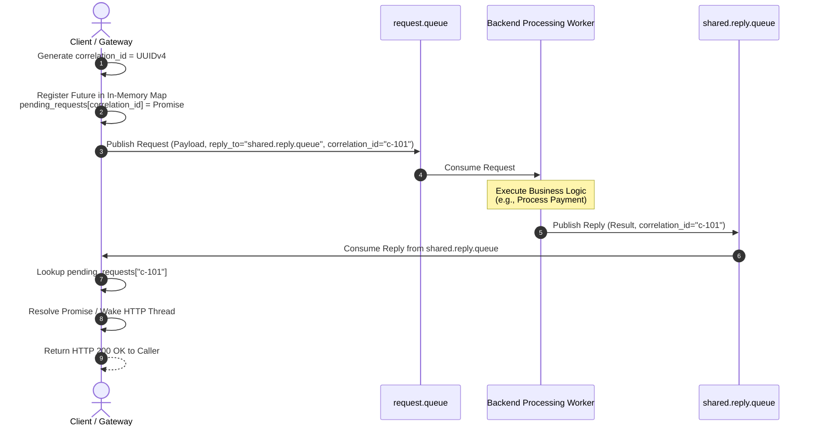

### LLD Mechanics & Engineering Internals

#### 1. Dynamic Temporary Reply Queue vs Shared Reply Queue with Correlation ID
There are two primary architectural implementations for Request-Reply:

| Architectural Metric | Dynamic Temporary Reply Queues (Exclusive) | Shared Multiplexed Reply Queue with Correlation ID |
| :--- | :--- | :--- |
| **Mechanics** | Client creates a temporary queue (e.g., `amq.gen-h7X...`) with `exclusive=true`, `auto_delete=true`. Server replies directly to this dedicated queue. | All client instances share a single durable reply queue (or one per pod instance). Clients filter incoming messages by `correlation_id`. |
| **Broker Overhead** | **Extreme**: Constant queue creation, binding declaration, and deletion triggers cluster-wide metadata replication (Raft/Mnesia churn). | **Minimal**: A single persistent queue initialized once at deployment. Zero broker metadata churn. |
| **Scalability** | Breaks down at > 1,000 req/sec due to broker topology thrashing. | Scales to millions of requests per second. |
| **Complexity** | Simple client logic: whatever arrives on the queue belongs to that client. | Requires client-side thread-safe routing tables and correlation multiplexing. |
| **Production Recommendation** | **Anti-pattern in high-throughput systems.** Use only for rare debugging tools. | **Industry standard.** Used in high-performance RPC frameworks. |

#### 2. Correlation Map, Cancellation Timers & Future Lifecycle
A production-grade Request-Reply client must handle network partitions, dead servers, and client restarts without leaking memory.

```java
public class AsyncRpcClient {
    private final ConcurrentMap<String, CompletableFuture<ResponseMessage>> pendingRequests = new ConcurrentHashMap<>();
    private final HashedWheelTimer timeoutTimer = new HashedWheelTimer(10, TimeUnit.MILLISECONDS);
    private final Channel channel;
    private final String replyQueueName;

    public CompletableFuture<ResponseMessage> sendAsync(RequestMessage request, Duration timeout) {
        String correlationId = UUID.randomUUID().toString();
        CompletableFuture<ResponseMessage> responseFuture = new CompletableFuture<>();

        // 1. Register future in concurrent routing map
        pendingRequests.put(correlationId, responseFuture);

        // 2. Schedule hard timeout to prevent memory leaks from dropped replies
        Timeout timeoutTask = timeoutTimer.newTimeout(t -> {
            CompletableFuture<ResponseMessage> removed = pendingRequests.remove(correlationId);
            if (removed != null && !removed.isDone()) {
                removed.completeExceptionally(new TimeoutException("RPC request timed out after " + timeout));
            }
        }, timeout.toMillis(), TimeUnit.MILLISECONDS);

        // Cancel timer if future completes successfully
        responseFuture.whenComplete((res, ex) -> timeoutTask.cancel());

        // 3. Publish message with AMQP / broker headers
        BasicProperties props = new BasicProperties.Builder()
            .correlationId(correlationId)
            .replyTo(replyQueueName)
            .expiration(String.valueOf(timeout.toMillis())) // Broker TTL: discard if server is too slow
            .build();

        channel.basicPublish("", "request.queue", props, request.toByteArray());
        return responseFuture;
    }

    // Single consumer loop processing the shared replyQueue
    private void onReplyReceived(String correlationId, ResponseMessage reply) {
        CompletableFuture<ResponseMessage> future = pendingRequests.remove(correlationId);
        if (future != null) {
            future.complete(reply); // Resolves the client thread waiting on this future
        } else {
            // Log warning: reply arrived after timeout or duplicate delivery
        }
    }
}
```

---

## 5. Transactional Outbox Pattern & Change Data Capture (CDC)

### Overview, Intent & The Dual-Write Problem
Microservices frequently need to update a relational database and publish an event to a message broker within the same business transaction (e.g., save an `Order` and emit an `OrderCreated` event).

**The Dual-Write Anti-Pattern**:
```python
# BROKEN ARCHITECTURE: Dual-Write Vulnerability
def create_order(order_data):
    db.session.add(Order(order_data))
    db.session.commit() # Step 1: Commit to DB
    
    # SYSTEM CRASH / NETWORK OUTAGE HERE!
    
    kafka_producer.send("order-topic", order_data) # Step 2: Publish to Broker
```
- If the application crashes between Step 1 and Step 2, the order exists in the database, but downstream inventory, billing, and notification services never receive the event. State corruption is permanent.
- If the developer swaps the order (Publish to Kafka first, then Commit to DB), the Kafka publish may succeed, but the database commit could fail due to a constraint violation. Downstream systems act on an order that technically never existed.
- Distributed Two-Phase Commit (XA Transactions) across heterogeneous systems (e.g., Postgres + Kafka) is notoriously slow, blocking, and unsupported by modern cloud brokers.

The **Transactional Outbox Pattern** solves the dual-write problem by persisting the domain entity and the outbound message **within the exact same local ACID database transaction**.

### HLD Architecture
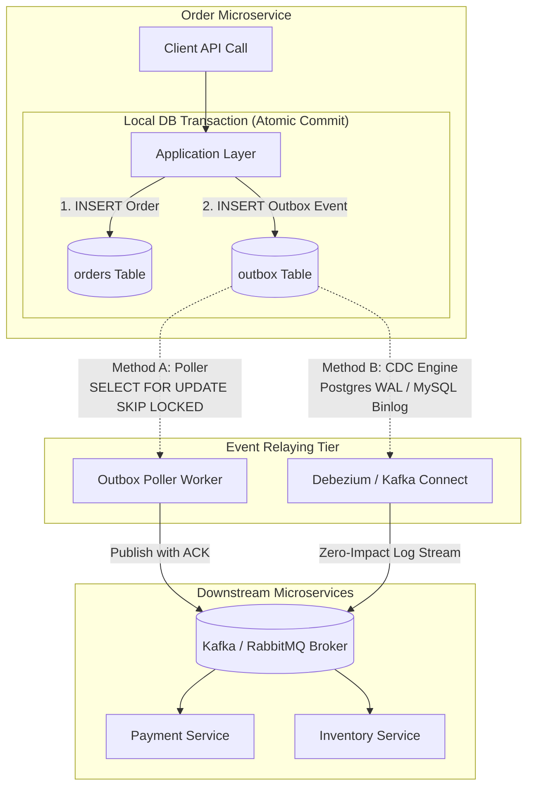

### LLD Mechanics & Engineering Internals

#### 1. Production-Grade Outbox Schema
```sql
CREATE TABLE outbox_events (
    id UUID PRIMARY KEY DEFAULT gen_random_uuid(),
    aggregate_type VARCHAR(64) NOT NULL,       -- e.g., 'ORDER'
    aggregate_id VARCHAR(64) NOT NULL,         -- e.g., 'order_987654'
    event_type VARCHAR(128) NOT NULL,          -- e.g., 'OrderCreatedEvent'
    payload JSONB NOT NULL,                    -- The canonical event data
    headers JSONB NOT NULL DEFAULT '{}'::jsonb,-- Tracing headers (traceparent, baggage)
    created_at TIMESTAMPTZ NOT NULL DEFAULT clock_timestamp(),
    processed_at TIMESTAMPTZ NULL,             -- Populated by poller or purged
    status VARCHAR(16) NOT NULL DEFAULT 'PENDING', -- PENDING, PUBLISHED, FAILED
    retry_count INT NOT NULL DEFAULT 0
);

-- Compound index optimizing the polling query
CREATE INDEX idx_outbox_unprocessed ON outbox_events (created_at ASC) 
WHERE status = 'PENDING';
```

#### 2. Outbox Relaying Architecture: Polling Publisher vs CDC Log Tailing

##### Approach A: Polling Publisher with `SELECT FOR UPDATE SKIP LOCKED`
Traditional polling queries like `SELECT * FROM outbox_events WHERE status = 'PENDING' ORDER BY created_at LIMIT 100` cause severe row-level lock contention when multiple poller instances run concurrently.

By using `SKIP LOCKED` (available in PostgreSQL 9.5+, MySQL 8.0+, Oracle), each poller thread atomically locks and processes its own disjoint subset of rows without blocking peer pollers:

```sql
-- Executed inside Poller Transaction
BEGIN;
SELECT id, aggregate_type, aggregate_id, event_type, payload, headers
FROM outbox_events
WHERE status = 'PENDING'
ORDER BY created_at ASC
LIMIT 100
FOR UPDATE SKIP LOCKED;

-- Application loop: Publish messages to Broker.
-- Once broker returns persistent ACK:
UPDATE outbox_events
SET status = 'PUBLISHED', processed_at = clock_timestamp()
WHERE id IN (:batch_of_ids);
COMMIT;
```
*Trade-off*: Introduces continuous polling read/write overhead on the primary database engine. Not suitable for ultra-high write volumes (> 5,000 events/sec).

##### Approach B: Transaction Log Tailing / Change Data Capture (CDC)
Rather than polling tables with SQL, an external engine (such as **Debezium** running on Kafka Connect) tails the database's internal **Write-Ahead Log (WAL)** (PostgreSQL `pgoutput` / MySQL binary log):
- **Zero Query Overhead**: No SQL queries touch the application database; the CDC engine reads the append-only sequential transaction log file directly from disk or replication stream.
- **Sub-Millisecond Latency**: Changes stream to Kafka within milliseconds of database commit.
- **Deletions / Purging**: The application can immediately delete rows from `outbox_events` within the same transaction, or a simple cron job truncates old partitions. CDC captures row creation directly from the WAL stream even if the row is subsequently deleted.

---

## 6. Saga Pattern (Distributed Transactions)

### Overview, Intent & 2PC vs Saga
In a distributed microservice architecture, a single business transaction spans multiple database boundaries (e.g., placing an order requires reserving inventory in Service A, charging a credit card in Service B, and creating a shipment in Service C).

**Why Two-Phase Commit (2PC) Fails at Scale**:
- **Synchronous Locking**: Locks are held across all participating databases throughout both preparation and commit phases. If a single node or network link is slow, all database connections freeze.
- **Availability Risk (CAP Theorem)**: 2PC prioritizes Consistency over Availability ($CP$). If the transaction coordinator crashes during the commit phase, participants remain in an indeterminate blocked state indefinitely.

The **Saga Pattern** structures a distributed business transaction as a sequence of independent local ACID transactions:
- Each local transaction updates a single microservice's database and publishes an event or message.
- If all local transactions succeed, the saga completes.
- If any local transaction fails, the saga executes a series of **Compensating Transactions** in reverse order to undo the changes made by earlier steps.

### Choreography vs Orchestration

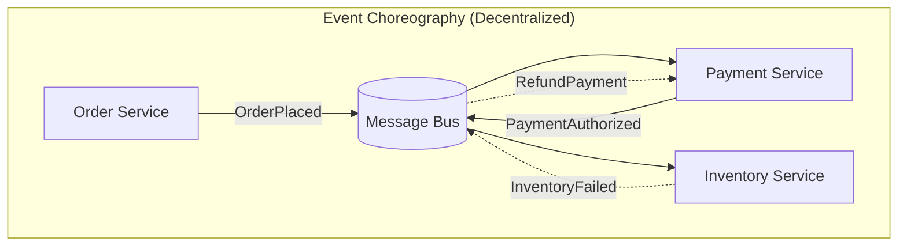

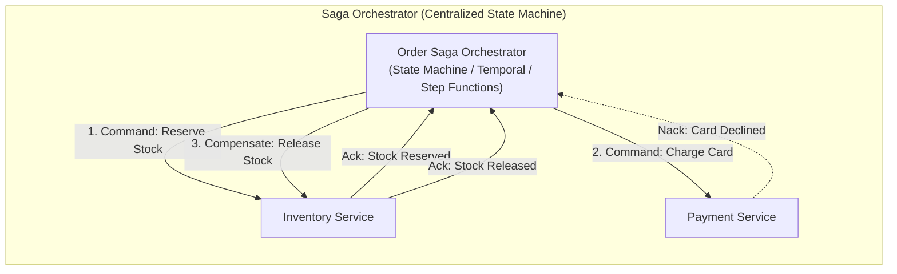

| Architectural Attribute | Choreography (Event-Driven) | Orchestration (Command-Driven) |
| :--- | :--- | :--- |
| **Coordination** | Implicit; services react to peer events. | Explicit; dedicated Orchestrator coordinates every step. |
| **Coupling** | Loose coupling; services do not know caller identity. | Orchestrator depends on service command APIs. |
| **Complexity** | Becomes incomprehensible ("spaghetti") at > 4 steps; circular dependencies common. | State is localized and observable; easy to visualize workflow. |
| **Blast Radius & Debugging** | Hard to audit current state; distributed tracing required across entire bus. | Trivial to audit; query the orchestrator database for current state. |
| **Best Suited For** | Simple 2 to 3-step linear workflows. | Complex enterprise workflows (order management, banking, travel booking). |

### LLD Mechanics & Engineering Internals

#### 1. Saga Execution Coordinator (SEC) State Machine
An Orchestrated Saga is governed by a persistent state machine. The orchestrator must persist its state to durable storage before dispatching each command.

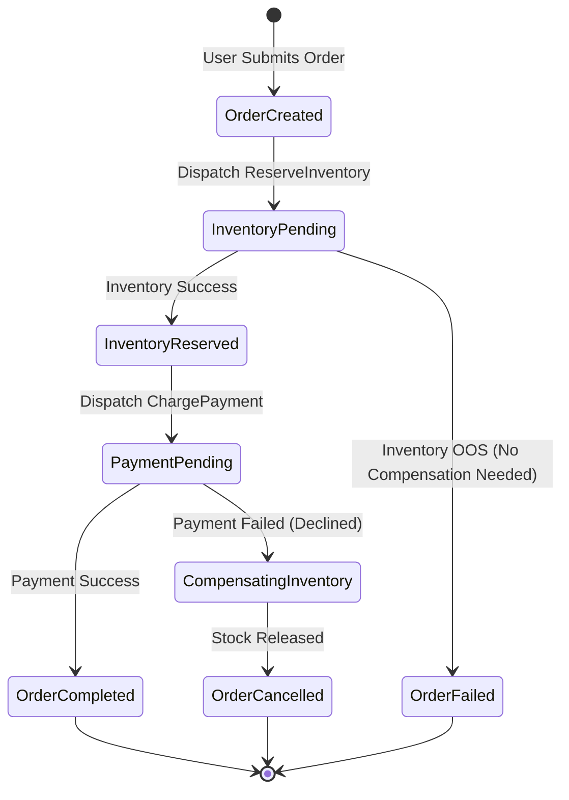

#### 2. The SEC State Transition Matrix
| Current State | Trigger Event | Next Action | Next State |
| :--- | :--- | :--- | :--- |
| `ORDER_SUBMITTED` | Client Request | Persist State; Emit `ReserveInventoryCommand` | `INVENTORY_RESERVING` |
| `INVENTORY_RESERVING` | `InventoryReservedEvent` | Persist State; Emit `ProcessPaymentCommand` | `PAYMENT_PROCESSING` |
| `INVENTORY_RESERVING` | `InventoryFailedEvent` | Mark Order `FAILED`; Send Alert | `ORDER_FAILED` |
| `PAYMENT_PROCESSING` | `PaymentSuccessEvent` | Persist State; Emit `CreateShipmentCommand` | `SHIPMENT_CREATING` |
| `PAYMENT_PROCESSING` | `PaymentDeclinedEvent` | **Trigger Compensation**: Emit `ReleaseInventoryCommand` | `INVENTORY_COMPENSATING` |
| `INVENTORY_COMPENSATING`| `InventoryReleasedEvent` | Mark Order `CANCELLED`; Notify Customer | `ORDER_CANCELLED` |

#### 3. Forward vs Compensating Transactions & The Pivot Step
A distributed saga breaks down into three distinct categories of operations:
1. **Compensatable Transactions**: Steps that precede the pivot step. These operations mutate state but can be cleanly undone by executing an inverted operation (e.g., `ReserveStock` $\rightarrow$ `ReleaseStock`; `BookHotel` $\rightarrow$ `CancelHotelBooking`).
2. **The Pivot Transaction**: The definitive point of no return in the business workflow.
   - If the pivot transaction succeeds, the saga **must guarantee forward completion**.
   - If the pivot transaction fails, the saga halts and rolls back all prior compensatable steps.
   - *Example*: In an e-commerce saga, charging the credit card or authorizing payment is the canonical Pivot Step. Once money has been captured, the system commits to delivering the order.
3. **Retriable / Repeatable Transactions**: Steps that occur *after* the pivot step. These operations **cannot be rolled back** (or doing so is commercially unacceptable). They must be architected to retry indefinitely until successful (e.g., generating an invoice, alerting the fulfillment warehouse).

> [!CAUTION]
> **Semantic Rollback vs Physical Rollback**: Compensating transactions perform *semantic* rollback, not physical database rollback. If Step 1 reserved seat 12B on an airplane, and Step 3 fails, the compensating transaction explicitly frees seat 12B. Other concurrent users could have seen seat 12B as reserved in the interim. All business logic must tolerate dirty reads across eventual consistency windows.

---

## 7. Dead Letter Queue (DLQ) & Multi-Tier Delayed Retry Pattern

### Overview, Intent & Failure Modes
In distributed messaging, message processing failures fall into two categories:
1. **Transient Failures**: Intermittent network blips, database lock deadlocks, or temporary downstream 503 throttling. These resolve spontaneously within milliseconds or seconds.
2. **Poison Pills (Permanent Failures)**: Malformed JSON, schema version mismatches, null pointer exceptions, or business rule violations (e.g., debiting a non-existent bank account). These will never succeed, no matter how many times retried.

**The Catastrophe of Naive In-Place Retries**:
If a consumer catches an exception and immediately calls `retry()`, or rejects the message with `requeue=true` in a tight loop:
- **CPU Spikes to 100%**: The consumer spins continuously processing the exact same poison pill.
- **Head-of-Line Blocking**: Valid messages trapped behind the poison message are starved.
- **Cascading Thundering Herd**: If a downstream database goes down for 5 seconds, thousands of concurrent consumers immediately hammer it with millions of instant retries, ensuring it can never recover.

### HLD Architecture: Multi-Tier Delayed Retry Pipeline
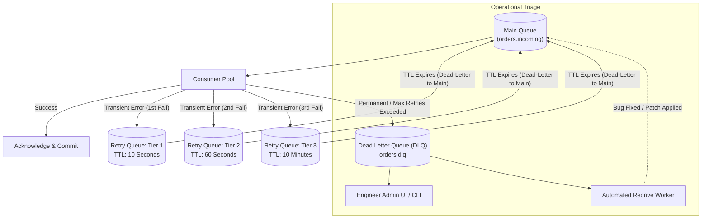

### LLD Mechanics & Engineering Internals

#### 1. Header Metadata Mutation
When a message fails processing, the consumer extracts the original payload, mutates metadata tracking headers, and publishes the message to the appropriate retry tier:

```json
{
  "headers": {
    "x-original-queue": "orders.incoming",
    "x-retry-count": 2,
    "x-first-failed-timestamp": "2026-10-14T19:00:10.102Z",
    "x-last-failed-timestamp": "2026-10-14T19:01:20.450Z",
    "x-exception-class": "com.enterprise.billing.PaymentGatewayTimeoutException",
    "x-exception-message": "Connection timed out after 5000ms connecting to api.stripe.com",
    "x-stack-trace-hash": "e3b0c44298fc1c149afbf4c8996fb92427ae41e4649b934ca495991b7852b855"
  },
  "payload": {
    "order_id": "ord_88192",
    "amount_cents": 4900
  }
}
```

#### 2. Exponential Backoff with Full Jitter Formula
To eliminate synchronization resonance across thousands of worker nodes, retries must inject randomness. The definitive production standard is **Full Jitter**:

$$T_{\text{sleep}} = \text{random\_between}\left(0, \min\left(M_{\text{max}}, B \times 2^{\text{retry\_count}}\right)\right)$$

Where:
- $B$ is the base retry duration (e.g., 2 seconds).
- $M_{\text{max}}$ is the ceiling cap (e.g., 600 seconds).
- `random_between(0, ...)` uniformly distributes the retry attempts across the time domain, flattening load curves completely.

#### 3. Automated Redrive Worker Engine
Messages landing in the final DLQ represent critical business failure. A redrive worker allows safe, throttled replay back into the primary queue once underlying root causes are resolved:

```python
def redrive_dlq_batch(sqs_client, dlq_url, target_queue_url, batch_size=10, max_messages=1000):
    processed = 0
    while processed < max_messages:
        response = sqs_client.receive_message(
            QueueUrl=dlq_url,
            MaxNumberOfMessages=batch_size,
            MessageAttributeNames=['All'],
            VisibilityTimeout=30
        )
        messages = response.get('Messages', [])
        if not messages:
            break

        for msg in messages:
            # Strip dead-letter routing metadata before re-injection
            cleaned_attributes = {
                k: v for k, v in msg.get('MessageAttributes', {}).items() 
                if not k.startswith('x-')
            }
            # Inject audit re-injection header
            cleaned_attributes['x-redriven-by'] = {'DataType': 'String', 'StringValue': 'AdminTriageScript'}
            
            # Atomic publish to primary queue
            sqs_client.send_message(
                QueueUrl=target_queue_url,
                MessageBody=msg['Body'],
                MessageAttributes=cleaned_attributes
            )
            # Delete from DLQ
            sqs_client.delete_message(
                QueueUrl=dlq_url,
                ReceiptHandle=msg['ReceiptHandle']
            )
            processed += 1
            time.sleep(0.05) # Throttle redrive rate to avoid overwhelming recovering target
```

---

## 8. Priority Queues & Fair Queuing Pattern

### Overview, Intent & Starvation Risks
Enterprise systems handle heterogeneous transactions with vastly different business values. For example, a banking messaging backbone processes real-time wire transfers (urgent) alongside end-of-month PDF statement generation (background). 

If a system uses a single FIFO queue, a sudden influx of 500,000 statement generation tasks will delay wire transfer authorizations by hours.

**The Starvation Vulnerability of Naive Priority Queues**:
In a strict priority queue (where higher priority messages always jump to the front of the line), if high-priority messages arrive at a rate equal to or greater than the consumer processing capacity, **low-priority messages will sit in the queue indefinitely and starve to death**.

### HLD Architecture: Multi-Lane Weighted Fair Queuing (WFQ)
Rather than relying on a single broker-level binary heap, enterprise architectures implement **Multi-Lane Priority Routing with Weighted Round Robin (WRR) Consumption**.

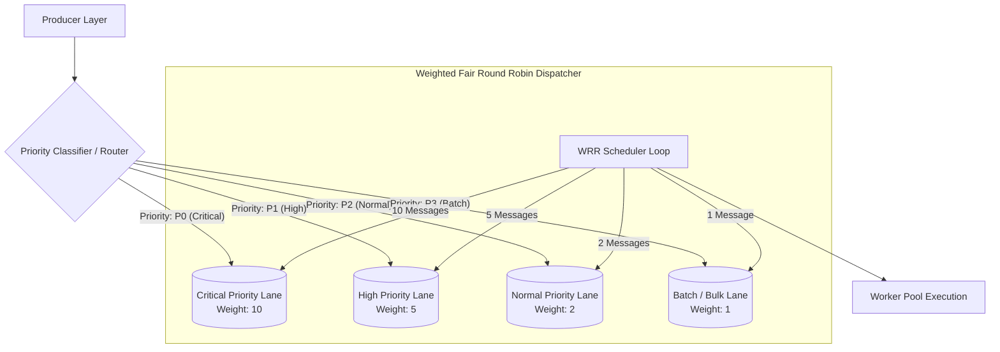

### LLD Mechanics & Engineering Internals

#### 1. Binary Heap vs Multi-Queue Trade-offs
- **Broker-Native Priority (e.g., RabbitMQ `x-max-priority`)**:
  - Broker maintains an internal binary max-heap.
  - Insertion complexity: $O(\log N)$.
  - Dequeue complexity: $O(1)$.
  - *Failure mode*: If the queue gets deep (> 1,000,000 messages), the $O(\log N)$ memory heap insertion degrades broker CPU and RAM significantly.
- **Multi-Queue Weighted Fair Round Robin**:
  - Independent, standard FIFO queues for each priority level.
  - Insertion complexity: $O(1)$ directly into the target lane queue.
  - Consumers enforce proportional dispatching ratios. Starvation is mathematically impossible.

#### 2. Weighted Round Robin (WRR) Algorithm
Let weights be:
$$W = \{\text{Critical}: 10, \text{High}: 5, \text{Normal}: 2, \text{Batch}: 1\}$$
In every cycle of 18 messages, the scheduler guarantees:
- 10 Critical tasks are processed ($\approx 55.5\%$).
- 5 High tasks are processed ($\approx 27.7\%$).
- 2 Normal tasks are processed ($\approx 11.1\%$).
- **At least 1 Batch task is processed ($\approx 5.5\%$)**, ensuring zero starvation regardless of critical traffic saturation.

```python
class WeightedFairScheduler:
    def __init__(self, queues_with_weights):
        # queues_with_weights = [('critical', 10), ('high', 5), ('normal', 2), ('batch', 1)]
        self.queues = queues_with_weights
        self.current_queue_idx = 0
        self.current_weight_counter = 0

    def get_next_message(self):
        start_idx = self.current_queue_idx
        while True:
            queue_name, weight = self.queues[self.current_queue_idx]
            
            if self.current_weight_counter < weight:
                msg = self.poll_queue(queue_name)
                if msg is not None:
                    self.current_weight_counter += 1
                    return msg
                else:
                    # Queue is empty, skip remaining weight allowance
                    self.current_weight_counter = weight

            # Reset counter and advance to next queue lane
            self.current_weight_counter = 0
            self.current_queue_idx = (self.current_queue_idx + 1) % len(self.queues)
            
            # All queues were checked and found empty
            if self.current_queue_idx == start_idx:
                return None

    def poll_queue(self, queue_name):
        # Driver-specific non-blocking queue pop (e.g., redis.rpop or amqp basic_get)
        pass
```

---

## 9. Message Deduplication & Idempotent Consumer Pattern

### Overview, Intent & The Reality of Network Partitions
Due to the physical impossibility of solving the Two Generals' Problem over untrusted networks, message brokers can only provide **At-Least-Once** delivery in the presence of node reboots, consumer crashes, and network partitions.

**How Duplicates Are Born**:
```
Consumer receives Message M1.
Consumer executes database mutation.
Consumer sends ACK back to Broker.
--- NETWORK DROPS THE ACK PACKET ---
Broker Visibility Timeout elapses.
Broker redelivers Message M1 to a second consumer.
```
If the consumer is not **idempotent**, duplicate execution corrupts ledger balances, sends duplicate customer emails, or reserves duplicate warehouse stock.

### HLD Architecture: Two-Tier Deduplication Pipeline
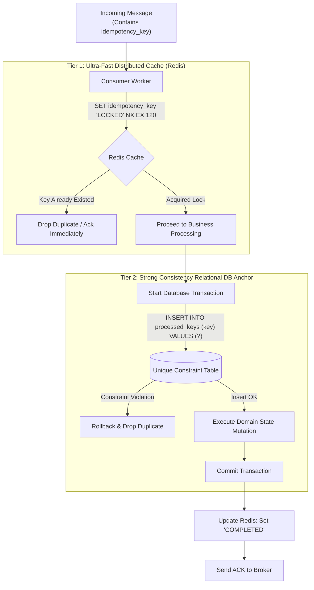

### LLD Mechanics & Engineering Internals

#### 1. Redis Atomic Fast-Path Filter
To protect the core relational database from absorbing unnecessary write-lock attempts during duplicate bursts, an in-memory fast-path filter evaluates incoming messages:
```redis
# Atomically set key only if it does not exist, expiring in 120 seconds
SET idempotency:msg_998124 "IN_FLIGHT" NX EX 120
```
- If Redis returns `NIL`, another worker is actively processing or has just processed this message. The consumer acknowledges and discards it.
- If Redis returns `OK`, this worker has acquired execution rights.

#### 2. Relational Database Strong Consistency Anchor
Redis keys can expire or get evicted under memory pressure. Therefore, the **authoritative** idempotency boundary must live inside the target storage engine via an atomic `UNIQUE` constraint:

```sql
CREATE TABLE processed_messages (
    idempotency_key VARCHAR(128) PRIMARY KEY,
    consumer_name VARCHAR(64) NOT NULL,
    processed_at TIMESTAMPTZ NOT NULL DEFAULT clock_timestamp(),
    response_payload JSONB NULL -- Used if caching RPC responses for replay
);
```

#### 3. Atomic Domain Upsert Pattern
Rather than executing separate `SELECT` then `INSERT` statements (which creates a race condition known as Time-of-Check to Time-of-Use / TOCTOU), the processing logic executes an atomic upsert:

```sql
-- Atomic check-and-insert within the primary domain transaction
BEGIN;

INSERT INTO processed_messages (idempotency_key, consumer_name)
VALUES ('ord_tx_554109', 'PaymentProcessor-Pod-3')
ON CONFLICT (idempotency_key) DO NOTHING;

-- If rows affected == 0, this is a duplicate! Abort transaction immediately.

UPDATE accounts 
SET balance_cents = balance_cents - 4900 
WHERE account_id = 'acc_101';

COMMIT;
```

---

## 10. Claim Check Pattern (Large Message Offloading)

### Overview, Intent & Broker Payload Limits
Message brokers are engineered for routing millions of small, lightweight control signals (1 KB to 32 KB). They are **not** object storage repositories.

**Broker Hard Constraints**:
- **AWS SQS**: Absolute hard ceiling of **256 KB** per message payload.
- **Apache Kafka**: Default `message.max.bytes = 1048576` (1 MB). Increasing this beyond 10 MB degrades the broker page cache, increases garbage collection pause times, and causes network head-of-line blocking across topic partitions.
- **RabbitMQ**: Messages $> 10\text{ MB}$ choke Erlang memory allocation processes and thrash RabbitMQ page files.

The **Claim Check Pattern** decouples the message payload from its metadata:
1. The producer uploads the heavy data blob to an external Object Store (e.g., AWS S3, Google Cloud Storage, Ceph).
2. The producer publishes a lightweight "Claim Check" token containing a reference pointer to the broker.
3. The consumer retrieves the pointer from the queue, downloads the payload directly from the object store, processes it, and triggers storage garbage collection.

### HLD Architecture
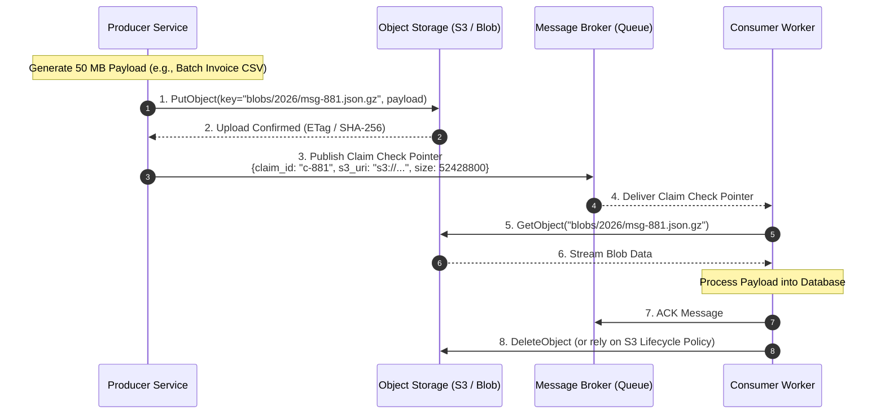

### LLD Mechanics & Engineering Internals

#### 1. Canonical Claim Check Schema
```json
{
  "$schema": "https://json-schema.org/draft/2020-12/schema",
  "type": "object",
  "required": ["claim_check_id", "storage_provider", "storage_pointer", "content_sha256", "byte_size"],
  "properties": {
    "claim_check_id": { "type": "string", "format": "uuid" },
    "storage_provider": { "type": "string", "enum": ["AWS_S3", "GCS", "AZURE_BLOB"] },
    "storage_pointer": { 
      "type": "object",
      "properties": {
        "bucket": { "type": "string" },
        "key": { "type": "string" },
        "region": { "type": "string" }
      },
      "required": ["bucket", "key"]
    },
    "content_sha256": { "type": "string", "pattern": "^[a-fA-F0-9]{64}$" },
    "byte_size": { "type": "integer", "minimum": 1 },
    "mime_type": { "type": "string", "default": "application/json" },
    "compression": { "type": "string", "enum": ["NONE", "GZIP", "ZSTD"], "default": "NONE" },
    "created_at": { "type": "string", "format": "date-time" }
  }
}
```

#### 2. Garbage Collection & Storage Lifecycle Management
Explicit deletion of the blob by the consumer (`DeleteObject`) suffers from failure edge cases:
- If consumer crashes before deleting the blob, the file becomes an orphaned storage leak costing money.
- If multiple consumers read the same topic (Fan-Out), Consumer 1 deleting the blob breaks Consumer 2.

**Production Solution: Hybrid Lifecycle Policies**:
1. Configure an **Object Storage Lifecycle Rule** on the S3 bucket targeting prefix `claim-checks/` with an automatic expiration time (e.g., `Expiration: Days = 7`).
2. If consumers finish processing early, they can emit a non-blocking asynchronous `PurgeCheckEvent` or let the native bucket TTL silently reclaim storage without consumer coordination overhead.

---

## 11. Delayed & Scheduled Message Pattern

### Overview, Intent & Use Cases
Enterprise workflows routinely require temporal delays rather than immediate execution.
- **Cart Abandonment Notifications**: Send an SMS if user has not completed checkout 2 hours after adding item.
- **Subscription Grace Periods**: Attempt payment retry 24 hours after a failed card charge.
- **Order Cancellation**: Auto-cancel an unpaid reservation if payment is not confirmed within 15 minutes.

### HLD Architecture: Native Delayed Broker vs Redis Sorted Set Engine
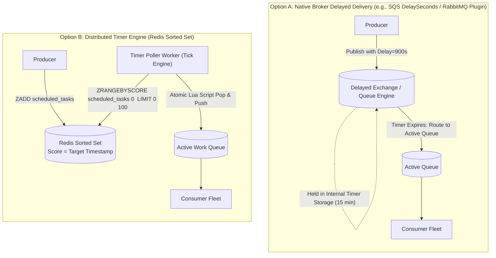

### LLD Mechanics & Engineering Internals

#### 1. Hierarchical Timing Wheel (HTW) Internals
High-performance broker timer engines (used internally by Netty, Kafka, and the RabbitMQ Delayed Exchange) avoid $O(N)$ timer scans by utilizing a **Hierarchical Timing Wheel**:
- A circular array of buckets, where each bucket represents a discrete tick (e.g., 1 second).
- A pointer advances around the wheel with each tick ($O(1)$ complexity).
- When timeouts exceed the wheel capacity, multiple wheels are cascaded (Second Wheel $\rightarrow$ Minute Wheel $\rightarrow$ Hour Wheel $\rightarrow$ Day Wheel).
- When the hour hand moves, tasks are shifted down into their respective minute wheel slots.
- **Advantage**: Insertion and cancellation are both $O(1)$ operations, making it capable of tracking millions of concurrent timers with minimal CPU overhead.

```
       [Hour Wheel: 24 Buckets]
                 |
      +----------v----------+
      |  Current Hour: 14   | ---> Cascades tasks to Minute Wheel
      +---------------------+
                 |
      [Minute Wheel: 60 Buckets]
                 |
      +----------v----------+
      |  Current Minute: 35 | ---> Cascades tasks to Second Wheel
      +---------------------+
                 |
      [Second Wheel: 60 Buckets]
                 |
      +----------v----------+
      |  Current Second: 12 | ---> Fires Immediate Execution
      +---------------------+
```

#### 2. Redis Sorted Set Polling Engine with Lua Atomic Pop
When building a custom scheduler, naive implementations call `ZRANGEBYSCORE` followed by `ZREM`. This creates a race condition where multiple poller pods retrieve and execute the same scheduled tasks.

The industry-standard solution is an **Atomic Lua Script**:

```lua
-- KEYS[1]: Scheduled sorted set key (e.g., 'tasks:scheduled')
-- ARGV[1]: Current UNIX epoch timestamp in milliseconds
-- ARGV[2]: Batch limit (e.g., 50)
local ready_tasks = redis.call('ZRANGEBYSCORE', KEYS[1], '-inf', ARGV[1], 'LIMIT', 0, tonumber(ARGV[2]))

if #ready_tasks > 0 then
    -- Atomically remove retrieved tasks so no other worker sees them
    redis.call('ZREM', KEYS[1], unpack(ready_tasks))
    return ready_tasks
else
    return {}
end
```

---

## 12. Circuit Breaker & Backpressure Integration

### Overview & Downstream Protection
A catastrophic anti-pattern in messaging is the **Consumer Thundering Herd Avalanche**:
A downstream dependency (e.g., a core PostgreSQL database or third-party CRM API) degrades and begins returning 500ms latency or errors.
1. The message consumer thread pool remains pinned, waiting on slow downstream responses.
2. The broker continues aggressively pushing messages across open TCP channels.
3. The consumer fleet exhausts memory, crashes, and dumps all unacknowledged messages back into the queue.
4. When restarted, the consumers hammer the already-struggling downstream database with doubled traffic, causing total systemic collapse.

A **Consumer-Side Circuit Breaker** intercepts message dispatching, monitoring downstream error rates and dynamically throttling or halting queue consumption.

### HLD Architecture
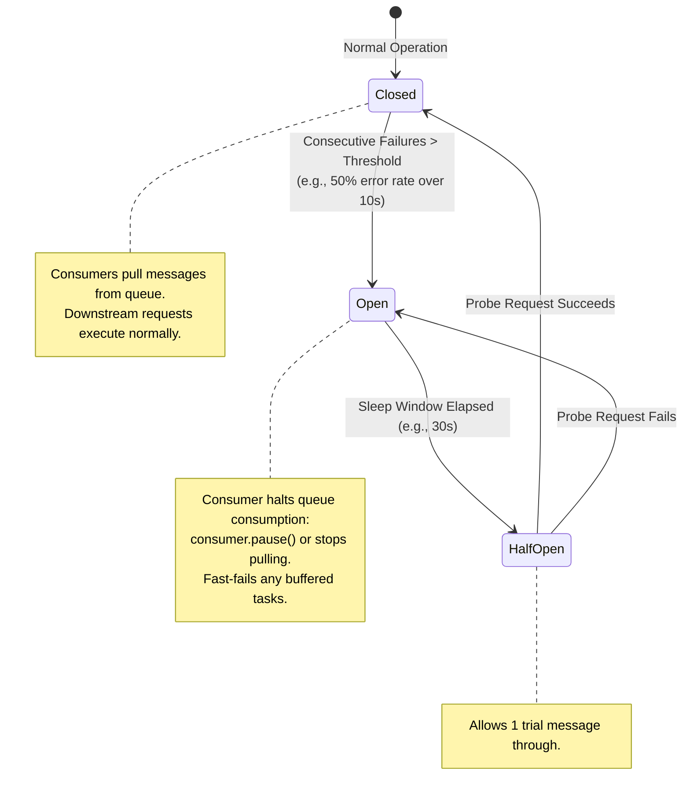

### LLD Mechanics & Engineering Internals

#### 1. Consumer Polling Suspension vs Requeuing
When the Circuit Breaker trips to `OPEN`, the consumer **must not** reject and requeue incoming messages in a tight loop (which burns CPU and generates millions of redelivery log entries).

Instead, the consumer pauses the ingestion channel at the transport layer:
- **Apache Kafka**: Invoke `consumer.pause(Set<TopicPartition> partitions)`. The poll loop continues executing heartbeats (`consumer.poll(0)`) to prevent Kafka from triggering a consumer group rebalance, but reads zero new records from the broker.
- **RabbitMQ**: Issue AMQP `basic.cancel` on the consumer tag, or temporarily stop reading from the socket.
- **AWS SQS**: Set the worker poll sleep interval to 10 seconds, skipping `ReceiveMessage` API calls entirely.

```java
public class ResilientKafkaConsumer {
    private final KafkaConsumer<String, String> consumer;
    private final CircuitBreaker circuitBreaker;
    private final DownstreamClient downstreamClient;

    public void runLoop() {
        while (running) {
            // Heartbeat poll is maintained regardless of circuit state
            ConsumerRecords<String, String> records = consumer.poll(Duration.ofMillis(100));

            if (circuitBreaker.isOpen()) {
                // Circuit is open: pause partition fetches to back off downstream
                consumer.pause(consumer.assignment());
                Thread.sleep(1000); // Back off locally
                continue;
            } else if (circuitBreaker.isHalfOpen()) {
                // Resume partitions with single probe fetch
                consumer.resume(consumer.assignment());
            }

            for (ConsumerRecord<String, String> record : records) {
                try {
                    circuitBreaker.executeRunnable(() -> downstreamClient.send(record.value()));
                    consumer.commitSync();
                } catch (CircuitBreakerOpenException e) {
                    // Circuit tripped during processing: pause and back off
                    consumer.pause(consumer.assignment());
                    break;
                } catch (Exception e) {
                    // Record failure in circuit breaker metrics
                }
            }
        }
    }
}
```

---

## 13. Real-World End-to-End Enterprise Case Study: E-Commerce Order Fulfillment

To demonstrate how these twelve enterprise patterns harmonize within a mission-critical, high-scale architecture, consider a global e-commerce platform processing 100,000 orders per minute.

### Complete Architecture Flowchart
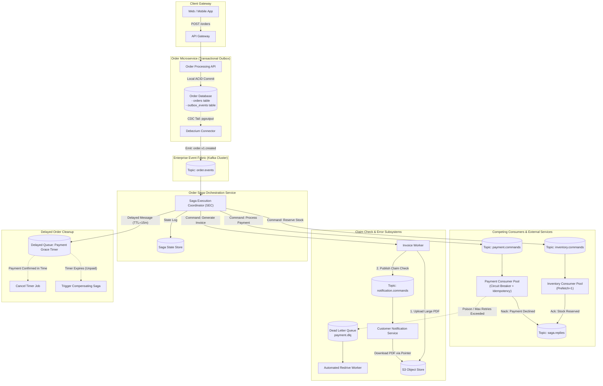

### Complete Sequence Diagram: Happy Path vs Failure Compensation
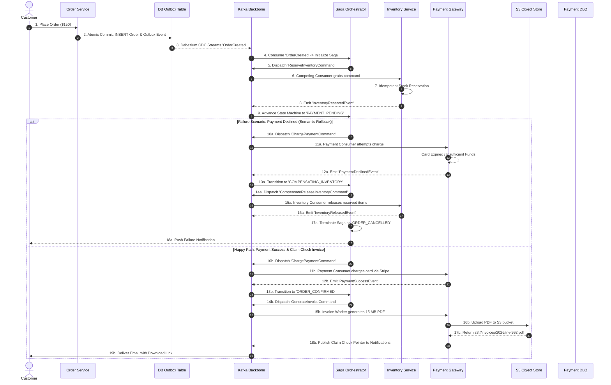

---

## 14. Staff-Level System Design Interview Masterclass (10 Deep Q&As)

### Q1: How do you guarantee strict FIFO ordering in a distributed messaging system handling 500,000 events/second?
**Answer**:
Strict global FIFO ordering across a single distributed queue at 500,000 events/sec is physically impossible due to the laws of concurrency: a single consumer thread traversing an ordered log is bound by CPU, memory bus, and network interface limits (typically topping out around 20,000–50,000 msgs/sec).

To achieve 500k events/sec with ordering, you **relax global ordering to per-entity causal ordering** using **Key-Based Partitioning**:
1. Assign a deterministic routing key to messages (e.g., `user_id` or `order_id`).
2. Hash the key using a uniform hash function (e.g., `MurmurHash3(key) % NumberOfPartitions`).
3. Scale partitions horizontally (e.g., 50 partitions each processing 10,000 events/sec).
4. Enforce strict single-consumer ownership per partition (Kafka Consumer Group partition assignment or AWS SQS FIFO Message Groups).
5. **Handling Consumer Rebalances**: During node rebalancing, in-flight processing can cause out-of-order execution. Consumers must utilize cooperative sticky assignors, commit offsets synchronously before yielding partitions, and enforce sequence version checking at the database write boundary.

### Q2: In the Transactional Outbox pattern, how do you handle high-frequency writes without creating a database write hotspot on the outbox table?
**Answer**:
A single outbox table under high insert volume suffers from B-tree index lock contention, table bloat, and WAL saturation.
1. **Sharded Outbox Partitioning**: Hash-partition the `outbox_events` table into $N$ physical tables (e.g., `outbox_events_00` through `outbox_events_31`) based on `aggregate_id`. Writes distribute across separate physical storage pages.
2. **PostgreSQL UNLOGGED Tables / Minimal Indexing**: Strip secondary indexes from the outbox table. Index only the primary key. Since outbox records are transient, use automated time-based partitioning (e.g., daily partitions dropped with `DROP TABLE` rather than running expensive row-by-row `DELETE` queries).
3. **Log Tailing (CDC) over Polling**: Polling with `SELECT ... FOR UPDATE SKIP LOCKED` triggers heavy database locking. CDC (Debezium reading the database WAL) reads sequentially from disk with zero row-lock overhead on the live table.

### Q3: How do you solve the "Dual-Write Problem" if your database does not support transactions or Write-Ahead Log tailing (e.g., Cassandra or DynamoDB without Streams)?
**Answer**:
When local atomic multi-table transactions are unavailable:
1. **Event Sourcing / Event-First Persistence**: Treat the event store as the primary source of truth. In DynamoDB, write the domain event to a single table with an atomic conditional put.
2. **Two-Phase Reservation / State Leasing**: Write the domain record with status `PENDING_PUBLISH`. An asynchronous reconciliation process scans for records stranded in `PENDING_PUBLISH` for longer than a threshold (e.g., 30 seconds) using a sparse GSI (Global Secondary Index) and publishes them to the broker.
3. **Client-Side Token Passing**: The client initiates an outbox lease in a distributed coordinator (e.g., Redis or Zookeeper) with an atomic TTL before issuing the write, releasing it only after the broker returns an acknowledgment.

### Q4: How do you prevent Low-Priority starvation in Priority Queues during peak traffic surges?
**Answer**:
Strict binary priority heaps inevitably cause starvation when high-priority ingress exceeds drain capacity.
1. **Weighted Fair Queuing (WFQ) / Deficit Round Robin (DRR)**: Implement discrete queue lanes (`Critical`, `High`, `Normal`, `Low`) and allocate consumer capacity via fixed ratios (e.g., 10:5:2:1). In every scheduling cycle, the consumer worker fleet is mathematically required to pull from the low-priority queue.
2. **Dynamic Priority Aging**: Messages accumulating queue dwell time have their priority dynamically boosted:
   $$\text{Effective Priority} = \text{Base Priority} + \left( \lambda \times \text{Queue Wait Time} \right)$$
   A low-priority message waiting for 30 minutes eventually escalates to high-priority, forcing the dispatcher to execute it.
3. **Dedicated Fleet Reservation**: Guarantee a fixed floor percentage of workers (e.g., 10% of CPU cores) exclusively to low-priority queues, decoupled from the critical consumer pool.

### Q5: What is the difference between Orchestrated Sagas and Choreographed Sagas in terms of operational blast radius, deadlocks, and testing?
**Answer**:
- **Operational Blast Radius**: In Choreography, an unexpected event schema mutation in Service A cascades invisibly across B, C, and D without compiler or linting warnings. In Orchestration, the orchestrator acts as a blast wall; contract changes are verified directly against the orchestrator's state definitions.
- **Deadlocks**: Choreography is vulnerable to cyclic event storms (Service A emits $E_1 \rightarrow$ Service B emits $E_2 \rightarrow$ Service A reacts to $E_2$ and emits $E_1$). Orchestration maintains an explicit directed acyclic graph (DAG) of state transitions, mathematically preventing cyclic deadlocks.
- **Testing & Observability**: Choreography requires running the entire constellation of microservices in an integrated testbed to verify a single compensation path. Orchestrated sagas can be unit-tested in isolation by mocking command responses and verifying that the state machine emits the expected compensating commands.

### Q6: How do you manage consumer group rebalances in Kafka when message processing duration is highly volatile (e.g., 10ms to 5 minutes)?
**Answer**:
If a message takes 5 minutes to process, the consumer thread may exceed `max.poll.interval.ms`. Kafka's coordinator assumes the consumer died, kicks it out of the group, and triggers a stop-the-world rebalance.
1. **Decouple the Polling Thread from Worker Pools**:
   - The Kafka poller thread runs in a tight loop doing nothing but `consumer.poll()` and pushing fetched records into an in-memory bounded blocking queue (e.g., `ArrayBlockingQueue`).
   - A separate pool of worker threads drains the in-memory queue and executes the slow business logic.
   - The poller thread continuously issues heartbeats to Kafka, keeping the group stable.
2. **Tuning `max.poll.interval.ms`**: If thread decoupling is not used, set `max.poll.interval.ms` strictly higher than the maximum worst-case processing time (e.g., 10 minutes) and reduce `max.poll.records` to a small batch (e.g., 5 to 10 records).
3. **Cooperative Sticky Assignor**: Configure `partition.assignment.strategy = org.apache.kafka.clients.consumer.CooperativeStickyAssignor`. Instead of revoking all partitions during a rebalance (Eager Rebalance), only reallocated partitions are migrated, allowing unaffected consumers to continue processing uninterrupted.

### Q7: Why does RabbitMQ degrade under deep queues, whereas Kafka throughput remains constant regardless of queue depth?
**Answer**:
- **RabbitMQ Architecture**: RabbitMQ maintains in-memory message pointer indices in Erlang processes. When queues grow deep (millions of unconsumed messages), messages are paged out to disk. Paging out and reading back messages requires random disk I/O, B-tree index updates, and triggers heavy Erlang garbage collection, collapsing throughput by up to 90%.
- **Kafka Architecture**: Kafka is fundamentally an append-only sequential commit log. Writes append to the end of an active file segment; reads stream sequentially from disk or the Linux OS Page Cache. Kafka does not maintain individual message state indices in memory. Whether a topic partition contains 100 messages or 100,000,000 messages, disk operations remain strictly $O(1)$ sequential I/O. Throughput is completely decoupled from queue depth.

### Q8: In the Claim Check pattern, what happens if the broker message is delivered before the S3 object upload achieves read-after-write consistency or during an upload network partition?
**Answer**:
While modern cloud stores (AWS S3) provide read-after-write consistency for `PUT` operations, network race conditions can still deliver the message before the upload completes if the producer published asynchronously.
1. **Strict Synchronous Confirmation**: The producer **must not** publish the claim check token to the broker until the object store returns an HTTP 200 OK along with an MD5/ETag or SHA-256 confirmation.
2. **Consumer Two-Tier Retry**: If the consumer receives a claim check and gets an S3 `NoSuchKey` / 404 error, it must treat this as a transient failure. It rejects the message with a short visibility delay (e.g., 5 seconds) to allow read-after-write propagation.
3. **Payload Checksum Integrity Validation**: The claim check token carries a `content_sha256` hash. Upon downloading the payload, the consumer recalculates the hash. If the hashes mismatch (indicating a corrupted or incomplete upload), the message is routed to the DLQ.

### Q9: How do you architect an Idempotent Consumer when the business logic involves both a database write and calling a non-idempotent third-party API (e.g., charging a credit card)?
**Answer**:
This is a classic distributed system boundary challenge. You cannot roll back a credit card charge via a database `ROLLBACK`.
1. **Pre-Authorization State Reservation**: Within a database transaction, insert an idempotency record with status `PAYMENT_PENDING` and commit.
2. **Deterministically Generated External Idempotency Keys**: Compute a deterministic idempotency key for the third-party API derived from the domain entity (e.g., `Stripe-Idempotency-Key = hash(order_id + amount + attempt_count)`).
3. **Execute API Call with Third-Party Idempotency**: Call the payment gateway with this key. If the network drops and the consumer retries, Stripe detects the duplicate key and returns the cached authorization result without charging the card a second time.
4. **Finalize State Transition**: Update the local database record to `PAYMENT_COMPLETED`. If this final write fails, the subsequent retry re-executes Step 3, receives the identical cached authorization from Stripe, and re-attempts the database write.

### Q10: How do you safely drain and reprocess 10,000,000 poisoned messages from a Dead Letter Queue without overwhelming the recovering downstream database?
**Answer**:
Dumping 10 million messages back into the primary queue will instantly re-crash downstream databases.
1. **Shadow Staging Queue with Rate Limiting**: Never redrive directly to the primary production queue. Redrive from the DLQ into an isolated **Staging Queue**.
2. **Throttled Token-Bucket Drain Worker**: Spin up dedicated redrive workers configured with a strict token bucket rate limiter (e.g., capped at 200 messages/sec).
3. **Downstream Health Circuit Breaker**: The redrive worker integrates with the downstream database monitoring system. If database CPU exceeds 65% or replication lag spikes, the redrive worker automatically throttles down or pauses execution.
4. **Batch Deduplication Pre-Filter**: Run an offline Spark/Flink job or script over the 10 million DLQ records to deduplicate by business key (`order_id`) and discard obsolete intermediate states, shrinking the actual reprocess volume significantly before injection.

---

## 15. Architectural Comparison & Pattern Selection Matrix

### Comprehensive Pattern Comparison
| Pattern Name | Latency Profile | Resource Overhead | Complexity | Primary Failure Mode | Best Broker Fit |
| :--- | :--- | :--- | :--- | :--- | :--- |
| **Competing Consumers** | Ultra-Low (1–5ms) | Low | Low | Head-of-Line blocking; duplicate leases on worker crash | RabbitMQ, SQS, Redis |
| **Fan-Out / Topic Routing** | Low (2–10ms) | Medium (Memory Fan-Out) | Low | Binding table bloat; slow consumers choking queues | RabbitMQ, Kafka, SNS |
| **Request-Reply (RPC)** | Moderate (10–50ms) | High (Metadata Churn) | Medium | Orphaned requests leaking memory on timeout | RabbitMQ, Redis |
| **Transactional Outbox** | Low–Mod (5–500ms) | Low–Med (DB WAL/I/O) | High | Outbox table bloat; CDC lag | Postgres + Debezium + Kafka |
| **Saga (Orchestration)** | High (100ms–Minutes) | Medium (State DB) | Very High | Pivot step failure; compensating transaction failure | Temporal, Step Functions, Kafka |
| **DLQ & Multi-Tier Retry** | Variable (Backoff) | Low | Medium | DLQ saturation; poison pill retry loops | SQS, RabbitMQ, Kafka |
| **Priority Queues (WFQ)** | Low (2–15ms) | Medium (Heap / Multi-Q) | Medium | Low-priority starvation; heap memory fragmentation | RabbitMQ, Redis, Custom |
| **Idempotent Consumer** | Low (+2–5ms DB lookup) | Medium (Cache + DB) | Medium | Cache eviction race conditions; index contention | Redis + PostgreSQL / DynamoDB |
| **Claim Check** | High (Blob upload RTT) | High (S3 I/O + Net) | Medium | S3 404 race condition; orphaned storage leaks | S3 / GCS + SQS / Kafka |
| **Delayed Messaging** | High (By design) | Medium (Timing Wheel) | Medium | Clock drift across worker nodes; timer queue overflow | Redis ZSet, RabbitMQ Delayed |
| **Circuit Breaker** | Sub-millisecond (Fast fail)| Ultra-Low | Medium | Flapping states; metric sliding window drift | In-Memory (Resilience4j) |

### Enterprise Decision Tree: Selecting the Right Pattern

```
Start: What is your primary architectural challenge?
  │
  ├── High-volume asynchronous compute with multiple workers?
  │     └── Are tasks variable in duration?
  │           ├── Yes ──> Competing Consumers with prefetch_count = 1 + Lock Extension Heartbeat
  │           └── No  ──> Competing Consumers with prefetch_count = 50-200
  │
  ├── Distributing events to multiple independent microservices?
  │     ├── Broadcast to ALL ─────────> Pure Fan-Out (fanout exchange / SNS)
  │     └── Broadcast selectively ────> Topic-Based Routing with Trie Wildcards
  │
  ├── Synchronous request over asynchronous messaging?
  │     └── Request-Reply Pattern with Shared Reply Queue + Correlation ID Map
  │
  ├── Updating Database AND publishing to Broker atomically?
  │     ├── High Write Volume (>5k/s) ─> Transactional Outbox with CDC (Debezium / WAL)
  │     └── Low/Medium Volume ─────────> Transactional Outbox with SELECT FOR UPDATE SKIP LOCKED
  │
  ├── Multi-step business transaction across microservices?
  │     ├── 2 to 3 simple steps ──────> Choreographed Saga
  │     └── Complex workflow (>3 steps)─> Orchestrated Saga with SEC State Machine
  │
  ├── Handling transient errors and poison pills?
  │     └── Multi-Tier Delayed Retry with Exponential Backoff + Full Jitter + DLQ
  │
  ├── Message payloads exceed broker limits (>256KB / >1MB)?
  │     └── Claim Check Pattern with S3 / Object Store + SHA-256 Hash Pointer
  │
  └── Downstream dependency is degraded / crashing?
        └── Consumer-Side Circuit Breaker with Partition Fetch Suspension
```
