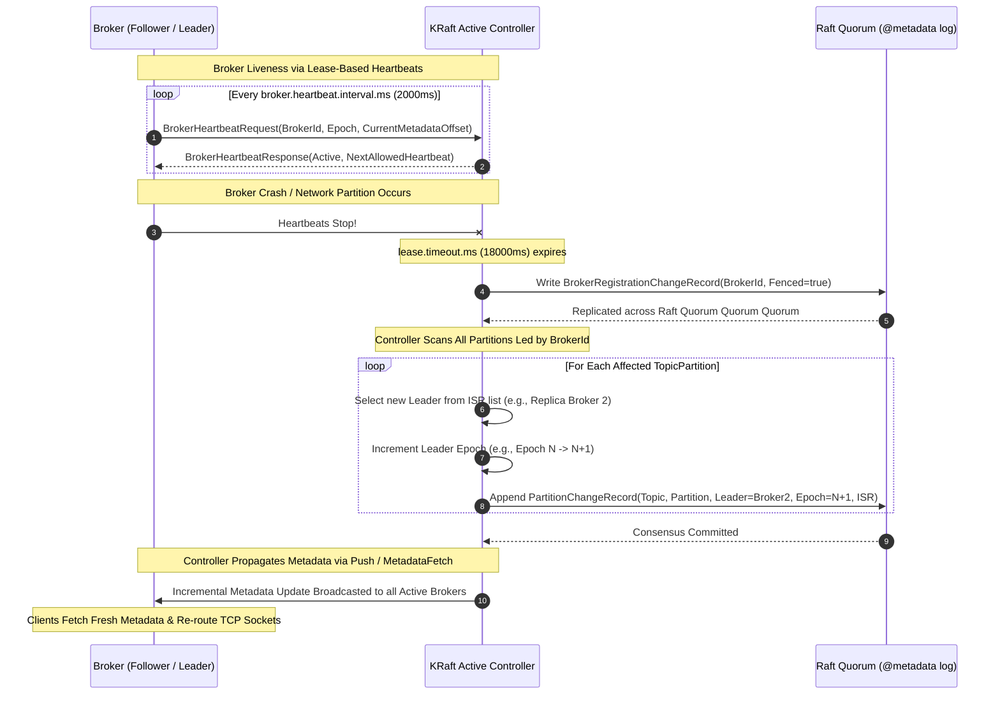
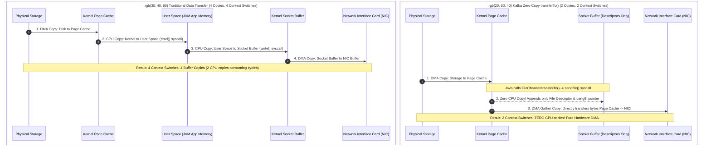
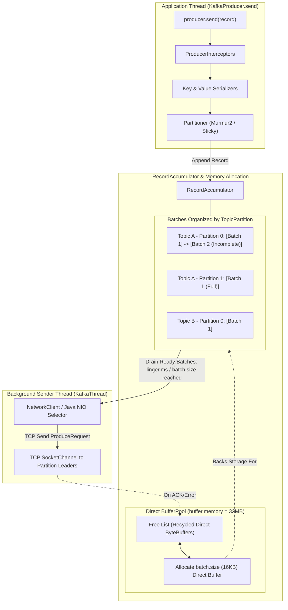
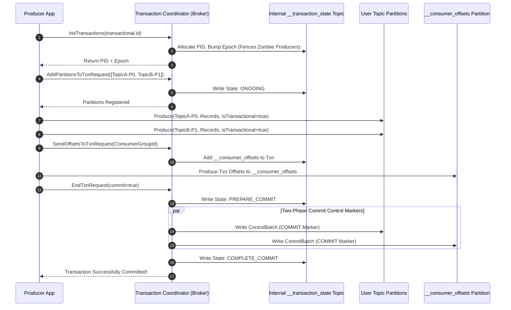
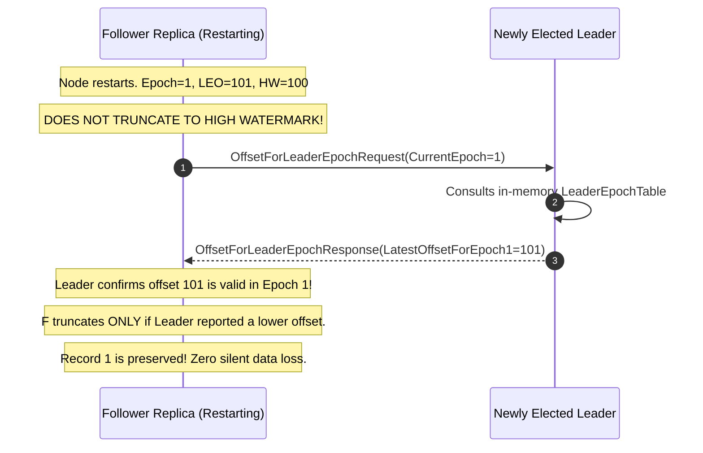

# Apache Kafka: The Definitive Distributed Systems Engineering Guide

---

## 1. Overview, Origin & Distributed Commit Log Philosophy

### 1.1 The Genesis at LinkedIn
In 2010, the engineering infrastructure team at LinkedIn (led by Jay Kreps, Neha Narkhede, and Jun Rao) faced an architectural breaking point. LinkedIn’s backend was evolving from a monolithic service into a labyrinth of distributed microservices, databases, and analytical clusters. Metrics, user tracking events (page views, clicks, searches), application operational logs, and database change feeds had to be routed across heterogeneous data stores—including ActiveMQ message brokers, Oracle databases, and offline Hadoop/HDFS data lakes.

Traditional enterprise message-oriented middleware (MOM) such as ActiveMQ, RabbitMQ, and IBM MQ collapsed under this scale:
1. **Queue Thrashing Under Volume**: Traditional message brokers rely on B-Tree or transient in-memory indexing to track individual message states (delivered, pending, acknowledged). As queues grew into millions of unacknowledged events during downstream outages, broker performance degraded exponentially.
2. **Push-Model Queue Overload**: Brokers pushed records to consumers at speeds dictated by the producer. Consumers with varying CPU capacities or network constraints frequently experienced buffer overflow, Out-Of-Memory (OOM) crashes, or lost connections.
3. **No Native Event Replayability**: Once a message was acknowledged, traditional message brokers pruned it from memory/disk. If an analytics pipeline crashed or an ML training job required data from 48 hours ago, there was no deterministic mechanism to rewind and replay messages without restoring entire database backups.
4. **Point-to-Point Pipeline Sprawl**: Engineering teams built bespoke dual-write pipelines ($O(N^2)$ connections between $N$ sources and $M$ sinks), resulting in massive architectural debt, tight coupling, and data divergence.

Kafka was engineered from first principles as an append-only distributed commit log designed to operate as a high-throughput, horizontally scalable, durable central nervous system for enterprise event streaming.

---

### 1.2 The Distributed Commit Log Paradigm
The foundational abstraction of Kafka is the **Append-Only Commit Log** (inspired by database Write-Ahead Logs, or WALs). 

```
                               APPEND ONLY LOG (PARTITION)
                      Offset Index: 0, 1, 2, ... N
+---------------------------------------------------------------------------------------+
| Record 0 | Record 1 | Record 2 | Record 3 | Record 4 | ... | Record N-1 | Record N    |
+---------------------------------------------------------------------------------------+
     ^                                 ^                                       ^
     |                                 |                                       |
Consumer C (Batch)              Consumer B (Analytics)                 Producer / Consumer A
Offset = 0                      Offset = 3                             Offset = N (Real-time)
```

In this model:
- **Immutability**: Once a byte sequence is written to the tail of the log, it cannot be modified, deleted, or reordered in place.
- **Strict Monotonic Ordering**: Every record appended to a log partition is assigned a 64-bit integer called an **Offset** ($0, 1, 2, \dots$). Offsets within a partition are strictly monotonic and immutable.
- **Decoupled Readers (Smart Consumer / Dumb Broker)**: The broker does not maintain per-message acknowledgement states, timers, or read pointers. Instead, the consumer tracks its own integer cursor (offset). This shifts the memory footprint of tracking consumers from $O(M \times N)$ on the broker to $O(1)$ per consumer group, allowing thousands of concurrent consumers to read from the exact same log at arbitrary offsets without impacting broker performance or each other.

---

### 1.3 Architectural Comparison: Kafka vs. Traditional Message Brokers

| Architectural Dimension | Traditional Message Queues (RabbitMQ, ActiveMQ) | Apache Kafka |
| :--- | :--- | :--- |
| **Broker State Model** | **Smart Broker / Dumb Consumer**: Broker tracks per-consumer message states (delivered, acked, unacked, dead-lettered). | **Dumb Broker / Smart Consumer**: Broker is a blind append-only log engine. Consumers maintain their own offset cursors. |
| **Data Retention** | **Destructive / Ephemeral**: Messages are pruned immediately or shortly after acknowledgement. | **Persistent / Time & Size Bound**: Messages persist on disk according to retention policies (e.g., 7 days, 100 GB, or infinity). |
| **Consumer Read Flow** | **Push Model**: Broker pushes messages down open TCP connections to consumers; risks backpressure saturation. | **Pull Model**: Consumers poll brokers on demand, controlling batch size, memory allocation, and processing pace. |
| **Throughput & Concurrency** | **Low-Medium**: $10^3$ to $10^5$ msgs/sec. Bottlenecked by per-message state updates, locking, and memory tracking. | **Ultra-High**: $10^6+$ msgs/sec per broker. Linear scaling via log partitioning, sequential disk I/O, and zero-copy kernel transfers. |
| **Message Ordering** | Guaranteed only across single-consumer queues. Fails or degrades under concurrent workers or DLQ re-queueing. | **Strict Total Order** per partition, deterministic across concurrent reader groups. |
| **Replayability** | Not natively supported. Messages vanish upon consumption. | **Deterministic Replay**: Consumers can rewind offsets to any historical point within the retention boundary. |
| **Multi-Tenancy & Fanout** | Requires explicit exchanges, bindings, and duplicating messages into distinct physical queues per consumer. | Zero overhead: Single partition log read concurrently by infinite independent consumer groups at zero storage amplification. |

---

## 2. High-Level Design (HLD) of Apache Kafka Architecture

### 2.1 Cluster Topology & KRaft Consensus
A production Kafka cluster consists of a mesh of stateless broker nodes and a metadata quorum. Historically, Kafka relied on external Apache ZooKeeper clusters to coordinate metadata and elect the cluster controller. Modern Kafka (KIP-500+, production-default in Kafka 3.x and pure KRaft in 4.0+) eliminates ZooKeeper entirely, replacing it with **KRaft (Kafka Raft Metadata Mode)**.

```mermaid
flowchart TD
    subgraph Producers ["Event Producers"]
        P1["Producer Client 1 (Direct Metadata Cache)"]
        P2["Producer Client 2 (Direct Metadata Cache)"]
    end

    subgraph KRaftQuorum ["KRaft Controller Quorum (@metadata Topic)"]
        C_Leader["Active Controller (Raft Leader)\nBroker 101"]
        C_Voter1["Controller Voter\nBroker 102"]
        C_Voter2["Controller Voter\nBroker 103"]
        C_Leader <-->|Raft Log Replication| C_Voter1
        C_Leader <-->|Raft Log Replication| C_Voter2
    end

    subgraph BrokerCluster ["Kafka Broker Data Plane"]
        subgraph Broker1 ["Broker Node 1"]
            B1_L["Topic A - Partition 0 (LEADER)"]
            B1_F["Topic A - Partition 1 (FOLLOWER)"]
            B1_PC["OS Page Cache Engine"]
            B1_Disk[("Log Segments on Disk")]
            B1_L --> B1_PC --> B1_Disk
        end

        subgraph Broker2 ["Broker Node 2"]
            B2_L["Topic A - Partition 1 (LEADER)"]
            B2_F["Topic A - Partition 0 (FOLLOWER)"]
            B2_PC["OS Page Cache Engine"]
            B2_Disk[("Log Segments on Disk")]
            B2_L --> B2_PC --> B2_Disk
        end

        subgraph Broker3 ["Broker Node 3"]
            B3_F0["Topic A - Partition 0 (FOLLOWER)"]
            B3_F1["Topic A - Partition 1 (FOLLOWER)"]
            B3_PC["OS Page Cache Engine"]
            B3_Disk[("Log Segments on Disk")]
            B3_F0 --> B3_PC --> B3_Disk
        end
    end

    subgraph ConsumerEcosystem ["Consumer Groups (Pull Model)"]
        subgraph CG_App ["Consumer Group: Analytics"]
            C1["Consumer Worker 1\n(Reading P0)"]
            C2["Consumer Worker 2\n(Reading P1)"]
        end
        subgraph CG_Audit ["Consumer Group: Audit Log"]
            C3["Consumer Worker 3\n(Reading P0 & P1)"]
        end
    end

    %% Producer Writes
    P1 -->|Direct TCP Produce| B1_L
    P2 -->|Direct TCP Produce| B2_L

    %% Intra-Broker Replication
    B2_F -.->|Replication Fetch| B1_L
    B3_F0 -.->|Replication Fetch| B1_L
    B1_F -.->|Replication Fetch| B2_L
    B3_F1 -.->|Replication Fetch| B2_L

    %% Control Plane
    C_Leader -.->|Metadata Push / Incremental Heartbeat| Broker1
    C_Leader -.->|Metadata Push / Incremental Heartbeat| Broker2
    C_Leader -.->|Metadata Push / Incremental Heartbeat| Broker3

    %% Consumer Reads
    B1_L -->|Zero-Copy Fetch| C1
    B2_L -->|Zero-Copy Fetch| C2
    B1_L -->|Zero-Copy Fetch| C3
    B2_L -->|Zero-Copy Fetch| C3
```



---

### 2.2 Deep Dive: ZooKeeper vs. KRaft (KIP-500)
ZooKeeper managed metadata externally as a hierarchical filesystem of znodes. While functional, ZooKeeper imposed severe scalability and operational walls:
- **ZooKeeper Watch Storms**: When a broker failed, thousands of partition leader watches fired simultaneously, triggering an $O(N)$ thundering herd problem that choked ZooKeeper CPU and saturated the broker network.
- **Controller Failover Latency**: When the active Kafka controller crashed, a newly elected controller had to perform a full reload of the entire cluster metadata from ZooKeeper (reading millions of partition states into RAM), stalling metadata operations for minutes.
- **Partition Limit Ceiling**: ZooKeeper clusters typically degraded beyond 200,000 partitions across a cluster due to memory pressure and serialized consensus serialization.

#### The KRaft Architectural Transformation
In KRaft mode, cluster metadata is stored internally as a single-partition, replicated commit log called `@metadata` (partition 0):
1. **Event-Sourced Metadata**: All state changes—topic creation, partition reassignment, ACL alterations, broker registrations—are written as typed records to the `@metadata` log.
2. **Dedicated vs. Combined Roles**: Nodes can run with `process.roles=controller`, `process.roles=broker`, or `process.roles=controller,broker`.
3. **Instantaneous Failover**: The Active Controller is the elected leader of the Raft voter quorum. The standby controller nodes act as Raft followers, continuously replicating the `@metadata` partition into their local memory. If the Active Controller dies, a standby controller wins Raft election and becomes the Active Controller in **sub-second time**, with cluster metadata already fully loaded in RAM.
4. **Scale Beyond Millions of Partitions**: Because metadata changes are streamed incrementally to brokers as append-only log batches, a single KRaft cluster can comfortably manage tens of millions of partitions without watch storms.

---

### 2.3 High-Availability, Heartbeats, and Failover Mechanics



#### Unclean Leader Election Risks
When all In-Sync Replicas (ISR) fail and only out-of-sync replicas remain:
- `unclean.leader.election.enable=false` (Default, Production Grade): The partition remains strictly unavailable for writes and reads until an ISR broker restarts. **Prioritizes Consistency (CP in CAP theorem)**.
- `unclean.leader.election.enable=true`: The broker promotes an out-of-sync replica as leader. All messages committed on the previous leader that were not replicated to this replica are **permanently destroyed**. The log is truncated, causing irreversible data loss and downstream corruption.

---

## 3. Low-Level Design (LLD) - Storage Engine & Segment Files

### 3.1 File System Hierarchy
On the underlying Linux ext4 or XFS filesystem, Kafka's storage layer avoids complex B-Trees or SQLite engines. Every partition is stored as a directory within the configured `log.dirs` path:

```
/var/lib/kafka/data/
├── @metadata-0/                                 # KRaft internal metadata log
├── orders.v1-0/                                 # Topic: orders.v1, Partition: 0
│   ├── 00000000000000000000.log                 # Base offset 0: Raw RecordBatches
│   ├── 00000000000000000000.index               # Offset-to-Physical-Position Index
│   ├── 00000000000000000000.timeindex           # Timestamp-to-Offset Index
│   ├── 00000000000000000000.txnindex            # Aborted Transactions Index
│   ├── 00000000000001450000.log                 # Active segment rolled at offset 1,450,000
│   ├── 00000000000001450000.index
│   ├── 00000000000001450000.timeindex
│   ├── leader-epoch-checkpoint                  # Leader epoch to start-offset mapping
│   └── partition.metadata                       # UUID metadata for topic identity
└── orders.v1-1/                                 # Topic: orders.v1, Partition: 1
```

A segment is composed of four primary files prefixed with a 20-digit zero-padded base offset string:
1. **`.log` File**: The binary sequence of serialized Kafka `RecordBatch` envelopes.
2. **`.index` File**: A sparse binary index mapping logical offsets to physical byte offsets in the `.log` file.
3. **`.timeindex` File**: A sparse binary index mapping Unix timestamps to logical offsets.
4. **`.txnindex` File**: Index storing metadata of aborted transactions for transactional consumers.
5. **`leader-epoch-checkpoint`**: Plaintext state checkpointing the starting offset of each leader epoch.

---

### 3.2 Exact Binary Layout of Log & Index Files

#### 3.2.1 RecordBatch Binary Layout (Kafka Record Format v2 - Modern Default)
Records in Kafka are never written individually; they are serialized into a `RecordBatch` wrapper to enable compression and vectorization.

```
+-----------------------------------------------------------------------------------------+
|                                  RecordBatch Header (61 Bytes)                          |
+-----------------------------------------------------------------------------------------+
| Field Name               | Type    | Size    | Description                              |
+--------------------------+---------+---------+------------------------------------------+
| BaseOffset               | int64   | 8 Bytes | First offset in this batch               |
| BatchLength              | int32   | 4 Bytes | Total byte length of entire batch        |
| PartitionLeaderEpoch     | int32   | 4 Bytes | Leader epoch when batch was written      |
| Magic                    | int8    | 1 Byte  | Format version (2 = modern Kafka format) |
| CRC32C                   | uint32  | 4 Bytes | Castagnoli polynomial checksum           |
| Attributes               | int16   | 2 Bytes | Bitmask: [0-2]: Compression Codec        |
|                          |         |         |          [3]: Timestamp type             |
|                          |         |         |          [4]: Is Transactional           |
|                          |         |         |          [5]: Is Control Batch           |
| LastOffsetDelta          | int32   | 4 Bytes | Last offset minus BaseOffset             |
| FirstTimestamp           | int64   | 8 Bytes | Epoch timestamp of first record          |
| MaxTimestamp             | int64   | 8 Bytes | Maximum timestamp in this batch          |
| ProducerId (PID)         | int64   | 8 Bytes | Producer ID assigned by coordinator     |
| ProducerEpoch            | int16   | 2 Bytes | Producer epoch for zombie fencing        |
| BaseSequence             | int32   | 4 Bytes | Base sequence number for idempotency     |
| RecordsCount             | int32   | 4 Bytes | Number of records contained inside       |
+--------------------------+---------+---------+------------------------------------------+
|                                    Records Array Payload                                |
+-----------------------------------------------------------------------------------------+
| Record 0:  [ Length (varint) | Attributes (int8) | TimestampDelta (varint)              |
|              OffsetDelta (varint) | KeyLength (varint) | Key (bytes)                     |
|              ValueLength (varint) | Value (bytes) | HeadersCount (varint) | Headers ]   |
| Record 1:  ...                                                                          |
+-----------------------------------------------------------------------------------------+
```

#### 3.2.2 Offset Index (`.index`) Binary Structure
The offset index uses fixed-width 8-byte entries, making binary search operations $O(\log N)$ with zero parsing overhead:

```
+---------------------------------------------------------------+
| Byte Range | Field Name      | Type   | Description           |
+---------------------------------------------------------------+
| Bytes 0-3  | RelativeOffset  | uint32 | Offset - BaseOffset   |
| Bytes 4-7  | PhysicalPosition| uint32 | Byte position in .log |
+---------------------------------------------------------------+
Total size per index entry: Exactly 8 Bytes (Fixed Width).
```

#### 3.2.3 Time Index (`.timeindex`) Binary Structure
Used for time-based retention pruning and offset-by-timestamp lookups:

```
+---------------------------------------------------------------+
| Byte Range | Field Name      | Type   | Description           |
+---------------------------------------------------------------+
| Bytes 0-7  | Timestamp       | int64  | Unix Epoch Timestamp  |
| Bytes 8-11 | RelativeOffset  | uint32 | Relative offset delta |
+---------------------------------------------------------------+
Total size per timeindex entry: Exactly 12 Bytes (Fixed Width).
```

#### 3.2.4 Transaction Index (`.txnindex`)
Contains entries for aborted transactions so the broker can instruct consumers in `read_committed` mode to skip aborted record batches:

```
+---------------------------------------------------------------+
| Field Name               | Type   | Size    | Description     |
+---------------------------------------------------------------+
| Version                  | int16  | 2 Bytes | Format version  |
| ProducerId               | int64  | 8 Bytes | PID of tx       |
| FirstOffset              | int64  | 8 Bytes | Start offset    |
| LastOffset               | int64  | 8 Bytes | End offset      |
| LastStableOffset (LSO)   | int64  | 8 Bytes | LSO at abort    |
+---------------------------------------------------------------+
```

#### 3.2.5 Leader Epoch Checkpoint File (`leader-epoch-checkpoint`)
A text file checkpointing the highest offset written under each leader epoch:
```
0                                <- Checkpoint format version
2                                <- Number of entries
0 0                              <- [LeaderEpoch: 0, StartOffset: 0]
1 1450000                        <- [LeaderEpoch: 1, StartOffset: 1,450,000]
```

---

### 3.3 Sparse Index Binary Search and Seek Algorithm

Kafka **does not** index every message. That would cause the index files to consume excessive RAM. Instead, Kafka uses **Sparse Indexing**. An entry is written to `.index` only after every `index.interval.bytes` (default: 4096 bytes / 4KB) written to the `.log` file.

#### Step-by-Step Disk Seek Walkthrough
**Target Goal**: Locate and read message at **Offset 1,450,210**.

```
Step 1: In-Memory ConcurrentSkipListMap (BaseOffsets)
[Segment 0: Base 0] -> [Segment 1: Base 1,000,000] -> [Segment 2: Base 1,450,000]
                                                            ^
                                              Floor entry <= 1,450,210
                                              Select: 00000000000001450000.log / .index

Step 2: Binary Search in Memory-Mapped .index File
Base Offset = 1,450,000
Target Relative Offset = 1,450,210 - 1,450,000 = 210
Binary search the 8-byte entries:
Index Entry 40:  Relative Offset 195 -> Physical Position: 38,912
Index Entry 41:  Relative Offset 225 -> Physical Position: 45,056
                  ^^^^^^^^^^^^^^^^^^
Floor match is Entry 40: Relative Offset 195 at Physical Position 38,912

Step 3: Direct Page Cache Seek
Seek directly to byte offset 38,912 in 00000000000001450000.log

Step 4: Sequential Linear Scan Over RecordBatches
Byte 38,912: RecordBatch [Base: 195, Count: 10] -> Covers offsets 195 to 204
Byte 40,960: RecordBatch [Base: 205, Count: 10] -> Covers offsets 205 to 214
              -> Target Offset 210 resides inside this RecordBatch!
Extract Record at OffsetDelta = (210 - 205) = 5. Return payload to consumer.
```

*Time Complexity*: $O(\log(\text{Segments})) + O(\log(\text{IndexEntries})) + O(\text{ScanWindow})$.
Since the entire `.index` file is memory-mapped via OS `mmap`, zero disk I/O occurs until Step 3, which resolves in sub-millisecond page cache hits.

---

### 3.4 Log Compaction LLD: Clean vs. Dirty Segments & SkimpyOffsetMap

Log Compaction (`cleanup.policy=compact`) guarantees that Kafka retains at least the latest state for each message key within a partition log. It converts Kafka into an immutable key-value change-data-capture store.

```
                               LOG SEGMENTS PARTITION TIMELINE
[ Clean Segment 1 ]  [ Clean Segment 2 ]  |  [ Dirty Segment 3 ]  [ Active Segment (Writing) ]
<---------------------------------------->  <------------------------------------------------>
            CLEAN SECTION (Tail)                           DIRTY SECTION (Head)
       (Deduplicated Keys Only)                   (Contains Duplicate Keys & Appends)
                                         ^
                                    CLEANER POINT
```

#### Internal Architecture of Cleaner Threads
1. **Log Split**: The log is partitioned into the **Clean Section** (previously compacted, strictly distinct keys) and the **Dirty Section** (accumulated new writes). The boundary is tracked by the `cleaner-offset-checkpoint`.
2. **SkimpyOffsetMap Construction**:
   - The cleaner thread initializes a specialized off-heap hash table called `SkimpyOffsetMap`.
   - To eliminate JVM garbage collection overhead, it is structured as a single flat memory array.
   - For every key in the dirty section, it computes an 8-byte hash:
     $$\text{Slot} = \text{Murmur3}(\text{KeyBytes}) \pmod{\text{TableCapacity}}$$
   - It stores `(KeyHash 8 bytes -> LatestOffset 8 bytes)` in the map.
3. **Log Cleaning & Merging Pass**:
   - The cleaner reads through the Clean and Dirty segments sequentially.
   - For every record, it checks the `SkimpyOffsetMap`:
     - If $\text{Record.Offset} < \text{Map.get}(\text{Record.KeyHash})$, the record is superseded and discarded!
     - If $\text{Record.Offset} == \text{Map.get}(\text{Record.KeyHash})$, the record is preserved and written into a new clean replacement segment.
4. **Tombstones & Deletion Handling**:
   - When a client produces a record with `Value = null`, it is a **Tombstone** (logical delete).
   - The cleaner preserves the tombstone across compactions for `delete.retention.ms` (default 24 hours) to ensure slow consumers observe the deletion marker before it is physically excised from disk.

---

## 4. Low-Level Design (LLD) - Memory, Kernel & Zero-Copy I/O

### 4.1 Linux Page Cache Exploitation vs. JVM Heap

A critical design choice of Kafka is that **the broker allocates virtually no cache memory in the JVM heap**. A production Kafka broker typically runs with a modest JVM heap (e.g., 8 GB to 16 GB), while the remaining 112 GB to 240 GB of RAM on a 128-256 GB machine is relinquished directly to the Linux Kernel **Page Cache**.

#### Why Kafka Rejects the JVM Heap Cache Model:
1. **Garbage Collection (GC) Pauses**: Caching tens of gigabytes of objects in the JVM heap triggers massive Stop-The-World (STW) pauses during major GC cycles (G1GC, ZGC), causing broker heartbeat timeouts and false failovers.
2. **Object Memory Amplification**: Java object representations carry heavy headers, field alignments, and 16-byte object overheads. A 100-byte raw payload often balloons to 300-400 bytes when wrapped in a Java object.
3. **Warm Caches Across Process Restarts**: If a Kafka broker restarts (e.g., during a rolling upgrade), an in-JVM cache vanishes instantly, leading to high disk latency upon reboot. Because the Linux Page Cache resides in kernel space, **the cache remains hot across JVM restarts**.

#### The I/O Write & Read Path:
- **Write Path**: Producer `ProduceRequest` arrives over TCP. The broker validates CRC and appends bytes using `FileChannel.write()`. This issues a write directly into the OS page cache. The page is marked **dirty**. The Linux kernel background flushers (`flush`, `pdflush`, or `kswapd` governed by `vm.dirty_background_ratio`) asynchronously flush dirty pages to disk via sequential writes.
- **Read Path**: When consumers fetch records, the kernel checks the Page Cache. Because consumers are typically streaming real-time data produced seconds ago, the read hits RAM (page cache) **100% of the time**, bypassing physical NVMe/SSD controllers completely.

---

### 4.2 Zero-Copy `sendfile()` Syscall Architecture

In a standard message broker, transferring data from disk to a network socket requires crossing the user-kernel boundary four times and copying data four times. Kafka eliminates this via the Linux `sendfile()` system call (exposed via Java's `FileChannel.transferTo()`).

#### Standard I/O (Traditional Broker) vs. Zero-Copy `sendfile()` (Kafka):



#### Detailed Breakdown of Zero-Copy Gains:
1. **Context Switches**: Halved from 4 to 2 (one switch into kernel space upon invoking `sendfile()`, one switch returning to user space upon completion).
2. **CPU Utilization**: Drops to near zero during network reads. CPU cycles are freed entirely for TLS encryption, CRC verification, and cluster coordination.
3. **Memory Bus Bandwidth**: No data travels across the CPU memory bus into user-space heap. Data is transferred directly from the system RAM page cache to the Network Interface Card (NIC) buffer via DMA (Direct Memory Access) gather operations.

---

## 5. Low-Level Design (LLD) - Producer Internals

### 5.1 The Internal Pipeline & Memory Allocation

The Kafka Producer architecture is decoupled into an asynchronous, non-blocking pipeline spanning the user caller thread and a dedicated background I/O `Sender` thread.



#### MemoryPool & JVM GC Avoidance
If a producer sending 100,000 records per second allocated a new byte array for each batch, it would generate hundreds of megabytes of short-lived objects per second, forcing aggressive JVM GC sweeps.
- Kafka producer uses an internal **`BufferPool`** allocating a fixed pool of off-heap/direct `ByteBuffer` allocations (default: 32 MB total, chunked into `batch.size` = 16 KB).
- When a batch completes and receives an ACK from the broker, the buffer is **not garbage collected**. It is returned to the `BufferPool` free list for immediate reuse by the next incoming batch.

---

### 5.2 Partitioning Algorithms

#### 5.2.1 Keyed Partitioning (Murmur2 Hash)
When a key is supplied, Kafka computes a deterministic 32-bit Murmur2 hash:
$$\text{Partition} = (\text{Utils.toPositive}(\text{Utils.murmur2}(\text{KeyBytes}))) \pmod{\text{NumPartitions}}$$
Where `Utils.toPositive(x)` clears the sign bit (`x & 0x7fffffff`). This guarantees that every event for a specific key (e.g., `account_id = 90210`) lands in the exact same partition, preserving strict chronological ordering.

#### 5.2.2 Key-less Partitioning: The Sticky Partitioner (KIP-480)
Historically, key-less messages were partitioned round-robin record-by-record. This caused catastrophic micro-batching: 10 messages across 10 partitions created 10 tiny network packets of 1 record each.
The modern **Sticky Partitioner** solves this:
- It picks a random partition and sticks to it, filling an entire `batch.size` (16 KB) buffer.
- Once that batch is full or `linger.ms` expires, it rotates to the next partition.
- **Result**: Drastically larger batch sizes, 5x higher compression ratios, and massive network request reduction.

---

### 5.3 Batching & Compression Parameters

| Parameter | Default | Production Tuning | Architectural Impact |
| :--- | :--- | :--- | :--- |
| `batch.size` | 16384 (16KB) | 65536 - 131072 (64KB - 128KB) | Maximum byte size allocated per partition batch. Larger sizes maximize compression ratios and throughput at the expense of marginal RAM. |
| `linger.ms` | 0 ms | 5 ms - 20 ms | Artificial delay injected to allow incoming records to coalesce into the same batch. Setting to 5-10ms provides massive throughput gains with undetectable latency impact. |
| `compression.type` | `none` | `lz4` or `zstd` | Compresses batches inside the `RecordAccumulator` before network transit. Broker stores compressed bytes directly; consumer decompresses. |
| `max.in.flight.requests.per.connection` | 5 | 5 (with Idempotence) | Max pipelined TCP requests sent without broker ACK. Must be $\le 5$ to guarantee ordering when idempotence is active. |

---

### 5.4 Idempotent Producer LLD
In a standard network environment, transient packet drops or timeouts cause producer retries. If the broker received and committed a batch, but the ACK was dropped on the network return path, a producer retry introduces duplicate records into the log.

Setting `enable.idempotence=true` enforces exact deduplication per partition:

```
PRODUCER                                                    BROKER PARTITION
[PID: 1042, Epoch: 0]                                       (Tracks Last 5 Sequences for PID 1042)
  |                                                           |
  |--- Batch A: Sequence 0, 1, 2, 3, 4 ---------------------->| Commit! Broker State: PID 1042 -> LastSeq = 4
  |<-- TCP ACK (Success) -------------------------------------|
  |                                                           |
  |--- Batch B: Sequence 5, 6, 7, 8 ------------------------->| Commit! Broker State: PID 1042 -> LastSeq = 8
  |    x- (Network drops ACK packet) -------------------------|
  |                                                           |
  | [Timeout Triggered -> Producer Retries Batch B]           |
  |--- Batch B (RETRY): Sequence 5, 6, 7, 8 ----------------->| Check: Incoming BaseSeq (5) <= LastSeq (8)
  |                                                           | Duplicate Detected! Discard write from disk.
  |<-- TCP ACK (Success Resent) ------------------------------| (No duplicates written to log!)
```

#### Protocol Mechanics:
1. **Producer ID (PID)**: Upon startup, the producer sends an `InitProducerId` RPC to the Transaction Coordinator broker. The broker assigns a globally unique 64-bit integer (`PID`) and an integer `Epoch`.
2. **Sequence Numbers**: Every batch appended to a `(TopicPartition, PID)` carries a 32-bit monotonically increasing `BaseSequence` number.
3. **Broker Deduplication Window**: The partition leader maintains an in-memory sliding window of the last **5 sequence numbers** for each active PID.
   - If $\text{IncomingSeq} == \text{BrokerLastSeq} + 1$: Batch accepted, appended to log, sequence updated.
   - If $\text{IncomingSeq} \le \text{BrokerLastSeq}$: Duplicate detected. Broker skips disk write, but returns an ACK so the producer can proceed.
   - If $\text{IncomingSeq} > \text{BrokerLastSeq} + 1$: Gap detected (messages were dropped). Broker rejects write with `OutOfOrderSequenceException`.

---

### 5.5 Transactional Coordinator LLD (2-Phase Commit & EOS)

Kafka's Transactional API guarantees **atomic writes across multiple topics and partitions**, alongside atomic consumer offset commits (the "read-process-write" pattern).



#### Abort and Isolation Mechanics:
- If an abort occurs (or the producer crashes), the Transaction Coordinator writes a `ControlBatch (ABORT Marker)` across all participant partitions.
- **Consumer Isolation Level**:
  - `isolation.level=read_uncommitted` (default): Consumer sees all messages including uncommitted or aborted batches.
  - `isolation.level=read_committed`: Consumer buffers records up to the **Last Stable Offset (LSO)**—the offset of the earliest ongoing transaction. Once an abort marker is read, the consumer consults the `.txnindex` and silently skips the aborted payload, guaranteeing **Exactly-Once Semantics (EOS)**.

---

## 6. Low-Level Design (LLD) - Consumer Internals & Group Coordination

### 6.1 The Consumer Group Coordinator State Machine

Consumers with identical `group.id` values form a cooperative group. The broker designated as the **Group Coordinator** for a group is deterministically chosen via:
$$\text{CoordinatorBrokerId} = \text{LeaderOfPartition}(\text{Murmur2}(\text{group.id}) \pmod{\text{offsets.topic.num.partitions}})$$

The Group Coordinator manages consumer lifecycles via a rigorous finite state machine:

```
        +--------------------------------------------------------+
        |                                                        |
        v                                                        |
    [ Empty ] --------(First Consumer Joins)---------> [ PreparingRebalance ]
        ^                                                    |
        |                                       (All Members Join / Timer Expires)
        |                                                    |
        |                                                    v
     [ Dead ] <---(Group Deleted)---- [ Stable ] <--- [ CompletingRebalance ]
                                         |         (Assignments Distributed)
                                         |
                                 (Member Leaves, Heartbeat Dies,
                                  or Partitions Altered)
                                         |
                                         +-------------------+
```

---

### 6.2 Rebalance Protocols: Eager vs. Incremental Cooperative

#### 6.2.1 The Legacy Eager Rebalance Protocol (Stop-the-World)
Historically, whenever a consumer joined, left, or crashed, the group executed an Eager Rebalance:
1. **Stop-The-World Revocation**: Every consumer in the group was forced to revoke **all** assigned partitions immediately and pause processing.
2. **Rejoin Storm**: All consumers sent `JoinGroup` requests to the Coordinator.
3. **Latency Spikes**: The entire pipeline stalled. For groups with hundreds of partitions, caches were wiped, connections severed, and lag spiked dramatically.

#### 6.2.2 Incremental Cooperative Rebalancing (KIP-429)
Modern Kafka defaults to the Incremental Cooperative Rebalancing Protocol (e.g., `CooperativeStickyAssignor`). Instead of a nuclear stop-the-world teardown, it migrates partitions iteratively:

```
Scenario: Consumer C3 Joins a 2-node group (C1 owns P0, P1; C2 owns P2, P3)

EAGER REBALANCE (Legacy):
Time 0: C1 and C2 revoke P0, P1, P2, P3. Processing stops entirely across cluster!
Time 1: Rebalance runs.
Time 2: C1 gets P0; C2 gets P2; C3 gets P1, P3. Processing resumes.
Downtime: 100% of pipeline stalled for duration of rebalance.

INCREMENTAL COOPERATIVE REBALANCE (Modern):
Round 1:
- C3 sends JoinGroup.
- Coordinator informs C1 and C2: "Do not stop processing unaffected partitions!"
- Group Leader calculates optimal migration: C1 needs to transfer P1 to C3; C2 needs to transfer P3 to C3.
- C1 revokes ONLY P1. C2 revokes ONLY P3.
- C1 CONTINUES processing P0 uninterrupted! C2 CONTINUES processing P2 uninterrupted!

Round 2:
- C3 re-joins and takes ownership of P1 and P3.
- Zero downtime for partitions P0 and P2. Processing continues at wire speed.
```

---

### 6.3 Concurrency Architecture: Heartbeat vs. Processing Thread

To prevent slow message processing from causing false consumer group failovers, Kafka splits consumer execution into two isolated mechanisms:

```
                               CONSUMER PROCESS
+-------------------------------------------------------------------------------+
|                                                                               |
|   +------------------------------------+                                      |
|   | Dedicated Heartbeat Thread         |                                      |
|   | Sends HeartbeatRequest to broker   |                                      |
|   | every heartbeat.interval.ms (3s)   |                                      |
|   +------------------------------------+                                      |
|                     |                                                         |
|                     v (TCP)                                                   |
|      If broker misses heartbeat for session.timeout.ms (45s) -> Node Evicted! |
|                                                                               |
|   +-----------------------------------------------------------------------+   |
|   | Main Application Processing Thread                                    |   |
|   | consumer.poll() -> Business Logic Processing -> commitSync()          |   |
|   +-----------------------------------------------------------------------+   |
|                     |                                                         |
|                     v (Local Guard)                                           |
|      If time between poll() > max.poll.interval.ms (300s):                   |
|      Consumer voluntarily abandons group! Triggers rebalance.                 |
|                                                                               |
+-------------------------------------------------------------------------------+
```

---

### 6.4 The Fetcher Engine & Incremental Fetch Sessions (KIP-227)

When a consumer subscribes to 100 partitions across 10 topics, a naive fetch request sends the complete list of 100 partition names, IDs, offsets, and epochs every few milliseconds. Across thousands of consumers, this deserialization overhead saturated broker CPU.

**Incremental Fetch Requests** solve this:
- The consumer establishes a stateful **Fetch Session** with each partition leader.
- The initial `FetchRequest` transmits the full partition manifest and receives a unique `FetchSessionId`.
- Subsequent fetch requests transmit **only the delta** (partitions whose offsets, epochs, or flow-control states changed).
- Broker deserialization overhead is reduced by up to 85%.

---

### 6.5 Advanced Scaling: Share Groups (KIP-932)
Introduced in Kafka 4.0+, **Share Groups** eliminate the architectural constraint where consumer group concurrency is strictly bound to partition count ($N \text{ consumers} \le M \text{ partitions}$).

```mermaid
graph TD
    subgraph Traditional Consumer Group ["Traditional Model (Strict 1:1 Mapping)"]
        TP0["Partition 0"] -->|Assigned Strictly to| C1["Consumer 1"]
        C2["Consumer 2 (IDLE / BLOCKED)"] -.->|No Partitions Available| TP0
    end

    subgraph ShareGroupKIP932 ["Share Groups (Record-Level Locking)"]
        SG_P0["Partition 0"]
        SG_P0 -->|Record 1 (Acquisition Lock)| SC1["Share Worker 1"]
        SG_P0 -->|Record 2 (Acquisition Lock)| SC2["Share Worker 2"]
        SG_P0 -->|Record 3 (Acquisition Lock)| SC3["Share Worker 3"]
    end
```

#### How Share Groups Operate:
- **Broker-Managed In-Flight State**: The partition leader acts as a centralized acquisition manager.
- **Record States**:
  - `AVAILABLE`: Ready for consumption.
  - `ACQUIRED`: Record delivered to a consumer; acquisition lock timer starts (e.g., 30s).
  - `ACKNOWLEDGED`: Consumer processed record; marked complete.
  - `RELEASED / REJECTED`: Consumer failed or lock timed out; record reverts to `AVAILABLE` for another worker.
- **Benefit**: Infinite horizontal scaling for compute-heavy workloads without over-partitioning topics.

---

## 7. Low-Level Design (LLD) - Replication & Consistency

### 7.1 ISR Mechanics, LEO, and High Watermark (HW)

Every Kafka partition maintains a leader replica and a set of follower replicas defined by the `replication.factor` (typically 3 in production).

```
                      PARTITION REPLICATION STATE
                      
Leader Replica (Broker 1):
[ 0 ] [ 1 ] [ 2 ] [ 3 ] [ 4 ] [ 5 ] [ 6 ] [ 7 ] [ 8 ]
                                       ^             ^
                                       HW           LEO = 9

Follower Replica 1 (Broker 2 - In ISR):
[ 0 ] [ 1 ] [ 2 ] [ 3 ] [ 4 ] [ 5 ] [ 6 ] [ 7 ]
                                       ^         ^
                                       HW       LEO = 8

Follower Replica 2 (Broker 3 - Lagging / Out of ISR):
[ 0 ] [ 1 ] [ 2 ] [ 3 ] [ 4 ]
                         ^   ^
                        HW  LEO = 5
```

- **Log End Offset (LEO)**: The offset of the next record to be written in a replica log.
- **High Watermark (HW)**: The highest offset replicated across **all** members of the In-Sync Replicas (ISR) set.
- **Consumer Read Barrier**: Consumers are strictly forbidden from reading beyond the High Watermark ($Offset \le HW$). This guarantees that uncommitted data replicated to only a subset of brokers is never exposed downstream.
- **ISR Ejection**: If a follower fails to send a replication fetch request within `replica.lag.time.max.ms` (default 30,000ms), the leader evicts it from the ISR set via a KRaft metadata update.

---

### 7.2 The Classical High Watermark Truncation Bug vs. Leader Epochs

In Kafka versions prior to 0.11, the replication protocol suffered from a critical data loss bug known as the **High Watermark Truncation Problem**.

#### The Bug Scenario:
1. Leader A receives Record 1 at offset 100.
2. Follower B fetches Record 1 and appends it to its log (Follower LEO = 101).
3. Follower B does not yet know Leader A's updated HW, so Follower HW remains 100.
4. Follower B crashes and restarts.
5. **Old Logic**: Upon restart, a follower truncated its log to its own known High Watermark (100). Follower B truncated Record 1!
6. Leader A crashes. Follower B is elected leader.
7. Record 1 is permanently lost, even though both nodes had successfully stored it!

#### The Modern Solution: Leader Epoch Checkpoints (KIP-101)
Kafka eliminates HW-based truncation by decoupling recovery from the High Watermark and attaching a **`LeaderEpoch`** integer to every log segment.



---

### 7.3 Mathematical Durability Proof: `acks=all` + `min.insync.replicas`

To achieve guaranteed zero data loss across distributed hardware failures, a topic must be configured with:
$$\text{Replication Factor (RF)} = N, \quad \text{min.insync.replicas} = M, \quad \text{Producer acks} = \text{all} \ (-1)$$
Where $1 < M \le N$ (Standard production: $N=3, M=2$).

#### Theorem:
A write operation acknowledged by the broker is guaranteed durable against $F$ simultaneous broker crashes, where:
$$F = N - M$$

#### Proof:
1. Let the replication factor be $N = 3$, and `min.insync.replicas` be $M = 2$.
2. Producer initiates a write with `acks=all`.
3. The leader appends the record locally and buffers it until at least $M$ replicas (the leader + at least 1 in-sync follower) write the bytes to their page caches and advance their LEOs.
4. If fewer than $M$ replicas are alive in the ISR, the leader **refuses the write** and throws `NotEnoughReplicasException`, preventing un-replicated commits.
5. If the leader crashes immediately after sending an ACK:
   - The remaining active replica in the ISR contains the record.
   - KRaft promotes this ISR replica to be the new leader.
   - The new leader's LEO includes the record.
   - Therefore, the cluster tolerates $F = 3 - 2 = 1$ concurrent broker failure without data loss or downtime. $\blacksquare$

---

## 8. Kafka Streams, Kafka Connect & Schema Registry

### 8.1 Kafka Streams Architecture & Dualism

Kafka Streams is an embedded client processing library that implements the **Duality of Streams and Tables**:
- **KStream (Fact Stream)**: Represents an unbounded stream of independent append events (e.g., individual credit card transactions).
- **KTable (State Table)**: Represents the current state of the world at any given point in time (e.g., current account balance). Every record is an `UPSERT` on the key.

```
KStream (Stream of Changes):
(Alice, +$10) -> (Bob, +$50) -> (Alice, -$5) -> (Alice, +$20)

KTable (Materialized View / Aggregate):
Alice => $25
Bob   => $50
```

#### State Stores & RocksDB
- Stateful operations (joins, windowed aggregations) store state in local, high-performance embedded **RocksDB** key-value databases on the application's local NVMe disk.
- To prevent data loss when an application node crashes, every mutation written to RocksDB is synchronously written to an internal, log-compacted Kafka **Changelog Topic**.
- When a replacement instance starts, it replays the changelog topic into its local RocksDB store, achieving complete fault tolerance without distributed locking.

---

### 8.2 Kafka Connect & Change Data Capture (CDC)
Kafka Connect is a distributed runtime for integrating Kafka with external databases, key-value stores, and cloud storage.

- **Source Connectors**: Ingest data from external sources into Kafka (e.g., Debezium CDC).
- **Sink Connectors**: Stream data out of Kafka into storage systems (e.g., S3, Snowflake, Elasticsearch).
- **Debezium CDC Mechanics**: Debezium connects directly to database transaction logs (PostgreSQL WAL, MySQL binary log). It intercepts low-level row mutations (`INSERT`, `UPDATE`, `DELETE`) before they are committed to tables and streams them into Kafka with microsecond latency.

---

### 8.3 Confluent Schema Registry & Wire Format

In polyglot distributed architectures, payload corruption occurs when producers modify JSON fields without consumer coordination. The Schema Registry enforces strict schema governance.

#### The Confluent Wire Format (Magic Byte + Schema ID)
Kafka producers do not embed raw Avro schemas inside messages (which would introduce 2KB of overhead per 50-byte message). Instead, they prepend a **5-byte framing header**:

```
+-----------------------------------------------------------------------------------------+
| Byte 0      | Bytes 1 - 4                        | Bytes 5 to End                       |
+-------------+------------------------------------+--------------------------------------+
| Magic Byte  | Schema ID (uint32)                 | Avro / Protobuf Binary Payload       |
| 0x00        | 4-Byte Unsigned Integer            | Serialized Data                      |
| (1 Byte)    | Big-Endian Network Byte Order      | (Schema-less Raw Payload)            |
+-----------------------------------------------------------------------------------------+
```

1. **Producer Serialization**:
   - The producer registers its schema with Schema Registry during initialization.
   - The registry assigns a globally unique 4-byte integer `Schema ID` (e.g., `ID = 42`).
   - The producer writes `[0x00] [0x00, 0x00, 0x00, 0x2A]` followed by the compressed Avro binary payload.
2. **Consumer Deserialization**:
   - Consumer reads the first byte. If `0x00`, it extracts bytes 1-4 to read `Schema ID = 42`.
   - Consumer checks its local in-memory cache for Schema 42. If missing, it fetches Schema 42 from Schema Registry via HTTP and caches it permanently.
   - It decodes the remaining bytes using the retrieved schema.

#### Schema Compatibility Modes:
- **BACKWARD**: New schema can deserialize data written by previous schema (e.g., deleting optional fields, adding fields with defaults).
- **FORWARD**: Previous schema can deserialize data written by new schema (e.g., adding optional fields).
- **FULL**: Both backward and forward compatible. Required for long-lived, mission-critical event backbones.

---

## 9. Production Code Implementation

### 9.1 Production-Grade Idempotent & Transactional Python Producer

```python
"""
Production-Grade Enterprise Kafka Producer.
Features:
- Idempotent delivery (PID + Monotonic Sequences)
- Transactional Exactly-Once Semantics (EOS)
- Robust delivery callback with latency tracking
- Backpressure monitoring and graceful degradation
"""

import json
import logging
import time
from typing import Any, Dict
from confluent_kafka import Producer, KafkaException, KafkaError

logging.basicConfig(level=logging.INFO, format="%(asctime)s [%(levelname)s] %(message)s")
logger = logging.getLogger("EnterpriseProducer")


class ResilientTransactionalProducer:
    def __init__(self, bootstrap_servers: str, transactional_id: str):
        self.conf = {
            "bootstrap.servers": bootstrap_servers,
            "client.id": "enterprise-order-producer-v1",
            
            # --- Durability & Idempotence ---
            "acks": "all",                            # Wait for Leader + all ISR replicas
            "enable.idempotence": True,               # Assign PID, prevent duplicate retries
            "max.in.flight.requests.per.connection": 5, # Maximum safe in-flight with idempotence
            "retries": 2147483647,                   # Retry indefinitely until delivery.timeout.ms
            "delivery.timeout.ms": 120000,            # Fail after 120 seconds of continuous retry
            
            # --- Transactional Guarantees ---
            "transactional.id": transactional_id,    # Coordinates 2PC via Transaction Coordinator
            
            # --- High Throughput & Batching ---
            "linger.ms": 10,                         # Buffer records for 10ms to maximize batches
            "batch.size": 65536,                     # 64KB batch allocation
            "compression.type": "zstd",              # Highest modern compression ratio
            
            # --- Memory & Socket Management ---
            "queue.buffering.max.messages": 100000,
            "queue.buffering.max.kbytes": 1048576,   # 1GB in-memory accumulator limit
            "socket.keepalive.enable": True,
        }
        
        self.producer = Producer(self.conf)
        logger.info("Initializing producer transactions with coordinator...")
        # Step 1: Handshake with Transaction Coordinator to acquire PID & fence old epochs
        self.producer.init_transactions()
        logger.info("Transaction coordinator initialized successfully.")

    def _delivery_report(self, err: KafkaError, msg: Any):
        """Invoked by the background Sender thread upon Broker ACK or fatal error."""
        if err is not None:
            logger.error("FATAL: Delivery failure for record key=%s: %s", msg.key(), err)
        else:
            latency = (time.time() - msg.timestamp()[1] / 1000.0) if msg.timestamp()[0] != 0 else 0
            logger.debug(
                "Delivered key=%s to [%s:%d] at offset %d (ack latency: %.2fms)",
                msg.key(), msg.topic(), msg.partition(), msg.offset(), latency
            )

    def execute_transactional_batch(self, topic: str, records: list[Dict[str, Any]]):
        """Executes an atomic batch write. All succeed or none are visible to read_committed consumers."""
        try:
            # Step 2: Begin transactional unit of work
            self.producer.begin_transaction()

            for item in records:
                key = str(item["entity_id"]).encode("utf-8")
                value = json.dumps(item).encode("utf-8")

                # Step 3: Append to accumulator (Non-blocking)
                self.producer.produce(
                    topic=topic,
                    key=key,
                    value=value,
                    on_delivery=self._delivery_report
                )
                # Poll to serve delivery callbacks without blocking
                self.producer.poll(0)

            # Step 4: Two-Phase Commit flush and commit marker write
            logger.info("Committing transaction for %d records...", len(records))
            self.producer.commit_transaction(timeout=10.0)
            logger.info("Transaction successfully committed.")

        except KafkaException as ke:
            logger.critical("Transaction failed due to Kafka error: %s. Aborting...", ke)
            self.producer.abort_transaction()
            raise
        except Exception as ex:
            logger.critical("Application error during transaction: %s. Aborting...", ex)
            self.producer.abort_transaction()
            raise

    def close(self):
        """Gracefully drain accumulator and close sockets."""
        logger.info("Flushing pending requests and shutting down producer...")
        self.producer.flush(timeout=30.0)
```

---

### 9.2 Production-Grade Consumer with Cooperative Rebalance Listener

```python
"""
Production-Grade Enterprise Kafka Consumer.
Features:
- Incremental Cooperative Rebalance Listener
- Manual Offset Commit Management (at-least-once processing)
- Read Committed Isolation (filters out aborted transactions)
- POSIX Signal Handling for Clean Drain and Graceful Shutdown
"""

import signal
import sys
import logging
from typing import List
from confluent_kafka import Consumer, KafkaError, KafkaException, TopicPartition

logging.basicConfig(level=logging.INFO, format="%(asctime)s [%(levelname)s] %(message)s")
logger = logging.getLogger("EnterpriseConsumer")


class ResilientConsumer:
    def __init__(self, bootstrap_servers: str, group_id: str, topics: List[str]):
        self.running = True
        self.topics = topics
        
        self.conf = {
            "bootstrap.servers": bootstrap_servers,
            "group.id": group_id,
            "client.id": "enterprise-order-worker-1",
            
            # --- Isolation & Offsets ---
            "isolation.level": "read_committed",     # Skip aborted transactional records
            "enable.auto.commit": False,             # Manual commit after business processing
            "auto.offset.reset": "earliest",          # Fail-safe initial offset
            
            # --- Cooperative Rebalancing (KIP-429) ---
            "partition.assignment.strategy": "cooperative-sticky",
            
            # --- Threading & Liveness Guards ---
            "session.timeout.ms": 45000,             # Background heartbeat timeout
            "heartbeat.interval.ms": 3000,           # Heartbeat thread frequency
            "max.poll.interval.ms": 300000,          # 5 minutes to finish record processing
            "max.poll.records": 500,                 # Bound batch size to prevent OOM
            
            # --- TCP Performance ---
            "fetch.min.bytes": 1024,                 # Wait for at least 1KB data
            "fetch.wait.max.ms": 500,                # Wait at most 500ms before returning
        }
        
        self.consumer = Consumer(self.conf)
        self._setup_signals()

    def _setup_signals(self):
        signal.signal(signal.SIGINT, self._sig_handler)
        signal.signal(signal.SIGTERM, self._sig_handler)

    def _sig_handler(self, signo, frame):
        logger.info("Termination signal %s intercepted. Initiating graceful shutdown...", signo)
        self.running = False

    # --- Rebalance Callbacks ---
    def on_partitions_assigned(self, consumer: Consumer, partitions: List[TopicPartition]):
        """Triggered when partitions are assigned under cooperative protocol."""
        for p in partitions:
            logger.info("Assigned partition: %s [%d]", p.topic, p.partition)

    def on_partitions_revoked(self, consumer: Consumer, partitions: List[TopicPartition]):
        """Triggered during rebalance. Commit offsets for revoked partitions BEFORE surrender!"""
        for p in partitions:
            logger.warning("Revoking partition: %s [%d]. Flushing in-flight state...", p.topic, p.partition)
        try:
            # Commit offsets synchronously for revoked partitions to avoid duplicates
            consumer.commit(asynchronous=False)
            logger.info("Offsets cleanly committed prior to partition surrender.")
        except KafkaException as e:
            logger.error("Offset commit failure during revocation: %s", e)

    def on_partitions_lost(self, consumer: Consumer, partitions: List[TopicPartition]):
        """Triggered if consumer was evicted (session timeout expired). Do NOT commit!"""
        for p in partitions:
            logger.critical("ABNORMAL: Partition ownership lost: %s [%d].", p.topic, p.partition)

    def start_poll_loop(self):
        try:
            self.consumer.subscribe(
                self.topics,
                on_assign=self.on_partitions_assigned,
                on_revoke=self.on_partitions_revoked,
                on_lost=self.on_partitions_lost
            )
            logger.info("Subscribed to %s. Entering consumer poll loop...", self.topics)

            while self.running:
                # Poll brokers; non-blocking with 1.0s timeout
                msg = self.consumer.poll(timeout=1.0)
                if msg is None:
                    continue

                if msg.error():
                    if msg.error().code() == KafkaError._PARTITION_EOF:
                        continue
                    else:
                        raise KafkaException(msg.error())

                # Execute domain business logic
                self._process_message(msg)

                # Commit offset synchronously (or batch commit every N records)
                self.consumer.commit(message=msg, asynchronous=False)

        except Exception as e:
            logger.critical("Fatal consumer failure: %s", e, exc_info=True)
        finally:
            self._cleanup()

    def _process_message(self, msg):
        """Simulate idempotent business processing."""
        payload = msg.value().decode("utf-8")
        logger.info(
            "Processed record: key=%s, offset=%d, partition=%d",
            msg.key(), msg.offset(), msg.partition()
        )

    def _cleanup(self):
        logger.info("Closing consumer connection and notifying coordinator of departure...")
        try:
            # Final synchronous offset commit
            self.consumer.commit(asynchronous=False)
        except Exception:
            pass
        # Closes sockets, triggers clean leave-group request to coordinator
        self.consumer.close()
        logger.info("Consumer shutdown complete.")
```

---

## 10. Operational Mastery & Production Failure Modes

### 10.1 Under-Replicated Partitions (URP) Diagnostics Playbook
An **Under-Replicated Partition (URP)** occurs when one or more follower replicas fall behind the leader’s Log End Offset (LEO) by more than `replica.lag.time.max.ms`.

```
DIAGNOSTIC WORKFLOW: Under-Replicated Partitions Spike
                       |
        Check Kafka Cluster URP Metric:
     kafka.server:type=ReplicaManager,name=UnderReplicatedPartitions
                       |
         +-------------+-------------+
         |                           |
  URP on Single Broker       URP Cluster-Wide
         |                           |
  - Check Node Hardware      - Network Switch / Router Saturation
  - Check NVMe Disk I/O Wait - Leader Network Interface Saturated
  - Check JVM GC STW Pauses  - ZK/KRaft Metadata Latency Spike
  - Look for "Failing disk"  - Misconfigured producer flood
```

#### Remediation Steps:
1. Identify affected partitions:
   `kafka-topics.sh --bootstrap-server localhost:9092 --describe --under-replicated-partitions`
2. Inspect broker system metrics:
   - Check `iostat -x 1 60`: If `%util` is 100% and `await` > 20ms, disk write saturation has occurred.
   - Check `dmesg`: Look for hardware I/O bus resets or XFS filesystem corruptions.
3. If caused by network saturation during partition reassignment, dynamically throttle replication bandwidth:
   `kafka-configs.sh --bootstrap-server localhost:9092 --entity-type brokers --entity-name <broker_id> --alter --add-config leader.replication.throttled.rate=50000000,follower.replication.throttled.rate=50000000`

---

### 10.2 Production JVM & Linux Kernel Tuning

#### 10.2.1 Production JVM Flags (G1GC for 16GB-32GB Heap)
```bash
-Xms16g -Xmx16g -XX:MetaspaceSize=128m -XX:MaxMetaspaceSize=512m
-XX:+UseG1GC
-XX:MaxGCPauseMillis=20
-XX:InitiatingHeapOccupancyPercent=45
-XX:G1ReservePercent=15
-XX:MinMetaspaceFreeRatio=50
-XX:MaxMetaspaceFreeRatio=80
-XX:+ExplicitGCInvokesConcurrent
-Djava.awt.headless=true
```

#### 10.2.2 Linux OS Kernel Tuning (`/etc/sysctl.conf`)
```ini
# Maximum dirty page limits before background thread begins flush to disk
vm.dirty_background_ratio = 5

# Hard limit: Processes will block on writes if dirty pages exceed 10% of RAM
vm.dirty_ratio = 10

# Disable aggressive swap to prevent JVM STW page-in stalls
vm.swappiness = 1

# Maximize socket receive and transmit buffers for high-bandwidth NICs
net.core.rmem_default = 262144
net.core.wmem_default = 262144
net.core.rmem_max = 16777216
net.core.wmem_max = 16777216
net.ipv4.tcp_rmem = 4096 87380 16777216
net.ipv4.tcp_wmem = 4096 65536 16777216

# Increase TCP connection backlog queue for high concurrent client connections
net.core.somaxconn = 32768
net.ipv4.tcp_max_syn_backlog = 16384

# Maximize memory-mapped files limit for thousands of index segment files
vm.max_map_count = 1048576
```

---

### 10.3 Partition Count Sizing Formula & Trade-Offs

Choosing partition counts requires balancing throughput against operational costs:
$$\text{NumPartitions} = \max\left(\frac{\text{Target Throughput}}{\text{Single Producer Throughput}}, \frac{\text{Target Throughput}}{\text{Single Consumer Throughput}}\right)$$

#### Cost of Over-Partitioning:
- **File Descriptors**: Each partition segment maintains 3 open file descriptors (`.log`, `.index`, `.timeindex`). A cluster with 50,000 partitions requires hundreds of thousands of open file handles.
- **Unavailable Partitions During Failure**: When a broker hosting 10,000 partition leaders crashes, the KRaft controller must elect 10,000 new leaders. Even at 50,000 elections/second, failover introduces temporary latency spikes.
- **Client Memory Footprint**: Every partition requires a buffer inside the producer's `RecordAccumulator`. 10,000 partitions $\times$ 64KB batch size = 640MB of buffer RAM reserved per producer.

---

## 11. Senior/Staff-Level System Design Interview Questions & Rigorous In-Depth Answers

### Q1: How does Kafka achieve millions of messages per second on standard spinning disks or budget SSDs while systems like RabbitMQ struggle at a fraction of that load?
**Answer:**
Kafka’s throughput is not the result of faster hardware, but of aligning software architecture with kernel and hardware physics:
1. **Sequential Disk I/O vs Random I/O**: Kafka uses an append-only commit log. Sequential disk access achieves ~600 MB/s on mechanical disks and ~3+ GB/s on NVMe SSDs, matching linear memory access bandwidth. Systems relying on B-Trees perform random disk updates ($O(\log N)$ seeks), degrading disk heads through rotational delay.
2. **Linux Page Cache Utilization**: Kafka does not cache messages in the JVM heap, eliminating garbage collection (GC) pauses and Java object size inflation. Instead, all reads and writes flow through the Linux OS Page Cache.
3. **Zero-Copy Architecture via `sendfile()`**: Traditional brokers copy data 4 times across the user/kernel space boundary. Kafka utilizes the `sendfile()` system call, allowing the NIC to read data directly from the OS page cache via Direct Memory Access (DMA) gather operations, incurring zero CPU buffer copies and only 2 context switches.
4. **End-to-End Vectorized Batching**: Records are grouped into `RecordBatch` structures on the producer, sent over TCP as a batch, written to disk as a batch, compressed as a batch (LZ4/ZSTD), and streamed to consumers as a batch.

---

### Q2: What was the High Watermark Truncation Bug in Kafka, and how did Leader Epochs permanently solve it?
**Answer:**
Prior to KIP-101 (Kafka 0.11), replica recovery relied solely on the High Watermark (HW). 
Consider two replicas, A (Leader) and B (Follower). Leader A appends Record 1 (LEO=1). Follower B fetches Record 1 and appends it locally (LEO=1), but does not yet know Leader A’s updated HW (Follower HW remains 0). 
Follower B restarts. Under the legacy protocol, a restarting replica **truncated its log to its own known HW** (0), permanently deleting Record 1. If Leader A crashed before Follower B caught back up, Follower B became the new leader. Record 1 was permanently lost, and subsequent writes by Follower B overwrote offset 1 with divergent data.

**The Solution (Leader Epochs)**:
Kafka introduced the `leader-epoch-checkpoint`. Replicas record a monotonic `LeaderEpoch` integer alongside each offset boundary. When Follower B restarts, **it does not truncate to HW**. Instead, it issues an `OffsetForLeaderEpochRequest` to Leader A. Leader A responds with the highest offset written in Epoch 1 (which is 1). Follower B checks its log, confirms offset 1 belongs to Epoch 1, and preserves the record. Truncation occurs *only* if the leader explicitly confirms the offset belongs to a diverging epoch.

---

### Q3: Walk through the exact algorithm Kafka uses to locate Offset 1,450,210 on disk. Why does this not exhaust broker RAM?
**Answer:**
Kafka uses a two-tier sparse indexing architecture:
1. **In-Memory Segment SkipList**: Segments are stored in a `ConcurrentSkipListMap` keyed by base offset. The broker runs a floor-key search: `segments.floorEntry(1450210)` in $O(\log S)$ time, immediately locating the specific segment files (e.g., `00000000000001450000.log` and `.index`).
2. **Sparse Memory-Mapped Index Binary Search**: The `.index` file contains fixed 8-byte entries `(RelativeOffset: 4 bytes, PhysicalPosition: 4 bytes)`. It only indexes records every 4KB (`index.interval.bytes`). The broker computes relative offset:
   $$\text{RelOffset} = 1,450,210 - 1,450,000 = 210$$
   It performs an in-memory binary search across the memory-mapped `.index` file to find the largest entry with $\text{RelativeOffset} \le 210$. Suppose entry 40 has $\text{RelativeOffset} = 195$ at physical file offset `38,912`.
3. **Physical File Seek and Linear Scan**: The broker seeks to byte position `38,912` in the `.log` file (which is already hot in the OS page cache) and scans forward sequentially through the `RecordBatch` envelopes until it hits offset `1,450,210`.

**Why it doesn't exhaust RAM**: 
Index entries are written sparsely (every 4KB), not per message. A 1GB log segment requires only ~2MB of index space. Furthermore, index files are accessed via OS `mmap()`, allowing the kernel to swap index pages in and out of memory dynamically based on system pressure.

---

### Q4: Explain the internal threading model and memory pooling of the `KafkaProducer`. How does it avoid triggering JVM Stop-the-World GC pauses under high write pressure?
**Answer:**
The `KafkaProducer` is architected as an asynchronous, non-blocking pipeline divided by the **`RecordAccumulator`**:
1. **User Calling Thread**: Executes serializers, interceptors, and partitioners, then appends the record into a partition-specific buffer inside the `RecordAccumulator`.
2. **`BufferPool` Direct Memory Allocation**: To prevent memory fragmentation and GC pauses, the producer initializes a `BufferPool` allocating fixed-size Direct ByteBuffers (default 16KB per buffer up to `buffer.memory` = 32MB). When a batch finishes, the buffer is returned to an internal free list rather than deallocated to JVM heap.
3. **Background `Sender` Thread**: A single daemon thread runs an event loop over a Java NIO `Selector`. It iterates through the `RecordAccumulator`, drains batches that are either full (`batch.size`) or expired (`linger.ms`), collates them by destination broker into unified `ClientRequest` packets, and transmits them asynchronously over non-blocking TCP socket channels.

---

### Q5: How does the Idempotent Producer protocol guarantee deduplication? What are the limitations regarding in-flight requests?
**Answer:**
Setting `enable.idempotence=true` implements deduplication via a stateful three-way handshake:
1. **PID & Epoch**: The producer acquires a 64-bit `ProducerId` (PID) and 16-bit `Epoch` from the Transaction Coordinator via an `InitProducerId` RPC.
2. **Sequence Numbers**: Every batch appended to a given `TopicPartition` has an incrementing 32-bit `BaseSequence` number assigned to it.
3. **Broker Deduplication Window**: The partition leader caches the last 5 committed sequence numbers for every active PID.
   - If $\text{IncomingSeq} == \text{BrokerLastSeq} + 1$: Batch accepted.
   - If $\text{IncomingSeq} \le \text{BrokerLastSeq}$: Duplicate detected (network retry scenario); write is ignored, but broker resends successful ACK.
   - If $\text{IncomingSeq} > \text{BrokerLastSeq} + 1$: Out-of-order sequence detected; broker raises `OutOfOrderSequenceException`.

**In-Flight Request Limitation**:
`max.in.flight.requests.per.connection` must be set to $\le 5$. The broker’s sliding sequence window tracks exactly the last 5 sequences. If `max.in.flight` exceeds 5 and an earlier batch fails while later batches succeed, the broker cannot verify whether a retry was an out-of-order gap or a duplicate, violating ordering guarantees.

---

### Q6: Walk through the Two-Phase Commit protocol executed by Kafka’s Transaction Coordinator. How does a consumer in `read_committed` mode skip aborted transactions?
**Answer:**
Kafka transactions provide atomic multi-partition writes:
1. **Phase 1: Registration**:
   - Producer sends `AddPartitionsToTxnRequest` to Transaction Coordinator (which manages the `__transaction_state` topic).
   - Coordinator records partition states as `ONGOING` in `__transaction_state`.
   - Producer writes records to user partition logs with the `isTransactional` bit set in the RecordBatch header.
2. **Phase 2: Two-Phase Commit**:
   - Producer sends `EndTxnRequest(commit=true)` to Coordinator.
   - Coordinator appends `PREPARE_COMMIT` to `__transaction_state`.
   - Coordinator writes a specialized **`ControlBatch` (COMMIT marker)** directly to the commit log of every partition involved in the transaction.
   - Coordinator writes `COMPLETE_COMMIT` to `__transaction_state` and returns success to producer.

**`read_committed` Consumer Skipping**:
A consumer in `read_committed` mode maintains a **Last Stable Offset (LSO)**—the offset of the first ongoing transaction. It never returns messages past the LSO. When reading up to the LSO, it inspects the partition's `.txnindex` (Transaction Index). If a batch belongs to a PID whose transaction ended with an `ABORT` marker, the consumer’s fetch engine silently discards the batch in memory, returning only committed records to the application.

---

### Q7: Compare the Eager Rebalance Protocol with the Incremental Cooperative Rebalance Protocol. Why was the cooperative protocol necessary?
**Answer:**
- **Eager Rebalance**:
  When any change in group membership occurs, all consumers in the group must surrender **all** their partitions simultaneously. They pause consumption, emit `JoinGroup` requests, and wait for the leader to reassign partitions. This results in a "stop-the-world" latency spike, drops processing throughput to zero, and causes cache invalidation across all worker nodes.
- **Incremental Cooperative Rebalance (KIP-429)**:
  Instead of revoking everything, consumers report their active assignments in the `JoinGroup` request. The Group Leader identifies the minimal set of partitions that must move to balance load:
  1. Consumers owning unaffected partitions **continue processing uninterrupted**.
  2. Only consumers whose partitions are being reassigned revoke those specific partitions and commit their offsets.
  3. A second lightweight rebalance round assigns the revoked partitions to their new owners.
  This eliminates cluster-wide stalls, maintains warm local caches, and reduces rebalance downtime from minutes to milliseconds.

---

### Q8: How does KRaft prevent split-brain scenarios without ZooKeeper? How are metadata changes propagated?
**Answer:**
KRaft implements a specialized variant of the **Raft consensus algorithm**:
1. **Single Leader Quorum**: A small, odd-numbered set of controllers (e.g., 3 or 5) form the metadata quorum. A controller can only become the Active Controller if it secures a majority vote ($\lfloor N/2 \rfloor + 1$) for a specific Raft `LeaderEpoch`.
2. **Fencing via Epochs**: Every metadata record, RPC, and broker heartbeat carries the controller's `LeaderEpoch`. If a split-brain network partition isolates an old controller, it cannot commit writes because it cannot achieve a quorum of votes. Any broker receiving an RPC from a lower epoch rejects it immediately.
3. **Event-Sourced Metadata Log (`@metadata`)**: Metadata changes are written as append-only records to the internal `@metadata-0` log. Standby controllers continuously replicate this log via Raft, maintaining an identical in-memory image.
4. **Incremental Propagation**: Instead of brokers querying metadata via polling or ZooKeeper watches, the Active Controller pushes incremental metadata updates to brokers via heartbeat response payloads.

---

### Q9: How does the Log Compaction Cleaner Thread clean segments without running out of RAM when processing hundreds of millions of keys?
**Answer:**
The log cleaner process uses the **`SkimpyOffsetMap`**:
1. **Memory Compact Hash Table**: The cleaner thread does not use standard Java object maps (like `HashMap<String, Long>`), which have heavy pointer overhead. Instead, it allocates a single flat off-heap memory array.
2. **8-Byte Hashing**: For each key in the dirty portion of the log, it calculates a 64-bit Murmur3 hash. It stores `(KeyHash: 8 bytes, LatestOffset: 8 bytes)` in the array slot using open addressing with linear probing.
3. **RAM Efficiency**: At 16 bytes per entry, a 1 GB `SkimpyOffsetMap` can index approximately 60 million distinct keys.
4. **Two-Pass Execution**:
   - *Pass 1*: Cleaner reads the dirty section of the log and builds the `SkimpyOffsetMap`.
   - *Pass 2*: Cleaner reads both clean and dirty segments sequentially from disk. For every record, it compares its offset to the map: if $\text{Offset} < \text{Map.get}(\text{KeyHash})$, the record is superseded and dropped. Otherwise, it is written to the new clean segment.

---

### Q10: What is the exact wire format of Confluent Schema Registry messages? Why does Kafka not embed the full Avro schema inside each record?
**Answer:**
Embedding a full Avro JSON schema (typically 1KB to 3KB) inside every 50-byte event would result in massive storage and network overhead (98%+ data bloat).
Instead, Confluent Schema Registry defines a **5-byte framing format**:
- **Byte 0: Magic Byte (`0x00`)**: Indicates to consumers that the record is encoded with Schema Registry framing.
- **Bytes 1-4: Schema ID (32-bit unsigned integer)**: The global ID assigned to this specific schema version by the Schema Registry, written in network byte order (big-endian).
- **Bytes 5+: Avro Binary Payload**: The raw, serialized binary data without field names or types.

The consumer reads the 4-byte Schema ID, queries the Schema Registry once (and caches the schema locally in memory forever), and decodes all subsequent payloads using the cached schema with zero per-message schema overhead.

---

### Q11: Explain how Share Groups (KIP-932) operate under the hood. How does Kafka prevent two consumers from concurrently processing the exact same record?
**Answer:**
In a traditional consumer group, partition ownership is strictly 1:1. Share Groups introduce record-level cooperative acquisition:
1. **Broker-Side Acquisition Coordinator**: The partition leader maintains an in-memory lock table tracking the status of records within the active delivery window.
2. **State Machine Transitions**: Records transition between `AVAILABLE`, `ACQUIRED`, `ACKNOWLEDGED`, and `RELEASED`.
3. **Atomic Lock Grants**: When Consumer A sends a `ShareFetchRequest`, the broker checks for `AVAILABLE` records, atomically transitions them to `ACQUIRED` with an acquisition lock timeout (e.g., 30 seconds), and returns the batch exclusively to Consumer A.
4. **Concurrency Safety**: Because the broker partition leader is the single source of truth and manages state sequentially in memory, it is impossible for two consumers to receive acquisition locks on the same record concurrently.
5. **Recovery**: If Consumer A crashes before sending an acknowledgement, the broker's lock timer expires. The record reverts to `AVAILABLE` and is served to Consumer B on its next fetch.

---

### Q12: How do you design an Exactly-Once (EOS) stream processing pipeline bridging Kafka and an external relational database (PostgreSQL)?
**Answer:**
Kafka's Transactional API guarantees exactly-once processing **strictly within Kafka-to-Kafka boundaries** (reading from Kafka, writing to Kafka, committing offsets atomically). It cannot natively coordinate a 2PC with external databases without distributed XA transactions (which degrade throughput).

To achieve end-to-end EOS writing to PostgreSQL, use one of two architectural patterns:
1. **Idempotent Upsert + Deterministic Keying**:
   - Structure database writes as idempotent `UPSERT` queries (`INSERT ... ON CONFLICT (id) DO UPDATE`).
   - Derive the primary key deterministically from the Kafka record key or partition-offset tuple (`topic_partition_offset`). If a network retry occurs or the consumer restarts and replays messages, the re-executed SQL statements overwrite identical state without side effects.
2. **Transactional Outbox with Atomic Offset Tracking**:
   - Store the consumer offset inside the target database within the **same relational transaction** as the business data:
     ```sql
     BEGIN TRANSACTION;
       INSERT INTO orders (id, amount) VALUES (101, 450.00);
       UPDATE kafka_consumer_offsets SET committed_offset = 1450210 WHERE partition = 0;
     COMMIT;
     ```
   - On consumer restart, it reads its starting offset from `kafka_consumer_offsets` in PostgreSQL rather than Kafka, guaranteeing atomic synchronization between processed state and offsets.

---

### Q13: What are the root causes of Under-Replicated Partitions (URPs) in a multi-terabyte cluster, and how do you systematically diagnose them?
**Answer:**
An under-replicated partition means follower replicas cannot keep up with the leader's LEO within `replica.lag.time.max.ms`.
Systematic diagnostic flowchart:
1. **Identify Scope (Single Node vs Cluster-Wide)**:
   - *Single Node URP*: A hardware or local OS issue on that specific broker.
   - *Cluster-Wide URP*: Network saturation, controller failure, or cluster-wide write spike.
2. **Disk I/O Bottlenecks**:
   - Check `iostat -xz 1`. If disk `%util` approaches 100% or `await` exceeds 20ms, the broker is experiencing storage contention. Common causes: disk compaction cleaner threads competing with writes, RAID controller cache battery failure, or bad sectors.
3. **JVM GC Stalls**:
   - Inspect GC logs (`-Xlog:gc*`). If the broker experiences Stop-the-World pauses > `replica.lag.time.max.ms`, the node stops responding to heartbeats, is evicted from the ISR, and all its follower partitions become under-replicated.
4. **Network Interface Saturation**:
   - Check `sar -n DEV 1`. Replication traffic shares the same NIC as client produce/consume traffic. If ingress/egress bandwidth hits NIC saturation (e.g., 10 Gbps on a 10GbE card), follower fetch requests time out.
5. **Mitigation**:
   - Apply dynamic network replication throttles (`leader.replication.throttled.rate`).
   - Move partition leaders using `kafka-reassign-partitions.sh`.
   - Scale out brokers or upgrade storage to NVMe arrays.

---

### Q14: What is the architectural impact of hosting 100,000 partitions on a single Kafka cluster? What breaks first?
**Answer:**
While modern KRaft clusters handle higher partition counts than ZooKeeper, extreme partition density impacts four critical subsystems:
1. **Operating System File Handles & Memory Mappings**:
   Each partition segment requires 3 open file descriptors (`.log`, `.index`, `.timeindex`). 100,000 partitions with 2 segments each = 600,000 open file descriptors. This risks exhausting `nofile` and `vm.max_map_count`, causing `IOException: Too many open files` or `OutOfMemoryError: Map failed`.
2. **Controller Failover & Recovery Times**:
   If a broker hosting 10,000 partition leaders crashes, the KRaft controller must elect 10,000 new leaders and broadcast metadata updates. Even at 50,000 elections/sec, clients experience connection churn and temporary metadata re-fetch stalls.
3. **Producer Memory Fragmentation**:
   The producer’s `RecordAccumulator` allocates memory buffers per `TopicPartition`. If a producer writes to 20,000 partitions, 20,000 $\times$ 64KB batch size = 1.28 GB of direct memory reserved *before any data is buffered*, starving the application of RAM.
4. **End-to-End Latency Degradation**:
   Replication fetch requests (`FetchRequest`) become massive. Follower brokers spend significant CPU cycles serializing and deserializing metadata arrays containing tens of thousands of partition status entries.

---

### Q15: How would you architect a zero-data-loss, multi-region disaster recovery Kafka deployment across US-East and US-West?
**Answer:**
Spanning a single Kafka cluster across WAN regions using synchronous replication (`acks=all` across continents) introduces unacceptable produce latencies (70-100ms round-trip time) and risks total write failure if the cross-region link drops.

The production architecture uses **Independent Regional Clusters with MirrorMaker 2 (or Confluent Cluster Linking)**:
1. **Cluster Topology**:
   - Deploy Cluster A in `us-east-1` (Primary) and Cluster B in `us-west-2` (Disaster Recovery).
   - Both clusters run locally with `RF=3` and `min.insync.replicas=2` for local sub-millisecond durability.
2. **Asynchronous Cross-Region Replication**:
   - Deploy **MirrorMaker 2 (MM2)** to replicate data asynchronously from US-East to US-West.
   - MM2 replicates topics with source prefixes: `us-east-1.orders`.
   - MM2 tracks and replicates consumer group offsets to the internal topic `__consumer_offsets` in the destination cluster, adjusting offsets using `checkpoint` topics.
3. **Failover Execution (Active-Passive / Standby)**:
   - When US-East suffers a catastrophe, invoke DNS failover to redirect producers to US-West.
   - Consumers in US-West consume from the replicated topics, starting at the translated offsets synchronized by MM2's `OffsetSync` tables.
4. **Active-Active Topology Alternative**:
   - If active-active is required, each region writes to region-prefixed topics (`us-east.orders`, `us-west.orders`). Downstream analytics consumers consume both topics via regular expression subscriptions (`.*.orders`), eliminating write conflicts and circular replication loops.
