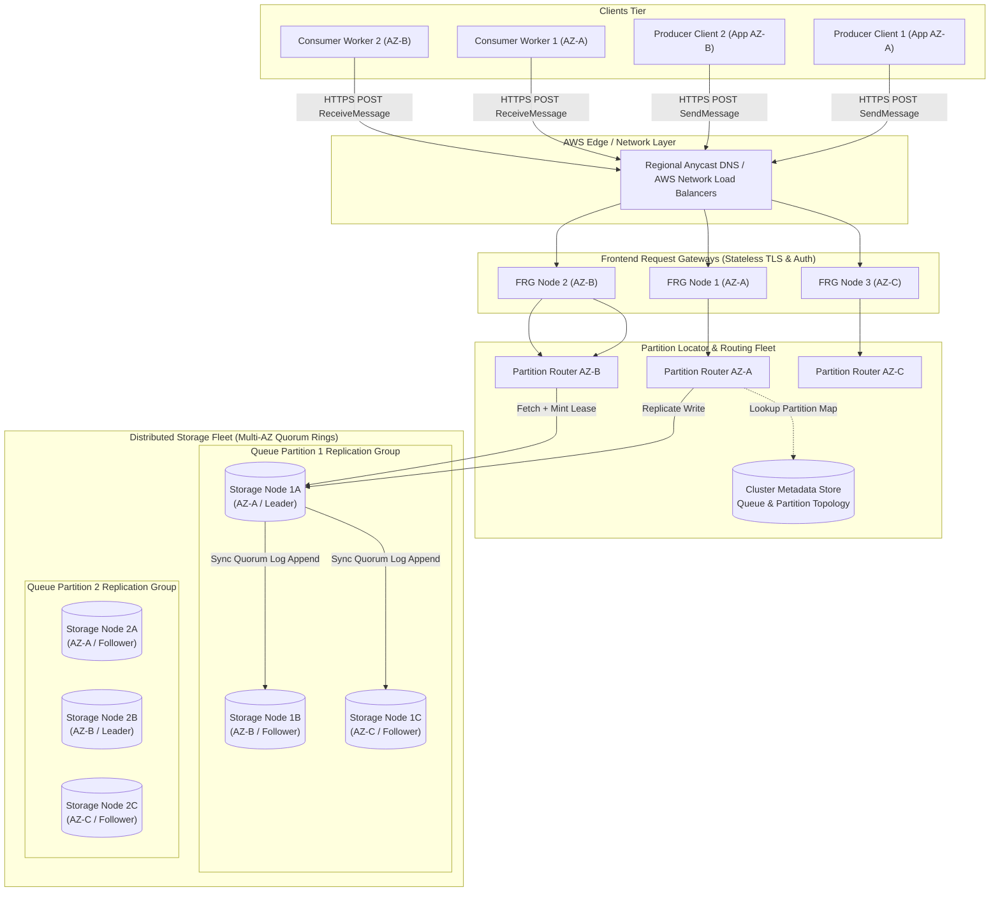
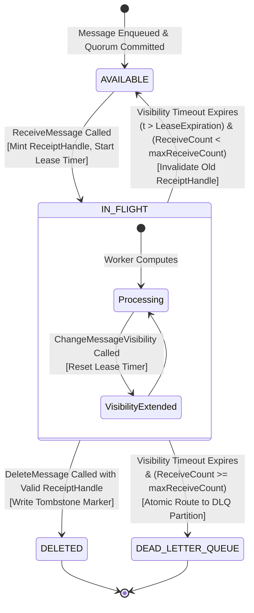
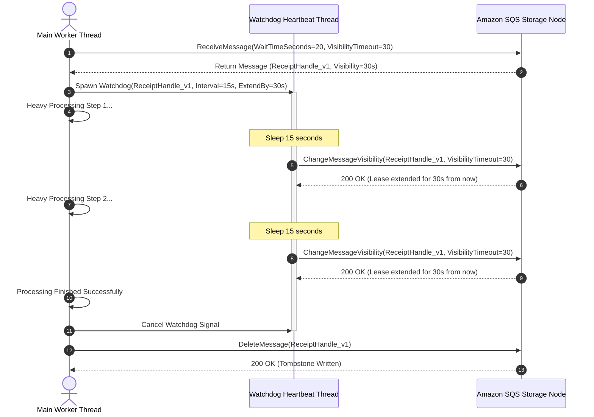
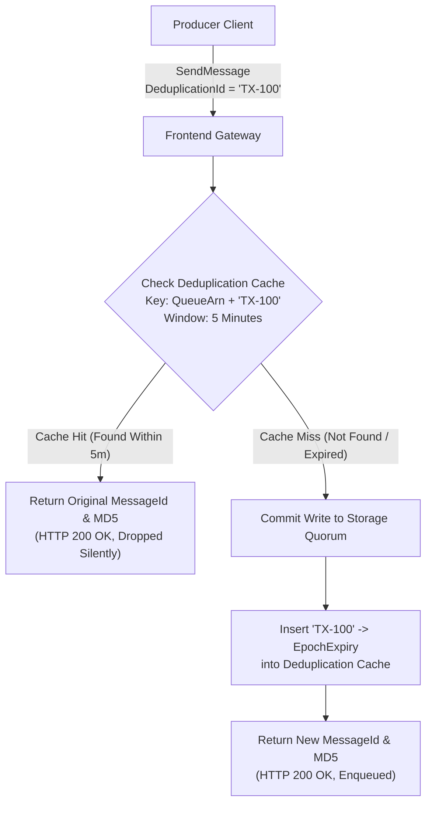
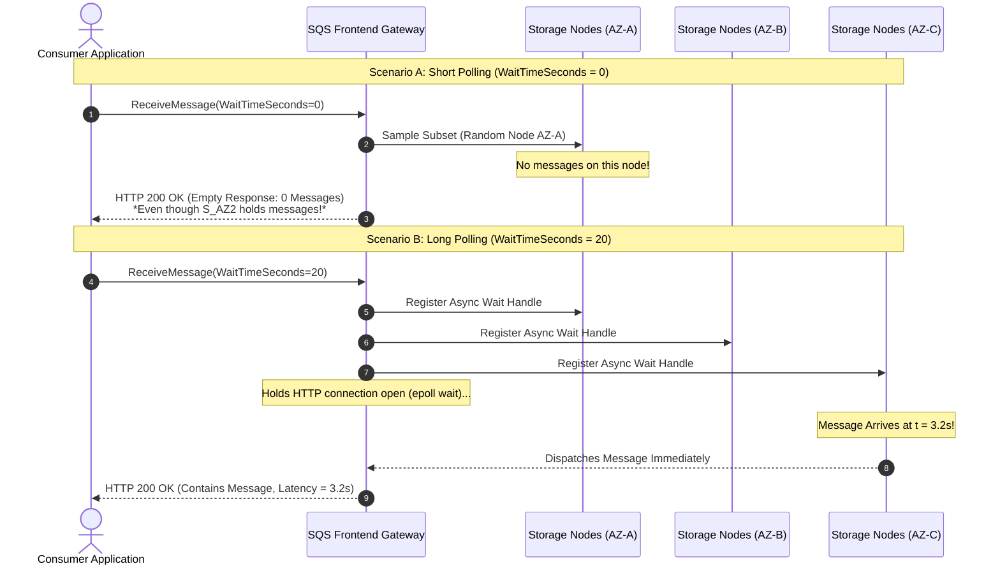
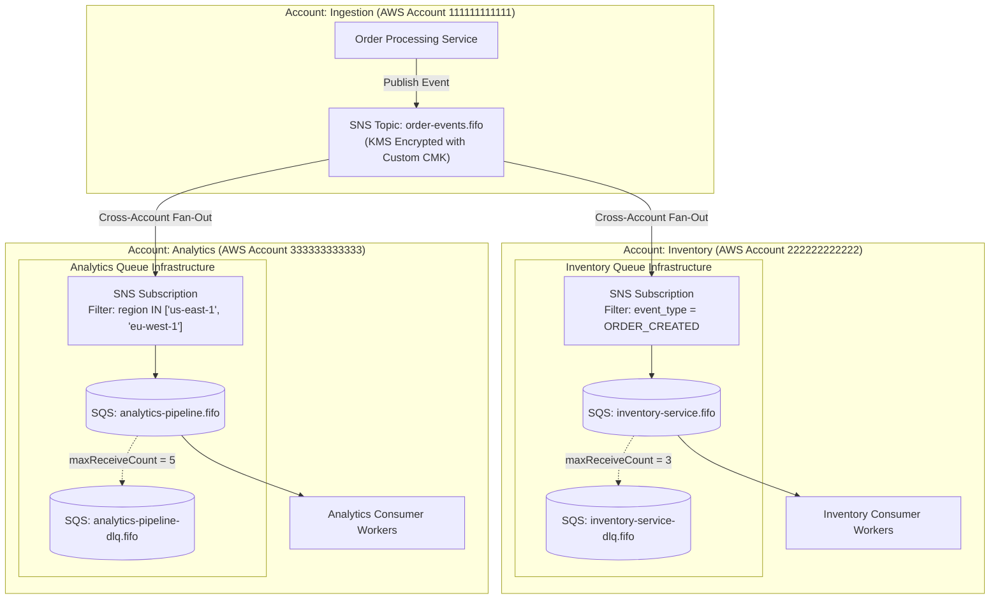
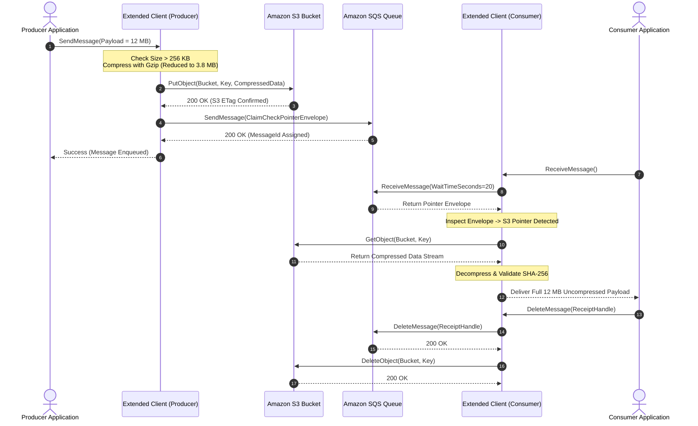
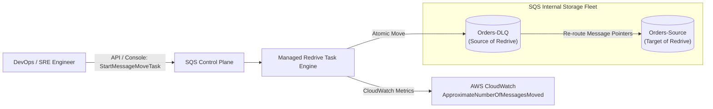

# Amazon SQS Deep Dive: High-Level & Low-Level Architectural Master Guide

## 1. Overview, Value Proposition & Evolution

Amazon Simple Queue Service (SQS) is a distributed, multi-tenant, fully managed message queuing service designed to provide asynchronous decoupling, high-availability buffering, and elastic scalability for distributed software systems. Launched in late 2004, SQS represents the foundational service of Amazon Web Services (AWS), predating even Amazon EC2 (2006) and Amazon S3 (2006). Initially conceived to decouple internal Amazon.com retail services from monolithic backends during massive holiday traffic spikes, SQS evolved into a planet-scale message fabric processing tens of millions of messages per second globally.

### 1.1 The Evolution of Asynchronous Messaging at AWS

```
2004: SQS Launched (Basic FIFO-like queue, single-region, best-effort)
  │
2006: Distributed Architecture Overhaul (Standard Queue: At-Least-Once, Multi-AZ)
  │
2012: Long Polling & Batch Operations Introduced (90%+ cost reduction)
  │
2014: Dead-Letter Queue (DLQ) Management Native Support
  │
2016: FIFO Queues with Exactly-Once Processing & Message Group IDs
  │
2019: HTTP API & VPC Endpoints (AWS PrivateLink) Integration
  │
2020: High-Throughput FIFO Mode (Up to 30,000+ TPS per region)
  │
2021: Native DLQ Redrive Automation via Console and API
```

### 1.2 Core Value Proposition: The Serverless Buffer

In modern distributed microservices architectures, synchronous point-to-point RPCs (e.g., HTTP/REST, gRPC) introduce severe operational risks: cascading failures, tight temporal coupling, thread-pool exhaustion, and catastrophic load amplification during downstream brownouts. SQS operates as a managed serverless buffer providing:

1. **Zero Infrastructure Maintenance:** No brokers, storage partitions, Zookeeper/Raft coordination clusters, operating system patches, or disk volumes to monitor and rebalance.
2. **Elastic, Autonomous Scaling:** Automatically partitions storage and frontend tiers to scale from 0 to hundreds of thousands of messages per second without pre-provisioned throughput (Standard Queues).
3. **Multi-AZ Durability:** Every accepted message is synchronously written to a quorum of distributed storage nodes across at least three distinct physical Availability Zones (AZs) before acknowledging receipt to the producer.
4. **Independent Temporal & Elastic Scaling:** Producers can burst to 100,000 requests per second while downstream consumer fleets process messages at a steady, sustainable 2,000 requests per second.

### 1.3 The Three Dimensions of Decoupling

True distributed decoupling requires separation across three structural dimensions:

* **Temporal Decoupling:** Producers and consumers do not need to be online concurrently. If the consumer fleet crashes or enters a deployment window, messages safely accumulate in SQS up to the configured retention limit (up to 14 days).
* **Topological Decoupling:** The producer has no network awareness of consumer IP addresses, instance counts, VPC subnets, or deployment topology. Producers publish strictly to an abstract Queue URL.
* **Failure / Availability Decoupling:** Downstream consumer crashes, database lock contentions, or internal server errors do not propagate upstream. The producer receives an immediate `200 OK` acknowledgment once the message hits SQS storage quorum.

### 1.4 Load Leveling (The Leaky Bucket Analogy)

In transactional workloads (e.g., flash sales, payment settlement, IoT telematics bursts), upstream traffic exhibits extreme volatility with peak-to-trough ratios exceeding 50:1. If these bursts directly hit relational databases (e.g., Amazon Aurora PostgreSQL, MySQL), connection pool starvation and CPU saturation inevitably cause systemic failure.

```
[Unbounded Traffic Spikes]  ──>  [ SQS Storage Buffer ]  ──>  [ Leaky Bucket Drain ]  ──>  [ Protected Backend ]
   (Up to 100k msgs/sec)           (Holds Millions of msgs)      (Steady 2k msgs/sec)        (Aurora / Legacy DB)
```

SQS acts as an elastic storage reservoir, allowing downstream consumers to pull messages via a steady, rate-controlled "leaky bucket" consumption rate, keeping downstream utilization safely below degradation thresholds.

---

## 2. High-Level Design (HLD) of SQS Internal Infrastructure

Underneath the public AWS SQS API lies a massive, multi-tenant distributed system built for fault tolerance, partition tolerance, and consistent low latency.

### 2.1 Multi-AZ Component Architecture

The SQS internal topology consists of four distinct architectural tiers distributed across all Availability Zones within an AWS Region:

1. **Frontend Request Gateways (FRG):** Stateless fleet terminating public HTTPS/TLS connections. Handles AWS Signature Version 4 (SigV4) authentication, IAM/Queue policy authorization, schema validation, rate-limiting, and request parsing.
2. **Partition Locator & Request Router (PL/RR):** High-speed in-memory routing directory backed by a distributed consensus metadata layer. Resolves the Queue ARN and Message Group ID to the active primary storage partition ring responsible for the target message set.
3. **Distributed Storage Fleet (DSF):** Stateful, multi-tenant storage nodes organized into replication groups across three physical Availability Zones (AZ-A, AZ-B, and AZ-C). Each replication group operates a consensus-based log (variant of Paxos/Raft) storing message envelopes, payload data, and state metadata.
4. **Metadata Coordinator & Cluster State Manager:** Manages queue configurations, permissions, retention policies, redrive policies, and cluster health monitoring.

### 2.2 End-to-End Multi-AZ Architecture Diagram



### 2.3 SQS Message Lifecycle (The 6 Stages)

A message traversing SQS undergoes six deterministic phases:

```
[1. SendMessage] ──> [2. Quorum Commit] ──> [3. ReceiveMessage & Lease] ──> [4. In-Flight Processing] ──> [5. DeleteMessage] ──> [6. Storage Reclamation]
```

1. **Ingestion & Validation (`SendMessage`):**
   * Producer sends an HTTP POST request containing `MessageBody`, optional `MessageAttributes`, and optional `DelaySeconds`.
   * Frontend Request Gateway authenticates credentials via SigV4, verifies authorization via SQS Access Policy, validates payload size ($\le 256\text{ KB}$), and assigns a globally unique 128-bit UUID (`MessageId`).
2. **Multi-AZ Quorum Commit:**
   * Partition Locator routes the payload to the primary storage node for that queue partition.
   * Primary node appends the message to its write-ahead append log and replicates the write over internal high-speed networks to follower nodes in AZ-B and AZ-C.
   * Once a write quorum ($W \ge 2$ of 3 nodes) acknowledges disk persistence, the primary returns HTTP 200 with `MessageId` and `MD5OfMessageBody`.
3. **Lease Granting (`ReceiveMessage`):**
   * Consumer calls `ReceiveMessage`.
   * Storage node identifies the message as `AVAILABLE` (current timestamp $t > \text{AvailableTimestamp}$).
   * Storage node atomically updates message state to `IN_FLIGHT`, initializes the Visibility Timeout lease clock, increments `ApproximateReceiveCount`, and mints an encrypted `ReceiptHandle`.
   * Message is dispatched to the consumer over HTTP.
4. **In-Flight Processing & Heartbeating:**
   * Consumer executes domain business logic.
   * If processing approaches the Visibility Timeout deadline, consumer issues `ChangeMessageVisibility` referencing the `ReceiptHandle` to extend the lease.
5. **Acknowledgment & Soft Deletion (`DeleteMessage`):**
   * Consumer finishes processing successfully and calls `DeleteMessage` with the exact `ReceiptHandle`.
   * Storage node validates the `ReceiptHandle`, checks that the lease has not expired or been superseded, and writes an atomic tombstone marker to the partition log.
6. **Hard Deletion & Garbage Collection:**
   * Compaction threads in the storage fleet traverse partition segments, reclaiming storage bytes associated with tombstoned records and expired retention windows ($t > \text{EnqueueTime} + \text{RetentionPeriod}$).

---

## 3. Low-Level Design (LLD) - Visibility Timeout & Lease Management Engine

The Visibility Timeout is SQS's implementation of a distributed lease. Because true distributed locks require complex consensus (e.g., Chubby, etcd, Zookeeper) and risk deadlock if a consumer dies holding the lock, SQS uses time-bounded leases to ensure both liveness and progress.

### 3.1 Message In-Flight State Machine



### 3.2 Receipt Handle Anatomy & Cryptographic Design

When a consumer receives a message, SQS returns two distinct identifiers:
* **`MessageId`:** An immutable UUID generated at `SendMessage` time. Useful for logging and tracing, but **cannot** be used to delete a message.
* **`ReceiptHandle`:** An ephemeral, opaque, cryptographically signed token generated uniquely upon **every single** `ReceiveMessage` invocation.

#### Deconstruction of Receipt Handle Internal Payload

While AWS treats the receipt handle as an opaque base64 string, its internal decrypted representation contains the following binary/JSON structure:

```json
{
  "storageNodeId": "sn-use1-az1-p0482",
  "partitionId": "part-84920481",
  "queueArn": "arn:aws:sqs:us-east-1:123456789012:OrderProcessingQueue",
  "messageId": "c4b92a10-8b1e-43f1-b8d2-03918a992bc4",
  "leaseId": 4,
  "leaseExpirationEpochMs": 1728919845000,
  "approximateReceiveCount": 2,
  "hmac": "9f83ab20c1d53e4b7a19284f...[HMAC-SHA256 signature using Cluster Key]"
}
```

#### Why a New Receipt Handle is Generated on Every Receive

Consider a distributed failure scenario without unique receipt handles:

```
Timeline:
t = 00s: Worker A receives Message M (Lease = 30s).
t = 25s: Worker A experiences a Stop-The-World (STW) JVM Garbage Collection pause for 15s.
t = 30s: SQS Visibility Timeout expires. Message M becomes AVAILABLE.
t = 31s: Worker B polls SQS and receives Message M (Lease = 30s). Worker B begins processing.
t = 40s: Worker A recovers from GC pause. Believing it succeeded, Worker A calls DeleteMessage(M).
```

* **If `MessageId` or a static handle were used:** Worker A's delete request would succeed, deleting Message M while Worker B is actively processing it. If Worker B then crashes before finishing, **the message is permanently lost**.
* **With Ephemeral Receipt Handles:** When Worker B received the message at $t = 31s$, SQS incremented `leaseId` to 2 and generated a new receipt handle. When Worker A attempts to call `DeleteMessage` at $t = 40s$ using its original handle (`leaseId = 1`), the storage engine detects an expired lease incarnation and rejects the request with `ReceiptHandleIsInvalid`. Worker B's active work is fully protected.

### 3.3 Dynamic Visibility Extension: The Watchdog Daemon Pattern

For variable-duration workloads (e.g., video transcoding, large document OCR, complex database transactions), setting a static visibility timeout presents a fundamental dilemma:
* Set it too high (e.g., 15 minutes): If a worker crashes immediately, the message remains invisible for 15 minutes, destroying end-to-end processing SLAs.
* Set it too low (e.g., 30 seconds): A complex job taking 35 seconds will be redelivered to a second worker, causing duplicate processing.

**The Solution:** The Heartbeat Watchdog Daemon pattern. Set the initial visibility timeout low (e.g., 30 seconds), and launch a background thread/goroutine that periodically calls `ChangeMessageVisibility` to extend the lease as long as the worker remains healthy.



---

## 4. Low-Level Design (LLD) - Standard Queue vs FIFO Queue Mechanics

### 4.1 Standard Queue Mechanics

Standard Queues prioritize horizontal scalability and unlimited throughput over strict ordering and exact delivery counts.

* **Distributed Sharding:** SQS shards standard queues across thousands of independent storage partitions.
* **Weighted Random Sampling (WRS):** When a consumer requests messages, the frontend gateway does not execute a global, cluster-wide scan. Instead, it queries a small, weighted random subset of storage nodes.
* **At-Least-Once Delivery:** If a storage node containing a copy of the message is temporarily unreachable due to network partition during a delete or poll, that replica may reappear later, causing redelivery. Consumers must be designed to be **strictly idempotent**.
* **Best-Effort Ordering:** Messages are enqueued across different storage partitions. A consumer polling partition B may receive a message enqueued at $t = 2$ before another consumer polling partition A receives a message enqueued at $t = 1$.

### 4.2 FIFO Queue Internals

FIFO (First-In-First-Out) queues enforce strict ordering and exactly-once processing (within a 5-minute deduplication window).

```
FIFO Queue Name Requirement: Must strictly terminate with the `.fifo` suffix.
```

#### The 5-Minute Deduplication Engine

FIFO queues utilize an internal sliding-window deduplication cache. Every accepted message must have a `MessageDeduplicationId`.

1. **Content-Based Deduplication:** If enabled, SQS automatically computes the SHA-256 hash of the `MessageBody`:
   $$\text{DeduplicationId} = \text{SHA256}(\text{MessageBody})$$
2. **Explicit Deduplication:** The producer provides an explicit business key (e.g., `payment_tx_98741029`).



* **Deduplication Boundary:** The deduplication window is strictly 300 seconds (5 minutes). If the producer sends the exact same `MessageDeduplicationId` at $t = 301$ seconds, SQS treats it as a brand-new message and enqueues it.

#### Message Group ID Mechanics & Sequential Locking

Strict global ordering is impossible at massive horizontal scale because a single queue partition cannot exceed the throughput limits of physical storage drives and network interfaces. FIFO queues solve this via the `MessageGroupId` partition key.

* **Strict Ordering Per Group:** Messages with the **same** `MessageGroupId` are guaranteed to be stored and delivered in strict first-in-first-out sequence.
* **Inter-Group Parallelism:** Messages with **different** `MessageGroupIds` are routed to independent partitions and processed completely concurrently.

```
Queue: Orders.fifo
┌──────────────────────┬──────────────────────┬──────────────────────┐
│ Group ID: Tenant-A   │ Group ID: Tenant-B   │ Group ID: Tenant-C   │
├──────────────────────┼──────────────────────┼──────────────────────┤
│ Msg 1 (Pending)      │ Msg 1 (In-Flight)    │ Msg 1 (In-Flight)    │
│ Msg 2 (Blocked)      │ Msg 2 (Blocked)      │ Msg 2 (Blocked)      │
│ Msg 3 (Blocked)      │                      │ Msg 3 (Blocked)      │
└──────────────────────┴──────────────────────┴──────────────────────┘
         ▲                      ▲                      ▲
    Worker Thread 1        Worker Thread 2        Worker Thread 3
 (Processes Tenant-A)   (Processes Tenant-B)   (Processes Tenant-C)
```

#### Head-of-Line (HoL) Blocking

If Message 1 of `Tenant-A` fails processing or its consumer crashes, SQS will **not** deliver Message 2 of `Tenant-A` to any consumer until Message 1 is either successfully deleted or evicted to a Dead Letter Queue.

**Mitigation Strategies:**
1. **High Cardinality:** Never use coarse group keys like `order_type = "retail"`. Use fine-grained keys like `customer_id` or `order_id`.
2. **Aggressive DLQ Thresholds:** Set `maxReceiveCount` low (e.g., 2 or 3) on FIFO queues to ensure malformed "poison pill" messages are evicted quickly, unblocking subsequent messages in that group.

### 4.3 FIFO Throughput Modes: Standard vs High Throughput

| Feature | Standard FIFO | High Throughput FIFO |
| :--- | :--- | :--- |
| **API Limit (Without Batching)** | Up to 300 TPS (Send, Receive, Delete) | Up to 3,000 to 9,000+ TPS per API call (region dependent) |
| **API Limit (With 10-Msg Batching)** | Up to 3,000 TPS | Up to 30,000 to 70,000+ TPS |
| **Underlying Architecture** | Centralized partition coordination | Dynamic hash-sharded partition fleet based on `MessageGroupId` |
| **Enabling Requirement** | Default FIFO behavior | Set `DeduplicationScope = messageGroup` and `FifoThroughputLimit = perMessageGroupId` |

---

## 5. Low-Level Design (LLD) - Polling Mechanics & Network Multiplexing

Consumers pull messages from SQS via the `ReceiveMessage` API. SQS supports two fundamentally different retrieval mechanisms: Short Polling and Long Polling.

### 5.1 Short Polling vs. Long Polling



### 5.2 Network Multiplexing & Kernel Mechanics

Under Short Polling, an application polling an empty queue in a tight loop generates hundreds of HTTP requests per minute. Each request incurs TLS handshake overhead, HTTP header parsing, and frontend CPU interrupts, while SQS returns empty XML/JSON bodies.

Under Long Polling (`WaitTimeSeconds = 20`):
1. The frontend gateway registers the client's request descriptor in a distributed wait queue multiplexer (similar to kernel `epoll` or `kqueue`).
2. The TCP socket connection is maintained in an idle, non-blocking state using HTTP Persistent Connections (`Keep-Alive`).
3. When a producer executes `SendMessage`, the storage cluster broadcasts an internal event to registered wait handles for that partition.
4. The frontend immediately streams the message down the open TCP connection and terminates the poll.

### 5.3 Comparative Architectural Analysis

| Characteristic | Short Polling (`WaitTimeSeconds = 0`) | Long Polling (`WaitTimeSeconds = 20`) |
| :--- | :--- | :--- |
| **Storage Sampling** | Samples a small random subset of storage nodes | Queries across all storage partitions |
| **False Empty Responses** | High probability if queue depth is low | Zero (returns empty only if queue is truly empty for 20s) |
| **API Cost Overhead** | Massive ($0.40 per 1M calls accumulated rapidly) | Minimal (up to 95% reduction in empty receive API calls) |
| **Delivery Latency** | High (bounded by client sleep interval between polls) | Sub-second (returns immediately upon message arrival) |
| **Network Efficiency** | Poor; high TCP/TLS handshake and header overhead | Optimal; persistent TCP streams with multiplexed wait states |

---

## 6. High-Level & Low-Level Design - SQS + SNS Fan-Out Architecture

Because an SQS queue implements competing-consumer semantics (a message is consumed and deleted by exactly one worker), delivering the same business event to multiple independent microservices requires the **SNS-to-SQS Fan-Out Pattern**.

### 6.1 Enterprise Multi-Account, Multi-Region Fan-Out Topology



### 6.2 SNS Subscription Filter Policy Engine

Rather than forcing consumer services to download, deserialize, and discard unwanted messages (wasting compute and bandwidth), SNS evaluates **Filter Policies** on message attributes *prior* to enqueuing into SQS.

```json
{
  "event_type": ["ORDER_CREATED", "ORDER_UPDATED"],
  "customer_tier": ["ENTERPRISE", "PLATINUM"],
  "order_value": [{"numeric": [">=", 1000]}],
  "region": [{"prefix": "us-"}]
}
```

* **Execution Point:** Evaluation occurs within the SNS delivery pipeline. If the policy evaluates to false, the message is dropped for that specific subscription without incurring SQS write costs.

### 6.3 Dead-Lettering at the Integration Boundary

A critical failure point in fan-out architectures is distinguishing between **delivery failures** and **processing failures**:

1. **SNS Subscription DLQ:** Configured on the SNS Subscription itself. Catches failures where SNS cannot push to SQS (e.g., SQS queue deleted, KMS decryption permission missing on the SQS queue policy, SQS queue full/throttled).
2. **SQS Queue DLQ:** Configured on the destination SQS queue. Catches failures where the consumer worker crashed while processing the payload.

---

## 7. Low-Level Design (LLD) - SQS Extended Client (Large Message Offloading)

Amazon SQS enforces a strict payload limit of **256 KB** (including attributes). Workloads requiring transmission of multi-megabyte payloads (e.g., machine learning tensors, PDF documents, high-resolution imagery) implement the **Claim Check Pattern** via the SQS Extended Client architecture.

### 7.1 S3 Pointer Envelope Schema

When a payload exceeds the threshold (typically configured between 32 KB and 256 KB), the client uploads the raw bytes to Amazon S3, generating an immutable, cryptographic pointer envelope sent to SQS:

```json
{
  "s3BucketName": "production-sqs-large-payloads-us-east-1",
  "s3Key": "payloads/2026/10/14/c9f28a41-3b7c-4a02-91e8-7a55d491bc82.json.gz",
  "contentLengthBytes": 8492019,
  "sha256": "4b227777d4dd1fc61c6f884f48641d02b4d121d3fd328cb08b5531fcacdabf8a",
  "compressionCodec": "gzip",
  "originalPayloadMd5": "c20ad4d76fe97759aa27a0c99bff6710",
  "enqueuedTimestamp": 1728919845
}
```

### 7.2 Producer / Consumer Claim Check Sequence



### 7.3 S3 Garbage Collection & Retention Alignment

If a consumer crashes permanently after downloading the S3 object but before deleting the SQS message, or if a message is routed to a DLQ and expires, S3 objects can become orphaned, causing silent storage cost bloat.

**Production Defense Mechanism:** Configure an **Amazon S3 Lifecycle Rule** on the payload bucket:
$$\text{S3 Expiration Days} = \lceil \frac{\text{SQS Retention Period (Seconds)}}{86400} \rceil + 2 \text{ Days Safety Margin}$$

If SQS `MessageRetentionPeriod` is 14 days, set the S3 Lifecycle Rule to automatically expire objects after 16 days. This provides automated, zero-maintenance garbage collection regardless of consumer failures.

---

## 8. Dead Letter Queues (DLQ) & Failure Recovery

A Dead Letter Queue (DLQ) isolates unprocessable messages ("poison pills"), preventing them from consuming worker cycles and stalling queue partitions.

### 8.1 The Redrive Policy Mechanics

The Redrive Policy is a JSON attribute applied to the source queue:

```json
{
  "deadLetterTargetArn": "arn:aws:sqs:us-east-1:123456789012:Orders-DLQ",
  "maxReceiveCount": 3
}
```

* **`ApproximateReceiveCount`:** An atomic counter incremented by the storage node every time the message is dispatched via `ReceiveMessage`.
* **State Transition:** If a worker fails to process and delete the message, and the visibility timeout expires when $\text{ApproximateReceiveCount} \ge \text{maxReceiveCount}$, SQS atomically removes the message from the source queue's active partition and enqueues it directly into the target DLQ partition.

### 8.2 SQS Delay vs Exponential Backoff with Jitter

Native SQS provides two delay mechanisms:
1. **Delivery Delay (`DelaySeconds`):** Hides newly published messages from consumers for up to 15 minutes upon initial enqueueing.
2. **Visibility Timeout Extension:** Consumers can set `ChangeMessageVisibility(VisibilityTimeout = N)` to push back retry attempts.

However, retrying immediately upon failure causes **thundering herd storms** on recovering downstream databases. Applications must implement **Full Jitter Exponential Backoff**:

$$T_{\text{sleep}} = \text{random}(0, \; \min(T_{\text{max}}, \; T_{\text{base}} \times 2^{\text{attempt}}))$$

```python
import random

def calculate_backoff(attempt: int, base: float = 1.0, max_backoff: float = 300.0) -> int:
    temp = min(max_backoff, base * (2 ** attempt))
    sleep_duration = random.uniform(0, temp)
    return int(sleep_duration)
```

### 8.3 Automated DLQ Redrive Architecture

Historically, redriving messages from a DLQ back to the source queue required custom scripts that read from the DLQ, called `SendMessage` on the source, and called `DeleteMessage` on the DLQ. This introduced severe data loss risks if the migration script crashed midway.

AWS SQS provides native **DLQ Redrive Tasks** managed directly by the SQS control plane:



* **Atomic Re-pointing:** SQS moves the messages at the storage layer without re-encrypting or issuing public API calls, preserving the original message body, attributes, and initial enqueue timestamps.

---

## 9. SQS with AWS Lambda & EC2 Autoscaling

### 9.1 AWS Lambda Event Source Mapping (ESM) Internals

When using AWS Lambda with SQS, engineers do not write long-polling loops. Instead, AWS deploys and manages an internal **Event Source Mapping (ESM) Poller Fleet**.

```mermaid
flowchart TD
    Queue[("Amazon SQS Queue")] <-->|Long Polling Fleet<br/>(AWS Managed ENIs)| ESM["Lambda Event Source Mapping (ESM)"]
    
    subgraph ESM_Internals["ESM Processing Engine"]
        Buffer["Batch Accumulator<br/>(BatchSize: 1-10000, BatchWindow: 0-300s)"]
        Dispatcher["Invoke Dispatcher"]
    end
    
    ESM --> Buffer
    Buffer --> Dispatcher
    
    Dispatcher -->|Synchronous Invoke| L1["Lambda Execution Instance 1"]
    Dispatcher -->|Synchronous Invoke| L2["Lambda Execution Instance 2"]
    Dispatcher -->|Synchronous Invoke| LN["Lambda Execution Instance N"]
```

#### Batch Size and Batching Window Mechanics

* **`BatchSize`:** The maximum number of messages delivered in a single Lambda invocation record set (up to 10 for standard queues, up to 10,000 for standard queues with high-volume scaling, max 10 for FIFO).
* **`MaximumBatchingWindowInSeconds`:** The maximum time the poller gathers messages before invoking Lambda. If `BatchSize` is met before the window expires, Lambda invokes immediately.

#### Partial Batch Failure Handling (`ReportBatchItemFailures`)

Without partial batch failure reporting, if a batch contains 10 messages and 9 succeed while message #10 throws an unhandled exception, **the entire batch of 10 fails**. SQS re-exposes all 10 messages, forcing consumers to re-execute already processed messages.

**The Solution:** Enable `ReportBatchItemFailures` in the ESM configuration. The Lambda handler returns a specific JSON schema indicating only the failed message identifiers:

```json
{
  "batchItemFailures": [
    { "itemIdentifier": "c4b92a10-8b1e-43f1-b8d2-03918a992bc4" }
  ]
}
```

SQS automatically deletes the 9 successful messages from the queue and resets visibility strictly on the failed message.

### 9.2 EC2 Auto Scaling Math: The Backlog-Per-Instance Metric

Scaling EC2 or ECS container instances based purely on `ApproximateNumberOfMessagesVisible` causes severe oscillation (thrashing) or sluggish scale-out. A queue depth of 10,000 messages means something completely different if you have 2 instances versus 500 instances.

**The Production Metric:** **Backlog Per Instance**

$$\text{Backlog Per Instance} = \frac{\text{ApproximateNumberOfMessagesVisible}}{\text{Current Fleet Capacity (Running Instances)}}$$

```
Scaling Policy Design:
1. Target Acceptable Processing Latency SLA = 60 seconds.
2. Single Worker Processing Throughput = 5 messages / second.
3. Target Backlog per Worker = 5 msgs/sec * 60 sec = 300 messages.
4. Target Tracking CloudWatch Policy: Maintain BacklogPerInstance == 300.
```

If the queue spikes to 30,000 messages:
$$\text{Desired Instances} = \frac{30,000}{300} = 100 \text{ Instances}$$

---

## 10. Production-Grade Code Implementations

### 10.1 Resilient SQS Long-Polling Worker with Watchdog Lease Extension

Below is a production-ready, fully typed Python worker implementing:
* Non-blocking long polling (`WaitTimeSeconds = 20`).
* Dynamic visibility extension watchdog thread.
* Graceful termination handling (`SIGINT`, `SIGTERM`).
* Batch message deletion.

```python
"""
Production-Grade Resilient SQS Long-Polling Worker
Includes dynamic visibility timeout extension watchdog daemon and graceful shutdown.
"""

import boto3
import logging
import signal
import sys
import threading
import time
from typing import Dict, Any, List

logging.basicConfig(
    level=logging.INFO,
    format="%(asctime)s [%(levelname)s] [%(threadName)s] %(message)s"
)
logger = logging.getLogger("SQSWorker")


class VisibilityWatchdog(threading.Thread):
    """
    Background daemon thread that periodically extends the Visibility Timeout
    of an in-flight message while processing is underway.
    """
    def __init__(
        self,
        sqs_client,
        queue_url: str,
        receipt_handle: str,
        message_id: str,
        extension_interval_sec: int = 15,
        visibility_extension_sec: int = 30
    ):
        super().__init__(name=f"Watchdog-{message_id[:8]}", daemon=True)
        self.sqs_client = sqs_client
        self.queue_url = queue_url
        self.receipt_handle = receipt_handle
        self.message_id = message_id
        self.interval = extension_interval_sec
        self.extension = visibility_extension_sec
        self._stop_event = threading.Event()

    def run(self):
        logger.debug(f"Watchdog started for message {self.message_id}")
        while not self._stop_event.wait(timeout=self.interval):
            try:
                logger.info(f"Extending visibility by {self.extension}s for {self.message_id}")
                self.sqs_client.change_message_visibility(
                    QueueUrl=self.queue_url,
                    ReceiptHandle=self.receipt_handle,
                    VisibilityTimeout=self.extension
                )
            except Exception as e:
                logger.error(f"Failed to extend visibility for {self.message_id}: {e}")
                # If handle is invalid, message might have expired or been deleted
                break

    def stop(self):
        self._stop_event.set()


class ResilientSQSConsumer:
    def __init__(self, queue_url: str, region_name: str = "us-east-1"):
        self.queue_url = queue_url
        self.sqs = boto3.client("sqs", region_name=region_name)
        self.is_running = True
        self._setup_signals()

    def _setup_signals(self):
        signal.signal(signal.SIGINT, self._handle_shutdown)
        signal.signal(signal.SIGTERM, self._handle_shutdown)

    def _handle_shutdown(self, signum, frame):
        logger.warning(f"Received termination signal ({signum}). Draining and stopping...")
        self.is_running = False

    def process_business_logic(self, payload: str, message_id: str):
        """
        Simulate complex, variable-latency transactional business computation.
        """
        logger.info(f"Executing business transaction for message {message_id}")
        # Simulated heavy work
        time.sleep(5)
        logger.info(f"Transaction successfully committed for message {message_id}")

    def run(self):
        logger.info(f"SQS Consumer initialized. Polling: {self.queue_url}")
        
        while self.is_running:
            try:
                response = self.sqs.receive_message(
                    QueueUrl=self.queue_url,
                    MaxNumberOfMessages=10,
                    WaitTimeSeconds=20,  # Long Polling
                    VisibilityTimeout=30,  # Initial lease: 30 seconds
                    AttributeNames=["All"],
                    MessageAttributeNames=["All"]
                )

                messages = response.get("Messages", [])
                if not messages:
                    logger.debug("Long poll completed with 0 messages. Re-polling...")
                    continue

                logger.info(f"Received batch of {len(messages)} messages.")
                delete_batch: List[Dict[str, str]] = []

                for msg in messages:
                    if not self.is_running:
                        logger.warning("Interrupted during batch processing; aborting remaining.")
                        break

                    msg_id = msg["MessageId"]
                    receipt = msg["ReceiptHandle"]

                    # Start dynamic lease watchdog
                    watchdog = VisibilityWatchdog(
                        sqs_client=self.sqs,
                        queue_url=self.queue_url,
                        receipt_handle=receipt,
                        message_id=msg_id,
                        extension_interval_sec=12,
                        visibility_extension_sec=30
                    )
                    watchdog.start()

                    try:
                        self.process_business_logic(msg["Body"], msg_id)
                        delete_batch.append({
                            "Id": msg_id,
                            "ReceiptHandle": receipt
                        })
                    except Exception as ex:
                        logger.error(f"Unrecoverable processing failure on {msg_id}: {ex}")
                        # Do NOT add to delete_batch. Message will revert to queue / DLQ.
                    finally:
                        watchdog.stop()
                        watchdog.join(timeout=2.0)

                # Batch delete successfully processed messages
                if delete_batch:
                    del_resp = self.sqs.delete_message_batch(
                        QueueUrl=self.queue_url,
                        Entries=delete_batch
                    )
                    successful_deletes = len(del_resp.get("Successful", []))
                    failed_deletes = del_resp.get("Failed", [])
                    logger.info(f"Deleted {successful_deletes} messages successfully.")
                    if failed_deletes:
                        logger.error(f"Failed deletions in batch: {failed_deletes}")

            except Exception as e:
                logger.error(f"Unhandled error in polling loop: {e}")
                time.sleep(2)  # Circuit breaker pause before retry

        logger.info("SQS Consumer worker shut down cleanly.")


if __name__ == "__main__":
    QUEUE_URL = "https://sqs.us-east-1.amazonaws.com/123456789012/ProductionOrderQueue"
    consumer = ResilientSQSConsumer(queue_url=QUEUE_URL)
    consumer.run()
```

### 10.2 AWS Lambda Partial Batch Failure Processor

```python
"""
AWS Lambda Handler implementing ReportBatchItemFailures.
Prevents entire batch re-processing when single records fail.
"""

import json
import logging
from typing import Dict, Any, List

logger = logging.getLogger()
logger.setLevel(logging.INFO)


def execute_subtask(body_json: Dict[str, Any]) -> None:
    # Business logic validation
    if body_json.get("action") == "CRASH_SIMULATION":
        raise ValueError("Simulated poisoned payload execution failure.")


def lambda_handler(event: Dict[str, Any], context: Any) -> Dict[str, Any]:
    records: List[Dict[str, Any]] = event.get("Records", [])
    batch_item_failures: List[Dict[str, str]] = []

    logger.info(f"Processing batch of {len(records)} records from SQS.")

    for record in records:
        message_id = record["messageId"]
        raw_body = record["body"]

        try:
            payload = json.loads(raw_body)
            execute_subtask(payload)
            logger.info(f"Successfully processed message: {message_id}")
            
        except Exception as err:
            logger.error(f"Error processing record {message_id}: {err}")
            # Register specific item failure
            batch_item_failures.append({"itemIdentifier": message_id})

    # Return partial batch failures
    return {
        "batchItemFailures": batch_item_failures
    }
```

### 10.3 SQS Extended Client Implementation (Claim Check Pattern)

```python
"""
SQS Extended Client implementing the Claim Check Pattern.
Transparently offloads payloads exceeding 256 KB to Amazon S3 with Gzip compression.
"""

import boto3
import gzip
import hashlib
import json
import uuid
from typing import Dict, Any, Optional

S3_THRESHOLD_BYTES = 256 * 1024  # 256 KB


class SQSExtendedClient:
    def __init__(self, s3_bucket: str, region_name: str = "us-east-1"):
        self.s3_bucket = s3_bucket
        self.s3 = boto3.client("s3", region_name=region_name)
        self.sqs = boto3.client("sqs", region_name=region_name)

    def send_large_message(
        self,
        queue_url: str,
        message_body: str,
        message_attributes: Optional[Dict[str, Any]] = None
    ) -> Dict[str, Any]:
        encoded_bytes = message_body.encode("utf-8")
        
        if len(encoded_bytes) > S3_THRESHOLD_BYTES:
            compressed_data = gzip.compress(encoded_bytes)
            sha256_hash = hashlib.sha256(encoded_bytes).hexdigest()
            s3_key = f"sqs-payloads/{uuid.uuid4()}.json.gz"

            # 1. Upload to S3
            self.s3.put_object(
                Bucket=self.s3_bucket,
                Key=s3_key,
                Body=compressed_data,
                ContentType="application/gzip",
                Metadata={"sha256": sha256_hash}
            )

            # 2. Build Claim Check Pointer Envelope
            envelope = {
                "__sqs_claim_check__": True,
                "s3BucketName": self.s3_bucket,
                "s3Key": s3_key,
                "originalSize": len(encoded_bytes),
                "compressedSize": len(compressed_data),
                "sha256": sha256_hash
            }
            final_body = json.dumps(envelope)
        else:
            final_body = message_body

        return self.sqs.send_message(
            QueueUrl=queue_url,
            MessageBody=final_body,
            MessageAttributes=message_attributes or {}
        )

    def resolve_payload(self, raw_body: str) -> str:
        try:
            data = json.loads(raw_body)
            if isinstance(data, dict) and data.get("__sqs_claim_check__") is True:
                bucket = data["s3BucketName"]
                key = data["s3Key"]

                # Fetch from S3 and decompress
                s3_resp = self.s3.get_object(Bucket=bucket, Key=key)
                compressed_bytes = s3_resp["Body"].read()
                decompressed_bytes = gzip.decompress(compressed_bytes)
                
                # Integrity verification
                computed_hash = hashlib.sha256(decompressed_bytes).hexdigest()
                if computed_hash != data.get("sha256"):
                    raise ValueError("Claim check payload SHA-256 integrity check failed!")
                    
                return decompressed_bytes.decode("utf-8")
        except (json.JSONDecodeError, KeyError):
            pass

        return raw_body

    def delete_large_message(self, queue_url: str, receipt_handle: str, raw_body: str) -> None:
        # Delete from SQS
        self.sqs.delete_message(QueueUrl=queue_url, ReceiptHandle=receipt_handle)

        # Delete backing S3 object if present
        try:
            data = json.loads(raw_body)
            if isinstance(data, dict) and data.get("__sqs_claim_check__") is True:
                self.s3.delete_object(
                    Bucket=data["s3BucketName"],
                    Key=data["s3Key"]
                )
        except Exception:
            # S3 lifecycle policies will clean up if deletion fails
            pass
```

### 10.4 Automated DLQ Redrive Management Script

```python
"""
Automated Native SQS DLQ Redrive Orchestration Script.
Uses AWS SQS StartMessageMoveTask API for atomic server-side redrives.
"""

import boto3
import time
import sys
import logging

logging.basicConfig(level=logging.INFO, format="%(asctime)s [%(levelname)s] %(message)s")
logger = logging.getLogger("DLQRedrive")


def execute_dlq_redrive(dlq_arn: str, destination_arn: str, region_name: str = "us-east-1"):
    sqs = boto3.client("sqs", region_name=region_name)

    logger.info(f"Initiating native redrive from {dlq_arn} to {destination_arn}...")
    
    start_resp = sqs.start_message_move_task(
        SourceArn=dlq_arn,
        DestinationArn=destination_arn
    )
    task_handle = start_resp["TaskHandle"]
    logger.info(f"Redrive task started successfully. TaskHandle: {task_handle}")

    while True:
        time.sleep(5)
        tasks_resp = sqs.list_message_move_tasks(SourceArn=dlq_arn)
        task_list = tasks_resp.get("Results", [])
        
        current_task = next((t for t in task_list if t.get("TaskHandle") == task_handle), None)
        if not current_task:
            logger.info("Task completed or handle expired.")
            break

        status = current_task.get("Status")
        moved = current_task.get("ApproximateNumberOfMessagesMoved", 0)
        total = current_task.get("ApproximateNumberOfMessagesToMove", 0)

        logger.info(f"Status: {status} | Progress: {moved}/{total} messages moved.")

        if status in ["COMPLETED", "FAILED", "CANCELLED"]:
            if status == "COMPLETED":
                logger.info("Redrive task completed successfully!")
            else:
                logger.error(f"Redrive task terminated with status: {status}. Reason: {current_task.get('FailureReason')}")
            break


if __name__ == "__main__":
    SOURCE_DLQ_ARN = "arn:aws:sqs:us-east-1:123456789012:OrderQueue-DLQ"
    DEST_QUEUE_ARN = "arn:aws:sqs:us-east-1:123456789012:OrderQueue"
    execute_dlq_redrive(SOURCE_DLQ_ARN, DEST_QUEUE_ARN)
```

---

## 11. Operational Mastery, Cost Optimization & Failure Modes

### 11.1 The Mathematics of Empty Receive Billing Optimization

Amazon SQS bills requests in chunks: **1 request per 64 KB of payload**. Every `ReceiveMessage` call counts as an API request regardless of whether it returns 10 messages or 0 messages.

#### Case Study: The Financial Trap of Short Polling
Assume a consumer fleet of 50 worker containers polling an idle standard queue using **Short Polling** (`WaitTimeSeconds = 0`) with a 100ms client loop sleep:

$$\text{Calls per worker per sec} = 10$$
$$\text{Total Calls per day} = 50 \times 10 \times 86,400 = 43,200,000 \text{ Requests/day}$$
$$\text{Monthly Requests} = 43,200,000 \times 30 = 1,296,000,000 \text{ Requests}$$
$$\text{Monthly SQS Bill} = \frac{1,296,000,000}{1,000,000} \times \$0.40 = \mathbf{\$518.40 / \text{month for an empty queue!}}$$

#### Under Long Polling (`WaitTimeSeconds = 20`):
$$\text{Calls per worker per 20s} = 1$$
$$\text{Calls per worker per day} = \frac{86,400}{20} = 4,320 \text{ Requests}$$
$$\text{Monthly Requests for 50 workers} = 50 \times 4,320 \times 30 = 6,480,000 \text{ Requests}$$
$$\text{Monthly SQS Bill} = \frac{6,480,000}{1,000,000} \times \$0.40 = \mathbf{\$2.59 / \text{month}}$$

> [!TIP]
> Switching from Short Polling to Long Polling results in an immediate **99.5% cost reduction** on idle or sparse queue workloads.

### 11.2 AWS PrivateLink VPC Endpoints Architecture

By default, SQS API traffic traverses the public AWS regional endpoint via an Internet Gateway (IGW) or NAT Gateway. In high-throughput architectures (e.g., 50,000 msgs/sec), NAT Gateway data processing fees ($\$0.045 / \text{GB}$) dominate infrastructure costs.

```
VPC Private Subnet (EC2 / EKS) ──> [ Interface VPC Endpoint (AWS PrivateLink) ] ──> SQS Storage Core
                                      (Keeps traffic on AWS Private Backbone)
```

* **Cost Elimination:** Completely eliminates NAT Gateway data processing charges for SQS traffic.
* **Security Hardening:** Allows locking down SQS Access Policies using the condition:
  ```json
  "Condition": {
    "StringEquals": {
      "aws:sourceVpce": "vpce-0123456789abcdef0"
    }
  }
  ```
  Any request originating outside the private VPC endpoint is rejected at the SQS edge.

### 11.3 Enterprise Failure Modes and Mitigations

1. **Premature Visibility Lease Expiry (Split-Brain Processing):**
   * *Root Cause:* Downstream service pauses (e.g., DB lock escalation, GC pause) exceed `VisibilityTimeout`. SQS redelivers the message to Worker 2 while Worker 1 is still writing.
   * *Mitigation:* Implement the Watchdog Heartbeat Daemon and wrap database writes in optimistic locking checks (version timestamps).
2. **Downstream Thundering Herd on Disaster Recovery:**
   * *Root Cause:* An outage at the payment gateway backs up 500,000 messages in SQS. When the gateway recovers, 500 concurrent workers pull batches simultaneously, instantly crashing the gateway again.
   * *Mitigation:* Throttle consumer concurrency via Lambda `ReservedConcurrency` or step-function rate-limiters; apply exponential backoff with full jitter.
3. **KMS Rate Throttling with SSE-KMS:**
   * *Root Cause:* At 20,000 TPS, default AWS KMS account limits (`KmsRequestsPerSecondLimitExceeded`) are reached, causing `SendMessage` calls to fail.
   * *Mitigation:* Enable **SQS-KMS Data Key Reuse Period** (configure between 1 minute and 24 hours). SQS caches the decrypted envelope key in memory, reducing KMS API calls by up to 99.9%.

---

## 12. 15 Senior/Staff-Level System Design Interview Questions & Rigorous In-Depth Answers

### Q1: How does Amazon SQS maintain at-least-once delivery internally during a catastrophic Availability Zone outage?
**Answer:**
Amazon SQS achieves high durability and at-least-once delivery by organizing its Distributed Storage Fleet into multi-AZ consensus replication rings (variants of Paxos/Raft). When a producer issues `SendMessage`, the primary storage node in the active partition appends the record to its local write-ahead log and replicates the write across high-speed dedicated intra-region links to follower storage nodes located in two physically independent Availability Zones. 

A write is not acknowledged (`200 OK`) to the producer until a quorum ($W \ge 2$ of 3 nodes) commits the write to durable media. If an entire AZ experiences catastrophic power loss or fiber severance, the remaining two AZs maintain quorum. The cluster metadata coordinator detects node heartbeats missing and triggers an automatic leader election if the partitioned node was the leader. Because every unacknowledged message was committed to at least one surviving node in the remaining AZs, zero committed messages are lost. During consumer polling, if a storage node fails before a `DeleteMessage` tombstone is written, the surviving replica will present the message again upon Visibility Timeout expiration, satisfying at-least-once semantics.

### Q2: What is the cryptographic and architectural rationale for generating a brand-new Receipt Handle on every `ReceiveMessage` call?
**Answer:**
A receipt handle is an ephemeral, cryptographically signed lease token containing the storage node ID, partition ID, message ID, lease version/incarnation number, and lease expiration epoch. Generating a new handle on every receive call prevents the **zombie consumer deletion problem** (split-brain lease invalidation).

If Worker A receives Message M with a 30-second visibility timeout and experiences an unexpected 35-second Garbage Collection or network freeze, the visibility timeout expires. SQS makes Message M visible again. Worker B polls the queue, receives Message M, and begins processing. When SQS dispatches the message to Worker B, it increments the internal lease version counter and issues a new receipt handle signed with the cluster's secret key. When Worker A unfreezes and attempts to call `DeleteMessage` using its old receipt handle, SQS decrypts the handle, compares its lease version against the current storage partition metadata, detects that the lease version is stale, and rejects the deletion with an HTTP 400 `ReceiptHandleIsInvalid`. This guarantees that Worker A cannot accidentally delete the message while Worker B is actively processing it.

### Q3: How does SQS FIFO implement its 5-minute deduplication window at extreme scale without running out of memory?
**Answer:**
SQS FIFO implements a distributed, time-bounded sliding-window deduplication cache partitioned by Queue ARN. The cache key is constructed as `SHA256(QueueArn + ":" + DeduplicationId)`.

Internally, this engine combines an in-memory Bloom filter for high-speed negative lookups with a partitioned, append-only sliding log backed by RocksDB/in-memory hash tables with secondary persistence. When a write arrives:
1. The partition router evaluates the hash against the deduplication index for that partition.
2. If found and $(\text{CurrentTime} - \text{EntryTime}) \le 300\text{ seconds}$, SQS suppresses the write, returns the original `MessageId`, and does not append to the queue.
3. Every partition maintains rotating 1-minute bucket rings. As time advances, buckets older than 5 minutes are discarded via atomic pointer swaps, releasing memory without requiring costly stop-the-world garbage collection or table scans.

Because deduplication keys expire after 300 seconds, the memory footprint is bounded strictly by $\text{Throughput} \times 300\text{ seconds}$, making it deterministic and horizontally scalable.

### Q4: How would you architect a rate-limited SQS consumer fleet to protect a downstream third-party payment API that strictly permits a maximum of 50 requests/second?
**Answer:**
An SQS queue inherently operates as a pull-based buffer, but consumers will greedily pull as fast as compute capacity allows. To enforce a hard downstream limit of 50 RPS:

1. **Token Bucket Distributed Rate Limiter:** Implement a centralized Redis cluster running a token bucket script (via Redis Lua scripting). Before calling `ReceiveMessage` or before processing a batch, consumer threads must acquire tokens from the Redis bucket configured to refill at 50 tokens/sec.
2. **Controlled Consumer Concurrency:** If serverless (AWS Lambda), configure the Event Source Mapping with `MaximumConcurrency = 5` and `BatchSize = 10`. This caps the maximum concurrent Lambda instances to 5.
3. **Client-Side Leaky Bucket Sleep:** Within each worker thread, use a token bucket rate-limiter library (e.g., Python `limiter` or Guava `RateLimiter`). If tokens are exhausted, workers block locally or set `ChangeMessageVisibility` to defer processing without dropping the message.
4. **FIFO Queue with 50 Distinct Message Group IDs:** A structural solution is to map all incoming traffic to exactly 50 fixed `MessageGroupId` values. Because SQS FIFO permits exactly one active consumer per group ID, the consumer concurrency is physically capped at 50 parallel workers.

### Q5: What causes Head-of-Line (HoL) blocking in SQS FIFO queues, and how do you mitigate it without losing ordering guarantees?
**Answer:**
Head-of-Line blocking occurs in SQS FIFO because the storage engine guarantees strict in-order processing within a single `MessageGroupId`. If Message 1 in Group A contains a malformed payload ("poison pill") that causes the consumer worker to crash or throw an unhandled exception, SQS will not deliver Message 2, 3, or 4 in Group A to any consumer. They remain completely blocked behind Message 1 until Message 1's visibility lease expires, is retried, or is resolved.

**Mitigation Architectures:**
1. **High Cardinality Group Partitioning:** Never group by coarse identifiers (e.g., `country_code`). Partition by high-cardinality keys like `user_id` or `order_id`. A poison pill for User 123 will block only User 123, while millions of other users process in parallel.
2. **Aggressive Dead Letter Queue (DLQ) Eviction:** Configure a Redrive Policy with `maxReceiveCount` set to a low threshold (e.g., 2 or 3). After two failures, SQS atomically moves the poison pill to the DLQ, clearing the obstruction and allowing subsequent messages in that group to proceed immediately.
3. **Application-Level Quarantine:** Catch deserialization/schema validation errors in a `try/except` block inside the worker, log the failure to a quarantine database, and immediately call `DeleteMessage` to prevent pipeline stalls.

### Q6: Deeply compare Amazon SQS vs Apache Kafka vs Amazon Kinesis across storage architecture, consumer models, scale mechanics, and replayability.
**Answer:**

| Architectural Dimension | Amazon SQS | Apache Kafka | Amazon Kinesis Data Streams |
| :--- | :--- | :--- | :--- |
| **Storage Architecture** | Ephemeral, distributed message store; messages deleted upon processing | Immutable, distributed commit log partitioned into segments on disk | Immutable, distributed commit log sharded into provisioned/on-demand shards |
| **Consumer Consumption Model** | Pull-based (or Lambda ESM poller); competing consumers delete messages from queue | Pull-based; consumers track their own commit offsets along the partition log | Pull-based (GetRecords) or Push-based (Enhanced Fan-Out with HTTP/2 gRPC) |
| **Message Replayability** | **None.** Once deleted, messages are permanently purged from storage | **Full Replay.** Consumers can reset offsets back to any point within retention | **Full Replay.** Consumers can reset shard iterators to timestamp or sequence number |
| **Throughput Scaling** | Transparent, elastic, automatic horizontal partitioning (Standard Queue) | Manual/automated partition reassignment, broker rebalancing, and cluster resizing | Explicit shard splitting/merging (Provisioned mode) or automatic scaling (On-Demand) |
| **Ordering Guarantees** | Best-effort (Standard); Strict per `MessageGroupId` (FIFO) | Strict ordering per Kafka partition | Strict ordering per Kinesis shard |
| **Payload Limits** | 256 KB native (Unlimited via Claim Check with S3) | Default 1 MB (Configurable to tens of MBs, though not recommended) | 1 MB hard limit per record |

**Selection Rule:** Use SQS for discrete task dispatching, worker queues, and independent microservice RPC decoupling where messages have individual lifecycles. Use Kafka/Kinesis for real-time stream processing, event sourcing, telemetry pipelines, and scenarios requiring replayable logs.

### Q7: How does the AWS Lambda Event Source Mapping (ESM) poll SQS, and how does it prevent Lambda cold-start storms?
**Answer:**
The Lambda Event Source Mapping is not an in-memory thread inside your Lambda runtime; it is an external, AWS-managed EC2/Nitro fleet running inside the Lambda control plane. 

1. **Polling Mechanism:** The ESM maintains persistent long-polling connections (`WaitTimeSeconds = 20`) to the target SQS queue using ENIs inside the AWS service network.
2. **Batch Formation:** When messages are returned, the ESM accumulates records until either `BatchSize` or `MaximumBatchingWindowInSeconds` is reached.
3. **Controlled Scale-Out:** To prevent cold-start storms on your VPC subnets and downstream databases, the ESM does not instantly spin up 1,000 Lambda containers. For Standard Queues, the ESM starts with 5 concurrent invocations and scales up gradually by adding up to 60 concurrent instances per minute as long as the queue depth increases, capped by the function's `ReservedConcurrency`.
4. **Connection Warming:** For established workloads, the ESM re-uses execution contexts, keeping instances "warm" and passing consecutive batches into the same container runtime without triggering cold-start TLS/JVM/Python initialization overhead.

### Q8: How do you architect an exact-order processing pipeline for 50,000 independent customer accounts generating a total of 60,000 messages/second using SQS?
**Answer:**
A standard FIFO queue is capped at 3,000 TPS with batching, which cannot handle 60,000 TPS. The architecture requires **High Throughput FIFO with dynamic partition sharding**:

1. **Queue Configuration:**
   * Create an SQS FIFO queue ending in `.fifo`.
   * Set `DeduplicationScope = messageGroup`.
   * Set `FifoThroughputLimit = perMessageGroupId`.
2. **Partitioning Key Strategy:**
   * Set `MessageGroupId = customer_account_id`.
   * Because there are 50,000 independent accounts, the cardinality is exceptionally high. SQS High Throughput mode automatically distributes the 50,000 distinct message groups across hundreds of backend storage partitions, scaling linearly up to 70,000+ TPS.
3. **Client-Side Batching:**
   * Producers use `SendMessageBatch` (up to 10 messages per API call). All messages in a batch destined for Customer X share `MessageGroupId = Customer_X`.
4. **Consumer Tier:**
   * Deploy an Auto Scaling fleet of consumer containers (ECS/EKS) pulling messages concurrently. SQS guarantees that no two workers will ever receive messages for the same `customer_account_id` simultaneously, guaranteeing zero race conditions and 100% strict per-customer ordering at 60,000 TPS global throughput.

### Q9: Explain how AWS PrivateLink VPC Endpoints reduce SQS operating costs and improve enterprise security.
**Answer:**
In an enterprise VPC, compute nodes in private subnets communicate with public AWS endpoints via NAT Gateways. 

1. **Financial Impact:** AWS charges $\$0.045$ per hour for NAT Gateway provisioning, plus $\$0.045$ per gigabyte of data processed. At high message throughput (e.g., hundreds of millions of messages, or large payloads using SQS Extended Client), NAT Gateway data fees can reach thousands of dollars per month. An Interface VPC Endpoint (AWS PrivateLink) places an Elastic Network Interface (ENI) directly inside your private subnet. Traffic to SQS routes over AWS internal private networking, bypassing the NAT Gateway entirely and eliminating NAT data processing charges.
2. **Security Hardening:** 
   * **Route Isolation:** API calls never touch the public internet. No Internet Gateway (IGW) or NAT route is required in the route table.
   * **IAM Policy Conditions:** The SQS queue access policy can enforce an explicit condition requiring `aws:sourceVpce` or `aws:sourceVpc`. Any request originating outside that specific VPC endpoint (even with valid IAM credentials) is denied at the SQS gateway.

### Q10: If an SQS standard queue receives a duplicate message, how does a consumer implement distributed idempotency with Amazon DynamoDB?
**Answer:**
Because Standard SQS provides at-least-once delivery, consumers must be idempotent. The industry standard pattern utilizes **DynamoDB Conditional Writes**:

1. **Schema Design:** Create a DynamoDB table named `ProcessedTransactions` with partition key `idempotency_key` (String) and a `ttl` attribute (Unix epoch timestamp for auto-expiration).
2. **Atomic Execution:** Before executing the business side effect (e.g., charging a credit card), the worker executes a conditional put:
   ```python
   try:
       dynamodb.put_item(
           TableName="ProcessedTransactions",
           Item={
               "idempotency_key": {"S": transaction_id},
               "status": {"S": "IN_PROGRESS"},
               "ttl": {"N": str(int(time.time()) + 86400)}
           },
           ConditionExpression="attribute_not_exists(idempotency_key)"
       )
   except ClientError as e:
       if e.response["Error"]["Code"] == "ConditionalCheckFailedException":
           # Duplicate message detected!
           logger.warning(f"Transaction {transaction_id} already executed. Skipping.")
           sqs.delete_message(QueueUrl=queue_url, ReceiptHandle=receipt_handle)
           return
   ```
3. **Transaction Completion:** Once the downstream operation succeeds, update `status` to `"COMPLETED"`. If a duplicate message arrives minutes later, the conditional write fails, the worker skips execution, and deletes the duplicate from SQS.

### Q11: How do you implement a priority queue system on SQS given that native SQS does not support message priority levels?
**Answer:**
SQS has no native concept of weighted message priorities. Attempting to manage priority within a single queue results in low-priority messages starving high-priority messages.

**The Multi-Queue Priority Pattern:**
1. **Queue Topology:** Provision three distinct SQS queues:
   * `Orders-High-Priority`
   * `Orders-Medium-Priority`
   * `Orders-Low-Priority`
2. **Producers:** Inspect transaction classification and route to the respective queue URL.
3. **Weighted Consumer Polling Strategy:** Workers poll the queues using a weighted distribution algorithm (e.g., 70% High, 20% Medium, 10% Low):
   * Worker Loop Step 1: Poll `Orders-High-Priority` (WaitTimeSeconds = 2). If messages exist, process immediately.
   * Worker Loop Step 2: If High is empty, poll `Orders-Medium-Priority`.
   * Worker Loop Step 3: Only poll `Orders-Low-Priority` if High and Medium return empty, or implement a strict weighted round-robin ratio (e.g., 7 polls of High for every 2 of Medium and 1 of Low) to prevent absolute starvation of low-priority tasks.

### Q12: What happens under the hood if a consumer crashes after processing a message but before calling `DeleteMessage`? How do you prevent duplicate side effects?
**Answer:**
If a worker crashes post-processing but pre-deletion:
1. The SQS Visibility Timeout clock continues ticking on the storage partition.
2. SQS never receives the `DeleteMessage` API call referencing the active `ReceiptHandle`.
3. When $t > \text{VisibilityTimeout}$, the storage node resets the message state from `IN_FLIGHT` to `AVAILABLE`, increments `ApproximateReceiveCount` by 1, and invalidates the previous `ReceiptHandle`.
4. A second worker polls SQS, receives the message, and attempts to process it again.

**Prevention Strategy:**
* The consumer must ensure all side effects are idempotent (e.g., database upserts via `INSERT ... ON CONFLICT DO UPDATE`, or checking the DynamoDB idempotency record before initiating external side effects).
* When the second worker completes processing, it successfully calls `DeleteMessage`, permanently purging the message and restoring system consistency.

### Q13: How does SQS calculate `ApproximateNumberOfMessagesVisible`, and why is it explicitly labeled "Approximate"?
**Answer:**
In a globally distributed, horizontally sharded architecture consisting of thousands of storage partitions across 3 Availability Zones, computing an exact, real-time message count would require a global distributed read barrier (e.g., distributed two-phase commit or stopping all writes to execute a cluster-wide count). This would destroy the low-latency, high-throughput guarantees of SQS.

Instead, SQS computes `ApproximateNumberOfMessagesVisible` using **statistical sampling and eventual consistency**:
1. Storage nodes locally track their queue segment counters.
2. Nodes periodically aggregate these counts and report them asynchronously to the metadata catalog fleet.
3. CloudWatch samples this aggregated metadata once every minute.
4. Because writes, deletes, and visibility expirations occur continuously across partitions, the CloudWatch metric reflects an eventually consistent, slightly delayed approximation rather than an atomic point-in-time snapshot. Autoscaling policies must use target tracking or smoothing algorithms to handle this variance.

### Q14: How would you architect an end-to-end distributed tracing and auditing pipeline for messages traversing an SQS and SNS fan-out topology?
**Answer:**
End-to-end tracing across asynchronous boundaries requires propagating a **W3C Trace Context** or **AWS X-Ray Trace Header**:

1. **Producer Ingestion:** When the producer generates an event, it extracts or mints the active trace context (`AWSTraceHeader = "Root=1-5e672f12-abcdef0123456789;Sampled=1"`).
2. **Message Attribute Injection:** The producer injects this header into the SNS message attributes:
   ```json
   {
     "AWSTraceHeader": {
       "DataType": "String",
       "StringValue": "Root=1-5e672f12-abcdef0123456789;Sampled=1"
     }
   }
   ```
3. **SNS Propagation:** SNS natively copies message attributes down into each subscribed SQS queue during fan-out.
4. **Consumer Context Extraction:** When the consumer worker (EC2, ECS, or Lambda) receives the message from SQS, it extracts `AWSTraceHeader` from `messageAttributes` and sets it as the parent trace context in the local OpenTelemetry or AWS X-Ray SDK.
5. **Auditing Log Stream:** The worker emits a structured JSON audit log containing `trace_id`, `message_id`, `queue_arn`, `processing_duration_ms`, and `status`, streaming directly to Amazon CloudWatch Logs and OpenSearch.

### Q15: Explain how SQS High Throughput FIFO mode works under the hood compared to Standard FIFO.
**Answer:**
Standard FIFO queues route all messages for the entire queue through a centralized partition coordinator to maintain total ordering across API calls, which physically caps throughput at 300 transactions/second (or 3,000 TPS with 10-message batching).

**High Throughput FIFO Architecture:**
1. **Dynamic Partition Sharding:** High Throughput FIFO eliminates the centralized coordinator bottleneck by sharding the queue into a dynamic fleet of independent storage partitions.
2. **Consistent Hash Routing on `MessageGroupId`:** When `FifoThroughputLimit = perMessageGroupId` is enabled, the Frontend Request Gateway hashes the `MessageGroupId`:
   $$\text{PartitionIndex} = \text{MurmurHash3}(\text{MessageGroupId}) \pmod N$$
3. **Independent Partition Execution:** Each partition manages its own consensus replication ring, in-flight lease state, and deduplication engine completely independent of other partitions.
4. **Result:** As long as traffic is distributed across diverse `MessageGroupId` values, the queue scales horizontally. 100 active message groups distributed across multiple partitions can process $100 \times 300 = 30,000\text{ TPS}$ (without batching) or up to $70,000+\text{ TPS}$ (with batching), completely shattering the legacy 3,000 TPS ceiling while maintaining strict ordering within every individual group.
