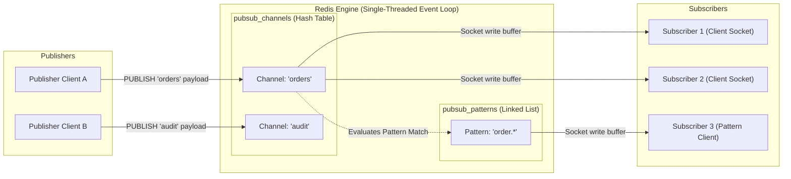
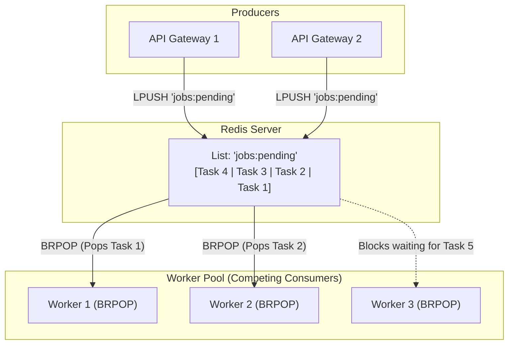
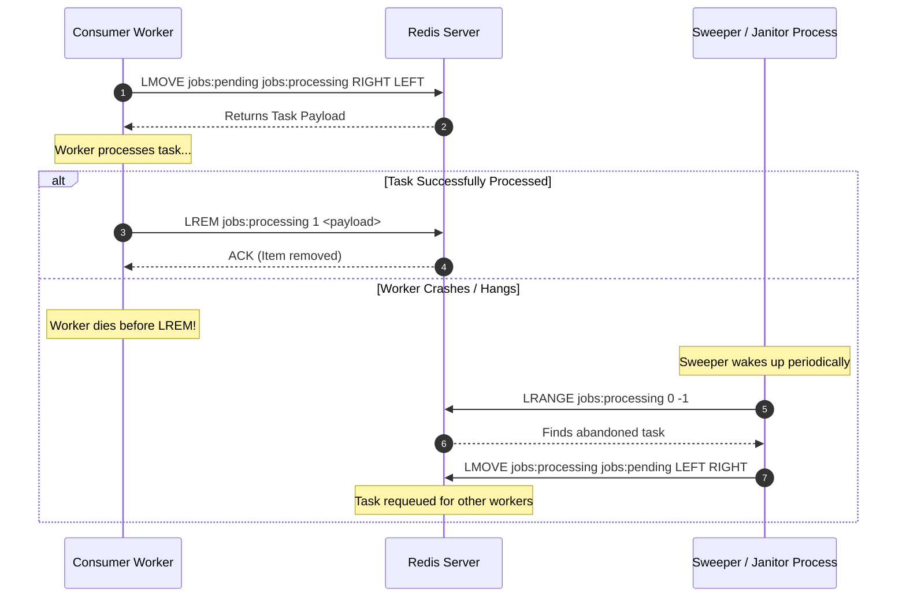
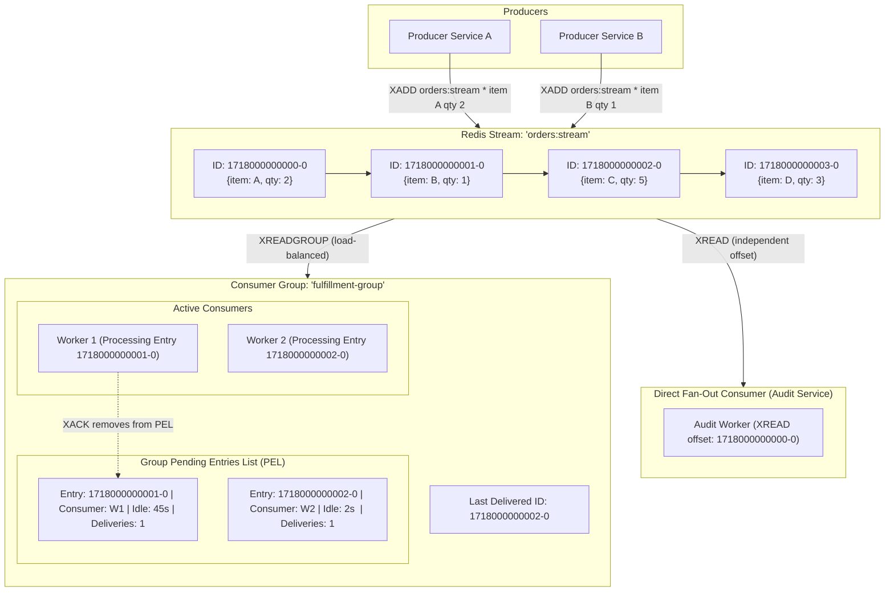
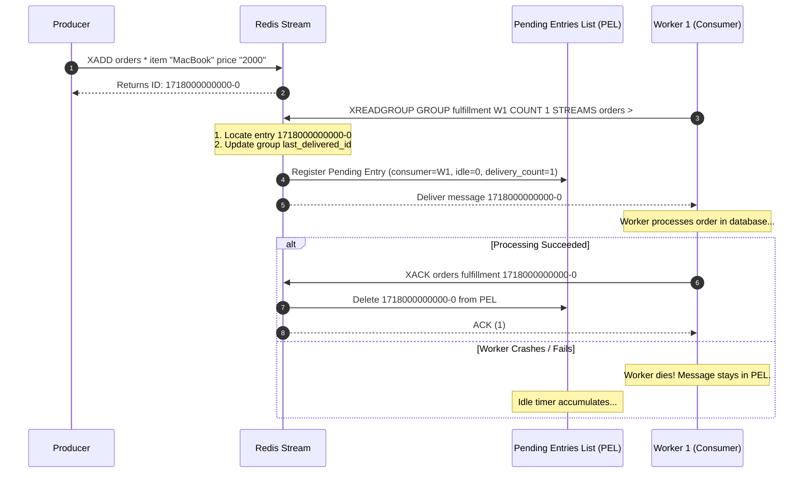
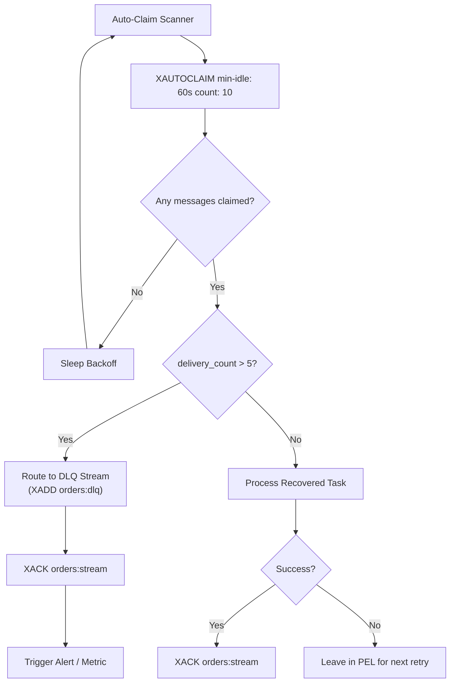
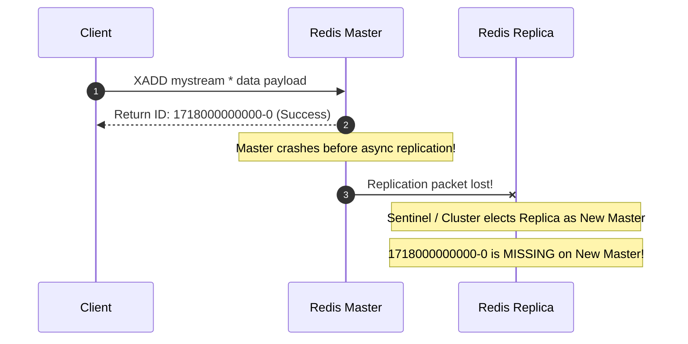
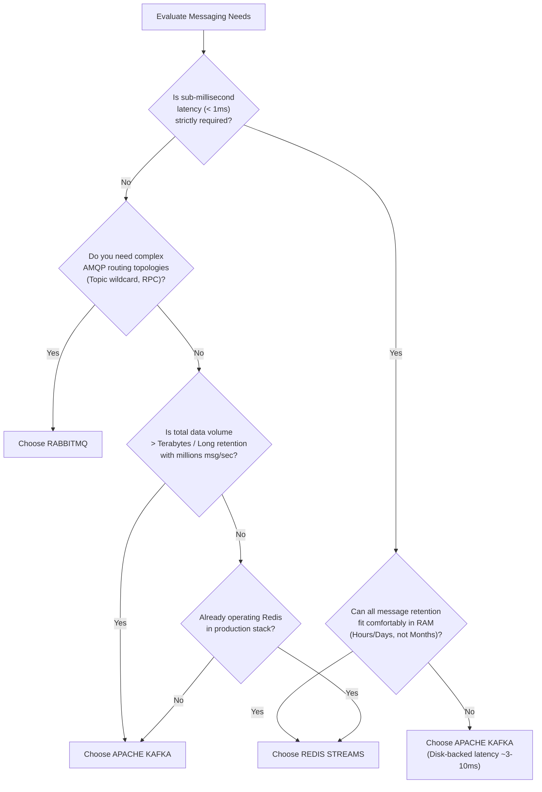
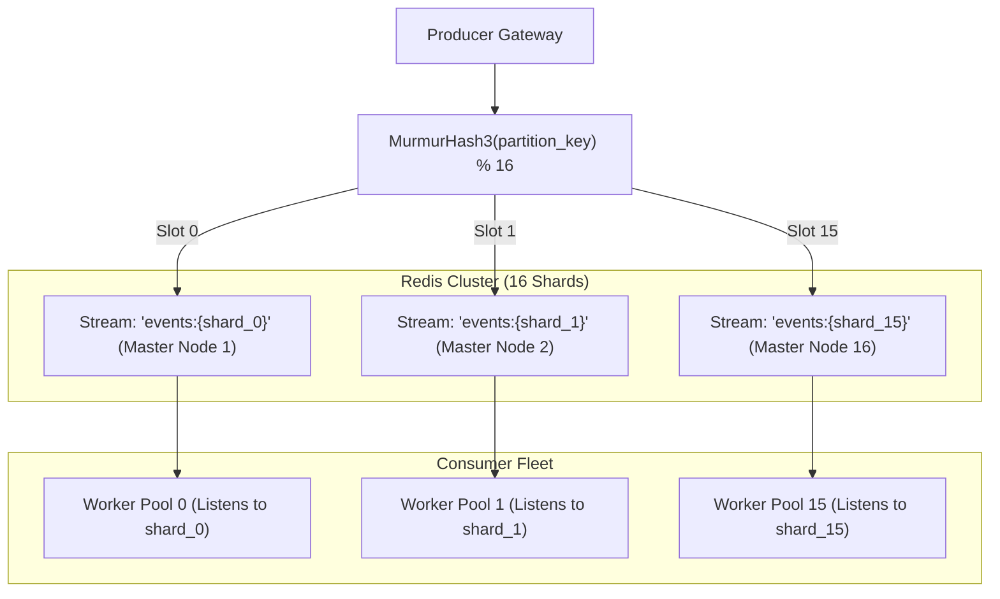

# Redis Streams and Pub/Sub Deep Dive: The Definitive Architectural Guide

Redis is renowned as an ultra-low latency, in-memory key-value data store. However, over its evolutionary history, Redis has steadily transformed into a versatile, high-throughput messaging engine. Today, it spans three distinct messaging paradigms: **Redis Pub/Sub** (an ephemeral broadcast bus), **Redis Lists** (lightweight FIFO/LIFO task queues), and **Redis Streams** (an append-only, persistent, replayable log with consumer groups inspired by Apache Kafka).

This guide provides an exhaustive, production-grade architectural analysis of Redis messaging systems. It examines the underlying C internals, algorithmic complexities, memory optimization strategies, clustering constraints, failure recovery mechanisms, and practical implementation patterns required for mission-critical distributed systems.

---

## 1. Overview & Evolution of Messaging in Redis

### 1.1 The Evolutionary Timeline

The evolution of messaging primitives in Redis reflects the industry's changing demands for messaging systems—moving from simple task distribution to real-time broadcasts, and ultimately to persistent, distributed stream processing.

```
+---------------------------------------------------------------------------------------------------+
|                                 REDIS MESSAGING EVOLUTION                                         |
+---------------------------------------------------------------------------------------------------+
|  Redis 1.0 (2009)       Redis 2.0 (2010)       Redis 2.6 (2012)       Redis 5.0 (2018)            |
|  Lists (LPUSH/RPOP)     Pub/Sub                Sorted Sets + Lua      Streams                     |
|  - Simple FIFO queues   - Fire-and-forget      - Delayed job queues   - Append-only log           |
|  - Blocking BRPOP       - Fan-out broadcast    - ZADD timestamp       - Kafka-style consumer grps |
|  - Point-to-point only  - Zero persistence     - ZRANGEBYSCORE poll   - Built-in ACK & PEL        |
|  - No ACKs / recovery   - At-most-once         - High CPU polling     - Radix Tree + Listpack     |
+---------------------------------------------------------------------------------------------------+
```

1. **Redis 1.0 — Lists as FIFO Task Queues (`LPUSH` / `RPOP` / `BRPOP`):**
   - Provided basic producer-consumer worker pools.
   - Strictly point-to-point: once an item is popped by one worker, it is removed from the server.
   - Lacked native acknowledgments (ACKs), consumer identity, fan-out capabilities, and automatic recovery of failed workers.

2. **Redis 2.0 — Publish/Subscribe (`PUBLISH` / `SUBSCRIBE` / `PSUBSCRIBE`):**
   - Introduced true 1-to-N broadcast messaging.
   - Completely decoupled publishers from subscribers.
   - Strictly ephemeral: Redis never writes Pub/Sub messages to RAM storage or disk. If a subscriber drops its TCP connection, messages sent during the downtime are permanently lost.

3. **Redis 2.6 — Sorted Sets (`ZSET`) for Delayed Messaging:**
   - Engineers began using Sorted Sets with epoch timestamps as scores (`ZADD queue <timestamp> <payload>`) and polling via `ZRANGEBYSCORE` or atomic Lua scripts to build scheduled and delayed task queues (e.g., Sidekiq, Celery, BullMQ).
   - Suffered from polling overhead, concurrency contention on score ranges, and high memory footprint compared to sequential logs.

4. **Redis 5.0 — Redis Streams (`XADD`, `XREAD`, `XREADGROUP`):**
   - Designed to bridge the architectural chasm between ephemeral Pub/Sub and primitive Lists.
   - Combines the persistent, append-only log model of Apache Kafka with the sub-millisecond in-memory speed of Redis.
   - Provides consumer groups, offset tracking, monotonic 128-bit message IDs, message acknowledgment, and a Pending Entries List (PEL) for worker crash recovery.

### 1.2 Architectural Trade-Off Matrix

| Dimension | Redis Lists (`LPUSH`/`BRPOP`) | Redis Pub/Sub | Redis Streams (`XADD`/`XREADGROUP`) |
| :--- | :--- | :--- | :--- |
| **Messaging Paradigm** | Point-to-Point Queue | Fan-out Broadcast Bus | Append-Only Log / Stream |
| **Message Persistence** | In-Memory (RDB / AOF) | **None** (Ephemeral RAM buffer) | In-Memory (RDB / AOF) |
| **Delivery Guarantee** | At-most-once (default) / At-least-once (`LMOVE`) | At-most-once (Fire-and-forget) | At-least-once (via PEL and `XACK`) |
| **Consumer Scalability** | Competing workers | Every subscriber gets every message | Competing workers via Consumer Groups |
| **Fan-out Capability** | No (Single consumer pops) | Yes (All active subscribers) | Yes (Multiple independent Consumer Groups) |
| **Historical Replay** | No (Destructive read) | No (Destructive on transmit) | Yes (Offset-based range queries) |
| **Acknowledgment Model** | None (Manual shadow list) | None | Native (`XACK` & Pending Entries List) |
| **Memory Overhead** | Low (Quicklist of listpacks) | Zero (Socket buffer only) | Low to Medium (Radix Tree + Listpack) |
| **Backpressure** | Natural (List length grows) | Socket buffer drop / disconnect | Natural (Trimming via `MAXLEN` / `MINID`) |

---

## 2. Redis Pub/Sub Deep Dive

### 2.1 Mechanics and Protocol

Redis Pub/Sub decouples message producers from consumers through logical routing keys called channels.
- `PUBLISH channel message`: Sends a string payload to the specified channel. Returns an integer representing the number of clients that received the message.
- `SUBSCRIBE channel [channel ...]`: Puts the client connection into a dedicated pub/sub listen state. The connection cannot issue normal Redis commands until it calls `UNSUBSCRIBE`.
- `PSUBSCRIBE pattern [pattern ...]`: Subscribes to channels matching glob-style patterns (e.g., `news.*`, `orders.?`).
- `SSUBSCRIBE shardchannel [shardchannel ...]` (Redis 7.0+): Sharded Pub/Sub, routing messages strictly to the cluster node owning the hash slot of the channel name.

### 2.2 High-Level Architecture



### 2.3 Low-Level Design (LLD) & C Internals

Under the hood in `pubsub.c`, the Redis server manages two primary data structures within its global `redisServer` struct:

```c
struct redisServer {
    /* ... */
    dict *pubsub_channels;  /* Map<robj* (channel name), list* (client pointers)> */
    list *pubsub_patterns;  /* List<pubsubPattern> */
    dict *pubsub_patterns_dict; /* Redis 7.0+ optimization for exact pattern lookups */
    /* ... */
};

typedef struct pubsubPattern {
    client *client;
    robj *pattern;
} pubsubPattern;
```

#### The `pubsub_channels` Dictionary
- **Structure:** A hash table (`dict`) where each key is a dynamically allocated Redis String Object (`robj*`) representing the channel name.
- **Value:** A doubly linked list (`list*`) containing pointers to active `client` structures currently subscribed to that channel.
- **Complexity:** Subscribing and unsubscribing takes $O(1)$ amortized time. Publishing to an exact channel name takes $O(1 + N)$, where $N$ is the number of subscribed clients on that specific channel list.

#### The `pubsub_patterns` List
- **Structure:** A doubly linked list containing `pubsubPattern` structs.
- **Complexity:** When `PUBLISH` executes, Redis iterates through the **entire** `pubsub_patterns` linked list, matching the channel name against each pattern using glob-style string pattern matching (`stringmatchlen`).
- **Performance Hazard:** If there are 10,000 active pattern subscriptions across the entire Redis instance, **every single `PUBLISH` command must iterate through all 10,000 entries**, leading to severe CPU spikes and event loop latency degradation ($O(M)$ where $M$ is total pattern subscriptions).

```
PUBLISH Time Complexity: O(N + M)
  Where:
    N = Number of direct subscribers to the target channel.
    M = Total number of pattern subscriptions across the ENTIRE Redis server.
```

### 2.4 Client Output Buffer Limits (`client-output-buffer-limit`)

Because Pub/Sub is synchronous from the Redis event loop's perspective, Redis copies the published message directly into the output buffer of each subscribed client. 

If a subscriber's network bandwidth is slower than the publication rate, its output buffer will balloon in RAM. To prevent slow subscribers from causing an Out-Of-Memory (OOM) crash, Redis enforces strict client output buffer limits:

```text
client-output-buffer-limit pubsub <hard-limit> <soft-limit> <soft-seconds>
# Default configuration:
client-output-buffer-limit pubsub 32mb 8mb 60
```

1. **Hard Limit (32MB):** If a subscriber's socket write buffer reaches 32MB, Redis immediately terminates the client's TCP socket connection.
2. **Soft Limit (8MB for 60s):** If the buffer exceeds 8MB and remains above 8MB continuously for 60 seconds, Redis terminates the client connection.
3. **Consequence:** Slow consumers are forcefully disconnected and miss all subsequent messages. No warning is sent to publishers.

### 2.5 Delivery Guarantees & Failure Modes

- **Fire-and-Forget:** Redis writes the payload directly into client socket buffers and retains no copy in memory.
- **Zero Durability:** Pub/Sub operations are never written to the Append-Only File (AOF) or snapshotted into RDB files.
- **Strict At-Most-Once:** If a client encounters a network partition, GC pause, or process crash during a message publish, that message is irrecoverably lost for that client.

---

## 3. Redis Lists as Task Queues

### 3.1 Mechanics and Worker Pools

Before Redis 5.0, developers utilized Redis Lists as point-to-point work queues via the Producer-Consumer pattern:

- **Enqueue:** Producers push tasks to the head of the list: `LPUSH task_queue '{"job_id": 101, "task": "render"}'`.
- **Dequeue:** Consumers pop tasks from the tail of the list: `RPOP task_queue`.
- **Blocking Dequeue:** To prevent wasteful CPU polling loops, consumers use `BRPOP task_queue 0`, which puts the client socket into a blocked state until an item is pushed or the timeout expires.

### 3.2 High-Level Architecture



### 3.3 Low-Level Design (LLD): The Quicklist

In modern Redis (v3.2+ through v7.0+), Lists are implemented internally using the **Quicklist** data structure (`quicklist.c`), which is a doubly linked list of **listpacks** (or **ziplists** in older versions).

```
+-------------------------------------------------------------------------------------------------+
|                                     QUICKLIST STRUCTURE                                         |
+-------------------------------------------------------------------------------------------------+
|                                                                                                 |
|   +-----------------------+       +-----------------------+       +-----------------------+     |
|   |    quicklistNode      | <===> |    quicklistNode      | <===> |    quicklistNode      |     |
|   |  - prev / next ptr    |       |  - prev / next ptr    |       |  - prev / next ptr    |     |
|   |  - zl: listpack ptr   |       |  - zl: listpack ptr   |       |  - zl: listpack ptr   |     |
|   |  - sz: 4096 bytes     |       |  - sz: 4096 bytes     |       |  - sz: 4096 bytes     |     |
|   |  - count: 32 entries  |       |  - count: 48 entries  |       |  - count: 18 entries  |     |
|   +-----------+-----------+       +-----------+-----------+       +-----------+-----------+     |
|               |                               |                               |                 |
|               v                               v                               v                 |
|   +-----------------------+       +-----------------------+       +-----------------------+     |
|   |       Listpack        |       |       Listpack        |       |       Listpack        |     |
|   | [TotalBytes|NumElems] |       | [TotalBytes|NumElems] |       | [TotalBytes|NumElems] |     |
|   | [Entry1][Entry2]...   |       | [Entry1][Entry2]...   |       | [Entry1][Entry2]...   |     |
|   +-----------------------+       +-----------------------+       +-----------------------+     |
|                                                                                                 |
+-------------------------------------------------------------------------------------------------+
```

- **Memory Optimization:** Traditional doubly linked lists incur 16 to 24 bytes of pointer overhead per element (on 64-bit architectures). A listpack stores elements contiguously in a single contiguous byte array, drastically reducing pointer overhead and cache misses.
- **Configurable Compaction:** Via `list-max-listpack-size` (default `-2`, meaning 8KB per node) and `list-compress-depth` (which compresses internal nodes using LZF compression while keeping head and tail uncompressed for $O(1)$ push/pop).

### 3.4 The Reliable Queue Pattern (`RPOPLPUSH` / `LMOVE`)

The fatal flaw of standard `RPOP` or `BRPOP` is that the pop operation is destructive. If a worker receives an item and immediately crashes (OOM, hardware fault, unhandled exception), the message is lost forever.

To achieve at-least-once delivery with Redis Lists, systems use the atomic transfer command `LMOVE` (or the deprecated `RPOPLPUSH`):

```text
# Atomically pops from tail of 'jobs:pending' and pushes to head of 'jobs:processing'
LMOVE jobs:pending jobs:processing RIGHT LEFT
```



### 3.5 Limitations of Redis Lists for Enterprise Queues

1. **Destructive Reads:** Cannot broadcast the same event to multiple independent downstream consumer services (e.g., Inventory, Billing, Notifications).
2. **Payload-based Removal:** Removing a processed item from `jobs:processing` requires `LREM jobs:processing 1 <payload>`. If payloads are large strings, `LREM` runs in $O(N)$ time, scanning the entire list and consuming CPU.
3. **No Native Retries or Dead-Letter Queues:** The application must build custom metadata stores to track delivery attempts, last-seen timestamps, and failure thresholds.
4. **Head-of-Line Blocking:** If a worker crashes while processing an item in `jobs:processing`, manual sweeper scripts are required to inspect and re-queue stuck jobs.

---

## 4. Redis Streams High-Level Design (HLD)

### 4.1 What Are Redis Streams?

Introduced in Redis 5.0, **Redis Streams** (`stream.h`) is an in-memory, append-only, ordered log data structure. Each entry consists of a unique 128-bit ID and a set of key-value field pairs (conceptually identical to a lightweight Redis Hash).

Unlike Redis Lists, a Stream allows multiple independent applications to consume the same log concurrently, either by independently traversing the log (Fan-out) or by sharing the processing load across a cluster of cooperating worker nodes (Consumer Groups).

### 4.2 Core Architecture Diagram



### 4.3 Consumption Paradigms: Fan-Out vs. Consumer Groups

Redis Streams uniquely supports two distinct consumption paradigms simultaneously on the exact same stream:

#### Paradigm A: Direct Stream Read (`XREAD`) — Fan-Out & Time-Travel
- **Semantics:** Each client maintains its own read pointer (offset ID).
- **Behavior:** Reading does not mutate stream metadata. Multiple independent clients can read the exact same messages simultaneously.
- **Use Case:** Audit loggers, real-time analytics dashboards, event-sourcing engines that need to replay the log from the beginning (`0-0`) or read only new items arriving from now on (`$`).

#### Paradigm B: Consumer Groups (`XREADGROUP`) — Competing Workers & At-Least-Once Delivery
- **Semantics:** Modeled after Kafka Consumer Groups. Multiple workers register under a shared `Group Name`.
- **Behavior:** Redis partitions message delivery so that **each message is delivered to only one consumer in the group**.
- **State Tracking:** Redis maintains group-level metadata:
  1. `last_delivered_id`: Cursor tracking the frontier of newly processed messages.
  2. `PEL (Pending Entries List)`: Tracks messages delivered to workers that have not yet been acknowledged via `XACK`.

---

## 5. Redis Streams Low-Level Design (LLD) & Internals

### 5.1 The Radix Tree (`rax`) and Listpack Architecture

Naively storing millions of stream messages as independent C structures or hash maps would result in massive pointer overhead and memory fragmentation. Redis Streams achieves superior memory density by pairing a **Radix Tree** with **Listpack** leaf nodes.

```
+---------------------------------------------------------------------------------------------------+
|                                 RADIX TREE (rax) WITH LISTPACKS                                   |
+---------------------------------------------------------------------------------------------------+
|                                                                                                   |
|                                    [ raxRoot Node ]                                               |
|                                     /            \                                                |
|                                 [ Prefix: 17180 ] [ Prefix: 17181 ]                               |
|                                   /                    \                                          |
|                          [ Leaf: Listpack A ]      [ Leaf: Listpack B ]                           |
|                         +--------------------+    +--------------------+                          |
|                         | Master Entry ID    |    | Master Entry ID    |                          |
|                         | Field Count: 2     |    | Field Count: 3     |                          |
|                         | Fields: item, price|    | Fields: user, op   |                          |
|                         +--------------------+    +--------------------+                          |
|                         | Entry 0 (Delta ms) |    | Entry 0 (Delta ms) |                          |
|                         | Entry 1 (Delta ms) |    | Entry 1 (Delta ms) |                          |
|                         | ... up to ~1000    |    | ... up to ~1000    |                          |
|                         +--------------------+    +--------------------+                          |
|                                                                                                   |
+---------------------------------------------------------------------------------------------------+
```

#### Radix Tree (`rax.c`)
- A space-optimized trie where nodes with single children are compressed (edges merge consecutive prefixes).
- In Redis Streams, the keys indexed by the `rax` are the 64-bit millisecond timestamps of the stream entries.
- Lookup, insertion, and deletion run in $O(K)$ time, where $K$ is the length of the stream ID in bits (constant time $\approx O(1)$ since IDs are fixed 128-bit integers).

#### Listpack Compression at Leaf Nodes (`listpack.c`)
- Instead of creating an individual radix tree node for every single stream entry, Redis groups batches of sequential entries into a single contiguous byte array called a **listpack**.
- **Master Entry Header:** The listpack writes a "Master Entry" at its head, recording the base timestamp, base sequence number, and all unique field names for that batch.
- **Delta Encoding:** Subsequent entries in the listpack store only:
  1. Flags (indicating if fields match the master entry).
  2. The timestamp delta: `ms_difference = current_entry.ms - master_entry.ms`.
  3. The sequence delta: `seq_difference = current_entry.seq - master_entry.seq`.
  4. Field values (omitting duplicate field names!).
- **Memory Savings:** This structural deduplication and variable-length integer encoding reduces per-message RAM overhead from ~150 bytes down to **20–30 bytes**.

### 5.2 Entry ID Anatomy & Monotonic Clock Guarantees

Every entry in a Redis Stream has a unique 128-bit identifier formatted as:

```text
<millisecondsTime>-<sequenceNumber>
Example: 1718000000000-0
```

```
+-----------------------------------------------------------------------------------+
|                            128-BIT STREAM ID ANATOMY                              |
+-----------------------------------------------------------------------------------+
|          64-Bit Milliseconds Timestamp        |     64-Bit Sequence Counter       |
|    (Unix Epoch in milliseconds: uint64_t)     | (Collision resolver: uint64_t)    |
|                ms                             |                seq                |
+-----------------------------------------------------------------------------------+
```

#### Monotonicity Rules
1. **Strict Ordering:** For any two consecutive entries $E_1$ and $E_2$, it is invariant that:
   $$\text{ID}(E_2) > \text{ID}(E_1) \iff (E_2.ms > E_1.ms) \lor (E_2.ms == E_1.ms \land E_2.seq > E_1.seq)$$
2. **Auto-Generation (`*`):** When calling `XADD mystream * field value`, Redis retrieves the current system time using `mstime()`.
3. **Clock Skew & Backward NTP Adjustments:**
   - If the system clock steps backward (e.g., NTP correction), Redis detects that `currentTime < stream->last_id.ms`.
   - Redis **refuses to decrement the millisecond component**. Instead, it reuses the timestamp of `stream->last_id.ms` and increments `sequenceNumber` by 1.
   - If `sequenceNumber` overflows (beyond $2^{64}-1$), the append errors out.
4. **Explicit ID Injection:** Applications can pass explicit IDs (e.g., `XADD mystream 1000-1 payload`). If the specified ID is less than or equal to the current `last_id`, Redis rejects the command with `ERR The ID specified in XADD is equal or smaller than the target stream top item`.

### 5.3 Consumer Group Internal C Structures

The core consumer group metadata resides in `stream.h`:

```c
/* The Stream object */
typedef struct stream {
    rax *rax;               /* Radix tree mapping entry IDs to listpacks */
    uint64_t length;        /* Total number of entries in the stream */
    streamID last_id;       /* 128-bit ID of the newest entry */
    rax *cgroups;           /* Consumer groups: map<sds group_name, streamCG*> */
} stream;

/* The Consumer Group object */
typedef struct streamCG {
    streamID last_id;       /* Highest ID delivered to ANY consumer in this group */
    rax *pel;               /* Group PEL: map<streamID, streamPendingEntry*> */
    rax *consumers;         /* Active consumers: map<sds consumer_name, streamConsumer*> */
} streamCG;

/* The Individual Consumer object */
typedef struct streamConsumer {
    mstime_t seen_time;     /* Timestamp of last activity (XREADGROUP/XCLAIM) */
    sds name;               /* Consumer name string */
    rax *pel;               /* Consumer-specific PEL (pointers to streamPendingEntry) */
} streamConsumer;

/* The Pending Entry Descriptor */
typedef struct streamPendingEntry {
    mstime_t delivery_time; /* Timestamp of the most recent delivery */
    streamConsumer *consumer;/* Pointer to current owner consumer */
    uint64_t delivery_count;/* Number of times this message was delivered */
} streamPendingEntry;
```

### 5.4 The Pending Entries List (PEL) LLD

The PEL is the foundation of Redis Streams' reliability guarantees.

```
+---------------------------------------------------------------------------------------------------+
|                                  PEL RADIX TREE STRUCTURE                                         |
+---------------------------------------------------------------------------------------------------+
|                                                                                                   |
|  Key (streamID): [ 1718000000001-0 ]                                                              |
|        |                                                                                          |
|        v                                                                                          |
|  Value (streamPendingEntry):                                                                      |
|  +---------------------------------------------------------------------------------------------+  |
|  | delivery_time  : 1718000045000 (Epoch ms when worker pulled the message)                     |  |
|  | consumer       : Pointer -> streamConsumer ("worker-prod-az1-42")                            |  |
|  | delivery_count : 3 (Incremented on initial read and every subsequent XCLAIM/XAUTOCLAIM)      |  |
|  +---------------------------------------------------------------------------------------------+  |
|                                                                                                   |
+---------------------------------------------------------------------------------------------------+
```

#### Dual-Indexing Architecture
Notice that `streamCG` has a `pel` Radix tree, and each `streamConsumer` also has its own `pel` Radix tree:
- **Group PEL:** Maps `streamID` to the single authoritative `streamPendingEntry` heap allocation.
- **Consumer PEL:** Maps `streamID` to the **same** `streamPendingEntry` pointer.
- **Why?** This dual index allows:
  1. $O(1)$ group-wide pending queries (`XPENDING mystream mygroup`).
  2. $O(1)$ consumer-specific pending queries (`XPENDING mystream mygroup - + 10 consumer_1`).
  3. $O(1)$ consumer reassignment when a message is claimed by another worker.

#### The Un-ACKed Memory Leak Hazard
When a consumer reads a message via `XREADGROUP`, an entry **must** be allocated in the PEL. It is only freed when `XACK` is executed.
> [!WARNING]
> If a developer writes consumer code that processes messages but forgets to call `XACK`, the PEL will grow monotonically indefinitely. Even if you trim the stream using `XTRIM` or `MAXLEN`, **Redis will NOT garbage-collect entries from the stream if they are still referenced in a Consumer Group PEL!** This is a primary cause of silent OOM crashes in Redis Streams deployments.

---

## 6. Consumer Group Mechanics, Commands & Failure Recovery LLD

### 6.1 Core Commands in Depth

#### 1. `XADD key [NOMKSTREAM] [MAXLEN|MINID [=|~] threshold] *|id field value [field value ...]`
- Appends an entry to the stream.
- `NOMKSTREAM`: Prevents stream creation if the key doesn't already exist.
- Returns the newly created entry ID.

#### 2. `XREAD [COUNT count] [BLOCK milliseconds] STREAMS key [key ...] id [id ...]`
- Reads entries starting *after* the specified `id`.
- Special ID `$`: Read only messages added *after* the client initiated the command.
- `BLOCK`: Suspends the connection up to $N$ milliseconds if no data is available (event-driven wakeup via `signalKeyAsReady`).

#### 3. `XGROUP CREATE key groupname id|$ [MKSTREAM]`
- Initializes a consumer group bound to `key`.
- `id`: The starting cursor. Passing `0` means the group processes all historical messages in the stream. Passing `$` means the group consumes only newly appended messages.
- `MKSTREAM`: Automatically creates the stream if it does not yet exist.

#### 4. `XREADGROUP GROUP group consumer [COUNT count] [BLOCK milliseconds] [NOACK] STREAMS key [key ...] id [id ...]`
- Reads messages on behalf of a specific consumer within a group.
- **The Special `>` ID:** Signals Redis to return messages that have **never been delivered** to any consumer in this group. Advances `streamCG->last_id` and adds entries to the PEL.
- **Passing Any Other ID (e.g., `0`):** Signals Redis to return the consumer's **own unacknowledged pending messages** from its PEL. Does not advance `last_id`.
- `NOACK`: Skips adding the message to the PEL entirely (at-most-once delivery).

#### 5. `XACK key group id [id ...]`
- Removes the specified entry IDs from both the Group PEL and Consumer PEL.
- Frees the `streamPendingEntry` struct.
- Returns the number of successfully acknowledged messages.

#### 6. `XPENDING key group [[IDLE min-idle-time] start end count [consumer]]`
- Inspects the Group PEL without mutating state.
- Returns summary statistics (total pending, lowest ID, highest ID, consumers) or detailed records including message ID, owner consumer, idle time in milliseconds, and delivery count.

#### 7. `XCLAIM key group consumer min-idle-time id [id ...] [IDLE ms] [TIME ms] [RETRYCOUNT count] [JUSTID]`
- Reassigns ownership of an unacknowledged message from a dead consumer to a healthy consumer.
- Requires `min-idle-time`: The message must have been idle for at least this many milliseconds before Redis allows the claim.
- Automatically increments `delivery_count` in the PEL.

#### 8. `XAUTOCLAIM key group consumer min-idle-time start [COUNT count] [JUSTID]`
- Introduced in Redis 6.2 to replace the cumbersome `XPENDING` + `XCLAIM` two-step pattern.
- Scans the PEL starting at `start` (use `0-0` to start from the oldest), claims up to `count` messages idle for `min-idle-time`, transfers them to `consumer`, and returns the next cursor ID.

### 6.2 End-to-End Consumption Flow Sequence Diagram



### 6.3 Fault Tolerance & Crash Recovery Mechanics

Distributed worker systems face two unavoidable failure modes:
1. **Worker Crash:** A worker pulls an event and dies before completion.
2. **Poison Pill:** A malformed payload crashes every worker that attempts to deserialize or process it.

#### Stalled Worker Recovery via `XAUTOCLAIM`
A dedicated background thread or a fleet of healthy workers periodically executes `XAUTOCLAIM`:

```text
# Scans PEL for orders:stream. Claims messages idle > 60000ms, assigns to worker_recovery_1
XAUTOCLAIM orders:stream fulfillment-group worker_recovery_1 60000 0-0 COUNT 10
```

Redis evaluates the messages in the PEL:
- If `idle_time >= 60000`, ownership transitions to `worker_recovery_1`.
- `delivery_time` is updated to current server time.
- `delivery_count` is incremented.

#### Dead Letter Queue (DLQ) & Poison Pill Mitigation
If a poison pill message crashes workers repeatedly, the recovery loop could cycle endlessly, resulting in an infinite crash-recovery storm.

To prevent this, production systems check the `delivery_count` returned by `XPENDING` or `XAUTOCLAIM`. If `delivery_count > MAX_RETRIES` (e.g., 5):
1. Write the payload and error context to a separate Dead Letter Stream: `XADD orders:stream:dlq * original_id ... reason ...`.
2. Acknowledge and clear the poisoned message from the primary stream: `XACK orders:stream fulfillment-group <id>`.



---

## 7. Memory Management, Trimming & Eviction Strategies

### 7.1 The Bounded Stream Imperative

Redis is an **in-memory** data store. Unbounded streams will consume RAM until the host system reaches its `maxmemory` threshold. Once memory is exhausted, Redis either invokes key eviction or rejects all further writes with an OOM error.

Therefore, **all production streams must be bounded**.

### 7.2 Exact Trimming (`=`) vs. Approximate Trimming (`~`)

Redis provides two syntax options for trimming streams via `XADD` or `XTRIM`:

```text
# Exact trimming:
XTRIM mystream MAXLEN = 100000

# Approximate trimming:
XTRIM mystream MAXLEN ~ 100000
```

```
+---------------------------------------------------------------------------------------------------+
|                            EXACT VS. APPROXIMATE TRIMMING INTERNALS                               |
+---------------------------------------------------------------------------------------------------+
|                                                                                                   |
|  [Listpack 1: 500 items] ===> [Listpack 2: 500 items] ===> [Listpack 3: 500 items]                |
|                                                                                                   |
|  SCENARIO: Stream has 1500 items. Request: MAXLEN 1200 (Evict 300 items).                        |
|                                                                                                   |
|  1. EXACT TRIMMING (=):                                                                           |
|     - Must evict exactly 300 items from Listpack 1.                                               |
|     - Must unpack Listpack 1, reallocate memory, copy 200 items into a new listpack, and update   |
|       the Radix tree leaf pointer.                                                                |
|     - Algorithmic Complexity: O(N) memory copy and listpack re-encoding. High CPU overhead!        |
|                                                                                                   |
|  2. APPROXIMATE TRIMMING (~):                                                                     |
|     - Checks macro-nodes (Listpacks). Listpack 1 has 500 items.                                    |
|     - Evicting Listpack 1 would leave 1000 items (below 1200 threshold).                          |
|     - Redis refrains from evicting Listpack 1 until an entire listpack boundary can be freed     |
|       without dropping below ~1200 items.                                                         |
|     - Deleting a listpack is a simple O(1) Radix tree leaf deallocation!                          |
|                                                                                                   |
+---------------------------------------------------------------------------------------------------+
```

> [!IMPORTANT]
> **Always use approximate trimming (`~`) in high-throughput production workloads.** 
> Approximate trimming amortizes the cost of eviction over thousands of operations, freeing whole listpack nodes from the Radix tree in $O(1)$ time, eliminating event-loop latency spikes.

### 7.3 Time-Based Stream Retention via `MINID`

In Redis 6.2+, the `MINID` argument allows time-based message retention:

```text
# Retain entries no older than 7 days (7 * 86400 * 1000 ms)
# Current time: 1718000000000. Cutoff: 1717395200000
XADD mystream MINID ~ 1717395200000 * sensor_temp 22.4
```

Entries with IDs strictly lower than the specified cutoff timestamp are pruned, providing an intuitive Time-To-Live (TTL) retention model directly comparable to Kafka retention hours.

### 7.4 Eviction Policies and the Stream Hazard

The Redis configuration directive `maxmemory-policy` dictates how Redis behaves when memory limits are reached.

| Policy | Behavior with Streams | Production Recommendation |
| :--- | :--- | :--- |
| `noeviction` | Returns an error on writes (`OOM command not allowed`). Stream data is **never** silently deleted. | **STRONGLY RECOMMENDED** for stream brokers. Forces producer backpressure. |
| `volatile-lru` / `allkeys-lru` | Silently evicts entire keys based on least-recently-used heuristics. | **CATASTROPHIC DANGER**. Redis may evict the entire stream key or auxiliary metadata! |

> [!CAUTION]
> If Redis is configured with `allkeys-lru`, under memory pressure it will silently delete the **entire Stream key**, obliterating all unacknowledged messages, group offsets, and consumer metadata. Never host mission-critical Redis Streams on an instance with generic LRU/LFU cache eviction policies enabled.

---

## 8. Redis Cluster, Persistence & Replication Mechanics

### 8.1 Streams in Redis Cluster

Redis Cluster partitions the 16,384 available hash slots across master nodes:
$$\text{slot} = \text{CRC16}(\text{key}) \pmod{16384}$$

#### Single-Key Constraint
- A single Redis Stream key resides entirely on the single master node responsible for its hash slot.
- A single stream **cannot be natively partitioned across multiple cluster nodes**. The write and read throughput of a single stream key is bounded by the single-core CPU throughput of that specific node.

#### Scaling Streams with Hash Tags
To scale write throughput beyond a single node's CPU capacity, the application layer must shard events across multiple stream keys using **Hash Tags**:

```text
# Sharding across 4 parallel streams:
XADD orders:{shard_0} * order_id 1001 ...
XADD orders:{shard_1} * order_id 1002 ...
XADD orders:{shard_2} * order_id 1003 ...
XADD orders:{shard_3} * order_id 1004 ...
```

The bracketed hash tags `{shard_0}` through `{shard_3}` ensure the keys hash to different slots across the cluster, distributing network and CPU load across 4 distinct master nodes.

### 8.2 Persistence Options: RDB vs. AOF

```
+---------------------------------------------------------------------------------------------------+
|                                 REDIS PERSISTENCE TRADEOFFS                                       |
+---------------------------------------------------------------------------------------------------+
|  Mode                  | Max Data Loss Window      | I/O Latency Impact | Recovery Speed          |
|  --------------------- | ------------------------- | ------------------ | ----------------------- |
|  RDB Snapshots         | Minutes (Snapshot period) | Negligible (fork)  | Fast (Direct binary)    |
|  AOF (everysec)        | ~1-2 seconds              | Minimal (fsync thd)| Moderate (Replay log)   |
|  AOF (always)          | 0 (Hardware crash edge)   | Severe (Disk sync) | Slow                    |
+---------------------------------------------------------------------------------------------------+
```

For stream-based messaging systems:
- **`appendfsync everysec`** is the standard industry choice. Redis offloads `fsync()` to a background thread once per second. In the event of an ungraceful server crash, a maximum of 1 to 2 seconds of published messages may be lost.
- **`appendfsync always`** forces an `fsync()` to NVMe/SSD before acknowledging every `XADD`. While this provides strict crash resilience, it degrades write throughput from ~100,000 ops/sec down to 1,000–3,000 ops/sec due to disk I/O bottlenecks.

### 8.3 Asynchronous Replication Lag & Failover Data Loss

Standard Redis master-replica replication is **completely asynchronous**:



If the master acknowledges an `XADD` to the client and immediately crashes before the replication buffer is transferred to the replica, Sentinel or Redis Cluster will promote the replica to master. The acknowledged message is **lost**.

#### Mitigating Replication Loss via `WAIT`
To achieve semi-synchronous replication, producers can execute the `WAIT` command immediately after `XADD`:

```text
XADD orders:stream * order_id 9999
# Blocks until at least 1 replica confirms receipt of the write, or 1000ms timeout
WAIT 1 1000
```

`WAIT` does not turn Redis into a fully consensus-driven engine (like Raft or Paxos), but it guarantees that the write has reached the operating system buffers of $N$ replicas before the producer proceeds.

---

## 9. Production-Grade Python Implementation

Below is a complete, production-ready, resilient implementation featuring an `OrderProducer`, a multithreaded `OrderConsumer`, an automated crash recovery background loop using `XAUTOCLAIM`, and an integrated Dead-Letter Queue (DLQ) poison-pill router.

```python
#!/usr/bin/env python3
"""
Production-Grade Redis Streams Implementation
Features:
  - Producer with approximate trimming (~ MAXLEN).
  - Consumer Group Worker with reliable XREADGROUP and XACK.
  - Fault-Tolerant Auto-Claimer using XAUTOCLAIM for dead worker recovery.
  - Poison-Pill Dead Letter Queue (DLQ) routing based on delivery count.
  - Graceful POSIX signal shutdown.
"""

import os
import sys
import time
import json
import signal
import logging
import threading
from typing import Dict, Any, List, Optional
import redis
from redis.exceptions import ResponseError, ConnectionError

# Logging Configuration
logging.basicConfig(
    level=logging.INFO,
    format="%(asctime)s [%(levelname)s] [%(threadName)s] %(message)s",
    handlers=[logging.StreamHandler(sys.stdout)],
)
logger = logging.getLogger("RedisStreamsEngine")

# Constants & Configuration
REDIS_HOST = os.getenv("REDIS_HOST", "localhost")
REDIS_PORT = int(os.getenv("REDIS_PORT", 6379))
STREAM_NAME = "orders:stream"
DLQ_STREAM_NAME = "orders:stream:dlq"
GROUP_NAME = "order_processing_group"
MAX_STREAM_LENGTH = 100_000
MAX_DELIVERY_ATTEMPTS = 5
CLAIM_MIN_IDLE_TIME_MS = 60_000  # 60 seconds idle threshold
BLOCK_TIME_MS = 2_000            # Block for 2 seconds on read


class RedisConnectionPool:
    """Singleton-style Redis connection manager."""
    _instance: Optional[redis.Redis] = None

    @classmethod
    def get_client(cls) -> redis.Redis:
        if cls._instance is None:
            cls._instance = redis.Redis(
                host=REDIS_HOST,
                port=REDIS_PORT,
                decode_responses=True,
                socket_timeout=5.0,
                socket_connect_timeout=5.0,
                retry_on_timeout=True,
                health_check_interval=30,
            )
        return cls._instance


class OrderProducer:
    """Resilient Producer appending events to Redis Stream with approximate trimming."""

    def __init__(self, client: redis.Redis, stream_name: str = STREAM_NAME):
        self.client = client
        self.stream_name = stream_name

    def publish_order(self, order_id: str, customer_id: str, amount: float) -> str:
        payload = {
            "order_id": order_id,
            "customer_id": customer_id,
            "amount": str(amount),
            "timestamp": str(time.time()),
        }
        try:
            # Approximate trimming via '~' ensures O(1) performance by dropping listpacks
            entry_id = self.client.xadd(
                name=self.stream_name,
                fields=payload,
                maxlen=MAX_STREAM_LENGTH,
                approximate=True,
            )
            logger.info(f"Published order {order_id} -> Stream ID: {entry_id}")
            return entry_id
        except redis.RedisError as e:
            logger.error(f"Failed to publish order {order_id}: {str(e)}")
            raise


class OrderConsumerWorker(threading.Thread):
    """
    Consumer group worker reading new events, executing business logic,
    and acknowledging successful processing via XACK.
    """

    def __init__(
        self,
        worker_id: str,
        client: redis.Redis,
        stop_event: threading.Event,
        stream_name: str = STREAM_NAME,
        group_name: str = GROUP_NAME,
    ):
        super().__init__(name=f"Worker-{worker_id}")
        self.worker_id = worker_id
        self.client = client
        self.stop_event = stop_event
        self.stream_name = stream_name
        self.group_name = group_name

    def run(self):
        logger.info(f"Worker {self.worker_id} started.")
        while not self.stop_event.is_set():
            try:
                # Read new undelivered messages (ID '>')
                streams = {self.stream_name: ">"}
                response = self.client.xreadgroup(
                    groupname=self.group_name,
                    consumername=self.worker_id,
                    streams=streams,
                    count=10,
                    block=BLOCK_TIME_MS,
                )

                if not response:
                    continue  # Timeout reached, loop back and check stop_event

                for stream_key, entries in response:
                    for entry_id, fields in entries:
                        self._process_entry(entry_id, fields)

            except ConnectionError as ce:
                logger.warning(f"Connection lost, retrying in 2s: {ce}")
                time.sleep(2.0)
            except Exception as ex:
                logger.error(f"Unexpected error in consumer loop: {ex}", exc_info=True)
                time.sleep(1.0)

        logger.info(f"Worker {self.worker_id} safely halted.")

    def _process_entry(self, entry_id: str, fields: Dict[str, Any]):
        try:
            # Simulate Business Logic
            logger.info(f"Processing Order: ID={entry_id}, Data={fields}")
            
            # Simulate deterministic poison-pill failure for demonstration
            if fields.get("order_id") == "POISON_PILL":
                raise ValueError("Fatal crash while executing order!")

            # Simulate I/O work
            time.sleep(0.05)

            # Acknowledge message upon successful execution
            self.client.xack(self.stream_name, self.group_name, entry_id)
            logger.info(f"Successfully processed and ACKed {entry_id}")

        except Exception as e:
            logger.error(f"Error processing {entry_id}: {e}. Leaving in PEL.")
            # Do NOT call XACK! Message remains in PEL for Auto-Claimer recovery


class AutoClaimRecoveryDaemon(threading.Thread):
    """
    Background recovery loop scanning the PEL for abandoned messages
    using XAUTOCLAIM, re-processing or routing to DLQ if delivery attempts exceed threshold.
    """

    def __init__(
        self,
        client: redis.Redis,
        stop_event: threading.Event,
        stream_name: str = STREAM_NAME,
        group_name: str = GROUP_NAME,
        dlq_name: str = DLQ_STREAM_NAME,
    ):
        super().__init__(name="AutoClaimRecoveryDaemon")
        self.client = client
        self.stop_event = stop_event
        self.stream_name = stream_name
        self.group_name = group_name
        self.dlq_name = dlq_name
        self.reclaimer_name = f"reclaimer-{os.getpid()}"

    def run(self):
        logger.info("Auto-Claim Recovery Daemon initiated.")
        start_id = "0-0"

        while not self.stop_event.is_set():
            try:
                # XAUTOCLAIM key group consumer min-idle-time start [COUNT count]
                # Returns: [next_start_id, [(entry_id, fields), ...], [deleted_ids...]]
                claim_result = self.client.xautoclaim(
                    name=self.stream_name,
                    groupname=self.group_name,
                    consumername=self.reclaimer_name,
                    min_idle_time=CLAIM_MIN_IDLE_TIME_MS,
                    start_id=start_id,
                    count=10,
                )

                next_start_id, claimed_entries = claim_result[0], claim_result[1]
                start_id = next_start_id if next_start_id != "0-0" else "0-0"

                if claimed_entries:
                    logger.warning(f"Claimed {len(claimed_entries)} abandoned messages.")
                    for entry_id, fields in claimed_entries:
                        self._handle_claimed_entry(entry_id, fields)

            except Exception as e:
                logger.error(f"Error in Auto-Claim daemon: {e}", exc_info=True)

            # Sleep between recovery scans
            time.sleep(5.0)

        logger.info("Auto-Claim Recovery Daemon halted.")

    def _handle_claimed_entry(self, entry_id: str, fields: Dict[str, Any]):
        try:
            # Query the PEL to determine the total delivery count for this message
            pending_info = self.client.xpending_range(
                name=self.stream_name,
                groupname=self.group_name,
                min=entry_id,
                max=entry_id,
                count=1,
            )

            delivery_count = pending_info[0]["times_delivered"] if pending_info else 1

            if delivery_count > MAX_DELIVERY_ATTEMPTS:
                logger.critical(
                    f"Message {entry_id} exceeded max retries ({delivery_count}). "
                    f"Routing to DLQ: {self.dlq_name}"
                )
                # 1. Forward to DLQ
                self.client.xadd(
                    name=self.dlq_name,
                    fields={
                        **fields,
                        "failed_stream": self.stream_name,
                        "failed_group": self.group_name,
                        "original_id": entry_id,
                        "delivery_attempts": str(delivery_count),
                        "evicted_at": str(time.time()),
                    },
                )
                # 2. Clear out of primary stream PEL
                self.client.xack(self.stream_name, self.group_name, entry_id)
                logger.info(f"Evicted poison pill {entry_id} from primary stream.")
            else:
                logger.info(f"Retrying message {entry_id} (Attempt {delivery_count})...")
                # Simulate successful retry or process directly
                self.client.xack(self.stream_name, self.group_name, entry_id)

        except Exception as ex:
            logger.error(f"Failed to process claimed message {entry_id}: {ex}")


def setup_consumer_group(client: redis.Redis, stream: str, group: str):
    """Initializes the consumer group if it does not already exist."""
    try:
        # MKSTREAM creates the stream key if absent; '0' reads from the beginning
        client.xgroup_create(name=stream, groupname=group, id="0", mkstream=True)
        logger.info(f"Consumer group '{group}' initialized on stream '{stream}'.")
    except ResponseError as e:
        if "BUSYGROUP" in str(e):
            logger.info(f"Consumer group '{group}' already exists.")
        else:
            raise


def main():
    """Bootstrap and graceful lifecycle management."""
    client = RedisConnectionPool.get_client()
    setup_consumer_group(client, STREAM_NAME, GROUP_NAME)

    stop_event = threading.Event()

    # Register POSIX signal handlers
    def signal_handler(signum, frame):
        logger.info(f"Received signal {signum}. Initiating graceful shutdown...")
        stop_event.set()

    signal.signal(signal.SIGINT, signal_handler)
    signal.signal(signal.SIGTERM, signal_handler)

    # Spawn Consumer Workers
    workers: List[threading.Thread] = []
    for i in range(3):
        w = OrderConsumerWorker(worker_id=f"worker_{i+1}", client=client, stop_event=stop_event)
        w.start()
        workers.append(w)

    # Spawn Auto-Claim Recovery Daemon
    recovery_daemon = AutoClaimRecoveryDaemon(client=client, stop_event=stop_event)
    recovery_daemon.start()

    # Spawn Producer
    producer = OrderProducer(client=client)

    # Produce test workload
    for i in range(10):
        producer.publish_order(f"ORD-{1000 + i}", f"CUST-{i}", 49.99 * (i + 1))
    
    # Intentionally produce one poison pill to demonstrate DLQ routing
    producer.publish_order("POISON_PILL", "CUST-BAD", 0.0)

    # Keep main thread alive until stopped
    try:
        while not stop_event.is_set():
            time.sleep(0.5)
    except KeyboardInterrupt:
        stop_event.set()

    # Join threads
    for w in workers:
        w.join()
    recovery_daemon.join()

    logger.info("Application shutdown complete. All threads joined.")


if __name__ == "__main__":
    main()
```

---

## 10. Redis Streams vs. Apache Kafka vs. RabbitMQ

### 10.1 Head-to-Head Architectural Comparison

| Dimension | Redis Streams | Apache Kafka | RabbitMQ |
| :--- | :--- | :--- | :--- |
| **1. Primary Storage Architecture** | In-Memory (RAM-first, asynchronous RDB/AOF disk persistence) | Disk-First (Sequential append log, heavy reliance on OS Page Cache) | Erlang mnesia / Disk (Queue index + message store) |
| **2. Throughput Profile** | Extremely High (~100,000–500,000 writes/sec per single core) | Massive (Millions of writes/sec across distributed partitions) | Moderate (~30,000–80,000 msgs/sec per broker node) |
| **3. Latency Profile** | **Sub-millisecond** (100–500 microseconds) | Low millisecond (2–10 milliseconds) | Low millisecond (1–5 milliseconds) |
| **4. Message Retention Model** | Memory-bounded. Requires active trimming (`MAXLEN` / `MINID`) | Size/Time-bounded on disk (Days, months, or years) | Destructive by default (Message removed once acknowledged) |
| **5. Consumer Group Scaling** | Dynamic: Any number of workers can join group; Redis tracks PEL | Bounded by partition count: Max active consumers = number of partitions | Dynamic: Competing workers pop from shared AMQP queue |
| **6. Partitioning Architecture** | Manual application-level sharding (Hash Tags across cluster slots) | Native, first-class citizen (Topics composed of distributed partitions) | Not native (Requires exchange routing, Shovel, or Consistent Hash plugin) |
| **7. Replayability & Seeking** | Yes: Can seek by timestamp or exact 128-bit ID (`XRANGE`, `XREAD`) | Yes: Can seek by 64-bit numerical offset or epoch timestamp | No: Messages are transient and consumed destructively |
| **8. Acknowledgment Model** | Explicit `XACK` updating in-memory PEL structure | Offset commit (`__consumer_offsets` topic) | AMQP `basic.ack` removing item from queue memory |
| **9. Routing Flexibility** | Basic (Key-based stream names) | Basic (Topic-based) | **Extremely Advanced** (Direct, Topic, Headers, Fan-out exchanges) |
| **10. Replication & Consensus** | Asynchronous / Semi-sync (`WAIT`). No native Paxos/Raft on data | Quorum replication via KRaft (formerly ZooKeeper) + ISR list | Quorum Queues based on Raft consensus |
| **11. Durability Guarantees** | Configurable (`fsync everysec` loses 1s; `always` impacts latency) | Extreme (Configurable `acks=all`, `min.insync.replicas`) | High (Durable queues with Quorum writes to disk) |
| **12. Memory Footprint** | High per byte (All active data resides in RAM) | Extremely Low (Data lives on cheap NVMe/HDD disks) | Moderate (Memory used for buffering unacknowledged queues) |
| **13. Backpressure Mechanism** | Producer rejects on `noeviction` OOM; or approximate trimming drops data | TCP pause, client buffer limits, producer blocks | Credit-based flow control, publisher confirms block |
| **14. Poison Pill / DLQ** | Built via application logic using `delivery_count` in PEL | Managed via custom consumer interceptors or Kafka Streams | **Native** (Dead Letter Exchanges `x-dead-letter-exchange`) |
| **15. Operational Overhead** | **Very Low** (Single C binary, zero dependencies) | **High** (JVM tuning, garbage collection, KRaft cluster management) | **Moderate** (Erlang OTP runtime, clustering topology management) |

### 10.2 Strategic Decision Framework



---

## 11. Senior/Staff-Level System Design Interview Questions & Rigorous Answers

### Q1: How does the internal storage layout of Redis Streams (Radix Tree + Listpack) enable high write throughput while maintaining low memory consumption compared to Redis Lists or Hashes?

**Answer:**
A naive implementation of an append-only log in Redis using standard doubly linked lists (`listNode`) or individual hashes incurs prohibitive overhead:
1. **Memory Overhead:** A 64-bit C pointer consumes 8 bytes. A doubly linked list node requires 24 bytes of pointers (`prev`, `next`, `value`) plus 16 bytes for the `robj` header, totaling 40+ bytes of allocator overhead before storing a single byte of payload.
2. **Memory Fragmentation:** Allocating millions of tiny heap objects severely fragments jemalloc/glibc heap arenas.

Redis Streams solves this via a **two-tier hierarchical data structure**:
- **Tier 1 (The Index):** A space-optimized Radix tree (`rax`). Keys are 64-bit millisecond timestamps. Because consecutive stream entries share common timestamp prefixes (e.g., `17180000...`), the radix tree compresses common prefixes into single nodes, drastically reducing index depth and pointer counts.
- **Tier 2 (The Data Blocks):** Instead of storing individual entries at the leaf nodes, the radix tree stores **listpacks** (`lp`). A listpack is a single, contiguous byte allocation storing hundreds of stream entries (configured via `stream-node-max-bytes` or `stream-node-max-entries`).
- **Delta & Schema Compression:** The listpack uses a Master Entry that defines common field names once. Sequential entries encode only timestamp deltas (`ms - master_ms`), sequence deltas, and flags indicating whether field names match the master schema. 

This design reduces per-message overhead from ~150 bytes down to **20–30 bytes**, achieves near $O(1)$ append time, and maintains high CPU L1/L2 cache locality during linear scans.

---

### Q2: Explain the lifecycle of a message in the Pending Entries List (PEL). What happens to memory if consumers fail to issue `XACK`, and how do you monitor and remediate PEL bloat?

**Answer:**
**Lifecycle:**
1. **Allocation:** When a consumer group worker calls `XREADGROUP` with the `>` ID, Redis delivers the message, advances `streamCG->last_id`, creates a `streamPendingEntry` struct, and inserts it into both the `group->pel` and `consumer->pel` radix trees. The entry tracks `delivery_time`, `consumer`, and sets `delivery_count = 1`.
2. **Deallocation:** When the worker finishes processing and calls `XACK`, Redis locates the ID in the radix trees, removes it from both `group->pel` and `consumer->pel`, and frees the `streamPendingEntry` memory.

**Failure Mode (PEL Bloat):**
If client code fails to issue `XACK` (due to software bugs, unhandled exceptions, or silent drops), the message remains registered in the PEL indefinitely.
- **The Stream Trimming Trap:** Even if the stream is trimmed via `XTRIM mystream MAXLEN 1000`, **Redis cannot free the underlying stream data from RAM if an entry is still referenced by any Consumer Group PEL!**
- **Memory Impact:** Unacknowledged messages cause monotonic RAM leaks, holding both the PEL radix tree nodes and preventing listpack deallocation.

**Monitoring & Remediation:**
- **Monitor:** Execute `XPENDING mystream mygroup` to inspect total unacknowledged count and oldest pending ID. Query `XINFO GROUPS mystream` to observe `pel-count` per group.
- **Remediate:** Run an automated janitor process using `XAUTOCLAIM mystream mygroup dead_worker_sweeper <min-idle-ms> 0-0 COUNT 100` to reclaim or DLQ-route abandoned messages, followed by explicit `XACK` calls to permanently free PEL allocations.

---

### Q3: Compare `XCLAIM` and `XAUTOCLAIM`. How do you design a robust crash-recovery daemon that prevents race conditions and thundering herd when multiple workers attempt to reclaim dead consumer messages?

**Answer:**
**Comparison:**
- **`XCLAIM`:** A two-step process. The application must first call `XPENDING` to retrieve a list of stale message IDs, filter them by idle time on the client side, and then execute `XCLAIM key group consumer min-idle-time id [id ...]`. This requires two round-trips to Redis and can suffer from concurrency races between the check and the claim.
- **`XAUTOCLAIM` (Redis 6.2+):** An atomic, single-step command. The client passes `min-idle-time` and an iteration cursor (e.g., `0-0`). Redis internally iterates over the group PEL radix tree, atomically identifies eligible messages, transfers ownership to the designated consumer, updates the idle timer, increments `delivery_count`, and returns the messages along with a new iteration cursor.

**Preventing Race Conditions & Thundering Herd:**
When multiple recovery workers run concurrently:
1. **Atomic Idle Reset:** When Worker A executes `XAUTOCLAIM` with `min-idle-time = 60000`, Redis atomically updates the message's `delivery_time` to the current timestamp. If Worker B executes `XAUTOCLAIM` 1 millisecond later, the message's idle time is now `0ms`, so Worker B will skip it completely, preventing duplicate processing.
2. **Deterministic Sharding or Single Leader:** Instead of allowing all active workers to execute `XAUTOCLAIM` simultaneously (which causes CPU contention on the PEL radix tree), elect a single recovery leader using a distributed lock (`SET recovery_lock uuid NX EX 30`) or assign specific consumer partitions to designated recovery workers.
3. **Cursor Pacing & Backoff:** Implement exponential backoff when `XAUTOCLAIM` returns zero claimed entries to avoid continuous tight-loop polling of the PEL.

---

### Q4: Under what conditions can Redis Streams lose data despite having AOF enabled? How does Redis replication lag interact with stream consumer groups during a master failover?

**Answer:**
Data loss in Redis Streams with AOF occurs under two primary conditions:

1. **AOF Flush Window (`appendfsync everysec`):**
   - By default, Redis writes AOF buffers to disk in the event loop and delegates the physical `fsync()` system call to a background thread once every second.
   - If the host machine experiences a kernel panic or power outage, any `XADD` operations executed during the ~1 to 2 seconds preceding the crash that have not been flushed to disk via `fsync()` are permanently lost.

2. **Asynchronous Replication Lag during Failover:**
   - Redis master-to-replica replication is entirely asynchronous.
   - Flow: Producer issues `XADD` $\to$ Master writes to in-memory radix tree $\to$ Master returns Entry ID to Producer $\to$ Master buffers write into the replication backlog.
   - If the master hardware crashes before the replication buffer is transmitted across the network to the replica:
     1. Sentinel or Redis Cluster detects master failure and promotes the replica.
     2. The newly promoted master has **no record of the recently acknowledged `XADD`**.
     3. **Consumer Group Desynchronization:** If a consumer had already read that entry via `XREADGROUP` on the old master, the consumer holds a reference to an Entry ID that no longer exists on the new master. When the consumer subsequently calls `XACK <id>`, the new master returns `0` (ID not found in PEL), breaking consumer group invariants.

**Mitigation:** Producers handling critical financial events must call `WAIT <num_replicas> <timeout_ms>` immediately after `XADD` to block until at least $N$ replicas confirm replication write buffer receipt.

---

### Q5: How would you design a horizontally scalable event-driven architecture that exceeds the single-node write throughput of a Redis Stream (e.g., handling 1,000,000 writes/sec)?

**Answer:**
Because a single Redis Stream key resides on a single Redis Cluster hash slot (bound to a single CPU core), maximum write throughput for one stream is capped at ~100,000 to 150,000 writes/second.

To scale to 1,000,000 writes/sec, we must implement **Application-Level Partitioning** across a multi-node Redis Cluster:



**Architecture Components:**
1. **Key Partitioning via Hash Tags:** Create $N$ parallel stream keys using Redis Hash Tags: `events:{shard_0}`, `events:{shard_1}`, ..., `events:{shard_N-1}`. The `{shard_i}` syntax guarantees that keys map to predictable hash slots distributed evenly across distinct cluster masters.
2. **Producer Partitioning Logic:** The producer computes a deterministic hash of the entity ID:
   $$\text{shard\_index} = \text{MurmurHash3}(\text{entity\_id}) \pmod N$$
   The producer issues pipelined `XADD events:{shard_i} * ...` to the respective cluster node.
3. **Consumer Fleet Topology:** For each partitioned stream, establish an independent Consumer Group (`CG_events_0`, `CG_events_1`, etc.). Deploy independent worker pools dedicated to consuming from specific shards, mirroring Kafka's partition-to-consumer assignment model.
4. **Throughput Math:** With 16 master shards, each handling ~65,000 writes/sec, aggregate cluster throughput exceeds **1,040,000 writes/sec**.

---

### Q6: Why is exact trimming (`MAXLEN = N`) an anti-pattern in high-throughput Redis Streams, and what happens at the memory allocator and Radix tree level during approximate trimming (`MAXLEN ~ N`)?

**Answer:**
**The Anti-Pattern of Exact Trimming (`MAXLEN = N`):**
In Redis Streams, entries are packed into contiguous listpacks of ~100 to 1,000 elements attached as leaf nodes to the Radix tree (`rax`).
- When executing exact trimming (`MAXLEN = 100000`) on a stream containing 100,050 elements, Redis is forced to remove **exactly 50 elements**.
- If those 50 elements reside in the middle of a listpack node, Redis cannot simply drop the listpack. It must:
  1. Allocate a new listpack or unpack the existing listpack memory buffer.
  2. Shift remaining entries forward in memory.
  3. Re-encode the Master Entry delta values.
  4. Update the radix tree leaf node pointer.
- This creates severe memory copying and re-allocation overhead, converting an append operation from $O(1)$ into an expensive $O(M)$ operation that stalls the single-threaded event loop.

**Under the Hood of Approximate Trimming (`MAXLEN ~ N`):**
- When using `~`, the caller gives Redis permission to retain slightly more than $N$ elements (e.g., 100,200 elements) until an **entire listpack can be freed cleanly**.
- Redis checks the first listpack node. If evicting that entire listpack still keeps the stream length above or near $N$, Redis simply unlinks the entire leaf node from the Radix tree and calls `lpFree()` to deallocate the contiguous block in $O(1)$ time.
- No entries are shifted, no listpacks are re-encoded, and heap allocator churn is eliminated.

---

### Q7: In a financial transaction processing engine, can Redis Streams be configured for strictly "Exactly-Once" delivery? Detail why or why not, and explain how to achieve end-to-end exactly-once semantics at the application layer.

**Answer:**
**No.** Out of the box, Redis Streams provides strictly **At-Least-Once** delivery semantics when using consumer groups. 

**Why Redis Streams Cannot Natively Provide Exactly-Once:**
1. **Network Partition on ACK:** A worker reads message `1718000000000-0`, successfully transfers $1,000 in a relational database, and issues `XACK`. If the network drops before the `XACK` packet reaches Redis, the message remains in the PEL. When the recovery daemon triggers `XAUTOCLAIM`, the message is redelivered and processed a second time.
2. **Master Failover:** If the master node crashes before an `XACK` write is replicated to the replica, failover promotes the replica where the message is still marked as pending, leading to redelivery.

**Achieving End-to-End Exactly-Once at the Application Layer:**
To guarantee true exactly-once processing (effectively once), the consumer pipeline must be designed for **idempotency**:

```
+---------------------------------------------------------------------------------------------------+
|                            IDEMPOTENT CONSUMPTION PATTERN                                         |
+---------------------------------------------------------------------------------------------------+
|                                                                                                   |
|  1. Worker pulls message: ID = 1718000000000-0, Payload = {txn_id: "TX-9988", amount: 500}       |
|                                                                                                   |
|  2. Open Atomic SQL Transaction:                                                                  |
|     BEGIN TRANSACTION;                                                                            |
|       -- Insert transaction deduplication record (Unique Constraint on txn_id)                   |
|       INSERT INTO processed_transactions (txn_id, stream_id, processed_at)                        |
|       VALUES ('TX-9988', '1718000000000-0', NOW());                                              |
|                                                                                                   |
|       -- If INSERT fails with DuplicateKeyException -> ROLLBACK and issue XACK immediately!       |
|                                                                                                   |
|       -- Deduct Balance                                                                           |
|       UPDATE accounts SET balance = balance - 500 WHERE account_id = 'ACC-12';                    |
|     COMMIT;                                                                                       |
|                                                                                                   |
|  3. Issue XACK to Redis:                                                                          |
|     XACK orders:stream order_group 1718000000000-0                                                |
|                                                                                                   |
+---------------------------------------------------------------------------------------------------+
```

By binding the business operation and the message deduplication key into an **atomic database transaction**, duplicate deliveries are neutralized at the persistence layer, achieving end-to-end exactly-once semantics.

---

### Q8: How does Redis Pub/Sub client-output-buffer-limit cause silent consumer disconnects, and why is Pub/Sub fundamentally unsuitable for task queues compared to Redis Streams?

**Answer:**
**The Mechanism of Silent Disconnects:**
Redis allocates an output buffer (`client->buf` and `client->reply` list) for every connected socket. When a publisher issues `PUBLISH channel msg`:
1. Redis iterates through the subscribers and appends the payload bytes into each subscriber's output buffer.
2. If a subscriber experiences slow network throughput or a client-side execution stall (e.g., blocking thread or GC pause), it stops draining its socket receive buffer.
3. Redis detects that the subscriber's buffer has breached `client-output-buffer-limit pubsub 32mb 8mb 60` (reaching 32MB instantly or remaining above 8MB for 60 seconds).
4. Redis closes the client connection (`freeClient`). The subscriber socket receives a TCP RST/FIN. Any messages published during reconnection are permanently lost.

**Why Pub/Sub is Fundamentally Unsuitable for Task Queues:**
1. **Zero Persistence / No Buffering:** Pub/Sub is an ephemeral broadcast mechanism. If no workers are connected when a task is published, the task is discarded immediately.
2. **Lack of Competing Consumer Load Balancing:** Pub/Sub broadcasts every message to **all** subscribers. You cannot have 10 workers share the processing load of a single channel—all 10 workers would execute the exact same job 10 times.
3. **No Failure Recovery or ACKs:** There is no concept of a Pending Entries List, message acknowledgments, or retries. If a worker crashes mid-task, the job cannot be recovered.
4. **Redis Streams Superiority:** Streams persist messages in a bounded log, distribute tasks across competing workers via Consumer Groups, track processing state in the PEL, and guarantee delivery via `XACK` and `XAUTOCLAIM`.

---

### Q9: Explain how clock skew or NTP backward time adjustments affect Redis Stream Entry ID generation (`<ms>-<seq>`), and how Redis guarantees strictly monotonic IDs.

**Answer:**
Redis Stream Entry IDs are 128-bit identifiers consisting of `<millisecondsTime>-<sequenceNumber>`. The integrity of range scans (`XRANGE`), consumer groups, and PEL depends strictly on the invariant that IDs are **monotonically increasing**.

**The Clock Skew Threat:**
A server's system clock is subject to NTP synchronization adjustments, leap seconds, or manual administrative time changes. If the system clock steps backward by 5,000 milliseconds, naive timestamp generation would produce an ID smaller than existing entries in the stream, corrupting the Radix tree indexing.

**How Redis Handles Backward Clock Skew Internally (`stream.c`):**
When `XADD mystream * ...` is called:
1. Redis obtains the current system time using `mstime()`.
2. Redis compares `currentTime` with `stream->last_id.ms`:
   ```c
   if (currentTime <= stream->last_id.ms) {
       /* Clock stepped backward or multiple appends occurred in same millisecond */
       currentTime = stream->last_id.ms;
       currentSeq = stream->last_id.seq + 1;
   } else {
       currentSeq = 0;
   }
   ```
3. If `currentTime` is less than or equal to `last_id.ms`, Redis **forces the timestamp of the new entry to match the existing `last_id.ms`**, and increments the sequence number `currentSeq`.
4. Only when the real system clock catches up and strictly exceeds `stream->last_id.ms` does Redis advance the millisecond portion and reset `currentSeq` to 0.
5. This ensures that stream IDs are strictly monotonic under all operating system time anomalies.

---

### Q10: Walk through the memory and CPU failure modes of Redis when configured as an unbounded stream engine with `maxmemory-policy noeviction` versus `allkeys-lru`. Which should you choose and why?

**Answer:**
Configuring Redis as an unbounded stream engine presents two catastrophic failure modes depending on the eviction policy:

#### Mode 1: `maxmemory-policy allkeys-lru` (Silent Data Destruction)
- **Behavior:** When RAM reaches `maxmemory`, Redis attempts to reclaim space by sampling keys and evicting those with the oldest access timestamps.
- **Catastrophic Failure:** Redis treats the Stream key the same as any standard cache key. If the stream key is selected for eviction, **the entire Stream key (including all historical messages, consumer group cursors, and the PEL) is deleted from memory**.
- **Consequence:** Downstream microservices experience catastrophic event loss. Offsets reset, workers crash with `NOGROUP` errors, and system state is irrecoverably corrupted.

#### Mode 2: `maxmemory-policy noeviction` (System Write Lockout)
- **Behavior:** When RAM reaches `maxmemory`, Redis refuses to execute any command that allocates additional memory (including `XADD`, `SET`, `LPUSH`).
- **Failure Mode:** Redis returns an explicit error to all producers: `OOM command not allowed when used memory > 'maxmemory'`.
- **Consequence:** Producers fail to publish new events. However, read operations (`XREAD`, `XREADGROUP`, `XRANGE`) and deletion operations (`XTRIM`, `XDEL`, `XACK`) **continue to function normally**.

#### The Architect's Decision & Recommended Architecture:
**Choose `noeviction` without hesitation.**
- In an enterprise architecture, failing fast with an explicit OOM error is vastly superior to silent data deletion. An explicit error alerts operational teams, trips circuit breakers, and triggers upstream backpressure.
- **Production Best Practices:**
  1. **Strict Approximate Trimming:** Always attach `MAXLEN ~ N` or `MINID ~ timestamp` to all `XADD` operations to maintain a fixed memory footprint.
  2. **Dedicated Redis Instances:** Never run Redis Streams on the same Redis instance used for general-purpose volatile caching. Isolate streaming workloads on dedicated instances configured with `maxmemory-policy noeviction`.
  3. **Aggressive PEL Monitoring:** Monitor `rdb_last_bgsave_status`, `used_memory`, and `pel-count` via Prometheus/Grafana alerts to detect unacknowledged message buildup before `maxmemory` is breached.
