# Message Queue & Event Streaming: Comprehensive Architectural Guide & Decision Framework

Choosing the right messaging foundation is one of the most consequential architectural decisions in distributed systems engineering. Selecting an append-only distributed log when your workload demands dynamic routing and per-message work distribution leads to catastrophic consumer rebalance storms and partition starvation. Conversely, selecting a traditional broker for high-throughput event streaming results in broker memory exhaustion and cascading node failures.

This guide provides an exhaustive, production-grade architectural analysis of the four industry-standard messaging paradigms:
1. **Apache Kafka** (Distributed Commit Log Paradigm)
2. **RabbitMQ** (Traditional Smart Broker / Exchange-Queue Paradigm)
3. **Amazon SQS** (Cloud-Native Serverless Distributed Queue Paradigm)
4. **Redis Streams** (In-Memory Append-Only Log Paradigm)

---

## 1. Core Architectural Paradigms Compared (HLD & LLD)

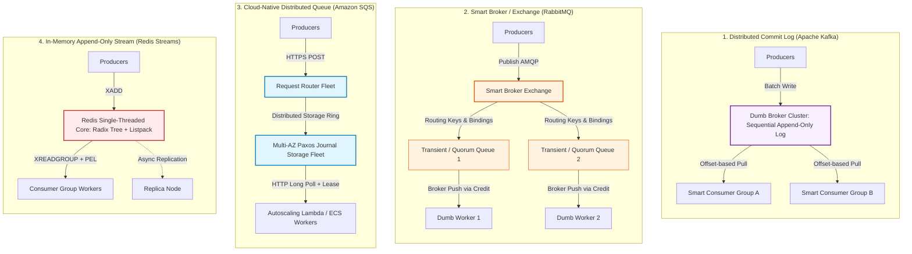

---

### Paradigm 1: Distributed Commit Log (Apache Kafka)

#### High-Level Design (HLD)
Apache Kafka treats data not as discrete transient messages to be discarded upon consumption, but as an **immutable, ordered sequence of records persisted across a distributed cluster**. 

- **Dumb Broker, Smart Consumer Philosophy**: The broker does not track per-message acknowledgments, nor does it maintain separate delivery timers per consumer. The broker merely appends bytes to disk and serves byte ranges starting at a requested offset.
- **Consumer Independence**: Multiple decoupled consumer groups can read the identical event stream at wildly differing speeds, historical timepoints, and batch sizes without interfering with one another or consuming broker memory.
- **Partitioning as the Concurrency Unit**: A topic is partitioned across cluster brokers. Each partition is strictly ordered and can be assigned to only one consumer per consumer group at any given time.

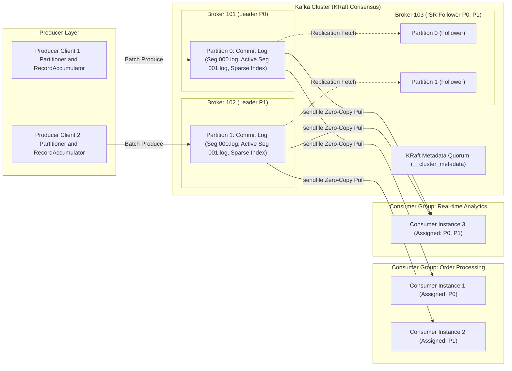

#### Low-Level Design (LLD)
- **Sequential Disk I/O & OS Page Cache**: Rather than managing an internal caching heap inside the JVM (which triggers garbage collection pauses), Kafka delegates memory management entirely to the Linux OS Page Cache. All writes are appended sequentially to the active segment file (`.log`), achieving mechanical disk throughput comparable to raw memory bus bandwidth.
- **Zero-Copy Network Serialization**: Data transfer from broker disk to the consumer network socket completely bypasses user-space memory buffers. Kafka executes the `sendfile()` system call, allowing the Linux kernel to transfer data directly from the page cache into the network interface card (NIC) DMA buffer:
  $$\text{Page Cache} \xrightarrow{\text{DMA}} \text{NIC Ring Buffer} \xrightarrow{} \text{Network}$$
- **Segment Indexing**: Each partition directory contains 1 GB segment files accompanied by `.index` (offset to physical byte position) and `.timeindex` (timestamp to physical offset) sparse indices. The broker performs binary search over the memory-mapped sparse index to satisfy consumer read requests in $O(\log N)$ time.
- **Offset State Tracking**: Consumer group progression is stored as ordinary Kafka messages within an internal, compacted topic named `__consumer_offsets` partitioned across the cluster.

---

### Paradigm 2: Traditional Smart Broker / Exchange-Queue (RabbitMQ)

#### High-Level Design (HLD)
RabbitMQ is built on the Advanced Message Queuing Protocol (AMQP 0-9-1) specification and the Erlang OTP runtime. It implements a **smart broker, dumb consumer** model where the broker is actively responsible for message routing, queue state management, delivery tracking, consumer concurrency distribution, and queue cleanup.

- **Exchange-to-Queue Indirection**: Producers never publish directly into a queue. Instead, producers publish messages to an **Exchange**, which evaluates routing keys, headers, or pattern bindings to fan out, filter, or direct messages into one or more bound queues.
- **Message Lifecycle**: Unlike Kafka's retention log, RabbitMQ treats messages as transient tasks. Once every consumer bound to a queue acknowledges a message (`basic.ack`), the message is immediately scheduled for deletion from broker RAM and disk.

```mermaid
flowchart TD
    subgraph RabbitMQProducer["Publishers"]
        Pub1["API Gateway Publisher"]
    end

    subgraph RabbitMQBroker["RabbitMQ Broker (Erlang BEAM Node)"]
        Ex["Topic Exchange: 'orders.exchange'"]
        
        subgraph Queues["Erlang Process Queues"]
            Q1["Queue: orders.eu (Binding: orders.eu.*)"]
            Q2["Queue: orders.us (Binding: orders.us.*)"]
            Q3["Queue: orders.audit (Binding: orders.#)"]
        end
    end

    subgraph ConsumerFleet["Competing Consumer Worker Fleet"]
        W1["EU Order Worker 1 (Prefetch=50)"]
        W2["EU Order Worker 2 (Prefetch=50)"]
        W3["US Order Worker 1 (Prefetch=50)"]
        W4["Audit Log Ingester (Prefetch=500)"]
    end

    Pub1 -->|basic.publish routing_key='orders.eu.created'| Ex
    Ex -->|Route Match| Q1
    Ex -->|Route Match| Q3

    Q1 -->|basic.deliver (Push)| W1
    Q1 -->|basic.deliver (Push)| W2
    Q2 -->|basic.deliver (Push)| W3
    Q3 -->|basic.deliver (Push)| W4

    W1 -.->|basic.ack delivery_tag| Q1
    W2 -.->|basic.ack delivery_tag| Q1
    W3 -.->|basic.ack delivery_tag| Q2
    W4 -.->|basic.ack delivery_tag| Q3
```

#### Low-Level Design (LLD)
- **Erlang Process Concurrency Model**: Every queue in RabbitMQ is represented internally as a lightweight Erlang actor process with its own mailbox, garbage collection state, and heap. A RabbitMQ node can host tens of thousands of concurrent queues without thread-context-switching penalties.
- **Message Store Engines**:
  - *msg_store_transient*: Keeps unacknowledged messages in RAM, paging to disk only under high memory watermarks.
  - *msg_store_persistent*: Writes persistent messages directly to disk logs while maintaining in-memory indexes.
  - *Quorum Queues*: Modern RabbitMQ queues implement a persistent, replicated append-only log using Raft consensus implemented in Erlang (`khepri`/`ra`), replacing older, partition-vulnerable mirrored classic queues.
- **Credit-Based Flow Control & Prefetch**: RabbitMQ uses a push-based delivery mechanism governed by consumer prefetch windows (`basic.qos prefetch_count`). The broker maintains an unacknowledged message counter per consumer channel. If unacknowledged messages equal `prefetch_count`, the broker halts delivery to that consumer until a `basic.ack` frees slot credit.

---

### Paradigm 3: Cloud-Native Distributed Queue (Amazon SQS)

#### High-Level Design (HLD)
Amazon SQS is a fully managed, serverless, multi-tenant distributed message queue engineered for massive horizontal elasticity, zero operational maintenance, and high availability across multiple AWS Availability Zones (AZs).

- **Multi-Tenant Request-Routing Layer**: SQS frontends are stateless HTTP/HTTPS reverse proxies that receive requests (`SendMessage`, `ReceiveMessage`, `DeleteMessage`) and authenticate them via AWS IAM.
- **Partition Ring & Distributed Storage Fleet**: Message payloads are distributed across a fleet of storage nodes coordinated via internal consensus protocols. Redundant copies are stored synchronously across at least three distinct Availability Zones before an acknowledgment is returned to the producer.

```mermaid
flowchart TD
    subgraph Producers["Client Layer"]
        P["Microservice Publisher<br/>AWS SDK v2"]
    end

    subgraph SQSInfrastructure["AWS Managed SQS Fleet"]
        FE["Stateless HTTP Request Routers<br/>(IAM Auth, Rate Limiting, Validation)"]
        
        subgraph StorageCluster["Distributed Storage Fleet (Multi-AZ)"]
            NodeAZ1["Storage Node (AZ-1a)<br/>Partition Slice Master"]
            NodeAZ2["Storage Node (AZ-1b)<br/>Synchronous Journal Replica"]
            NodeAZ3["Storage Node (AZ-1c)<br/>Synchronous Journal Replica"]
        end
    end

    subgraph ConsumerFleet["Worker Fleet"]
        C1["Worker 1 (Long Poll 20s)"]
        C2["Worker 2 (Long Poll 20s)"]
    end

    P -->|HTTPS POST SendMessage| FE
    FE -->|Hash Key Distribution| NodeAZ1
    NodeAZ1 <-->|Synchronous Replicate| NodeAZ2
    NodeAZ1 <-->|Synchronous Replicate| NodeAZ3

    C1 -->|HTTPS POST ReceiveMessage| FE
    FE -->|Lease Generation| NodeAZ1
    NodeAZ1 --"Return Message + ReceiptHandle<br/>(Start Visibility Timeout: 30s)"--> C1

    C1 -->|HTTPS POST DeleteMessage(ReceiptHandle)| FE
    FE -->|Mark Deleted| NodeAZ1
```

#### Low-Level Design (LLD)
- **Visibility Timeout & Lease Protocol**: SQS does not lock queues or assign dedicated partitions to consumers. Instead, when a worker receives a message, SQS issues a temporary lease known as the **Visibility Timeout** (default: 30 seconds). During this lease window, other workers polling the queue cannot see or retrieve this message.
- **Receipt Handle Token Dynamics**: Along with the message payload, SQS returns an ephemeral, cryptographically signed `ReceiptHandle`. To confirm successful processing, the worker must invoke `DeleteMessage` presenting this specific `ReceiptHandle`. If the worker crashes, hangs, or fails to delete the message before the visibility timer expires, the message automatically reappears in the queue for another consumer to process.
- **HTTP Long Polling Mechanics**: SQS eliminates wasteful tight-loop HTTP polling through `WaitTimeSeconds` (up to 20 seconds). The frontend router holds the client connection open at the socket level until either a message arrives in the storage tier or the timeout expires, drastically reducing network I/O and billing costs.

---

### Paradigm 4: In-Memory Append-Only Log (Redis Streams)

#### High-Level Design (HLD)
Introduced in Redis 5.0, **Redis Streams** (`XADD`, `XREAD`, `XREADGROUP`) combines the lightning-fast, single-threaded in-memory performance of Redis with the structured consumer-group and log-offset paradigms pioneered by Kafka.

- **In-Memory Sequential Stream**: Every stream entry consists of an auto-generated, time-ordered identifier (`<millisecondsTime>-<sequenceNumber>`, e.g., `1718000000000-0`) associated with arbitrary string key-value pairs.
- **Consumer Groups with Direct Offset Tracking**: Like Kafka, Redis Streams supports named consumer groups where multiple workers cooperate to consume distinct slices of the stream. Unlike Kafka, consumer group membership does not depend on fixed partition counts; any number of competing consumers can join a Redis Streams group dynamically.

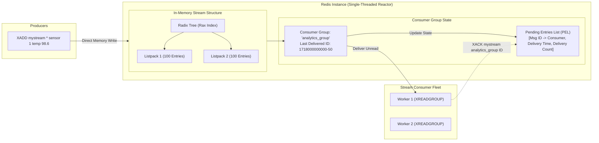

#### Low-Level Design (LLD)
- **Radix Tree (Rax) + Listpack Storage**: To avoid the massive memory overhead of allocating separate C pointers for every individual message, Redis Streams represents stream data as a **Radix Tree** whose leaf nodes point to **Listpacks**. A Listpack is a contiguous, compact binary byte array storing tens to hundreds of serialized stream entries without pointer indirection, delivering optimal CPU L1/L2 cache locality and dramatically reducing RAM footprint.
- **Pending Entries List (PEL)**: When a consumer fetches a message using `XREADGROUP`, Redis appends an entry to that group's internal PEL hash table tracking:
  1. The message ID.
  2. The name of the consumer that claimed it.
  3. The exact delivery timestamp.
  4. The number of delivery attempts.
- **Acknowledgment & Claim Recovery**: The consumer must explicitly issue `XACK` to remove the message from the PEL. If a consumer crashes, other consumers discover abandoned messages using `XPENDING` and reassign them using `XCLAIM` or `XAUTOCLAIM`.
- **Memory Bounding & Eviction**: Because Redis runs entirely in RAM, streams must be explicitly capped. Producers specify `XADD mystream MAXLEN ~ 1000000 * ...` to continuously trim the stream to an approximate threshold with zero performance penalty.

---

## 2. Comprehensive Technical Comparison Matrix across 26 Dimensions

The following matrix provides an authoritative, side-by-side technical evaluation across all distributed messaging dimensions.

| # | Dimension | Apache Kafka | RabbitMQ | Amazon SQS | Redis Streams |
|---|---|---|---|---|---|
| **1** | **Architectural Paradigm** | Distributed append-only commit log | Smart broker / Exchange-to-Queue routing | Serverless, multi-tenant distributed queue | In-memory append-only log with consumer groups |
| **2** | **Primary Language / Runtime** | Java / Scala (JVM) | Erlang (BEAM runtime) | Proprietary AWS Fleet (C++ / Java) | C (Single-threaded POSIX event loop) |
| **3** | **Storage Engine / Persistence** | OS Page Cache + Append-only segment files (`.log`) | Mnesia/Khepri metadata + `msg_store` / Quorum Raft log | Multi-AZ distributed Paxos journal storage | In-Memory (RAM) + optional AOF / RDB disk snapshots |
| **4** | **Memory Model** | Off-heap OS Page Cache; minimal JVM heap (~4-8 GB) | Erlang process heaps; highly memory-sensitive | Managed AWS cloud allocation (transparent) | 100% RAM-resident; Radix tree + compact Listpacks |
| **5** | **Ordering Guarantees** | Strict total order **within a single partition**; no global order across partitions | Strict FIFO order **within a single queue**; broken by priority or per-message redeliveries | Standard: Best-effort; FIFO: Strict FIFO order within `MessageGroupId` | Strict chronological order by Stream ID (`time-seq`) |
| **6** | **Throughput Capacity** | **Extremely High**: 1,000,000+ msgs/sec per broker node | **Medium-High**: 50,000–100,000 msgs/sec per node | **High**: Virtually unlimited (Standard); 300–3,000/s (FIFO, higher with batching) | **Very High**: 500,000+ msgs/sec per single-threaded node |
| **7** | **Latency Profile (p50 / p99)** | p50: 2–5 ms; p99: 15–30 ms | p50: 1–3 ms; p99: 10–25 ms | p50: 12–25 ms; p99: 50–120 ms | p50: < 0.5 ms; p99: 1–2 ms (sub-millisecond) |
| **8** | **Delivery Semantics** | At-least-once (default); Exactly-once via Kafka Transactions | At-least-once (with ACKs); At-most-once (no-ACK) | At-least-once (Standard); Exactly-once processing (FIFO deduplication) | At-least-once (via PEL + XACK); At-most-once (untracked) |
| **9** | **Consumer Model** | Pull (Client-managed long poll batching) | Push (Broker delivers over TCP up to prefetch credit) | Pull (Client HTTP long-polling with `WaitTimeSeconds`) | Pull (Client blocking poll via `XREAD` / `XREADGROUP BLOCK`) |
| **10** | **Routing Flexibility** | Primitive: Partition keys determine target partition | **Extremely Advanced**: Direct, Topic, Fanout, Headers, Alternate Exchanges | Primitive: Point-to-point Queue URL | Primitive: Stream Key name |
| **11** | **Message Replay** | **Native**: Rewind consumer group offset to arbitrary offset/timestamp | **None**: Messages destroyed upon `basic.ack` | **None**: Messages destroyed upon `DeleteMessage` | **Native**: Seek by ID or scan historical ranges via `XRANGE` |
| **12** | **Retention Policy** | Configurable: Hours, Days, Years, or Infinite; Size/Time-based or Compaction | Transient: Intended to remain near-zero; retained until ACK | Max 14 days (configurable from 1 minute to 14 days) | Bounded by RAM: Explicit trimming via `MAXLEN ~` or `MINID` |
| **13** | **Message Size Limits** | Default 1 MB (tunable to 10+ MB; larger discouraged) | Unlimited (practical ceiling ~128 MB before Erlang heap collapse) | **256 KB hard limit** (extended via S3 Claim Check) | Up to 512 MB (practical ceiling < 10 MB per entry) |
| **14** | **Horizontal Scaling Unit** | Add topic partitions + Broker nodes | Add nodes to cluster + Quorum queues + Sharding plugin | Fully automatic, transparent serverless autoscaling | Redis Cluster hash slots (16,384 shards) |
| **15** | **Consumer Coordination** | KRaft Group Coordinator; Partition assignment strategies | Competing consumers on single queue; Fair dispatch via prefetch | Independent stateless workers polling via HTTP | Group PEL tracking; explicit `XCLAIM` / `XAUTOCLAIM` |
| **16** | **High Availability & Consensus** | KRaft (Raft quorum) or ZooKeeper; In-Sync Replicas (ISR) | Quorum Queues (Raft consensus); Classic Mirrored (deprecated) | Multi-AZ Paxos synchronous storage replication | Redis Sentinel (failover) / Redis Cluster (async replication) |
| **17** | **Backpressure Mechanism** | Native Pull: Consumers request only what they can process | Credit-based flow control; TCP socket backpressure | Natural Pull: Workers pause HTTP polling | Native Pull: Workers pause `XREADGROUP` polling |
| **18** | **Schema Governance** | **Industry Gold Standard**: Confluent Schema Registry (Avro, Protobuf, JSON) | Manual / Application-level (bring your own) | Manual / Application-level (bring your own) | Manual / Application-level (field-value pairs) |
| **19** | **Dead Letter Queue (DLQ)** | Application-managed (error topic routing) | Native: `x-dead-letter-exchange` / `x-dead-letter-routing-key` | Native: Redrive policy (`maxReceiveCount` + Target ARN) | Application-managed via PEL delivery count check |
| **20** | **Priority Queues** | **No native support** (requires multi-topic emulation) | **Native support**: `x-max-priority` (0–255 integer weights) | **No native support** (requires separate priority queues) | **No native support** (requires separate stream keys) |
| **21** | **Delayed / Scheduled Delivery** | No native support (requires external state store / Kafka Streams) | Supported via RabbitMQ Delayed Message Plugin (Erlang timer) | **Native support**: Delivery Delay (0 to 15 minutes) | Native via Redis Sorted Sets (`ZADD` + poller) or raw stream |
| **22** | **Multi-Tenancy & Isolation** | Topic-level ACLs, SASL/SCRAM, MTLS, Quotas (produce/fetch bytes) | VHosts (Virtual Hosts), User permissions, Tag-based policies | Full AWS IAM integration, Resource Policies, KMS encryption | Redis ACLs (per-key/command); no strict compute isolation |
| **23** | **Operational Complexity** | **High**: Broker JVM tuning, OS page cache, KRaft metadata, disk balancing | **Medium-High**: Erlang VM tuning, memory alarms, cluster network netsplit | **Zero**: Completely managed SaaS serverless platform | **Low-Medium**: Redis memory limits, persistence tuning, sentinel/cluster |
| **24** | **Cost Structure & TCO** | Fixed compute/storage cost; high engineering maintenance | Fixed compute/storage cost; moderate maintenance | Pay-per-API request ($0.40/M requests) + data transfer | Memory-heavy cost (RAM is expensive compared to NVMe SSD) |
| **25** | **Ecosystem & Client SDKs** | Kafka Connect, Kafka Streams, Flink, Spark, ksqlDB | Universal AMQP clients (Java, Go, Python, Node, C#, Rust) | AWS SDKs (Boto3, Java AWS SDK, Go SDK, Lambda triggers) | Universal Redis clients (ioredis, Jedis, redis-py, go-redis) |
| **26** | **Optimal Fit Archetype** | High-throughput event streaming, event sourcing, stream processing | Heterogeneous microservice RPC, complex routing, task queues | Serverless AWS decoupling, async jobs, S3 event triggers | Sub-millisecond messaging, real-time gaming, WebSocket fanout |

---

## 3. Low-Level Mechanics Comparison

Understanding the low-level systems engineering of these platforms explains why their latency, throughput, and reliability characteristics diverge radically under stress.

```mermaid
flowchart TD
    subgraph StorageComparison["Storage & Memory Engine Internals"]
        direction TB
        subgraph KafkaDisk["Kafka: Sequential Log"]
            KLog["Partition Directory on NVMe<br/>00000000000.log (Contiguous Data)<br/>00000000000.index (Sparse Offset Index)<br/>00000000000.timeindex (Timestamp Index)"]
            KCache["Linux Kernel Page Cache<br/>(Bypasses JVM Heap Garbage Collection)"]
            KLog <--> KCache
        end

        subgraph RabbitMemory["RabbitMQ: BEAM Process Queue"]
            ETS["Erlang Term Storage (ETS)"]
            MsgStore["msg_store_persistent / Raft Log"]
            MAlarm["Memory Watermark Alarm: Suspends Publishers"]
            ETS <--> MsgStore
            ETS --> MAlarm
        end

        subgraph SQSStorage["SQS: Distributed Paxos Storage"]
            FrontFleet["Stateless HTTP Request Routers"]
            PaxosRing["Multi-AZ Distributed Storage Cluster<br/>Synchronous Write across 3 AZs"]
            FrontFleet --> PaxosRing
        end

        subgraph RedisRAM["Redis: In-Memory Listpack"]
            RaxTree["Radix Tree (Rax Node Index)"]
            LPChunk["Listpack (Contiguous Byte Array Buffer)"]
            AOFEngine["AOF fsync=everysec Background Thread"]
            RaxTree --> LPChunk
            LPChunk -.-> AOFEngine
        end
    end
```

---

### Storage & Disk I/O Layout

#### Apache Kafka: The Sequential Append-Only Segment
Kafka bypasses traditional database storage structures like B-Trees. A B-Tree incurs random disk seeks with an $O(\log N)$ disk head repositioning penalty, degrading to tens or hundreds of operations per second on spinning disks and causing heavy write amplification on SSDs.

Instead, Kafka writes messages to an active segment file strictly using sequential appends:
- **Zero In-Place Updates**: Once written, bytes are completely immutable.
- **Sparse Indexing**: Kafka does not index every single message. Instead, it writes an index entry every $4\text{ KB}$ (configurable via `index.interval.bytes`). When searching for offset $1,050,420$, Kafka binary-searches the `.index` file to find the closest offset $\le 1,050,420$, locates the exact physical byte position, and performs a sequential scan of a tiny data slice.
- **OS Page Cache Exploitation**: When producers write to Kafka, data is appended directly to the OS page cache. When consumers read recent messages, data is fetched directly from the OS page cache. The disk controller never even activates physical write heads or flash cells for real-time consumers.

#### RabbitMQ: The Actor Message Store & Paging Dilemma
RabbitMQ handles messages via Erlang processes. In classic queues, messages reside primarily in the Erlang process memory heap and ETS (Erlang Term Storage) tables:
- **Paging to Disk**: If consumers fall behind and messages accumulate past the configured high memory watermark (`vm_memory_high_watermark`, default: 40% of physical RAM), RabbitMQ triggers a paging emergency. It serializes Erlang terms from RAM to disk.
- **Garbage Collection Pauses**: Paging millions of messages induces severe Erlang BEAM garbage collection pauses, blocking socket reads, tripping heartbeat timeouts, and collapsing cluster performance.
- **Quorum Queue Storage**: Modern Quorum Queues replace this with a dedicated Raft write-ahead log (`ra`), persisting messages to disk sequentially and avoiding the catastrophic paging behavior of classic queues.

#### Amazon SQS: Distributed Paxos Key-Value Slices
SQS partitions queue storage across an internal distributed database cluster:
- **Multi-AZ Synchronous Writes**: When a message arrives at the request router, it is hashed to a storage partition slice. The slice coordinates with storage nodes distributed across three distinct Availability Zones.
- **Paxos Journal Append**: SQS appends the message metadata and payload to an internal Paxos journal. Once a quorum of replicas acknowledges the write, SQS returns `200 OK` with a message ID to the client.
- **Decoupled Delete Marker**: Deleting a message does not trigger an immediate disk compaction or erase. Instead, SQS appends a tombstone record referencing the `ReceiptHandle`, which garbage-collection routines reap asynchronously.

#### Redis Streams: Radix Tree of Compact Listpacks
Redis Streams achieves sub-millisecond execution times because it operates entirely within the host process memory space:
- **Radix Tree Indexing**: The stream ID (composed of timestamp + counter) forms a key in a Radix tree (Rax). Radix trees provide deterministic $O(k)$ lookups where $k$ is the length of the stream ID string.
- **Listpack Compression**: Rather than allocating each message as a standalone heap node, Redis batches groups of up to 100 stream entries into a single contiguous memory block called a **Listpack**. A Listpack encodes strings and integers with compact variable-length prefixes, eliminating 64-bit pointer overhead and dramatically reducing CPU cache misses.
- **AOF Disk Flushing**: Persistence is decoupled from read/write execution. Redis can append mutations to an Append-Only File (AOF) on disk asynchronously (`appendfsync everysec`), ensuring that write latency is never throttled by physical disk I/O.

---

### Consumer Tracking & Coordination Protocols

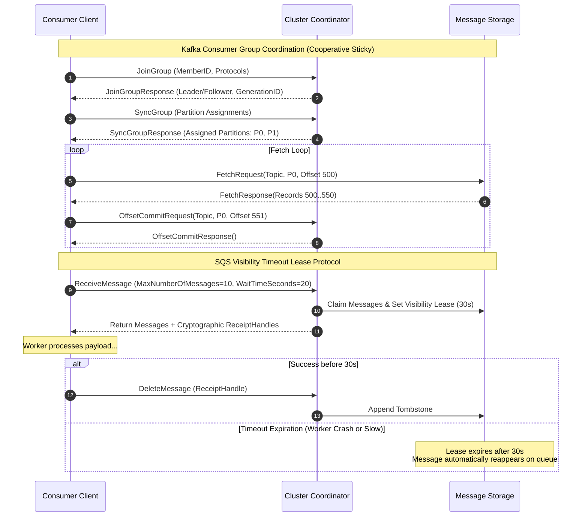

#### Apache Kafka: The Group Coordinator & Incremental Rebalancing
Consumer group membership in Kafka is maintained via a designated broker called the **Group Coordinator** (the leader broker for the consumer group's `__consumer_offsets` partition):
1. **Heartbeat Thread**: Consumer clients maintain a dedicated background heartbeat thread sending pulses to the coordinator every `heartbeat.interval.ms` (e.g., 3 seconds).
2. **Failure Detection**: If the coordinator does not receive a heartbeat within `session.timeout.ms` (e.g., 45 seconds), or if the client takes longer than `max.poll.interval.ms` (e.g., 5 minutes) to process a batch and invoke `poll()`, the consumer is evicted from the group.
3. **Rebalance Protocols**:
   - *Eager Rebalancing (Legacy)*: All consumers drop their assigned partitions and halt consumption while the entire group renegotiates assignments, causing severe throughput freezes.
   - *Cooperative Sticky Rebalancing (Modern)*: Consumers retain their healthy partition assignments. Only the reassigned or revoked partitions are migrated, allowing uninterrupted consumption across unaffected partitions.

#### RabbitMQ: Channel Multiplexing & Credit Allocation
RabbitMQ avoids polling entirely. When a consumer connects:
1. It opens a long-lived TCP connection and multiplexes multiple lightweight logical **AMQP Channels**.
2. The consumer issues `basic.consume(queue='orders')`, and the broker immediately starts pushing messages over the TCP channel.
3. **Prefetch Credit**: To prevent a fast broker from overwhelming a slow consumer, the consumer defines `basic.qos(prefetch_count=N)`. The broker allocates $N$ delivery credits. Each message pushed decrements credit by 1; each `basic.ack` received increments credit by 1. If credit reaches 0, the broker stops pushing to that consumer and dispatches to other competing workers.

#### Amazon SQS: Visibility Timeout Leases
SQS uses a lease-based token mechanism:
1. When a consumer invokes `ReceiveMessage`, SQS claims up to 10 messages from the storage layer.
2. It generates a dynamic, unique string called the `ReceiptHandle` and starts the **Visibility Timeout** countdown clock (1 second to 12 hours).
3. If processing takes longer than expected, the consumer can extend the lease dynamically by calling `ChangeMessageVisibility(ReceiptHandle, VisibilityTimeout=60)`.
4. If the consumer crashes or fails to call `DeleteMessage` before the timeout expires, the lease lapses, the `ReceiptHandle` is invalidated, and the message is instantly made eligible for consumption by another worker polling the queue.

#### Redis Streams: Pending Entries List (PEL) Tracking
Redis tracks consumer progress through internal data structures inside each Consumer Group:
1. When a worker invokes `XREADGROUP GROUP mygroup worker1 COUNT 10 STREAMS mystream >`, the special ID `>` instructs Redis to deliver only messages that have never been delivered to any consumer in this group.
2. Redis updates the group's `last_delivered_id` and appends all 10 message IDs to the group's **PEL (Pending Entries List)** mapped to `worker1` along with the current timestamp.
3. When `worker1` successfully processes a message, it calls `XACK mystream mygroup <id>`, which purges the entry from the PEL.
4. If `worker1` dies, other workers inspect the group's backlog using `XPENDING mystream mygroup`. If an entry's idle time exceeds a threshold (e.g., 60 seconds), another worker invokes `XCLAIM mystream mygroup worker2 60000 <id>` or `XAUTOCLAIM` to transfer ownership of the pending message to itself.

---

### Failover, Replication & Consensus

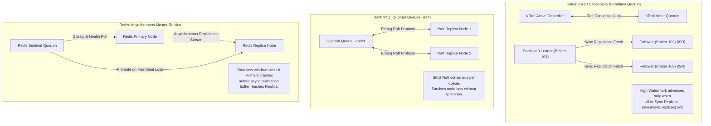

- **Kafka**: Uses a two-tier consensus model. The cluster metadata plane is governed by **KRaft** (a dedicated Raft quorum among controller brokers). The data plane utilizes **ISR (In-Sync Replicas)**. A producer configured with `acks=all` only receives a commit acknowledgment after the message is replicated to all brokers currently in the ISR list. If the partition leader crashes, any broker remaining in the ISR is elected leader with zero data loss.
- **RabbitMQ**: Modern high-availability workloads use **Quorum Queues**, which implement the Raft consensus algorithm directly in Erlang. Each quorum queue forms its own Raft cluster across a configurable odd number of nodes (typically 3 or 5). If the leader node crashes, the remaining Raft replicas elect a new leader without the split-brain vulnerabilities that plagued older mirrored classic queues.
- **Amazon SQS**: Highly available by design. Redundant Paxos-based storage engines operate across multiple physical AWS data centers. AWS guarantees $99.9\%$ to $99.99\%$ service availability with zero user-side configuration of nodes, replication factors, or consensus parameters.
- **Redis Streams**: Operates on an **asynchronous master-replica replication** architecture. When a master accepts an `XADD` command, it immediately acknowledges the write to the client and asynchronously pushes the replication stream to read replicas. If the master suffers catastrophic power failure before replication completes, Sentinel or Cluster failover will promote a replica, leading to potential silent data loss of the most recent writes.

---

### Latency vs. Throughput Trade-off Curves under Heavy Load

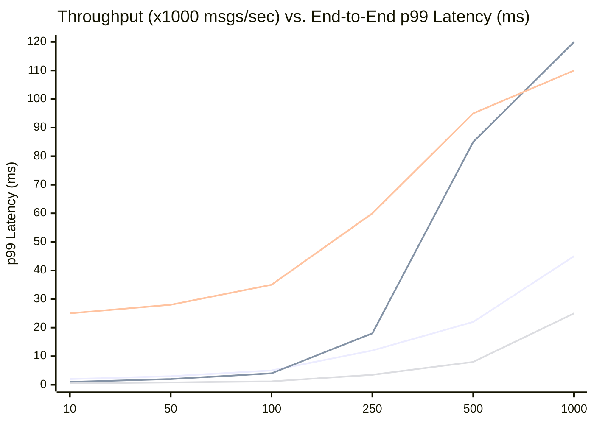

*(Legend: Blue = Apache Kafka; Green = RabbitMQ; Yellow = Amazon SQS; Red = Redis Streams)*

1. **Redis Streams (Red)** dominates the low-latency spectrum. At low to medium throughput ($10\text{k} - 250\text{k}$ msgs/sec), p99 latency remains firmly under $1\text{ millisecond}$ because all operations execute in single-threaded process RAM. However, once memory bandwidth or single-core CPU saturation is reached ($\sim 500\text{k}+$), latency spikes steeply.
2. **RabbitMQ (Green)** provides exceptionally low latency ($1 - 3\text{ ms}$) at moderate throughput ($10\text{k} - 50\text{k}$ msgs/sec). However, as throughput approaches $100\text{k}$ msgs/sec, queue process mailboxes fill up, memory pressure rises, and p99 latency explodes due to Erlang process scheduling contention and disk paging.
3. **Apache Kafka (Blue)** exhibits the most resilient, flat latency curve under extreme load. While p99 latency at low throughput ($5\text{ ms}$) is slightly higher than Redis due to disk logging and network batching windows (`linger.ms`), Kafka scales linearly up to $1,000,000+$ msgs/sec with negligible latency degradation due to its batching mechanics and OS page cache efficiency.
4. **Amazon SQS (Yellow)** maintains an elevated latency baseline ($20 - 40\text{ ms}$) even at low traffic due to HTTPS TLS handshakes, HTTP request routing, and multi-AZ synchronous Paxos network hops. However, its serverless backend handles massive traffic surges without exhausting local machine memory.

---

## 4. Multi-Dimensional Decision Framework & Flowchart

Use this production decision flowchart to evaluate your engineering requirements against the fundamental architectural trade-offs.

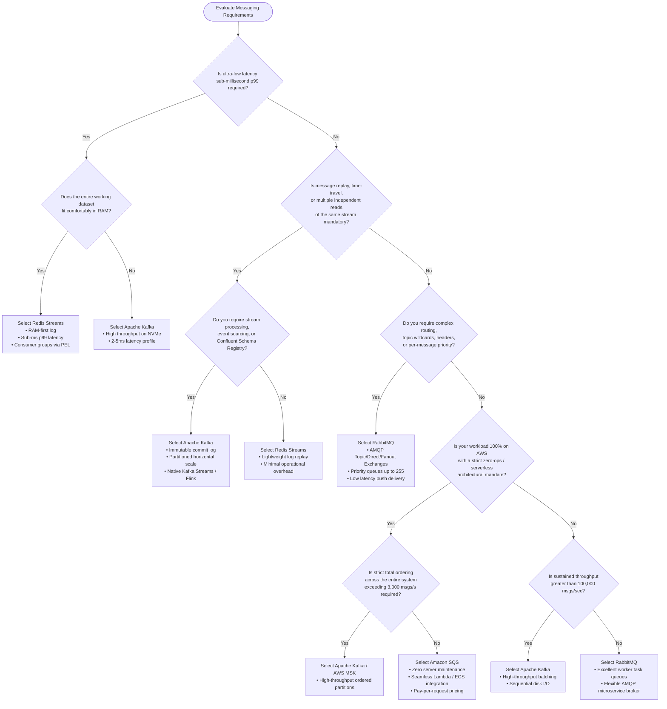

---

### Archetype Scorecards & Weighted Evaluation Matrices

To apply objective engineering rigor to messaging technology selection, evaluate your project against these five industry archetypes using a 1–5 scoring scale (where 5 represents an ideal fit and 1 represents a disqualifying flaw).

```
Dimension Weights:
• Order = Ordering Integrity
• Thru  = Throughput Scalability
• Route = Routing Sophistication
• Repl  = Replay & Persistence
• Ops   = Operational Simplicity
```

#### Archetype 1: E-Commerce Order Lifecycle
*Workload Profile:* Order placed $\rightarrow$ Inventory reserved $\rightarrow$ Payment processed $\rightarrow$ Invoice generated $\rightarrow$ Warehouse notified. Requires reliable task completion, DLQ redrive, and dynamic routing based on order type.

| Platform | Order (x3) | Thru (x2) | Route (x3) | Repl (x2) | Ops (x2) | Total Score | Verdict |
|---|:---:|:---:|:---:|:---:|:---:|:---:|---|
| **Apache Kafka** | 4 (12) | 5 (10) | 2 (6) | 5 (10) | 2 (4) | **42 / 60** | Overkill routing-wise; rebalances disrupt slow payment gateways. |
| **RabbitMQ** | 5 (15) | 4 (8) | 5 (15) | 1 (2) | 3 (6) | **46 / 60** | **Optimal for self-hosted/hybrid cloud**: Rich topic exchanges and task ACKs. |
| **Amazon SQS** | 4 (12) | 4 (8) | 3 (9) | 1 (2) | 5 (10) | **41 / 60** | **Optimal for AWS-native**: Effortless integration with AWS Step Functions & Lambda. |
| **Redis Streams**| 3 (9) | 4 (8) | 2 (6) | 3 (6) | 4 (8) | **37 / 60** | Lacks native DLQs and flexible routing; requires custom logic. |

#### Archetype 2: High-Volume Clickstream & IoT Telemetry Ingestion
*Workload Profile:* 500,000 events/second emitted from mobile clients, connected vehicles, or web servers. Requires massive write throughput, sequential batching, and integration with data lakes/real-time analytics engines.

| Platform | Order (x2) | Thru (x5) | Route (x1) | Repl (x3) | Ops (x2) | Total Score | Verdict |
|---|:---:|:---:|:---:|:---:|:---:|:---:|---|
| **Apache Kafka** | 5 (10) | 5 (25) | 2 (2) | 5 (15) | 2 (4) | **56 / 65** | **Decisive Winner**: The gold standard for telemetry and event streaming. |
| **RabbitMQ** | 3 (6) | 2 (10) | 4 (4) | 1 (3) | 2 (4) | **27 / 65** | Unsuitable: High volume exhausts Erlang memory; causes crash loops. |
| **Amazon SQS** | 3 (6) | 3 (15) | 1 (1) | 1 (3) | 5 (10) | **35 / 65** | Cost-prohibitive ($0.40/million requests) at 500k msgs/sec ($500+/day). |
| **Redis Streams**| 4 (8) | 5 (25) | 2 (2) | 3 (9) | 3 (6) | **50 / 65** | Feasible for speed layer, but RAM storage costs become unsustainable. |

#### Archetype 3: Financial Ledger & Transaction Processing
*Workload Profile:* Core banking mutations, ledger audits, cryptocurrency balance transfers. Requires absolute ordering per account, idempotency, permanent audit trail replay, and zero data loss (`RPO = 0`).

| Platform | Order (x5) | Thru (x3) | Route (x1) | Repl (x4) | Ops (x2) | Total Score | Verdict |
|---|:---:|:---:|:---:|:---:|:---:|:---:|---|
| **Apache Kafka** | 5 (25) | 5 (15) | 2 (2) | 5 (20) | 3 (6) | **68 / 75** | **Decisive Winner**: Partitioned strict order, transactions, permanent audit log. |
| **RabbitMQ** | 4 (20) | 3 (9) | 4 (4) | 1 (4) | 3 (6) | **43 / 75** | Unsuitable: Transient queues destroy audit trails upon acknowledgment. |
| **Amazon SQS** | 4 (20) | 2 (6) | 1 (1) | 1 (4) | 5 (10) | **41 / 75** | FIFO throughput capped; lacks permanent historic replay capability. |
| **Redis Streams**| 4 (20) | 4 (12) | 2 (2) | 3 (12) | 3 (6) | **52 / 75** | Asynchronous replication exposes cluster to ledger loss during failovers. |

#### Archetype 4: Microservices Inter-Service RPC & Work Orchestration
*Workload Profile:* Point-to-point asynchronous command dispatching, long-running batch job workers (video transcoding, PDF generation), heterogeneous worker consumption speeds.

| Platform | Order (x2) | Thru (x2) | Route (x4) | Repl (x1) | Ops (x3) | Total Score | Verdict |
|---|:---:|:---:|:---:|:---:|:---:|:---:|---|
| **Apache Kafka** | 4 (8) | 5 (10) | 2 (8) | 4 (4) | 2 (6) | **36 / 60** | Anti-pattern: Slow workers trigger `max.poll.interval.ms` rebalance storms. |
| **RabbitMQ** | 5 (10) | 4 (8) | 5 (20) | 1 (1) | 3 (9) | **48 / 60** | **Ideal for Multi-Cloud/On-Prem**: Perfect per-message worker leases. |
| **Amazon SQS** | 4 (8) | 4 (8) | 3 (12) | 1 (1) | 5 (15) | **44 / 60** | **Ideal for AWS**: Outstanding worker decoupling with visibility extensions. |
| **Redis Streams**| 3 (6) | 4 (8) | 2 (8) | 2 (2) | 4 (12) | **36 / 60** | Requires explicit application-level worker crash monitors via `XCLAIM`. |

#### Archetype 5: Real-Time Gaming & Live Notification Feeds
*Workload Profile:* Player coordinate synchronization, live sports score ticker, WebSocket push gateway for 500,000 active browser connections.

| Platform | Order (x3) | Thru (x4) | Route (x2) | Repl (x1) | Ops (x3) | Total Score | Verdict |
|---|:---:|:---:|:---:|:---:|:---:|:---:|---|
| **Apache Kafka** | 4 (12) | 5 (20) | 2 (4) | 4 (4) | 2 (6) | **46 / 65** | Latency ($15 - 30\text{ ms}$ p99) is too high for real-time multiplayer gaming. |
| **RabbitMQ** | 4 (12) | 3 (12) | 5 (10) | 1 (1) | 3 (9) | **44 / 65** | High connection overhead under hundreds of thousands of raw client sockets. |
| **Amazon SQS** | 2 (6) | 3 (12) | 1 (2) | 1 (1) | 5 (15) | **36 / 65** | Unusable: High HTTP polling latency ($20 - 100\text{ ms}$) violates SLA. |
| **Redis Streams**| 5 (15) | 5 (20) | 3 (6) | 3 (3) | 4 (12) | **56 / 65** | **Decisive Winner**: Sub-millisecond latency; pairs natively with Redis Pub/Sub. |

---

## 5. Hybrid Architectures (HLD & LLD)

In enterprise-scale distributed architectures, choosing a messaging system is rarely a binary proposition. Production architectures intentionally compose multiple messaging technologies into **multi-tier hybrid topologies**, leveraging the distinct strengths of each platform while isolating their weaknesses.

---

### Pattern 1: Kafka (Ingestion Backbone) + Amazon SQS (Worker Shock Absorber)

#### Architectural Motivation
Kafka excels at ingesting millions of events per second with high partition efficiency. However, when individual worker tasks take non-deterministic durations to process (e.g., executing OCR on uploaded PDFs, transcribing audio, or invoking external vendor webhooks taking 200ms to 45 seconds), Kafka's partition assignment model breaks down. 

If one worker on Partition 3 encounters a slow 45-second job, all subsequent messages behind it on Partition 3 are completely blocked (head-of-line blocking). Furthermore, if the processing duration exceeds `max.poll.interval.ms`, Kafka evicts the worker, triggering cascading rebalance storms.

**Solution:** Ingest using Kafka; offload slow background worker execution into Amazon SQS.

```mermaid
flowchart LR
    subgraph IngestionTier["High-Throughput Ingestion Backbone"]
        P[Producers / Webhook Fleet] -->|50,000 events/sec| K[Apache Kafka<br/>Ingestion Topic: 64 Partitions]
        K -->|High-Throughput Stream Consumers| Disp[Dispatcher Fleet<br/>(Stateless Forwarder)]
    end

    subgraph BufferingTier["Worker Shock Absorber Tier"]
        Disp -->|Batch SendMessage| SQS[Amazon SQS Standard Queue<br/>Buffering 2,000,000 Async Tasks]
    end

    subgraph ProcessingTier["Dynamic Worker Fleet"]
        SQS -->|HTTP Long Poll (WaitTime=20s)| W1[Worker 1 (Fast Job: 200ms)]
        SQS -->|HTTP Long Poll (WaitTime=20s)| W2[Worker 2 (Slow OCR: 45s)]
        SQS -->|HTTP Long Poll (WaitTime=20s)| W3[Worker 3 (Failed / Retry)]
        W2 -.->|ChangeMessageVisibility| SQS
        W3 -.->|Exceeds maxReceiveCount| DLQ[Amazon SQS Dead Letter Queue]
    end
```

#### Low-Level Event Flow
1. **Raw Ingestion**: Mobile and web clients submit document upload events through an API Gateway, which batches them directly into a 64-partition Kafka topic. Kafka absorbs massive traffic spikes without degradation.
2. **Stateless Dispatch**: A fleet of lightweight dispatcher microservices reads from Kafka using standard consumer group batching (`fetch.min.bytes=65536`, `linger.ms=50`).
3. **Queue Fan-Out**: The dispatcher unwraps the Kafka events and pushes individual tasks to an Amazon SQS Standard queue via `SendMessageBatch`.
4. **Independent Worker Scaling**: A pool of heterogeneous worker instances (hosted on AWS ECS Fargate or Kubernetes with KEDA) polls SQS. Worker 2 can take 45 seconds on a complex task, periodically issuing `ChangeMessageVisibility` to retain its lease, without blocking Worker 1 from immediately processing subsequent tasks.
5. **Poison Pill Isolation**: Malformed payloads that crash a worker three times automatically divert to an SQS Dead Letter Queue via redrive policy, without stalling the primary Kafka partition.

---

### Pattern 2: Kafka (System of Record) + Redis Streams (Real-Time Speed Layer)

#### Architectural Motivation
Enterprises running core financial, transactional, or order tracking systems require Kafka as an immutable, permanent system of record with schema validation and multi-year replay. However, user-facing edge systems (such as high-frequency trading dashboards or live gaming scoreboards) demand sub-millisecond query latency and live updates pushed to thousands of open WebSockets.

**Solution:** Implement the **Lambda Architecture variant**: Kafka acts as the durable streaming log of record; an event consumer continuously flushes materialized state and real-time delta logs into Redis Streams for edge distribution.

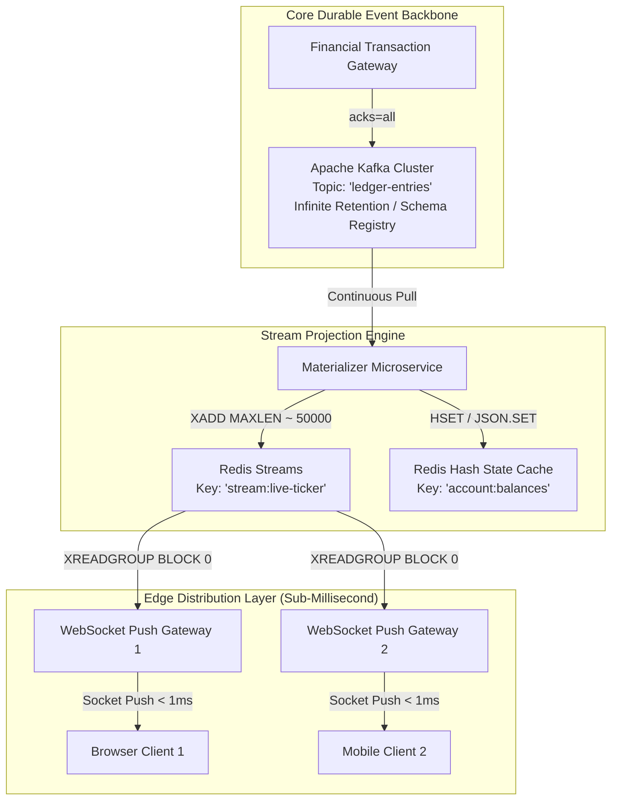

#### Low-Level Event Flow
1. **Durable Commit**: Financial transactions are published to Kafka with `acks=all`, schema-validated against Confluent Schema Registry, and committed across an In-Sync Replica quorum.
2. **Materialization & Projection**: A dedicated projection engine consumes from the Kafka topic. It computes updated account balances and pushes:
   - Updated snapshot state to a Redis Hash (`HSET account:1001 balance 4500.50`).
   - The delta mutation event into Redis Streams (`XADD stream:live-ticker MAXLEN ~ 50000 * txnId 9812 account 1001 delta +500.00`).
3. **Sub-Millisecond Fan-Out**: Edge WebSocket gateway nodes monitor the Redis Stream via blocking calls (`XREADGROUP BLOCK 1000 ...`). Because the data resides in RAM, notifications are dispatched to client browsers in under $800\text{ microseconds}$, completely decoupling the user-facing web tier from Kafka broker load.

---

### Pattern 3: RabbitMQ (Complex Microservice Routing) + Kafka (Analytics Event Lake)

#### Architectural Motivation
In a large microservices landscape, operational domains require fine-grained message routing, direct request-reply RPC correlation, and complex routing-key filtering (e.g., `inventory.eu.berlin.created`). RabbitMQ excels here. However, the data analytics, machine learning, and BI teams require access to every single event emitted across the company to feed an analytical data lake (Snowflake, BigQuery, or Apache Iceberg via ClickHouse/Spark).

**Solution:** Use RabbitMQ for inter-service communication; tap exchanges to shovel all events directly into Kafka.

```mermaid
flowchart LR
    subgraph MicroserviceDomain["Domain Microservices (AMQP)"]
        Producer[Billing Microservice] -->|Publish AMQP| Ex[RabbitMQ Topic Exchange<br/>'finance.exchange']
        Ex -->|Binding 'finance.invoice.*'| Q1[Queue: 'invoice-generation']
        Q1 -->|Push Delivery| W1[Invoice Generator Service]
    end

    subgraph Bridge["AMQP-to-Kafka Bridge"]
        Ex -->|Binding '#' (Catch-All)| QAudit[RabbitMQ Tap Queue<br/>'all-finance-events']
        QAudit -->|Batch Drain| Shovel[Connector Service / RabbitMQ Shovel Plugin]
    end

    subgraph AnalyticsLake["Data Lakehouse Ingestion (Kafka)"]
        Shovel -->|High-Volume Batch Write| KTopic[Apache Kafka Topic<br/>'lakehouse.finance.raw']
        KTopic -->|Kafka Connect S3 Sink| S3[Amazon S3 / Iceberg Lakehouse]
    end
```

#### Low-Level Event Flow
1. **Operational Domain Routing**: The Billing service publishes an AMQP message with routing key `finance.invoice.issued`.
2. **Exchange Multi-Casting**: The topic exchange routes the message to the `invoice-generation` queue for immediate microservice processing. Simultaneously, a catch-all binding (`#`) captures an exact duplicate into an audit queue `all-finance-events`.
3. **Bridge Forwarding**: A lightweight connector service (or native RabbitMQ Shovel plugin) consumes from `all-finance-events` in large prefetch batches and issues bulk produce requests to Apache Kafka.
4. **Lakehouse Archival**: Kafka acts as the corporate-wide analytics buffer, where Kafka Connect sinks data continuously into Parquet/Iceberg format on Amazon S3.

---

## 6. Step-by-Step Zero-Downtime Migration Playbooks (HLD & LLD)

Migrating between messaging systems in a 24/7 mission-critical system requires zero message loss, zero downtime, and immediate rollback safety.

---

### Migration 1: RabbitMQ to Apache Kafka

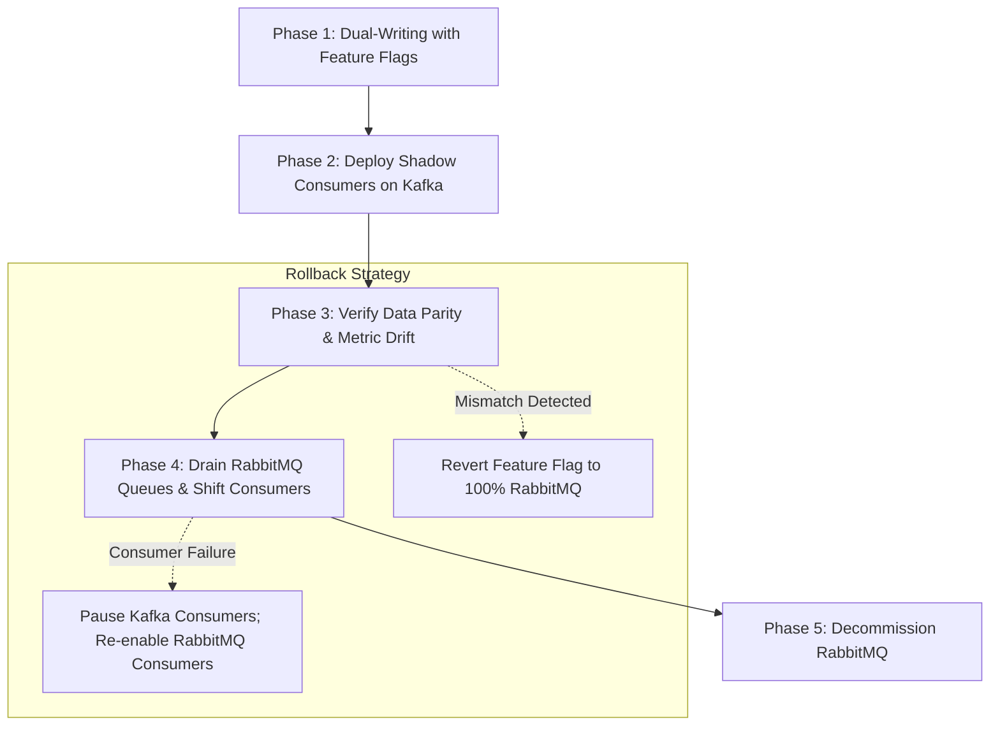

#### Phase 1: Dual-Writing with Dynamic Feature Flags
Do not attempt an instantaneous producer switch. Implement a dual-writing strategy in your producer client SDK governed by dynamic configuration (e.g., LaunchDarkly):

```python
# Producer Dual-Write Implementation Logic
def publish_order_event(order_event):
    # Primary transport during Phase 1
    rabbitmq_client.publish(
        exchange="orders.exchange",
        routing_key=f"orders.{order_event.region}",
        body=order_event.serialize_json()
    )
    
    # Feature flag controls shadow Kafka writing
    if feature_flags.is_enabled("kafka_dual_write_enabled", default=False):
        try:
            kafka_producer.produce(
                topic="orders.events",
                key=order_event.customer_id.encode('utf-8'),
                value=order_event.serialize_avro(),
                on_delivery=kafka_delivery_callback
            )
        except Exception as e:
            # Crucial: Log error, emit metric, but do NOT crash producer
            metrics.increment("kafka.shadow_write.failed")
            logger.warn(f"Shadow write to Kafka failed: {e}")
```

#### Phase 2: Shadow Consumer Deployment & Parity Verification
Deploy Kafka consumers in **Shadow Mode**:
- Shadow consumers read from Kafka partitions and execute business logic, database lookups, and validations.
- **Side-Effects Disabled**: All external network mutations, database writes, and outbound emails are suppressed.
- A **Parity Comparator** logs differences between RabbitMQ consumer output and Kafka shadow consumer output:
  $$\text{Parity Error Rate} = \frac{|\text{RabbitMQ Output} - \text{Kafka Output}|}{\text{Total Events}} < 0.0001\%$$

#### Phase 3: Drain RabbitMQ & Shift Consumer Authority
Once parity is verified for at least 72 consecutive hours:
1. Shift producer feature flag: Kafka becomes the primary write target; RabbitMQ writing is stopped.
2. RabbitMQ queues will cease receiving new messages.
3. Allow existing RabbitMQ consumers to continue running until the RabbitMQ queue depth reaches exactly **0**.
4. Activate real side-effects on the Kafka consumers.
5. Decommission RabbitMQ cluster nodes safely.

---

### Migration 2: Amazon SQS to Apache Kafka

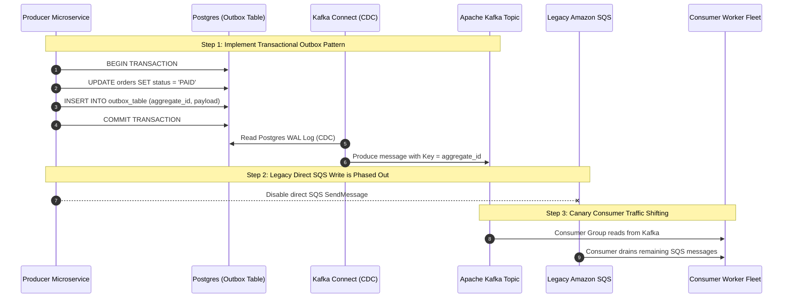

#### Step-by-Step Execution Plan
1. **Eliminate Producer Dual-Write Dual-Failure**: SQS does not support distributed two-phase commits with databases. Instead of directly dual-writing from the application to both SQS and Kafka (which causes split-brain data corruption during partial network failures), implement the **Transactional Outbox Pattern**:
   - The application writes business data and event records into a PostgreSQL outbox table within a single ACID transaction.
   - Deploy **Kafka Connect with the Debezium Postgres CDC connector** to stream rows from the Write-Ahead Log (WAL) directly into the destination Kafka topic.
2. **Partition Key Strategy**: In SQS Standard, messages are randomly scattered across internal storage nodes. When moving to Kafka, you must define an explicit partitioning key (e.g., `tenant_id` or `user_id`) to ensure strict ordering per entity.
3. **Canary Consumer Migration**:
   - Launch the new Kafka consumer group with a traffic-shifting canary policy ($10\% \rightarrow 25\% \rightarrow 50\% \rightarrow 100\%$).
   - Monitor consumer lag closely via Kafka metrics: `records-lag-max` and `fetch-latency-avg`.
4. **Rollback Strategy**:
   - If unhandled consumer exceptions occur during canary rollout, immediately pause the Kafka consumer group.
   - The Debezium connector continues appending to Kafka without data loss. Re-route traffic temporarily to SQS by enabling an emergency SQS forwarder consumer on Kafka until application bugs are resolved.

---

### Migration 3: Apache Kafka to Redis Streams (Edge Cache Warming & Fan-Out)

When migrating an edge notification or presence subsystem from Kafka to Redis Streams to eliminate 20ms consumer latency:
1. **Deploy Kafka-to-Redis Connector**: Run a lightweight stream replication service that reads from the head of the Kafka topic and issues `XADD mystream MAXLEN ~ 100000 * payload <data>` to the target Redis Cluster.
2. **Pre-Warm Consumer Groups**: Instantiate the Redis Consumer Group with ID `0` to consume historical backlog or `$` to start strictly at current time:
   ```bash
   XGROUP CREATE mystream live_notification_group $ MKSTREAM
   ```
3. **Client Socket Cutover**: Update API Gateway / WebSocket server configuration to switch consumer backends from Kafka polling threads to non-blocking Redis `XREADGROUP` loops.
4. **Failure Mitigation**: If Redis encounters an Out of Memory (OOM) condition, the edge gateway falls back to reading directly from Kafka while the Redis stream is trimmed using `XTRIM mystream MAXLEN 20000`.

---

## 7. Production Anti-Patterns & Common Traps

Every messaging system has architectural failure modes when pushed outside its design sweet spot.

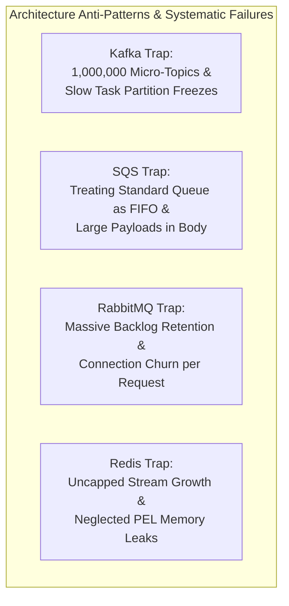

---

### Apache Kafka Anti-Patterns

#### Trap 1: The "Micro-Topic" Anti-Pattern (Million Topics with Single Partitions)
- *The Mistake:* Designing a multi-tenant SaaS system where a new Kafka topic is created dynamically for every individual customer account (e.g., `events.tenant.10042`).
- *The Failure:* Kafka is not designed for millions of individual topics. Each partition maps to physical files (`.log`, `.index`, `.timeindex`) on the broker filesystem. A million partitions requires opening millions of OS file descriptors, exhausts Linux `max_map_count`, inflates JVM off-heap metadata memory, and causes multi-minute leader election failovers during broker restarts.
- *The Architectural Fix:* Use a single, shared, high-throughput topic partitioned by `tenant_id` hash key (e.g., `events.multitenant` with 64 partitions), or use topic prefixes with record headers for tenant routing.

#### Trap 2: Slow Consumer Rebalance Cascades (`max.poll.interval.ms` Starvation)
- *The Mistake:* Fetching a batch of 500 records from Kafka and invoking a slow third-party REST API for each record sequentially inside the consumer loop.
- *The Failure:* The total batch processing time exceeds `max.poll.interval.ms` (default: 300,000 ms / 5 minutes). The Kafka coordinator marks the consumer dead, evicts it from the group, and triggers a full group rebalance. When another consumer inherits the partition, it attempts to process the exact same batch from the last committed offset, exceeds the timeout again, and triggers an infinite rebalance cascade across the entire cluster.
- *The Architectural Fix:* Decouple the poll loop from the worker execution using an internal thread pool with bounded queues, tune `max.poll.records=50` down to a manageable size, or transition the workload to Amazon SQS.

---

### Amazon SQS Anti-Patterns

#### Trap 1: Expecting Global Strict Ordering at 100,000 msgs/sec
- *The Mistake:* Selecting SQS Standard and expecting chronological processing, or selecting SQS FIFO and expecting to scale writes to 50,000 msgs/sec without architectural adjustments.
- *The Failure:* SQS Standard provides **best-effort ordering**; messages are delivered out of order under load. SQS FIFO guarantees strict ordering, but is hard-capped at **300 transactions/second** (or **3,000 transactions/second with batching** of 10 records).
- *The Architectural Fix:* If you require strict ordering at $>10,000\text{ msgs/sec}$, you must use Apache Kafka partitioned by entity key. If SQS FIFO is mandatory, maximize throughput by distributing load across thousands of distinct `MessageGroupId` values.

#### Trap 2: Encoding Massive Payloads (>256 KB) Directly into Message Bodies
- *The Mistake:* Base64 encoding high-resolution images, large JSON payloads, or PDF documents into the SQS message body.
- *The Failure:* SQS imposes an absolute hard ceiling of $256\text{ KB}$ per message. Attempting to bypass this through compression or string splitting creates brittle, unmaintainable client logic.
- *The Architectural Fix:* Implement the **Claim Check Pattern**. The producer uploads the heavy payload directly to an Amazon S3 bucket, and sends an SQS message containing only the S3 bucket name, object key, and metadata pointer. The consumer downloads the payload from S3, processes it, and deletes the S3 object upon completion.

---

### RabbitMQ Anti-Patterns

#### Trap 1: Treating RabbitMQ as a Persistent Historical Event Store
- *The Mistake:* Leaving messages in RabbitMQ queues for weeks or months so consumers can "catch up whenever they want", treating it like Kafka.
- *The Failure:* RabbitMQ was designed for **empty queues**. When message counts swell into the millions, RabbitMQ exhausts the Erlang memory threshold, pages messages to disk, triggers severe BEAM garbage collection pauses, and throttles publishers via socket flow control.
- *The Architectural Fix:* Maintain near-zero queue depths in RabbitMQ. If long-term retention or event replay is required, route messages through a fanout exchange into Apache Kafka or an object store.

#### Trap 2: Connection Churn (Opening a TCP Connection per Message)
- *The Mistake:* Creating a new AMQP connection for every HTTP request in a serverless function or REST controller, and closing it immediately after `basic.publish`.
- *The Failure:* Establishing an AMQP connection requires a TCP handshake, TLS negotiation, AMQP protocol handshake (`Connection.Start`, `Connection.Tune`, `Connection.Open`), and spawning multiple Erlang processes on the broker. High connection churn spikes broker CPU to 100% and exhausts ephemeral ports.
- *The Architectural Fix:* Maintain a long-lived connection pool. Keep connections open for the lifetime of the application process and multiplex short-lived **AMQP Channels** over existing connections.

---

### Redis Streams Anti-Patterns

#### Trap 1: Unbounded Stream Growth (The OOM Catastrophe)
- *The Mistake:* Appending events using raw `XADD mystream * sensor_id 1 temp 98.6` without trimming limits.
- *The Failure:* Unlike Kafka, which safely pages expired segments to cheap NVMe disks, Redis stores streams 100% in system RAM. An unbounded stream will inevitably trigger an Out of Memory (OOM) crash, invoking the Redis memory eviction policy (which can drop other cache keys) or crashing the Redis process.
- *The Architectural Fix:* Always append using approximate trimming:
  ```bash
  XADD mystream MAXLEN ~ 1000000 * sensor_id 1 temp 98.6
  ```
  The tilde (`~`) instructs Redis to trim entries at listpack block boundaries, executing trimming with $O(1)$ amortized CPU overhead.

#### Trap 2: Neglecting PEL Memory Leaks (The Zombie Consumer Hazard)
- *The Mistake:* Continuously reading messages via `XREADGROUP` without issuing corresponding `XACK` commands, or allowing temporary workers to spin up, read messages, and terminate permanently.
- *The Failure:* Every unacknowledged message remains stored in the consumer group's internal **Pending Entries List (PEL)** forever. Over time, the PEL grows to millions of entries, silently leaking gigabytes of RAM even if the stream itself is continuously trimmed with `MAXLEN`.
- *The Architectural Fix:* Ensure strict `XACK` execution upon successful processing. Deploy a scheduled background maintenance job that queries `XPENDING mystream mygroup` and purges abandoned entries via `XCLAIM` or `XAUTOCLAIM`.

---

## 8. 20 Senior/Staff-Level System Design Interview Questions & Rigorous In-Depth Answers

### Q1: How does Kafka achieve massive write throughput compared to traditional message brokers, despite persisting every record to disk?
**Answer:** Kafka's throughput is the result of four synergistic systems-engineering design decisions:
1. **Sequential Disk I/O**: Rather than using random-access data structures (like B-Trees) that require mechanical disk head repositions or flash page erase cycles, Kafka appends records strictly to the end of a 1 GB segment file. Sequential write speeds on modern NVMe drives reach $3,000+\text{ MB/sec}$, rivaling raw RAM bus speeds.
2. **OS Page Cache Exploitation**: Kafka does not manage an internal caching layer inside the JVM heap. Instead, all read and write operations interact directly with the Linux kernel Page Cache. This completely avoids JVM garbage collection pauses, double-buffering memory overhead, and 64-bit object reference bloat.
3. **Zero-Copy Network Transfer (`sendfile`)**: When transmitting data to consumers, Kafka uses the Linux `sendfile()` system call. Data transfers directly from the OS page cache to the network card's DMA ring buffer without passing through user-space application memory buffers, cutting CPU cycles and context switches by more than 60%.
4. **End-to-End Batching & Compression**: Kafka producers accumulate records in an internal buffer (`RecordAccumulator`) and transmit them in compressed batches (LZ4, ZSTD, Snappy). The broker writes the compressed bytes directly to disk without decompressing them, amortizing network and disk syscall overhead across thousands of messages.

---

### Q2: Explain the "Poison Pill" problem in message queues and describe the exact architectural pattern to mitigate it across Kafka, RabbitMQ, and SQS.
**Answer:** A "Poison Pill" is a malformed, unparseable, or logic-breaking message that causes the consuming worker to crash or throw an unhandled exception every time it is picked up for processing.
- **In RabbitMQ**: If the consumer rejects the message with `basic.nack(requeue=true)` or crashes, the broker immediately re-delivers the message to the next available worker, causing an infinite CPU-pegging crash loop across the worker fleet.
  *Mitigation:* Configure a dead-letter exchange (`x-dead-letter-exchange`). Catch exceptions in application code, increment an attempt header, and when attempts exceed a threshold (e.g., 3), issue `basic.reject(requeue=false)` to route the message to the DLQ.
- **In Amazon SQS**: A poison pill message will repeatedly trigger visibility timeout expirations.
  *Mitigation:* Configure an **SQS Redrive Policy** targeting an explicit Dead Letter Queue ARN with `maxReceiveCount = 3`. SQS automatically increments an internal `ApproximateReceiveCount` attribute on each delivery attempt; when it exceeds 3, SQS moves the message to the DLQ without consumer intervention.
- **In Apache Kafka**: Kafka lacks native per-message broker DLQs. If a consumer crashes on offset $42$, it cannot advance its committed offset; restarting will re-read offset $42$ infinitely.
  *Mitigation:* The consumer framework (e.g., Spring Kafka / confluent-kafka) must implement an explicit try-catch error handler. Upon detecting a terminal serialization or validation failure, the consumer produces the poisoned message payload along with stack trace metadata to a dedicated error topic (e.g., `orders.DLQ`), manually commits offset $42$ to `__consumer_offsets`, and continues processing offset $43$.

---

### Q3: How do Kafka, RabbitMQ, and SQS differ in their handling of message ordering when consumer instances fail?
**Answer:**
- **Apache Kafka**: Ordering is strictly guaranteed **per partition**. If Consumer 1 (assigned to Partition 0) fails, Kafka halts consumption on Partition 0 until a group rebalance reassigns Partition 0 to Consumer 2. Consumer 2 resumes reading sequentially from the last committed offset. **Order is 100% preserved**, but processing of that specific partition is temporarily blocked during the rebalance.
- **RabbitMQ**: Guarantees FIFO order within a single queue *only under happy-path single-consumer execution*. If competing workers process a queue and Worker 1 fails while holding Message 1 (unacknowledged), RabbitMQ requeues Message 1. Meanwhile, Worker 2 has already processed Message 2. When Message 1 is requeued, it is placed at the head of the queue and processed **out of order** relative to Message 2.
- **Amazon SQS Standard**: Makes no ordering guarantees whatsoever; messages can arrive out of order under normal and failure conditions.
- **Amazon SQS FIFO**: Preserves strict FIFO order within a specific `MessageGroupId`. If a consumer fails while processing a message from Group A, subsequent messages belonging to Group A are blocked from delivery until the visibility timeout lapses and the unacknowledged message is retried and deleted. Messages belonging to Group B continue processing in parallel without interruption.

---

### Q4: What is the CAP/PACELC theorem classification for Apache Kafka, RabbitMQ Quorum Queues, and Amazon SQS?
**Answer:**
Under the **PACELC theorem** (If Partition: Trade-off between Availability and Consistency; Else: Trade-off between Latency and Consistency):
- **Apache Kafka**:
  - *If Partition:* **PC**. When a network partition occurs, Kafka prioritizes Consistency over Availability. A partition leader with `min.insync.replicas=2` rejects writes with `NotEnoughReplicasException` if it cannot reach an ISR quorum, rather than accepting un-replicated writes.
  - *Else:* **L/C tunable**. By tuning `acks=0`, `acks=1`, or `acks=all`, engineers explicitly choose between minimal latency ($L$) or strict durability/consistency ($C$).
- **RabbitMQ Quorum Queues**:
  - *If Partition:* **PC**. Quorum queues run the Raft consensus algorithm. If a network partition isolates a minority node, that minority node refuses to process client writes or elect a leader, preventing split-brain states.
  - *Else:* **C**. Writes require majority disk consensus before acknowledgment, prioritizing consistency over sub-millisecond RAM latency.
- **Amazon SQS (Standard)**:
  - *If Partition:* **PA**. SQS Standard prioritizes Availability over Consistency. If an internal availability zone is partitioned, SQS accepts writes and serves reads from surviving partitions, tolerating duplicate message delivery and out-of-order anomalies.
  - *Else:* **A/L**. Optimized for high availability and low latency at the cost of strict linearizability.

---

### Q5: How do you achieve Exactly-Once Processing (E2E) in a distributed streaming pipeline, and why is "Exactly-Once Delivery" technically impossible over a network?
**Answer:**
**The Two Generals' Problem** proves mathematically that "Exactly-Once Delivery" over an unreliable network is physically impossible. Network packets can be dropped, delayed, or duplicated. If a consumer processes a message and the network drops the outgoing acknowledgment packet, the broker *must* re-deliver the message to avoid data loss, resulting in at-least-once delivery.

Therefore, "Exactly-Once Processing" is achieved via one of two production patterns:
1. **Idempotent Consumer Pattern (The Industry Standard)**:
   - The producer attaches a globally unique deterministic identifier (UUID or deterministic business key: `order_id + event_type`) to every message header.
   - The consumer processes business logic and commits the message ID into a persistent store within an atomic database transaction:
     ```sql
     BEGIN TRANSACTION;
     INSERT INTO processed_events (event_id, processed_at) VALUES ('evt_1001', NOW());
     UPDATE account_balances SET balance = balance - 100 WHERE account_id = 'acc_42';
     COMMIT;
     ```
   - If the same event arrives a second time due to network redelivery, the unique constraint on `event_id` violates, the transaction rolls back, and duplicate execution is prevented.
2. **Kafka Transactional API (`read-process-write`)**:
   - Used when reading from Kafka, transforming data, and writing back to another Kafka topic.
   - Leverages a `TransactionalId` and a central **Transaction Coordinator** broker.
   - Offset commits to `__consumer_offsets` and output record writes are committed together within a two-phase commit protocol. The consumer only observes committed records if configured with `isolation.level=read_committed`.

---

### Q6: What is a Split-Brain scenario in a RabbitMQ cluster, how did Mirrored Classic Queues fail, and how do Quorum Queues solve it?
**Answer:**
- **The Split-Brain Failure in Classic Mirrored Queues**:
  - Classic mirrored queues relied on an active master node and passive mirror nodes synchronized via Erlang cluster communication without a formal consensus protocol.
  - If a network partition severed communication between Node A and Node B, both sides assumed the other node was dead.
  - Node A elected a local mirror to become Master A; Node B elected its local mirror to become Master B.
  - Both nodes accepted new writes independently. When the network partition healed, RabbitMQ had diverged state with conflicting message IDs and acknowledgments. Resolving this required either dropping all messages on one partition (`autoheal` mode) or manual intervention, causing permanent message loss.
- **The Quorum Queue Solution**:
  - Quorum queues implement **Raft Consensus** (`ra` library in Erlang).
  - Every queue consists of an odd number of replicas (e.g., 3 or 5).
  - A leader can only append messages and commit acknowledgments if a strict majority ($Q = \lfloor N/2 \rfloor + 1$, e.g., 2 out of 3) of nodes acknowledge the Raft log entry.
  - If a network partition occurs, the minority partition cannot achieve quorum and rejects all writes. Only the majority partition continues operating. When the partition heals, the lagging nodes catch up from the Raft log with zero data corruption or divergence.

---

### Q7: Explain Kafka's Consumer Rebalance Protocol. What causes rebalance storms and how does Cooperative Sticky Assignor eliminate them?
**Answer:**
- **The Eager Rebalance Storm**:
  - Historically, Kafka used the **Eager Rebalance Protocol**. When any single consumer joined, left, or timed out (`max.poll.interval.ms` exceeded), the Group Coordinator revoked *all* partition assignments across the *entire* consumer group.
  - All consumer instances halted processing and surrendered their partitions. The leader assigned all partitions from scratch and sent assignments back.
  - In a cluster with 500 partitions and 50 workers, a single flapping consumer caused all 50 workers to repeatedly freeze, discard caches, and re-negotiate, resulting in massive throughput flatlines lasting minutes (a "rebalance storm").
- **The Cooperative Sticky Assignor Solution (KIP-429)**:
  - Replaces "stop-the-world" reassignment with an **incremental two-phase rebalance**:
  - **Phase 1**: Consumers report their current partition assignments to the coordinator and continue processing unaffected partitions without interruption.
  - **Phase 2**: The coordinator calculates the delta. Only the specific partitions that need to be migrated are revoked from their current owner and reassigned to the new consumer.
  - 95%+ of partition assignments remain completely stable and uninterrupted throughout the rebalance.

---

### Q8: How does SQS handle message deduplication in FIFO queues, and what are the limitations of the deduplication window?
**Answer:**
SQS FIFO queues enforce deduplication using two mechanisms:
1. **Content-Based Deduplication**: SQS generates a SHA-256 hash of the message body.
2. **Explicit Deduplication ID**: The producer explicitly provides a `MessageDeduplicationId` string (e.g., `order_id_10042_payment_v1`).

**The Deduplication Window Mechanics & Trap**:
- SQS stores deduplication IDs in an internal sliding cache for exactly **5 minutes (300 seconds)**.
- If a message with the identical deduplication ID is submitted within 5 minutes, SQS accepts the API call (`200 OK`) and returns a valid message ID, but **silently drops the message from entering the queue**.
- **The Trap**: If a network failure, retry storm, or system delay causes a duplicate message to be transmitted **5 minutes and 1 second** after the initial message, SQS will treat it as an entirely new message and deliver it to consumers. SQS FIFO deduplication cannot replace an application-level idempotent database check for long-running workflows.

---

### Q9: What happens under the hood when a Kafka broker experiences an ungraceful crash while acting as a Partition Leader?
**Answer:**
1. **Controller Detection**: The active KRaft controller detects broker failure when its heartbeat session expires.
2. **Leader Election from ISR**: The KRaft controller examines the partition's metadata. It selects the next available replica from the **In-Sync Replicas (ISR)** list to become the new Partition Leader.
3. **High Watermark (HWM) Fencing**: The High Watermark is the highest offset replicated across all ISR nodes. Any un-replicated records above the HWM on the crashed leader are truncated when that crashed broker recovers.
4. **Leader Epoch Update**: The controller increments the `LeaderEpoch` counter (e.g., from Epoch 3 to Epoch 4) in the partition metadata and broadcasts an `UpdateMetadata` request to all cluster brokers.
5. **Client Redirection**: When producers and consumers attempt to send requests to the dead broker, they receive `NotLeaderOrFollowerException`. The clients automatically refresh their internal cluster metadata cache from any bootstrap broker, discover the new leader, and transparently redirect their network sockets to the new partition leader.

---

### Q10: How does RabbitMQ implement Backpressure, and what happens when the Erlang VM hits its memory alarm?
**Answer:**
RabbitMQ enforces backpressure through a layered, multi-tier mechanism:
1. **TCP Socket Flow Control (Credit-Based)**: RabbitMQ monitors internal Erlang process mailboxes. If an internal message store process falls behind, it suspends reading from the AMQP channel process. The channel process stops reading from the client's TCP socket buffer. Once the client's local OS network socket buffer fills up, the client application's network write calls block or fail.
2. **Memory Alarm Watermark (`vm_memory_high_watermark`)**:
   - By default, if RabbitMQ detects that Erlang BEAM memory usage exceeds 40% of host physical RAM, the broker raises a cluster-wide **Memory Alarm**.
   - **Publisher Blocking**: RabbitMQ immediately sends an AMQP `Connection.Blocked` frame to all connected producers and stops reading bytes from producer TCP sockets entirely.
   - **Emergency Paging**: The broker forces background paging threads to dump transient in-memory messages to disk.
   - The broker remains completely locked to incoming traffic until memory usage drops at least 30% below the watermark threshold.

---

### Q11: Explain the internal storage layout of Redis Streams. Why is a Listpack used instead of a standard Linked List or Skiplist?
**Answer:**
Redis Streams uses a **Radix Tree (Rax)** whose leaf nodes contain **Listpacks**:
- **Why Linked Lists Fail**: A standard doubly-linked list (`adlist.c` in Redis) allocates a separate heap structure for every node. On a 64-bit architecture, each node requires 16 bytes for forward/backward pointers plus 8 bytes for value pointers—consuming 24 bytes of pointer overhead alone for a 4-byte payload, leading to 600%+ memory bloat and severe CPU L1/L2 cache misses due to pointer chasing.
- **Why Skiplists Fail**: While skiplists provide $O(\log N)$ search, they require multi-level forward pointers per entry, consuming substantial memory and making sequential memory-scan performance poor.
- **The Listpack Solution**: A Listpack (`listpack.c`) stores entries in a single, contiguous byte array. Up to 100 stream entries are encoded sequentially using compact variable-length integer prefixes.
  - *Memory Density:* Pointer overhead is zero.
  - *CPU Cache Efficiency:* Iterating through stream entries is a contiguous memory scan, maximizing hardware prefetching and CPU cache line hits.
  - *Fast Lookups:* The Radix tree indexes the master ID of each Listpack block in $O(k)$ time, after which a binary/linear scan within the tiny Listpack finds the exact target entry.

---

### Q12: How do you implement a Delay Queue (Scheduled Delivery) in Apache Kafka, RabbitMQ, and Amazon SQS?
**Answer:**
- **Amazon SQS**: Native and trivial. Configure `DelaySeconds` (0 to 15 minutes) on `SendMessage`, or configure a queue-level delivery delay. SQS holds the message invisible until the delay timer expires.
- **RabbitMQ**: Native via the **RabbitMQ Delayed Message Plugin** (`rabbitmq_delayed_message_exchange`). The publisher routes messages to an exchange of type `x-delayed-message` with an `x-delay` header specifying milliseconds. The broker stores the message in an internal Mnesia/Khepri table and routes it to the target queue only after the timer expires. (Alternative: Queue TTL + Dead Letter Exchange chaining).
- **Apache Kafka**: **No native broker support**. Attempting to implement delayed messages by sleeping consumer threads will trigger `max.poll.interval.ms` rebalances.
  *Production Architecture:* Write scheduled messages to an external store (e.g., PostgreSQL or Redis Sorted Sets keyed by timestamp `ZADD scheduled_tasks <unix_timestamp> <payload>`). A separate scheduler service periodically queries `ZRANGEBYSCORE scheduled_tasks 0 <now>`, pulls mature events, and publishes them into the active Kafka topic for real-time consumption. Alternatively, use a stateful Kafka Streams / Flink topology with punctuation timers.

---

### Q13: In Kafka, what is Log Compaction, how does the Cleaner Thread work, and what is its impact on consumer lag?
**Answer:**
- **Log Compaction Principle**: Instead of deleting data based on age or partition size, Kafka guarantees that for a given topic, it will retain at least the **latest known value** for every message key.
- **Log Cleaner Mechanics**:
  - A partition log is split into the **Clean** section (compacted) and the **Dirty** section (new appends).
  - The background `CleanerThread` builds an in-memory hash table (the **SkimpyOffsetMap**) scanning the dirty section, mapping `Hash(Key) -> Latest Offset`.
  - It then recopies the log segments: if an older record in the clean section has an offset less than the offset recorded in the map for that same key, the older record is permanently discarded.
  - Deletions are executed by publishing a **Tombstone** (a record with a non-null key and a null payload). The cleaner retains tombstones across a configurable `delete.retention.ms` window to allow consumers to observe the deletion.
- **Impact on Consumer Lag**: Consumers lagging behind in the dirty section read sequentially without noticing compaction. However, if a consumer falls far behind into compacted segments, it will skip historical intermediate state updates, observing only the latest state snapshots.

---

### Q14: How does SQS scale horizontally to virtually infinite throughput while maintaining high availability?
**Answer:**
SQS scales horizontally through a completely decoupled, multi-tiered architecture:
1. **DNS Anycast & Front-End Routing**: Incoming API calls hit AWS edge locations and route to thousands of stateless front-end web servers.
2. **Key-Space Partitioning**: Queues are internally sharded across a massive distributed storage fleet. SQS divides the queue's message ID space across hundreds of independent partition storage slices.
3. **Partition Splitting**: As write or read traffic on an SQS Standard queue surges, the internal control plane detects load metrics and automatically splits partition slices horizontally, allocating additional storage nodes across multiple availability zones.
4. **Decoupled Consumer Long-Polling**: When consumers long-poll (`WaitTimeSeconds=20`), front-end servers query an internal subset of storage nodes using consistent hashing. If no messages are found, the request waits asynchronously on an internal event-driven notification ring without consuming dedicated CPU threads, allowing SQS to support millions of concurrent worker polls effortlessly.

---

### Q15: What is the exact mathematical relationship between Kafka Partitions, Consumer Group instances, and horizontal scaling limits?
**Answer:**
In Apache Kafka, **the Partition is the absolute unit of concurrency and parallelism**:
$$\text{Max Active Consumers in Group } G = \text{Total Partitions } P \text{ in Topic } T$$
- If a topic has $P = 10$ partitions, and consumer group $G$ has $C = 10$ consumer instances, Kafka assigns exactly $1$ partition per consumer.
- If you scale consumer group $G$ to $C = 15$ instances, **$5$ consumers will sit completely idle**, consuming zero partitions and providing zero scaling benefit.
- If $C = 5$ instances, Kafka assigns $2$ partitions per consumer.
- **Scaling Limit**: To increase consumer parallel processing capacity from 10 to 100 instances, you *must* expand the topic partition count to 100 via `alter topic`. However, expanding partitions alters key-to-partition hash assignments ($Hash(Key) \pmod P$), breaking key-affinity ordering guarantees for future writes.

---

### Q16: How do you design an Idempotent Consumer when using RabbitMQ with multiple competing workers?
**Answer:**
When multiple competing workers consume from a RabbitMQ queue with `basic.qos(prefetch_count=N)`:
1. **Producer Side**: Generate a deterministic unique message ID:
   ```json
   {
     "message_id": "usr_99812_pwd_reset_1718000000",
     "timestamp": 1718000000,
     "payload": { ... }
   }
   ```
2. **Consumer Atomic State Verification**:
   - The consumer receives the message and extracts `message_id`.
   - Before executing business logic, the consumer attempts an atomic conditional write in a centralized distributed cache (e.g., Redis) or RDBMS:
     ```python
     # Acquire idempotency lease in Redis with 10-minute TTL
     acquired = redis.set(f"idemp:{msg_id}", "PROCESSING", nx=True, ex=600)
     if not acquired:
         # Message is currently being processed or has completed; ack and drop
         channel.basic_ack(delivery_tag=method.delivery_tag)
         return
     ```
3. **Transactional Execution**:
   - Execute the business logic inside the application database.
   - Upon completion, update the idempotency key state to `COMPLETED`:
     ```python
     redis.set(f"idemp:{msg_id}", "COMPLETED", ex=86400) # Retain 24 hours
     channel.basic_ack(delivery_tag=method.delivery_tag)
     ```
4. **Crash Recovery**: If the worker crashes mid-execution, the 600-second TTL expires, allowing the requeued message to be retried safely by another worker without permanently locking the key.

---

### Q17: Compare the performance, durability, and operational trade-offs of Redis Streams vs Kafka for a 100,000 msg/sec workload.
**Answer:**
For a sustained workload of $100,000\text{ msgs/sec}$ (assuming $1\text{ KB}$ payload size = $100\text{ MB/sec}$ ingress):
- **Memory & Storage Costs**:
  - *Redis Streams:* Storing 24 hours of data requires $100\text{ MB/sec} \times 86,400\text{ sec} \approx 8.64\text{ TB}$ of RAM. In cloud infrastructure (AWS ElastiCache), 8.6 TB of RAM costs $\approx \$15,000 - \$22,000/\text{month}$.
  - *Apache Kafka:* Stores data on local NVMe SSDs or Amazon EBS gp3 volumes. 8.6 TB of NVMe storage costs $\approx \$700 - \$900/\text{month}$. Kafka is over **20x more cost-effective** for multi-day data retention.
- **Latency SLAs**:
  - *Redis Streams:* Delivers p99 latencies $< 1\text{ ms}$. If the application is an edge gaming platform or high-frequency trading pipeline, Redis Streams is the only candidate meeting this SLA.
  - *Kafka:* Delivers p99 latencies of $10 - 25\text{ ms}$.
- **Durability & RPO**:
  - *Kafka:* With `acks=all` and `min.insync.replicas=2`, Kafka guarantees zero data loss ($RPO = 0$) across broker power failures.
  - *Redis Streams:* Async replication to replicas means a sudden primary crash risks losing the last few milliseconds of stream mutations ($RPO > 0$).

---

### Q18: What is the Claim Check Pattern, and how do you implement it reliably to bypass SQS message size limitations?
**Answer:**
The **Claim Check Pattern** decouples message routing from heavy payload transmission:
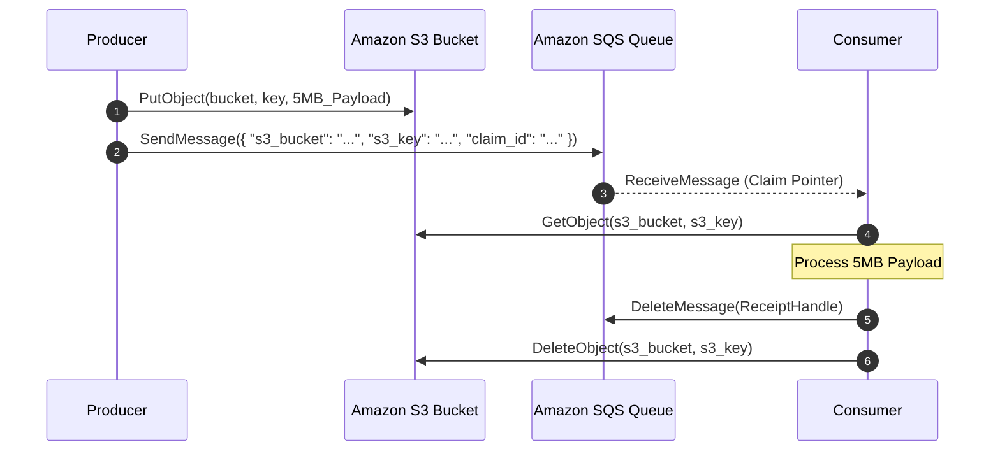
**Failure Edge Cases & Mitigations**:
1. *Orphaned S3 Payloads:* If a consumer processes the payload and deletes the SQS message, but crashes before deleting the S3 object, S3 accumulates orphaned data.
   *Mitigation:* Configure an **S3 Lifecycle Policy** on the bucket to automatically purge objects older than 14 days (matching SQS maximum retention).
2. *Premature S3 Deletion:* If multiple consumer groups consume the claim check, Consumer 1 must not delete the S3 object while Consumer 2 is still fetching it. Store the object with immutable versioning or decouple deletion to an automated cleanup worker triggered after all consumers have acknowledged.

---

### Q19: What is Consumer Lag in Apache Kafka, how do you measure it programmatically, and what architectural strategies resolve lag spikes?
**Answer:**
- **Definition**: Consumer Lag is the numerical difference between the **Log End Offset (LEO)** (the latest written message in a partition) and the **Current Consumer Offset (CCO)** (the latest committed offset processed by a consumer group):
  $$\text{Lag}_p = \text{LEO}_p - \text{CCO}_p$$
- **Programmatic Measurement**:
  - Never monitor lag by querying consumer clients directly (inaccurate if consumers crash).
  - Use an out-of-band monitoring daemon like **LinkedIn Burrow** or the Kafka `AdminClient` API:
    ```java
    // Fetch consumer group offsets via Kafka AdminClient
    Map<TopicPartition, OffsetAndMetadata> offsets = adminClient.listConsumerGroupOffsets("order-group")
        .partitionsToOffsetAndMetadata().get();
    // Compare against listOffsets(OffsetSpec.latest())
    ```
- **Architectural Remediation Strategies**:
  1. *Scale Consumer Instances:* If the topic has 32 partitions and only 8 consumers, scale the consumer group to 32 instances to achieve maximum parallel processing.
  2. *Internal Worker Decoupling:* If partition count cannot be increased immediately, modify the consumer to offload CPU-intensive processing to an internal bounded thread pool executor, committing offsets only as thread pool batches complete.
  3. *Increase Batch Fetch Size:* Tune `max.poll.records` and optimize downstream database writes using bulk updates (`INSERT ... ON CONFLICT DO UPDATE` or JDBC batching).

---

### Q20: Under what exact technical conditions would choosing RabbitMQ over Apache Kafka be considered an architectural failure, and vice-versa?
**Answer:**
- **Choosing RabbitMQ is an Architectural Failure when:**
  1. *Long-Term Data Retention & Replay:* The business requires re-reading historical events to rebuild database read models, hydrate new microservices, or satisfy multi-year legal audit requirements. RabbitMQ deletes messages upon consumption; forcing it to retain millions of messages causes memory exhaustion and cluster failure.
  2. *Sustained Extreme Throughput ($> 100,000\text{ msgs/sec}$):* High write volumes overwhelm Erlang process message queues, inducing memory alarms, GC pauses, and publisher throttling.
  3. *Event Streaming & Materialized Views:* The system requires complex event processing, windowed joins, or integrations with Kafka Streams, Apache Flink, or Spark Streaming.
- **Choosing Apache Kafka is an Architectural Failure when:**
  1. *Complex Routing Logic:* The system demands routing messages dynamically based on AMQP topic binding keys (wildcards `*.orders.#`), headers, or content inspection across hundreds of dynamic queues. Kafka requires writing custom routing microservices or Flink topologies to simulate this.
  2. *Per-Message Task Queues with Variable Latencies:* Background jobs take varying times (50ms to 10 minutes). Kafka's partition assignment locks up entire partitions behind slow tasks, causing partition starvation and rebalance timeouts.
  3. *Per-Message Priority:* The workload requires native message priority queues (`x-max-priority`). Kafka does not support message priorities natively; emulating it requires maintaining multiple priority topics, introducing complex consumer polling logic.
