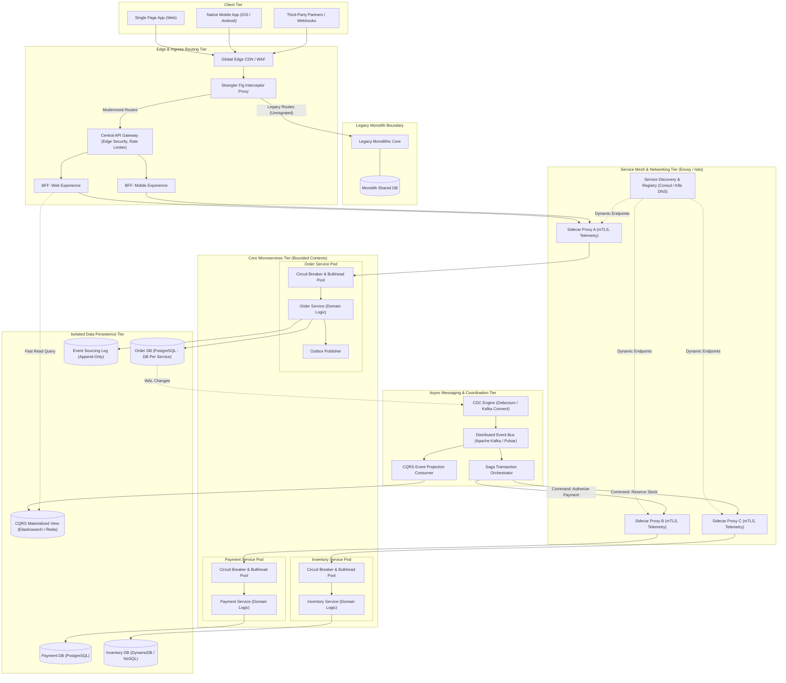
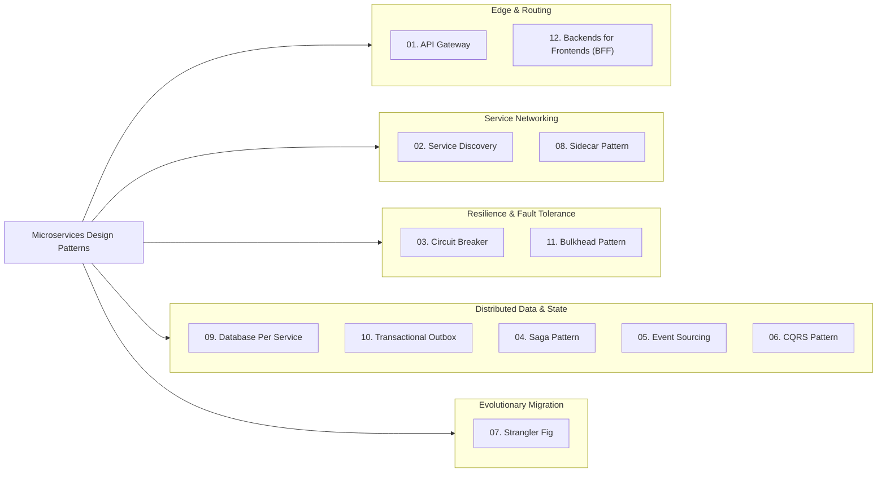
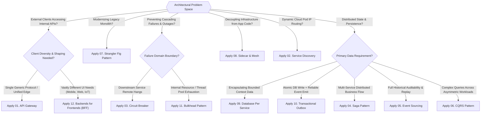
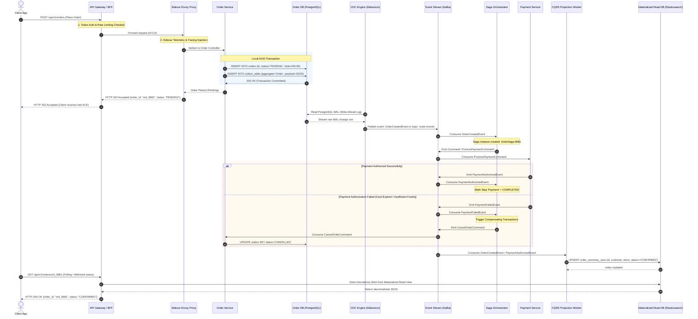
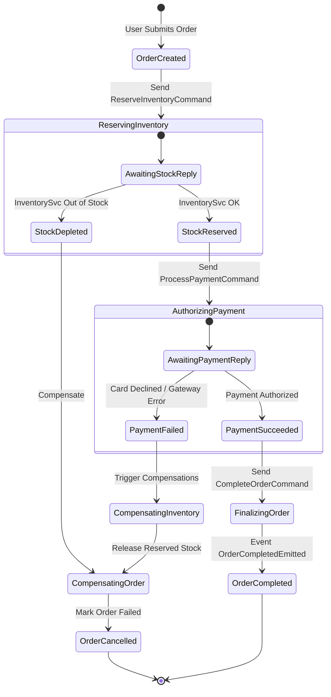
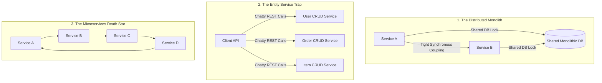

# Microservices Design Architecture Blueprint & Comprehensive Guide

## 1. Executive Architectural Overview & First Principles

Microservices architecture decomposes a monolithic application into a suite of independently deployable, loosely coupled, and bounded services. Each service encapsulates a distinct business domain capability, maintains its own persistent state, and communicates across network boundaries via lightweight, language-agnostic protocols (such as HTTP/REST, gRPC, or asynchronous message streams).

While the monolithic paradigm optimizes for local in-process computation and single-runtime transactional simplicity, distributed microservices optimize for **organizational scale, fault isolation, and independent deployability**. However, moving from an in-memory function call (`~10-100 nanoseconds`) to a network hop (`~1-50 milliseconds`) fundamentally shifts the physics of software design.

```
+----------------------------------------------------------------------------------------------------+
|                                    DISTRIBUTED SYSTEMS PHYSICS                                     |
+------------------------------------+----------------------------------+----------------------------+
| Monolithic In-Process Execution    | Microservices Network Boundary   | Engineering Implication    |
+------------------------------------+----------------------------------+----------------------------+
| Latency: Nanoseconds (L1/L2/RAM)   | Latency: Milliseconds (TCP/TLS)  | Must minimize network hops |
| Memory: Shared address space       | Memory: Isolated heap/process    | No shared state or caches  |
| Consistency: ACID (Local DB lock)  | Consistency: BASE / Eventual     | Requires Saga / Outbox     |
| Failure: Process crash (All/None)  | Failure: Partial, silent network | Must use Circuit Breakers  |
| Deployability: Monolithic lockstep | Deployability: Continuous, decoup| API contracts & versioning |
+------------------------------------+----------------------------------+----------------------------+
```

### The Fallacies of Distributed Computing in Microservices
Architects must confront Peter Deutsch’s Eight Fallacies of Distributed Computing:
1. **The network is reliable**: Packets drop; switches fail; TCP connections reset mid-stream.
2. **Latency is zero**: Serialization, TLS handshakes, and routing add p99 tail latencies.
3. **Bandwidth is infinite**: Chatty JSON payloads over-saturate ingress/egress links.
4. **The network is secure**: Zero-Trust architecture requires mutual TLS (mTLS) across all internal hops.
5. **Topology does not change**: Pods autoscale, migrate, and crash dynamically in cloud orchestrators.
6. **There is one administrator**: Heterogeneous polyglot microservices are built across multiple teams.
7. **Transport cost is zero**: Cloud egress fees and CPU cycles for serialization/deserialization compound.
8. **The network is homogeneous**: Varying protocols (HTTP/1.1, HTTP/2, gRPC, WebSocket, AMQP) coexist.

---

## 2. Table of Contents & Pattern Catalog

This guide provides deep technical coverage across the core design patterns of microservices architecture:

| Pattern | Category | Primary Intent | Key Trade-off |
| :--- | :--- | :--- | :--- |
| [01. API Gateway](01_API_Gateway_Pattern.md) | Edge & Routing | Single entry point, aggregation, rate limiting, and edge security | Latency bottleneck and single point of failure risk |
| [02. Service Discovery](02_Service_Discovery_Pattern.md) | Service Infrastructure | Dynamic registry for resolving ephemeral pod IP addresses and health | Registry state synchronization lag and heartbeat churn |
| [03. Circuit Breaker](03_Circuit_Breaker_Pattern.md) | Fault Tolerance | Fail fast when downstream services degrade to avoid thread starvation | Fallback complexity and tuning trip/reset thresholds |
| [04. Saga Pattern](04_Saga_Pattern.md) | Data Consistency | Manage distributed transactions via compensating actions without 2PC | Lack of read isolation (dirty reads) and complex compensations |
| [05. Event Sourcing](05_Event_Sourcing_Pattern.md) | Data Persistence | Store state changes as an immutable append-only event append stream | Storage growth, schema version evolution, and replay latency |
| [06. CQRS](06_CQRS_Pattern.md) | Query & Data Modeling | Segregate write operations from optimized read materialized views | Eventual consistency lag and duplicate data stores |
| [07. Strangler Fig](07_Strangler_Fig_Pattern.md) | Migration & Evolution | Incrementally replace monolith functions with microservices behind proxy | Dual-write synchronization and interim dual-system overhead |
| [08. Sidecar Pattern](08_Sidecar_Pattern.md) | Service Infrastructure | Attach cross-cutting operational capabilities (mTLS, telemetry) to pods | Container CPU/memory footprint and proxy hop latency |
| [09. Database Per Service](09_Database_Per_Service_Pattern.md) | Data Consistency | Enforce domain encapsulation by giving each microservice private storage | Loss of cross-table relational joins and distributed ACID locks |
| [10. Outbox Pattern](10_Outbox_Pattern.md) | Data Consistency | Atomically write database state and publish events via CDC | CDC polling/log reader latency and at-least-once deduplication |
| [11. Bulkhead Pattern](11_Bulkhead_Pattern.md) | Fault Tolerance | Partition CPU, memory, connection, and thread resources into isolated pools | Resource underutilization in uncalibrated static pools |
| [12. BFF (Backends for Frontends)](12_Backends_For_Frontends_Pattern.md) | Edge & Routing | Provide customized backend interfaces tailored to specific frontend channels | Code duplication across BFFs and coordination with backend APIs |

---

## 3. Microservices Architecture Holistic Blueprint (HLD)

In a resilient enterprise deployment, these 12 patterns operate in concert across five distinct tiers:
1. **Edge & Client Routing Tier**: Manages traffic ingress, WAF filtering, SSL termination, and client-tailored orchestration.
2. **Service Mesh & Networking Tier**: Enforces zero-trust identity, transparent sidecar routing, dynamic service discovery, and telemetry.
3. **Core Business Services Tier**: Domain-Driven Design (DDD) bounded contexts with isolated resource bulkheads and circuit breakers.
4. **Data Persistence Tier**: Strict Database-per-Service boundaries leveraging polyglot storage engines.
5. **Distributed Messaging & Asynchronous Coordination Tier**: Outbox CDC event streaming, Saga transaction orchestrators, and CQRS projection pipelines.

### Holistic Architecture Topology Diagram



---

## 4. Microservices Design Patterns Taxonomy & Classification

The 12 microservices design patterns divide systematically into 5 operational dimensions:



### Comprehensive Pattern Classification Matrix

```
+--------------------------------------------------------------------------------------------------------------------------------------------+
|                                              MICROSERVICES DESIGN PATTERNS CLASSIFICATION MATRIX                                            |
+--------------------------+-----------------------+---------------------+-------------------+------------------------+----------------------+
| Pattern Name             | Architectural Layer   | Latency Overhead    | Operational Cost  | Blast Radius Defense   | Primary Consistency  |
+--------------------------+-----------------------+---------------------+-------------------+------------------------+----------------------+
| 01. API Gateway          | Edge Ingress          | Low-Med (+2-8ms)    | Moderate          | High (Rate limiting)   | Strong / Stateless   |
| 02. Service Discovery    | Networking & Mesh     | Low (Cached in-mem) | Moderate          | High (Evicts unhealthy)| Read-replica lag     |
| 03. Circuit Breaker      | Service Client Layer  | Microsecond (CPU)   | Low               | Critical (Stops drops) | N/A (Flow Control)   |
| 04. Saga Pattern         | Business Workflow     | Asynchronous        | High              | High (Compensations)   | Eventual (BASE)      |
| 05. Event Sourcing       | Domain Persistence    | Med (Event replay)  | High              | Moderate (Audit trail) | Strong at Aggregate  |
| 06. CQRS                 | Data Access & Views   | Low for Reads       | High              | Moderate (View rebuild)| Eventual             |
| 07. Strangler Fig        | Ingress Routing       | Low (+1-3ms proxy)  | Moderate          | High (Can rollback)    | Interim Dual-Sync    |
| 08. Sidecar Pattern      | Pod Runtime Boundary  | Low (+0.5-2ms TCP)  | Moderate-High     | High (Policy/mTLS)     | N/A (Infrastructure) |
| 09. Database Per Service | Data Tier             | Zero (Native DB)    | High (DB sprawl)  | Complete Data Bounds   | Local ACID           |
| 10. Transactional Outbox | Persistence to Stream | Low-Med (CDC lag)   | Moderate          | High (Guarantees pub)  | At-least-once        |
| 11. Bulkhead Pattern     | Thread/Resource Pool  | Zero (In-memory)    | Low               | Critical (Pool isolat) | N/A (Resource Pool)  |
| 12. BFF Pattern          | Edge Presentation     | Low (+2-5ms)        | Moderate          | Moderate (Channel isol)| Stateless            |
+--------------------------+-----------------------+---------------------+-------------------+------------------------+----------------------+
```

---

## 5. Architectural Decision Framework & Decision Tree

Choosing the correct design pattern requires navigating trade-offs between consistency, latency, team topology, and operational maturity.



### Quantitative Decision Matrix for Architects

Use this scoring rubric to evaluate pattern necessity in your architecture:

1. **Transactional Outbox**: Mandatory if your service updates an ACID database and emits an event to Kafka in the same user transaction. Without Outbox, you are guaranteed to experience the Dual-Write Trap.
2. **Saga vs. Two-Phase Commit (2PC)**: In cloud microservices, never use 2PC. 2PC holds distributed locks across network boundaries, turning the slowest node or transient partition into an availability catastrophe (violates CAP theorem). Use Saga with compensating transactions.
3. **CQRS vs. Single DB Read**: Do not adopt CQRS unless write workloads and read queries have drastically different scale profiles (e.g., 100:1 read/write ratio) or require materialized denormalization across multiple aggregate roots.

---

## 6. End-to-End Request Lifecycle & Distributed Transaction Architecture (LLD)

The following sequence diagram traces an enterprise-grade distributed flow: A user places an order through an API Gateway, protected by Circuit Breakers, coordinated across service meshes via Sidecars, saved atomically via Transactional Outbox, orchestrated across distributed services via Saga, and published into a CQRS materialized read model.



---

## 7. Distributed State Machine: Saga Orchestration Lifecycle

Distributed transactions require explicit state machine modeling to guarantee that every non-terminal state converges deterministically toward either `SUCCESS` or a fully compensated `FAILED` state.



### State Machine Transition Table
```
+---------------------+-------------------------------+-------------------------+----------------------------+
| Current State       | Trigger Event                 | Action Executed         | Next State                 |
+---------------------+-------------------------------+-------------------------+----------------------------+
| [*]                 | User Order Placed             | Persist Outbox Record   | OrderCreated               |
| OrderCreated        | OrderCreatedEvent Consumed    | ReserveInventoryCommand | ReservingInventory         |
| ReservingInventory  | InventoryReservedEvent        | ProcessPaymentCommand   | AuthorizingPayment         |
| ReservingInventory  | InventoryDepletedEvent        | CancelOrderCommand      | OrderCancelled (Failed)    |
| AuthorizingPayment  | PaymentAuthorizedEvent        | CompleteOrderCommand    | OrderCompleted (Success)   |
| AuthorizingPayment  | PaymentFailedEvent            | ReleaseStockCommand     | CompensatingInventory      |
| CompensatingInvent  | StockReleasedEvent            | CancelOrderCommand      | OrderCancelled (Failed)    |
+---------------------+-------------------------------+-------------------------+----------------------------+
```

---

## 8. Pattern Composition & Architectural Synergies

Microservices patterns achieve their true power when combined into cohesive architectural sub-systems.

```
+----------------------------------------------------------------------------------------------------+
|                                    SYNERGISTIC PATTERN COMPOSITIONS                                |
+-------------------------------+-----------------------------------+--------------------------------+
| Primary Pattern Composition   | Combined Superpower               | Real-World Production Scenario |
+-------------------------------+-----------------------------------+--------------------------------+
| Outbox + Saga Orchestrator    | Guarantees distributed execution  | Payment & Order settlement     |
|                               | without distributed deadlocks     | across 5+ independent services |
+-------------------------------+-----------------------------------+--------------------------------+
| CQRS + Event Sourcing         | Complete audit history with       | High-frequency trading and     |
|                               | sub-millisecond query performance | regulated financial ledgers    |
+-------------------------------+-----------------------------------+--------------------------------+
| Circuit Breaker + Bulkhead    | Multi-layered defense against     | Downstream gateway timeouts    |
|                               | thread pool starvation & storms   | without taking down caller     |
+-------------------------------+-----------------------------------+--------------------------------+
| API Gateway + BFF             | Global edge security combined     | Multi-device platforms         |
|                               | with device-tailored payloads     | (iOS, Android, SmartTV, Web)   |
+-------------------------------+-----------------------------------+--------------------------------+
| Sidecar + Service Discovery   | Transparent mTLS, dynamic load    | Cloud-native zero-trust        |
|                               | balancing, zero app code changes  | Kubernetes service meshes      |
+-------------------------------+-----------------------------------+--------------------------------+
```

### 1. Outbox Pattern + Saga Orchestrator
When a service participates in a distributed Saga, it must reliably emit events signaling the completion of its step. Emitting directly to a message broker (e.g., Kafka) after committing a database transaction creates the **Dual-Write Trap**:
- If the DB commit succeeds but the message broker is temporarily unreachable, the downstream saga steps will never execute, leaving the system in a permanently corrupt state.
- If the event is sent first and the DB commit rolls back, downstream services execute compensations for an action that never occurred.

**The Solution**: Write the local domain entity update and an outbox event record in the **same local database transaction**. A CDC reader (e.g., Debezium) streams the event to Kafka, which the Saga orchestrator consumes to drive the next state transition with zero data loss.

### 2. CQRS + Event Sourcing
Event Sourcing guarantees that every state transition is recorded as an immutable fact. However, querying an event log (e.g., `SELECT * FROM events WHERE aggregate_id = X`) to compute aggregate summaries across millions of events causes severe CPU degradation and query latency.

**The Solution**: CQRS separates the write model (the append-only Event Store) from optimized read models (Materialized Views in Elasticsearch, PostgreSQL, or Redis). As events are committed, asynchronous projectors consume them and update denormalized read records in real time.

### 3. Circuit Breaker + Bulkhead
A Circuit Breaker stops calls to a failing remote service when an error threshold is reached. However, before the breaker trips (e.g., during a 30-second window where downstream calls are hanging on connection timeouts), the calling service's incoming requests continue to consume container threads.

**The Solution**: Bulkheading partitions the thread pools. If downstream Service B hangs, it can only consume its dedicated pool of 20 threads. Service A's remaining 180 threads remain fully responsive to serve other traffic, completely isolating the blast radius.

---

## 9. Architectural Anti-Patterns & Production Pitfalls



### 1. The Distributed Monolith
* **Symptom**: Microservices share a common physical database, or services require simultaneous, coordinated deployments (lockstep releases).
* **Failure Mode**: Schema migrations in one service break adjacent services. A slow query executed by Service A exhausts database connection pools, taking down Services B, C, and D.
* **Remedy**: Strictly enforce [Database Per Service](09_Database_Per_Service_Pattern.md). Bounded contexts must communicate solely via public APIs or asynchronous event streams.

### 2. The Entity Services Anti-Pattern
* **Symptom**: Microservices designed purely as CRUD abstractions around single database tables (`UserService`, `OrderService`, `OrderItemService`).
* **Failure Mode**: The application layer becomes anemic. Simple client business operations trigger dozens of sequential network round-trips ("chatty network calls"), creating massive p99 latency amplification and cascading failure vulnerability.
* **Remedy**: Model services around **Business Capabilities and Domain-Driven Design (DDD) Aggregates**, not database tables. Merge anemic entity services into cohesive domain boundaries.

### 3. The Dual-Write Trap
* **Symptom**: Application code updates a relational database and then calls `kafkaProducer.send()` within the same request handler.
* **Failure Mode**: Network failure, JVM OutOfMemory crash, or pod eviction between the DB commit and Kafka send leads to permanent data inconsistency.
* **Remedy**: Adopt the [Transactional Outbox Pattern](10_Outbox_Pattern.md) paired with Change Data Capture (Debezium).

### 4. Synchronous RPC Overkill
* **Symptom**: Deep synchronous request chains (Service A calls B, which calls C, which calls D, which calls E via HTTP/REST).
* **Failure Mode**: Availability compounds multiplicatively. If each service has `99.9%` availability, a chain of 5 synchronous calls has an availability of $(0.999)^5 \approx 99.5\%$. Latency equals the sum of all serial timeouts.
* **Remedy**: Convert intermediate communications to asynchronous event-driven messaging. Use API composition or CQRS read projections to serve queries in a single hop.

### 5. The Microservices "Death Star" (Cyclic Graph Dependencies)
* **Symptom**: Complex, circular service dependency graphs where Service A calls Service B, which triggers an event consumed by Service C, which queries Service A.
* **Failure Mode**: Distributed deadlocks, impossible root-cause analysis, and cascading brownouts during startup (services cannot boot because their upstream dependency is awaiting their own health check).
* **Remedy**: Enforce strict layered architectural tiers (Directed Acyclic Graph - DAG). Use dependency inversion via asynchronous pub/sub.

---

## 10. Production Case Studies: Hyper-Scale Implementations

### 1. Netflix: High-Availability Edge & Mesh Resilience
* **Context**: Millions of concurrent video streaming sessions globally across thousands of diverse devices.
* **Implementation**:
  * **Edge & BFF**: Developed **Zuul**, an edge API gateway handling dynamic routing, canary deployments, and adaptive rate limiting.
  * **Resilience**: Engineered **Hystrix** (the industry-standard pioneer of Circuit Breakers and Bulkhead thread pools), isolating downstream recommendation failures from core video playback.
  * **Discovery**: Created **Eureka** to handle client-side load balancing and multi-region service discovery.
  * **Orchestration**: Built **Conductor**, an open-source JSON-defined Saga orchestration engine managing complex media encoding and distributed processing pipelines.

### 2. Uber: DOMA (Domain-Oriented Microservice Architecture)
* **Context**: Over 4,000 microservices causing operational complexity, deep call graphs, and high cognitive load.
* **Implementation**:
  * **Evolution**: Transitioned from unconstrained microservices to **DOMA**, grouping services into distinct Domains and Virtual Sub-domains.
  * **Gateway Aggregation**: Established dedicated Gateway Layers for each domain to enforce strict inbound boundaries.
  * **Workflow Orchestration**: Developed and open-sourced **Cadence** (later evolved into **Temporal**), providing fault-tolerant, code-as-configuration state machine execution for driver dispatch, trip settlement, and rider billing.

### 3. Amazon: Cell-Based Architecture & Blast Radius Containment
* **Context**: Global e-commerce and AWS infrastructure requiring ultra-high availability (99.999%).
* **Implementation**:
  * **Partitioning**: Subdivided monolithic architectures into thousands of decentralized microservices owned by autonomous "Two-Pizza Teams".
  * **Cell-Based Architecture**: Microservice instances are partitioned into isolated, self-contained "cells" (e.g., AZ-level failure zones). A total outage in Cell A cannot propagate to Cell B.
  * **Storage Decoupling**: Ubiquitous adoption of DynamoDB to guarantee predictable, single-digit millisecond latency with hard isolation boundaries between tenant workloads.

---

## 11. Master System Design Interview Guide

### Q1: How do you guarantee exactly-once message processing across distributed microservices without distributed transactions?
> **Answer**: True end-to-end "exactly-once" delivery over an unreliable network is physically impossible under the Two Generals' Problem. In production, exactly-once processing is achieved by combining **At-Least-Once Delivery** with **Idempotent Consumer Processing**.
>
> 1. **Message Publishing**: Use the **Transactional Outbox Pattern** with database Write-Ahead Log (WAL) capture via Debezium to guarantee that messages are never lost, even across service crashes.
> 2. **Deduplication Key**: Every message payload contains a unique business idempotency key (e.g., `idempotency_key = "order_create_usr883_seq1"` or an aggregate UUID).
> 3. **Consumer Idempotency**:
>    - *RDBMS Consumer*: In the consumer's local database transaction, insert the `idempotency_key` into an `idempotent_consumer_log` table with a `PRIMARY KEY UNIQUE` constraint alongside the business entity update. If a duplicate message arrives, the database rejects the duplicate insert with a unique constraint violation, rolling back the transaction harmlessly.
>    - *Key-Value / Redis Consumer*: Execute atomic conditional checks:
>      ```redis
>      SET idempotency:msg_9881 "PROCESSED" NX EX 86400
>      ```
>      If the key already exists (`NX` returns false), the consumer immediately returns a successful ACK to Kafka without re-executing side effects.

---

### Q2: In a CQRS and Event Sourcing architecture, how do you handle the eventual consistency lag when a user updates their profile and immediately navigates to view it?
> **Answer**: This is the classic "Read-Your-Own-Writes" consistency challenge. When a command commits to the Event Store, there is an inherent propagation lag ($\sim 10-200\text{ms}$) before the asynchronous CQRS projection worker updates the materialized read store.
>
> **Production Solutions**:
> 1. **Optimistic UI Update**: The frontend immediately updates its local client-side state/cache upon receiving the HTTP 200/202 command ACK, hiding the read-replica lag from the user.
> 2. **Version Pinning / Read Routing**:
>    - When the write command commits, return the aggregate's new version number: `{ aggregate_id: "usr_12", version: 42 }`.
>    - When the client immediately issues a read query, it passes `If-Version-At-Least: 42`.
>    - If the read model currently reflects version 41, the query service either:
>      - Holds the HTTP connection open via long-polling/Server-Sent Events for up to 500ms until the projector catches up.
>      - Routes the immediate read to the write-side Event Store / Primary DB for that specific user session.
> 3. **Session Consistency**: Bind the client's session affinity to read from the master database for $N$ seconds following any mutating write operation.

---

### Q3: How do you prevent cascading failures and thread pool exhaustion during a partial downstream outage?
> **Answer**: Cascading failures occur when a downstream microservice experiences elevated latency (e.g., degraded from 20ms to 5,000ms due to database locks). Upstream services waiting for responses block their worker threads, causing thread pool starvation, resource exhaustion, and upstream crashes.
>
> **Defense-in-Depth Strategy**:
> 1. **Defensive Timeouts**: Enforce strict, aggressive connection and socket read timeouts on all inter-service clients (e.g., p99 + 3 standard deviations, never arbitrary 30-second defaults).
> 2. **Bulkhead Pattern**: Allocate isolated thread pools or semaphore permits per downstream client. If Service C hangs, it can only exhaust its dedicated 10 permits, leaving the remaining 90 permits available for Services A and B.
> 3. **Circuit Breaker Pattern**: Configure a circuit breaker (e.g., Resilience4j) monitoring error rates and slow call percentages. If $>50\%$ of calls take $>2$ seconds over a sliding window of 100 requests, trip the breaker to `OPEN`. All subsequent calls fail fast immediately (0ms latency), protecting upstream threads and allowing downstream services time to recover.
> 4. **Graceful Fallbacks**: Return cached data, degraded static responses, or queue requests for asynchronous retry.

---

### Q4: When should you choose Saga Choreography vs. Saga Orchestration, and how do you handle non-compensable actions?
> **Answer**:
> * **Saga Choreography** (Decentralized, event-driven): Services publish events and react to peer events autonomously.
>   * *When to choose*: Simple workflows (2-4 steps), low inter-team coordination overhead, high performance/throughput where central orchestrator latency is prohibitive.
>   * *Pitfall*: Becomes impossible to trace or debug at scale; high risk of cyclic dependencies.
> * **Saga Orchestration** (Centralized coordinator): A dedicated orchestrator (Temporal, Camunda, AWS Step Functions) sends explicit commands to services and tracks state transitions.
>   * *When to choose*: Complex enterprise workflows ($>4$ steps), financial transactions, strict compliance/auditability requirements, or workflows with branching conditional logic.
>
> **Handling Non-Compensable (Pivot) Actions**:
> Actions like charging a credit card or sending an email/SMS cannot be transparently undone via local database rollbacks.
> - **The Pivot Transaction**: Structure the Saga so that the pivot step is the exact point of no return. Steps *before* the pivot must be fully compensable.
> - **Retriable Transactions**: Steps *after* the pivot must be guaranteed to eventually succeed. If an email notification fails, the orchestrator retries with exponential backoff and dead-letter queues until it succeeds, rather than rolling back the entire purchase.

---

### Q5: How do you migrate a mission-critical billing monolith to microservices with zero downtime and zero data divergence?
> **Answer**: Apply the **Strangler Fig Pattern** combined with **Branch by Abstraction** and **Dark Shadowing**:
>
> 1. **Step 1: Interception Proxy**: Place an API Gateway or reverse proxy (Envoy, NGINX) in front of the monolith. Initially, 100% of traffic routes directly to the monolith.
> 2. **Step 2: Build the New Service**: Develop the autonomous `Billing Microservice` with its own private database.
> 3. **Step 3: Change Data Capture & Dual Sync**: Set up bi-directional CDC replication between the Monolith Billing DB and the Microservice DB to keep schemas continuously synchronized.
> 4. **Step 4: Dark Traffic Shadowing**: Configure the API Gateway to duplicate production billing read traffic, sending identical requests asynchronously to both the monolith and the new microservice. Compare output payloads, latencies, and error codes in real time without returning the microservice's responses to users.
> 5. **Step 5: Canary Routing**: Route 1% of live mutating traffic to the new billing service, monitoring error budgets, p99 latencies, and database consistency.
> 6. **Step 6: Cutover & Decommission**: Incrementally ramp traffic (5% -> 25% -> 100%). Once stabilized, sever the sync connection and retire the monolith's billing module.

---

### Q6: How do you design an API Gateway layer for ultra-low latency (p99 < 10ms) while performing rate-limiting, authentication, and dynamic routing?
> **Answer**: Achieving single-digit millisecond p99 latencies at the edge requires eliminating blocking I/O and central bottleneck lookups:
>
> 1. **Non-Blocking Asynchronous Core**: Deploy a gateway built on event-driven, non-blocking runtimes (e.g., Envoy with C++, OpenResty/Nginx with Lua, or Netty-based gateways). Avoid blocking thread-per-request architectures.
> 2. **Stateless JWT Validation**: Validate cryptographic signatures (RSA/ECDSA) entirely in-memory using public keys loaded into the gateway's memory at startup. Avoid calling an external Auth Server over the network for every request.
> 3. **Distributed Local Rate Limiting**: Avoid synchronous Redis network round-trips for every packet. Use a **Token Bucket** algorithm where worker threads maintain local in-memory token buckets, synchronizing batch updates asynchronously to Redis clusters at fixed intervals ($\sim 100\text{ms}$).
> 4. **Connection Pooling & HTTP/2 Multiplexing**: Maintain warm, persistent HTTP/2 or gRPC connection pools from the gateway to downstream microservices, avoiding repeated TCP handshakes and TLS renegotiations.

---

### Q7: What are the trade-offs of Service Mesh (Envoy sidecars) vs. Library-based (SDK) microservices communication?
> **Answer**:
> * **Service Mesh (Sidecar Model - e.g., Istio + Envoy)**:
>   * *Pros*: Polyglot by design (works identically across Go, Java, Node, Python); transparent operational upgrades without recompiling or redeploying microservices; centralized traffic control and security policies.
>   * *Cons*: Adds container memory overhead per pod ($\sim 50-150\text{MB}$ per sidecar); introduces double-proxy network hops (+1 to 3ms p99 latency per inter-service call); high Kubernetes cluster control-plane complexity.
> * **Library-Based SDK (e.g., Finagle, Spring Cloud, gRPC client interceptors)**:
>   * *Pros*: Minimal latency overhead (in-process function calls, no localhost TCP proxy hop); direct hardware resource utilization.
>   * *Cons*: High polyglot maintenance costs (must re-implement circuit breaking, mTLS, and tracing libraries in every programming language used); updating an SDK version requires rebuilding, testing, and redeploying hundreds of independent applications.
> * **Verdict**: Adopt Service Mesh when running $>20$ polyglot microservices in Kubernetes where security compliance (mTLS) and standardized observability outweigh minor CPU and sub-millisecond latency costs.

---

### Q8: How do you architect a multi-region active-active microservices deployment with Database per Service?
> **Answer**:
> 1. **Global Traffic Management**: Use Anycast DNS or AWS Route 53 Geolocation / Latency routing to direct users to the nearest active cloud region.
> 2. **Stateless Service Layer**: Microservices are deployed identically across Region A and Region B, capable of processing any client request dynamically.
> 3. **Partitioned Data Ownership**:
>    - Avoid distributed multi-region master-master relational database locks across WANs (speed-of-light propagation latency makes synchronous replication across continents unfeasible).
>    - **User Home Regioning**: Partition user accounts so that a given user is "homed" in a primary region (e.g., Region A). All write mutations for that user route to Region A.
>    - **Conflict-Free Replicated Data Types (CRDTs) / Multi-Region NoSQL**: For global shared data, leverage multi-region engines like AWS DynamoDB Global Tables or Google Cloud Spanner with TrueTime synchronization.
> 4. **Cross-Region Asynchronous Event Streaming**: Use Kafka MirrorMaker 2 or Apache Pulsar geo-replication to mirror events across regions asynchronously with idempotency deduplication keys.

---

## 12. Conclusion & Pattern Navigation Map

Mastery of microservices architecture lies not in adopting every pattern indiscriminately, but in strategically balancing **architectural complexity against business velocity and resiliency requirements**. Start simple: establish clean bounded contexts and automated CI/CD pipelines, enforce strict database isolation, protect edge boundaries with API Gateways, and introduce advanced patterns (Saga, Event Sourcing, CQRS) only when distributed scale demands them.

### Detailed Pattern Documentation Links

Explore the comprehensive deep-dive guides for each pattern in this repository:

1. [01. API Gateway Pattern](01_API_Gateway_Pattern.md) — Comprehensive ingress management, security, and edge composition.
2. [02. Service Discovery Pattern](02_Service_Discovery_Pattern.md) — Dynamic endpoint registries and health-aware routing.
3. [03. Circuit Breaker Pattern](03_Circuit_Breaker_Pattern.md) — Preventing cascading system failures and fail-fast resilience.
4. [04. Saga Pattern](04_Saga_Pattern.md) — Managing distributed transactions via orchestration and choreography.
5. [05. Event Sourcing Pattern](05_Event_Sourcing_Pattern.md) — State modeling via immutable, append-only event streams.
6. [06. CQRS Pattern](06_CQRS_Pattern.md) — Segregating command mutations from high-throughput read views.
7. [07. Strangler Fig Pattern](07_Strangler_Fig_Pattern.md) — Zero-downtime evolutionary migration from monolithic systems.
8. [08. Sidecar Pattern](08_Sidecar_Pattern.md) — Decoupled infrastructure, mTLS, and observability across pods.
9. [09. Database Per Service Pattern](09_Database_Per_Service_Pattern.md) — Enforcing strict domain encapsulation and zero state coupling.
10. [10. Outbox Pattern](10_Outbox_Pattern.md) — Eliminating dual-write vulnerabilities with reliable CDC event delivery.
11. [11. Bulkhead Pattern](11_Bulkhead_Pattern.md) — Compartmentalizing CPU, thread, and connection resource pools.
12. [12. Backends For Frontends (BFF)](12_Backends_For_Frontends_Pattern.md) — Dedicated backend layers tailored to multi-experience clients.
