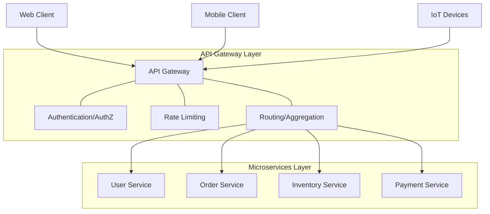

# Microservices Design Patterns: API Gateway Pattern

## 1. Pattern Overview and Intent

In a microservices architecture, a client application often needs to consume functionality from multiple microservices. If clients interact directly with each individual microservice, several challenges arise:
- **Coupling**: Clients are tightly coupled to the internal microservices structure.
- **Chattiness**: A single client operation might require multiple network calls to different services, leading to increased latency and network traffic.
- **Security**: Each microservice must implement its own security, authentication, and authorization mechanisms.
- **Cross-cutting concerns**: Features like rate limiting, logging, metrics, and CORS need to be implemented repeatedly across all services.

The **API Gateway Pattern** introduces a reverse proxy that acts as a single entry point for all client requests. It sits between the clients and the microservices, handling routing, composition, and protocol translation. The intent is to encapsulate the internal architecture and provide an API that is tailored to each client.

## 2. Detailed Explanation of How It Works

An API Gateway processes requests in the following typical flow:
1. **Request Reception**: The gateway receives an API request from a client (e.g., mobile app, web app).
2. **Authentication & Authorization**: It verifies the client's identity and permissions.
3. **Routing**: It determines which microservice(s) should handle the request.
4. **Aggregation (Optional)**: If the request requires data from multiple services, the gateway makes the necessary calls, aggregates the results, and returns a unified response.
5. **Protocol Translation**: It might translate between protocols (e.g., from HTTP on the outside to gRPC or AMQP on the inside).
6. **Cross-Cutting Operations**: It applies rate limiting, logging, caching, and payload transformation.
7. **Response Delivery**: The formatted response is sent back to the client.

### Architecture Diagram



## 3. Real-World Example: E-Commerce System

Consider an E-Commerce system where a user views their order history.

Without an API Gateway, the client app would have to call:
1. `UserService` to get user details.
2. `OrderService` to get the list of orders.
3. `InventoryService` to get product details for each order.
4. `ReviewService` to check if the user has reviewed the products.

With an API Gateway, the client makes a single call: `GET /api/v1/user/{id}/order-summary`.

### Code Snippet (Node.js Express-based API Gateway Pseudocode)

```javascript
const express = require('express');
const axios = require('axios');
const app = express();

// Middleware for authentication
app.use(async (req, res, next) => {
    const token = req.headers['authorization'];
    if (!await verifyToken(token)) {
        return res.status(401).send('Unauthorized');
    }
    next();
});

// Route with Aggregation
app.get('/api/v1/user/:id/order-summary', async (req, res) => {
    const userId = req.params.id;
    
    try {
        // Parallel calls to internal microservices
        const [userResponse, ordersResponse] = await Promise.all([
            axios.get(`http://user-service/users/${userId}`),
            axios.get(`http://order-service/orders?userId=${userId}`)
        ]);

        const user = userResponse.data;
        const orders = ordersResponse.data;

        // Fetch product details for orders
        const productIds = orders.map(o => o.productId);
        const productsResponse = await axios.post(`http://inventory-service/products/bulk`, { ids: productIds });
        const products = productsResponse.data;

        // Aggregate Data
        const summary = {
            userInfo: user,
            orderHistory: orders.map(order => ({
                orderId: order.id,
                product: products.find(p => p.id === order.productId),
                status: order.status
            }))
        };

        res.json(summary);
    } catch (error) {
        res.status(500).send('Error aggregating data');
    }
});

app.listen(3000, () => console.log('API Gateway listening on port 3000'));
```

### Comparison with BFF (Backend for Frontend)
While an API Gateway is a single entry point for *all* clients, a **BFF** creates a specific API Gateway for *each type of client* (e.g., one for Web, one for Mobile). This prevents the gateway from becoming a bloated monolith itself and tailors the API exactly to the client's needs.

## 4. Pros and Cons

### Pros
* **Insulates clients** from how application is partitioned into microservices.
* **Reduces number of round trips** between client and application, improving latency.
* **Simplifies client code** by moving aggregation and protocol translation to the server.
* Provides a **centralized place** for cross-cutting concerns like security, monitoring, and rate limiting.

### Cons
* **Single point of failure**: If the gateway goes down, the entire system is inaccessible (requires high availability setup).
* **Performance bottleneck**: Must be scaled properly to handle all incoming traffic.
* **Development bottleneck**: Can become a monolith if not managed correctly; developers must update the gateway to expose new microservice endpoints.
* **Increased complexity**: Adds another moving part to the system architecture.

## 5. When to Use / When NOT to Use

**When to Use:**
* You are building a microservices-based application with multiple client apps (web, mobile, third-party APIs).
* You need to aggregate data from multiple services to reduce client round-trips.
* You want centralized management of authentication, rate limiting, and monitoring.

**When NOT to Use:**
* Simple applications with only a few services.
* Internal systems where clients and services are on the same low-latency network and security is handled at the network level.
* When the added latency of a proxy hop is strictly unacceptable (though usually, the gateway reduces overall latency via aggregation).

## 6. Common Interview Questions

1. **What is the difference between an API Gateway and a Load Balancer?**
   * *Answer:* A load balancer distributes traffic across multiple instances of the same service at the network level (L4 or L7). An API Gateway is a specialized L7 proxy that understands the application context, performs routing based on paths/headers, aggregates data from multiple distinct services, and handles cross-cutting concerns.
2. **How does the BFF pattern differ from a traditional API Gateway?**
   * *Answer:* A traditional API Gateway serves all clients, whereas BFF provisions a dedicated gateway per client type (e.g., Mobile BFF, Web BFF).
3. **How do you handle a failing microservice in an API Gateway?**
   * *Answer:* By implementing the Circuit Breaker pattern and Fallback mechanisms within the Gateway to return cached data or default responses instead of cascading the failure.
4. **How do you prevent the API Gateway from becoming a bottleneck?**
   * *Answer:* Deploy it in a highly available cluster, use asynchronous/non-blocking I/O (like Node.js, Spring Cloud Gateway, Nginx), and horizontally scale it based on traffic.
5. **Should business logic be placed in the API Gateway?**
   * *Answer:* No. The Gateway should only contain routing, aggregation, and cross-cutting logic. Core business logic belongs in the microservices to prevent the gateway from becoming a monolithic bottleneck.

*(This concludes the deep dive into the API Gateway Pattern.)*
