# Microservices Design Patterns: API Gateway Pattern

## 1. Pattern Overview, Intent & Core Motivations

In distributed microservices architectures, client applications (web single-page apps, native iOS/Android mobile clients, third-party integrations, and IoT devices) rarely consume backend services through direct point-to-point network connections. When clients communicate directly with individual microservices, systems rapidly degrade into an unmaintainable, insecure, and sluggish state known as the **Distributed Monolith** or **Pin-cushion Architecture**.

```
Direct Client-to-Service Anti-Pattern:
[Mobile Client] ----> [User Service]
        | ----------> [Order Service]
        | ----------> [Payment Service]
        | ----------> [Inventory Service]
        + ----------> [Recommendation Service]
(Massive client-side chattiness, exposed internal IPs, fractured auth, zero unified rate limiting)
```

### The Fundamental Problems of Direct Client-to-Microservice Communication

1. **Client-Side Chattiness & High Latency (The Round-Trip Multiplier)**:
   A single high-level user screen (such as an e-commerce checkout page) requires data from 6 to 10 distinct domain services: User Profile, Order, Inventory, Pricing & Discounts, Shipping Calculation, Tax Engine, and Payment Gateways. Over mobile networks (cellular 4G/5G with fluctuating radio resource states and high round-trip latency of 50–150ms), executing serial or even concurrent round-trips from the device destroys client performance and drains battery life.
2. **Coupling to Internal Decomposition**:
   Microservice decomposition should be an internal implementation detail. If services are split, merged, or rewritten (e.g., decomposing a monolithic `OrderService` into `OrderFulfillmentService` and `OrderHistoryService`), direct client-to-service links break client backward compatibility unless complex client-side versioning is deployed.
3. **Mismatched Protocol Boundaries**:
   Internal microservices operate most efficiently using high-performance, binary, multiplexed protocols such as **gRPC (HTTP/2 with Protocol Buffers)**, **Apache Avro**, or message brokers like **Apache Kafka** and **RabbitMQ**. Web browsers and mobile clients generally speak **HTTP/1.1, HTTP/2, WebSockets, or HTTP/3 (QUIC)** with JSON payloads. Direct access forces internal teams to maintain public HTTP/JSON interfaces across every microservice.
4. **Scattered Cross-Cutting Concerns**:
   Authentication, OAuth2/OIDC token verification, centralized rate limiting, TLS termination, CORS headers, IP allow/denylisting, Web Application Firewall (WAF) filtering, request payload validation, and distributed tracing headers must be duplicated across every microservice team. Inevitably, one service misconfigures token validation or omits rate limiting, creating an enterprise security vulnerability.
5. **Attack Surface Area & Security Exposure**:
   Exposing every microservice directly to the public internet requires public IP addresses or ingress routes for all services, massively expanding the threat surface for DDoS attacks, credential stuffing, and internal reconnaissance.

---

### The API Gateway Intent & Architectural Solution

The **API Gateway Pattern** introduces a reverse-proxy routing and aggregation layer that serves as the single, hardened, and unified entry point for all external client traffic. It sits at the edge of the private microservice network boundary, abstracting internal microservice topologies, enforcing cross-cutting policies, and optimizing client communications.

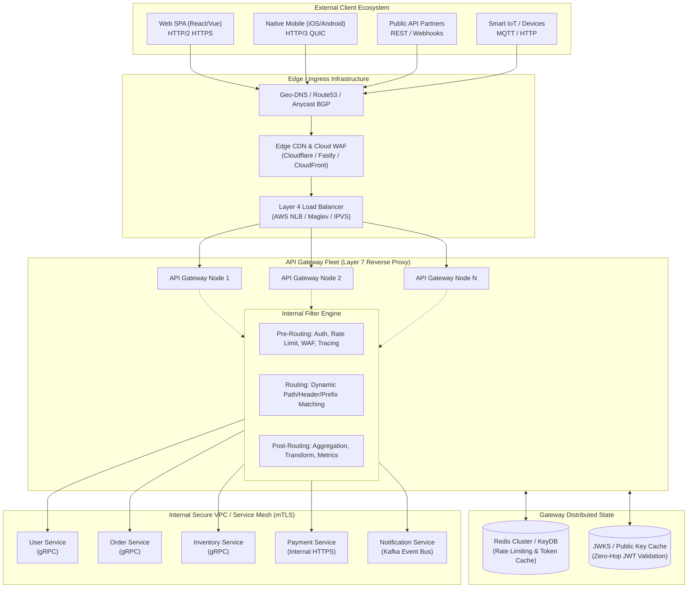

---

### OSI Positioning: Layer 4 Transport vs. Layer 7 Application Gateways

Understanding where routing occurs in the OSI stack is essential for API Gateway architecture:

| Capability / Attribute | Layer 4 Transport Balancer (e.g., AWS NLB, Linux IPVS, HAProxy TCP mode) | Layer 7 Application Gateway (e.g., Envoy, Kong, Spring Cloud Gateway, NGINX Plus) |
| :--- | :--- | :--- |
| **Inspection Depth** | TCP/UDP packet headers: Source/Dest IP, Source/Dest Port | Full HTTP/HTTPS/gRPC request: URI paths, query params, HTTP headers, cookies, JSON/Protobuf body |
| **TLS Termination** | Passes raw TCP through or terminates TLS without inspecting payload | Terminates TLS, decrypts payload, inspects/mutates headers, can re-encrypt via internal mTLS |
| **Routing Decisions** | Round-robin, least-connections, IP-hash per connection | Path-based (`/api/v1/orders`), Header-based (`X-Tenant-ID: EMEA`), Canary traffic splitting (10% to v2.0) |
| **Payload Aggregation** | Impossible (no awareness of application message boundaries) | Native support for fan-out orchestration, response stitching, and JSON transforms |
| **Throughput & Latency** | Extreme throughput (>1,000,000 req/sec per core); Sub-millisecond latency (<0.1ms) | Moderate-to-high throughput (20,000–100,000 req/sec per core); 1–5ms processing latency |
| **Primary Role** | Ingress load distribution across API Gateway instances | Business routing, security enforcement, protocol transformation, client optimization |

---

## 2. Core Architectural Approaches & Variants

There is no single "one-size-fits-all" gateway implementation. Modern enterprise architectures leverage five distinct API Gateway topologies depending on organizational structure, latency constraints, and domain complexity.

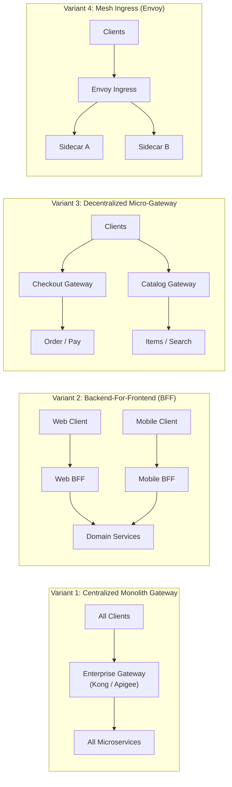

---

### Approach 1: Centralized / Monolithic API Gateway

A single, unified gateway fleet managed by a centralized platform/infrastructure team acts as the front door for every microservice in the organization.

* **Reference Technologies**: Kong Gateway Enterprise, Google Cloud Apigee, AWS API Gateway, NGINX Plus, Treblle.
* **Architecture Topology**:
  - Global Anycast IP routes traffic via Layer 4 NLB to a horizontally autoscaled cluster of gateway instances running inside the primary edge VPC.
  - Configuration (routes, plugins, rate limits) is stored in a centralized datastore (PostgreSQL for Kong) or distributed via GitOps declarative files (`kong.yml` via Ingress Controller).
  - All incoming traffic terminates its external SSL/TLS connection at this layer, executes security filters, and proxies traffic downstream across private VPC peerings or AWS Transit Gateways.

#### In-Depth High-Level Design (HLD)
```
[Client] ---> [Anycast IP] ---> [Edge CDN / WAF] ---> [Layer 4 NLB]
                                                            |
                  +-----------------------------------------+
                  |
         +--------v--------+       +-----------------+
         | Kong / Apigee   |<----->| Redis Cluster   | (Distributed Rate Limiting)
         | Gateway Node    |<----->| Control Plane DB| (Routes / Plugins)
         +--------+--------+       +-----------------+
                  |
        +---------+---------+---------+
        |                   |         |
+-------v-------+   +-------v---+  +--v------------+
| User Service  |   | Order Svc |  | Inventory Svc |
+---------------+   +-----------+  +---------------+
```

#### Low-Level Design (LLD) & Internals
- **Threading Model**: Typically leverages an event-driven, non-blocking I/O loop (such as NGINX's master-worker architecture backed by Linux `epoll` / BSD `kqueue`, or OpenResty Lua execution). A fixed pool of worker processes (one per CPU core) multiplexes tens of thousands of concurrent TCP sockets without thread context-switching overhead.
- **Request Filter Chain**:
  1. `ssl_certificate_by_lua`: Dynamic SNI-based TLS certificate selection.
  2. `access_by_lua`: IP blacklisting, OAuth2 token parsing, WAF rule validation, Redis-backed sliding-window rate limit evaluation.
  3. `rewrite_by_lua`: Path rewrites, header injection (`X-Forwarded-For`, `X-Consumer-ID`).
  4. `balancer_by_lua`: Upstream peer selection via Round-Robin, Least-Connections, or Consistent Hashing with active/passive health checkers.
  5. `header_filter_by_lua` & `body_filter_by_lua`: Stripping internal headers, injecting CORS headers, streaming response transformation.
  6. `log_by_lua`: Asynchronously formatting access logs, exporting OpenTelemetry spans and Prometheus metrics.

* **Trade-Offs**:
  - *Strengths*: Unified governance, single pane of glass for enterprise compliance, centralized billing, and audit logs.
  - *Weaknesses*: Platform team becomes an organizational bottleneck; blast radius is massive (a malformed plugin configuration can crash the gateway and take down the entire company's API); high inter-team contention on route deployments.

---

### Approach 2: Backend-For-Frontend (BFF) Architecture

Pioneered by Sam Newman and popularized by Netflix and SoundCloud, the BFF pattern decomposes the API gateway into **separate, purpose-built edge gateways tailored specifically for distinct client form factors**.

#### In-Depth High-Level Design (HLD)
Instead of a one-size-fits-all API returning identical payloads to all clients, dedicated gateways are deployed:
- **Mobile BFF**: Optimized for low-bandwidth, high-latency mobile networks. Aggregates deep object graphs, strips unneeded JSON fields (payload pruning), converts timestamps to local mobile-optimized formats, and pushes batched responses.
- **Web BFF**: Optimized for broadband connections. Can return richer, heavier payloads with server-side rendered (SSR) markup, utilizing HTTP/2 Server Push or streaming chunked transfers.
- **Third-Party / Public Partner BFF**: Hardened for enterprise API consumption with strict API key throttling, contract stability, legacy XML-to-JSON transforms, and semantic versioning (`/v1`, `/v2`).

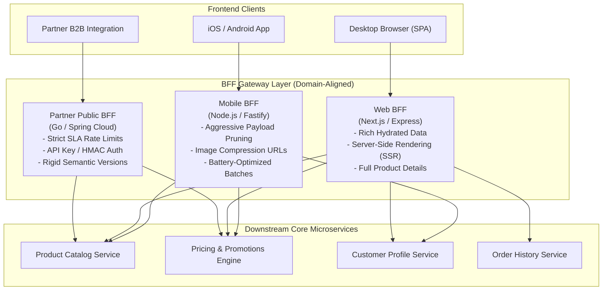

#### Low-Level Design (LLD) & Team Ownership Model
- **Ownership**: The frontend engineering team (e.g., Mobile Team) owns and deploys the Mobile BFF codebase. They dictate its release cadence, write aggregation routes, and deploy without asking backend teams for custom API fields.
- **Concurrency & Aggregation Engine**: BFFs frequently use asynchronous, event-driven runtimes like **Node.js (Fastify)** or **Go (fasthttp / Gin)**.
- **Request Coalescing with DataLoader**: BFFs often implement batching/deduplication to prevent calling the same downstream microservice multiple times within a single aggregated request (e.g., fetching author information for 20 blog posts via a single batch request `GET /authors?ids=1,2,3...`).

* **Trade-Offs**:
  - *Strengths*: Eliminates team dependencies, optimizes client-specific network payloads, isolates client-specific failure modes.
  - *Weaknesses*: Code duplication of cross-cutting concerns (authentication, rate limiting) across multiple BFF codebases; potential proliferation of dozens of BFFs if boundaries are not strictly regulated.

---

### Approach 3: Decentralized / Micro-Gateway Pattern

In ultra-large organizations (hundreds of engineering squads, thousands of microservices), a centralized gateway becomes an operational bottleneck, while BFFs may not cover internal cross-domain communication. The **Micro-Gateway Pattern** deploys lightweight, isolated gateways per business domain or bounded context (e.g., Checkout Gateway, Inventory Gateway, Streaming Gateway).

#### In-Depth High-Level Design (HLD)
- An outer Layer 4 / Layer 7 Edge Router (e.g., Cloudflare Workers or AWS CloudFront with Lambda@Edge) routes traffic based on top-level URI namespaces:
  - `api.company.com/checkout/*` $\to$ Checkout Micro-Gateway Fleet.
  - `api.company.com/catalog/*` $\to$ Catalog Micro-Gateway Fleet.
  - `api.company.com/media/*` $\to$ Media Micro-Gateway Fleet.
- Each micro-gateway is completely isolated in its own autoscaling group or Kubernetes namespace, with dedicated CPU/memory limits, connection pools, and Redis rate limiters.

#### Low-Level Design (LLD) & Blast Radius Containment
- **Blast Radius Elimination**: A memory leak, regex CPU exhaustion (ReDoS), or cascading crash in the Catalog Gateway has zero operational impact on the Checkout Gateway's ability to process credit card payments.
- **Independent Scaling Profiles**: The Catalog Gateway experiences high read traffic (100,000 req/sec) and is tuned for high concurrency, memory-heavy caching, and aggressive keep-alives. The Payment/Checkout Gateway experiences lower volume (2,000 req/sec) but requires strict transaction guarantees, zero connection drop tolerance, and hardware security module (HSM) integrations.

---

### Approach 4: Service Mesh Ingress Gateway (Envoy / Istio)

In environments where internal services already participate in a **Service Mesh** (such as Istio, Linkerd, or Consul Connect), the API Gateway function is naturally split into an **Ingress Gateway** backed by Envoy Proxy.

#### In-Depth High-Level Design (HLD)
The Ingress Gateway acts as the bridge between external untrusted client traffic and the internal mutual TLS (mTLS) zero-trust service mesh.
- **Control Plane**: Istio Pilot (`istiod`) translates Kubernetes custom resources (`Gateway`, `VirtualService`, `EnvoyFilter`) into Envoy dynamic configuration via xDS protocols (LDS, RDS, CDS, EDS).
- **Data Plane**: Envoy Ingress Proxy terminates client TLS, validates JWT tokens at line rate using WebAssembly (Wasm) or native C++ filters, and injects cryptographic SPIFFE/SPIRE identity tokens before initiating mTLS connections to the target sidecar proxy.

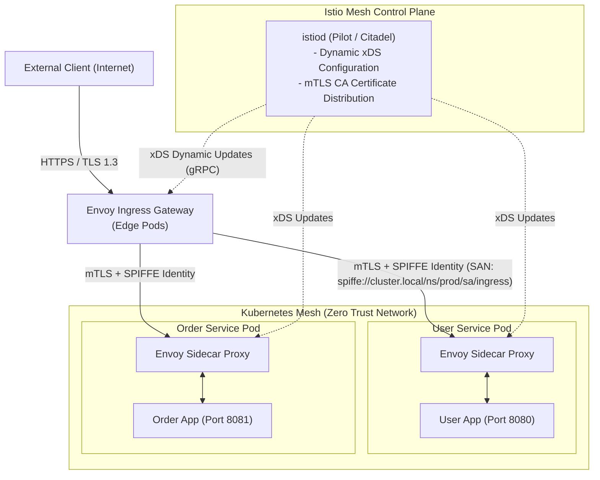

#### Low-Level Design (LLD) & Envoy Internals
- **C++ Multi-Threaded Event Loop**: Envoy operates a master thread for socket management and coordination, and independent worker threads bound to CPU cores running libevent loops. Requests are processed without lock contention between worker threads.
- **Filter Chains**: Envoy's `http_connection_manager` processes requests via a composable pipeline of C++ or WebAssembly (Wasm) filters:
  - `envoy.filters.http.jwt_authn`: Validates signatures against remote JWKS without passing unverified requests down the stack.
  - `envoy.filters.http.ratelimit`: Queries an external gRPC rate limit service via asynchronous non-blocking RPC.
  - `envoy.filters.http.router`: Matches routes and transmits bytes to upstream clusters with connection pooling and outlier detection.

---

### Approach 5: GraphQL Federation Gateway (Apollo Federation)

For massive frontend ecosystems querying complex, interconnected object graphs, REST-based API gateways force either over-fetching, under-fetching, or an explosion of bespoke aggregation endpoints. **GraphQL Federation** solves this by composing multiple independently deployed GraphQL services (Subgraphs) into a single, unified enterprise graph (Supergraph) exposed via an API Gateway (Apollo Router).

#### In-Depth High-Level Design (HLD)
- Each backend team deploys a **Subgraph** (e.g., `Accounts Subgraph`, `Products Subgraph`, `Reviews Subgraph`).
- A schema registry (Apollo Studio or Hive) continuously validates and merges subgraph schemas into a monolithic **Supergraph Schema**.
- The **Apollo Router** (written in Rust for zero-garbage-collection sub-millisecond execution) accepts client GraphQL queries, generates an optimized **Query Execution Plan**, queries the subgraphs in parallel, merges the partial JSON structures, and returns a single unified response.

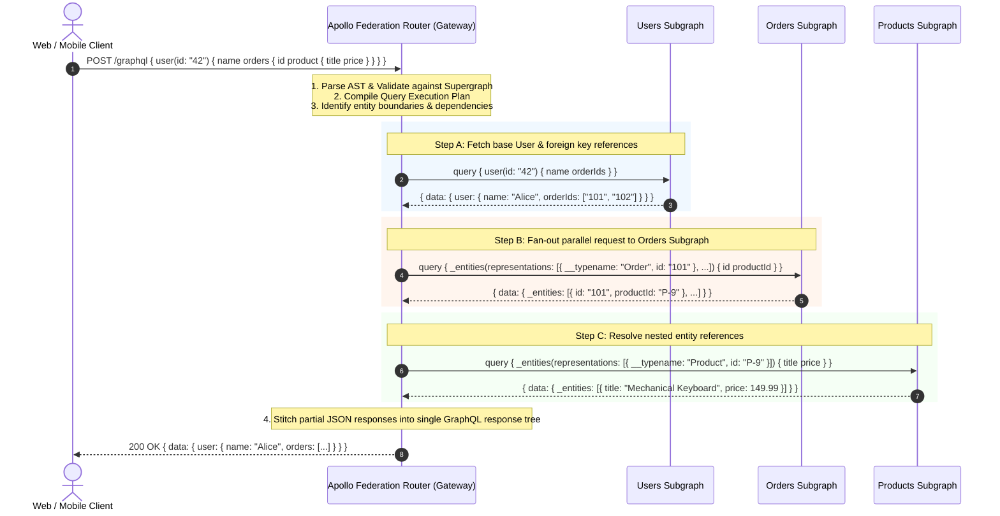

#### Low-Level Design (LLD) & Entity Federation Semantics
- **Entities & Primary Keys**: Subgraphs define entities using the `@key` directive:
  ```graphql
  # Products Subgraph Schema
  type Product @key(fields: "id") {
    id: ID!
    title: String!
    price: Float!
  }
  ```
- **Extending Types Across Boundaries**: Another subgraph can extend that entity without owning it:
  ```graphql
  # Reviews Subgraph Schema
  type Product @key(fields: "id") {
    id: ID!
    reviews: [Review!]!
  }
  ```
- **Query Plan Optimization**: The Apollo Router uses directed acyclic graph (DAG) dependency resolution to determine which subgraphs must execute sequentially (due to field dependencies) versus which can execute in parallel, radically outperforming naive recursive resolvers.

---

## 3. Low-Level Gateway Internals & Engineering Mechanics

To survive sustained loads of hundreds of thousands of requests per second under turbulent network conditions, an API Gateway requires meticulous low-level engineering across its filter pipeline, threading architecture, connection pooling, and distributed rate limiting.

### 3.1 Request Filter Chain Execution Pipeline

Every request ingested by an enterprise gateway traverses a strictly ordered, bi-directional pipeline divided into four distinct phases: **Pre-Routing**, **Routing**, **Post-Routing**, and **Error Handling**.

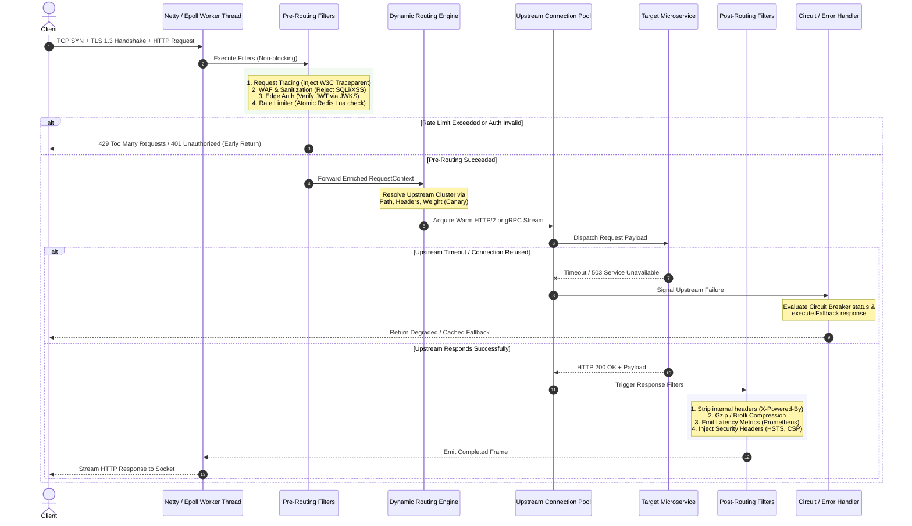

---

### 3.2 Threading & Concurrency Models: Thread-per-Request vs. Event Loops

The architectural split between legacy gateways (e.g., Netflix Zuul 1.x, Spring Cloud Gateway 1.x on Tomcat) and modern edge gateways (e.g., Envoy, Netflix Zuul 2.x, Spring Cloud Gateway on Netty, Kong) centers entirely around the underlying I/O concurrency model.

```
Model A: Thread-Per-Request (Blocking I/O - Tomcat / Zuul 1)
[Thread 1] ===(Read)===> [Blocked on Upstream Svc A (200ms)] ===(Write)===> [Done]
[Thread 2] ===(Read)===> [Blocked on Upstream Svc B (500ms)] ===(Write)===> [Done]
* When 500 downstream calls slow down, 500 threads freeze -> OS Stack Overflow & Out-Of-Memory.

Model B: Non-Blocking Event-Driven (Netty / Envoy / Zuul 2)
[Epoll Loop] ---> Socket 1 Readable ---> Trigger Pipeline ---> Register Upstream Socket
             ---> Socket 2 Writable ---> Flush Chunk Bytes
             ---> Timer Expired   ---> Abort Stalled Stream
* 1 Event Loop per CPU core handles 50,000 concurrent open connections effortlessly.
```

| Concurrency Dimension | Thread-per-Request (BIO / Synchronous NIO) | Non-Blocking Event Loop (Netty / Epoll / Kqueue) |
| :--- | :--- | :--- |
| **Thread Count** | High (500–2,000 threads per instance) | Minimal (1 to 2 threads per physical CPU core) |
| **Memory Footprint** | Massive (Each OS thread allocates 1MB stack memory; 1,000 threads $\approx$ 1GB stack) | Tiny (Thread stacks fixed at startup; memory allocated in off-heap direct byte buffers) |
| **Context Switching Overhead** | Severe under load; CPU spends 30–40% of time in kernel context switching | Zero inter-thread context switching on request path; optimal L1/L2/L3 CPU cache residency |
| **Slow Backend Sensitivity** | Fatal: Stalled backend microservices exhaust the thread pool, starving unrelated routes (**Cascading Thread Starvation**) | Highly Resilient: A stalled microservice only holds an idle socket descriptor; event loop continues servicing other traffic |
| **Programming Complexity** | Simple: Synchronous, sequential, standard imperative stack traces | Complex: Reactive programming (`Mono`/`Flux`), callback hell, or async/await; stack traces decoupled from execution context |

---

### 3.3 Connection Pooling & Protocol Engineering

A gateway must manage two independent connection lifecycles:
1. **Downstream Connections (Client to Gateway)**: High latency, untrusted, bursty, public internet (often HTTP/1.1 or HTTP/2, prone to mobile disconnects).
2. **Upstream Connections (Gateway to Microservices)**: Low latency (<1ms), trusted private datacenter/VPC, high throughput.

#### Critical Connection Pool Optimizations
- **Multiplexed HTTP/2 & gRPC Upstreams**: Instead of paying the TCP 3-way handshake and TLS negotiation cost per request, the gateway maintains long-lived, persistent HTTP/2 connections. Multiple concurrent requests travel across a single TCP socket via binary streams, eliminating head-of-line blocking at the transport layer.
- **Connection Warm-Up**: On gateway startup or route reloading, connection pools pre-establish a baseline number of TCP sockets to upstream targets to prevent connection-establishment latency spikes during sudden traffic surges.
- **TCP Keep-Alive & Idle Timeouts**:
  - `idle_timeout`: Idle connections in the pool are closed after 60 seconds to prevent silent socket drops by cloud NAT gateways (e.g., AWS NAT Gateway drops silent connections after 350 seconds).
  - `tcp_keepalive`: Probes are transmitted every 15 seconds with 3 retries to detect dead upstream nodes immediately.

---

### 3.4 Distributed Rate Limiting Engineering

In a distributed cluster of 50 API Gateway nodes, local in-memory rate limiting is insufficient: a malicious client could cycle through gateway instances and exceed their quota fifty-fold. A centralized, atomic datastore (Redis) is required.

#### Rate Limiting Algorithm Comparison

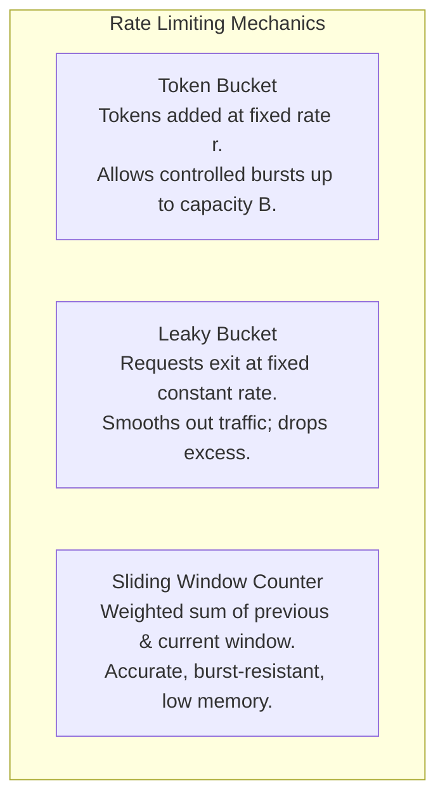

1. **Token Bucket**: Allows bursts of traffic up to capacity $B$ while enforcing a continuous average replenishment rate $r$. Ideal for public REST APIs.
2. **Leaky Bucket (Traffic Shaping)**: Queues requests and discharges them at an exact, smooth rate. Ideal for egress data streams or ingress pipelines feeding rigid transactional backends.
3. **Sliding Window Counter**: The industry standard for distributed API Gateways. Avoids the edge-boundary vulnerability of Fixed Window counters where an attacker sends $2\times$ the limit at the boundary transition point.

#### Production Sliding Window Rate Limiter: Atomic Redis Lua Script
The following Lua script implements an atomic sliding window counter utilizing Redis Sorted Sets (`ZSET`). It runs atomically inside Redis, preventing race conditions without requiring distributed locks.

```lua
-- KEYS[1]: Rate limit key (e.g., "ratelimit:user_12345:orders")
-- ARGV[1]: Current UNIX timestamp in milliseconds
-- ARGV[2]: Sliding window duration in milliseconds (e.g., 60000 for 1 minute)
-- ARGV[3]: Maximum permitted requests within the window
-- ARGV[4]: Unique Request ID (to prevent duplicate member insertion in ZSET)

local key = KEYS[1]
local now = tonumber(ARGV[1])
local window = tonumber(ARGV[2])
local limit = tonumber(ARGV[3])
local requestId = ARGV[4]

local clearBefore = now - window

-- Step 1: Evict timestamps outside the sliding window boundary
redis.call('ZREMRANGEBYSCORE', key, '-inf', clearBefore)

-- Step 2: Query the number of requests currently recorded in the active window
local currentRequests = redis.call('ZCARD', key)

if currentRequests < limit then
    -- Step 3: Record current request timestamp into the ZSET
    redis.call('ZADD', key, now, requestId)
    -- Step 4: Refresh TTL so stale keys expire automatically
    redis.call('PEXPIRE', key, window)
    
    -- Return array: [1 = Allowed, Remaining Quota, Retry-After (0)]
    return {1, limit - currentRequests - 1, 0}
else
    -- Quota exceeded: Calculate time until the oldest request expires
    local oldest = redis.call('ZRANGE', key, 0, 0, 'WITHSCORES')
    local retryAfterMs = 0
    if #oldest > 0 then
        retryAfterMs = math.max(0, math.ceil((tonumber(oldest[2]) + window) - now))
    end
    
    -- Return array: [0 = Blocked, 0 Quota, Retry-After in ms]
    return {0, 0, retryAfterMs}
end
```

---

## 4. Concrete Production Implementations

### 4.1 Spring Cloud Gateway: Custom Reactive Filter with Redis Sliding-Window Rate Limiter

This production-grade Java implementation utilizes **Spring Cloud Gateway (Project Reactor / WebFlux non-blocking engine)** and Spring Data Reactive Redis to execute custom token evaluation and rate limiting.

```java
package com.enterprise.gateway.filters;

import org.springframework.cloud.gateway.filter.GatewayFilter;
import org.springframework.cloud.gateway.filter.factory.AbstractGatewayFilterFactory;
import org.springframework.core.io.ClassPathResource;
import org.springframework.data.redis.core.ReactiveStringRedisTemplate;
import org.springframework.data.redis.core.script.DefaultRedisScript;
import org.springframework.http.HttpHeaders;
import org.springframework.http.HttpStatus;
import org.springframework.http.server.reactive.ServerHttpResponse;
import org.springframework.scripting.support.ResourceScriptSource;
import org.springframework.stereotype.Component;
import org.springframework.web.server.ServerWebExchange;
import reactor.core.publisher.Mono;

import java.util.Collections;
import java.util.List;
import java.util.UUID;

@Component
public class DistributedRateLimitGatewayFilterFactory 
        extends AbstractGatewayFilterFactory<DistributedRateLimitGatewayFilterFactory.Config> {

    private final ReactiveStringRedisTemplate redisTemplate;
    private final DefaultRedisScript<List> rateLimitScript;

    public DistributedRateLimitGatewayFilterFactory(ReactiveStringRedisTemplate redisTemplate) {
        super(Config.class);
        this.redisTemplate = redisTemplate;
        
        // Load the atomic Lua script from classpath
        this.rateLimitScript = new DefaultRedisScript<>();
        this.rateLimitScript.setScriptSource(
            new ResourceScriptSource(new ClassPathResource("scripts/sliding_window_rate_limiter.lua"))
        );
        this.rateLimitScript.setResultType(List.class);
    }

    public static class Config {
        private int limit = 100;                 // Max requests
        private long windowMillis = 60000;       // Window duration (default 1 min)

        public int getLimit() { return limit; }
        public void setLimit(int limit) { this.limit = limit; }
        public long getWindowMillis() { return windowMillis; }
        public void setWindowMillis(long windowMillis) { this.windowMillis = windowMillis; }
    }

    @Override
    public GatewayFilter apply(Config config) {
        return (exchange, chain) -> {
            String clientIp = resolveClientIdentifier(exchange);
            String routeId = exchange.getAttribute(
                org.springframework.cloud.gateway.support.ServerWebExchangeUtils.GATEWAY_PREDICATE_ROUTE_ATTR
            );
            String redisKey = String.format("ratelimit:%s:%s", routeId != null ? routeId : "default", clientIp);

            long now = System.currentTimeMillis();
            String requestId = UUID.randomUUID().toString();

            List<String> keys = Collections.singletonList(redisKey);
            String[] args = new String[]{
                String.valueOf(now),
                String.valueOf(config.getWindowMillis()),
                String.valueOf(config.getLimit()),
                requestId
            };

            return redisTemplate.execute(rateLimitScript, keys, List.of(args))
                .next()
                .flatMap(result -> {
                    // Result: [allowed (0 or 1), remaining, retryAfterMs]
                    Long isAllowed = (Long) result.get(0);
                    Long remaining = (Long) result.get(1);
                    Long retryAfterMs = (Long) result.get(2);

                    ServerHttpResponse response = exchange.getResponse();
                    HttpHeaders headers = response.getHeaders();

                    headers.add("X-RateLimit-Limit", String.valueOf(config.getLimit()));
                    headers.add("X-RateLimit-Remaining", String.valueOf(remaining));

                    if (isAllowed == 1) {
                        // Pass downstream to next filter in the pipeline
                        return chain.filter(exchange);
                    } else {
                        // Reject request with 429 Too Many Requests
                        headers.add("Retry-After", String.valueOf(Math.ceil(retryAfterMs / 1000.0)));
                        response.setStatusCode(HttpStatus.TOO_MANY_REQUESTS);
                        return response.setComplete();
                    }
                })
                .onErrorResume(ex -> {
                    // Fail-Open Policy: If Redis cluster crashes, log alert and allow traffic
                    // to prevent API Gateway from taking down the business
                    System.err.println("CRITICAL: Redis Rate Limiter failed! Failing open. Error: " + ex.getMessage());
                    return chain.filter(exchange);
                });
        };
    }

    private String resolveClientIdentifier(ServerWebExchange exchange) {
        // Prioritize authenticated Subject ID from JWT, fallback to X-Forwarded-For, then remote socket address
        String jwtSubject = exchange.getRequest().getHeaders().getFirst("X-User-Id");
        if (jwtSubject != null && !jwtSubject.isBlank()) {
            return "user:" + jwtSubject;
        }
        String xForwardedFor = exchange.getRequest().getHeaders().getFirst("X-Forwarded-For");
        if (xForwardedFor != null && !xForwardedFor.isBlank()) {
            return "ip:" + xForwardedFor.split(",")[0].trim();
        }
        return "ip:" + exchange.getRequest().getRemoteAddress().getAddress().getHostAddress();
    }
}
```

---

### 4.2 Production Envoy Gateway Configuration (v3 API)

Below is an enterprise Envoy Proxy v3 configuration showing **Edge TLS termination**, **HTTP Connection Manager filter chains**, **Distributed Rate Limiting via gRPC**, and **Outlier Detection / Circuit Breaking**.

```yaml
static_resources:
  listeners:
  - name: external_edge_listener
    address:
      socket_address:
        address: 0.0.0.0
        port_value: 8443
    filter_chains:
    - transport_socket:
        name: envoy.transport_sockets.tls
        typed_config:
          "@type": type.googleapis.com/envoy.extensions.transport_sockets.tls.v3.DownstreamTlsContext
          common_tls_context:
            tls_certificates:
            - certificate_chain: { filename: "/etc/envoy/certs/tls.crt" }
              private_key: { filename: "/etc/envoy/certs/tls.key" }
            alpn_protocols: ["h2,http/1.1"]
      filters:
      - name: envoy.filters.network.http_connection_manager
        typed_config:
          "@type": type.googleapis.com/envoy.extensions.filters.network.http_connection_manager.v3.HttpConnectionManager
          stat_prefix: ingress_edge_http
          codec_type: AUTO
          use_remote_address: true
          
          # HTTP Request Filter Chain
          http_filters:
          - name: envoy.filters.http.jwt_authn
            typed_config:
              "@type": type.googleapis.com/envoy.extensions.filters.http.jwt_authn.v3.JwtAuthentication
              providers:
                auth0_provider:
                  issuer: https://auth.enterprise.com/
                  audiences: ["https://api.enterprise.com"]
                  remote_jwks:
                    http_uri:
                      uri: https://auth.enterprise.com/.well-known/jwks.json
                      cluster: jwks_cluster
                      timeout: 1s
                    cache_duration: 300s
              rules:
              - match: { prefix: "/api/v1/orders" }
                requires: { provider_name: "auth0_provider" }

          - name: envoy.filters.http.ratelimit
            typed_config:
              "@type": type.googleapis.com/envoy.extensions.filters.http.ratelimit.v3.RateLimit
              domain: edge_ingress_limits
              request_type: external
              rate_limit_service:
                transport_api_version: V3
                grpc_service:
                  envoy_grpc:
                    cluster_name: external_ratelimit_grpc_service

          - name: envoy.filters.http.router
            typed_config:
              "@type": type.googleapis.com/envoy.extensions.filters.http.router.v3.Router

          route_config:
            name: enterprise_routes
            virtual_hosts:
            - name: api_vhost
              domains: ["api.enterprise.com"]
              routes:
              - match: { prefix: "/api/v1/orders" }
                route:
                  cluster: order_service_cluster
                  timeout: 3.0s
                  retry_policy:
                    retry_on: "5xx,connect-failure,refused-stream"
                    num_retries: 3
                    per_try_timeout: 1.0s
                    retry_back_off:
                      base_interval: 0.1s
                      max_interval: 1.0s

  clusters:
  - name: order_service_cluster
    connect_timeout: 0.5s
    type: STRICT_DNS
    lb_policy: ROUND_ROBIN
    http2_protocol_options: {} # Native gRPC / HTTP2 multiplexing
    
    # Low-Level Circuit Breaking & Outlier Detection
    circuit_breakers:
      thresholds:
      - priority: DEFAULT
        max_connections: 1024
        max_pending_requests: 512
        max_requests: 4096
        max_retries: 3

    outlier_detection:
      consecutive_5xx: 5
      interval: 10s
      base_ejection_time: 30s
      max_ejection_percent: 50
      enforcing_consecutive_5xx: 100

    load_assignment:
      cluster_name: order_service_cluster
      endpoints:
      - lb_endpoints:
        - endpoint:
            address:
              socket_address:
                address: order-service.internal.mesh
                port_value: 8080
```

---

### 4.3 Production Node.js / TypeScript BFF Gateway with Batching & Circuit Breakers

This code demonstrates an enterprise Fastify-based Mobile BFF aggregating order summaries with concurrent requests, timeout enforcement, circuit breakers (`opossum`), and DataLoader batching.

```typescript
import fastify, { FastifyInstance, FastifyRequest, FastifyReply } from 'fastify';
import CircuitBreaker from 'opossum';
import DataLoader from 'dataloader';
import { Agent, fetch } from 'undici';

// Custom persistent HTTP/2 & Keep-Alive connection pool agent
const internalPool = new Agent({
  keepAliveTimeout: 30_000,
  keepAliveMaxTimeout: 60_000,
  connections: 100,
  pipelining: 1
});

interface OrderSummaryResponse {
  userId: string;
  userFullName: string;
  orders: Array<{
    orderId: string;
    totalAmount: number;
    productName: string;
  }>;
}

// 1. Batch Product Fetching via DataLoader to eliminate N+1 microservice calls
const productBatchLoader = new DataLoader<string, any>(async (productIds) => {
  const response = await fetch('http://inventory-service.internal/products/bulk', {
    method: 'POST',
    body: JSON.stringify({ ids: productIds }),
    headers: { 'Content-Type': 'application/json' },
    dispatcher: internalPool,
  });
  if (!response.ok) throw new Error('Inventory Service Batch Failure');
  const products: any = await response.json();
  
  // Return items strictly aligned to input productIds array index
  return productIds.map(id => products.find((p: any) => p.id === id) || null);
});

// 2. Circuit Breaker configurations for fragile downstream services
const breakerOptions: CircuitBreaker.Options = {
  timeout: 2000,              // Trigger failure if downstream takes > 2s
  errorThresholdPercentage: 50, // Open circuit if 50% of requests fail
  resetTimeout: 15000          // Wait 15s in Open state before testing Half-Open
};

const userServiceBreaker = new CircuitBreaker(async (userId: string, authHeader: string) => {
  const res = await fetch(`http://user-service.internal/users/${userId}`, {
    headers: { 'Authorization': authHeader },
    dispatcher: internalPool
  });
  if (!res.ok) throw new Error(`User service HTTP ${res.status}`);
  return res.json();
}, breakerOptions);

const orderServiceBreaker = new CircuitBreaker(async (userId: string) => {
  const res = await fetch(`http://order-service.internal/orders?userId=${userId}`, {
    dispatcher: internalPool
  });
  if (!res.ok) throw new Error(`Order service HTTP ${res.status}`);
  return res.json();
}, breakerOptions);

// Fallback logic when User Service is down
userServiceBreaker.fallback(() => ({ id: 'UNKNOWN', name: 'Valued Customer (Cached)' }));

// 3. Initialize Gateway Server
const server: FastifyInstance = fastify({ logger: true });

server.get('/mobile/v1/users/:id/dashboard', async (request: FastifyRequest, reply: FastifyReply) => {
  const { id } = request.params as { id: string };
  const authHeader = request.headers['authorization'] || '';

  const correlationId = request.headers['x-correlation-id'] || crypto.randomUUID();

  try {
    // Concurrent Fan-Out using Circuit Breakers
    const [userData, ordersData]: [any, any] = await Promise.all([
      userServiceBreaker.fire(id, authHeader),
      orderServiceBreaker.fire(id)
    ]);

    // Gather unique product IDs from orders
    const productIds: string[] = ordersData.map((order: any) => order.productId);
    
    // Batch load product details in a single bulk request via DataLoader
    const productList = await Promise.all(productIds.map(pId => productBatchLoader.load(pId)));

    // Mobile-optimized payload pruning (strips internal fields, transmits minimal bytes)
    const payload: OrderSummaryResponse = {
      userId: userData.id,
      userFullName: userData.name,
      orders: ordersData.map((order: any, idx: number) => ({
        orderId: order.id,
        totalAmount: order.totalPrice,
        productName: productList[idx]?.name ?? 'Item Details Unavailable'
      }))
    };

    reply
      .header('X-Correlation-ID', correlationId)
      .header('Cache-Control', 'private, max-age=10')
      .send(payload);

  } catch (err: any) {
    request.log.error({ err, correlationId }, 'BFF Aggregation failed critically');
    reply.status(502).send({ 
      error: 'Bad Gateway', 
      message: 'Failed to aggregate required dashboard resources',
      correlationId 
    });
  }
});

server.listen({ port: 3000, host: '0.0.0.0' });
```

---

## 5. Production Resiliency, Failure Modes & Edge Cases

An API Gateway represents the absolute edge boundary of your platform. When failure strikes the gateway layer, the entire digital enterprise goes dark. Production implementations must engineer defenses for the following battle-tested failure scenarios.

### 5.1 Thundering Herd & Cache Stampede Mitigation (Single-Flight Pattern)

When a hot cache entry expires (e.g., an e-commerce flash sale homepage banner viewed by 50,000 users/second), thousands of concurrent requests miss the gateway cache simultaneously and slam the upstream microservice. The service crashes under the sudden load spike, causing the gateway's circuit breakers to trip.

#### Architectural Defense: Request Coalescing (Single-Flight Pattern)
The gateway intercepts identical concurrent cache-miss requests. The first incoming request is allowed through to query the upstream microservice; all subsequent identical requests queue up in memory awaiting the initial response. Once returned, the single response is broadcast to all waiting client sockets and populated into cache.

```
Incoming: 10,000 requests for GET /products/hot-deal
Without Single-Flight: Gateway fires 10,000 requests to Upstream ---> Upstream OOM Crashes
With Single-Flight:
[10,000 reqs] ---> [Gateway Mutex (Key: /products/hot-deal)]
                        |
                        +---> 1 Request Dispatched to Upstream
                        |     (Remaining 9,999 await Promise/Channel)
                        |
[All 10,000 reqs receive identical upstream payload via local broadcast]
```

---

### 5.2 Cascading Timeouts & Global Deadline Propagation

A catastrophic failure mode occurs when upstream timeout settings are misaligned:
- Gateway timeout: 5.0 seconds
- Service A (Orchestrator) timeout: 4.0 seconds
- Service B (Worker) timeout: 3.0 seconds

If an edge client terminates their browser connection after 1.5 seconds, the gateway and downstream microservices may waste CPU, memory, and database connection pool resources processing work that the client has already abandoned.

#### Architectural Defense: gRPC / Distributed Deadlines
Every incoming request is tagged with an absolute UTC deadline timestamp:
$$\text{Deadline} = \text{CurrentTime} + \text{TimeoutBudget}$$
The gateway injects this deadline via headers (`X-Request-Deadline: 1715000005200` or gRPC `grpc-timeout: 2000m`). Each downstream service checks remaining budget before making further sub-calls or database queries. If $\text{Deadline} < \text{CurrentTime}$, the operation aborts immediately, stopping wasted compute cycles.

---

### 5.3 Zero-Downtime Dynamic Configuration & Hot-Reloading

In a cloud-native platform where hundreds of microservices deploy multiple times daily, restarting the API Gateway to pick up new routing rules is unacceptable. Doing so drops active TCP connections, empties in-flight connection pools, and introduces latency spikes.

#### Architectural Mechanics: The xDS Dynamic Control Plane
Modern gateways (Envoy, Traefik, Kong DB-less) decouple the **Data Plane** (request proxying) from the **Control Plane** (configuration management) via asynchronous streaming gRPC connections:

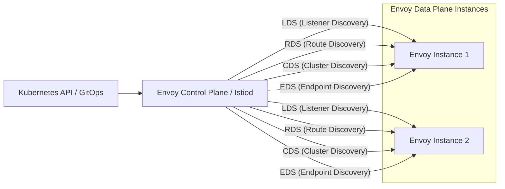

1. **LDS (Listener Discovery Service)**: Pushes changes to listening ports and TLS certificates dynamically.
2. **RDS (Route Discovery Service)**: Updates URL prefix mappings and headers without dropping connections.
3. **CDS (Cluster Discovery Service)**: Registers new upstream backend service definitions.
4. **EDS (Endpoint Discovery Service)**: Streams live container IP updates directly as pods spin up or terminate, bypassing stale DNS caches completely.

---

### 5.4 High Availability & Multi-Region Active-Active Routing

To survive total cloud availability zone or regional outages:
- **Anycast BGP + Geo-DNS**: Route53 / Cloudflare DNS advertises low-latency edge IPs, routing traffic to the nearest healthy datacenter region.
- **Fail-Open Policy on Gateway Dependencies**: If distributed rate-limiting infrastructure (Redis) or telemetry loggers (Kafka) fail completely, the API Gateway must automatically shift into **Fail-Open Mode**, logging a critical alert while permitting business-critical user requests to pass downstream uninhibited.

---

## 6. Comprehensive Comparison & Trade-Off Matrix

The following matrix compares all five API Gateway approaches across core architectural and operational dimensions.

| Evaluation Dimension | 1. Centralized Monolith Gateway | 2. Backend-For-Frontend (BFF) | 3. Decentralized Micro-Gateway | 4. Service Mesh Ingress (Envoy) | 5. GraphQL Federation Gateway |
| :--- | :--- | :--- | :--- | :--- | :--- |
| **Typical Tech Stack** | Kong, Apigee, AWS API GW, NGINX Plus | Node.js (Fastify), Go (Gin), Next.js | Traefik, Spring Cloud Gateway, Envoy | Envoy Proxy + Istio / Linkerd | Apollo Router (Rust), Apollo Gateway |
| **Added Latency (p99)** | 1.5ms – 4.0ms | 3.0ms – 10.0ms (Aggregation fan-out) | 1.0ms – 2.5ms | 0.8ms – 2.0ms | 5.0ms – 15.0ms (Query plan + AST parse) |
| **Architectural Complexity** | Low to Medium | Medium | Medium to High | High to Very High | Very High |
| **Operational Overhead** | Low (Single central platform team) | High (Multiple BFFs to maintain) | High (Multiple gateway fleets to monitor) | Very High (Control plane + mesh maintenance) | High (Schema registry governance required) |
| **Blast Radius of Failure** | **Catastrophic** (Entire platform fails) | **Low** (Only specific client type fails) | **Low** (Only specific business domain fails) | **Medium** (Ingress tier isolated per cluster) | **High** (Broken supergraph stalls all clients) |
| **Team Autonomy** | Very Low (Central queue for route approvals) | **Maximum** (Frontend teams ship independently) | High (Domain squads own their gateway) | Medium (Platform + App squad shared) | High (Federated subgraph teams publish schemas) |
| **Network Chattiness Reduction** | Minimal (Standard pass-through proxying) | **Maximum** (Deep bespoke payload aggregation) | Moderate (Domain-scoped aggregation) | Low (Primarily routing/mTLS translation) | **Maximum** (Declarative field-level retrieval) |
| **Best Suited For** | Regulated enterprise compliance & public APIs | Multi-client ecosystems (Web, iOS, Android, TV) | Massive organizations with autonomous business units | Zero-Trust Kubernetes native architectures | Highly relational, data-dense client graphs |

---

## 7. Real-World Enterprise Case Studies

### 7.1 Netflix: The Evolution from Zuul 1 to Zuul 2 and Envoy

#### The Zuul 1 Crisis
Netflix originally built **Zuul 1**, an open-source gateway based on the standard synchronous Java Servlet API (`javax.servlet.Servlet`). Each incoming request bound a dedicated thread from a limited thread pool.
- **The Failure**: When an internal microservice suffered latency degradation (e.g., response time spiked from 20ms to 2,000ms), threads waiting for I/O were blocked. Within seconds, Zuul 1's entire thread pool of 1,500 worker threads was depleted. The gateway began rejecting all incoming Netflix streaming traffic globally with HTTP 500 errors—even though 95% of backend microservices were completely healthy.

#### The Architecture of Zuul 2
Netflix completely re-architected the gateway into **Zuul 2**, migrating to asynchronous non-blocking I/O powered by **Netty**:
- Worker threads were reduced to a small, fixed count equal to available CPU cores ($2 \times \text{cores}$).
- Netty event loops registered connection socket channels with Linux `epoll`.
- When an upstream service stalled, the worker thread simply registered an I/O callback and immediately returned to the event loop to process other user traffic.
- Connection volume increased tenfold to over **500,000 concurrent long-lived connections per cluster**, supporting push notifications and WebSocket streaming with zero thread starvation.

---

### 7.2 Uber: EdgeStack and the RTAPI Architecture

#### The Challenge
Uber's global mobile application ecosystem handles millions of concurrent driver-rider real-time coordinates, ride requests, and delivery state changes across 70+ countries. Early direct routing models caused severe mobile battery drain and unpredictable latency across emerging market cellular networks.

#### The Solution: EdgeStack / RTAPI
Uber created **EdgeStack** and the **RTAPI (Real-Time API)** gateway layer:
- **Protocol Optimization**: Terminates QUIC (HTTP/3) at the edge, converting flaky cellular connections into persistent, multiplexed internal gRPC streams.
- **Schema-Driven Code Generation**: Utilizes Apache Thrift and Protobuf to generate strongly typed models across edge gateway layers, eliminating runtime JSON parsing bugs.
- **Dynamic Context Propagation**: Injects Uber-specific session contexts, including Geo-hashing, device battery level, network quality indicators, and payment profiles, into every downstream RPC call without burdening mobile clients.

---

### 7.3 Airbnb: Viaduct — Enterprise GraphQL Federation at Scale

#### The Challenge
Airbnb's migration from a legacy Rails monolith to hundreds of microservices created severe fragmentation. Frontend engineers spent weeks negotiating API formats with backend teams, leading to massive over-fetching and duplicated aggregation controllers across services.

#### The Solution: Viaduct
Airbnb engineered **Viaduct**, a centralized data mesh and GraphQL federation gateway:
- Internal backend services define their domain schemas and data loaders.
- Viaduct automatically compiles these schemas into a single enterprise graph.
- The gateway acts as an intelligent compiler: client queries are parsed, analyzed for depth and complexity, transformed into an optimized query execution plan, and fanned out in parallel to underlying Java/Go services.
- Reduced mobile payload sizes by up to **45%** and cut frontend feature delivery cycles from months to days.

---

## 8. System Design Interview Masterclass: Deep-Dive Questions & Answers

### Question 1: How does an API Gateway differ from a Load Balancer, and why can't an L7 Load Balancer replace an enterprise API Gateway?

#### Architectural Answer
While both components route network traffic, they solve fundamentally different problems at distinct abstraction layers:
- **Load Balancers (e.g., AWS ALB, HAProxy, F5 BIG-IP)** are optimized for pure transport and protocol load distribution. They balance connections across identical server pools using algorithms like Round Robin or Least Connections. Their knowledge of application state is minimal: path-based routing (`/images/*`), SSL termination, and basic health checks.
- **API Gateways (e.g., Envoy, Kong, Spring Cloud Gateway)** are specialized application proxies that encapsulate business topology. A gateway performs:
  1. **Cross-Service Data Aggregation & Composition**: Joining responses from 5 microservices into a single JSON payload.
  2. **Protocol Translation**: Translating public WebSockets / HTTP/REST into internal gRPC / Protobuf / Kafka messages.
  3. **Identity Token Transformation**: Decrypting external OAuth2/OIDC JWT bearer tokens, verifying signatures, and injecting sanitized internal security identity headers (`X-User-Id`, `X-User-Roles`).
  4. **Dynamic Request Shaping & Complex Rate Limiting**: Applying business-aware rate limits (e.g., "Tier-1 Gold Subscribers get 5,000 req/min; Free Tier gets 50 req/min").

In production enterprise architectures, they are deployed together: a **Layer 4 Load Balancer sits in front of the API Gateway fleet** to distribute raw TCP traffic across gateway nodes; the **API Gateway then executes L7 application logic and routes to microservices**.

---

### Question 2: How would you design a distributed rate limiter that handles 1,000,000 requests/sec across 50 gateway nodes without Redis becoming a fatal bottleneck?

#### Architectural Answer
At 1,000,000 requests/sec, executing an atomic Redis round-trip for every single incoming request generates 1,000,000 network calls/sec to Redis. Even a large Redis Cluster will suffer CPU saturation, network interface card (NIC) saturation, and increased p99 gateway latency.

```
High-Throughput Distributed Rate Limiter:
[Client Request] ---> [Gateway Node Local In-Memory Token Bucket]
                              |
                     (Every 100ms or 500 requests)
                              |
                              v
                  [Asynchronous Batch Sync]
                              |
                              v
                    [Redis Cluster (Central)]
```

#### The Two-Tiered Local Batching Architecture
1. **Local Token Allocation (In-Memory Reservoir)**:
   - Each gateway node maintains a local, in-memory **Token Bucket** per client using concurrent primitives (e.g., Java `AtomicLong` or Go `sync/atomic`).
   - The central Redis cluster acts as a **Global Token Reserve**.
2. **Batch Sync with Redis**:
   - Instead of checking Redis per request, the gateway node requests a batch of tokens (e.g., 500 tokens) from Redis in a single atomic call and refills its local bucket.
   - The node satisfies local requests instantly from memory at line rate (sub-microsecond latency, zero network I/O).
   - When the local token count drops below a low-water mark (e.g., 100 tokens), an asynchronous background thread dispatches a request to Redis for the next allocation.
3. **Handling Burst Limits & Skew**:
   - For strict global limits where batching might allow temporary slight over-allocation, dynamic leasing is used: shorter lease windows (100ms) with smaller batch sizes limit maximum potential overage to $<2\%$, while reducing Redis query volume by **95%** (from 1,000,000 ops/sec down to 50,000 ops/sec across the cluster).

---

### Question 3: How do you handle authentication and authorization at scale at the edge without querying a central User Database on every request?

#### Architectural Answer
Querying an internal User Service or identity database for every incoming edge request introduces severe latency and creates a catastrophic single point of failure.

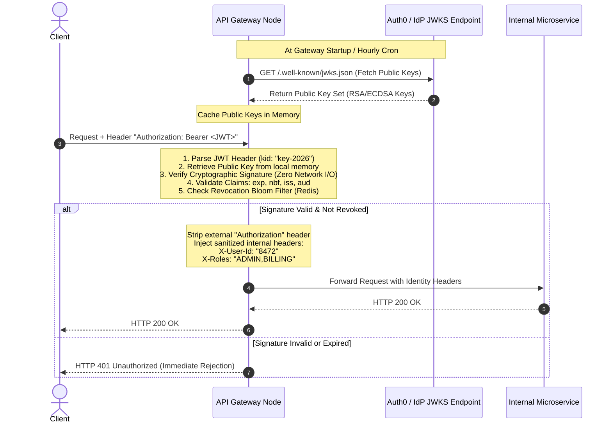

#### Production Zero-Hop Edge Auth Architecture
1. **Asymmetric Cryptographic Signatures (RS256 / ES256)**:
   - The Identity Provider (e.g., Keycloak, Auth0, Okta) signs short-lived (15-minute) JWTs using a private RSA/ECDSA key.
   - The API Gateway downloads and caches the IdP's public keys via its standard **JWKS (JSON Web Key Set)** endpoint at startup and refreshes hourly.
   - Signature verification occurs **entirely in memory on the gateway worker thread** using the cached public key. Total verification time: $<0.2\text{ms}$; external network calls: **zero**.
2. **Instant Token Revocation via Redis Bloom Filters**:
   - While JWTs are stateless, enterprise compliance requires immediate revocation on password reset or account compromise.
   - When a token is revoked, its unique ID (`jti`) is written to a shared **Redis Scalable Bloom Filter** with a TTL matching the token's remaining lifespan.
   - The gateway performs an ultra-fast $O(1)$ memory check against the Bloom filter. If the `jti` is not present, the request proceeds immediately. If a positive match occurs, a secondary check against a standard Redis set confirms revocation.
3. **Internal Identity Injection**:
   - The gateway strips the external `Authorization` bearer token and replaces it with verified, immutable internal HTTP headers (`X-User-Id`, `X-Tenant-Id`, `X-User-Roles`).
   - Downstream microservices trust these headers implicitly because the gateway enforces strict network perimeter security (mTLS), eliminating duplicated token parsing downstream.

---

### Question 4: How do you prevent Cascading Failures and Thread Starvation in an API Gateway during a massive downstream outage?

#### Architectural Answer
When an upstream microservice degrades, it does not fail instantly; it responds slowly, holding open TCP sockets and connection resources.

#### Resiliency Mechanisms
1. **Strict Non-Blocking Event-Driven Architecture (Netty / Envoy)**:
   Migrate off blocking I/O (Tomcat). Asynchronous event loops guarantee that delayed upstream responses tie up zero execution threads; only an inactive file descriptor exists in memory.
2. **Aggressive Upstream Timeout Budgets**:
   Every route must configure a hard connect timeout (e.g., 500ms) and read timeout (e.g., 2,000ms). Never rely on default framework timeouts (which are often infinite).
3. **Bulkheading (Connection Pool Isolation)**:
   Allocate isolated connection pools per upstream service. If the `RecommendationService` is saturated and exhausts its assigned limit of 200 connections, the `OrderService` connection pool (with its own independent 200 connections) remains completely unaffected.
4. **Outlier Detection & Circuit Breaking**:
   Continuously track consecutive 5xx errors or slow requests per upstream host. If an instance fails 5 consecutive requests, eject it from the load balancing pool for 30 seconds. If the entire cluster fails, open the circuit breaker immediately to return cached fallbacks without touching the network.

---

### Question 5: What is the impact of HTTP/1.1 vs. HTTP/2 vs. HTTP/3 (QUIC) on Gateway performance and connection pooling?

#### Architectural Answer

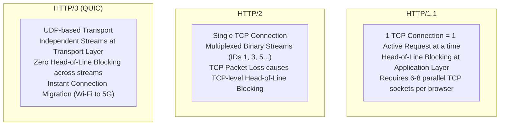

- **HTTP/1.1 Downstream & Upstream**:
  Requires establishing multiple parallel TCP sockets. High overhead from repeated TLS handshakes, large repetitive plain-text headers, and head-of-line blocking.
- **HTTP/2 Between Gateway and Microservices**:
  Drastically reduces operating system file descriptor exhaustion. Thousands of concurrent RPCs are multiplexed over a handful of persistent, warm TCP connections between the gateway and upstream pods. HPACK binary header compression reduces bandwidth by up to 30%.
- **HTTP/3 (QUIC) at the Client Edge**:
  Mobile devices switching between Wi-Fi and cellular networks experience broken TCP connections under HTTP/1.1 and HTTP/2, requiring full reconnection handshakes. HTTP/3 uses UDP with cryptographic **Connection IDs**, enabling **Zero-RTT connection resumption** and connection migration without dropping in-flight API requests. Packet loss on one stream does not stall unrelated streams.

---

### Question 6: In a GraphQL Federated Gateway, how do you prevent the N+1 Query Problem and defend against Maliciously Nested Queries?

#### Architectural Answer

#### 1. Preventing N+1 Subgraph Fan-Out with DataLoader
When a client queries a list of 100 orders and their associated products:
```graphql
query {
  orders(limit: 100) {
    id
    product { id title }
  }
}
```
A naive gateway execution engine would make 1 request to the `Orders Subgraph`, followed by 100 individual requests to the `Products Subgraph` for each product ID.
- **Solution**: The gateway leverages the **DataLoader Pattern**. It pauses resolution across the event loop tick, gathers all 100 product IDs into a single distinct array (`[P1, P2, ... P100]`), and dispatches a single batch entity representation query:
  `query { _entities(representations: [{__typename: "Product", id: "P1"}, ...]) { title } }`.

#### 2. Defending Against Malicious Deeply Nested Queries
Attackers can construct circular, deeply nested recursive queries to trigger an algorithmic denial of service (DoS):
```graphql
query MaliciousDoS {
  user {
    friends {
      friends {
        friends {
          friends { ... } # 50 levels deep
        }
      }
    }
  }
}
```
- **Max Query Depth Limiting**: The gateway parses the GraphQL Abstract Syntax Tree (AST) before execution and rejects any query with an AST depth exceeding a strict threshold (e.g., $>7$ levels).
- **Query Complexity Analysis (Cost Calculation)**: Each field is assigned an integer cost score. Multiplying factors (e.g., `friends(limit: 100)`) multiply the cost of nested fields. If the total calculated score exceeds a maximum budget (e.g., 1,000 points), the gateway rejects the query with an immediate validation error prior to dispatching any downstream requests.
- **Persisted Queries (Query Allowlisting)**: In production mobile and web clients, disable arbitrary dynamic GraphQL queries entirely. Frontends pre-compile their queries during CI/CD, register the SHA-256 hash of each query with the gateway, and send only the hash:
  `POST /graphql { "extensions": { "persistedQuery": { "sha256Hash": "a1b2c3d4..." } } }`.
  The gateway executes only pre-approved, whitelisted queries, rendering arbitrary query injection attacks impossible.

---

### Question 7: How do you achieve true Zero-Downtime Hot Reloading of routing rules in a high-traffic API Gateway?

#### Architectural Answer
In legacy architectures, reloading configuration required executing an OS process signal (such as `kill -HUP $(cat nginx.pid)`). While NGINX handles this gracefully by spawning new worker processes and slowly draining old ones, doing this dozens of times per hour under heavy load causes worker process bloat, memory exhaustion, and severed WebSocket/long-polling connections.

#### The Modern Solution: Dynamic Control Plane Streaming (xDS)
Modern cloud-native gateways (Envoy Proxy) never restart the process or reload worker threads. Instead:
1. **Dynamic Streaming gRPC Sockets**: Gateway data plane instances establish persistent, bi-directional gRPC streams to a centralized Control Plane (e.g., Istio Pilot or go-control-plane).
2. **Versioned Config State Machines**: Configuration is modeled as versioned resources. When a developer registers a new route via Kubernetes Custom Resources or GitOps:
   - The control plane compiles a new `RouteConfiguration` object with a monotonic version ID (`v1042`).
   - The control plane pushes an RDS (Route Discovery Service) update down the gRPC stream.
3. **Atomic Pointer Swapping (RCU - Read-Copy-Update)**:
   - Inside the gateway process, the routing table is stored behind an atomic reference pointer.
   - The worker threads read the current pointer without locking.
   - The main thread parses the new routing table, validates syntax and upstream reachability, and **atomically updates the shared pointer**.
   - Active in-flight requests finish cleanly against the old routing table; all subsequent requests immediately evaluate against the new routing table without dropping a single packet or dropping connections.

---

### Question 8: How do you ensure End-to-End Distributed Tracing across asynchronous boundaries originating from the API Gateway?

#### Architectural Answer
Because an API Gateway aggregates, forks, and translates protocols, maintaining an unbroken causal trace chain is critical for root-cause latency analysis.

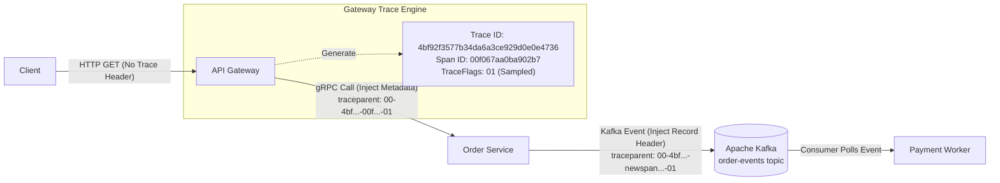

#### The End-to-End Implementation Blueprint
1. **W3C Trace Context Standard**:
   - The gateway adheres strictly to the **W3C Trace Context specification**, inspecting incoming headers for `traceparent` and `tracestate`.
   - If missing (external client entry), the gateway generates a cryptographically random 16-byte `Trace ID` and an 8-byte `Span ID`.
2. **Context Injection Across Heterogeneous Protocols**:
   - **For HTTP/REST downstreams**: Injects `traceparent: 00-{trace-id}-{span-id}-{flags}`.
   - **For gRPC downstreams**: Injects trace context into gRPC metadata (`io.grpc.Metadata`).
   - **For Asynchronous Message Brokers (Kafka / RabbitMQ)**: Injects the trace context directly into the Kafka Record Headers (`org.apache.kafka.common.header.Headers`). When background worker microservices consume messages off the queue, they extract the record header, initialize their tracing tracer as a child span of the gateway span, and continue the trace lineage unbroken.
3. **Intelligent Edge Sampling**:
   - Tracing 100% of 1,000,000 req/sec would generate massive storage costs in tracing backends (Jaeger, Datadog).
   - The gateway implements **Probabilistic Adaptive Sampling**: trace 1% of normal 2xx traffic, but enforce **Tail-Based Sampling** or 100% capture on any request resulting in HTTP 4xx, 5xx, or latency exceeding the 95th percentile SLA threshold ($>500\text{ms}$).
